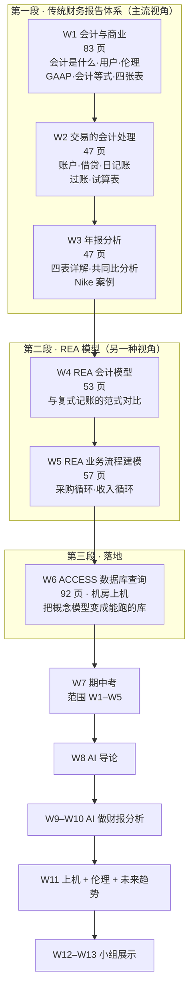

# AC6761 · Artificial Intelligence Accounting · 课程总览

> **当前材料与审修状态（2026-10-26）**：M01–M06 材料 v1.0，M08–M11 v0.9。M01–M05、M08/M09 本次全篇审修已写回；M05 关联/Notion/Git逐项见全库台账。M06 本次全篇独审后正在集中修稿；M10/M11候选独审已接受，正式稿尚未写回。S6前段补M04，01:13:52起M05；10/21的S18/S19仍保留独立时钟与未知接缝。材料版本不证明本人学习或授课完成，个人字段不变。 M08仍无本讲转录、date null；先前6段Windows录音机原件已校验迁入，音频发布及具体来源保存仍按各自台账核实。

> 本课入口。找什么都从这里点。

> 作业、项目及练习入口在 `assignment/00-overview/作业总览.md`；本人材料按现行《备份与公开发布规则》纳入公开范围，第三方名单与凭据仍排除。

**一句话**：MScAIB (P85) 的**商业核心组内选修**（3 学分，13 周，Prof. Kevin ZHU 主讲）。名字叫「AI 会计」，实际结构是 **7 周把零基础的你补成能读财报的人，再用 4 周教你怎么让 AI 替你读**。教授在第一节课的原话立场是：*"AI is a powerful amplifier, but only when you already understand the numbers."*

---

## 🔴 现在最要紧的事

| 时间 | 事项 |
|---|---|
| **约 2026-09-16（第 3 周末）** | **小组名单提交**（3–5 人／组）。**这是本课第一个截止日**，别错过 |
| **2026-10-14（已过）19:00–21:00** | **期中考**，闭卷，考场 **AC1 (Yeung) Y4302 & Y4702**。🎙️ 教授明说范围是 **Week 1–Week 5**，**不考 Week 6 的 ACCESS，也不考 AI** |
| **2026-11-29（具体时刻未给）** | 同业两家上市公司财务比较；PDF正文≤7页，邮件提交（报告10%）；本人Group11名单列11/18展示 |

完整清单见 [[AC6761_Artificial_Intelligence_Accounting/_meta/作业与DDL|作业与DDL]]。

---

## 定位与考核

| 项 | 内容 |
|---|---|
| 课程码 / 学分 | AC6761 · **3 学分** · P5/P6 |
| 开课单位 | Department of Accountancy, College of Business |
| 项目定位 | **MScAIB (P85) 商业核心**（组内选修） |
| 授课教师 | **Prof. Kevin ZHU** ｜ xindozhu@cityu.edu.hk ｜ AC3 13-218 ｜ 3442 4763 |
| 上课时间 | **周三**晚间（W1 = 2026-09-02；期中考最终时段 19:00–21:00，已过） |
| 先修 | **Nil**（不需要任何会计基础） |
| 语言 | 全英文授课与考核 |

**考核构成**

```
持续评估 50%                          期末考试 50%
├─ 课堂参与 10%   讨论 / 个人作业 / 案例   闭卷 · 3 小时 · 全论述与案例题
├─ 小组项目 20%   书面报告 10% + 展示 10%
└─ 期中考   20%   闭卷 · W7 · 范围 W1–W5
```

> ❗ **及格线规则**：**持续评估与期末考试两部分必须分别通过**，任一不过即可能整门课不过。
> 官方目录与 Outline 都写了这条，但**都没给具体百分比**（与 IS5113 的 25% 明文不同）。详见 [[AC6761_Artificial_Intelligence_Accounting/_prep/课程前置资料#3.2 ❗ 两条硬性规则（官方目录与 Outline 都写了）|课程前置资料 › 3.2 ❗ 两条硬性规则（官方目录与 Outline 都写了）]]。

> 🤖 **GenAI 政策**：课堂活动与小组项目**允许**用 GenAI，但**禁止用 AI 代写报告任何部分**；小组项目还必须**署明使用出处并解释为什么采纳该段输出**。期中与期末**一律禁止**。

---

## 六周主题地图（讲义已全部提前放出）

前六周的暂定主线是会计基础、REA与ACCESS，W8再设AI专题；这不表示此前没有AI讨论，W1及S3视频已涉及AI。



**为什么是这个顺序**（🎙️ 教授在 `12:20`–`13:26` 的解释）：W1–W3 先给主流的复式记账体系；W4–W5 换一个视角看会计（REA）；**W6 之所以存在，是因为 REA 纯理论"太难懂也太无聊"，所以要把概念模型落到真实的 ACCESS 数据库里跑一遍**。

---

## 笔记索引

> ✅ **2026-09-09：W3–W5 三篇笔记已产出，期中考范围（W1–W5）的讲义笔记全部齐备。**
> ✅ **2026-10-07 转录融合**：M01–M04 为 v1.0，M05/M06 仍为 v0.9。9 月 30 日实际课堂为 Quiz 1 讲评 → M03 p.28–47续讲 → AI视频 → M04 p.2–29；不能按课表日期把这三段当成 M05。M04 p.30–53 没有直接录音证据，保留完整讲义自学内容且不可降权。
> ✅ **2026-09-10：W2 转录已合并，M02 升 v1.0**；这份转录的前 47 分钟是 W1 顺延的交易 5–11 与一道当堂练习，已回填进 M01 §2.8.5。⚠️ 录音在试算表（p.45–47）之前中断。
> ✅ **2026-09-17：W3 转录已合并，M03 升 v1.0**；这份转录的前 49 分钟是 W2 顺延的课堂练习 2 解答 + 当堂小测 + 试算表/AI 演示（已回填进 M02 §2.6.4），**W3 讲义正文录音只讲到 p.27**（Nike 共同比案例两道练习题的答案已确认），p.28 起（利润表/现金流量表/权益变动表/附注）没有转录佐证。
> ❗ 但按 [[笔记模板#★ 预习可用性：讲义每一页都要有实质讲解（2026-09-09 用户决定）|预习可用性规则]]，**每一页都已在正文实质讲解**（脚本逐页验过），**只靠笔记预习即可**。


| 周 | 日期 | Outline 主题 | 讲义 | 笔记 | 状态 |
|---|---|---|---|---|---|
| **1** | 09-02 | Accounting in Business | `Week 1 PPT.pptx`（83 页） | [[M01-会计与商业]] | ✅ **v1.0**；2026-10-23 全篇重审闭合并正式写回。W1 开头缺失、W2 转录尾部缺失，p.77–83 的课堂覆盖仍未知；材料状态不等于本人已通读 |
| **2** | 09-09 | Accounting for Business Transactions | `Week 2 PPT.pptx`（47 页） | [[M02-交易的会计处理]] | ✅ **v1.0**；2026-10-25 本次全篇重审闭合并正式写回。W2 本源缺尾且缺失长度不可估；W3 补 Case 2 后段、Quiz 1 布置/课堂活动，以及试算表用途与 AI 演示，未录 p.46 三步原文或 p.47 的 45,300 具体表；材料状态不等于本人已通读 |
| **3** | 09-16 | Annual Report Analyses | `Week 3 PPT.pptx`（47 页） | [[M03-年报分析]] | ✅ **v1.0**；原09-16源只到p.27，09-30 S2已补p.28–47；本次更新17格、新增3条明示/反向提醒，具体数字桥仍属笔记验算 |
| **4** | 09-30（录音日期核实，讲义模块4） | REA Accounting Model | `Week 4 PPT.pptx`（53 页） | [[M04-REA会计模型]] | ✅ v1.0（S2/S3/S4 + S6；p.2–53均有相应课堂证据；S6续讲至01:13:46） ；2026-10-25本次全篇重审已写回，含两包新6.1独审/53页/16问/Case4/SQL/12图，限制与同步状态见重审回执 |
| **5** | ⚪09-30（原计划） | REA Business Process Modeling | `Week 5 PPT.pptx`（57 页） | [[M05-REA业务流程建模]] | ✅ v1.0（S6 01:13:52–01:48:21；40课堂格；Case 5完整题面、官解对齐与同源双图；实际授课日期待核） |
| **6** | ⚪10-07 | Accounting Information Querying with ACCESS | `Week 6 PPT.pptx`（92 页） | [[M06-ACCESS数据库构建与查询]] | **当前材料v1.0（2026-10-25并发稿）**；92页，S19后段/R1/S21部分转录；mechanism/readability均pending，本次全篇重审未开始。旧无转录v0.9说明仅属此前状态，个人学习状态未改 |
| **7** | **10-14** | **Mid-term test** | — | — | 范围 W1–W5 |
| 8 | 原排日期仅供计划，实课日期待核 | AI基础与会计技术 | Week 8 PPT.pptx（45页），2026-10-22已下载 | [[AC6761_Artificial_Intelligence_Accounting/notes/M08-AI基础与会计技术\|M08 AI基础与会计技术]] | v0.9，转录 pending、实课日期待核；本次全篇重审已写回，课堂范围未知 |
| 9 | 原排日期仅供计划，实课日期待核 | AI财报分析与利益相关者 | Week 9 PPT.pptx（38页），2026-10-22已下载 | [[AC6761_Artificial_Intelligence_Accounting/notes/M09-AI财报分析与利益相关者\|M09 AI财报分析与利益相关者]] | v0.9/pending/date null；2026-10-26全篇独审/实修/门槛及正文写回完成，38页/5英文原题及条件答案；Apple实际资料/原音/视频仍未核，讲义发布不等于授课完成 |
| 10 | 原排日期仅供计划，实课日期待核 | AI财务分析与比率核验 | Week 10 PPT.pptx（42页）+ Ratio Analysis（16页），2026-10-22已下载 | [[AC6761_Artificial_Intelligence_Accounting/notes/M10-AI财务分析与比率核验\|M10 AI财务分析与比率核验]] | v0.9，转录pending；讲义发布不等于授课完成 |
| 11 | 原排日期仅供计划，实课日期待核 | 财务预测实作与AI伦理 | Week 11 PPT.pptx（39页），2026-10-22已下载 | [[AC6761_Artificial_Intelligence_Accounting/notes/M11-财务预测实作与AI伦理\|M11 财务预测实作与AI伦理]] | v0.9，转录pending；讲义发布不等于授课完成 |
| 12 | 11-18 | Group presentations | — | — | |
| 13 | 11-25 | Group presentations | — | — | 报告截止 |

> 📌 **日期为推算值**：W1 = 2026-09-02（周三），逐周 +7 天，与课件 p.2 写明的期中考日期 10 月 14 日（第 7 周周三）吻合。若遇公众假期顺延，以学校课表为准。

**`M0N` ↔ 原始命名对应**：本课官方用 **Week N**，本库统一用 **M0N**。`M01` = `Week 1 PPT.pptx` = Outline 的 Week 1，其余同理。转录同样用 `M0N-transcript.txt`。

---

> **M03 本次全篇重审（2026-10-25）**：三位 `gpt-6.1-sol` 完整连续独审及缺陷定向复核完成，正文已按 `note-review-v2`、full 门槛原子写回并精确回读，Notion 备注已追加并核全部 16 属性。Nike 外源、A 公司身份及 Note25/33 已补证；原音、Tesla 完整输出、2014 全面重列、60,058／68,140／1 差额及原生 Obsidian 显示边界保留。独立 Case3 练习解析仍待本次重审，不能据本笔记题块升级。

## 转录状态

> **M06 并发处理提示（2026-10-25只读核文件）**：现有部分转录已出现，正文frontmatter为merged/v1.0但教学审查pending；本次M03批不接管或发布M05/M06稿件，来源登记与各端同步由其实际回执另记，不能沿用下方历史表的“始终无转录”。

| 文件 | 覆盖 | 判定 |
|---|---|---|
| `transcripts/M01-transcript.txt` | `00:01 → 02:03:38`（356 段，2h03m42s） | ⚠️ **内容不完整**：录音**从讲课中段开始**（第一句就是复式记账流程的半句话），课件 p.1–2 的课程介绍与考核细则**未被录到**。`01:41:09→01:44:57` 的 3分48秒空档**不是课间**——是教授让学生**自己填 Example #2 表格**的课堂练习时间（`01:41:09` 原话："Do that by yourself. Try to finish this table."），**没有内容丢失**。详见 [[M01-会计与商业#9. 延伸与勘误\|M01-会计与商业 › 9. 延伸与勘误]] |
| `transcripts/M02-transcript.txt` | `00:02 → 01:38:33`（342 段，1h38m31s） | ⚠️ **结尾缺失且缺失长度不可估**：首句已在 W1 顺延的交易 5 中，开头是否短缺及长度仍未知；**前 47 分钟是 W1 内容**（交易 5–11 + 当堂练习），W2 讲义从 `47:45` 起；最后一段 `01:38:33` 是噪声，`01:33:20` 刚布置练习 2，W2 本源没有录到其解答或 p.45–47。后到 W3 与官方 `Case 2 with solution.docx` 已补教学/书面题源，但不反推 W2 尾部时长。三处 ≥2 分钟空档位于布置/做练习活动中，不能证明整堂录音完整。W1 p.77–83 的实际课堂覆盖仍未知；ASR 与原音未核边界见 [[M02-交易的会计处理#9.5 待核对\|M02 §9.5]] |
| `transcripts/M03-transcript.txt` | `00:01 → 01:54:24`（366 段，1h54m23s） | ⚠️ **缺开头**（首句已在讲 T 账户）；**结尾基本完整但末句被截**（`01:54:24` 有下课语，'group name'半句被截）。**前 49 分钟是 W2 顺延**：课堂练习 2 的交易 3–12 与余额方法（`00:01`–`17:43`）+ 当堂小测（`17:43`–`40:14`）+ 试算表内部用途与 AI 演示（`40:14`–`43:54`）；没有录到 p.46 三步原文或 p.47 的 45,300 具体表。`49:04` 起进入 W3 讲义且该旧源只到 p.27；2026-10-07 已用 09-30 S2 补 M03 p.28–47。本行只更新 W2 顺延边界，不改变 M03 的既有教学状态 |

---

### 2026-09-30 追加录音登记（2026-10-07 融合）

| 文件与原录音 | 转录范围/段数 | 实际内容与缺口 |
|---|---|---|
| `M04-transcript-part1-partial.txt`（S2，录音2） | 01:19–55:02，258段；媒体55:32.502秒 | 有效教学06:09起；Quiz1讲评回填M02，25:36–55:02 M03后半；34:16→37:47为自读，前段环境噪声/幻觉不引 |
| `M04-transcript-part2-partial.txt`（S3，录音3） | 00:00–19:48，130段；媒体19:55.201秒 | 视频开头已在中段；07:43教师评价，08:24进入REA；19:45休息 |
| `M04-transcript-part3-partial.txt`（S4，录音4） | 00:00–37:30，235段；媒体40:10.475秒 | 前31秒M03舍入答疑；00:46续M04至p.29与白板；预告下周例子，未录到正式下课 |

三源独立计时，623段；媒体总长1h55m38s仅为录音长度。文件日期/内容支持先后，但课间接缝连续性与未知缺口长度不猜。Quiz1金额冲突边界见M02；上述为三源历史缺口记录。当前S6已确认M04四组答案并补p30–53；Load阈值仍未给，原音/接缝未知保留。

## 与其他课的交叉点

| 交叉主题 | AC6761 在哪 | 对方课在哪 |
|---|---|---|
| **问责与责任** | W1 会计伦理：Enron / WorldCom / Olympus / **SOX 法案**（管理层必须签字、审计师必须验证内控） | **IS5113 W5 Accountability and Liability** —— SOX 是"制度怎么把责任钉到具体的人身上"的**现成先例**，做 IS5113 W5 时可直接引用 |
| **透明性的制度化** | W1 🎙️ **审计意见分级**（clean / with explanatory notes / qualified / adverse） | IS5113 W4 Transparency —— 一套已运行几十年的分级外部鉴证机制 |
| **AI 伦理** | W11 Ethical Considerations（一节课） | IS5113 全课 13 周。**做 AC6761 小组项目直接搬 IS5113 的 FATP 框架** |
| **阈值判断** | W1 重要性水平（materiality）：多小的错可以不披露 | IS5113 W3 Fairness 的阈值选择，是同构问题 |
| **人在环路** | W1 课件 p.7–8：AI 会幻觉，"你是质量过滤器" | IS5113 W4/W5；IS5542 GenAI in Business |
| **财报与比率分析** | W3, W9–W10 | EF5560 / Fintech and AI in Finance |
| **数据建模** | W4–W6 REA → ACCESS | IS6400 BDA 的 SQL / 数据建模 |

---

## 元数据

| 文件 | 用途 |
|---|---|
| [[AC6761_Artificial_Intelligence_Accounting/_meta/知识层级台账\|知识层级台账]] | ★ 连贯性机制。**本课 L0 特别声明：读者会计零基础，所有会计概念都不在 L0** |
| [[AC6761_Artificial_Intelligence_Accounting/_meta/术语表\|术语表]] | 会计术语中英对照 + 港式/内地译法取舍 + 可默写的英文定义 |
| [[AC6761_Artificial_Intelligence_Accounting/_meta/考点库\|考点库]] | 三档可信度（🔴 教授明示 / 🟡 CILO 反推 / ⚪ 笔记推断） |
| [[AC6761_Artificial_Intelligence_Accounting/_meta/作业与DDL\|作业与DDL]] | 全部截止日期与提交要求 |
| [[AC6761_Artificial_Intelligence_Accounting/_meta/待并入术语总表\|待并入术语总表]] | 待主 agent 合并进全库 `_meta/术语总表.md` 的跨课条目 |

## 前置资料

| 文件 | 用途 |
|---|---|
| [[AC6761_Artificial_Intelligence_Accounting/_prep/课程前置资料\|课程前置资料]] | 官方课程目录 × Outline **逐项对校**；及格线、GenAI 政策、13 周表、Keyword Syllabus 缺口 |

## 材料

```
course_files_export/
├─ AC6761 Outline 2627.docx        课程大纲（权威）
├─ Accounting principles.docx      教授补发的四条会计原则例题（对应 W1 p.33）
├─ Transaction analyses for Lecture 1.docx   9/21 补发：W1 FastForward 11 笔官方解答表 → M01 §2.8.4
├─ Case 1 with solution.docx        9/21 补发：SWIFT 8 笔会计等式案例（带解答）→ M01 §7 第 9 题
├─ Case 2 with solution.docx        9/21 补发：GTech 12 笔 T 形账户 + 试算表案例（带解答）→ M02 §7 第 9 题
├─ Case 3 with solution.docx        共同比资产负债表案例（官方题目及答案）
├─ Case 4 with Solution.docx        多重性与关系表（官方题目及答案）
├─ Case 5.docx / Solution of Case 5.pdf   REA 案例及官方答案
├─ Quiz 1 with solution.docx        小测官方题目及答案
├─ AI application in DEBS.docx      课堂 AI 应用材料
├─ 2 Analyze balance sheet.docx     9/21 补发：W3 课堂 AI 演示的提示词原文（Tesla 10-K）→ M03 §2.2.10
└─ Week 1–6 PPT.pptx               六周讲义，共 379 页，W1 一次性放出
transcripts/
├─ M01-transcript.txt              W1 课堂转录（2h03m42s，缺开头）
├─ M02-transcript.txt              W2 课堂转录（1h38m31s，缺结尾；前 47 分钟为 W1 顺延内容）
├─ M03-transcript.txt              原 W3 源（前49分钟为W2顺延；此旧源只到p.27）
├─ M04-transcript-part1-partial.txt  9/30录音2：Quiz1讲评+M03后半（S2）
├─ M04-transcript-part2-partial.txt  9/30录音3：课堂AI视频+M04开场（S3）
├─ M04-transcript-part3-partial.txt  9/30录音4：M03舍入答疑+M04至p.29（S4）
└─ M04-M05-transcript-source6-partial.txt  S6：补M04 p30–53；01:13:52起M05，独立原时钟与未知日期保留
```

> ⚠️ **本课六份 pptx 的 speaker notes 全部为空**（逐页检查过：W1 83 页、W2 47、W3 47、W4 53、W5 57、W6 92，无一页有备注）。`.pptx` 相对 PDF 的备注优势在这门课上**不存在**，唯一的额外收益是能直接取出嵌入的 Excel 表格数据。

## 2026-10-07 Case4材料到位

两页课堂照片已只读保留；私有练习区已完成4题/5个作答单元、中文精读、英文参考作答、关系工作簿及约束核验。官方解答已于 10 月 11 日取得，逐题比对与行政要求仍待核，不将参考作答记为正式可提交，不改变课堂录音缺口。

## Case 1–4 详细解析审修（2026-10-07）

本地私有练习区已补齐 Case 1、2 独立零基础教程，定向补充 Case 3、4 的难句与关键逻辑；每份均有答案、过程、误区、总结和改条件练习。覆盖分别为 8 笔交易、12 笔／12 个 T 账户、23 行／46 个百分比、4 题／5 个作答单元。Case 1–3 的本地官方答案已核；Case 4 私人解析仍为照片版参考解析，官方文件已取得、逐题比对待核。10 月 7 日核对时 Canvas 登录受阻；10 月 11 日已取得官方原件，逐题比对及计分、提交条件仍待核；本人学习与提交不代勾。完整入口在本地作业总览及练习索引，公开页不展开私人答案。

## Case 5 课堂案例登记（2026-10-07）

两页原照片已按附件原名只读保留。完整私人参考解析覆盖收入流程核心模型六步、7 个类、8 条关联、21 项属性及 16 个端点，包含难句白话、模型图、属性归属、重要范围假设、完整分配算例和自测。阅读入口在本地作业总览／练习索引，公开页不复制个人完整答案。

10 月 7 日四入口均转到 CityU SSO；10 月 11 日已读 Files 与公告并取得官方题目及答案，私人解析逐题比对、计分、DDL 和提交要求仍待核；参考解析完成不等于官方确认或可提交。没有更新 M05 的课堂覆盖、转录状态或本人学习／提交勾选。

## 2026-10-15 公开题目与材料更新

2026-10-15 材料状态更新：10 月 11 日已取得 Canvas 的 Case 4 with Solution.docx、Case 5.docx、Solution of Case 5.pdf 和 Quiz 1 with solution.docx；文件已与下载清单 SHA-256 核对一致。官方原件已到位，但私人解析与官方答案的逐题比对仍待完成。10 月 11 日 Assignments / Modules 显示课程已禁用这两个页面；Case 的计分、DDL 与提交要求仍未确认。不能把此前登录受阻当成当前材料缺失，也不代填本人学习或提交状态。

题目入口见 [全库作业与练习题目索引](../_meta/作业与练习题目索引.md)。官方文件含教师答案时保留原件；个人作答、名单与座位表不公开。

10 月 11 日保存的公告另确认：补课为 10 月 31 日 14:00–17:00（LI-4109）；10 月 9 日期中公告说明论述题占 30%、非论述题占 70%。期中日期 10 月 14 日已过去；旧记录的 19:30–21:30 与 9 月 22 日公告的 19:00–21:00 存在口径差异，不据此推断本人应考或提交状态，具体安排以教师最新通知为准。


## 2026-10-15 考试日与录音预期

用户确认2026-10-14为期中考试，当日没有授课，因此没有本周授课录音属于不适用，不能登记成缺录。M05/M06原有材料与录音缺口仍保留；不据此改本人考试、学习、提交或评分状态。

## 2026-10-20 项目现行要求

新原件 `AC6761 Group project.docx`（Canvas file16312020）已下载并核 SHA-256。题目为 *The AI-Powered Financial Analyst: A Comparative Analysis*。在同一行业选两家上市公司，取得双方最近至少两年的年报。报告包括公司/行业概况、含图表的财务定量比较、MD&A/CEO Letter/Risk Factors 等定性比较、每家公司的 Buy/Hold/Sell 建议，以及 AI 方法的局限、偏差和错误。必须加入团队自己的批判性判断。

报告为 PDF，正文最多 7 页，不含封面与参考文献；封面列组号、成员姓名与学号。2026-11-29 前发至 `xindozhu@cityu.edu.hk`，邮件主题注明 `AC6761`；原件未给具体小时，不擅自填 23:59。报告 10%，全员参与的 25–30 分钟展示 10%。`AC6761 group namelist.xls` 当前本地已与 Canvas 哈希一致，本人 LI Binxiong 行为 Group 11、2026-11-18 展示；具体展示时刻未明示。名单只引用本人行，不复制其他同学资料。

上述正式文件替代此前“题目/报告日期/提交渠道待核”和泛称 AI 会计应用的准备方向。旧 Week 13 相对期限及展示周次保留为历史；尚未制作或提交团队报告，不改变本人学习/提交/评分状态。当前文件要求 AI 辅助分析并对 AI 草稿加入批判思考；旧 Outline 对代写的限制和采纳说明仍需结合本次任务区分，不能解释为可不经人工核验直接交 AI 输出。

来源：[新项目文件](https://canvas.cityu.edu.hk/courses/70229/files/16312020)、[10/20 公告](https://canvas.cityu.edu.hk/courses/70229/discussion_topics/640901)、[组号及展示名单](https://canvas.cityu.edu.hk/courses/70229/files/16067043)。四入口核对沿用本日完整下载核对记录：Files 21项，公告5条；Assignments/Modules未在该课导航开放。

## 2026-10-21 转录融合与录音归档

M01–M05为材料v1.0，M06仍v0.9。S6保留同一时钟，前段补M04 p.30–53，01:13:52起M05；6段Windows录音机原件已校验迁入课程目录。

录音新旧名称、来源和缺口见 [[_meta/audio-library/录音索引|全库录音索引]]。本次来源/教学/R疑点与实际同源显示已核对，原生Obsidian与逐声全听校未做；个人学习/提交字段不动。

## 2026-10-22 Canvas 新材料

2026-10-22 实读 Canvas Files 两页共 28 项；21 项与本地已有文件 SHA-256 相同，新增 7 项：Week 8/9/10/11 五份讲义（含 Week 10 Ratio 补充）、Quiz 2 和 ExampleTables1.accdb。没有 Week 7 新讲义，Week 7 为已记录的期中考试。

四篇新笔记为讲义版 v0.9、transcript pending；讲义提前发布不代表已授课。正文按 45、38、42+16、39 页对应共 180 页；无新转录，不改变旧模块状态。Apple 年报未附，相关题给条件式参考解析，不虚构实际财务数值。

- [[AC6761_Artificial_Intelligence_Accounting/notes/M08-AI基础与会计技术|M08 AI基础与会计技术]]
- [[AC6761_Artificial_Intelligence_Accounting/notes/M09-AI财报分析与利益相关者|M09 AI财报分析与利益相关者]]
- [[AC6761_Artificial_Intelligence_Accounting/notes/M10-AI财务分析与比率核验|M10 AI财务分析与比率核验]]
- [[AC6761_Artificial_Intelligence_Accounting/notes/M11-财务预测实作与AI伦理|M11 财务预测实作与AI伦理]]

Quiz 2：[[AC6761_Artificial_Intelligence_Accounting/assignment/practice/M06-Quiz2-按销售员筛选销售|查询步骤与5行结果]]。本批验收及来源限制见 [[_meta/AC6761材料与笔记回执-2026-10-22|回执]]。


## 2026-10-26 Case1 独立解析进度

2026-10-26：Case1独立配套解析完成本次全篇gpt-6.1-sol独审、集中实修/定向关闭、官方8笔与4变式核算、必要图文及门槛写回。8原题/官方After值保留，补12英文参考答案，明确四变式起点，状态表按同一时点拆列。此项仅学习解析验收，task仍draft、行政待核，不代表本人学会/提交；Case2–5不随此升级。

## 2026-10-26 Case2 独立解析进度

2026-10-26：Case2独立解析本次全篇6.1独审、集中实修/定向关闭、官方12分录/12账户/试算与4变式、必要同源图文及full-v2写回完成。原数保留，补权益定义/完整英文题面和12英文余额句，区分发生额与净余额；task仍draft、行政待核，不等于本人学会或提交。Case3–5状态不随本项升级。

## 2026-10-26 Case3 独立解析进度

2026-10-26：Case3独立解析本次全篇6.1独审、集中实修/定向关闭、来源/计算/实际图文及full-v2原子写回完成。23行46比例/全部原金额保留，补完整英文原题与作答口径、Excel首次复做动作及真实D32公式、附录图组含长期投资的读法；原工作簿字节不变。task仍draft、行政待核，不代表本人学会或提交；Case4–5仍待逐篇重审。

## 2026-10-26 Case4 独立解析进度

2026-10-26：Case4独立解析完成本次全篇6.1两阶段独审、一批B1/B2/T1修复及原审定向关闭；官方Word五单元/两照片完整核，Q3b中英先No、拆表单列设计扩展。正文35081bytes及工作簿9文本单元格已过full-v2并CAS原子写/精确回读；原记录/33公式/缓存保持，12SQL新实跑在E副本。三局部图、No中英、原题/新增桥及必要表显示已看，导出前导0完整，预览工具/原生Excel与Obsidian限制保留。任务仍draft，行政与本人学习/提交未升级；Case5仍待全篇重审。

## 2026-10-26 Case5 独立解析进度

2026-10-26：Case5独立解析本次全篇6.1两阶段独审、一批F1–F3修复/定向关闭及full-v2完成。Word33段/两照片/扫描官图7类8关联16端点21属性逐项核，主模型不改值；补完整英文题面、8条双向英文答句、∑及账户集合和两求和方向桥。正文46085bytes、8当前图源/图示记录已CAS原子写/精确回读，历史图示报告不改。数例/R4/本轮10错误例实算，新图/公式/流程/原题实际看；硬0/Cwarn4/Rwarn53，机器与原生Obsidian限制保留。任务仍draft、行政/本人状态不升级；独立解析通过不升级主M05全篇或转录状态。

## 2026-10-26 A01 准备指南进度

2026-10-26：A01 项目任务/准备指南本次全篇 6.1 两阶段独审及 S1–S5 集中修复/定向关闭完成，教师原文块保留。明确先准备 11/18 展示，再按 11/29 报告截止整理 PDF；补集团/母公司来源记录、定性语气与证据、项目 AI 采纳理由。正文教学版 cfecf8a5… 经 full-v2 原子写/精确回读，随后仅中英/数字间空格维护为 d1d454cb…（11066 bytes），非空白字符及原文块相同，不追加教学审查。按本地 brief/Outline 和仅本人名册行核源；本轮 Canvas 四入口均 SSO，最新线上变更未核。指南仍 draft，不等于团队报告完成、可提交或本人已学会/提交；Notion 两既有行及 Git 状态另列。

## 2026-10-26 原创模拟卷解析当前进度

[[AC6761_Artificial_Intelligence_Accounting/assignment/practice/midterm-mock-20261011/答案与中文解析|模拟卷 Q1–Q9 解析]]：2026-10-26：原创模拟卷答案/中文解析本次全篇 6.1 两阶段独审完成，9 题完整原文/全部小问与表均已保留，补借贷和账户桥梁、逐问英文参考；原题条件/金额/分值不变，新增 S6 基本 pattern 与本卷额外画图训练的区别。独立重算 6 次累计、12 分录/12 账户、40,600 试算、6,300 利润、35,300 权益、16 共同比、3 分配/应收 600 和漏 T6 后双侧 39,100；原图 7 类/8 关联/16 端点/5 属性及必要同源图文已核。原生 Obsidian 未直接查看，初始预览漏字与原生 MathML 最终显示分别保留；本人出席/学习/成绩/提交不升级。本项不替同目录导览、M05 全篇或课堂缺录授予通过。

## 2026-10-26 M05 全篇审修当前范围

2026-10-26：M05 按当前 57 页与 S6/S18/S19 所提供材料完成本次全篇高中知识起点独审、集中修复及缺陷定向关闭，正式 306822 bytes / SHA 77b1dc45…已 gate0、CAS 原子写并精确回读。统一资源次数/局部 Supplier 端点依据/简化分录与真实系统/受控派生余额/typically 日期与给定20+1属性/通用骨架和核心模型；补最小 SQL 输入、中间结果、应用生效日边界与逐单元英文。原题/官方端点/19 Mermaid/四 SVG 未改；12图本次实看、7未变扩展图按20261025真实证据承接，四SVG本次实看；SQLite精确查询3截止日新实跑，Access/原生Obsidian未看。W1 引文已回实际转录字面，未逐字核音；S6空档与S18→S19接缝未知、p36–37缺录和图文口径差保留。材料仍 v1.0/merged，不改变本人通读、自测、复习、提交或成绩。
