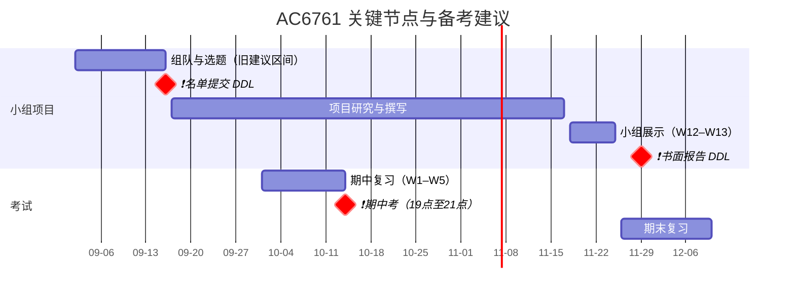

# AC6761 作业与 DDL

> 制作规则：[[作业规范|全局通用规则]] → [[AC6761_Artificial_Intelligence_Accounting/_meta/AC6761作业制作规范|AC6761 课程细则]] → 本地私有 Axx 任务说明。本页维护作业事实与历史来源，不能覆盖制作规则。

> **Case 3（2026-09-30 核对）**：课堂照片及 Canvas `Case 3 with solution.docx` 已取得，完整学习与答案在本地私有 `assignment/practice/`，入口为作业总览／练习索引。23 行、46 个百分比与官方一致。Canvas 未明示本案例的计分、提交及截止，不为它捏造 DDL，也不替本人记录学习或提交。

> 信息来源：`AC6761 Outline 2627.docx`、官方课程目录（2026-09-09 抓取）、**`Week 1 PPT.pptx` p.2（细节最全）**、`transcripts/M01-transcript.txt`。
> ⚠️ **教授对考核的口头说明落在转录缺口里**（录音从讲课中段开始，课件 p.1–2 那段没录到）。下面的细节全部来自课件与官方文件，**没有课堂补充**。

---

## 🔴 最近的截止

### 1. 小组名单提交 —— **第 3 周末（约 2026-09-16 前后）**

| 项 | 内容 |
|---|---|
| 出处 | 讲义 p.2：*"Name list should be submitted **before the end of week 3**"* |
| 要求 | **3–5 人一组** |
| 提交到哪 | ⚠️ **未说明**（Canvas？邮件？）。见 §待核对 |
| 推算日期 | W1 = 2026-09-02（周三），W3 = **2026-09-16**（周三）。"end of week 3" 保守按 **2026-09-16** 掌握，最迟不晚于 2026-09-20（周日） |

> ❗ **这是本课第一个截止日，也是唯一一个在期中之前的。** 组队要在两周内完成。

---

## 全部评估任务

### A. 小组项目 · 20%

| 项 | 内容 | 出处 |
|---|---|---|
| **总权重** | **20%** | 官方目录 / Outline / 讲义 p.2 |
| **拆分** | **书面报告 10% + 小组展示 10%** | 讲义 p.2及当前AC6761 Group project.docx |
| 组队 | 3–5 人 | 官方目录 / 讲义 p.2 |
| 题目 | 当前：The AI-Powered Financial Analyst: A Comparative Analysis；同业两家上市公司、各至少最近两年年报、五节报告 | 当前项目DOCX；目录/Outline原宽泛主题保留为课程背景 |
| **名单 DDL** | **第 3 周末**（约 2026-09-16） | 讲义 p.2 |
| **报告 DDL** | **2026-11-29，具体时刻未给**；PDF正文≤7页，邮件至xindozhu@cityu.edu.hk、主题AC6761 | 当前项目DOCX；旧讲义“end of week13”为历史，不再推算11/25 |
| **展示时间** | 本人Group11名单列 **2026-11-18**，具体时刻未给；全课原安排W12–13 | 当前group namelist.xls本人行；Outline为全课安排 |
| **展示时长** | **约 25–30 分钟**，**每位组员都必须参与** | 讲义 p.2：*"Each of team member has to participate in group presentation"* |
| **GenAI** | ✅ **允许**，但**必须**：① 恰当署明使用了 GenAI 工具；② **解释为什么采纳 GenAI 给出的那一段回答**。❌ **严禁用 AI 代写报告的任何部分** | 官方目录 + Outline |
| **评分标准** | *"Ability to **introduce, interpret, and demonstrate** the application of AI in accounting and related functions."* 五档：Excellent(A) High ｜ Good(B) Significant ｜ Fair(C) Moderate ｜ Marginal(D) Basic ｜ Failure(F) Not even reaching marginal levels | 官方目录 Rubric |

> 💡 **Rubric 的三个动词是选题的约束**：`introduce`（介绍这项 AI 技术）→ `interpret`（解释它在会计里意味着什么）→ `demonstrate`（**展示**它的应用）。**第三个动词最重**——它对应 DEC 的 A3「Accomplishments：产出创造性作品/对真实问题的有效解决方案」。**纯文献综述型的选题在这个 Rubric 下拿不到高分，要有可演示的东西。**

> 💡 **GenAI 要求的第二句才是重点**：*"provide explanation of **why** the piece of response from the GenAI tool is adopted"* —— 它要求你展示**判断**，不只是引用。这恰好呼应讲义 p.7 的"You become the quality filter"。按 2026-10-06 全局规则，先用一句话写实际工具；若本任务现行要求仍要求采纳理由，再补充该理由。不要自行扩展为完整提示词、回答与逐段 AI 分工清单；教师明确要求的内容另按原文处理。

> 🔗 **选题可与 [[AC6761_Artificial_Intelligence_Accounting/00-课程总览#与其他课的交叉点|IS5113]] 复用**：IS5113 的 FATP 框架（Fairness / Accountability / Transparency / Privacy）可以直接拿来给 AI 会计应用做伦理体检，对应本课 W11 的 "ethical considerations"。

---

### B. 课堂参与 · 10%

| 项 | 内容 |
|---|---|
| **权重** | **10%** |
| 形式 | 课堂讨论、**个人作业**、案例解答（讲义 p.2：*"In class discussion, individual assignment or case solution"*） |
| **GenAI** | ✅ 允许用于**信息检索**；❌ **严禁用 AI 撰写任何一部分的评估报告** |
| 评分标准 | *"Ability to **actively participate** in interactive discussions and **contribute to the discovery** of contemporary knowledge and possible developments."* |

> ⚠️ **"individual assignment" 意味着可能有个人作业**，但**至今没有任何具体的作业布置**（W1 转录里没有；也可能在录音缺口那段布置过）。**留意 Canvas。**

---

### C. 期中考 · 20%

| 项 | 内容 | 出处 |
|---|---|---|
| **权重** | **20%** | 三方一致 |
| **日期** | **2026-10-14（周三）** | 讲义 p.2 |
| **时间** | **19:00–21:00**（2 小时） | 9 月 22 日公告；讲义 p.2 的 19:30–21:30 为旧时段 |
| **地点** | **AC1 (Yeung) — Y4302 & Y4702** | 讲义 p.2 |
| **形式** | **闭卷** | 官方目录 / 讲义 p.2 |
| 🔴 **范围** | **Week 1 – Week 5**（🎙️ 教授说了两遍，转录 `13:28`、`14:02`） ❌ **不考 Week 6 ACCESS** ❌ **不考 AI** | 转录 |
| **GenAI** | ❌ **禁止** | 官方目录 |
| 评分标准 | *"Ability to explain the concepts, types, and implementation of AI, as well as the knowledge related to basic accounting concepts."* ⚠️ 前半句与实际范围矛盾，见下 | 官方目录 Rubric |

> ⚠️ **官方 Rubric 与教授口头说法冲突**：Rubric 写着期中要考 AI，但按进度表 AI 到 W8 才讲，教授也明说范围是 W1–W5。**采信教授**，理由见 [[AC6761_Artificial_Intelligence_Accounting/_prep/课程前置资料#4.2 ⚠️ 期中考的范围：Rubric 说考 AI，进度表说 AI 还没讲|课程前置资料 › 4.2 ⚠️ 期中考的范围：Rubric 说考 AI，进度表说 AI 还没讲]]。

**期中复习范围（按进度表）**

| 周 | 主题 | 笔记 |
|---|---|---|
| 1 | Accounting in Business | ✅ [[M01-会计与商业]] |
| 2 | Accounting for Business Transactions（复式记账、借贷、日记账、过账、试算表） | ✅ [[M02-交易的会计处理]] v1.0；2026-10-25 本次全篇重审闭合并正式写回（不代表本人已通读/自测） |
| 3 | Annual Report Analyses（四表详解、共同比分析、Nike 案例） | ⏳ 待产 |
| 4 | REA Accounting Model | ⏳ 待产 |
| 5 | REA Business Process Modeling | ⏳ 待产 |

> ⏰ **距期中还有 5 周**（自 2026-09-09 计）。M02–M05 四篇笔记必须在此之前产出。

---

### D. 期末考 · 50%

| 项 | 内容 |
|---|---|
| **权重** | **50%** |
| **形式** | **闭卷** |
| **时长** | **3 小时**（官方目录：*Examination Duration (Hours): 3*） |
| **题型** | *"Students are required to answer **all the essay and case questions** set in the examination paper."* → **全部是论述题与案例题，没有选择题** |
| **日期地点** | ⚠️ 未公布，学校统一安排 |
| **GenAI** | ❌ **禁止** |
| 评分标准 | *"Ability to provide **good analysis of conceptual and case questions** and demonstrate **excellent presentation** on the provided answers."* |

> 💡 **"excellent presentation on the provided answers" 是一条容易被忽略的得分点**——它指的是**答案的组织与表达**，不只是内容对错。写清楚结构（分点、给小标题、先结论后论证）本身就在 Rubric 里。

---

## ❗ 及格线规则（务必记住）

> **持续评估（50%：课堂 10% + 项目 20% + 期中 20%）与期末考试（50%）必须分别通过。**
>
> 讲义 p.2：*"You must pass **both** the Coursework … **and** the Final in order to pass the course."*
> 官方目录 / Outline：*"Students are required to pass both coursework and examination components to guarantee to pass the course. **Failing either component may lead to failure in the course.**"*

⚠️ **三份文件都没有给出具体百分比门槛**（不同于 IS5113 官方目录里明写的 25%）。**不要自行假定一个数字。**

---

## GenAI 政策速查

| 评估任务 | 允许？ | 限制 |
|---|---|---|
| 课堂参与 / 课堂活动 | ✅ | 仅限**信息检索**；**严禁用 AI 撰写评估报告的任何部分** |
| 小组项目 | ✅ | **必须署明**使用了 GenAI，**并解释为什么采纳**该段输出 |
| 期中考 | ❌ | — |
| 期末考 | ❌ | — |

---

## 时间线

> 📌 **时间线读法**：2026-11-29报告日来自当前项目DOCX，具体时刻未给；全课展示W12–13来自Outline，本人Group11在名单中列11/18。10/14期中考为已核历史节点。名单日与研究/复习条带是旧推算或准备建议，不代表本人已完成，也不是新增官方截止。

---

## 待核对

| # | 事项 | 说明 |
|---|---|---|
| 1 | **小组名单的提交渠道** | 讲义只说"第 3 周末前提交"，未说提交到哪。**去 Canvas 确认**，或直接问教授。<!-- W2转录 --> W2 转录（`00:02`–`01:38:33`）里 `group` / `team` / `submit` 0 命中（唯一的 "No need to submit" 是课堂练习）；**W2 录音尾部缺失**，课末若说过也没录到 |
| 2 | **书面报告的格式要求** | 页数、结构、引用格式一律未说明 |
| 3 | **是否有个人作业** | 讲义 p.2 的课堂参与里提到 "individual assignment"，但**至今未见任何具体布置**。可能在转录缺口那段说过。<!-- W2转录 --> W2 的两道课堂练习都明说**不收**（`21:04` *"I will not collect"*、`01:33:20` *"No need to submit"*），不是作业 |
| 4 | 🎙️ **教授提到的 Word 答题格式文件** | M01 `01:53:19` 与 W2 `20:50`、`35:07`–`35:21` 提到会上传/使用 format。后到的 `Transaction analyses for Lecture 1.docx`、Case 1/Case 2/Quiz 1 DOCX 已在本地，但现有证据未确认哪一个就是该特定模板；不再写成所有相关文件均未取得，也不猜文件身份 |
| 5 | **期末考的日期与地点** | 学校统一安排，学期后段公布 |
| 6 | **及格线的具体百分比** | 三份文件都只说"两部分都要过"，没有数字 |
| 7 | 展示的评分是个人分还是小组分 | 讲义只说"每位组员都要参与"，未说明是否分开评分 |
| 8 | **带解答 DOCX 的行政地位** | Case 1/Case 2、`Transaction analyses for Lecture 1.docx`、`2 Analyze balance sheet.docx` 与后到 `Quiz 1 with solution.docx` 均已在本地并用于教学核对。文件存在/带答案不等于计分或提交；现有材料没有确认 Case 1/2 的独立提交入口或截止。Quiz 1 的课堂收取仅作 participation 证据且本次不评分，不推断本人已交 |

---

<!-- W2转录 -->
## 【W2 转录追加区块】2026-09-09 课堂转录的 DDL / 作业排查结果

> 来源：`transcripts/M02-transcript.txt`（`00:02 → 01:38:33`，342 段）。⚠️ **录音在课堂练习 2 中间中断**（判定依据见 [[M02-交易的会计处理#9.5 待核对|M02 §9.5]]），**课末的任何行政说明都没录到**——与 W1 缺开头正好互补，两次课的行政信息都落在录音之外。

| 项 | 转录里有没有 | 说明 |
|---|---|---|
| 期中考（范围 / 形式 / 题型） | ❌ 0 命中 | `midterm` / `exam`（除 `03:04` 那句审题规则）/ `test`（全是 cash 的误识）均无 |
| 小组名单提交渠道 | ❌ 0 命中 | 见待核对 #1 |
| 个人作业 | ❌ | 两道课堂练习都不收 |
| **课堂练习 1**（交易分析，8 笔） | ✅ `18:21`–`47:21` | *"I will not collect"*（`21:04`）。题面 + 答题格式教授说会上传（`20:50`）。题面与解答已重建在 [[M01-会计与商业#2.8.5 交易 5–11 逐笔展开（讲义 p.63–75）\|M01 §2.8.5]] |
| **课堂练习 2 / Case 2**（算各账户期末余额） | ✅ W2 `01:33:20` 起；W3 `00:01`–`17:43` 顺延 | W2 本源说 *"No need to submit"* 且中途截断；W3 只录到交易 3–12 与余额方法。后到官方 `Case 2 with solution.docx` 已补全题面、12 笔分录、12 个账户和试算表；录音缺段仍保留 |
| 🔴 审题 / 答题讲评 | ✅ | 默认现金有考试语境原话；不写 0 有明确失分原话；编号、正负号、备注和逐笔验平衡包含要求与建议，不合并称完整评分标准。逐项来源见 [[AC6761_Artificial_Intelligence_Accounting/_meta/考点库\|考点库]] W2-1～W2-3 |
| 上传承诺 | ✅（历史原话） | `20:50` *"I will upload this [to Canvas] later"*。相关官方 DOCX 现已取得；本轮不把未核听的渠道词或具体模板对应关系补成确定事实 |

**历史结论更新**：W2 转录没有新增截止日期；范围仍按 W1 的教授口述为 W1–W5。时段后来由 9 月 22 日公告更新为 10 月 14 日 19:00–21:00；练习文件是否取得另按后续材料记录，不再把本段当当前待找清单。

**2026-10-25 M02 同步结论**：本次全篇重审没有发现新的计分任务、截止或提交渠道。Case 2 明示无需提交；Quiz 1 为课堂参与证据、本次不评分。Notion DDL 只做 fresh read 后的“无增量”核对，不新建任务、不改本人提交/评分状态。

---

## 【W3 转录追加区块】2026-09-16 课堂转录的 DDL / 作业排查结果（2026-09-17）

> 来源：`transcripts/M03-transcript.txt`（`00:01 → 01:54:24`，366 段）。前 49 分钟是 W2 顺延内容，`49:04` 起才是 W3 讲义。

| 项 | 转录里有没有 | 说明 |
|---|---|---|
| 🔴 **课堂参与（10%）的记录方式** | ✅ **`17:43`–`22:02`** | **当堂小测**："analyze the company's transaction... also add the ending balance for each account"（`20:29`）；教授明说 *"I will not grade it, but I will collect it as the evidence for your participation"*（`20:58`），要求写名字与学号（`21:08`），随后上传 Canvas（`22:02`：*"I will now upload to the [Canvas]"*）。**⇒ 课堂参与 10% 的证据收集方式 = 当堂随堂测验，收卷但不评分，只作出勤/参与证明。** 已同步登记见下方新增小节 |
| 小组名单提交渠道 | ❌ **仍是 0 命中** | 末段 `01:54:24` *"By the way, if you didn't send a group name"*——只提到"名字"这件事本身，**没有说提交到哪里**。见待核对 #1，**仍未解决** |
| 个人作业 | ❌ 0 命中 | 本讲没有布置新的个人作业 |
| 期中考 | ❌ 0 命中（除已知的 W1–W5 范围） | 没有新信息 |
| 试算表/AI 演示 | ✅ `40:14`–`49:04` | 教授用 Gemini 演示从交易数据自动生成分录与试算表，属于教学内容不是作业，已回填 [[M02-交易的会计处理#2.7.2 试算表（讲义 p.46–47）\|M02 §2.7.2]] |

**结论**：W3 转录**解决了课堂参与 10% 的记录机制**（当堂小测 + 收卷不评分 + 上传 Canvas），但**小组名单提交渠道仍然未知**——这是本课到目前为止唯一一条反复出现却始终没解决的行政信息，**建议直接去 Canvas 或课上当面问**。

### B. 课堂参与 · 10% —— 补充：当堂小测是参与记录方式之一

> 🎙️ **2026-09-17 从 W3 转录确认**：W3 课上（`17:43`–`22:02`）用一道当堂小测作为课堂参与的记录方式——分析一组交易并算出期末余额，**不评分但要收上来、写姓名学号，作为参与的证据**，随后上传 Canvas。这与讲义 p.2 "in class discussion, individual assignment or case solution" 的描述相符（当堂小测属于 case solution 的一种形式）。

---

## 相关

- 课程入口：[[AC6761_Artificial_Intelligence_Accounting/00-课程总览|00-课程总览]]
- 官方口径对校：[[AC6761_Artificial_Intelligence_Accounting/_prep/课程前置资料|课程前置资料]]
- 考点：[[AC6761_Artificial_Intelligence_Accounting/_meta/考点库|考点库]]
- W1 笔记：[[M01-会计与商业]]

---

<!-- W3W4 -->
## 【W3+W4 追加区块】Week 3 / Week 4 讲义的 DDL 与作业排查结果

> 由 W3/W4 的 agent 追加（2026-09-09）。

### ✅ 排查结论：**Week 3 PPT（47 页）与 Week 4 PPT（53 页）里没有任何截止日期、作业要求或提交说明。**

排查方法（两份讲义各 100% 覆盖）：
1. `python-pptx` 提取全部 100 页的文本框、表格、图表数据 —— **无 due / deadline / submit / assignment / group / hand in / Canvas 等字样**
2. **speaker notes 逐页检查 —— 100 页全部为空**（与 [[交接-2026-09-09]] §4.1 记录的"AC6761 六份 pptx 共 379 页、0 页有备注"一致）
3. PowerPoint COM 转 PDF 后 `pdftotext -layout` 复查（用于取出 `python-pptx` 读不到的 4 个嵌入 OLE 对象，W4 p.32–35）—— 同样无
4. 11 + 17 页图片/图形页视觉复核 —— 均为财务报表截图或 UML 图，无行政信息

**⇒ 这两周的讲义是纯教学内容，行政信息一条都没有。**

### ⚠️ 由此产生的一个提醒

[[AC6761_Artificial_Intelligence_Accounting/_meta/作业与DDL|作业与DDL]] 的「🔴 最近的截止」记录 **小组名单要在"第 3 周末（约 2026-09-16）"前提交**，来源是 **W1 讲义 + W01 转录**。
**Week 3 的讲义本身没有再提这件事**，也没有说提交渠道。

⇒ 「待核对」表第 1 条（**提交渠道未知**）**仍然没有解决**。W3 上课时若有口头说明，会落在**尚未导出的 W3 转录**里。
⇒ **建议：不要等转录，直接去 Canvas 查看，或在 W3 课上当面问。**

### 顺带确认的一条

「待核对」表第 4 条（教授承诺的 **Word 答题模板**）—— **W3 与 W4 的讲义里都没有附带任何 Word 模板或对它的引用**。仍需去 Canvas 找。
<!-- /W3W4 -->

---

<!-- W6 -->
## W6（2026-10-07 · Chapter 6 ACCESS 数据库构建与查询）的 DDL 检查结果

> 由 W6 的笔记 agent 追加（2026-09-09）。来源：`Week 6 PPT.pptx`（92 页）。

**结论：本讲讲义没有任何作业、截止日期或提交要求，因此本文件的正表未新增条目。**

**检查方法**（可复现）：对讲义全文（`pdftotext -layout` 92 页 + `python-pptx` 703 行两份提取结果）不区分大小写检索
`deadline` / `due` / `submit` / `assignment` / `group` / `exam` / `midterm` / `quiz` / `homework` / `present`
—— **除 `Example`（例题）与 `Group By`（SQL 关键字）这两类无关命中外，零命中。**

### ⚠️ 但有两件事需要去 Canvas / 课上确认

| # | 事项 | 为什么要确认 |
|---|---|---|
| 1 | **本讲是机房上机课，有没有课堂练习或上机作业？** | 🎙️ W1 转录 `12:56`：*"that's why we have this **computer room** so we have that access software"*。上机课经常有当堂练习，但**讲义一个字没提** |
| 2 | **配套的 Access 数据库文件会不会发下来？** | 讲义用了两个库：`Dunn3-SeChapter6Examples.accdb`（p.5–p.84）与 `Dunn4eChps10-11withqueries.accdb`（p.86–p.92）。**拿不到文件的话，91 页截图只能看不能练** |

### 已确认与本讲相关的既有 DDL（不新增，仅交叉引用）

| 日期 | 事项 | 与 W6 的关系 |
|---|---|---|
| **2026-10-14（周三）19:00–21:00** | 🔴 **期中考**，闭卷，AC1 (Yeung) Y4302 & Y4702 | 9 月 22 日公告确认时段；🎙️ W1 转录 `13:28` 确认范围是 **Week 1–Week 5**、**不含 W6**。期末范围仍未知 |
<!-- /W6 -->

## 🎙️ M02 转录追加（2026-10-07）· 课堂口头信息（转录追加）

| 事项 | 内容 | 来源 |
|---|---|---|
| Quiz 1 讲评与后续练习 | 讲评日期2026-09-30；此次不新增提交渠道或DDL，不把讲评当作本人提交/完成 | S2 `06:09`–`24:54`；旧M03 `20:58`说明小测仅作参与证据 |

## Case 4 课堂照片案例登记（2026-10-07）

已收到两页Case4照片，内容为供应商/采购、采购退回、多重性、客户表原则和收款转关系表。照片版参考作答及实际核验留在本地私有practice；完整个人答案不在此公开页展开。

10 月 7 日 Canvas Files 访问受登录阻塞；10 月 11 日官方题目与答案已取得，计分、截止、提交形式仍未确认；不能继承Case3的旧Canvas状态或标已提交。本案例不改变M04课堂覆盖、本人通读或自测勾选。

## Case 1–4 详细解析审修（2026-10-07）

本地私有练习区已补齐 Case 1、2 独立零基础教程，定向补充 Case 3、4 的难句与关键逻辑；每份均有答案、过程、误区、总结和改条件练习。覆盖分别为 8 笔交易、12 笔／12 个 T 账户、23 行／46 个百分比、4 题／5 个作答单元。Case 1–3 的本地官方答案已核；Case 4 私人解析仍为照片版参考解析，官方文件已取得、逐题比对待核。10 月 7 日核对时 Canvas 登录受阻；10 月 11 日已取得官方原件，逐题比对及计分、提交条件仍待核；本人学习与提交不代勾。完整入口在本地作业总览及练习索引，公开页不展开私人答案。

## Case 5 课堂案例登记（2026-10-07）

两页原照片已按附件原名只读保留。完整私人参考解析覆盖收入流程核心模型六步、7 个类、8 条关联、21 项属性及 16 个端点，包含难句白话、模型图、属性归属、重要范围假设、完整分配算例和自测。阅读入口在本地作业总览／练习索引，公开页不复制个人完整答案。

10 月 7 日四入口均转到 CityU SSO；10 月 11 日已读 Files 与公告并取得官方题目及答案，私人解析逐题比对、计分、DDL 和提交要求仍待核；参考解析完成不等于官方确认或可提交。没有更新 M05 的课堂覆盖、转录状态或本人学习／提交勾选。

## 2026-10-15 公开题目与材料更新

2026-10-15 材料状态更新：10 月 11 日已取得 Canvas 的 Case 4 with Solution.docx、Case 5.docx、Solution of Case 5.pdf 和 Quiz 1 with solution.docx；文件已与下载清单 SHA-256 核对一致。官方原件已到位，但私人解析与官方答案的逐题比对仍待完成。10 月 11 日 Assignments / Modules 显示课程已禁用这两个页面；Case 的计分、DDL 与提交要求仍未确认。不能把此前登录受阻当成当前材料缺失，也不代填本人学习或提交状态。

题目入口见 [全库作业与练习题目索引](../../_meta/作业与练习题目索引.md)。官方文件含教师答案时保留原件；个人作答、名单与座位表不公开。

10 月 11 日保存的公告另确认：补课为 10 月 31 日 14:00–17:00（LI-4109）；10 月 9 日期中公告说明论述题占 30%、非论述题占 70%。期中日期 10 月 14 日已过去；旧记录的 19:30–21:30 与 9 月 22 日公告的 19:00–21:00 存在口径差异，不据此推断本人应考或提交状态，具体安排以教师最新通知为准。

## 2026-10-15 考试日与录音预期

用户确认2026-10-14为期中考试，当日没有授课，因此没有本周授课录音属于不适用，不能登记成缺录。M05/M06原有材料与录音缺口仍保留；不据此改本人考试、学习、提交或评分状态。

## 2026-10-20 项目现行要求

新原件 `AC6761 Group project.docx`（Canvas file16312020）已下载并核 SHA-256。题目为 *The AI-Powered Financial Analyst: A Comparative Analysis*。在同一行业选两家上市公司，取得双方最近至少两年的年报。报告包括公司/行业概况、含图表的财务定量比较、MD&A/CEO Letter/Risk Factors 等定性比较、每家公司的 Buy/Hold/Sell 建议，以及 AI 方法的局限、偏差和错误。必须加入团队自己的批判性判断。

报告为 PDF，正文最多 7 页，不含封面与参考文献；封面列组号、成员姓名与学号。2026-11-29 前发至 `xindozhu@cityu.edu.hk`，邮件主题注明 `AC6761`；原件未给具体小时，不擅自填 23:59。报告 10%，全员参与的 25–30 分钟展示 10%。`AC6761 group namelist.xls` 当前本地已与 Canvas 哈希一致，本人 LI Binxiong 行为 Group 11、2026-11-18 展示；具体展示时刻未明示。名单只引用本人行，不复制其他同学资料。

上述正式文件替代此前“题目/报告日期/提交渠道待核”和泛称 AI 会计应用的准备方向。旧 Week 13 相对期限及展示周次保留为历史；尚未制作或提交团队报告，不改变本人学习/提交/评分状态。当前文件要求 AI 辅助分析并对 AI 草稿加入批判思考；旧 Outline 对代写的限制和采纳说明仍需结合本次任务区分，不能解释为可不经人工核验直接交 AI 输出。

来源：[新项目文件](https://canvas.cityu.edu.hk/courses/70229/files/16312020)、[10/20 公告](https://canvas.cityu.edu.hk/courses/70229/discussion_topics/640901)、[组号及展示名单](https://canvas.cityu.edu.hk/courses/70229/files/16067043)。四入口核对沿用本日完整下载核对记录：Files 21项，公告5条；Assignments/Modules未在该课导航开放。

## 🎙️ M05 转录追加（2026-10-21）· 课堂口头信息（转录追加）

| 事项 | 内容 | 来源 |
|---|---|---|
| 期中题型补充 | 2 小时；两教室；将另发 seating plan；题型类似上传的 Cases / Quizzes | S6 `01:46:15`–`01:47:33`；本转录不提供绝对日期，不由“next Wednesday”推断 |

## 2026-10-21 S6录音补证（历史复盘）

Core pattern、给骨架填关联名/属性/PK/多重度、关联属性降权及概念举例要求已按S6补入M04/M05与Notion期中考要求。此为已过考试的教学范围补证，不产生新DDL；当前已核行政时间及本人出席/成绩/提交状态不改。

## 2026-10-22 Canvas 新材料

Quiz 2 原件已到：基于 ExampleTables1 查询 E-10 的销售，保存 QueryA，并按题面邮件交更新后的数据库。题面未明示计分或截止，本轮未发送、未生成本人已提交记录。解析与实际5行结果：[[AC6761_Artificial_Intelligence_Accounting/assignment/practice/M06-Quiz2-按销售员筛选销售|Quiz 2 解析]]。

小组项目文件与本地版本 SHA-256 一致，最新公告仍为10/20：展示从Week11开始，报告11/29前邮件交，具体小时未给。补课10/31 14:00–17:00 LI-4109沿当前公告，未新增其他DDL。Files 28项、Announcements 5条；Assignments禁用；Modules重定向首页。

## 2026-10-25 分散录音融合

本源只录到Quiz2操作/上传入口；完整题面、截止与计分不由录音补造。纸笔SQL题型与软件点击分开。现有已核Quiz2材料及本人提交状态保留，不代提交。

## 2026-10-26 Case4 来源核对更新

[[AC6761_Artificial_Intelligence_Accounting/assignment/practice/M04-Case4-多重性与关系表|Case4独立解析]]与本地官方Word已逐问对照：Q1/Q2端点、Q3a实体完整性、Q3b No、Q4四行外键均一致；正文与工作簿完成本次全篇审修。下方/上方10月历史“逐题待核”仅保留当时事实；Case5仍待逐篇核。此次没有新增计分/截止/格式/提交证据，Canvas四入口未实时刷新，不创建未知DDL、不改本人提交/评分。

## 2026-10-26 Case5 本地官图与解析核对更新

[[AC6761_Artificial_Intelligence_Accounting/assignment/practice/M05-Case5-销售与收款REA核心模型|Case5完整原题/模型/中英解读]]已全篇审修，并与本地Case5.docx及SolutionofCase5.pdf逐项核对7类/8关联/16端点/21属性。10月旧“逐题待核”保留当时事实，当前本项本地官图核对已完成；没有新增计分/截止/格式/提交证据，Canvas四入口未实时刷新。不新建未知DDL、不改本人提交评分，也不升级M05主笔记审查。

## 2026-10-26 A01 准备指南与来源边界

[[AC6761_Artificial_Intelligence_Accounting/assignment/graded/A01-ai-accounting-project/notes/任务说明|A01 准备指南]] 已全篇审修及原子回读；本轮校读项目 Word/Outline 并仅核本人名册行，Group 11/11/18 未变，报告不晚于 11/29、无小时。本项目须满足团队批判判断及 Outline 小组项目 20% 行的 GenAI 披露/为何采纳；10% 课堂活动行的禁写限制不泛套。四个 Canvas 入口本轮均 SSO，未获得最新公告或附件，不能由旧禁用/下载记录推断现在无变更；任务仍 draft，未代选公司、未制作/发出团队报告，不更改本人提交/评分。

## 2026-10-31 · 项目与补课口头增量

S23 `15:55`–`19:36`：五部分完整题面仍查正式任务；本人验证与讨论，不直接copy-paste AI输出。正文≤7页，参考文献、封面、目录、附录prompt不计正文，合成单一PDF。与原任务的截止/渠道分开，无新绝对截止；两AI同答不替原始来源核验。

S23 `20:00`–`20:20`某周六14:00–17:00、AC2 4109，实际录制日未知，不能推日历日期或新建确定DDL。既有本人展示/提交/评分不改。
