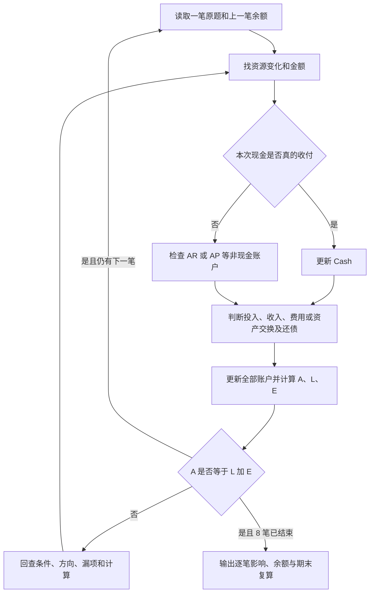

# M01 · Case 1：逐笔交易与会计等式

SWIFT 是一家送货服务公司。你要追踪它从开业到完成 8 笔交易后，手里有什么、欠别人多少、属于所有者的份额是多少。每做一笔都要更新余额，并证明两边仍相等；不是只算最后剩下多少现金。

本篇是私人学习与核验材料。原题与官方答案来自 `AC6761_Artificial_Intelligence_Accounting/course_files_export/Case 1 with solution.docx`。官方逐笔金额已核对；下文账户拆分、白话解释与迁移题是学习补充。Canvas 当前登录受阻，是否需要提交、是否计分、DDL 和提交方式均待核。本篇可供练习，不代表个人是否已经学会得到验证。

[[AC6761_Artificial_Intelligence_Accounting/assignment/00-overview/作业总览|回作业总览]] · [[AC6761_Artificial_Intelligence_Accounting/assignment/practice/练习索引|Case 1–4 解析入口]]

## 1. 题目到底让你做什么

原题：

> Analyze the following transactions for SWIFT, a delivery service, for the month of January 2025. Use the accounting equation to show the effect of each transaction and ensure it balances after each step.

白话：分析 SWIFT 在 2025 年 1 月的以下交易。每笔都用“资产 = 负债 + 权益”展示影响，每一步结束都要平衡。

题意对应的解题产物是：8 行交易影响、8 行交易后余额，以及每行的等式核对。这里说的是题面要求你计算什么，不是已确认的 Canvas 提交要求。只列最后的现金不能完成题意；只列正负数却没有交易后余额，也看不出前面错误怎样传到了后面。

金额沿用原题的 `$` 符号；原文件未明示具体币种，不自行认定 USD 或 HKD。下表及后文数值使用同一题面金额单位；数学式只写数值以便阅读。

## 2. 先理解三种东西，再动手算

公司与 Eddie Johnson 本人要分开看。Eddie 的个人钱包不属于公司账本；钱投进 SWIFT 以后，才进入这道题的公司账户。否则“所有者投入”与“公司收入”会混成一件事。

### 2.1 资产：公司现在控制、未来有用的资源

资产（Assets）不只是现金。送货车能在以后送货，办公用品和燃油能在以后使用，客户欠款代表公司有权收钱，它们也可能是资产。本题会用到 5 个资产账户：

| 账户 | English | 在本题中具体指什么 |
|---|---|---|
| 现金 | Cash | SWIFT 已持有的钱 |
| 送货车 | Vehicle / Delivery van | 花钱买到、可持续用于送货的车 |
| 办公用品 | Office supplies | 已购入的办公用品，本题未提供耗用信息 |
| 燃油 | Fuel | 已赊购的燃油，官方表按购入资产处理 |
| 应收账款 | Accounts receivable，AR | 服务已经提供，客户尚未付的欠款 |

“资产总额”是这 5 个账户的合计，不是 Cash 账户余额。例如现金 5,000 加车 15,000，仍有资产 20,000；公司现金少了，但得到车作为另一种资源。

### 2.2 负债：公司现在欠外部人的义务

负债（Liabilities）是公司因已经发生的事项而承担的付款等义务。本题只有应付账款（Accounts payable，AP）：向 FuelCo 买燃油先不付钱，于是欠供应商钱。

应收与应付的方向相反：AR 是“别人欠公司”，属于资产；AP 是“公司欠别人”，属于负债。看清公司站在哪一边，比死背“账款”两个字可靠。

### 2.3 权益：扣除外部债务后，归所有者的剩余份额

权益（Equity）是资产中扣除负债后的剩余权益。它不是某个单独的钱袋，也不等于银行现金。所有者投入资本会增加权益；经营收入减去费用得到的利润也会增加权益。本题没有所有者提款，因此两条增加路径要分开算：

$$
E = C + R - X
$$

| 符号 | 含义 | 本题对应内容 |
|---|---|---|
| $E$ | 权益总额 | 所有者对净资产的剩余份额 |
| $C$ | 投入资本（Capital） | Eddie 投入的 20,000 |
| $R$ | 收入（Revenue） | 已完成的送货服务带来的 3,000 和 2,500 |
| $X$ | 费用（Expenses） | 本题确认的租金费用 800 |

收入是经营活动赚到的金额；费用是为经营而已经耗用的资源。本题将“买到车”“买到用品”“买到燃油”与“已发生租金费用”区分处理。不能看到付款就一律记费用，也不能看到收款就一律记收入。

### 2.4 为什么资产一定等于负债加权益

会计等式是：

$$
A = L + E
$$

$A$ 表示资产总额，$L$ 表示负债总额，$E$ 表示权益。它把同一个公司从两面描述：左边是公司控制的资源；右边是这些资源中外部债权人的份额与所有者的剩余份额。既然 $E=A-L$，移项就得到 $A=L+E$。

例如公司有资源 21,000，其中欠供应商 1,000，剩余权益就是 20,000，所以 $21,000=1,000+20,000$。这不表示债权人与所有者分别拿着对应数量的现金；资源可能已经是车、用品或燃油。

每笔合法记录都要保持这个关系。对应的变化必须满足：

$$
\Delta A = \Delta L + \Delta E
$$

$\Delta$ 读“变化量”，增加写正数，减少写负数。两边都是 0 也算有交易：现金减 15,000、车增 15,000，资产总额净变化为 0，但资产构成已经改变。

## 3. 怎样从一句英文得到一行账

拿到每笔交易时，先读动作与条件，再更新上一笔的状态，不要先靠“收钱 / 付钱”的直觉猜收入费用。

1. 找公司得到了什么、失去了什么；金额是多少。
2. 检查是否已经付现金或收到现金。`cash` 明确即时现金往来；`on credit` 表示这次先赊账，而不是用了某种信用卡。
3. 检查是不是所有者投入、已提供服务、已耗用资源、偿还旧欠款，或仅仅买入一种资产。
4. 将影响写到账户里，再汇总为资产、负债、权益的变化。
5. 用上一笔余额加本笔变化；检查 $A=L+E$，再继续下一笔。第 8 笔处理完并核对总账后停止，不自行补入折旧、燃油消耗、利息或其他题面没有的交易。

注意，平衡是必要检查，不能证明账户分类全对。例如把老板投入同时写成“Cash +20,000、收入 +20,000”，等式仍平衡，却把资本错误地变成经营收入。还要核对经济含义。

## 4. 8 笔原题逐句拆解，并保留每一步状态

开始前各账户为 0。本题描述开业后这 8 笔交易，因此从这个初始状态顺序更新。下面每笔的 A / L / E 总额都与官方 `After` 行核对；分账户状态是根据原题动作拆出的学习辅助。

### 第 1 笔：老板投入现金，不是公司做生意赚的钱

> On January 1, 2025, Eddie Johnson invested \$20,000 cash to start the business.

`On January 1, 2025` 是发生日期；`Eddie Johnson invested` 指 Eddie 以所有者身份投入；`$20,000 cash` 是实际投入公司现金；`to start the business` 说明目的是开业。白话：1 月 1 日，老板把 20,000 现金交给 SWIFT 作为开业资本。

输入：所有者投入现金 20,000。动作：Cash 增 20,000，Capital 增 20,000。因此资产增 20,000、权益增 20,000、负债不变。

为什么不是收入？SWIFT 没有为此向 Eddie 提供送货服务；钱来自所有者投入，而不是经营赚取。为什么不是负债？题面说 invested，没有说借款或约定偿还。若题面改成 borrowed，才会走负债路径。不能只因都是收进现金就混用。

| 交易后账户 | Cash | Vehicle | Supplies | Fuel | AR | AP | Capital | 累计收入 | 累计费用 |
|---|---:|---:|---:|---:|---:|---:|---:|---:|---:|
| 第 1 笔后 | 20,000 | 0 | 0 | 0 | 0 | 0 | 20,000 | 0 | 0 |

$$
A=20,000,\quad L=0,\quad E=20,000;\qquad 20,000=0+20,000
$$

这一步建立了后续购买资产的资金基础；接下来花掉现金不一定让权益减少。

### 第 2 笔：现金换车，资源总额不变

> Purchased a delivery van for \$15,000 cash.

`Purchased` 是已经购买；`a delivery van` 是送货车；`for $15,000 cash` 表示这次用 15,000 现金买车。白话：公司花 15,000 现金得到一辆送货车，没有在本笔留下一笔欠款。

输入：原来 Cash 20,000，用 15,000 买车。动作：Cash 减 15,000 成为 5,000；Vehicle 增 15,000。资产变化是 $-15,000+15,000=0$；负债和权益均不变。

为什么不是立即产生 15,000 费用？公司取得了以后可用来送货的车，并没有在这一刻把车全部耗用掉。比如把钱换成一台可以使用多年的机器，不能因付款就说全部价值当日消失。未来可能产生折旧费用，但本题没有年限、残值、期间等条件，也没有要求计提折旧，因此不能额外扣除。

| 交易后账户 | Cash | Vehicle | Supplies | Fuel | AR | AP | Capital | 累计收入 | 累计费用 |
|---|---:|---:|---:|---:|---:|---:|---:|---:|---:|
| 第 2 笔后 | 5,000 | 15,000 | 0 | 0 | 0 | 0 | 20,000 | 0 | 0 |

$$
A=5,000+15,000=20,000;\qquad 20,000=0+20,000
$$

这一步提醒你：现金余额与资产总额必须分别看，否则会误以为公司只剩 5,000 的资产。

### 第 3 笔：买办公用品，还没有题面证据说已经用完

> Purchased office supplies for \$500 cash.

`office supplies` 是办公用品，如可供以后使用的纸张；`for $500 cash` 表示当场支付 500 现金。白话：用 500 现金换来办公用品。

输入：Cash 5,000，购买用品 500。动作：Cash 减到 4,500，Supplies 从 0 增到 500。资产内部一减一增；资产总额、负债与权益不变。

为什么不是办公费用？原题只说买入，没有说本月耗用了多少，官方也明确写资产 $-500+500$。例如买入一箱纸尚放在柜里，它仍是未来可用的资源；后来真正用了其中价值 100 的纸，才可以按该使用条件讨论 Supplies 减 100 和用品费用增 100。这个使用例子是补充，不是原题第 3 笔的事实。

| 交易后账户 | Cash | Vehicle | Supplies | Fuel | AR | AP | Capital | 累计收入 | 累计费用 |
|---|---:|---:|---:|---:|---:|---:|---:|---:|---:|
| 第 3 笔后 | 4,500 | 15,000 | 500 | 0 | 0 | 0 | 20,000 | 0 | 0 |

$$
A=4,500+15,000+500=20,000;\qquad 20,000=0+20,000
$$

这里与买车同样是资产交换，但不要因此忽略用品以后可能被耗用；本题只记录已给出的购买动作。

### 第 4 笔：赊购燃油，得到资产也欠供应商钱

> Purchased fuel on credit for \$1,000 from FuelCo.

`Purchased fuel` 是购入燃油；`on credit` 修饰购买条件，指现在拿到燃油、暂不付款；`for $1,000` 是燃油交易金额；`from FuelCo` 表示供应商是 FuelCo。白话：向 FuelCo 买来 1,000 的燃油，这次先欠着货款。

输入：购入 1,000 燃油、未付款。动作：Fuel 增 1,000，AP 增 1,000；Cash 仍为 4,500。资产与负债同增 1,000，权益不变。

本题的关键限制是：官方表明确写资产 +1,000、负债 +1,000，按购入燃油资产的口径处理。原题没有提供燃油耗用量；不能凭“送货肯定要用油”自行把这笔改成燃油费用。Fuel 账户是解释官方资产变化的学习拆分，并不是官方表单独列出的账户名。

例如赊购一桶尚未使用的油，公司多了油，也多了付款义务；以后用掉油才涉及耗用。若题面明确说燃油已全部耗用，答案就需要另作处理，见迁移题。欠款增加本身不会降低权益：公司同时得到等值资源。

| 交易后账户 | Cash | Vehicle | Supplies | Fuel | AR | AP | Capital | 累计收入 | 累计费用 |
|---|---:|---:|---:|---:|---:|---:|---:|---:|---:|
| 第 4 笔后 | 4,500 | 15,000 | 500 | 1,000 | 0 | 1,000 | 20,000 | 0 | 0 |

$$
A=4,500+15,000+500+1,000=21,000;\qquad 21,000=1,000+20,000
$$

这笔建立了 FuelCo 的应付账款。第 8 笔的 partial payment 就是在偿还这里产生的欠款。

### 第 5 笔：服务已完成并收现，现金与收入同时增加

> Provided delivery services and received \$3,000 cash.

`Provided delivery services` 指送货服务已经提供；`and received $3,000 cash` 指同时收到 3,000 现金。白话：公司完成送货，客户当场付了 3,000。

输入：已完成服务、已收现金。动作：Cash 增 3,000，从 4,500 到 7,500；服务收入增 3,000，使权益增 3,000。负债不变。

与第 1 笔的收款不同，这次客户付钱是为了公司已经提供的服务，所以属于经营收入。也不是客户预付款：原题写的是 provided，服务已经提供；不能把它误写为“公司仍欠客户未来服务”的负债。服务收入使公司增加净资源，而无需承担等额偿还义务，因此增加所有者剩余份额。

| 交易后账户 | Cash | Vehicle | Supplies | Fuel | AR | AP | Capital | 累计收入 | 累计费用 |
|---|---:|---:|---:|---:|---:|---:|---:|---:|---:|
| 第 5 笔后 | 7,500 | 15,000 | 500 | 1,000 | 0 | 1,000 | 20,000 | 3,000 | 0 |

$$
A=24,000,\quad E=20,000+3,000=23,000;\qquad 24,000=1,000+23,000
$$

服务是否已提供决定收入路径；现金是否已收到决定现金还是应收路径。第 7 笔会把这两个判断分开。

### 第 6 笔：已发生的租金费用，使现金与权益减少

> Paid rent expense for office space \$800 cash.

`Paid` 指已经支付；`rent expense for office space` 明确是办公室租金费用；`$800 cash` 是这次付出 800 现金。白话：公司用现金支付办公室租金费用 800。

输入：已发生租金费用且付现。动作：Cash 减 800，到 6,700；累计费用增 800。费用从收入中扣减，所以权益减少 800，成为 $20,000+3,000-800=22,200$。

为什么不像车一样增一个资产？本题明确使用 rent expense，按已经发生的费用处理；没有说支付未来期间的预付租金。为什么负债不减？题面没有给出先前的租金欠款，不是偿还旧 AP。这里不能为了凑“付钱必还债”而创造一笔不存在的负债。

注意“费用增加”与“权益减少”是同一记录的两个观察角度，不能把权益再扣两次。费用账户累计 800，权益公式中减去这 800。

| 交易后账户 | Cash | Vehicle | Supplies | Fuel | AR | AP | Capital | 累计收入 | 累计费用 |
|---|---:|---:|---:|---:|---:|---:|---:|---:|---:|
| 第 6 笔后 | 6,700 | 15,000 | 500 | 1,000 | 0 | 1,000 | 20,000 | 3,000 | 800 |

$$
A=23,200,\quad E=22,200;\qquad 23,200=1,000+22,200
$$

目前利润是 $3,000-800=2,200$，与现金 6,700 不相等；现金里仍包含老板投入和购买资产的影响。

### 第 7 笔：赊销服务，有收入但还没有现金

> Provided delivery services on credit for \$2,500 to a customer.

`Provided delivery services` 指已经完成服务；`on credit` 指给客户赊账，允许客户以后支付；`for $2,500` 是服务价款；`to a customer` 明确客户是欠钱的一方。白话：送货已完成，赚到 2,500，但客户暂未付款。

输入：已完成服务 2,500、尚未收钱。动作：AR 增 2,500，Cash 保持 6,700；累计收入增到 5,500，使权益再增 2,500，达到 24,700。

为什么 AR 是资产？公司已经取得向客户收取价款的权利，虽然这项权利尚未变成现金。为什么收入现在就记？本题按已提供服务确认收入的口径处理，即权责发生制：收入确认不机械等到收钱。若送货完成后客户下周付款，本周仍已完成赚钱的服务；下周只是把应收变成现金，不能同一服务赚两遍。

为什么不是 AP？这一笔是客户欠 SWIFT，方向与第 4 笔 SWIFT 欠 FuelCo 相反。`on credit` 单独出现不告诉你应收还是应付，必须一起读“公司买了什么”或“公司提供了什么”。

| 交易后账户 | Cash | Vehicle | Supplies | Fuel | AR | AP | Capital | 累计收入 | 累计费用 |
|---|---:|---:|---:|---:|---:|---:|---:|---:|---:|
| 第 7 笔后 | 6,700 | 15,000 | 500 | 1,000 | 2,500 | 1,000 | 20,000 | 5,500 | 800 |

$$
A=25,700,\quad E=20,000+5,500-800=24,700;\qquad 25,700=1,000+24,700
$$

这笔说明赚到的利润与收到的现金不是同一个数字。期末的应收账款也因此必须列入资产。

### 第 8 笔：partial payment 是部分还旧债，不是再买一次燃油

> Paid FuelCo \$500 cash for partial payment.

`Paid FuelCo` 是付给供应商 FuelCo；`$500 cash` 是实际支付金额；`for partial payment` 表示部分清偿，结合第 4 笔可确定是偿还原来的 1,000 燃油欠款中的 500。白话：这次还掉一半，剩余 500 继续欠着。不能把 partial 理解为这次购买半份新燃油。

输入：AP 原来 1,000，偿还 500。动作：Cash 从 6,700 减为 6,200；AP 从 1,000 减为 500。资产减 500、负债减 500；权益不变，Fuel 仍是 1,000。

为什么不是再记 500 费用？钱付出去的原因是解除之前已记录的付款义务，没有给出新的资源耗用。第 4 笔已经记录了购入燃油；第 8 笔只是结清其中一部分欠款。若再增加燃油资产，就会把同一批燃油重复记入；若再扣费用，就会把偿债误作新经营成本。

| 交易后账户 | Cash | Vehicle | Supplies | Fuel | AR | AP | Capital | 累计收入 | 累计费用 |
|---|---:|---:|---:|---:|---:|---:|---:|---:|---:|
| 第 8 笔后 | 6,200 | 15,000 | 500 | 1,000 | 2,500 | 500 | 20,000 | 5,500 | 800 |

$$
A=25,200,\quad L=500,\quad E=24,700;\qquad 25,200=500+24,700
$$

8 笔已全部记录，到这里结束。接下来用分账户复算确认没有漏项，而不是继续添加推测中的业务。

## 5. 官方三列表与自己算出的细账怎样对上

官方只列资产、负债、权益三类的变化及余额；本篇细账用于解释这些数怎么来。空白影响按“无变化”读，不能读成账户余额是 0。

| 交易 | 资产变化 $\Delta A$ | 负债变化 $\Delta L$ | 权益变化 $\Delta E$ | 交易后 A | 交易后 L | 交易后 E |
|---|---:|---:|---:|---:|---:|---:|
| 1 | +20,000 | 0 | +20,000 | 20,000 | 0 | 20,000 |
| 2 | −15,000 +15,000 = 0 | 0 | 0 | 20,000 | 0 | 20,000 |
| 3 | −500 +500 = 0 | 0 | 0 | 20,000 | 0 | 20,000 |
| 4 | +1,000 | +1,000 | 0 | 21,000 | 1,000 | 20,000 |
| 5 | +3,000 | 0 | +3,000 | 24,000 | 1,000 | 23,000 |
| 6 | −800 | 0 | −800 | 23,200 | 1,000 | 22,200 |
| 7 | +2,500 | 0 | +2,500 | 25,700 | 1,000 | 24,700 |
| 8 | −500 | −500 | 0 | 25,200 | 500 | 24,700 |

这里 8 行余额与 DOCX 官方 After 1–8 一致。资产交换的两项必须保留，才能看出资产总额虽然不变、构成却变了。

### 5.1 期末按账户从头复算

现金只收进了老板投入和第 5 笔现销；第 7 笔赊销不能混进来：

$$
\text{Cash}=20,000-15,000-500+3,000-800-500=6,200
$$

若得到 7,200，常见原因是漏扣第 3 笔用品 500 与第 8 笔还款 500；仍须逐项回查，不能只凭结果猜错在哪。

$$
\text{Vehicle}=15,000,\quad \text{Supplies}=500,\quad \text{Fuel}=1,000,\quad \text{AR}=2,500
$$

$$
A=6,200+15,000+500+1,000+2,500=25,200
$$

$$
\text{AP}=1,000-500=500
$$

$$
\text{Profit}=\text{Revenue}-\text{Expenses}=3,000+2,500-800=4,700
$$

$$
E=\text{Capital}+\text{Profit}=20,000+4,700=24,700
$$

最后：

$$
25,200=500+24,700
$$

### 5.2 利润、资本、权益、现金分别回答什么

| 数字 | 它回答的问题 | 为什么不能换成另一个数字 |
|---|---|---|
| Capital 20,000 | 老板投入了多少？ | 投入不是经营收入，不计入利润 |
| Revenue 5,500 | 已提供服务赚取了多少收入？ | 含未收现金的 2,500 |
| Profit 4,700 | 收入扣除题面确认费用后赚了多少？ | 不是全部现金净流入 |
| Equity 24,700 | 扣除负债后所有者份额是多少？ | 包含原始资本和本题利润 |
| Cash 6,200 | 公司现在实际持有多少现金？ | 大量资源已变成车、用品、燃油和应收 |

上述 4,700 是这 8 笔及官方口径下的练习利润；不是对真实公司完整月度报表的推定。若有额外已耗用燃油、折旧或其他费用，需要题面或可靠材料提供条件后另算。

## 6. 容易混淆的英文与动作速查

| 看见什么 | 白话判断 | 通常影响哪些账户 | 不能直接推出什么 |
|---|---|---|---|
| invested cash | 老板投入现金 | Cash ↑，Capital / E ↑ | 不能说是收入 |
| purchased ... for cash | 现金购买指定资源 | Cash ↓，所购资产 ↑ | 不能只因付款就说费用 |
| purchased ... on credit | 公司先拿货、后付款 | 购入资产 ↑，AP ↑ | 不是 AR，也不是此刻付现 |
| provided services and received cash | 服务已做、钱已收 | Cash ↑，Revenue / E ↑ | 不是所有者投入 |
| provided services on credit | 服务已做、客户欠钱 | AR ↑，Revenue / E ↑ | 不是没有收入，也不是 AP |
| paid rent expense | 已发生租金费用并付款 | Cash ↓，Expense ↑，E ↓ | 不创造题面没给出的预付款 |
| partial payment to supplier | 偿还旧应付的一部分 | Cash ↓，AP ↓ | 不是新购货或新费用 |
| only（条件阅读补充） | “只有 / 仅”，限制范围 | 要看 only 限定的对象 | 原题这 8 句没有 only，不能自行补入限制 |

例如补充句 “received only $1,000 of the $2,500 due” 指只收回欠款中的 1,000，剩余 AR 为 1,500，不表示本次新赚收入 1,000。only 不能脱离它修饰的金额和对象单独记成规则。

解题时的两类警讯：一是等式不平衡，可能漏了对应账户或算错方向；二是等式平衡但经济含义错误，例如把资本当收入、把还债当费用。前者回查数值，后者回读 invested、provided、on credit、partial payment 等条件。不能单靠给一边补一个数字让等式看起来平衡。

## 7. 改变条件后，能不能独立重做

以下均为笔记补充的迁移题，不是官方新增交易。每题独立从原题第 8 笔结束状态开始，不能将不同题的改变连着累加。建议先写出涉及账户与中间余额，再展开答案。

### 题 1：客户只付回部分欠款

新增一句：“The customer paid only $1,000 of the $2,500 owed for delivery services.” 公司已收现金 1,000。此时 Cash、AR、资产总额、利润、权益分别怎样变？

答案与理由

这是第 7 笔应收的回款，不是再提供服务。Cash 从 6,200 增到 7,200；AR 从 2,500 减到 1,500。资产内部转换，资产总额仍 25,200；AP 仍 500；利润仍 4,700；权益仍 24,700。

$$
A=7,200+15,000+500+1,000+1,500=25,200=500+24,700
$$

only 限定收到的金额，所以不能把 AR 全部清成 0。如果再加收入 1,000，就是对已经在第 7 笔确认的服务重复记收入。

### 题 2：新增信息说燃油已经耗用 600

题目另补充：“By month-end, $600 of the fuel had been used.” 不再付现金，也没有新燃油采购。Fuel、Cash、费用、利润与权益怎样变？

答案与理由

燃油从未来可用资源变成已耗用资源。Fuel 从 1,000 减为 400；累计费用从 800 增为 1,400；Cash 仍 6,200，AP 仍 500。利润从 4,700 减为 4,100，权益从 24,700 减为 24,100。

$$
A=6,200+15,000+500+400+2,500=24,600
$$

$$
E=20,000+5,500-1,400=24,100;\qquad 24,600=500+24,100
$$

这是耗用时确认费用，不是偿债时确认费用。原题没有这句，因此不能把此变化偷偷加入官方答案。

### 题 3：第 1 笔如果是借款，其他 7 笔照旧

把第 1 笔改成“SWIFT borrowed $20,000 cash from Eddie Johnson, to be repaid.” 从开业起完整重新计算，期末现金、负债、利润、权益是多少？

答案与理由

收到的钱有偿还义务，因此第 1 笔改为 Cash +20,000、Loan payable +20,000；Capital 为 0。其他现金动作不变，Cash 仍 6,200，资产总额仍 25,200。

AP 仍是 FuelCo 的 500，但负债总额还要加借款 20,000：$L=20,500$。服务收入与费用不变，利润仍 4,700；没有投入资本，权益为 4,700。

$$
25,200=20,500+4,700
$$

借款与投资都使 Cash 增加，但债权人的份额与所有者的份额不同。按原资本口径保留 E=24,700，会把同一份资源权利算两遍。这个改写只给偿还义务，未给利息条件，因此不自行加利息费用。

### 题 4：第 8 笔若把剩余 1,000 全还清

将原第 8 笔的 partial payment 500 改为全额还款 1,000。从第 7 笔后状态出发，最后 A、L、E 与 Cash 是多少？

答案与理由

第 7 笔后 Cash 6,700、AP 1,000。还款 1,000 后 Cash=5,700，AP=0；其他资产保持不变，权益仍 24,700。

$$
A=5,700+15,000+500+1,000+2,500=24,700=0+24,700
$$

相对原题期末，现金和负债都再少 500，利润不变。不能从原第 8 笔后的 6,200 又减 1,000，那样会重复还原先的 500。

## 8. 来源、使用范围与下一次练习

本篇原题 8 句与官方三列金额、After 1–8 取自 `Case 1 with solution.docx`，核对范围是现有文件中的题面与答案。5 个资产账户、资本 / 收入 / 费用的细分状态，以及为什么这样记录的解释，是据题面与官方口径作出的私人学习拆解；官方表本身没有逐个展示这些账户。迁移题是明确改条件后的补充练习，不能当成原题信息。

进一步阅读：[[AC6761_Artificial_Intelligence_Accounting/notes/M01-会计与商业|M01 会计与商业]] 的 §2.7 解释等式组成，§2.8 展开交易分析，§7 包含本案例官方解答。此链接供扩展，不是理解本篇每一步的前提。

本篇没有添加新的课堂原话，也没有把 Canvas 行政状态当成已确认。现阶段确认的是官方内容可核、数值可复算；是否计分、需提交什么及截止时间仍待 Canvas 核对。`learning_status: detailed-analysis-complete` 表示详细学习解析已写完；任务 `status: draft` 保留行政待核边界，不表示已进行读者独立作答评估。

下一次练习可以遮住 §4、§5，只看 §1 原题任务和 8 句英文，自己从 0 开始填 Cash、Vehicle、Supplies、Fuel、AR、AP、Capital、Revenue、Expenses。若每笔都能说明账户方向、保持等式，并解释“为什么第 8 笔不影响利润”，才有直接证据说明你能重做这道题；本篇不替你预先宣称学会。

2026-10-07：按现行简化流程补齐独立学习解析，来源为只读官方 DOCX 的全部正文与表格。未做独立 Q/R 盲读，未补造学习评分；任务级 draft 保留当前行政待核边界。原件 SHA-256：`af790f648a4a0e11e76cb3a7428749f140a00be727c30fffc63a99350cd3bab4`。
