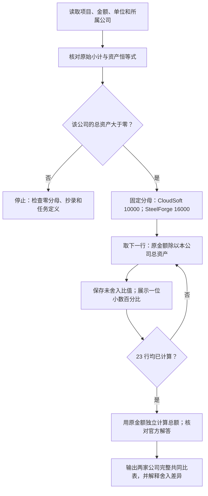

# Case 3：把 CloudSoft 与 SteelForge 的资产负债表看明白

> [!abstract] 从哪里开始
> 第一次接触会计，顺读 §1–3；只想先核答案，看 §4。§5 解释两家公司，§6 手把手使用计算表，§7 是额外分析，§8 是自测。

[[AC6761_Artificial_Intelligence_Accounting/assignment/00-overview/作业总览|回作业总览]] · [[AC6761_Artificial_Intelligence_Accounting/assignment/practice/练习索引|回练习索引]] · [打开 Excel 计算与核对](work/case3-common-size/Case3-计算与核对.xlsx)

## 0. 三分钟速览

这道题要求把两家公司的所有报表金额换成“**每 100 元资产中占多少元**”，让规模不同的软件公司和钢铁企业放到同一尺度上比较。

学完你应能：

- 用现金、存货、设备和权益各算一行，不换错分母。
- 完整重做 23 行、46 个百分比，按老师要求展示一位小数。
- 解释为什么 SteelForge 明细展示值可以加到 100.1%，而总资产仍写 100.0%。
- 用数字说明经营模式和融资结构的差别，并说清哪些判断不能仅凭资产负债表作出。

**来源层次**：§1 的题意及 §4 结果来自两张照片与老师后来发布的 `Case 3 with solution.docx`；官方解答在 Canvas 预览第 3–4 页。逐行结果已复算并与官方两张表核对。讲解、Excel 操作、额外比率和假设情景是 **💡 笔记补充**，不冒称老师布置或课堂确认。

**任务状态**：2026-09-30 已检查 Canvas Files、Announcements、Assignments、Modules。Files 有官方带解答文件；Assignments 和 Modules 被课程禁用；三条公告为小组／考试、停课与补课，未见 Case 3 单独的提交或截止说明。暂归私有课堂练习，**是否计分、是否交给老师、截止及格式仍未明示**，不能据此写“已提交”或保证一个提交格式。

这份文件按知识归属放在 M03，并不推断它一定是在第三周发放。收件／处理日期是 2026-09-30，报表日则是 2025-12-31，两者不同。

## 1. 先把题目翻成人话

### 1.1 你扮演谁，比较什么

你是股票分析员，比较两家上市公司的合并资产负债表。**合并**是把母公司和受控制的子公司视作一个集团来报；集团内部往来通常要抵销，不能把集团内部同一笔资源重复算进规模。本题已经提供简化合并数，不需要你再做合并分录。

CloudSoft 提供 SaaS（Software as a Service，软件即服务）：客户通过云端使用企业软件。照片只给行业；当前官方 DOCX 进一步说明它较少依赖实物资产、研发及收购投入较多，并主要靠权益和留存收益融资。SteelForge 制造钢材和机械，官方说明它需要工厂、设备及存货，并较多依赖债务融资。这些背景是题目给定事实，不是从公司名字猜出来的。

两家公司遵守同一会计准则，但题目没有指明是 IFRS、HKFRS 还是其他准则。相同准则提高比较基础，仍不代表资产结构、具体估计和经营风险相同。

### 1.2 老师真正要求的交付

原文要求：准备两家公司的 common-size balance sheets；**每行换成总资产百分比，保留一位小数**。因此必答是完整百分比表，不是只挑现金、设备、借款几个项目，也不是先给一段行业评论替代表格。

全部金额的单位是 **HK$ million（百万港元）**。例如 1,800 指 1,800 百万港元，不是 1,800 港元。本题比例的分子、分母都是同一单位，单位相除后消掉，结果没有港元单位。

分母固定如下：CloudSoft 是 **10,000**，SteelForge 是 **16,000**。这是各自资产总额。即使这一行写的是股本或留存收益，仍除以该公司的资产总额。

### 1.3 来源入口

- [[AC6761_Artificial_Intelligence_Accounting/course_files_export/AC6761-Case3-Common-Size-Balance-Sheets-p01.jpg|课堂照片 p01：资产与背景]]
- [[AC6761_Artificial_Intelligence_Accounting/course_files_export/AC6761-Case3-Common-Size-Balance-Sheets-p02.jpg|课堂照片 p02：负债、权益与 Required]]
- [本地老师原件及解答](../../course_files_export/Case%203%20with%20solution.docx)
- [Canvas 同一文件](https://canvas.cityu.edu.hk/courses/70229/files?preview=16135309)，2026-09-30 核对，20:59 发布、页面约 20 KB；用户下载原件 19,858 字节。

官方 DOCX 比照片多了行业及融资背景的说明，原始 46 个金额与题目要求一致；不是将补充文字误写为照片中已有的内容。

### 1.4 题干难句：每句话究竟要求你做哪一步

题目不是要比较谁“钱更多”，而是把两家规模不同的公司都看成“总资产 100 元”，再比较资源放在哪里、资金从哪里来。下面逐句解释；白话和反例是笔记补充，原意取自官方 DOCX。

| 题干关键表达 | 最简单的意思 | 具体影响与容易误读的点 |
|---|---|---|
| equity analyst | 为股票投资做分析的人 | 这是你的角色；本题真正交付仍是百分比表，不是完整买卖建议 |
| as at 31 December 2025 | 拍一张 2025 年 12 月 31 日的财务照片 | 表里是这一天的资产、负债和权益，不是全年收入或现金流入合计 |
| simplified consolidated balance sheets | 已经把集团合在一起、并简化过的资产负债表 | 直接用题目给的合并数，不重新把母子公司相加；“简化”表示细节少，不代表可猜其他项目是什么 |
| all figures in HK$ million | 一个数字单位代表一百万港元 | 1,800 和 10,000 都是百万港元，相除时单位消掉；不能一个换成港元、另一个仍保留百万 |
| common-size | 把每家公司各自缩成同样的 100 元规模 | 原金额不同，也能比较结构；不是用两家公司共同的 10,000 当分母 |
| every line item | 每个有金额的项目、各小计及总计都要换算 | 23 行两家公司共 46 个百分比，不能只挑几项讨论；标题空行没有金额，不算一个计算项目 |
| percentage of total assets | 当前这一行÷同一公司的全部资产 | 权益和负债行也除总资产；不是让资产除资产、负债改除负债 |
| round to one decimal place | 最后显示百分数的一位小数 | 3.75% 显示为 3.8%；保留原计算，不先把金额或比例截断再算其他项目 |
| finances growth mainly through equity and retained earnings | 扩张资金主要由股东投入及留在企业的累积利润支持 | 描述资金来源；留存收益可能已经变成机器、软件或应收，不表示有同额现金躺在银行 |

一个具体反例：SteelForge 流动资产 4,800 比 CloudSoft 的 3,500 大，但它的全部资产也更大。分别除以 16,000 和 10,000，得到 30.0% 与 35.0%。所以“金额更多”和“占比更高”可以方向相反，二者回答不同问题。


## 2. 开始计算前，先认识表中的词

### 2.1 资产、负债、权益在回答不同问题

**资产（assets）**是公司控制并预期带来经济利益的资源，例如现金、应收账款或设备。**负债（liabilities）**是公司要向外部履行的义务，例如付供应商款或偿还借款。**权益（equity）**是扣除负债后归属于权益持有者的剩余账面利益。

资产一侧问“资源放在哪里”，负债和权益一侧问“这些资源由谁提供资金或承担索取权”。两侧是同一家公司资源的两个视角，所以

$$
A=L+E.
$$

这里 $A$ 是资产总额，$L$ 是所有负债，$E$ 是合并权益；三个数使用相同的百万港元单位。CloudSoft：$10{,}000=3{,}000+7{,}000$。SteelForge：$16{,}000=10{,}000+6{,}000$。等式平衡是必要检查，**不能保证每一行都没有抄错或分类错误**。

借款会让现金资产与偿还义务同时出现，不能把“借来的钱不算资产”当作理由删现金。现金是资源，借款是资金来源，分属等式两侧。

所以，后面的百分比表会把资产侧和资金来源侧分别看成 100%，不能把两侧加成 200% 后认为报表错了。回链：[[AC6761_Artificial_Intelligence_Accounting/notes/M03-年报分析#2.2 资产负债表（Balance Sheet）|M03 资产负债表]]。

### 2.2 流动和非流动不是“能用”和“不能用”

**流动（current）**通常与正常营业周期或未来十二个月的变现、消耗、结算有关；现金还需考虑使用限制。**非流动（non-current）**表示长期使用或较长期结算，不代表价值低或永远不能卖。题目已分类，跟随其分类，不自行把机器改到流动资产。

| 类别 | 本题项目 | 先用人话理解 |
|---|---|---|
| 流动资产 | 现金、应收账款、存货、其他流动资产 | 比较接近现金或日常经营周转的资源，变现速度仍不同 |
| 非流动资产 | 设备、无形资产、长期投资、其他非流动资产 | 长期投入的资源；不适合只用“短期有没有钱”来理解 |
| 流动负债 | 应付账款、短期借款、其他流动负债 | 日常经营及较近期需处理的义务 |
| 非流动负债 | 长期债务、其他非流动负债 | 较长期的义务；长期不等于没有利息或再融资风险 |

所以，35.0% 的流动资产不能全当现金；其中还包括客户未付的钱和需要卖出的存货。回链：[[AC6761_Artificial_Intelligence_Accounting/notes/M03-年报分析|M03 §2.2 的逐科目解释]]。

### 2.3 把每一类具体科目认识清楚

| 术语（English） | 直白理解与本题读法 | 最容易误解的地方 |
|---|---|---|
| 现金及现金等价物（cash and cash equivalents） | 现金以及期限短、容易换成确定金额且价值风险很低的投资 | 不能把全部长期投资都当现金等价物 |
| 应收账款（accounts receivable） | 客户已经欠公司的钱，通常来自先交货或服务后收款 | 确认应收不等于现金已到账，还要看坏账与账龄 |
| 存货（inventories） | 为销售、生产或经营消耗持有的货品、原料等 | 比例高不自动等于积压；行业和周转速度要一起看 |
| 物业、厂房及设备（PP&E, net） | 土地、厂房、机器等长期经营资产，题目给的是净账面额 | 净额不等于市场卖价，账龄及折旧政策也影响比例 |
| 无形资产（intangible assets） | 没有实物形态的可确认资源，如某些软件、专利、权利 | 没实物不代表无价值，也不能把所有研发支出都确认成资产 |
| 商誉（goodwill） | 收购中超出可辨认净资产的部分，和被收购业务整体收益能力有关 | 本题把它并在无形资产内，不能假设 4,200 全是商誉或全是研发 |
| 长期投资（long-term investments） | 公司为较长期目的持有的投资 | 不能仅凭名称推断具体资产类别、收益或可变现金额 |
| 其他流动／非流动资产 | 未在简化表单列的资源 | 成分没有披露，不能编成特定预付款或某种技术资产 |
| 应付账款（accounts payable） | 公司欠供应商的钱，通常来自赊购 | 是负债，但不一定是计息贷款 |
| 短期借款／长期债务（borrowings/debt） | 明确列示的借款融资 | 不能将它与“全部负债”混用定义 |
| 其他流动／非流动负债 | 没有单列性质的义务 | 不能未经资料确认都当成预收订阅款、税款或租赁负债 |
| 股本及股本溢价（share capital/share premium） | 股东投入及发行股份形成的资本金额 | 是资金来源的账面项目，不能把它当作仍存银行的现金 |
| 留存收益（retained earnings） | 累积利润中留在企业的账面部分 | 利润可能已投入设备、应收等，留存收益不等于可分配现金 |
| 非控股权益（NCI, non-controlling interests） | 合并集团中属于子公司其他股东的权益 | 属合并权益，不属于应偿还的借款；本题 300／400 还含其他权益 |

所以，熟悉项目后才能把“百分比高低”翻成经营含义；单纯按数值排序不足以评价公司。统一译名见 [[AC6761_Artificial_Intelligence_Accounting/_meta/术语表|课程术语表]]。

## 3. 手把手：共同比究竟怎样算

### 3.1 为什么要统一分母

SteelForge 总资产是 CloudSoft 的 1.6 倍。直接比较金额，会把规模差别和结构差别混在一起。共同比分析（common-size analysis）把每项金额除以该公司总资产，相当于把两家公司都缩放成“资产总额为 100 元”的公司，再比较每项放了多少。

这消除了统一单位下的名义规模差别，**不自动消除行业、资产账龄、计量估计、通胀或资产质量差别**。即使两张表遵循同一会计准则，也要说明比较边界。

$$
p_{i,c}=\frac{x_{i,c}}{A_c}\times100\%.
$$

| 符号 | 意义 | 本题例子 |
|---|---|---|
| $c$ | 公司 | CloudSoft 或 SteelForge |
| $i$ | 当前要算的项目 | 现金、存货或权益合计 |
| $x_{i,c}$ | 这一项目的原始金额 | CloudSoft 现金 1,800 百万港元 |
| $A_c$ | 同一公司的总资产 | CloudSoft 10,000 百万港元 |
| $p_{i,c}$ | 对应总资产百分比 | 现金占 18.0% |

乘 100 是把比例 0.18 换成百分比 18%，不是额外增加经济价值。若金额与分母同时扩大一倍，比值不变。这就是可比较的依据。回链：[[AC6761_Artificial_Intelligence_Accounting/notes/M03-年报分析#2.3 共同比分析（讲义 p.16–18）|M03 共同比分析]]。

### 3.2 按这个流程处理每一行



循环中变化的是当前项目，**同一公司的分母不变**。处理完全部 23 行才停止。正常数据中总资产为正；遇到零分母不能机械地填 0%，负资产或异常分类也先回源，不套本题的经济读法。

1. 先核 CloudSoft 流动资产：$1{,}800+1{,}200+150+350=3{,}500$。
2. 再核非流动资产：$800+4{,}200+1{,}000+500=6{,}500$，资产总额为 $3{,}500+6{,}500=10{,}000$。
3. 固定分母 10,000，分别算明细及小计。SteelForge 同样先核 $4{,}800+11{,}200=16{,}000$，再固定 16,000。
4. 完整填表后核官方值，不能把流动资产明细又加上流动资产合计一起求总资产，那会重复计算。

### 3.3 四个完整代入：现金、设备、无形资产与权益

**CloudSoft 现金**：每 100 元资产中，18 元以现金或现金等价物持有。

$$
\frac{1{,}800}{10{,}000}\times100\%=18.0\%.
$$

**SteelForge 的设备**：每 100 元资产中，60 元是设备等 PP&E 的净账面额。

$$
\frac{9{,}600}{16{,}000}\times100\%=60.0\%.
$$

**SteelForge 的无形资产**：先算完整比值，最后才按一位小数显示。

$$
\frac{600}{16{,}000}\times100\%=3.75\%\longrightarrow3.8\%.
$$

**CloudSoft 权益合计**：仍除以总资产，不因它在权益一侧而换分母。

$$
\frac{7{,}000}{10{,}000}\times100\%=70.0\%.
$$

若拿 7,000 除以 7,000，算到 100% 表示“权益合计占自身全部权益”；数学没错，却回答了另一问题，不符合本题要求。

### 3.4 为什么 SteelForge 可以出现 100.1%

钢铁公司的两个 600 项各自都是 3.75%，各显示为 3.8%。设备、投资等也按各自原金额换算；逐项舍入会留下小差额。**先从原金额算总资产 16,000，所得总比例是 100.0%；不能先将已经舍入的明细相加再冒充总额。**

例如其非流动资产展示明细 $60.0+3.8+2.5+3.8=70.1$，而原始非流动资产合计 $11{,}200/16{,}000$ 为 70.0%。两者相差 0.1 个百分点，来自展示舍入，不是账不平。

正式表下保留一句“Totals are calculated from original amounts; rounding may cause displayed components not to add exactly to totals.” 不把其中一个 3.8% 改成 3.7% 来凑数。

### 3.5 不省略其他行：每行怎样从原金额走到答案

§3.3 展示四个典型代入，下面把其余项目也写出输入和同一运算。每行先取官方原金额，除以该列公司的总资产，再转换为百分比，最后显示一位小数。标题和空行只分组，不能拿来算。

| 官方项目 | CloudSoft：原金额与过程 | SteelForge：原金额与过程 |
|---|---|---|
| Cash and cash equivalents | $\frac{1{,}800}{10{,}000}\times100\%=18.0\%$ | $\frac{450}{16{,}000}\times100\%\approx2.8\%$ |
| Accounts receivable | $\frac{1{,}200}{10{,}000}\times100\%=12.0\%$ | $\frac{1{,}350}{16{,}000}\times100\%\approx8.4\%$ |
| Inventories | $\frac{150}{10{,}000}\times100\%=1.5\%$ | $\frac{2{,}700}{16{,}000}\times100\%\approx16.9\%$ |
| Other current assets | $\frac{350}{10{,}000}\times100\%=3.5\%$ | $\frac{300}{16{,}000}\times100\%\approx1.9\%$ |
| Total current assets | $\frac{3{,}500}{10{,}000}\times100\%=35.0\%$ | $\frac{4{,}800}{16{,}000}\times100\%=30.0\%$ |
| Property, plant and equipment (net) | $\frac{800}{10{,}000}\times100\%=8.0\%$ | $\frac{9{,}600}{16{,}000}\times100\%=60.0\%$ |
| Intangible assets (including goodwill) | $\frac{4{,}200}{10{,}000}\times100\%=42.0\%$ | $\frac{600}{16{,}000}\times100\%\approx3.8\%$ |
| Long-term investments | $\frac{1{,}000}{10{,}000}\times100\%=10.0\%$ | $\frac{400}{16{,}000}\times100\%=2.5\%$ |
| Other non-current assets | $\frac{500}{10{,}000}\times100\%=5.0\%$ | $\frac{600}{16{,}000}\times100\%\approx3.8\%$ |
| Total non-current assets | $\frac{6{,}500}{10{,}000}\times100\%=65.0\%$ | $\frac{11{,}200}{16{,}000}\times100\%=70.0\%$ |
| Total assets | $\frac{10{,}000}{10{,}000}\times100\%=100.0\%$ | $\frac{16{,}000}{16{,}000}\times100\%=100.0\%$ |
| Accounts payable | $\frac{600}{10{,}000}\times100\%=6.0\%$ | $\frac{1{,}600}{16{,}000}\times100\%=10.0\%$ |
| Short-term borrowings | $\frac{200}{10{,}000}\times100\%=2.0\%$ | $\frac{1{,}200}{16{,}000}\times100\%=7.5\%$ |
| Other current liabilities | $\frac{700}{10{,}000}\times100\%=7.0\%$ | $\frac{800}{16{,}000}\times100\%=5.0\%$ |
| Total current liabilities | $\frac{1{,}500}{10{,}000}\times100\%=15.0\%$ | $\frac{3{,}600}{16{,}000}\times100\%=22.5\%$ |
| Long-term debt | $\frac{1{,}000}{10{,}000}\times100\%=10.0\%$ | $\frac{5{,}600}{16{,}000}\times100\%=35.0\%$ |
| Other non-current liabilities | $\frac{500}{10{,}000}\times100\%=5.0\%$ | $\frac{800}{16{,}000}\times100\%=5.0\%$ |
| Total non-current liabilities | $\frac{1{,}500}{10{,}000}\times100\%=15.0\%$ | $\frac{6{,}400}{16{,}000}\times100\%=40.0\%$ |
| Share capital and share premium | $\frac{3{,}500}{10{,}000}\times100\%=35.0\%$ | $\frac{2{,}000}{16{,}000}\times100\%=12.5\%$ |
| Retained earnings | $\frac{3{,}200}{10{,}000}\times100\%=32.0\%$ | $\frac{3{,}600}{16{,}000}\times100\%=22.5\%$ |
| Other equity (including NCI) | $\frac{300}{10{,}000}\times100\%=3.0\%$ | $\frac{400}{16{,}000}\times100\%=2.5\%$ |
| Total equity | $\frac{7{,}000}{10{,}000}\times100\%=70.0\%$ | $\frac{6{,}000}{16{,}000}\times100\%=37.5\%$ |
| Total liabilities and equity | $\frac{10{,}000}{10{,}000}\times100\%=100.0\%$ | $\frac{16{,}000}{16{,}000}\times100\%=100.0\%$ |

例如 Accounts payable 的 600 是“公司欠供应商的钱”。算 $600/10{,}000\times100\%=6.0\%$ 的意思是：每 100 元总资产，相应有 6 元供应商款义务。它既不是“应付账款有 6% 要还”，也不是“6% 的供应商欠公司钱”。同样，Total equity 的 37.5% 是 SteelForge 的账面资源对应多少股东剩余权益，不是股价上涨 37.5%。

小计行也要换算，但不能在求合计时重复加。例如已经用现金、应收、存货、其他流动资产得到流动资产 3,500，再把这四项与 3,500 一起相加，会算成 7,000，等于把同一批资源数了两次。求总资产只加“流动资产合计”和“非流动资产合计”，或只加互不重叠的最底层项目。


## 4. 完整必答表：23 行与官方结果一致

下面是 **Table 1 · Common-size balance sheets as at 31 December 2025**。所有数值单位为“占各自总资产的百分比”，保留一位小数。✅ 原金额来自照片及当前官方 DOCX；✅ 百分比与其 Solutions 两列表逐项一致。计算表的 `Answer` 页同时保留原金额。

| Item（项目） | CloudSoft | SteelForge |
|---|---:|---:|
| **Assets · 资产** | | |
| Cash and cash equivalents（现金及现金等价物） | 18.0% | 2.8% |
| Accounts receivable（应收账款） | 12.0% | 8.4% |
| Inventories（存货） | 1.5% | 16.9% |
| Other current assets（其他流动资产） | 3.5% | 1.9% |
| **Total current assets（流动资产合计）** | 35.0% | 30.0% |
| Property, plant and equipment (net)（物业、厂房及设备（净额）） | 8.0% | 60.0% |
| Intangible assets (including goodwill)（无形资产（包括商誉）） | 42.0% | 3.8% |
| Long-term investments（长期投资） | 10.0% | 2.5% |
| Other non-current assets（其他非流动资产） | 5.0% | 3.8% |
| **Total non-current assets（非流动资产合计）** | 65.0% | 70.0% |
| **Total assets（资产总额）** | 100.0% | 100.0% |
| **Liabilities and Equity · 负债及权益** | | |
| Accounts payable（应付账款） | 6.0% | 10.0% |
| Short-term borrowings（短期借款） | 2.0% | 7.5% |
| Other current liabilities（其他流动负债） | 7.0% | 5.0% |
| **Total current liabilities（流动负债合计）** | 15.0% | 22.5% |
| Long-term debt（长期债务） | 10.0% | 35.0% |
| Other non-current liabilities（其他非流动负债） | 5.0% | 5.0% |
| **Total non-current liabilities（非流动负债合计）** | 15.0% | 40.0% |
| Share capital and share premium（股本及股本溢价） | 35.0% | 12.5% |
| Retained earnings（留存收益） | 32.0% | 22.5% |
| Other equity (including NCI)（其他权益（包括非控股权益）） | 3.0% | 2.5% |
| **Total equity（权益合计）** | 70.0% | 37.5% |
| **Total liabilities and equity（负债及权益总额）** | 100.0% | 100.0% |

**Rounding note.** Totals are calculated from original amounts. Rounding may cause displayed components not to add exactly to totals.

**用法**：这张表就是题目要求的计算答案。下面的行业解释和附录是理解与补充；若老师只收表，先保留这张完整表及精度说明，按老师指定格式交，不能未经核实就认定 Excel 是正式提交格式。

## 5. 直白分析：这些比例告诉我们什么

### 5.1 两家公司将钱放在不同地方

CloudSoft 的 PP&E 只有 **8.0%**，无形资产及商誉占 **42.0%**；SteelForge 的 PP&E 为 **60.0%**，存货为 **16.9%**。数字与官方给定的 SaaS 和制造业背景吻合：前者少依赖厂房机器、研发和收购较多；后者要靠工厂、设备、原料及在制品经营。

但“软件公司较少实物资产”不能说成“没有长期资产”：CloudSoft 非流动资产仍占 **65.0%**。无形资产多也不能当成价值更高，更不能说全部 42.0% 都是研发资产。题目没有提供无形资产与商誉的分拆、估值或减值资料。

所以，行业背景解释的是**为什么资产结构可能不同**，不是用一个行业标签直接判优劣。官方 DOCX 的行业结论已确认；对资产质量的限制是笔记补充。

### 5.2 现金结构看起来不同，短期偿债还要配分母

CloudSoft 现金占资产 **18.0%**，SteelForge **2.8%**，前者较多账面资源以现金形式持有。但总资产不是短期要付的钱，若想看短期偿债，需要与流动负债比较，见 Table A1。

另一个容易误读的地方：SteelForge 流动资产金额 4,800 大于 CloudSoft 的 3,500，**占资产的比例却是 30.0% 对 35.0%**。金额大和结构占比高是两个判断，不能混用。

存货还需经过销售、收款才变成现金；应收也可能延迟收款。没有现金流量表、账龄和存货周转资料，不能把某个比率写成“确定不会缺钱”。

### 5.3 资金来源：权益与借款要区分口径

CloudSoft 合并权益占 **70.0%**，全部负债占 **30.0%**；SteelForge 权益 **37.5%**，全部负债 **62.5%**。这表明前者在账面上更依靠权益，后者承担更多负债索取权，与官方的融资背景一致。

其中明确列示的短期借款加长期债务为：CloudSoft $200+1{,}000=1{,}200$，占资产 **12.0%**；SteelForge $1{,}200+5{,}600=6{,}800$，占 **42.5%**。这不同于全部负债，后者还包括供应商款和其他义务。简化表未披露其他项目是否含计息性质，因此这里只称“明确列示借款”，不假装得到了完整计息债务。

负债比例较高意味着要更关注利息、到期分布、再融资和经营现金流，**不能仅据 62.5% 宣布公司财务失败**。制造业经营模式、抵押能力和周期都会影响融资选择，而题目没有这些证据。

### 5.4 可采用的英文分析段落（💡 补充作答）

> CloudSoft has a larger share of intangible assets and goodwill, at 42.0% of total assets, while PP&E accounts for only 8.0%. This fits its software and acquisition-based business. SteelForge has 60.0% of its assets in PP&E and 16.9% in inventories, which is consistent with its manufacturing operations. CloudSoft also relies more on equity, which funds 70.0% of its assets, compared with 37.5% for SteelForge. These differences describe the companies' business and financing structures. They do not, by themselves, show which company is more profitable or a better investment; cash flows, earnings and asset-quality information would be needed.

这是基于核实结果的自然学生语言，不是老师的原段落。若要采用，应先能解释每一个数字和最后的限制。

## 6. 在 Excel 中怎样一步步复做

### 6.1 四个工作表分别用来做什么

| Sheet | 做什么 | 第一次打开先看哪里 |
|---|---|---|
| `Answer` | 完整必答表，金额和百分比用公式连接 | 第 7–29 行；CloudSoft 分母 B17，SteelForge 分母 D17 |
| `Source` | 把老师给的原始金额、中文名称及照片页码放在一起 | 第 7–29 行；蓝色为输入，保留报告合计便于对照 |
| `Appendix` | 7 个比率、资产结构图和 20% 假设情景 | Table A1–A3 与 Figure A1；假设 B40／C40 可改 |
| `Checks` | 明细加总、恒等式、每行比例及官方百分比对照 | 差额应为 0；第 32–54 行每行对照官方两值 |

从 `Source` 核原数据，再看 `Answer` 的公式，最后读 `Checks`。练习时优先改附录的假设输入，不随意覆盖原案例数字；若要试新公司，先另存副本。

### 6.2 先认识 Excel 语法，不假定你会公式

Excel 中一个格子叫单元格，`B7` 是 B 列第 7 行。`=Source!B7` 表示从名为 Source 的工作表取 B7 值；前面的 `=` 告诉 Excel 这是计算，不是普通文字。`B7:B10` 是从 B7 到 B10 的连续区域，`SUM` 将它们相加。

`Answer!B7` 的公式是 `=Source!B7`，所以取到 1,800。`Answer!B11` 是 `=SUM(B7:B10)`，用四个明细重算 3,500。`Answer!B17` 是 `=B11+B16`，得到 10,000。

最关键的百分比格是 `Answer!C7`：

```excel
=B7/$B$17
```

这个代码块是 **Excel 可输入的公式语法**，不是用代码块替代数学排版。它取“现金÷总资产”，内部结果为 0.18，单元格数字格式 `0.0%` 将其显示为 18.0%。**不要再乘 100 然后设置百分比格式**，否则会显示 1,800.0%。

`$B$17` 中两处 `$` 固定列和行。将公式向下复制时，B7 会跟着变为 B8、B9，但分母仍是 B17。如果写 `=B7/B17` 而复制，后续分母会变成 B18，错把应付账款当总资产。SteelForge 在 `E7` 使用 `=D7/$D$17`。

比例公式保留未舍入值，单元格只展示一位小数。`Checks` 另用 `ROUND(比例*100,1)/100` 与官方显示值核对；`ROUND` 第二参数 1 是保留一位小数。这将“计算值”和“显示值”分开，避免后续比率被早期舍入影响。

### 6.3 自己核一次，而不是看见 0 就相信

在 `Source` 看到 4,800 这一行后，自己加 SteelForge 前四项：$450+1{,}350+2{,}700+300=4{,}800$。再算 $4{,}800/16{,}000=0.3$，应显示 30.0%。最后看 `Checks` 流动资产差额为 0。这是“原件→手算→Excel→官方”四方核对，不是只依赖一个自动提示。

| 现象 | 常见原因 | 排查动作 |
|---|---|---|
| 现金显示 1,800.0% | 乘了 100 又使用百分比格式 | 内部比例保持 0.18，只设 `0.0%` |
| 拖下来以后全部不对 | 分母没用绝对引用 | 核 `$B$17`／`$D$17` |
| 所有公司共用 10,000 | 用错公司的总资产 | 逐列固定各自分母 |
| 有 `#DIV/0!` | 总资产空白或零 | 回原始数据，不把错误格改成 0% |
| 金额不再平衡 | 明细或报告合计改了、重复求和 | 用 Checks 对照 Source 的报告值，再核原件 |
| 钢铁明细加到 100.1% | 一位小数逐行舍入 | 保留原计算，解释差异；不要篡改一个项目 |

## 7. 附录 A：有依据的理解深度与检验

以下不是题面另加的小问，而是为了理解结果而实施的补充。附录表用 **Table A1–A3**，资产结构图是 **Figure A1**，不占用 Table 1 的必答定位。

### 7.1 Table A1：短期偿债及融资口径

先问“短期义务由哪些资源覆盖”，再算比率。流动比率把全部流动资产除以流动负债。严格口径速动比率这里只取现金和应收：未知的其他流动资产可能含预付款，资料不足时不直接算成可立即偿债资源。现金比率则只取现金。**速动比率存在不同口径；此处已定义，不将一种口径冒充唯一标准。**

$$
\text{流动比率}=\frac{\text{流动资产}}{\text{流动负债}},\qquad
\text{本例严格速动比率}=\frac{\text{现金及现金等价物}+\text{应收账款}}{\text{流动负债}}.
$$

| Table A1 · 指标 | CloudSoft | SteelForge | 单位／口径 |
|---|---:|---:|---|
| 流动比率 | 2.333 | 1.333 | 倍，原金额计算 |
| 严格口径速动比率 | 2.000 | 0.500 | 倍，只计现金与应收 |
| 现金比率 | 1.200 | 0.125 | 倍，现金／流动负债 |
| 净营运资本 | 2,000 | 1,200 | 百万港元，流动资产－流动负债 |
| 全部负债／资产 | 30.0% | 62.5% | 所有负债，不只借款 |
| 明确列示借款／资产 | 12.0% | 42.5% | 短期 borrowings + long-term debt |
| 全部负债／权益 | 0.429 | 1.667 | 倍，不把它叫另一口径的借款权益比 |

代入核对：CloudSoft 流动比率 $3{,}500/1{,}500=2.333$，严格速动 $3{,}000/1{,}500=2.000$；SteelForge 是 $4{,}800/3{,}600=1.333$ 和 $1{,}800/3{,}600=0.500$。现金比率则分别由 $1{,}800/1{,}500$ 和 $450/3{,}600$ 得到。

所以，钢铁公司的流动比率超过 1，并不代表现金或快速可变现资源同样足够；差异很大一部分来自存货。是否真正吃紧还要看收款与付款时间、存货销量、可用授信、受限现金及长期融资。比率是检查线索，不是确定结论。

### 7.2 Table A2 与 Figure A1：先看经营资源的主线

Excel 中将资产合并成互不重叠的四组：流动资产、PP&E、无形资产及商誉、其余非流动资产。分别按原金额画图，而不是把流动资产合计与它的现金明细重复画成可相加的组。

CloudSoft 主线是无形资产及商誉 **42.0%**、流动资产 **35.0%**；SteelForge 主线是 PP&E **60.0%**。图上纵轴是占总资产比例，两种颜色分别表示两家公司；柱子高是相对占比，不是金额或利润。这个图辅助解释 Table 1，不能替代完整表。

### 7.3 Table A3：资产减值，为什么现金比例可能“变好”

💡 **明确假设**：两家公司无形资产及商誉的合并账面金额各下调 20.0%；无现金支付，负债不变，暂忽略税与 NCI 分配，在集团层面权益承受相同账面损失。20.0% 是教学压力测试输入，不是判断真实减值、也不是老师要求的预测。两家公司采用何种具体准则未指名。

设损失为 $D$，比例为 $s$，无形资产账面额为 $I$。本情景中

$$
D=sI,\qquad A'=A-D,\qquad L'=L,\qquad E'=E-D.
$$

撇号表示假设后的数值；$A,L,E$ 与 §2 相同，全部金额为百万港元。资产和权益同额下降，所以 $A'-L'-E'=0$ 仍成立。这里是对账面变化的教学简化，不直接指定每一项减值的会计分录或判断某个 CGU 的真实可收回金额。

| Table A3 · 假设后的项目 | CloudSoft | SteelForge |
|---|---:|---:|
| 损失 | 840 | 120 |
| 新资产总额 | 9,160 | 15,880 |
| 负债（不变） | 3,000 | 10,000 |
| 新权益 | 6,160 | 5,880 |
| 现金（不变） | 1,800 | 450 |
| 现金占新资产 | 19.7% | 2.8% |
| 全部负债占新资产 | 32.8% | 63.0% |

CloudSoft 损失 $4{,}200\times20.0\%=840$，新的分母 $10{,}000-840=9{,}160$。现金仍是 1,800，但比例从 18.0% 变成 $1{,}800/9{,}160=19.7\%$；全部负债仍是 3,000，占比变为 $3{,}000/9{,}160=32.8\%$。

**我的理解**：只看现金占比上升，可能误说现金管理改善；这里实际没有收到新现金，变化来自资产分母下降。同样，负债占比上升也没有新增借款。这说明共同比分析必须同时看原金额、分母与会计事件，不能将一个比例的方向机械翻译成好坏。改 Excel 附录 B40／C40 可以重做这个检验。

### 7.4 无形资产与商誉：外部知识及分析边界

先解释两个动作：**费用化（expensing）**是在适用期间确认费用；**资本化（capitalisation）**是满足确认条件时先记录资产，之后按适用规则确认摊销或减值。摊销就是将有限寿命无形资产的可摊销金额分期计入费用，并不是“放进资产就永远不影响利润”。

🔗 外部补充：IFRS 的 IAS 38 对可确认无形资产设条件，研究支出通常费用化，开发支出需满足条件才资本化；收购商誉的核算属于 IFRS 3 范围。因此不能从“科技公司投研发”推断全部费用变成资产。参见 [IFRS Foundation · IAS 38](https://www.ifrs.org/issued-standards/list-of-standards/ias-38-intangible-assets/)，获取日期 2026-09-30。

🔗 在 IFRS 的 IAS 36 下，减值判断涉及账面额与可收回金额，商誉通常联系到产生现金流的单位，不能只凭一个资产占比判定发生减值。参见 [IFRS Foundation · IAS 36](https://www.ifrs.org/issued-standards/list-of-standards/ias-36-impairment-of-assets/)，获取日期 2026-09-30。本题未指名采用 IFRS，以上是理解边界的参考，不写成两家公司的已知会计政策。

一张时点资产负债表不能证明利润高低、现金流强弱、资产可变现值、增长前景或股票便宜程度；还缺收入、利润、现金流、历史趋势、附注、市场价格等资料。本例可以比较结构，并提出下一步要检查的线索，不能完成投资估值或评价真实公司的优劣。

## 8. 自测与迁移：遮住表，自己做一遍

### 8.1 分母检验

SteelForge 股本及溢价为 2,000。同学用权益合计 6,000 作分母，写 33.3%。这是本题答案吗？

<details><summary>答案与错误定位</summary>

不是本题要求的结果。本题分母为总资产 16,000，应为 **12.5%**。33.3% 讲的是股本在权益内部的结构比例，不能替代共同比资产负债表里的总资产比例。错误发生在“选分母”而不是最后舍入。
</details>

### 8.2 完整小例子（💡 笔记补充）

新公司有现金 200、设备 1,400、其他资产 400；负债 600、权益 1,400，单位相同。先核平衡，再完成整个共同比表。

<details><summary>全部步骤与输出</summary>

1. 核资产：$200+1{,}400+400=2{,}000$；核资金来源：$600+1{,}400=2{,}000$，两侧相同。
2. 固定分母为 2,000；当前项目依次为现金、设备、其他资产、负债、权益。
3. 转换后：现金 **10.0%**、设备 **70.0%**、其他资产 **20.0%**；负债 **30.0%**、权益 **70.0%**。
4. 三个资产明细相加为 **100.0%**，两项资金来源相加为 **100.0%**，每一项目均处理完，正常停止。

这五行展示的是两侧结构，不把资产及资金来源全部再加成一次资产总额。
</details>

### 8.3 预测中间状态

上例的设备账面额减值 200，其他条件按 §7 的简化假设保持。现金金额变了吗？下一步的共同分母是什么？

<details><summary>答案、核对与解释</summary>

现金仍为 200。资产变为 **1,800**，负债仍为 600，权益变为 **1,200**，核 $1{,}800=600+1{,}200$。此时尚未转换比例；先重新固定分母 1,800，再算现金 $200/1{,}800=11.1\%$。比例由 10.0% 上升，并不是收到了新现金。
</details>

### 8.4 判断一个分析是否过头

同学说：“CloudSoft 留存收益占 32.0%，所以银行里有 3,200 可立即分红；SteelForge 负债高，所以一定更差。”请指出各自缺了什么证据。

<details><summary>答案与下一步</summary>

留存收益是累计账面权益，不等于现金。要看可用现金、分红法律／契约限制等；不能仅由这项得出立即可分红数。负债高提示偿债压力，但还要看盈利、经营现金流、到期日、抵押、授信和行业。结构差异不构成确定的公司优劣排序。
</details>

### 8.5 这道题下次怎样自己开始

先确认是一个时点的资产负债表，再确认单位相同。给每家公司圈出自己的总资产，所有行固定用它作分母。逐行转换后用原金额核小计和两侧平衡，最后才舍入；解释高低时同时看原金额、分母和行业，不直接判谁更好。

本题最容易卡住的三句话是“全部项目都除总资产”“留存收益不是现金”“明细 100.1% 不等于账不平”。前两句是定义与比较口径，第三句是展示舍入。它们分别影响选分母、解释资金来源和核总计，不能用一个“按公式即可”省略。

改条件再想：假设 CloudSoft 现金和总资产都扩大为原来的两倍，其他结构也按同一比例扩大，其现金占比是多少？

<details><summary>答案与原因</summary>

新现金 3,600，新总资产 20,000，$3{,}600/20{,}000\times100\%=18.0\%$。金额更大，但分子、分母同倍变化，结构比例没变；这正是 common-size 要消除规模差异的原因。情景是笔记补充，不是原公司真的扩张了。

</details>


## 9. 来源、知识回链与验收边界

### 9.1 知识接在哪儿

本案例向 [[AC6761_Artificial_Intelligence_Accounting/notes/M03-年报分析#2.2 资产负债表（Balance Sheet）|M03 §2.2]] 回链科目与恒等式，向 [[AC6761_Artificial_Intelligence_Accounting/notes/M03-年报分析#2.3 共同比分析（讲义 p.16–18）|M03 §2.3]] 回链比例方法。工作区里仍只有一份计算工作簿，全部教程、答案、直白解读和自测集中在这篇笔记。

入口放在私有作业总览、练习索引和知识地图。公开 M03 保持通用概念笔记，不反链完整私有解答。

### 9.2 四项可核的验收

- **复述**：输入是两家公司同日、同单位的报表项目；输出是每行占本公司总资产的一位小数百分比。机制是先核金额、固定公司分母、逐行转换、最后展示和复核。
- **执行**：23 行／46 个输入金额与 DOCX 一致；46 个百分比与官方解答一致；14 个小计及合计关系独立复算；§8 小例子的完整中间状态已手算核对。
- **解释**：同一单位的项目除以总规模，使公司缩放到同一尺度；不因行在权益侧就换分母。比例上升可能来自分母变化，不自动意味着资源增加。
- **诊断**：检测错分母、百分比重复乘 100、重复相加小计和逐行舍入；每种错误在 §6／§8 给出修正及限制。

这是计算与模型阅读自检，不冒称真人初学者已试读或本人已学会。Excel 四张表已渲染查看，关键金额／比率／图形无错位；导出文件的 219 条公式及缓存值已核，0 公式错误，23 行官方对照差额均为 0。原生图表 1 张。

最终同源浏览器预览检查：47 处数学表达式（8 处独立公式），0 数学渲染错误；Mermaid 流程图 10 节点／10 连线，零分母停止、逐行循环和正常结束的分支可见；展开自测后数字及推导显示正常。Obsidian 本机 CLI 不可用，本轮未直接查看其阅读视图，不把浏览器检查说成已看过 Obsidian。

### 9.3 材料完整性与未确认事项

老师文件来自用户下载，归档时未改变字节；照片命名已按授权完成，文件内容未改。正式是否提交、计分、截止、格式仍未明示；若后来布置提交，再以当前 Canvas／老师要求核定交付，本次没有代提交。

本案例的百分比是一位小数，附录比率三位小数、金额整数；同指标在正文、表格及 Excel 保持相同展示口径，计算始终用原值。最后链接检查扫描 156 个 Markdown 文件，0 问题；README 检查 0 问题；相对本任务私有开工快照的完整性检查 0 问题。

本地官方 DOCX SHA-256：`15a0cc87f13fd8952490088a66d849c6416e1634cc317415ce053464d6191d1a`。

照片 `AC6761-Case3-Common-Size-Balance-Sheets-p01.jpg` SHA-256：`0c7973d7a3212181c92fddcf9012910c2ae405953cc9832f3fd7929832b5181b`。

照片 `AC6761-Case3-Common-Size-Balance-Sheets-p02.jpg` SHA-256：`783e11b9db1fbc78aa81b80e2165e59c4d10a80783be91b9a0d258e146ef5ee4`。

### 9.4 处理记录

2026-09-30：按授权查看并命名照片；核 Canvas 四入口及官方四页预览；接收用户下载 DOCX 并对照全部表格；生成连续教程、完整答案与公式工作簿，登记私有入口。


验收收尾（2026-09-30）：原件哈希三项未变；23 行／46 个百分比与官方一致；已核导出 Excel 的 92 个必答缓存值、219 条公式与 1 张原生图表，错误 0。已实际查看同源预览公式、流程和自测。两个主要入口的链接已核：作业总览与练习索引。

同期完整性清单中的 IS6400 M03／M05 和全库 `_meta/转录处理规则.md` 三处变化不是本案例脚本所写，已保留，没有恢复或覆盖。尚未确认本案例计分／提交要求，也没有提交 Canvas 或 Git。

2026-10-07 定向补充：§1.4 拆解题干难句，§3.5 写出官方全部 23 行、46 个原金额代入与结果，§8.5 提炼独立重做顺序及等比例扩大例。当前原 DOCX 的两表重新对照，46 个一位小数结果一致；旧工作簿与 2026-09-30 的视觉／公式验收记录保留，未冒称本次又做了那些检查。当前 Canvas 登录受阻，行政信息仍未刷新。
