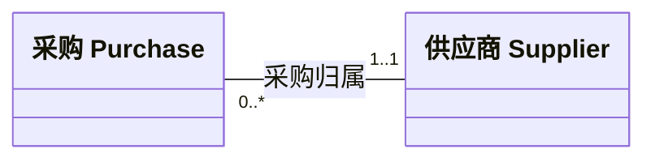
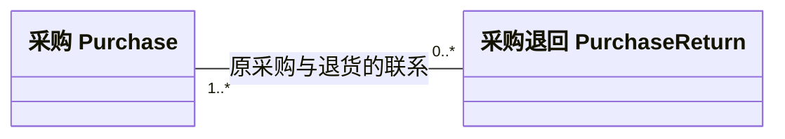
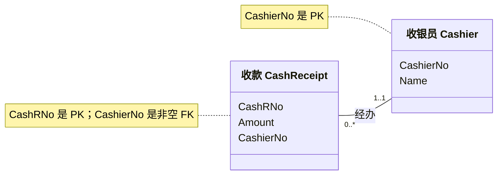

# Case 4：把业务叙述变成多重性与关系表

> 第一次读数据库题，先读 §1–2，再按 §3 逐题做。想先核答案，看 §4；打开 Excel 后按 §5 检查。§6 解释为什么“加了外键”仍可能没有实现所有业务规则。

[[AC6761_Artificial_Intelligence_Accounting/assignment/00-overview/作业总览|回作业总览]] · [[AC6761_Artificial_Intelligence_Accounting/assignment/practice/练习索引|回练习索引]] · [打开关系表与核对工作簿](work/case4-relational/Case4-关系表与核对.xlsx)

## 0. 要完成什么，哪些已知

照片共有 4 道题，第 3 题包含两张表，因此这里分别回答 1、2、3a、3b、4，共 5 个作答单元。题目依次要求：供应商和采购的多重性、采购和采购退回的多重性、关系表原则判断、收款与收银员关系转表。

本文件按知识归属联系 M04，不据此认定一定在第 4 周发题。收到照片的日期是 2026-10-07；第 2 题的业务背景是 May 2015，其他表的有效日期没有给出。

来源分清：两照片提供原题；本轮已逐项读取本地 `Case 4 with Solution.docx` 的题面、5张表及官解。Q1/Q2端点、Q3a的 `Violate entity integrity.`、Q3b的 `No.` 和Q4四行外键与原件一致。本文中文推导、英文完整句、设计扩展、SQLite约束实验和自测是笔记补充，不冒称教师原话或额外必交任务。

2026-10-07记录的Canvas Files登录阻断属于历史；2026-10-26本轮未实时检查Canvas四入口。官方答案已从本地原件核实，但计分、截止和提交形式仍未确认，任务保持 `draft`。本人练习按现行规则允许公开；是否已进入远端另看Git回执，答案生成或官方核对不代表本人已学会或已提交。

## 1. 把两页题面逐项读清

### 1.1 题目 1：供应商与采购

先明确本题要你由叙述与通常业务常识确定两方向的最少、最多。

Q1完整英文原题（官方Word；不含下文官解）

1. Supplier can exist in database without any purchase. One purchase can only be made to one supplier.

Required: Decide multiplicities between purchase and supplier using narrative description and common business sense.

第一句允许供应商先进入主档、以后再发生采购；第二句禁止一笔采购同时属于多个供应商。按通常已发生采购业务，一笔 Purchase 需要一个供应商；一个供应商可被反复采购。这里解释 Purchase 为经济采购事件，不把尚未指定供应商的草拟订单当作本题已经完成的采购。

### 1.2 题目 2：采购与采购退回

本题的英文情境和要求如下，原文语法保留；解读和官解另列。

Q2完整英文原题（官方Word）

2. Company purchased goods from its supplier. Normally the quality of goods is satisfactory and there is no purchase return. During May of 2015, Company noticed that there are some batches of goods (with the same purchase reference number) with problems and requested purchase returns. The supplier allowed purchase returns for these batches. Noted that: The supplier also allowed combined returns for different purchases (with the different purchase reference number).

Required: Decide multiplicities between purchase and purchase return using narrative description and common business sense.

中文读题：通常货品质量满意，没有退货；2015 年 5 月发现同一 purchase reference number 下有一些问题批次，供应商允许这些批次退回；还允许将不同 purchase reference number 的采购合并退回。

要数的是采购事件与退货事件的关联次数。货品数量、批次数与退货单/退货事件数不是同一个单位。同一采购号不因为多个批次就变成多笔原采购；允许不同采购号合并也不意味着所有采购一定合并退货。

### 1.3 题目 3a：客户表

Q3下述判断问句共同适用于本节客户表和§1.4的销售表，两个表分别作答。原问是：

> 3. Do the following examples violate principles of relational model?

中文：以下例子是否违反关系模型原则？先看给定记录，再直接答是或否及依据。下表一行是一名客户；编号、姓名、地址按原件保留，Stephen的空白用“（空白）”显式展示。

| CustomerID | CustomerName | CustomerAddress |
|---|---|---|
| 05233 | Jack | 123 A street |
| 05234 | Sarah | 343 B street |
| （空白） | Stephen | 318 C street |
| 05235 | Ana | 846 D street |

Stephen 这一行的编号确实为空，不是照片截掉了一个数字。`05233` 等是标识符，开头的 0 是原题的一部分。

### 1.4 题目 3b：销售和客户资料

| SaleID | CustomerID | CustomerName | CustomerAge |
|---|---|---|---|
| 45631 | C123 | Andy | 21 |
| 63123 | C124 | Andy | 21 |
| 132123 | C125 | Jennifer | 29 |
| 313213 | C126 | Arlie | 33 |

照片给的是两个不同 CustomerID，以及相同的 Andy/21。题面没有明确说这两行是同一个人，姓名和年龄也不是可靠的唯一身份依据。

### 1.5 题目 4：收款与收银员

先区分输入的收款表、人员表与叙述，再输出加了外键的关系表。完整原题如下；原件写作 `takes cares`，这里按原文保留。

Q4完整英文指令、独立输入两表与叙述

4. Convert into relational tables

Cash receipt 0..*  ----- 1..1 Cashier

| CashR# | Amount |
|---|---|
| 1 | 200 |
| 2 | 100 |
| 3 | 300 |
| 4 | 400 |

| Cashier# | Name |
|---|---|
| C1 | F |
| C2 | G |
| C3 | H |
| C4 | I |
| C5 | J |

Narrative description:

Cashier F takes cares of CashR# 1, 3 and  Cashier J takes care of CashR# 2, 4.

原关系是 `Cash receipt 0..* — 1..1 Cashier`。收款编号 1、2、3、4 的 Amount 分别为 200、100、300、400。收银员 C1/F、C2/G、C3/H、C4/I、C5/J；叙述指定 F 负责收款 1、3，J 负责 2、4。Amount 没有标币种，不补写港元或美元。

### 1.6 题干难话逐句说清：不要只翻译名词

| 原句／关键词 | 人话是什么意思 | 它告诉哪一步，没告诉什么 |
|---|---|---|
| Supplier can exist ... without any purchase | 先登记一个供应商，暂时一单也没向它买，可以 | 固定该供应商，数采购的最小值是 0；不表示已有采购可以不知道供应商是谁 |
| One purchase ... only ... one supplier | 一笔采购不能同时记在两个供应商名下 | `only` 给最多一个；本题已发生采购按通常业务取至少一个，合为 1..1 |
| normally ... no purchase return | 货没有问题时，买完就结束，不一定要退 | 固定采购数退货，最少可以 0；不是要求每笔采购都退一次 |
| batches ... same purchase reference number | 同一采购编号下可能有几批货 | 原采购仍是一笔；不能看见几批就把采购数加成几笔 |
| combined returns ... different purchase reference number | 一次退货允许一起包含几笔原采购的货 | 固定一次退货数原采购，最多可多笔；这是“允许”，不是“所有退货必须来自多笔” |
| violate principles of relational model | 检查表里是否破坏行的身份、引用或事实存放规则 | 要先说查哪个键、哪条规则及证据；不是所有重复文字都违规 |
| Cash receipt 0..* — 1..1 Cashier | 收银员可以没有收款；每笔收款必须由一人负责 | 写在 Cash receipt 旁的 0..* 数的是一名收银员对应多少笔收款，不是收款金额可为零 |

若把Q1改成允许尚未分配供应商的草拟订单，采购关联供应商的最小值要重新讨论。这是变式，不是原题已发生采购的口径；官解当前取恰好一个。

“退货”在这里是一次有独立编号的处理事件；不是退回一件货就自动多一条退货事件。“参照”可以先理解成拿一个编号去另一张表找对应的人；找不到就是悬空引用。“一事一地”则是同一个人的一条事实尽量只保存一次，让每笔交易通过编号去找，不是要求世界上不能出现两个 Andy。

## 2. 先学会读数字，再谈画表

### 2.1 多重性是“固定一个，再数对面”

一个表格中的具体记录叫一个实例。例如 C1 是 Cashier 类的一个实例，收款 1 是 CashReceipt 的一个实例。多重性（multiplicity）说明一个实例可以关联对方多少个实例。

`0..*` 表示可以没有，也可以有多个；`1..1` 表示必须恰好一个；`1..*` 表示至少一个，也允许多个。星号是不设这个上限，不是“必须至少两个”。

最易读反的是端点位置：写在类 B 旁边的数字，回答“一个 A 可以关联多少个 B”。先把句子写出来，再把数字放到被数的类旁边。回链：[[AC6761_Artificial_Intelligence_Accounting/notes/M04-REA会计模型|M04 多重性与位置约定]]。

### 2.2 主键与外键做两种不同的工作

主键（primary key，PK）给一行唯一身份，必须唯一且非空。客户姓名可能同名，所以不能仅靠姓名当这里的身份编号。由两列联合组成的主键叫复合主键（composite primary key）。

外键（foreign key，FK）保存另一个表的主键，建立两行的联系。CashReceipt 中存 `C1`，表示这笔收款由 Cashier 表的 C1 经办。无需把 F 的名字复制为每笔收款的存储字段。

外键能否为空还取决于业务最小参与。本题每笔收款恰好有一个收银员，因此 CashReceipt 的 Cashier# 外键不能空；收银员可有零笔收款，是主档中没有对应子记录，不是允许收款没有收银员。

### 2.3 课堂三条原则分别查什么

下面每行是一条原则，依次说明要查哪个对象、怎样用于当前题。例如实体完整性检查一行的主键，而不是看到两个同名客户就判违规。

| 原则 | 应检查的对象 | 本题如何使用 |
|---|---|---|
| 实体完整性 Entity integrity | 主键是否非空、唯一 | 查 Stephen 的空 CustomerID；也查 SaleID/CashR# |
| 参照完整性 Referential integrity | 非空外键是否能找到对应主键 | 查每笔收款的 Cashier# 是否在人员表中 |
| 一事一地 One fact, one place | 同一个键值与属性值的事实是否重复存放；单元格是否塞多值 | 客户资料归客户表；不要在一个格中写“1,3”收款列表 |

同一个属性值出现两次，不自动等于同一个事实出现两次。`(C123, Andy)` 与 `(C124, Andy)` 的键值不同；如果两人确实不同，这是两个事实。课程的“一事一地”是数据库设计原则，不表示所有关系表天然都已经完全规范化。回链：[[AC6761_Artificial_Intelligence_Accounting/notes/M04-REA会计模型#2.9.4 关系模型的三条原则（讲义 p.39）|M04 三条原则]]。

## 3. 逐题做：答案、理由和边界

### 3.1 题目 1

| 固定一个 | 问对面多少个 | 最少 | 最多 | 依据 |
|---|---|---|---|---|
| Supplier | Purchase | 0 | 多个 | 允许还没有采购；通常可反复采购 |
| Purchase | Supplier | 1 | 1 | 已发生采购需要供应商；题面只允许一个 |

端点写为 `Purchase 0..* — 1..1 Supplier`，与官方Word一致。不要把供应商“可零笔采购”误读为采购“可零个供应商”。

读图只沿关联数对象，不把线当时间或资金流：固定右边一个Supplier，左端0..*数采购；固定左边一笔Purchase，右端1..1数供应商。图依据官方端点，中文读法为笔记补充。

### 3.2 题目 2

| 固定一个 | 问对面多少个 | 最少 | 最多 | 依据 |
|---|---|---|---|---|
| Purchase | PurchaseReturn | 0 | 多个 | 正常采购可无退货；按批次分别退回可有多个事件 |
| PurchaseReturn | Purchase | 1 | 多个 | 退货至少来自一笔原采购；允许合并不同采购 |

端点写为 `Purchase 1..* — 0..* PurchaseReturn`。它是多对多关系（many-to-many relationship）；Purchase 这一端的 `1..*` 说的是“一次退货对应多少笔原采购”。

图先把两个方向独立显示：

固定一笔采购，右端0..*数退货事件；固定一次退货，左端1..*数原采购。下方P1/P2/R1/R2表把这两方向逐行走一遍。端点与官方Word一致，编号例是笔记补充。
这里采用允许同一采购按批次分别发生退货事件的题目/官解口径。若教师后来明示“同一采购所有问题批次必须只做一次合并退货”，则 Purchase→PurchaseReturn 的最大值需要相应改变；当前题面没有这个限制。不能把一张退货单包含多个批次机械算成多个事件。

多对多关系一般转成三个表：Purchase、PurchaseReturn，以及关联表（associative table / link table）ReturnLink(PurchaseID, ReturnID)。关联表每行只存一对编号，两列联合为主键，并分别指向两边的主键。它不是在一格里写多个采购号。

#### 3.2.1 把“分批退”和“合并退”画成实际编号

以下全部是笔记补充，用来解释端点，不是题面另给的数据。P1、P2、P3 是同一供应商的三笔采购，R1、R2 是两次退货：

| 退货号 | 原采购号 | 这一行只表达一个联系 |
|---|---|---|
| R1 | P1 | R1 退了 P1 的部分货 |
| R1 | P2 | 同一个 R1 也退 P2 的部分货，所以一次退货可合并两笔采购 |
| R2 | P1 | P1 还有另一批货在另一时间退，所以一笔采购可涉及两次退货 |

P3 没有出现在联系表里，表示它没有退货；不是把 P3 的采购记录删掉。固定 P1，会数到 R1、R2；固定 R1，会数到 P1、P2。先数清“固定谁、数谁”，再把结果写在被数对象旁边，才得到 `Purchase 1..* — 0..* PurchaseReturn`。

为什么一格不写“P1,P2”？因为那格里塞了两个编号，不能单独核每个采购是否存在，也不好只删掉或修改其中一个联系。分两行后，每行的一对编号可分别验证，两列联合主键禁止把同一 `(P1,R1)` 联系重复登记。这里没有退货数量，不能据这张表判断有没有超退或算退款。

### 3.3 题目 3a

按 CustomerID 为本客户表主键的题意，Stephen 的行违反实体完整性。姓名和地址虽有值，不能代替缺失的主键。修复要从可靠主档或业务记录取得一个非空且唯一的客户编号，不能擅自填 `05236` 并称其为官方答案。

`05233`、`05234`、`05235` 都按文本标识保留。0、空字符串和 Null 也不等价：本题空白是没有给标识；数据库实现除 NOT NULL 外可另拒绝空字符串，避免用空文本绕过身份要求。

### 3.4 题目 3b：先答官方No，再谈设计风险

**直接答案：按当前四行，不违反；官方Word原文为 `No.`。** 相同的Andy/21分别与C123、C124配对，不能仅凭同名同龄证明同一客户事实重复。下面先说明当前记录能判什么，再把未来重复购买的拆表放为设计扩展。

从四行本身可见：SaleID 都不空且互不相同，不能说发生了重复 SaleID 主键。没有给客户主档，无法直接判断 C123–C126 是否是悬空外键。两个 Andy 同为 21 岁，也不能单凭这两列认定同一人。

**💡 设计扩展，不是原题另一个“违反”答案**：若进一步考虑同一客户未来可发生多笔销售，CustomerID 决定客户的姓名/年龄，而 SaleID 决定该笔销售归哪个客户。在这种业务依赖下，销售表同时存客户属性会在重复购买时反复存同一客户事实，产生更新风险，宜按课程“一事一地”把它拆开。

Customer(CustomerID PK, CustomerName, CustomerAge)：

| CustomerID | CustomerName | CustomerAge |
|---|---|---|
| C123 | Andy | 21 |
| C124 | Andy | 21 |
| C125 | Jennifer | 29 |
| C126 | Arlie | 33 |

Sale(SaleID PK, CustomerID FK)：

| SaleID | CustomerID |
|---|---|
| 45631 | C123 |
| 63123 | C124 |
| 132123 | C125 |
| 313213 | C126 |

这份拆表保留照片全部四个客户编号。若后续身份资料证实 C123/C124 是同一个人，再按可靠主档确定保留哪个规范编号并更新销售外键；不能任意选一个。若两人不同，不能给 CustomerName+Age 加唯一约束而拒绝第二个人。

所以，本表按通常业务依赖存在结构性冗余风险，但照片当前四行没有证明同一客户事实已经重复。当前官解No已明确，不再猜测教师另有“两个Andy其实同一人”的意图；如果未来另有可靠身份资料，才按那份新证据处理。

#### 3.4.1 冗余风险究竟在哪里：换一行就看见

照片当前是 C123 和 C124 两个编号。先保留两人，不能凭 Andy/21 合并。真正说明“重复存同一客户事实”的办法，是另举 C123 再购买一次的情况：原混合表新添一行 `(新销售号, C123, Andy, 21)`，就又存了一遍“C123 的名字是 Andy、年龄是 21”。

若以后要把 C123 的属性改掉，旧销售行和新销售行都要改；只改一行，就可能同时查到 C123 的两个不同值。这就是更新异常（update anomaly）：同一事实被存了多处，更新没有保持一致。拆表后只在 Customer 保存 C123 的当前属性，Sale 每次只记这笔销售的 CustomerID；查询时用 C123 去找该客户即可。

这句话中的“CustomerID 决定姓名／年龄”，不是编号能算出名字，而是当前主档中一个编号对应一组明确客户属性。这里采用当前客户资料口径；若业务想保留每次销售发生时的年龄或姓名快照，应另定义历史属性及时间，不能把历史值和当前主档值混为一个事实。

### 3.5 题目 4

给定是一对多：一名收银员零到多笔收款，一笔收款恰好一个收银员。把“一”端 Cashier 的主键放入“多”端 CashReceipt 作外键；不需要独立关联表，也不把收款编号列塞回 Cashier 的一个单元格。

图里No对应原题的#，如CashRNo即CashR#。收款框的CashierNo指向人员框的同名主键：固定一笔收款，右端恰好一人；固定一人，左端可零笔或多笔。图的线和端点表示关系，不表示收款先后。字段和端点依据原题/官解，PK/FK及非空是本次关系表实现说明。

Cashier(Cashier# PK, Name)：

| Cashier# | Name |
|---|---|
| C1 | F |
| C2 | G |
| C3 | H |
| C4 | I |
| C5 | J |

CashReceipt(CashR# PK, Amount, Cashier# NOT NULL FK)：

| CashR# | Amount | Cashier# |
|---|---|---|
| 1 | 200 | C1 |
| 2 | 100 | C5 |
| 3 | 300 | C1 |
| 4 | 400 | C5 |

Cashier# 在收款表不能加 UNIQUE，否则 C1/C5 只能各出现一次，反而拒绝题面合法数据。G、H、I 没有收款仍保留；这正体现 `0..*`。

核金额：F 经办 $200+300=500$；J 经办 $100+400=500$；全部 $200+100+300+400=1000$，人员汇总 $500+0+0+0+500=1000$。这里只是 Amount 的加总，币种没有提供。

### 3.6 第 4 题为什么必须把编号放进收款表

从第一笔收款开始：编号 1、金额 200，题面说由 F 经办。先去 Cashier 表找到 F 对应 C1，再在这一笔 CashReceipt 的 Cashier# 栏填 C1。第三笔也是 F，就再填一次 C1；第二、四笔找 J 得 C5。这里重复 C1 合法，因为它表示“同一个人做了不同两笔事”；重复 CashR# 不合法，因为那会让两行抢同一笔收款的身份。

`NOT NULL` 用人话说是“每一笔已经记录的收款，都要填写负责人编号”；`FK` 是“这个编号必须能在人员表里找到”；不给该列加 `UNIQUE` 是“允许同一人负责多笔”。三个要求分别保证有负责人、负责人存在、可以重复负责，不能互相代替。

G、H、I 虽暂时没有收款，人员表仍保留 C2、C3、C4：没有发生交易不等于这个人不存在。查询时先列五名人员，再给各人找对应收款；没有就显示零笔。这也说明为什么“没有收款”不需要造一行空负责人或零金额收款。

## 4. 英文参考作答

以下完整英文句按本轮已核官方结论组织，措辞为笔记自拟；官解原文、推导及设计扩展分开。学习解释和内部检查不必整篇附给教师。

### 1. Purchase and Supplier

Each purchase is made from exactly one supplier. A supplier may have zero or many purchases. The multiplicity at the Purchase end is 0..*, and the multiplicity at the Supplier end is 1..1.

### 2. Purchase and Purchase Return

A purchase may have no return or several return events. Each purchase return relates to at least one original purchase, and combined returns allow it to relate to multiple purchases. Thus, the Purchase end is 1..* and the PurchaseReturn end is 0..*. This interpretation treats separately returned batches as separate return events when applicable.

### 3a. Customer table

Assuming CustomerID is the primary key, the Stephen row violates entity integrity because its CustomerID is missing. A verified unique, non-empty identifier is required. The missing ID should not be invented from the surrounding sequence.

### 3b. Sale and customer details

No. On the displayed rows, matching names and ages under different CustomerID values do not establish that the same customer fact is repeated. This follows the official answer, "No."

As a separate design extension for repeated purchases, under the usual dependency CustomerID → CustomerName, CustomerAge, customer attributes can be stored in Customer and referenced by CustomerID in Sale to avoid repeating the same customer facts across sales.

The displayed rows do not show a duplicate or null SaleID. Referential integrity cannot be assessed without the customer master. Andy aged 21 under C123 and C124 may represent two different people; matching names and ages alone are not proof of identity. If they are confirmed to be the same person, the duplicate customer identity must also be resolved using a reliable master record.

### 4. Relational tables

Use Cashier(Cashier# PK, Name) and CashReceipt(CashR# PK, Amount, Cashier# NOT NULL FK). The Cashier# values for receipts 1, 2, 3 and 4 are C1, C5, C1 and C5 respectively. Cashier# must not be unique in CashReceipt. Keep all five cashier records, including the three without receipts.

I used OpenAI Codex to assist with this case.

## 5. 手把手使用工作簿

工作簿有五页：“答题总览”对应五个作答单元；“多重性”把两方向分开；“Q3原表与拆分”保存原表和保留四个客户编号的拆表；“Q4关系表”区分存储列与查询列；“核对与边界”用公式联到实际输入。

1. 先看 Q3 里的 Stephen 空白。主键检查应显示“缺主键”；其他三个客户编号显示带 0 的原题文本。这里用文本常量公式 `="05233"` 等保留前导零；不是拿 5233 替代原标识。
2. Q4 的 A/B 列是 Cashier 主档，F/G/H 是收款存储字段；C/D/I 列仅是计算或查询显示，不额外重复存人员姓名。
3. C 列 COUNTIF 数某位收银员出现几次；D 列 SUMIF 加总这些收款金额。范围已限定为四行原收款，不把标题或总计重复算进去。
4. I 列 VLOOKUP 按 Cashier# 查主档姓名，匹配条件为精确匹配。C1 应显示 F，C5 应显示 J。匹配不到时显示“未知编号”，不能猜一个人名。
5. “核对与边界”依次应显示 1、2、1000、1000、5、2，右侧说明为什么。第二个 2 是 Andy/21 出现次数，不是有两条违规客户记录。

本轮已同步工作簿“答题总览”的Q3b直接No与官方来源状态，原数据、33个公式及各关系表保留；拆表仍是设计扩展。“核对与边界”的行政状态也区分当前已核本地官解与10/7旧登录观察。

修改实验只在工作簿副本操作。例如把某笔收款改给 C2，人员汇总应随之变化而总金额仍为 1000；这验证外键映射的方向，但 Excel 公式不是数据库外键约束，不能因此称其已自动阻止所有非法写入。

## 6. 学习补充：关系图正确，还不等于数据库约束完整

### 6.1 实际约束核验

同目录的 `Case4-关系模型核验.sqlite` 是SQLite（本机可运行的数据库）教学实现；`Case4-schema.sql` 可读字段与约束；`Case4-核验结果.json` 保留2026-10-07运行的12项核验；本轮另在库外E盘副本实跑12项，不覆盖历史数据库/结果。脚本使用 CashRNo/CashierNo，对应原题 CashR#/Cashier#，没有改变编号值。它不是直接可运行的 Access 脚本，表结构本身可迁移到 Access。

CustomerA 模拟正式表只保存三行合法编号；Stephen 的原始行仍保留在工作簿与源 JSON 中，用于拒绝测试，没有补号或改写原记录。要重做实验，可在该工作目录运行 `D:\anaconda3\python.exe -X utf8 Case4-rebuild.py`，结果写入新的 `recheck-日期时间` 子目录，不覆盖已经核验的原数据库。

下面先说明核验动作。连接（JOIN）按共同编号把拆开的资料接回：Sale行45631的CustomerID是C123，在Customer表找同为C123的行，取回Andy、21，就恢复该销售的四列。两个Andy按不同ID分别匹配，不因姓名相同互相串行。

左连接（LEFT JOIN）先保留左边Cashier的全部五人，再按CashierNo找右边收款。F找到两笔，G/H/I找不到收款也保留人员；没有匹配的收款数量和金额显示为0。它不是把没有交易的人删掉，也不是给他们造零金额收款。

2026-10-07的原核验记录确认：Q3b 拆表 JOIN 回来与照片四行完全相同；两个 Andy 仍能合法保留；Q3a 主键 Null 和空字符串被拒绝；Q4 悬空外键、缺收银员和重复收款主键被拒绝；外键整体检查无错误；G/H/I 以零笔记录出现在 LEFT JOIN 汇总中。

示例拒绝空文本另加了 CHECK；若只加 NOT NULL，空字符串仍可能通过。主键和外键规则不是只靠列名就会自动生效。SQLite 示例明确启用了 foreign_keys，题面只要求转换关系表，本实现是额外核验，不冒称老师要求写 SQL。

### 6.2 Q2 的最小参与还要业务核对

示例补充数据有 P-A1/P-A2/P-A3/P-B1、退货 R-A1/R-A2。R-A1 连 P-A1 与 P-A2，表示合并不同采购；P-A1 同时连 R-A1 与 R-A2，表示同一采购可有不同退货事件；P-A3 不连任何退货，表示正常无退货。编号都是学习补充，不在照片上。

先把记录叫法对上：PurchaseReturn里标识某次退货的一行叫退货头（return header），ReturnLink里逐对连接采购号和退货号的行叫联系明细（link records）。头存在，并不保证联系表里已有任何指向它的行。

普通关联表外键可以保证已填写的采购号和退货号存在，但不自动禁止创建一个没有任何关联明细的退货头 R-EMPTY。2026-10-07的实验实际插入后，业务查询找到了它，再回滚；本轮在E盘副本按同一原脚本重做12项核验，当前运行与旧记录分别保存。要实现 Return→Purchase 至少 1，须在同一业务事务中创建头和关联明细，并在提交前检查至少一笔关联；不能声称复合主键+外键已经保证所有最低参与数。

数据库事务（database transaction）把一组更改作为一起成功的工作。例如要新建退货头并加入至少一条联系，两步和最低参与检查都成功，才提交（commit）保存；任何一步失败，应回滚（rollback）撤销这次未提交的一组更改。原实验在试插R-EMPTY前标记尝试起点，查到它没有明细后退回该起点，所以R-EMPTY被撤销，原有R-A1/R-A2及联系仍保留。外键不会替你执行这个“至少一条”的业务检查；本例演示的是发现和撤销，不是已经实现全部生产流程。

一个供应商允许合并自己的不同采购，不自动允许跨供应商合并成同一个退货事件。若扩展业务模型，应检查关联采购属于同一供应商。题面没有给批量、退货数量或金额，不能进一步算出剩余数量、退款或应付余额；这份教学数据库也没有实现完整的供应商/库存/金额系统。

### 6.3 Q3b 的身份与更新实验

若客户 C123 后来又发生一笔销售，在原“销售＋客户详情”结构中又抄 Andy/21，会重复 `(C123, Andy)` 等事实；客户属性修改可能只改到其中一行。分表之后，只改客户主档一次，所有销售通过外键查询同一事实。

这说明设计风险如何变成实际重复，不是证明照片当前 C123/C124 已是同一人。两个不同的人恰好同名同龄时，合并客户反而破坏真实身份。年龄随时间变动，也不能由 21 这个值猜出生日期或反算其他题的年份。

## 7. 自测与迁移

**1.** 一名收银员可以暂时没有收款，所以 CashReceipt.Cashier# 可以 Null，对吗？

答案
不对。零笔是 Cashier 没有子记录；题面每笔 CashReceipt 必须连一个 Cashier，外键应非空。

**2.** 两个 Andy 都 21 岁，直接把 C124 改为 C123 是否是安全的关系表修复？

答案
不是。姓名与年龄不唯一。必须先核身份；若不同人，应继续保留两个编号。

**3.** 若供应商只允许“一次退货对应一笔采购”，仍可分批退同一笔采购，多重性怎么变？

答案
Purchase→PurchaseReturn 仍 0..*；PurchaseReturn→Purchase 改为 1..1。端点为 Purchase 1..1—0..* PurchaseReturn，不再需要多对多的关联表。

**4.** 外键检查为零错误，能否证明每个 Return 至少有一条 Purchase 关联？

答案
不能。已有外键可以合法，但头记录可能没有任何子关联。须单独检查反方向的最低参与。

**5.** 把每位收银员的收款列表写成一个格子“1,3”有什么问题？

答案
一个格含多个事实，也难以对每笔施加外键/主键规则。把每笔收款各存一行，在多端放 Cashier# 外键。

### 7.1 本题总结：读懂一句话，再落到一个字段

Q1 先固定供应商数采购、再固定采购数供应商；Q2 分清“原采购”“货物批次”“退货事件”，两个方向都允许多，但采购可无退货、退货必须有来源。Q3a 先查题意中的主键是否为空；Q3b 不凭姓名年龄判断身份，用业务依赖说明拆表理由。Q4 一笔收款一行，填写一个可在主档找到的收银员编号，五名人员全保留。

最容易读反的地方是“数字写在被数对象旁边”，最容易误判的是“属性相同不证明身份相同”。下次遇到新叙述，先写出两句“固定一个 A，数 B；固定一个 B，数 A”，分别找题面支持的最少、最多，再画关系或设计字段；未明确的条件先列假设。

再改一个条件：若规定每名收银员也必须至少有一笔收款，哪边要改？

答案与具体影响

固定收银员数收款，最少由 0 变 1，所以写在 Cash receipt 旁的是 1..*；Cashier 旁仍为 1..1。原题里的 G、H、I 零笔会不符合这个新规定，但不能删除人员来假装满足；应让业务实际分配收款或明确还没满足新要求。收款表的非空外键只保证每笔收款有人员，不自动保证每个人有收款，还须检查反方向的最低参与。新条件是学习补充，不改原题答案。

## 8. 来源与本次核对记录

照片 1：[原附件](../../course_files_export/case4-case5-photos/case4-page-01.jpg)，包含 Q1/Q2/Q3a。照片 2：[原附件](../../course_files_export/case4-case5-photos/case4-page-02.jpg)，包含 Q3b/Q4。两张原图按附件原名复制，SHA-256 与用户附件完全一致。

课堂理论依据为 [[AC6761_Artificial_Intelligence_Accounting/notes/M04-REA会计模型|M04 多重性、关系模型与转表]] 及 [[AC6761_Artificial_Intelligence_Accounting/notes/M05-REA业务流程建模|M05 退货与扩展事件]]，不能把旧转录尚未讲到后半当作本题官方答案。此次未改 M04/M05 的课堂覆盖或用户学习状态。

2026-10-07历史核对范围：两页逐项阅读、五个作答单元、当时工作簿/12项数据库核验、前导零与文件安全检查。当时官方解答和行政信息未取得；该历史不改写为当时已核。2026-10-26本轮已直接核官方Word，计分/DDL/提交条件仍待确认。本人学习/提交不代勾；现行公开授权与Git实际上传另列，题目中的Required不构成代交授权。

2026-10-07 追加定向讲解：§1.6 难句的对象与条件；§3.2.1 用 P1/P2/R1/R2 解释分批和合并，§3.4.1 用重复购买说明更新异常而不合并两个 Andy，§3.6 逐笔填外键，§7.1 总结与最低参与变式。原照片、原表、工作簿及此前 12 项数据库核验记录保留；本次未重新生成数据库，不把旧核验当新增测试。该次官方解答仍未取得；本轮（2026-10-26）已从本地原件逐项核对，不能继续将官方未知当当前状态。

### 2026-10-26 本轮来源补证

本地官方原件：[Case 4 with Solution.docx](../../course_files_export/Case%204%20with%20Solution.docx)。本轮区分完整英文原题、官解结论与笔记推导/设计扩展，不把M04主笔记已审或旧12项记录自动算作本篇审查通过。当前独立审查、图文、门槛、正文/工作簿原子写回及适用同步/Git状态见全库逐篇台账；未改原照片、官方Word或历史SQLite原库。
