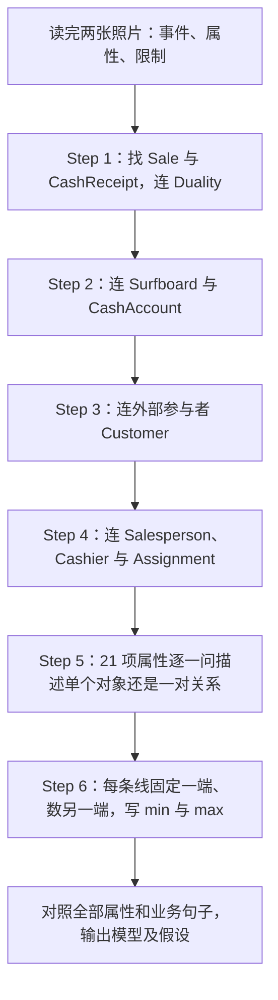
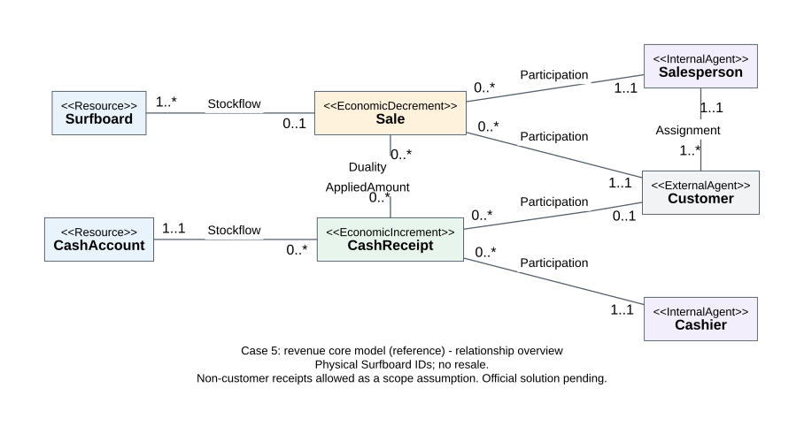
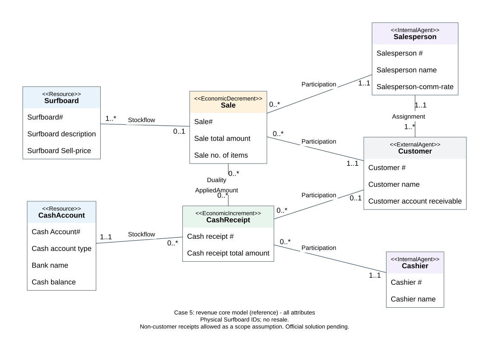

# Case 5：从业务句子画出销售与收款 REA 模型

这家店卖冲浪板。有时板已经交给顾客，钱还没收齐；有时顾客一次付款还清几笔购买；收到的钱也不全来自卖冲浪板。题目要求把这些事情、涉及的人和资源画成一张业务模型，并把题目给出的属性和“至少几个、最多几个”的限制放对位置。

本篇是私人学习解析与参考作答，不是正式提交稿或官方答案。照片给出了建模步骤、21 项属性和业务叙述，没有金额、币种或 Case 5 官方解答。2026-10-07 核对当前 Canvas Files、Assignments、Announcements、Modules 四入口时，均跳转 CityU SSO 登录；因此 Canvas 原件、官解、计分、截止、提交入口和 AI 使用条件均未核，不能记录为“未发布”。本人是否已学会、是否已提交均未确认。

[[AC6761_Artificial_Intelligence_Accounting/assignment/00-overview/作业总览|回作业总览]] · [[AC6761_Artificial_Intelligence_Accounting/assignment/practice/练习索引|Case 1–5 练习入口]]

## 1. 先知道要做什么、交什么

要交出的核心成果是收入流程层级的 REA Core model：7 个业务类、8 条关联、16 个方向的端点限制，以及 21 项属性的归属。这里的“类”是同一类对象的记录结构，例如 Customer 类里可以保存许多个客户；不是“画一个框就只代表一个客户”。

照片将 Step 3 and 4 合写，第二张照片开头是 Step 5 的最后一项属性，不能丢掉。为了跟 Week 5 PPT p.7–8 的六步方法对齐，本篇分成：①经济事件；②资源；③外部参与者；④内部参与者及指派；⑤属性；⑥多重性。

来源分三层：标“题面”的结论来自两张照片；标“讲义方法”的定义来自 Week 5 PPT；标“常识／假设”的限制是题目允许的 common business sense 或 reasonable assumptions，并非照片逐字给出。所有数值样例均为“💡 笔记补充”，不能冒充原题数据。

对应讲义方法：p.2–4 的 REA 类与关联，p.5–6 的属性和多重性，p.7–8 的六步，p.21 的收入流程核心模式。更完整背景可读 [[AC6761_Artificial_Intelligence_Accounting/notes/M05-REA业务流程建模|M05：REA 业务流程建模]]，但本篇会把做题所需方法就地解释。

## 2. 最难的业务句子，先翻成人话

| 题面关键句 | 谁做什么、最简单的意思 | 直接改变哪一步 | 没有说明什么 |
|---|---|---|---|
| Credit sale is allowed | 顾客已经买到板，可以暂时不付钱。这是店家赊销、客户赊购 | 固定一笔 Sale，允许暂时找不到 CashReceipt，最少为 0 | 不代表销售不需要客户，也不代表以后永远不用还 |
| Partial payment is allowed | 同一笔购买可以分几次付，不必一次付清 | 固定一笔 Sale，可对应多次 CashReceipt，最多为 * | 没有给分期日期、利率或手续费 |
| Combined payment is allowed | 同一个客户把几笔购买的钱合成一笔付款 | 固定一次 CashReceipt，可用于多笔 Sale，最多为 * | 不意味着一笔普通客户付款可以同时属于两个不同买方 |
| Sale of surfboard inventory is not the only source of cash receipt | 店里也会收到与卖板无关的钱 | 固定一次 CashReceipt，允许没有任何 Sale，最少为 0 | 不单独证明付款人一定不是 Customer；也没告诉另一种钱具体是什么 |
| There are some surfboards available for sale | 仓库里还有板没卖出去 | 固定一块 Surfboard，允许没有 Sale，最少为 0 | 不能据此认为每笔 Sale 可以不包含板 |
| Sale can be made by one and only one salesperson | 每笔销售由恰好一个销售员办理 | 固定 Sale，数 Salesperson，最少和最多都是 1 | 不限制销售员只能做一笔销售 |
| Every cash receipt has to be deposited into one and only one cash account | 每次收款全部归入恰好一个账户 | 固定 CashReceipt，数 CashAccount，恰好 1 | 不限制账户只能收一次钱；也不允许把一次收款拆入两个账户 |
| Cash receipt can be handled by one and only one cashier | 每次收款由恰好一个收银员办理 | 固定 CashReceipt，数 Cashier，恰好 1 | 不限制收银员只能办理一次收款 |
| Employees and customers can enter system without any transactions | 可以先建员工／客户档案，还没卖过板、还没付过钱 | 固定 Salesperson／Cashier／Customer，数其相关经济事件，最少可为 0 | “没有交易”不等于“没有客户指派”；Assignment 本身不是经济交易 |
| One customer must be assigned with one and only one salesperson | 每个客户都必须有恰好一个负责销售员 | 固定 Customer，数 Assignment 的 Salesperson，恰好 1 | 没说每次实际销售必须由该负责人完成 |
| One salesperson must be assigned to one customer and can be assigned to multiple customers | 每个销售员至少负责一个客户，也可以负责多个 | 固定 Salesperson，数 Assignment 的 Customer，1..* | 前半句的 must 不能忽略；此处不是 0..* |

例如，顾客买了 1,000 的板，先付 400、后来再付 600，就是一笔 Sale、两次 CashReceipt。相反，顾客把两笔欠款合计付 800，就是一次 CashReceipt、两笔 Sale。两方向都必须看，不能只把“分期”翻译出来就结束。

“收到别的钱”影响两条不同关系。它明确允许 CashReceipt 没有 Sale；至于 CashReceipt 是否可以没有 Customer，要再说明系统中的 Customer 范围。主模型允许其他来源来自非客户，所以 Customer 可为 0；若所有付款人都登记为 Customer，则这里可以是 1。该不确定性在 §7 单独保留。

## 3. 六步做题：每一步留下什么

REA 的三个字母是 Resource、Event、Agent：资源、事件、参与者。资源是店家控制、能够带来经济利益的东西；事件是某次实际流入或流出；参与者是做事或与店家交换资源的人。它关心真实交换，不从“收入账户”“应收账款账户”等总账名称开始画。

这不是无限循环算法。先完成六步，再按题面检查属性是否遗漏、端点是否读反、假设是否写明；出现矛盾就针对那条关系修正。交付边界是核心业务模型，不自动扩到退货、订单、佣金付款或整个会计系统。

### Step 1：找两个经济事件，连交换关系

Sale 是“一次将冲浪板所有权交给客户”。店里的板流出，所以是 Economic Decrement（经济减量事件）。CashReceipt 是“一次收到了钱”；店里现金流入，所以是 Economic Increment（经济增量事件）。减量不表示利润一定减少，增量也不表示所有收款都确认销售收入；方向是从企业资源的增减看，讲义 p.2、p.54–55 支持这一方法。

两者用 Duality（对偶／交换关联）连接，回答“哪次收款结算了哪笔销售”。先画连接，暂不填 1:1。赊销、分期与合并付款说明它们不是每笔完全一一配对。

所以呢：先把“已经卖出”与“已经收到钱”拆成两类事件，后面才能表达未付款、分期和合并付款。

### Step 2：每个事件连实际改变的资源

Sale 连 Surfboard；CashReceipt 连 CashAccount。前者是库存流出 Stockflow，后者是现金流入 Stockflow。题面写 Attach Cash，但属性列给 Cash Account#、account type、Bank name、Cash balance，因此用 CashAccount 表示具体现金账户，不另建一个重复的 Cash 框。

CashAccount 是“钱放在哪里、现在有多少”的持续存在对象；CashReceipt 是“这一次收了多少、谁办的”的一次事件。CA1 可以今天收 400、明天收 800，账户仍是同一个，收款事件却有两个。

题面已有 Cash balance 和 Customer account receivable，它们是余额属性。应收表示销售已发生而尚未结算的汇总，不能因为属性名含 receivable 就新加第三个经济资源。现金余额也属于现有账户，而非另建一个 Balance 资源。它们的推导见 §8；仅靠本题收入子模型不能重建整个公司全部历史现金收付。

所以呢：持续存在的是板和账户，发生一次的是卖出和收款，余额是前后事件累积的结果。

### Step 3：加入外部参与者 Customer

客户不是企业内部员工。Sale 连 Customer，说明板交给谁；CashReceipt 连 Customer，说明客户付款来自谁。对没有客户的其他来源收款，主模型允许这条 Customer 连接为空，而不把“未知付款人”猜成某个客户。

主模型采用常识：每笔普通销售有一个买方；每次普通客户收款最多来自一个客户。一次收款可以结算该客户的多笔销售，但不能自动拿来结算另一个客户的销售。这条同客户约束需要实现时额外检查，单靠两个端点上的 1 并不能保证。

所以呢：Customer 给事件补上“对方是谁”，不是把销售额或收款额变成客户身份。

### Step 4：加入内部参与者，并保留独立指派

Salesperson 连 Sale，Cashier 连 CashReceipt，两者都是 Participation（参与关联），记这次交易由谁办理。

Salesperson 还必须连 Customer，标 Assignment（指派）。它问“客户长期由谁负责”，不是“这次交易谁办理”。题面明确要求这条线。讲义 p.4、p.31 解释：两个人的关系不依赖他们共同参加某次事件时，才需要独立 Assignment。

例如 C3 刚登记，还没买板，已经分配给 SP2；SP2 可以暂时没有销售，但至少负责 C3。若把 Assignment 删掉，只剩 Salesperson → Sale → Customer，C3 没有 Sale，系统就无法记住负责人。反过来，题面没有规定“负责客户的销售员必须办理其全部销售”，不能暗加这个相等约束。

题目称 Core model，却明确要求 Assignment；因此参考答案保留题面指定的这条次级关联，而不机械删掉，也不据此扩出其他未要求的业务。

所以呢：事务参与和长期负责是两件事；“允许没交易”保留零次事务，但不能抹掉明确强制的指派。

### Step 5：把 21 项属性逐项放到真正描述的地方

属性是一条记录的某个信息。例如客户名称描述一个客户；分配金额描述“一次收款用于一笔销售”的组合。下面的编号是核对清单，不是原件额外字段。

| 序号 | 照片属性原名 | 归属 | 人话解释 |
|---|---|---|---|
| 1 | Surfboard# | Surfboard | 冲浪板的识别编号，主模型按单块实物识别 |
| 2 | Surfboard description | Surfboard | 这块板的描述 |
| 3 | Surfboard Sell-price | Surfboard | 这块板的售价属性；不是整笔交易总额 |
| 4 | Cash Account# | CashAccount | 现金账户编号 |
| 5 | Cash account type | CashAccount | 账户类型 |
| 6 | Bank name | CashAccount | 账户所属银行名称，不能当账户唯一编号 |
| 7 | Cash balance | CashAccount | 该账户当前余额，可由完整收付记录与期初余额推导 |
| 8 | Cashier # | Cashier | 收银员编号 |
| 9 | Cashier name | Cashier | 收银员姓名，姓名相同不证明同一个人 |
| 10 | Cash receipt # | CashReceipt | 这一次收款的编号 |
| 11 | Cash receipt total amount | CashReceipt | 这次实际收到的总额 |
| 12 | Customer # | Customer | 客户编号 |
| 13 | Customer name | Customer | 客户姓名 |
| 14 | Customer account receivable | Customer | 这个客户尚未结清的销售欠款汇总 |
| 15 | Salesperson # | Salesperson | 销售员编号 |
| 16 | Salesperson name | Salesperson | 销售员姓名 |
| 17 | Salesperson-comm-rate | Salesperson | 销售员佣金率；不是实际佣金金额 |
| 18 | Sale# | Sale | 一笔销售的编号 |
| 19 | Sale total amount | Sale | 这一笔销售的总金额 |
| 20 | Sale no. of items | Sale | 这一笔卖出的板数，是数量，不能和钱相加 |
| 21 | Cash receipt amount applied to sale | Sale–CashReceipt 的 Duality 关联 | 这次收款中的多少金额用于结算这一笔销售 |

`#` 是 number 在编号意义上的缩写。例如 Sale# = S1；它不是“第 S1 笔卖了多少块”。Sale no. of items 才是件数。若一笔卖 2 块、金额 1,600，编号、数量、金额三个信息分别是 S4、2、1,600，单位完全不同。

7 个类内属性数量依次为：Surfboard 3、CashAccount 4、Salesperson 3、Cashier 2、Customer 3、Sale 3、CashReceipt 2，共 20 项；加 1 项关联属性，合计 21 项。

照片没有日期、地址、电话、真实佣金金额，不作为题内属性补进去。讲义 p.5 说事件通常有日期，并不等于 Case 5 已给日期。佣金率需要对应计提基数和条件才能算佣金；题面没有说明按销售额还是到账额计算，所以不擅自计算真实佣金。

编号可用作 PK（Primary Key，主键）：使同类记录中每一条都可唯一识别。本题概念图不必额外塞满 FK（Foreign Key，外键）。落数据库时，FK 才用另一类的编号连接对象，例如一笔收款保存一个账户编号。用于关联金额的组合键见 §8。

所以呢：先问“只知道这个对象能不能确定该值”，再放属性；不能把所有带 cash receipt 的文字都塞进 CashReceipt。

### Step 6：逐方向确定最少与最多

Multiplicity（多重性）写成 min..max。`0` 是可以没有关联记录，`1` 是至少／恰好一个，`*` 是不设固定数值上限，不是无限多记录已经存在。

最容易读反的是端点位置：写在 A 旁边的数字，表示固定一个 B 时，可以有多少个 A。例如 `Surfboard "1..*" -- "0..1" Sale`：固定 Sale，数 Surfboard，至少一块；固定 Surfboard，数 Sale，零次或一次。不是“固定 Surfboard 就看 Surfboard 边上的数字”。

每条线按同一操作推：①固定一条记录；②明确数另一端什么单位；③找允许零的句子；④找至少一的句子；⑤找 exactly one 或 many 的上限；⑥把数值放到被数对象旁。没有足够题面依据时标明常识／假设，不把一般模板当定理。

## 4. 完整主图：7 类、8 关联、20 类属性与 1 关联属性

主图把 Sale 限定为已经将冲浪板交给客户的销售，不是未完成的订单；采用单块实物 Surfboard，并允许非客户来源的其他收款。其他来源没有自动并入这类冲浪板 Sale。所有 21 个原属性的对应见 §3；图中保留照片属性原名；`<<...>>` 显示类的 REA 身份，`#` 标识编号，不新增业务属性。

先看结构图：类内字段暂省略，7 个类、8 条关联、16 个端点与关键关联属性全部保留。资源、事件、内部／外部参与者用颜色辅助区分，类型名仍直接写在框内。线没有箭头，表示关联；从 Sale 和 CashReceipt 的交换关系开始，分别读资源和参与者。

完整属性图显示原题的全部 20 个类属性与 Duality 上的 AppliedAmount；字段使用照片原名，编号的 # 含义不变。

两图来自同一份 [JSON 语义清单](work/case5-revenue-core/case5.model.json)，[完整 DOT 图源](work/case5-revenue-core/case5.dot) 可重画；版本与实际核对见 [图示记录](work/case5-revenue-core/Case5-图示核对记录.json)。在 vault 根复做，可运行 `node _meta/tools/render_concept_graph.mjs --input AC6761_Artificial_Intelligence_Accounting/assignment/practice/work/case5-revenue-core/case5.model.json --output E:/app-data/codex/scratchpad/case5-redraw/model`，加 `--overview` 出结构图。重做先输出 scratch，核对后原子发布，不直接覆盖已有图。

主图范围仍是单块实物且无退回再售，允许非客户来源的其他收款；§7 的型号／客户来源替代条件继续保留。图示改进只改变显示与图源管理，不把参考答案升级成官方确认。

图中的 Duality 线旁直接标 AppliedAmount，表示对偶关联的关联属性；AppliedAmount 对应原题末项 `Cash receipt amount applied to sale`，属于线上的 Sale–CashReceipt 组合，未放进任何类框。真实 UML 可以在线旁标原属性全名，或用关联类展示该金额。即使转换成单独的关联表，也不是第三种经济事件，更不是把本题改成 8 个业务类。

图中 8 条线分别是：2 条 Stockflow、1 条 Duality、4 条 Participation、1 条 Assignment。不要再添加“Cashier 保管 CashAccount”等题面未给出的独立职责关系。

## 5. 16 个端点逐方向反解

下表每行先固定一条左列记录，再数右列对象。“端点”写在被数对象旁，务必和主图交叉读。它把模型变回业务句子，便于发现看反的数字。

| 固定谁 | 数谁 | 最少 | 最多 | 被数对象旁端点 | 为什么；来源边界 |
|---|---|---:|---:|---|---|
| 一笔 Sale | Surfboard 块数 | 1 | 多个 | Surfboard：1..* | 本题卖的是板，销售至少一块、可以多块；业务常识，讲义 p.54 的 one or more 作方法支持 |
| 一块 Surfboard | Sale 次数 | 0 | 1 | Sale：0..1 | 题面还有未售板；按单块实物、无退回再售循环假设，最多售出一次 |
| 一次 CashReceipt | CashAccount 个数 | 1 | 1 | CashAccount：1..1 | 题面 every、one and only one，不能一笔拆到两个账户 |
| 一个 CashAccount | CashReceipt 次数 | 0 | 多个 | CashReceipt：0..* | 账户可重复收款，也可新建后暂无收款；常识假设，题面 without transactions 只直接说员工／客户 |
| 一笔 Sale | CashReceipt 次数 | 0 | 多个 | CashReceipt：0..* | Credit sale 给 0；partial payment 给多个 |
| 一次 CashReceipt | Sale 笔数 | 0 | 多个 | Sale：0..* | 其他来源收款给 0；combined payment 给多个 |
| 一笔 Sale | Salesperson 人数 | 1 | 1 | Salesperson：1..1 | 题面 one and only one |
| 一个 Salesperson | Sale 笔数 | 0 | 多个 | Sale：0..* | 员工可以无交易；没有每人只能卖一次的限制，多个属常识 |
| 一次 CashReceipt | Cashier 人数 | 1 | 1 | Cashier：1..1 | 题面 one and only one |
| 一个 Cashier | CashReceipt 次数 | 0 | 多个 | CashReceipt：0..* | 员工可以无交易；可重复办理属常识 |
| 一笔 Sale | Customer 人数 | 1 | 1 | Customer：1..1 | 每笔普通销售一个买方，常识假设；照片未逐字写 exactly one customer |
| 一个 Customer | Sale 笔数 | 0 | 多个 | Sale：0..* | 客户档案可无交易；客户可重复购买属常识 |
| 一次 CashReceipt | Customer 人数 | 0 | 1 | Customer：0..1 | 主模型范围假设允许其他来源来自非客户；普通客户付款最多一个付款客户属常识 |
| 一个 Customer | CashReceipt 次数 | 0 | 多个 | CashReceipt：0..* | 客户档案可无交易；可以多次付款，分期也是直接例子 |
| 一个 Customer | 负责的 Salesperson 人数 | 1 | 1 | Salesperson：1..1 | 题面每客户 must、one and only one |
| 一个 Salesperson | 被指派的 Customer 人数 | 1 | 多个 | Customer：1..* | 题面 must be assigned to one 给最少 1；can be assigned to multiple 给最多多个 |

注意同一个 Salesperson 在两条线上的最低数量不同：Sale 为 0，Assignment 的 Customer 为 1。SP2 可以没做销售却负责 C3，因此两条限制完全可以同时成立。若给 Assignment 写成 0..*，就把题面必须负责至少一人的限制丢了。

不要把讲义 p.6 的 Resource–Event 常用 0..1 机械套到现金账户上。一块具体板在本题范围内最多卖一次；一个现金账户却会一再接收不同的款，它不是一笔收到后就消失的现金事件。因此 CashAccount 是资源，仍可以对应多次 CashReceipt；默认规则要看具体资源怎样被事件改变。

## 6. 为什么“应用金额”不能放进某个单独类

假设 R2 收了 800，其中 600 用来付 S1，200 用来付 S2。只知道 R2，可以知道收款总额是 800，却不知道问的是“给 S1 的 600”还是“给 S2 的 200”。只知道 S1，也不能知道问的是 R1 给它的 400，还是 R2 给它的 600。

要同时知道“哪次收款”和“哪笔销售”，才能确定这个金额。因此它描述的是一对记录，属于关联属性（association attribute）。讲义 p.5 的判断标准就是：描述一个 thing，还是 combination of things；p.16–17 将付款用于采购的金额放在 Duality 上，本题按同一方法处理收入方向。

数据库实现可以用以下关联表，不需要新造经济事件：

| ReceiptID | SaleID | AppliedAmount |
|---|---|---:|
| R1 | S1 | 400 |
| R2 | S1 | 600 |
| R2 | S2 | 200 |

在本题简化模型中，一对 `(ReceiptID, SaleID)` 只保存一个累计应用金额，组合就是主键；两个编号同时也是分别指向收款、销售的外键。若现实业务要记录同一对对象多次分配／调整的历史，则要扩展历史记录设计，照片没有要求。

若把 AppliedAmount 作为 CashReceipt 的单一字段，R2 的 600 与 200 无法分别对应目标；若把它作为 Sale 的单一字段，S1 的 400 与 600 无法追踪来自哪次收款。保存总数可以满足汇总查询，但不能代替这张分配明细。

所以呢：收款总额回答“进来了多少”；应用金额回答“其中多少结算这笔销售”；总额相同不表示属性位置相同。

## 7. 两个题面不能唯一决定的地方

### 7.1 Surfboard 是单块实物，还是 SKU 品类？

主图按 Surfboard# 识别一块具体板，采用 Resource。每块最多对应一次 Sale，是没有退货再售循环的核心范围假设。一笔 Sale 至少含一块，可以含多块，所以 Surfboard 端是 1..*、Sale 端是 0..1。

如果教师将 Surfboard# 定义为一种型号／SKU，而不是每块实物，它应是 ResourceType。一个型号可以反复出现在不同销售中，因此改为 `Surfboard "1..*" -- "0..*" Sale`。同一 SKU 在一笔销售中卖几块需要销售明细数量表达；题面给出的 Sale no. of items 是整笔件数，不能自动当每种 SKU 的数量。主答案不在未说明时补造这些题内属性。

讲义 p.2 区分可互换品类与独立实物，p.6 给两种常用端点。本题照片未进一步解释编号粒度，故主模型与替代条件都保留。不能把 0..1 宣称为完全不依赖假设的唯一官解。

### 7.2 每次收款都必须来自 Customer 吗？

题面明确“销售冲浪板不是收款的唯一来源”，只直接推出固定 CashReceipt 可没有 Sale。主模型进一步允许其他钱来自非客户，因此 Customer 端为 0..1。

另一种合理范围是：其他来源也来自登记的客户，所有收款都有一个 Customer。这时将 `Customer "0..1" -- "0..*" CashReceipt` 改为 `Customer "1..1" -- "0..*" CashReceipt`；Sale–CashReceipt 仍然保持 0..* 对 0..*，因为收款是否对应销售与是否来自客户是两回事。

讲义 p.19–20 的采购样例含支付其他 utilities 的情境，可作“业务范围改变事件参与端点”的方法参考；它不是 Case 5 官方解答，不能直接拿采购付款方的数字证明本题客户端必须为 0。

主模型没有新增 OtherPayer 类，是在指定收入核心范围内用可选 Customer 连接表示其他来源。完整组织模型仍应追踪实际付款方及来源事件，那属于进一步扩展。

## 8. 用同一份小数据，从销售到余额完整走一遍

以下全部是 💡 笔记补充，不是照片数据；数值单位为任意一致的金额单位，不指定原题币种。观察时点依次为三笔销售记完、R1 分配完、R2 分配完、R3 记完；最终余额都截至最后一个时点。账户期初现金和客户期初应收均设为 0。不考虑折扣、退货、坏账、税费和付款流出。佣金基数未知，不计算佣金。

先建档：客户 C1、C2 分给 SP1；C3 分给 SP2。SP2 没有销售，但负责 C3；C3 没有销售或收款。K2 暂无收款，CA2 暂无收款。它们显示“建档可无交易”不等于“客户可无指派”。

销售记录如下；四块板分别为 B1、B2、B3、B4，B4 还未售出。此样例仅为简化取板售价等于该笔销售金额，题面未规定永远没有折扣。

| SaleID | 已卖出实物 | Customer | Salesperson | Sale no. of items | Sale total amount |
|---|---|---|---|---:|---:|
| S1 | B1 | C1 | SP1 | 1 | 1,000 |
| S2 | B2 | C1 | SP1 | 1 | 600 |
| S3 | B3 | C2 | SP1 | 1 | 300 |

B4 的售价为 250，但未卖出；没有第四笔 Sale，也不能把 250 加到销售额里。三笔销售总额是 1,900，销售件数是 3，两者不能相加。

收款记录如下，均由 K1 收入 CA1：

| ReceiptID | Customer | 收款总额 | 和销售的关系 |
|---|---|---:|---|
| R1 | C1 | 400 | 400 全用于 S1 |
| R2 | C1 | 800 | 600 用于 S1，200 用于 S2 |
| R3 | 无 | 50 | 主模型假设的非客户其他来源，无 Sale 连接 |

R3 的“无客户”是为演示 §7.2 主模型假设，不是原题确定的付款人事实。S3 暂时没有 CashReceipt，是赊销。B4 没有 Sale 是未售库存。

### 8.1 逐次处理，看到中间状态

先记录 S1、S2、S3：CA1 现金仍为 0，C1 欠 1,600，C2 欠 300。销售与收款分开，因此已卖出不自动等于已到账。

记 R1 收款 400，并分配给 S1：CA1 变成 400；S1 未结清从 1,000 变 600；S2 仍 600、S3 仍 300。C1 合计欠 1,200，C2 欠 300。

记 R2 收款 800：CA1 从 400 变成 1,200。将其中 600 分给 S1、200 分给 S2：S1 剩 0，S2 剩 400，S3 仍 300。R2 合计分配正好 800。S1 接受 R1 和 R2 两次收款，示范分期；R2 同时结算 S1、S2，示范合并付款。

再记 R3 的 50：CA1 从 1,200 变成 1,250；它没有关联 Sale，所以不减少 C1、C2 的销售应收。不能因为“又收到钱”就把所有客户欠款减 50。

| 处理结束时 | CA1 现金 | S1 未结清 | S2 未结清 | S3 未结清 | C1 应收 | C2 应收 |
|---|---:|---:|---:|---:|---:|---:|
| 三笔销售已记，未收款 | 0 | 1,000 | 600 | 300 | 1,600 | 300 |
| R1 分配完成 | 400 | 600 | 600 | 300 | 1,200 | 300 |
| R2 分配完成 | 1,200 | 0 | 400 | 300 | 400 | 300 |
| R3 完成 | 1,250 | 0 | 400 | 300 | 400 | 300 |

### 8.2 公式怎样从明细产生汇总

令 $T_s$ 表示销售 $s$ 的总额；$A_{r,s}$ 表示收款 $r$ 用于销售 $s$ 的应用金额；没有连接则视作 0。$AR_s$ 是这笔销售的未结清金额，不是在主图新加一个类。

$$
AR_s=T_s-\sum_r A_{r,s}
$$

对 S1，先加来自两次收款的 400 和 600，再从 1,000 扣除：

$$
AR_{S1}=1000-(400+600)=0
$$

S2 只从 R2 得到 200；S3 没有收款：

$$
AR_{S2}=600-200=400,\qquad AR_{S3}=300-0=300
$$

客户应收是这个客户各笔销售的未结清金额之和。$c$ 是客户，$s\in Sales(c)$ 表示属于客户 $c$ 的销售集合。

$$
AR_c=\sum_{s\in Sales(c)}AR_s
$$

因此 C1 应收为 $0+400=400$，C2 为 300，C3 没有销售，求和结果为 0。不是把全公司的 700 随意分给某个客户。

现金余额则要看账户，不看销售应收。$B_{a,0}$ 为账户 $a$ 的期初余额，$R_r$ 为收到的总金额，$D_d$ 为从该账户付出的金额；本题没有 CashDisbursement 类，但完整现金余额需要付款数据。无付款的教学样例才能直接只加收款。

$$
B_a=B_{a,0}+\sum_{r\in Receipts(a)}R_r-\sum_{d\in Disbursements(a)}D_d
$$

样例的期初为 0、付款为 0：

$$
B_{CA1}=0+400+800+50-0=1250
$$

同一套明细还可以做两项核对。第一，销售总额由已结算部分和未结算部分组成；第二，收款总额由用于销售的部分和未用于本题销售的部分组成。

$$
1900=1200+700
$$

$$
1250=1200+50
$$

这里 700 是 S2 的 400 加 S3 的 300；50 是 R3 的其他来源。R1、R2 的钱只计入现金一次，应用金额表只解释它们如何结算销售，不能再把 1,200 加入现金造成重复。

所以呢：销售金额回答已卖出多少，现金回答已到账多少，应收回答销售尚欠多少；三个数可以不同而模型仍然正确。

### 8.3 多重性不能自动保证金额合理

本示例把不存在的分配在汇总算式中按 0 处理；实际已保存的分配行采用正金额，0 元不另造联系行。下列是额外完整性要求，不是端点上的 min..max 自动保证的：应用金额不能为负；一笔收款分给销售的合计不得超过该次实收；一笔销售收到的应用金额合计不得超过该笔应收范围；普通客户付款只能分配给同一个客户的销售。这些要求用于当前无退款／预收／调整的简化样例，复杂业务需要增加明确规则。

$$
A_{r,s}\ge 0,\qquad \sum_s A_{r,s}\le R_r,\qquad \sum_r A_{r,s}\le T_s
$$

例如把 R2 对 S2 的分配从 200 写成 300，总分配就成为 900，超过实收 800。关联数量仍符合多对多，图不会自动报错，金额检查却能抓到问题。若把 R2 分给 C2 的 S3，端点仍可能合法，但违反本篇普通单客户付款的同客户约束。

若系统只见这些端点、没做金额与客户一致性校验，就可能产生账面“欠款为负”或拿甲的钱抵乙的债。修正要回查分配明细，而非随便改余额来凑平。

## 9. 改条件自测：规则变了，改哪一端？

以下是学习练习，答案为本篇条件下的参考推理；未实际作答前不记录本人通过。

### 题 1：禁止赊销，要求每笔销售在记录时已有收款，仍允许分期

固定 Sale，CashReceipt 端应改成什么？

参考答案

改为 1..*。禁止零次已收款提高最少数；仍允许分期保留多个。固定 CashReceipt 数 Sale 仍可能为 0..*，因为题设仍允许其他来源与合并付款。“没有赊销”本身不自动证明每笔只收一次。

### 题 2：允许赊销，但每笔销售最多收款一次

固定 Sale，数 CashReceipt，应如何改？

参考答案

CashReceipt 端为 0..1。赊销保留 0，最多一次把上限改成 1。合并付款若仍允许，一次 CashReceipt 仍可对应多笔 Sale，因此 Sale 端不能跟着自动改成 0..1。

### 题 3：所有收款都来自登记客户，但有些客户付的是与卖板无关的钱

是否把 CashReceipt–Sale 的 Sale 端最低改成 1？

参考答案

不改。CashReceipt–Customer 的 Customer 端改为 1..1；CashReceipt–Sale 的 Sale 端仍为 0..*。客户身份必填与必须结算销售是两种不同要求。

### 题 4：新销售员可以暂时还没有指派客户

该改哪条关联？

参考答案

Assignment 的 Customer 端由 1..* 改为 0..*，因为固定 Salesperson 可以有零个客户。不是修改 Salesperson–Sale；后者原本就允许没有销售。每客户必须恰好一位负责销售员若仍保留，Salesperson 端仍为 1..1。

### 题 5：Surfboard# 改成型号编号，同一型号可以卖给不同顾客

哪一端变，主类身份变成什么？

参考答案

改成 ResourceType；固定一个型号可以出现在多笔 Sale，所以 Sale 端从 0..1 改为 0..*。固定 Sale 仍至少有一个型号，Surfboard 端保持 1..*。每种型号卖几块还需要明细数量设计，不能从整笔 Sale no. of items 推出分型号数量。

### 题 6：在原样例后，C1 再付 R4 = 400，全用于 S2

假设仍由 K1 存入 CA1，新的中间状态是什么？

参考答案

新增分配 `(R4,S2)=400`。CA1 为 $1250+400=1650$；S2 为 $600-(200+400)=0$；C1 应收为 0；C2 仍为 300。总应用金额为 1,600，销售总额仍 1,900，因此 $1900=1600+300$；现金 $1650=1600+50$。收款不是新销售，不把销售额再加 400。

### 题 7：一笔 R5 实收 200，却填了对 S3 的应用金额 350

多重性有错吗，真正应查什么？

参考答案

一笔收款连一笔销售，数量上符合 0..* 对 0..*。金额上同时超过实收 200 和 S3 未结清 300，违反两项金额约束。应核原收款与分配明细，而非仅看端点图或把余额硬改成非负。

## 10. 学习总结与易错诊断

遇到同类题，先画实际资源流入、流出的两种事件，再连资源和人；之后把属性分成“单个对象的信息”和“两个对象组合的信息”；最后逐条线固定一端、数另一端的最少与最多。

本题最重要的结果是：Sale 与 CashReceipt 多对多，客户付款用于某笔销售的金额属于 Duality；Salesperson–Customer 的 Assignment 独立于交易，销售员至少负责一个客户。账款是尚未结清销售的汇总，账户余额是资金收付的汇总，不能把每次收款都当作当次销售收入。

常见错误可以这样发现：漏掉第 21 属性就查第二张照片开头；把 AppliedAmount 放进 CashReceipt 就拿 R2 的 600／200 反问；读反端点就说完整句“固定一笔 Sale，有几块板”；Assignment 写 0 就回看 salesperson 的 must；把 Customer 端 0 写成题面必然结论就区分“非销售钱”与“非客户钱”；把 250 的 B4 算进销售，就查它有没有 Sale 连接。

本篇参考解析覆盖六步、21 属性、8 关联及 16 端点。重要数值以 §8 的完整表和恒等式公开，本次已实际运行补充数据及 R4 变式复算，并检查金额、身份和最小参与错误；具体结果见下方核对记录。新增图形的实际显示在收尾记录单列，不以代码写出来作为显示通过。没有虚构读者评分，没有将官方或行政条件标成已确认。

## 11. 英文精简参考表达（照片版条件，非提交确认）

> Reference answer based on the two Case 5 photos; official solution and submission requirements remain unverified.

Resources: Surfboard and CashAccount. Economic events: Sale (decrement) and CashReceipt (increment). Agents: Salesperson and Cashier (internal), and Customer (external). Connect Sale to CashReceipt by Duality; attach Surfboard to Sale and CashAccount to CashReceipt by Stockflow; add four event-agent Participation associations and a Salesperson–Customer Assignment association.

Place the 20 object attributes in their respective seven classes. Place “Cash receipt amount applied to sale” on the Sale–CashReceipt Duality association, because it depends on both identifiers. Use the 16 directional multiplicities in §5. Under the stated assumptions, each Surfboard is an individual physical board sold at most once, and a non-sales cash receipt may come from a non-customer. If Surfboard# identifies a resource type, allow multiple sales per type. If all cash receipts must come from registered customers, require exactly one Customer per CashReceipt.

Each Customer must be assigned exactly one Salesperson, and each Salesperson must be assigned one or more Customers. Employees and Customers may have zero economic transactions; that does not remove the required Assignment.

本私人参考解析使用 Codex 辅助整理题面、推理和撰写；这句记录本篇实际使用情况，不代替用户确认采纳、独立学习或正式提交声明。

## 12. 来源、核对与实际完成范围

照片第 1 页包含 Step 1–5 前 20 项属性；第 2 页首行是第 21 项关联属性，之后给 Step 6 的全部业务条件和唯一 Required。两页均已逐项视觉读取。步骤内容是题面要求，不是替用户提交、上传或公开私人答案的授权。

- [照片第 1 页](../../course_files_export/case4-case5-photos/case5-page-01.jpg)：SHA-256 `767145b90420fdeb281d1965d63b09adabbbb2a31b3f3f66cf48246bf8fdc5a6`，与用户附件字节一致。
- [照片第 2 页](../../course_files_export/case4-case5-photos/case5-page-02.jpg)：SHA-256 `907c6990a22903d091a69ea8fd387a292d79d3e6df71a5199a36f6e6fcd88125`，与用户附件字节一致。

原 `Week 5 PPT.pptx` 共 57 页的文字和备注已读取，备注正文均为空；这里只引用与本题相关的 p.2–8、p.16–21、p.31、p.54–55 方法，不把讲义中的采购例子称为 Case 5 官方解答。PPT 原件 SHA-256：`9c0c1bb05e4100a02bb07355e8a04bdf20f6069cca22f81eefbefe6cc28bd8d5`。

本次实际复算：补充数据的销售合计 1,900、收款 1,250、用于销售的应用金额 1,200、其他来源 50、未结清销售 700；C1/C2/C3 应收 400/300/0，CA1/CA2 现金 1,250/0。新增 R4 后现金 1,650、应用金额 1,600、应收合计 300。10 个有明确错误原因的变式实际被拒绝；它们是教学范围内的程序核验，不是已建生产数据库或官方检查器通过。

完整建模与难句解释、21 项归属、16 个端点、汇总读法及 7 道自测已完成。现阶段为照片版参考解析：本次 Canvas 四入口均实见 CityU SSO 登录，官方版本、计分、DDL、提交及 AI 使用条件未核。没有直接 Obsidian 阅读视图或独立真人 Q/R 评分；不替本人记录已通读、自测通过或已提交。Notion 作业看板规则只跟踪计分任务，不为这份待核课堂练习新建行，也不改 M05 的课程笔记／转录状态。

收尾显示核对（2026-10-07）：同源浏览器预览实际查看完整核心模型、六步流程图及金额表／公式，2 张 Mermaid 图完成渲染，27 个数学表达式均显示，0 数学错误；7 个折叠自测答案齐全。Mermaid 按自动布局显示，数字端点同时逐项写在 §5 的 16 行表中供反解。未直接操作 Obsidian 阅读视图。原照片哈希一致，Week 5 PPT 与原有 Case 1–4 全文哈希和开工备份一致。

2026-10-07 图示流程落实：以同一语义 JSON 改用 Graphviz 结构图与完整属性图，7 类／8 关联、20 类属性＋1 关联属性和16端点与原解析一致；实际查看最终矢量图与字体、连线、端点和图注，语义及原有范围假设未变。旧 Mermaid 的渲染记录保留为当时事实；本次不改官方／行政待核或本人学习状态。
