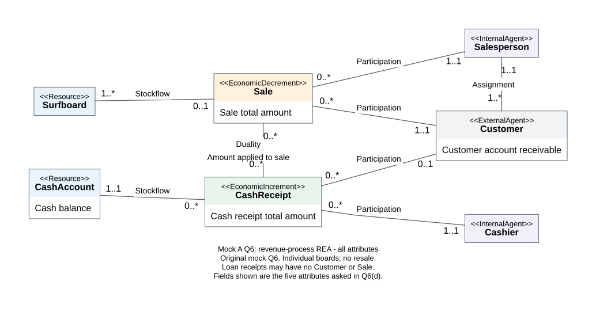

# AC6761 期中模拟卷 A · 答案与中文解析

本文件对应同目录“试卷.md”，全部答案是原创模拟卷的参考解析。教师 Case 的官解用于核对概念和方法，不能把本卷答案称为教师标准答案。评分细则供自评，实际考试如何给分由教师决定。

建议先限时做题，再对答案。做错时把错因写成“把收款当收入”“把端点放反”等具体动作。不要只记录分数。

## Q1 · 原则识别（8 分）

每问：原则名称 1 分，贴合题面解释 1 分。以下英文句子是本卷参考答法，不是课件逐字引文。

1. Historical cost principle（历史成本原则）。Reference answer: The equipment is initially recorded at its acquisition cost of HKD18,000, rather than the dealer's later offer of HKD23,000.

   中文解析：这题问购买时如何记账，依据是实际取得设备的成本。后来的报价不是当初付出的金额。题目已限定历史成本口径；不要把它扩张成“任何资产在任何情形下永远不能重估”。

2. Monetary unit assumption（货币计量假设）。Reference answer: Accounting records transactions in monetary units; employee motivation is not directly recorded as a monetary amount.

   中文解析：账簿需要可用货币计量的数字。员工积极性可能很重要，但“很积极”没有给出可靠的金额。不能因为账上没写金额，就断言它没有经营价值。

3. Business entity assumption（经济主体假设）。Reference answer: The business is accounted for separately from its owner. A personal holiday payment is an owner withdrawal, not an operating expense.

   中文解析：即使老板拥有企业，也必须把企业经营与个人消费分开。企业现金减少了，但旅行不是为企业赚收入而发生的经营耗用，因此不进入本期费用。

4. Going concern assumption（持续经营假设）。Reference answer: The accounts assume that the business will continue operating rather than immediately liquidating its assets.

   中文解析：设备能在未来几年继续发挥作用，处理时采用企业继续经营的前提。持续经营不是保证“企业永远不会倒闭”，也不是仅凭预计使用几年就能排除倒闭风险。

改条件自测：如果旅行是企业安排且符合题面给定的业务用途，应先判断它是否属于经营支出，不能机械把所有老板经手的付款都记为提取。

## Q2 · 会计等式（12 分）

先唤醒三件事：Assets 是企业控制的资源；Liabilities 是企业欠外部人的义务；Equity 是资产扣除负债后属于业主的部分。把每笔影响放入这三个类别，再检查等式。

$$Assets = Liabilities + Equity$$

下表每行是交易变化或交易后的累计余额。金额单位都是 HKD。`+0` 表示这一类没有净变化；资产内部的交换仍须展示两项。

| 行 | Assets | Liabilities | Equity |
|---|---:|---:|---:|
| T1 变化 | +16,000 | +0 | +16,000 |
| T1 后余额 | 16,000 | 0 | 16,000 |
| T2 变化 | −5,000 +5,000 | +0 | +0 |
| T2 后余额 | 16,000 | 0 | 16,000 |
| T3 变化 | +800 | +800 | +0 |
| T3 后余额 | 16,800 | 800 | 16,000 |
| T4 变化 | +3,000 | +0 | +3,000 |
| T4 后余额 | 19,800 | 800 | 19,000 |
| T5 变化 | +2,000 −2,000 | +0 | +0 |
| T5 后余额 | 19,800 | 800 | 19,000 |
| T6 变化 | −400 | −400 | +0 |
| T6 后余额 | 19,400 | 400 | 19,000 |

T5 的资产栏读法是：现金增加 2,000，应收账款减少 2,000，总资产不变。它不是“什么都没有发生”。

### 每一笔为什么这样处理

1. 业主投入：企业收到现金，业主对企业的权益同步增加。投入不是提供服务赚来的，所以不叫收入。
2. 买设备：现金少 5,000，设备多 5,000。设备尚未耗用，本题又不计折旧，因此总资产和权益不变。
3. 赊购用品：企业先取得用品，多了 800 资产；尚未付款，所以多了 800 应付账款。题目明确用品未耗用，不记费用。
4. 赊销服务：服务已经完成，取得向客户收取 3,000 的权利。这是应收账款资产；服务收入增加权益，即使现金尚未收到。
5. 客户回款：这次收的是 T4 已确认的欠款。只把应收变成现金，不再确认一次收入。
6. 还供应商：现金和原有应付账款各少 400。清偿旧债没有再耗用新资源，所以权益不变。

最后独立核算现金 12,600、应收 1,000、用品 800、设备 5,000。

$$12,600+1,000+800+5,000=19,400=400+19,000$$

每笔 2 分：正确的类别、金额及符号 1 分，累计余额和平衡 1 分。T2、T5 只写总资产净变 0 而不展示两项，变化部分只能得 0.5 分；累计余额仍单独计分。

改条件自测：若 T3 的用品买来后当场全部耗用，资产不应保留用品 800。以购入后立即耗用的合并效果看，负债增加 800、费用令权益减少 800，总资产净变化为 0。

## Q3 · 分录、账户与试算表（20 分）

### (a) 全部 12 笔分录（12 分）

借方（Debit）是账户左边，贷方（Credit）是右边。资产增加放借方，负债、资本和收入增加放贷方；费用及业主提取增加放借方。不能把“借方”一律当作增加。

下表每行是一笔分录；借方和贷方金额相等。`Prepaid Rent` 是仍可供未来使用的租赁权益，不是本期已经耗用的租金。

| 交易 | 借方账户 | 贷方账户 | 金额 HKD |
|---|---|---|---:|
| T1 | Cash | Owner's Capital | 30,000 |
| T2 | Prepaid Rent | Cash | 6,000 |
| T3 | Equipment | Cash | 9,000 |
| T4 | Supplies | Accounts Payable | 1,800 |
| T5 | Cash | Service Revenue | 6,000 |
| T6 | Accounts Receivable | Service Revenue | 4,000 |
| T7 | Utilities Expense | Cash | 500 |
| T8 | Accounts Payable | Cash | 1,200 |
| T9 | Owner's Withdrawals | Cash | 1,000 |
| T10 | Cash | Accounts Receivable | 2,500 |
| T11 | Rent Expense | Prepaid Rent | 2,000 |
| T12 | Supplies Expense | Supplies | 1,200 |

每笔 1 分：两账户正确 0.5 分，借贷方向及金额正确 0.5 分。由前问错误带来的后续一致结果，按后续方法另给分，不重复扣同一错误。

### 每笔的经济动作与理由

1. T1：老板把 30,000 现金交给企业。现金资产和投入资本增加；经营收入尚未发生。
2. T2：企业一次付三个月的房租。付款时取得三个月的使用权；先记 6,000 预付资产，现金减少 6,000。
3. T3：企业用 9,000 现金换到设备。仍是资产内部交换；题目明确忽略折旧，所以不另造费用。
4. T4：用品已到手但钱没付。用品增加 1,800，应付账款增加 1,800。`on account` 在这里指赊购。
5. T5：服务做完且现场收钱。现金增加 6,000，收入增加 6,000。
6. T6：服务做完但客户欠款。应收增加 4,000，收入增加 4,000。这里的 `on account` 是向客户赊销。
7. T7：9 月水电已耗用并付款。现金减少 500，9 月费用增加 500；费用令权益减少。
8. T8：偿还 T4 的部分欠款。应付和现金各减少 1,200；本次不是再次购买或耗用品。
9. T9：老板取走 1,000 作私人消费。现金减少，业主提取增加；它减少业主权益，但不减少利润。
10. T10：收回 T6 欠款中的 2,500。现金增加，应收减少。客户还欠 1,500，本次没有新增服务收入。
11. T11：到了月末，9 月的使用权已耗用。每月租金为 $6,000\div3=2,000$；预付资产减少 2,000，租金费用增加 2,000。此刻没有再付款。
12. T12：用品中有 1,200 已用于经营。用品资产减少 1,200，用品费用增加 1,200；剩余未耗用品是 600。

把预付款转成费用的顺序是：先付钱取得未来服务，再随着期间经过耗用服务。T2 和 T11 是不同的动作，不能把两次都记成现金付款。

### (b) 全部 T-account 明细（4 分）

账户记录把同一账户的多笔变化放在一起。先分别加总借、贷两侧，再用较大侧减去较小侧。下方 `(T1) 30,000` 表示 T1 在这一侧记录了 30,000，不是日期或余额。

Cash 的借贷记录较多，单列如下；空白格表示没有对应分录。

| Cash · Debit HKD | Cash · Credit HKD |
|---:|---:|
| (T1) 30,000 | (T2) 6,000 |
| (T5) 6,000 | (T3) 9,000 |
| (T10) 2,500 | (T7) 500 |
| — | (T8) 1,200 |
| — | (T9) 1,000 |
| 合计 38,500 | 合计 17,700 |

Cash 期末借方余额为 $38,500-17,700=20,800$。两侧发生额不相等是正常现象；一笔分录在不同账户的借贷相等，不表示每个账户自己两侧相等。

其余 11 个账户如下。最后一列的 Dr/Cr 表示余额在哪一侧；破折号表示该侧没有本期记录。

| Account | Debit entries HKD | Credit entries HKD | Ending balance HKD |
|---|---|---|---|
| Accounts Receivable | T6 4,000 | T10 2,500 | 1,500 Dr |
| Prepaid Rent | T2 6,000 | T11 2,000 | 4,000 Dr |
| Supplies | T4 1,800 | T12 1,200 | 600 Dr |
| Equipment | T3 9,000 | — | 9,000 Dr |
| Accounts Payable | T8 1,200 | T4 1,800 | 600 Cr |
| Owner's Capital | — | T1 30,000 | 30,000 Cr |
| Owner's Withdrawals | T9 1,000 | — | 1,000 Dr |
| Service Revenue | — | T5 6,000；T6 4,000 | 10,000 Cr |
| Utilities Expense | T7 500 | — | 500 Dr |
| Rent Expense | T11 2,000 | — | 2,000 Dr |
| Supplies Expense | T12 1,200 | — | 1,200 Dr |

例如 Accounts Payable：先赊购欠了 1,800，再还了 1,200，剩余欠款 600。负债减少记借方；不能因 T8 在借方就认定负债增加。

评分：现金明细及余额 1 分；其余资产账户 1 分；负债、资本、提取、收入 1 分；费用账户 1 分。各组按正确覆盖比例给部分分。

### (c) 调整后、结账前试算表（2 分）

试算表取每个账户的期末余额，不把全部借贷发生额再填一遍。本表已经包含月末 T11、T12，但尚未把收入、费用和提取账户结转关闭，因此这些账户都保留。

| Account | Debit HKD | Credit HKD |
|---|---:|---:|
| Cash | 20,800 | — |
| Accounts Receivable | 1,500 | — |
| Prepaid Rent | 4,000 | — |
| Supplies | 600 | — |
| Equipment | 9,000 | — |
| Accounts Payable | — | 600 |
| Owner's Capital | — | 30,000 |
| Owner's Withdrawals | 1,000 | — |
| Service Revenue | — | 10,000 |
| Utilities Expense | 500 | — |
| Rent Expense | 2,000 | — |
| Supplies Expense | 1,200 | — |
| Total | 40,600 | 40,600 |

余额列位置与内容 1 分，合计各 40,600 且明确为结账前 1 分。不能把期末权益 35,300 再额外加进试算表，否则会重复计算。

### (d) 利润与权益（2 分）

本期利润是收入减经营费用。总收入为 10,000，费用包括水电 500、9 月租金 2,000 和耗用品 1,200。

$$Net\ income=10,000-(500+2,000+1,200)=6,300$$

业主权益则是在期初权益基础上，加投入和利润，再减业主提取。本题期初权益为零。

$$Ending\ equity=0+30,000+6,300-1,000=35,300$$

利润和权益各 1 分。再用期末资产与负债独立对校：

$$20,800+1,500+4,000+600+9,000=35,900=600+35,300$$

改条件自测：如果 T2 支付的 6,000 覆盖六个月且 9 月是首月，9 月租金变为 1,000，预付余额变为 5,000。现金仍是 20,800，利润变为 7,300，权益变为 36,300。改变的是耗用期间，不是已经付出的现金。

## Q4 · 共同比（12 分）

共同比把不同规模公司的数字放到共同尺度上。本题每一行除以本公司 Total assets；既不除以总收入，也不把两公司的资产加起来作分母。

$$Common\ size\ percentage=\frac{Line\ item}{Total\ assets}\times100\%$$

分子是该行金额，分母是同公司、同日的资产总额。二者都用 HKD thousand，所以单位约掉。下面每格同时展示原金额代入和一位小数结果。

| Item | CloudBridge | MetalWorks |
|---|---|---|
| Cash | $2,400\div 12,000$ → 20.0% | $1,000\div 20,000$ → 5.0% |
| Accounts receivable | $1,800\div 12,000$ → 15.0% | $3,000\div 20,000$ → 15.0% |
| Inventories | $600\div 12,000$ → 5.0% | $6,000\div 20,000$ → 30.0% |
| PPE, net | $1,200\div 12,000$ → 10.0% | $8,000\div 20,000$ → 40.0% |
| Intangible assets | $6,000\div 12,000$ → 50.0% | $2,000\div 20,000$ → 10.0% |
| Current liabilities | $1,800\div 12,000$ → 15.0% | $5,000\div 20,000$ → 25.0% |
| Long-term debt | $1,200\div 12,000$ → 10.0% | $7,000\div 20,000$ → 35.0% |
| Equity | $9,000\div 12,000$ → 75.0% | $8,000\div 20,000$ → 40.0% |

例如 CloudBridge 无形资产 50.0%：每 100 元账面资产中，有 50 元记在无形资产这一类。它不表示本期收入有一半来自无形资产。

前五行资产占比各自合计 100%；后三行融资来源占比也各自合计 100%。两组分别看，不能把整张表八行全加成 100%。16 个结果各 0.5 分。

### (b) 总负债占比（2 分）

题目已声明负债类别完整，因此总负债等于流动负债加长期债务。

$$CloudBridge:\quad\frac{1,800+1,200}{12,000}\times100\%=25.0\%$$

$$MetalWorks:\quad\frac{5,000+7,000}{20,000}\times100\%=60.0\%$$

每家公司 1 分。这里得到总负债占比，不能把流动负债全部叫作计息借款。

### (c) PPE 占比差（2 分）

$$40.0\%-10.0\%=30.0\ \text{percentage points}$$

正确差额 1 分，写明 30.0 个百分点 1 分。百分比之间相减用“百分点”；若问相对增加率，才算 $(40-10)/10=300\%$。

改条件自测：若一家公司 PPE 金额不变，但其他资产减值导致资产总额下降，PPE 占比也可能上升。占比变化不必然表示购入了更多设备。

## Q5 · 多重性与关系表（8 分）

多重性回答“固定一个对象，最多／最少能连几个对面的对象”。`0..*` 是零到多个，`1..1` 是恰好一个，`1..*` 是至少一个。数字写在被数的那一端。

### (a) Supplier–Purchase（2 分）

参考表示：`Supplier 1..1 — 0..* Purchase`。

- 固定一个 Supplier，可有零笔或多笔 Purchase，所以 Purchase 端写 `0..*`。
- 固定一个已完成 Purchase，必须且只能有一个 Supplier，所以 Supplier 端写 `1..1`。

两端各 1 分。供应商先登记、还未发生采购，是第一个方向最小值为 0 的例子；不是已有采购可以没有供应商。

### (b) Purchase–PurchaseReturn（2 分）

参考表示：`Purchase 1..* — 0..* PurchaseReturn`。

- 固定一次采购，可能不退，也可能分几次退，因此 PurchaseReturn 端为 `0..*`。
- 固定一次退货，必须追溯到至少一次原采购，也允许合并几次采购，因此 Purchase 端为 `1..*`。

两端各 1 分。不同采购合并在同一次退货，是退货连多次采购的例子；同一采购分两次退，是采购连多次退货的例子。数的是两个事件类别的关联，不是货物件数。

### (c) 两种完整性错误（2 分）

Ben 的 CustomerID 为空，违反实体完整性（Entity integrity）：已声明的主键必须唯一且非空。这里的问题是缺编号，不是名字 Ben 本身。（1 分）

S9 的外键 C99 找不到 Customer 主表中的对应主键，违反参照完整性（Referential integrity）。（1 分）

两位 Ada 分别是 C01、C02。仅同名不能证明是重复身份，也不能据此合并客户。主键区分记录，名字不是本题唯一编号。

### (d) 收款与收银员转表（2 分）

每笔收款恰好由一名收银员处理，一个收银员可处理多笔收款。把收银员的主键放到收款表作外键，一行就能表达“这笔款由谁处理”。

Cashier 主表每行是一名员工；CashierID 是唯一编号，不是金额。

| CashierID（PK） | Name |
|---|---|
| K1 | Mei |
| K2 | Leon |
| K3 | Amy |

CashReceipt 每行是一笔收款；ReceiptID 是主键，CashierID 是引用上表的外键，Amount 单位为 HKD。

| ReceiptID（PK） | Amount HKD | CashierID（FK，非空） |
|---|---:|---|
| R1 | 300 | K1 |
| R2 | 200 | K2 |
| R3 | 500 | K1 |

Cashier 主表及三行 0.5 分，收款表及三行 0.5 分，PK/FK 位置及外键非空 1 分。K3 没收款仍必须保留；K1 在外键列重复是合法的一对多关系，不违反收款主键唯一。

核对：总收款为 1,000，K1 经办 800、K2 经办 200、K3 经办 0。“经办金额”不是员工收入，也不是现金账户余额。

改条件自测：若一笔收款允许两名收银员共同经办，就不能在 CashierID 单元格填 `K1,K2`。应新建收款–收银员关联表，每行保存一对编号。

## Q6 · REA 收入流程（10 分）

REA 把业务拆成资源（Resource）、事件（Event）和参与者（Agent）。先找交出了什么、收到了什么，再找发生的动作及参与的人；不要一上来凭记忆画框。

### (a) 七类对象（2 分）

下表每行是一类可记录的对象。类型由本题业务角色决定，不由是否有“金额”属性决定。

| Class | REA category | 本题含义 |
|---|---|---|
| Surfboard | Resource | 单件、独立编号的冲浪板 |
| CashAccount | Resource | 持续存在的现金／银行账户 |
| Sale | Economic decrement event | 把板的所有权交给客户 |
| CashReceipt | Economic increment event | 一次收到现金的事件 |
| Customer | External agent | 企业外部的顾客 |
| Salesperson | Internal agent | 办理销售或负责客户的员工 |
| Cashier | Internal agent | 办理收款的员工 |

七类齐全 1 分，分类正确 1 分。Sale 是资源流出事件，不表示总资产必然下降：赊销时可能同时增加应收。这两个层次不能混成一个判断。

### (b) 八条关联和十六个端点（4 分）

先看结构图，再逐行读关系。图中线表示业务关联，不表示时间先后；端点数字贴在被数的类旁。图源是本卷原创题干，不是教师 Case 5 图的复制。

图中的标签与下表一致。表左端数字是“固定一个右端对象，数左端”；右端数字则相反。每条关系的类型和两端正确得 0.5 分。

| 关联（左端数字 — 右端数字） | 类型 |
|---|---|
| Surfboard `1..*` — `0..1` Sale | Stockflow |
| CashAccount `1..1` — `0..*` CashReceipt | Stockflow |
| Sale `0..*` — `0..*` CashReceipt | Duality |
| Customer `1..1` — `0..*` Sale | Participation |
| Customer `0..1` — `0..*` CashReceipt | Participation |
| Salesperson `1..1` — `0..*` Sale | Participation |
| Cashier `1..1` — `0..*` CashReceipt | Participation |
| Salesperson `1..1` — `1..*` Customer | Assignment |

逐条把端点变回业务话：

1. 每次 Sale 至少卖一块板；一块独立编号的板可尚未售出，最多属于一次 Sale。这里是单件板，不是可多次销售的商品型号。
2. 每次 CashReceipt 进一个 CashAccount；一个账户可有零笔或多笔收款。
3. 每次 Sale 可尚未收款，也可分次收款；每次 CashReceipt 可来自贷款而不连 Sale，也可合并结算多次 Sale。
4. 每次 Sale 有且只有一名 Customer；客户可还没买过，也可买很多次。
5. 每次 CashReceipt 可无 Customer（贷款）或恰好一名 Customer（客户付款）；客户可有零笔或多笔收款。
6. 每次 Sale 由一名 Salesperson 办理；销售员可还没办过销售，也可办过多次。
7. 每次 CashReceipt 由一名 Cashier 办理；收银员可暂未办过收款，也可办过多次。
8. 每名 Customer 固定指派一名 Salesperson；每名已登记 Salesperson 至少负责一名客户，也可负责多名。

第 8 条最容易读错：题目允许销售员没有销售事件，却要求他至少有一个已指派客户。这两句不矛盾，因为“负责客户”和“处理一次销售”是两条不同关联。

例如新客户 C2 尚未购买，就已由 SP1 负责。C2 没有 Sale 记录，仍有 Assignment；如果只靠 Sale 路径连接两者，负责人信息就会丢失。

本题限定不允许预收或超额付款。两端多重性只能表达关联数量，不能独自保证分配金额不超过销售额、合并付款都属同一客户；这些还要查具体金额和客户编号。

### (c) 收款分配与应收（2 分）

收款分配金额属于一笔 Sale 与一笔 CashReceipt 的配对。下表每行就是一个配对；同一对在本题最多出现一行。SaleID 与 ReceiptID 合起来可以作为关联表的复合主键，两列也各自是外键。

| SaleID | ReceiptID | AmountApplied HKD |
|---|---|---:|
| S1 | R1 | 700 |
| S2 | R1 | 200 |
| S1 | R2 | 500 |

R1 的两项分配相加为 $700+200=900$；R2 只给 S1 分配 500。R3 是贷款，不加入销售结算表。三行正确且排除 R3 得 1 分。

S1 已收 $700+500=1,200$，应收为零。S2 已收 200，尚欠 $800-200=600$。

$$C1\ receivable=(1,200+800)-(700+200+500)=600$$

应收及过程正确 1 分。不能把 R1 全额 900 同时扣在 S1、S2 上；那会把同一笔钱算两次。贷款 400 增加现金和贷款负债，不偿还 C1 的欠款。

### (d) 属性归属（2 分）

每行给出“这个值描述谁”。类属性只描述一个对象；关联属性描述两个对象的组合。

| Attribute | 归属 |
|---|---|
| Sale total amount | Sale |
| Cash receipt total amount | CashReceipt |
| Cash balance | CashAccount |
| Customer account receivable | Customer |
| Cash receipt amount applied to sale | Sale–CashReceipt 的 Duality 关联 |

每项 0.4 分。Cash balance 属于账户，是累积余额；本次收到多少属于 CashReceipt。Customer account receivable 是客户尚欠金额，在本题可由销售和分配记录计算，属于可派生属性。

一个 CashReceipt 对几笔 Sale 各分多少，必须随配对记录；不能只放在 CashReceipt 类上一个数字，也不能把“应收金额”另建成一种客户。

改条件自测：若改为“只收客户付款，每笔付款只结一笔销售；仍允许分次付款”，则 Sale 端变为 `1..1`，CashReceipt 端仍为 `0..*`。固定一笔收款必须找一笔销售；固定一笔销售仍能找多笔收款。

## Q7 · 现金、利润与错误检查（10 分）

以下英文段落是可以参照的答题表达；中文解释帮助你知道每句话为什么成立。

### (a) 预付租金（4 分）

Reference answer: The HKD6,000 payment buys three months of future rental benefits, so it is initially recorded as prepaid rent. By September-end, one month has been consumed. Rent expense is HKD2,000 and prepaid rent is HKD4,000. The payment reduces cash by HKD6,000; the month-end adjustment does not change cash, but reduces assets and equity by HKD2,000.

中文推理：9 月 1 日付钱后，企业仍拥有未来使用场地的权利；资产从现金转成预付租金。到 9 月底，属于 9 月的部分已经用完，不能继续当未来资源。

扣掉一个月后还有两个月，预付余额为 4,000。月末减少的是预付资产，不是再付一次现金。费用使利润减少 2,000，再传到权益减少 2,000。

评分：取得未来利益 1 分；每月 2,000 及预付 4,000 各 1 分；区分付款与调整的现金／权益影响 1 分。

### (b) 客户回款与业主提取（3 分）

Reference answer: Collecting HKD2,500 converts receivables into cash; the revenue was recognised when the service was completed, so net income and equity do not change on collection. The HKD1,000 withdrawal reduces cash and owner's equity, but is not an operating expense and therefore does not reduce net income.

中文推理：客户回款让一种资产换成另一种，现金多 2,500、应收少 2,500，总资产及权益都不变。T6 已确认收入，T10 再确认会重复计算。

业主提取却把资源从企业拿到业主私人手里。企业资产少 1,000、权益少 1,000；它没有对应经营耗用，所以利润仍是 6,300。利润和权益不能当成同一个数。

评分：回款的资产交换且不再确认收入 1 分；提取的现金／权益变化 1 分；解释提取不进入经营费用 1 分。

### (c) 完全漏记 T6（3 分）

Reference answer: The trial balance would still balance because both the debit and the credit of HKD4,000 were omitted. Accounts receivable and net income would each be understated by HKD4,000. With all other entries unchanged, the trial-balance totals would each be HKD39,100.

中文推理：试算表只能比较左右是否相等，不能知道一笔业务完全没被写入。T6 的借方应收 4,000 和贷方收入 4,000 一起漏掉，左右仍然相等。

假定其余分录仍按原题记录，收入从 10,000 错记成 6,000，利润从 6,300 错成 2,300；均少了 4,000。

应收会从正确借方 1,500 变成错误的贷方 2,500，因为 T10 的回款仍记着。这个异常余额是线索，不是“应收负数因此漏记不存在”。权益也被低估 4,000。

试算表按余额方向重新列示：借方去掉原应收 1,500，成为 $40,600-1,500=39,100$；贷方收入少 4,000，但新增异常应收贷方 2,500，成为 $40,600-4,000+2,500=39,100$。不能机械把两侧合计都减去 4,000，因为应收余额已经跨到另一侧。

评分：指出仍平衡并说明双边遗漏 1 分；应收低估 4,000 1 分；利润低估 4,000 1 分。合计 39,100 是补充核对，不额外计分。

## Q8 · 财报结构解释（10 分）

### 可参照的英文短答

CloudBridge's low PPE share of 10% and inventory share of 5%, together with its 50% intangible-asset share, are more consistent with an asset-light technology structure. MetalWorks has 40% PPE and 30% inventory, which are more consistent with manufacturing. These are inferences from asset composition, not verified industry classifications.

CloudBridge finances 25% of assets with liabilities and 75% with equity; MetalWorks' corresponding shares are 60% and 40%. MetalWorks relies more on liabilities and may face greater repayment pressure. Current liabilities are not necessarily all interest-bearing borrowings, and the ratios alone do not establish insolvency.

The balance sheets show a position at one date, not profit over a period. Profitability requires income-statement information, while repayment analysis also needs liability maturities, operating cash flows and asset recoverability.

### (a) 从资产结构推出合理线索（5 分）

PPE 指房屋、机器等有形固定资产；Inventories 是还没出售或耗用的货；Intangible assets 是可辨认的无形资源以及题面包含的相关账面项目。本题不细分其组成。

CloudBridge 的 PPE 为 10%、库存为 5%，两类合计 15%；MetalWorks 分别为 40%、30%，合计 70%。后者更依赖厂房、机器和备货，符合制造业务的常见资源需要。

CloudBridge 的无形资产占 50%，远高于 MetalWorks 的 10%，这与技术、专利或并购相关无形资产较多的企业结构相容。但资产负债表没有给出该项目明细，不能断言这 6,000 全是研发投入。

评分：PPE 和库存比较及解释 2 分；无形资产比较及解释 2 分；明确只是结构推断 1 分。仅写“一个科技、一个制造”没有数字和原因，不拿满分。

### (b) 从融资结构解释风险（3 分）

总负债占比为 25% 对 60%；权益占比为 75% 对 40%。这是资产由谁提供资金的结构，不是企业本期赚了多少。

MetalWorks 需要依靠较多负债，其偿付义务相对更重。是否真会缺现金，还要看到期时间和经营回款；题目没有提供这些信息。

特别注意流动负债可能含应付供应商款、应计费用等，不能把 5,000 全部改名成短期计息贷款。长期债务则在本题明示为 debt。

评分：两家公司负债／权益占比 1 分；有条件的偿付风险分析 1 分；不把全部负债当作计息借款 1 分。

### (c) 为什么不能判断利润和确定偿债（2 分）

资产负债表是 12 月 31 日的存量快照，没有给出全年收入与费用，不能直接比较盈利。（1 分）

偿债需要到期安排、现金流及资产可收回性。账上有应收或存货，不表示债务到期时这些项目都能立即变成足额现金。（1 分）

改条件自测：即使 CloudBridge 现金占比更高，也不能只据此断言其“偿债必然更安全”。若它明天有一笔大额到期债务，而另一家公司长期债务五年后才到期，判断需要额外事实。

## Q9 · REA、关联与扩展事件（10 分）

### (a) 两种视角（4 分）

Reference answer: Double-entry accounting records financial effects through balanced debits and credits. REA organises business data around resources, events and agents, preserving who participated, what was exchanged and which events were linked. It can support tracing a sale to its customer and salesperson, and allocating one receipt across several sales. Adoption may require substantial database redesign and staff training. Accounting applications can also store supplementary operational data; the distinction concerns the underlying representation.

中文解析：复式记账强调“哪个账户增加或减少、借贷是否平衡”。REA 先问“卖出了什么、卖给谁、谁经办、哪几笔付款结算这次销售”。

例如 Q6 的 900 元收款同时偿还 S1、S2。若只知道现金账户增加 900，无法从这个总额直接还原两笔销售各分到多少；REA 的配对金额保留了这些业务细节。普通会计软件也能扩展相应明细，不能说只有 REA 才能记录客户。

评分：两种表示方式 1 分；两个具体信息需求各 1 分；一项实施限制 1 分。不要求背历史人物或把课件未经来源验证的“降成本 15%”例子当真实证据。

### (b) 三种核心关联和指派（3 分）

Stockflow 连接事件与资源，例如 Sale–Surfboard：这次销售让企业交出了哪些板。（0.75 分）

Duality 连接资源增加和资源减少的交换事件，例如 Sale–CashReceipt：收到的钱用来结算哪些销售。允许赊销意味着交换可以跨时间，不要求两事件同时发生。（0.75 分）

Participation 连接事件与参与者，例如 Sale–Salesperson：本次销售由谁处理。（0.75 分）

Assignment 连接独立存在的负责关系，例如 Salesperson–Customer：即使客户还没有买东西，也要记录负责人。没有 Sale 时仍存在的关系，不能用某次交易的参与关系代替。（0.75 分）

可用英文收束：Assignment exists independently of participation in a particular sale; a customer may be assigned before making any purchase.

### (c) 订单、购货与退货（3 分）

Purchase order 是 mutual commitment event（双方承诺事件）：供应商答应将来交货，企业答应按约定支付。它记录未来安排，不证明货已经到企业。（1 分）

Receipt of purchased goods 对应本题 Purchase，是 economic increment event（资源增加事件）。题面已限定此时所有权转移，企业库存增加。（1 分）

Purchase return 是 economic reversal event（先前经济事件的逆转）：把以前收到的货交还供应商，逆转先前的购货资源流入，库存减少。（1 分）

不要用“退货一定等于现金流入”代替这个定义。退货后可能收到退款，也可能减少应付款；题目未说明结算形式，只能确定退回商品的所有权与库存方向。

改条件自测：取消一张尚未交货的订单改变承诺记录，但没有把企业已拥有的库存交回去，因此不自动成为 Purchase return。

## 做完后怎样判断薄弱处

先按评分细则自评，再逐个标记实际错误；这不是教师评级，也不代表本人已经掌握。

- Q1–3、Q7 错得多：先练“钱有没有收付”和“服务／资源有没有耗用”两条时间线，再学借贷。
- Q4、Q8 错得多：先锁定报表日期、单位和本公司分母，分清金额、占比、利润和现金。
- Q5、Q6、Q9 错得多：先写两个方向的业务句子，再标端点；金额放回具体事件或配对。

下一次重做时，只看试卷，用空白纸重新推出结论。能讲清改条件后哪一步变了，比复述答案数字更有用。

工具声明：本模拟卷及解析使用 AI 辅助编写；金额由本地脚本独立复算，概念与已列课件及 Case 核对。它是私人复习材料，不是实际考试作答或提交稿。
