# M03 · 年报分析（Annual Report Analyses）

> **本讲一句话**：M01 教你四张报表**叫什么**，M02 教你数字**怎么进去**；这一讲教你拿到一份真实的年报，**怎么把它读出意思来**——每一行是什么、哪些行不可信、以及怎么把不同大小、不同货币的公司放在同一把尺子上比。
> **原始材料**：`Week 3 PPT.pptx`（47 页） ｜ **转录**：`merged`（`M03-transcript.txt`，`00:01 → 01:54:24`，366 段，2026-09-17 合并）

> ✅ **本笔记为 v1.0**（2026-09-11 讲义版 v0.9 → 2026-09-17 合并转录）。**先知道这份转录的三个特殊之处，再读正文**：
> 1. **前 49 分钟不是 W3 的内容**——是 **W2 顺延**：课堂练习 2 的解答（`00:01`–`17:43`）+ 当堂小测（`17:43`–`40:14`）+ 试算表与 AI 演示（`40:14`–`49:04`）。这部分已回填进 [[M02-交易的会计处理#2.6.4 课堂练习 2 的解答（W3 补讲）|M02 §2.6.4]]，本笔记只做索引（[[#8. 讲义页码映射|§8]]）。
> 2. 09-16 原录音从 `49:04` 进入 Week 3、到 `01:54:24` 只覆盖 p.27。**2026-09-30 的追加源 S2 `25:36`–`55:02` 已补 p.28–47**；S4 `00:00`–`00:31` 补共同比舍入答疑。真实报表为简讲，§2.10 的具体差额桥和完整数字验算仍属笔记补充，不冒称课堂逐项验证。
> 3. **教授在 `01:40:04`–`01:40:23` 安排学生自读 p.20–25**：`01:40:23` 之后进入自读，前段到 `01:43:33` 有明确依据；`01:43:33`–`01:47:42` 的 ASR 严重乱码，直到 `01:47:42` 才恢复正式讲解。本轮未核原音频，不能确认后段是否含课程内容，也不能排除内容缺失。结尾 `01:54:24` 有下课语但"group name"那句被截断。判断依据见 [[#9.5 待核对|§9.5]]。

> 🔴 **期中考已于 2026-10-14 举行，闭卷，范围 W1–W5，本讲在范围内。** `Week 1 PPT.pptx` p.2 的旧时段是 19:30–21:30；保存的 [2026-09-22 Canvas 公告](https://canvas.cityu.edu.hk/courses/70229/discussion_topics/635034) 后续明确为 **19:00–21:00**，故现行历史记录采用 19:00–21:00。这里不据此填写本人出席、提交或成绩。§6 按考试题型整理。

---

> **追加转录来源（2026-10-07）**：S2 = `M04-transcript-part1-partial.txt`（录音 2，258 段）；S3 = `M04-transcript-part2-partial.txt`（录音 3，130 段）；S4 = `M04-transcript-part3-partial.txt`（录音 4，235 段）。各源独立计时；顺序结合文件日期、课间语和内容衔接核实，接缝连续性及缺口长度未知。

## 0. 三分钟速览

**这一讲讲了什么**

前两讲做的事是**造账**：从一笔交易，到分录，到总账，到试算表。这一讲做的事是**读账**——而且读的是**别人的账**，一份公开发布、通常包含财务报表与审计报告的**年度报告（Annual Report）**；审计意见实际覆盖哪些报表与附注，要读该年审计报告确认。

讲义的结构非常规整，是一个"**先给地图，再逐张报表精读，每张报表配一个真实案例**"的四层结构：

1. **地图**（p.2）：讲义把年报列成 13 个部分，其中有四张主表，报表附注也是财务报表的组成部分；其余部分承担叙述、鉴证、治理与补充信息等不同功能。
2. **逐表精读**（p.3–15、p.28–34、p.39–44、p.45–46、p.47）：资产负债表 → 利润表 → 现金流量表 → 权益变动表 → 附注。每张报表都按同一个模板讲：**它报什么 → 它有哪些行 → 它能告诉你什么（Key information）→ 它有什么骗不了人也骗得了人的地方（Weaknesses）**。
3. **一件工具**（p.16–18）：**共同比分析（Common-Size Analysis）**——把绝对金额换算成百分比，从而让"3 百万的公司"和"3 千 5 百万的公司"能放在同一张表里比。
4. **两个真实案例**：**Nike**（p.19–27、p.35–38，美国公司、US GAAP 口径、2014–2016 三年）与一家**未署名的港股上市公司**（p.14–15、p.34、p.43–44、p.46，人民币口径、HKFRS、2019 年）。前者用来练共同比分析，后者用来看真实年报的排版长什么样。

**学完你应该能**

1. **列出**一份年报的 13 个组成部分，并能回到本年审计报告判断审计意见实际覆盖哪些报表与附注
2. **逐行读懂**资产负债表：流动/非流动的划分线在哪里、每一类里都有什么、每一项的计量口径是历史成本还是公允价值
3. **解释**商誉是怎么产生的，以及**为什么自创商誉不能上表**
4. **计算并解读**共同比报表与百分比变动报表（会算 66.7% 和 73.5% 是怎么来的）
5. **说清**四张报表之间的**三条勾稽线**，并能在一份真实年报上验证它们
6. **用 CFO / CFI / CFF 的正负号提出阶段候选**，并说出还需哪些业务、用途和持续性证据才能确认
7. **指出**每张报表各自的**弱点**——这是本课"为什么 AI 不能替你做判断"的接口

**如果只记三件事**

1. **资产负债表是"某一天"的照片，其余三张是"一整年"的录像。** 这条 M01 说过，但只有在这一讲对着真实年报的表头（"31 December 2019" vs "Year ended 31 December 2019"）看过一遍，才真正装进脑子。
2. **共同比分析先固定分母**：利润表各行除营业收入，资产负债表各行除总资产。

   同表金额和分母一起乘同一货币或规模因子，比例不变。通胀、计量政策和不同年份的结构变化不会因此消失；具体例见 §2.3.4。
3. **复习时，不只背 "Key information"，还要读 "Weaknesses"。**

这是笔记给出的复习建议，不是教授对实际试题或分值的明示。资产负债表中的部分项目会在成本、折旧或减值口径下与当前市场价值不同，也可能存在未确认事项；利润表又会受估计、分类与非经常项目影响。

这些弱点能解释为什么还要结合现金流量表和附注，但不能据此回推已经举行的期中考出了什么题。

> 🎙️ **课堂实况**（2026-09-16）：教授先用约 49 分钟补完 W2 顺延内容——课堂练习 2 的解答（`00:01`–`17:43`）、当堂小测（`17:43`–`40:14`，收上来作课堂参与证据）、试算表概念与 AI 演示（`40:14`–`49:04`）；**W3 讲义本身只用了约 65 分钟**（`49:04`–`01:54:24`），从年报组成一路讲到 p.27 的 Nike 共同比案例。教授在 `01:40:04`–`01:40:23` 要求学生自读 p.20–25，紧随其后的 `01:40:23`–`01:43:33` 可判为自读；`01:43:33`–`01:47:42` 的 ASR 严重乱码，本轮未核原音频，不能确认是否含课程内容或内容缺失。**重心在资产负债表逐项讲解（§2.2，约 34 分钟）与一段 11.5 分钟的 AI 分析资产负债表课堂演示**；p.28 起在这份 09-16 原录音中没有录到，现已由 09-30 S2 续讲补上。所以本讲课堂的重点是"资产负债表怎么读 + AI 能不能自动分析"，后半内容的新增课堂证据见下方追加实况；完整数字复算仍看笔记补充。

> 🎙️ **课堂实况**（2026-09-30（实际课堂追加源））：2026-09-30 追加源 S2 `25:36`–`55:02` 补上 Week 3 p.28–47：利润表/盈余质量、Nike 利润表、现金流量表、权益变动表和附注均出现课堂证据；S4 `00:00`–`00:31` 另有共同比舍入答疑。真实报表多为简讲，完整数值桥仍属笔记验算。

**首遍 / 第二遍阅读路线**

- **首遍必须掌握**：年报 13 项的用途边界、A/L/E 与流动线、资产负债表主要项目、共同比分母与 Case 3、Nike 两道题、利润表四层、三类现金流、权益变动表用途、附注入口。先能读表、算比例、写有限结论。
- **第二遍进阶复做**：部分年折旧与估计变更、存货减记后的销售与转回、按已给定 FVPL/FVOCI 类别比较计量和列报、取得控制后的合并抵销、时间加权 EPS、直接/间接 CFO 同账、p.46 两年权益桥。它们解释核心规则为何成立，但首遍可先读各块开头的“先记到哪里”，再回来完整复算。
- 标为“第二遍”的块仍保留来源、条件和结论；它不是可跳过的附件，也不能把正文当前判断所需的核心条件藏进去。


---

> **S2 的自读与讲解分开看**：`34:16`–`37:47` 是 Nike 三页自读；随后 p.36 只简讲三年净利润为正，p.37 展开比例读法，p.38 具体政策细节被降权。各页仍保留自学解析，见 §2.6 与 §8。

## 1. 开始之前 · 知识衔接

### 1.1 你已经有的

| 概念 | 一句话唤醒 | 回看 |
|---|---|---|
| 会计等式 | $\text{资产}=\text{负债}+\text{权益}$，按三者定义始终保持平衡 | [[M01-会计与商业]] §2.7.1 |
| 资产 / 负债 / 权益 | 拥有或控制的资源 ／ 债权人的求偿权 ／ 剩余求偿权 | [[M01-会计与商业]] §2.7.2–2.7.4 |
| 收入 / 费用 / 净利润 | 收入与费用分别使权益增加／减少，但所有者投入不是收入、向所有者分配也不是费用；$\text{净利润}=\text{收入}-\text{费用}$ | [[M01-会计与商业]] §2.7.5 |
| 留存收益 | 历年净利润里没分给股东的累计部分 | [[M01-会计与商业]] §2.7.6 |
| 四张财务报表 | 利润表、权益变动表、资产负债表、现金流量表 | [[M01-会计与商业]] §2.9 |
| 时点 vs 时期 | 资产负债表标"某一天"，其余三张标"某一段" | [[M01-会计与商业]] §2.9 |
| 流动 vs 非流动 | 流动分类不只看“一年内能否变现”；资产与负债各有多条判断条件，本讲 §2.2.2 展开 | [[M01-会计与商业]]（L1，🎙️） |
| 计量原则（历史成本） | M01 的土地原例采用历史成本；这不是“所有项目一律只按历史成本”的总规则 | [[M01-会计与商业]] §2.6.3 |
| 收入确认原则 | 商品/服务已交付时确认收入，不是收到现金时 | [[M01-会计与商业]] §2.6.3 |
| 配比原则 | 费用记在它帮助产生的收入的同一期间 | [[M01-会计与商业]] §2.6.3 |
| 充分披露原则 | 把理解报表所需且适用准则要求的重要信息说清楚，附注是主要位置之一；不是“任何可能影响的信息全部披露” | [[M01-会计与商业]] §2.6.3 |
| 或有事项 | 诉讼等不确定事项要先判断是否确认负债、只披露，或在极低可能性下无需披露；不能只凭“可能发生”就断言一定进附注 | [[M01-会计与商业]]（L1，🎙️） |
| 重要性 | 遗漏、错报或模糊信息是否可能合理影响主要使用者的决策，要结合金额、性质与具体情境判断；它不是企业自行省略准则要求的许可 | [[M01-会计与商业]] §2.6.5 |
| 预收收入 | 收了钱还没干活，是**负债** —— 本讲 p.10 叫它 deferred revenue | [[M01-会计与商业]] §2.7.3 |
| 应收账款 / 应付账款 | 该收未收 ／ 该付未付 | [[M01-会计与商业]] §2.7.2–2.7.3 |
| 试算表 | 全部账户余额的清单，借贷两栏必须相等 —— **本讲是它的下一步** | [[M02-交易的会计处理]] §2.7 |
| 审计师 / 审计意见 | 对报表发表审计意见，意见类别与强调事项须区分 | [[M01-会计与商业]]（L1，🎙️） |
| GAAP / IFRS | GAAP 是某一辖区公认会计原则的泛称，**US GAAP** 才专指美国，IFRS 在多个法域采用或作为趋同基础，香港 HKFRS 与 IFRS 趋同，内地 CAS 与 IFRS 趋同也不等于企业直接使用 IFRS | [[M01-会计与商业]] §2.6.1–2.6.2 |
| 货币计量假设 | 财务报表用货币计量可确认项目，但附注和年报仍可包含定性信息；REA 能补充业务对象与事件，不会自动把真实财报的全部信息补齐 | [[M01-会计与商业]]（L1） |

**审计意见唤醒**：审计师依据报表和证据发表意见，包括无保留、保留、否定和无法表示意见。强调事项提醒读者注意某事，不是第五个意见等级。

> ⚠️ **一处必须提前打的补丁**：M01 与 M02 教的是 $\text{资产}=\text{负债}+\text{权益}$ 的**竖排格式**（先列全部资产，再列全部负债，最后列权益）。**本讲 p.14–15 的真实港股年报用的不是这个格式**，而是 $\text{非流动资产}+\text{净流动资产}-\text{非流动负债}=\text{净资产}=\text{权益}$ 的**净资产格式**。两者是同一个等式的移项，但第一次看会以为"等式坏了"。[[#2.2.11 读一份真实的资产负债表（讲义 p.14–15）|§2.2.11]] 会把这个移项一步步拆开。

### 1.2 本讲全新引入的概念

| 概念 | English | 展开于 |
|---|---|---|
| 年度报告 | Annual Report | §2.1 |
| 合并（财务）报表 | Consolidated Financial Statements | §2.1.3 |
| 管理层讨论与分析 | MD&A | §2.1.2 |
| 营业周期 | Operating Cycle | §2.2.2 |
| 物业、厂房及设备 | Property, Plant & Equipment (PP&E) | §2.2.3 |
| 折旧 / 摊销 | Depreciation / Amortization | §2.2.3 |
| 账面价值 | Book Value / Carrying Amount | §2.2.3 |
| 公允价值 | Fair Value | §2.2.3 |
| 无形资产 | Intangible Assets | §2.2.4 |
| 商誉（外购 vs 自创） | Purchased vs Internally Generated Goodwill | §2.2.4 |
| 存货 | Inventories | §2.2.5 |
| 净变现价值 / 成本与可变现净值孰低 | Net Realizable Value / Lower of Cost or NRV | §2.2.5 |
| 减值 | Impairment | §2.2.5 |
| 盈余管理 | Earnings Management | §2.2.5、§2.5.4 |
| 现金及现金等价物 | Cash and Cash Equivalents | §2.2.6 |
| 应计费用 | Accrued Expenses | §2.2.7 |
| 应付债券 | Bonds Payable | §2.2.7 |
| 优先股 | Preferred Stock | §2.2.8 |
| 股本溢价 / 额外实收资本 | Share Premium / Additional Paid-in Capital | §2.2.8 |
| 库存股 | Treasury Stock / Treasury Shares | §2.2.8 |
| 其他综合收益累计额 | Accumulated Other Comprehensive Income (AOCI) | §2.2.8 |
| 已实现 vs 未实现 | Realized vs Unrealized | §2.2.8 |
| 少数股东权益 | Non-controlling Interests (NCI) | §2.2.9 |
| 表外项目 | Off-balance-sheet Items | §2.2.10 |
| 使用权资产 | Right-of-use Assets | §2.2.11 |
| 联营公司 | Associates | §2.2.11 |
| 共同比分析 | Common-Size Analysis | §2.3 |
| 百分比变动分析 | Percentage Change Analysis | §2.4.3 |
| 销货成本 / 毛利 | Cost of Revenue / Gross Profit | §2.5.2 |
| 分销 / 管理 / 财务费用 | Distribution / Administration / Finance Costs | §2.5.3 |
| 营业利润 / 税前利润 | Profit from Operations / Profit before Tax | §2.5.2 |
| 每股收益 | Earnings Per Share (EPS) | §2.5.2 |
| 利得与损失 | Gains and Losses | §2.5.1 |
| 经常性 vs 非经常性项目 | Recurring vs Nonrecurring Items | §2.5.4 |
| 盈余质量 | Quality of Earnings | §2.5.4 |
| 直接法 / 间接法 | Direct / Indirect Method | §2.7.1 |
| CFO / CFI / CFF | Cash Flow from Operating / Investing / Financing | §2.7.2 |
| 缴入资本 vs 赚得资本 | Contributed vs Earned Capital | §2.8.1 |
| 报表附注 | Notes to the Accounts | §2.9 |
| 《公司条例》 | Companies Ordinance | §2.9 |

### 1.3 为什么这一讲放在这里 · 重排说明

**承接**：M02 的终点是**试算表**——一张按科目排列、借贷两栏相等的清单。但试算表**不是财务报表**：它是给会计自己看的校验工具，科目顺序是账号顺序，没有小计、没有分类、没有可比期间，外人读不了。从试算表到"可以拿给投资者看的报表"，标准教科书中间还有一章**调整分录（Adjusting Entries）**——**AC6761 的讲义直接跳过了这一章**（见 [[AC6761_Artificial_Intelligence_Accounting/_meta/知识层级台账|知识层级台账]] 的预告表）。所以从 M02 到 M03，读者会感到一个跳跃：**试算表怎么变成了资产负债表？**

**从试算表接到报表（笔记补充）**

先问：预付租金中，本期已经耗用多少？只有题面或政策给足条件，才可补相应调整。

1. 记录并过账调整分录。包括预付转费用、已履约预收转收入、折旧和应计费用等适用事项。
2. 汇总调整后的账户余额，形成调整后试算表。
3. 按性质编制报表：收入费用进入本期利润表，资产负债权益进入期末报表，并核勾稽。
4. 编表后再结账。对公司主体，通常把本期收入、费用等**临时账户**的余额结转到留存收益，使这些临时账户在下一会计期间从 0 开始；独资或其他主体使用哪个权益账户，要按其组织形式另判。

这里“清零”的是临时账户转入下期时的期初余额，不会删除本期凭证、总账明细或已经编出的财务报表，历史收入费用仍可回查。公开 Case 2 已含耗用调整，不能因讲义没有独立调整章节便说不考。

**铺路**：本讲是**期中考 W1–W5 范围里唯一一讲"读别人的报表"**，也是全课后半段（W9–W10 "AI in Financial Statement Analyses"）的直接前置——AI 分析财报，分析的就是本讲这些行。此外，本讲 p.13 的 "Weaknesses"（历史成本、表外项目）与 p.33 的 "Weaknesses"（数字可被操纵）是 **W4 REA 模型的动机**：REA 之所以要抛开借贷科目、直接记录业务事件，正是因为传统报表把太多信息压缩掉了。

**重排说明**：讲义的页码顺序**基本就是学习顺序**，我做的调整很小：

| 讲义原顺序 | 本笔记 | 理由 |
|---|---|---|
| p.14–15 真实年报（资产负债表）**夹在** p.13 与 p.16 共同比之间 | 放在 §2.2 的**最后**（§2.2.11），作为资产负债表一节的收尾 | 讲义把真实年报插在"资产负债表讲完"和"共同比开始"之间，位置是对的；我只是把它明确标成 §2.2 的一部分，而不是一个孤立的图片页 |
| p.16–18 共同比 → p.19–27 Nike 案例 | 保持 | 先给工具再用工具，顺序正确 |
| p.34 真实年报（利润表）在 p.33 之后、p.35 Nike 分隔页之前 | 归入 §2.5（利润表）末尾 | 同上 |
| — | **新增 §2.10「四张报表的勾稽验算」** | 用真实报表练主表恒等式与跨表差异，区分已核和待附注 |

**为什么新增 §2.10**：讲义没有逐页把四张报表串起来验算，本笔记把这份真实年报用于勾稽练习（💡 补充）。主表恒等式可核；其中“现金对不上”和借款差异仍需附注，不能称所有跨表差已解释。

对应关系逐页可查，见 [[#8. 讲义页码映射|§8 讲义页码映射]]。

---

## 2. 正文

### 2.0 封面（讲义 p.1）

讲义 p.1 是封面：**AC6761 Artificial Intelligence Accounting ／ Chapter 3 Annual report analyses**。

课程大纲 `AC6761 Outline 2627.docx` 的 Tentative Schedule 里，Week 3 的主题正是 **"Annual Report Analyses"**，与封面一致。本讲**没有单独的学习目标页**（对比 M02 的讲义有 7 页学习目标分隔页），所以本笔记 §0 的「学完你应该能」是我从内容反推的，标 💡。

---


**所以呢**：封面确认本讲是年报分析；接下来先辨认文件范围，才能知道一行数字属于集团还是母公司。

### 2.1 年报是什么，由哪些部分组成（讲义 p.2）


**所以呢**：年报各部分提供不同证据，先确认报表范围与审计/政策，再读资产负债表的存量。

#### 2.1.1 是什么

**年度报告（Annual Report）** 是一家公司在每个会计年度结束后，向股东和公众发布的**一份综合性文件**。它不等于"财务报表"——财务报表只是它中间的一部分。

讲义 p.2 一次性列出了 **13 个组成部分**（原文照抄，顺序不变）：

| # | 英文原文（讲义 p.2） | 中文 | 是什么 | 审计/鉴证边界（💡 笔记补充） |
|---|---|---|---|---|
| 1 | Corporate Profile | 公司概况 | 公司做什么生意、在哪些地方经营、股权结构 | 通常不属于财务报表审计意见覆盖的主表；仍以本年审计报告写明的范围为准 |
| 2 | Directors and Senior Management Profile | 董事及高级管理人员简介 | 每位董事/高管的姓名、年龄、履历、任职年限 | 同上，不因放在年报内便自动成为经审计数字 |
| 3 | Directors' Report | 董事会报告 | 董事会对本年度经营的正式陈述，法定内容（主要业务、股息建议、董事持股、重大关联交易） | 法定披露不等于全部内容都由审计意见保证；核审计报告范围 |
| 4 | Chairman's Statement | 主席报告书 | 董事长以第一人称写的致股东信，讲战略与展望 | 管理层叙述；不把展望当经审计预测 |
| 5 | Management's Discussion and Analysis (MD&A) | 管理层讨论与分析 | **管理层用文字解释数字为什么长这样**：收入为何增长、毛利率为何下滑、下一年的风险 | 管理层解释；与经审计数字互相核对，但不等于审计师替管理层预测背书 |
| 6 | Corporate Governance Report / ESG Report | 企业管治报告 / 环境社会及管治报告 | 董事会构成、审计委员会运作、内部控制自评；ESG 报告披露碳排放、员工、供应链等非财务指标 | 是否另有 assurance 须看具体报告，不能一概写“已审计/未审计” |
| 7 | Auditor's Report | 审计报告 | **独立审计师**对财务报表是否"真实公允"发表意见 | — （它本身就是鉴证意见） |
| 8 | Consolidated Statement of Profit or Loss | 合并损益表（利润表） | 见 §2.5 | 通常属于审计报告所指财务报表；以该报告列明的报表和责任为准 |
| 9 | Consolidated Statement of Financial Position | 合并财务状况表（资产负债表） | 见 §2.2 | 同上 |
| 10 | Consolidated Cash Flow Statement | 合并现金流量表 | 见 §2.7 | 同上 |
| 11 | Statement of Changes in Equity | 权益变动表 | 见 §2.8 | 同上 |
| 12 | Notes to the Accounts | 报表附注 | 见 §2.9 | 附注通常是财务报表组成部分；具体范围仍回审计报告 |
| 13 | Financial Highlights and Supplementary Information | 财务摘要及补充资料 | 通常是五年财务概要、股价走势、物业清单等 | 可能摘自经审计数字，也可能含其他资料；不一概归类 |

> ⚠️ **最后一列是 💡 笔记补充，讲义 p.2 没有。** 它只教你先问“审计意见究竟覆盖哪些报表和附注”，不提供固定的 8–12 项通用清单。正式判断必须读该年审计报告的范围、管理层责任和审计师责任；年报中的其他信息可能受法规、单独鉴证或一致性阅读约束，但不能由本表一刀切。

#### 2.1.2 为什么需要它 —— 四张主表之外的其他部分在干什么

一个只看四张主表的人会问：其他部分是不是废话？不是。附注本身就是财务报表的一部分；MD&A、分部资料、并购说明、治理与 ESG 等材料则从不同角度补充证据。它们的范围有重叠，不能硬切成互斥的“过去／未来”或“财务／非财务”：

- **主表先告诉你“发生了什么”，MD&A 常用来解释“为什么”**。收入从 208 亿涨到 242 亿（真实年报 p.34），原因可能在 MD&A，也可能要结合附注、分部资料和并购披露才能核实；不能把解释权只交给 MD&A。
- **主席报告书可以同时回顾过去和讨论展望**。其中的前瞻表述是管理层观点，不等于经审计预测。
- **ESG 报告常包含非财务指标，也可能包含货币金额。** 财务报表主要呈现可确认、可计量的项目，附注还会给定性说明；不能说所有不能用钱衡量的信息都被整份年报排除。W4 的 REA 模型能补充业务资源、事件和参与者记录，但不会自动、彻底地补全真实财报及其外部披露。
- **审计报告是判断财务报表数字是否获得审计意见的重要入口**。若审计师出具保留意见或否定意见，要先读意见涉及的范围和原因，再决定哪些分析受影响；不能把它扩成对年报全部数字的统一保证。

#### 2.1.3 一个必须先搞清的词：Consolidated（合并）

13 项里有 3 项带 "Consolidated" 前缀。**这个词不解释，后面所有真实年报都读不懂。**

> 💡 **来源边界**：讲义 p.2 只列出带 `Consolidated` 的报表名称；下面“全额并入、内部抵销、NCI”的机制是笔记补充，并与讲义 p.12 的 80%/20% 数字例相互核对，不冒充 p.2 原句。

**是什么**：一家公司（**母公司 Parent**）如果控制了另一家公司（**子公司 Subsidiary**），集团报表会把子公司的资产、负债、收入、费用逐行合并，再抵销集团内部往来，形成 **合并财务报表（Consolidated Financial Statements）**。实际并表边界仍以控制判断和适用准则为准。

**为什么**：分析集团资源和义务时，只看母公司单体会漏掉受控制子公司的业务。这里把集团看成一个报告主体，是帮助读者理解合并表用途的笔记解释；不在没有来源时把具体公司舞弊故事写成讲义事实。

**⚠️ 关键的反直觉之处（💡 笔记机制 + p.12 例子）**：取得控制后的合并例中，子公司的资产负债按 100% 纳入，哪怕母公司只持有 80%；剩下 20% 在权益里列为**非控股权益（Non-controlling Interests, NCI）**。这正是讲义 p.12 的数字例，见 [[#2.2.9 权益（二）：少数股东权益（讲义 p.12）|§2.2.9]]。

> [!info] 材料差集图例
> **A 状态**＝课上讲了讲义外的解释、例子或其他增量；**B 状态**＝课上讲了同一讲义内容，没有新增。A/B 只描述“讲义与课堂转录的差集”，不是可信度、审查分数或教学通过状态，也不是多份录音来源的 A/B 标签。

**🎙️ 课堂补充**（`49:15`–`57:48`，约 8.5 分钟，含一段 `52:03`–`57:39` 的外部视频）
教授基本照 p.2 的清单顺序念了 13 个组成部分，插了几句口语点评：MD&A 是

> *"management discussion and analysis"*

（`49:42`）；

把 "corporate governance report / ESG report" 念成

> *"corporate governance report or [ESG] report, which is becoming more importantly in recent years"*

（`50:16`–`50:22`，ASR 把 "ESG" 听成 "yes"）；

审计报告一句带过其作用——

> *"with the guarantee of the auditors ... the capital market participants can be assured that they are actually using the correct information to make decisions"*

（`50:36`）。

`52:03` 起插入一段约 5.5 分钟的外部讲解视频（语速均匀、句式书面化：

> *"Financial reporting is the process of disclosing financial information about a company's performance and financial position"*

，`52:03`；

视频中段出现频道提示语

> *"Please like the video. It will be helpful for this channel"*

，`53:46`——但这不是视频结尾；视频继续讲类型、好处与总结，到 `57:39` 才结束。该段语速和频道提示表明是教授播放的外部科普视频，不是教授本人讲话；本笔记只把它作为课堂播放材料定位，不把视频句子冒充教授原话。

B 状态。

> ⚠️ **审计边界补丁（💡 笔记补充）**：教授上面的 *"guarantee"* 是课堂口语，不能理解成审计对每个数字绝对正确的保证。审计师是在合理保证基础上，就特定财务报表整体是否存在重大错报形成意见；意见针对报表及报告写明的范围，不是对审计机构资质的认证，也不保证企业未来经营。🔗 [IAASB ISA 700（Revised）官方页](https://www.iaasb.org/publications/international-standard-auditing-isa-700-revised-forming-opinion-and-reporting-financial-statements)说明该准则处理审计师对财务报表形成意见及报告的责任；[IAASB 2026 Handbook](https://www.iaasb.org/publications/2026-handbook-international-quality-management-auditing-review-sustainability-and-other-assurance) Volume 1 收录 ISAs。获取日均为 2026-10-25。

这里的**合理保证（reasonable assurance）**是经过系统审计程序后获得的高程度把握，但不是绝对保证；**重大错报（material misstatement）**是单独或合计起来足以合理影响报表使用者决策的错误或遗漏。四种意见怎样由“已证实错报还是证据不足”以及“重大影响是否广泛”组合得出，精确回看 [[M01-会计与商业#2.5.4 🎙️ 课堂四档记录与审计意见的判断机制|M01 §2.5.4]]；本讲不另写一章审计意见。

**💡 换个说法（笔记补充）**
把年报想成一份**体检报告**：
- 四张报表 = 血检、心电图、影像（审计报告像医生签字，但签了哪些报表与附注须看报告范围）
- MD&A = 主诊医生的分析段落（**解释读数**）
- 主席报告书 = 医生对你说"注意休息，明年应该会好"（**没有仪器背书**）
- 附注 = 每项指标的检测方法与参考区间（**没有它，读数没有意义**）
- 审计报告 = 审计师对这组报表出具的专业检查意见；它不是体检中心的资质证书，也不是“每个读数都正确”的保证

**⚠️ 常见误解**
- ❌ "年报 = 四张主表"。→ 财务报表还包括附注；年报另外还会收录治理、管理层叙述、ESG 与补充资料。各部分页数随公司和年度变化，不能无来源地固定成“三分之一”。
- ❌ "年报里的每个数字都被审计过"。→ 审计意见覆盖哪些报表与附注，要读具体审计报告；财务摘要或 ESG 指标可能来自不同范围或另有鉴证，不能只按目录序号判断。
- ❌ "Consolidated 就是加总"。→ 是加总**之后再抵销内部交易**。母公司卖货给子公司的那笔收入必须消掉，否则集团可以靠左手倒右手虚增收入。

**与其他概念的关系**
本页是全讲的**目录页**：第 8–11 项对应 §2.2 / §2.5 / §2.7 / §2.8，第 12 项对应 §2.9。第 7 项（审计报告）承接 [[M01-会计与商业]] 的审计师一节。第 6 项（ESG）与第 5 项（MD&A）是 **W9「AI in Financial Statement Analyses – from the Perspective of Stakeholders」的文本分析对象**。

---

### 2.2 资产负债表（Balance Sheet）

> 📄 **讲义 p.3 是本节的分隔页**，整页只有一行标题：**"Balance Sheet (Statement of financial position)"**。
> 这一页本身就有信息量：它把**同一张表的两个常见名字**并列写出来。`Balance Sheet` 常见于教材和美国公司材料，IFRS 文献常用 `Statement of Financial Position`。本课既有 Nike 也有港股案例，两个名字都要认得。作答时优先沿用题目或报表表头；本讲没有评分依据，不能承诺“写哪个都一定得分”。

#### 2.2.1 定义与三要素（讲义 p.4）

**是什么**

讲义 p.4 原文：

> *"Snapshot of financial position on a given day"*
> **某一个特定日子的财务状况快照。**

三要素的定义（讲义 p.4 原文 + 中译）：

| 要素 | 讲义原文 | 中文 | 讲义的简化风险标签 |
|---|---|---|---|
| **Assets 资产** | *"resources that provide probable future economic benefits"*；上表要满足两个条件：**Be owned or controlled by the company**（被公司拥有**或控制**）＋ **Possess expected future benefits**（具有预期未来利益） | 能带来**很可能**的未来经济利益的资源 | — |
| **Liabilities 负债** | *"the claims on assets by creditors"*；*"Fixed return with lower risk – creditors"* | **债权人**对资产的求偿权 | **相对权益而言**常有优先、较确定的合同求偿；不是所有负债都固定回报或低风险 |
| **Equity 权益** | *"the claims on assets by shareholders"* | **股东**对资产的求偿权，是**还完债权人之后剩下的** | **剩余求偿、高风险** |

**权益的另外两句原文**：

- *"Residual claim after creditors"*：债权人优先之后，股东享有剩余求偿权。
- *"Higher risk – shareholders"*：剩余金额不确定，因此股东承担较高风险。

> ⚠️ **课件历史简化与正式边界分开**：上表保留 p.4 的 *"Fixed return with lower risk"* 原句。本讲把它理解为“在给定固定利率、足额资产和既定顺位的教学情形中，债权求偿通常先于普通股”。现实负债也可能金额或清偿时点不确定，利率可以浮动；债权人仍承担违约、担保不足与受偿顺位风险。因此它不是“所有负债固定收益、绝对低风险”的定义。

**为什么需要它**

这一页把 [[M01-会计与商业]] 的会计等式**加上了求偿顺位**。M01 的 $A=L+E$ 是按要素定义保持的等式；在本页的简化清算情形里，先按合同、担保和法律顺位处理债权，普通股股东取得剩余。

只有先假设资产足够、债权金额确定且忽略不同债权人的顺位差异，才能把它压缩成“债权人先拿约定本息，剩余给股东”。若资产跌破债务，债权人也可能收不全，所以风险不会全部只落在股东。理解这个边界后，再看「负债占总资产多少」（§2.3）才不会把一个比例误读成安全保证。

**课件原例**

讲义 p.4 对资产的两个条件用的是 "**owned or controlled**"。**"or controlled" 这三个字是有意加的**，但不能直接推出“租来的整件标的都成为本公司的自有资产”。IFRS 16 的一般承租人模型确认的是**使用权资产（right-of-use asset）**和**租赁负债（lease liability）**；短期租赁与低价值资产租赁等有适用豁免，具体还要先判断合同是否属于准则范围。这就是 §2.2.11 真实年报出现使用权资产的制度背景。🔗 [IFRS 16 官方页](https://www.ifrs.org/issued-standards/list-of-standards/ifrs-16-leases/)；获取日 2026-10-25。

**🎙️ 课堂补充**（`57:48`–`59:37`）：教授照讲义念了定义——

> *"the balance sheet is the snapshot of the financial position [on a] given ... day"*

（`57:48`–`58:02`；

ASR 把 "on a" 漏听）——并强调这一点"因为它反映的是某一时间点而不是时间段"：

> *"it is reflecting company's financial position in a given time point instead of the time period"*

（`58:02`–`58:18`）。教授随后用中文意思相当于“这是要记住的区别”作提醒；`58:18` 的原 ASR 是 `something we should have bear in mind`，语法已损坏，因此不加工成逐字英文引文。

三要素照讲义原句念了一遍，权益部分补了一句因果：

> *"after total assets minus total liabilities, we have residual value for equity ... this is high risk from the perspective of shareholders because companies have to pay debt or the money first"*

（`58:54`–`59:09`）。

没有超出讲义的新增内容，B 状态。

**💡 换个说法（笔记补充）**

用一个**固定利率、无其他债权、暂不考虑交易成本与违约处置**的按揭例子理解剩余求偿：

- 房屋价值先按 800 万看作资产，未偿按揭为 500 万，则本例净额为 300 万。
- 房价涨跌不会自动改变银行合同约定的本金，但银行的实际回收仍受借款人违约、抵押物价值和处置顺位影响，不能说“房价与银行完全无关”。
- 若房价跌到 700 万而按揭仍为 500 万，本例剩余从 300 万降到 200 万，说明在资产仍足以覆盖债务时，价格变动先由剩余权益吸收。
- 若房价进一步跌破 500 万，普通权益可降到零，银行也可能收不回全部债权。这个边界说明“剩余求偿”不等于“所有风险永远只由股东承担”。

**⚠️ 常见误解**
- ❌ "资产就是公司拥有的东西"。→ 资产强调企业控制的经济资源。租赁下通常确认的是使用权资产与租赁负债，并有范围和短期／低价值豁免；不能把租赁标的整件等同于企业自有资产。
- ❌ "权益就是公司值多少钱"。→ 权益是报表中已确认资产减负债的账面剩余，各项目可能采用成本、公允价值等不同计量基础，不是全部“按历史成本算”，也不等于公司市值。见 §2.2.10 的 Weaknesses。
- ❌ "负债越少越好"或“负债必然更便宜”。→ 债务通常不稀释普通股，但融资成本会随利率、信用、担保与条款变化；利息能否税前扣除还取决于法域与具体税法，本讲不作普遍保证。共同比分析要结合资产、期限和现金流结构，而不是只看负债越多或越少。

**与其他概念的关系**
承接 [[M01-会计与商业]] §2.7 会计等式；这里加的"风险—回报次序"是 §2.3 共同比分析、以及 §2.7.3「公司处在什么阶段」判断的基础。

---

#### 2.2.2 流动与非流动：那条线画在哪里（讲义 p.5）

**是什么**

讲义 p.5 原文：

> **Current Assets（流动资产）**：*"can be converted to cash within one year **or one operating cycle, whichever is longer**"*
> **Non-Current Assets（非流动资产）**：*"cannot be easily converted to cash"*

这两句是讲义 p.5 的入门简化，先保留原文。它提醒你：正常营业周期可能超过一年，不能机械地把所有超过 12 个月的项目都判为非流动；但现行分类不是把“较长者”套到所有资产和负债上的唯一公式。

**营业周期（Operating Cycle）** 的定义，讲义 p.5 给得很完整：

> *"operating cycle is the time for a firm to convert cash back into cash (i.e., purchase material, manufacture product, sell product, and collect cash)"*
> **企业把现金变回现金所需的时间**：买原料 → 生产 → 卖出 → 收回货款。

**为什么需要它**

因为"一年"这条线不足以描述某些企业的正常营业循环。按 IAS 1 的现行条件，资产只要满足下列任一项，便可分类为流动：预计在正常营业周期实现、出售或耗用；主要为交易持有；预计在报告期后 12 个月内实现；或者属于现金／现金等价物且没有至少 12 个月的使用限制。其他资产才归为非流动。因此，“非流动”是剩余分类，不等于简单的“不容易卖”。

**💡 笔记补充的两个有条件例子**：

- 假设一家威士忌酒厂某批存货要在正常生产、陈酿和销售周期内经过 12 年才实现为现金，该批存货仍可能按正常营业周期列为流动。这里的 12 年是教学假设，不代表所有酒厂或所有资金循环都恰好 12 年；长期投资、受限现金等项目仍按各自条件另判。
- 假设一家便利店从进货到收现的正常周期只有 3 天，存货和贸易应收仍按该正常周期判断；其他资产还可能因 12 个月、交易持有或现金限制等条件得到不同分类，不能把整家公司“一概按一年”处理。

若正常营业周期无法清楚辨认，IAS 1 假定为 12 个月。负债另有自己的条件：正常周期内清偿、交易持有、12 个月内到期，或报告日没有权利把清偿递延至少 12 个月，均可能导致流动分类。🔗 [IFRS Foundation 的 IFRS 18 参考材料（含 IAS 1 第 66、68–71 段对照）](https://www.ifrs.org/content/dam/ifrs/project/primary-financial-statements/ifrs-standard/reference-material-for-ifrs18.pdf)；获取日 2026-10-25。IFRS 18 将自 2027 年起取代 IAS 1 的列报规定，本文此处用的是材料中列明的 IAS 1 现行段落，不提前把未来生效编号当成当前课堂答案。

**课件原例**

讲义 p.5 给的两组例子：

| 类别 | 讲义列举 | 中文 |
|---|---|---|
| Current Assets | inventories, accounts receivables, cash and cash equivalents | 存货、应收账款、现金及现金等价物 |
| Non-Current Assets | plant property & equipment (PP&E), investments, intangibles | 物业厂房及设备、投资、无形资产 |

**注意讲义列举的顺序**：`存货 → 应收 → 现金` 可以帮助你读营业周期（先有货，卖出形成应收，再收回现金），但它不是所有报表的强制行序。真实企业可能按流动性或长期／短期结构列示；看到 Nike 与港股案例的顺序差异时，先认项目名称和分类依据，不要只凭“US/IFRS 惯例”替企业下结论。

**🎙️ 课堂补充**（`59:37`–`01:00:31`）：教授照讲义念了流动/非流动划分与例子。`59:52` 的 ASR 原文是 `Which cell is longer?`，对应讲义 p.5 的书面限定词 *whichever is longer*；这里不把乱码拼成教授逐字引文。

营业周期只保留可稳定校正的短句：

> *"operating cycle is the time for firms to convert cash back into [cash]"*

（`59:52`）。随后教授口述“购买材料 → 制造产品 → 销售 → 收现”的循环；`01:00:02` 的 `manufacturing manufacturer product / thermal duct / collector cast` 已整段失真，本句按讲义 p.5 作中文转述，不硬编成英文原话。

没有额外展开，B 状态。

**💡 换个说法（笔记补充）**
流动/非流动分类帮助你判断哪些资源和义务会在近期或正常经营循环中周转，但资产与负债必须分别套自己的条件。**流动比率**把流动资产与流动负债放在一起，才回答短期偿债资源与短期义务是否匹配；讲义 p.13 的 "How much cash or quick assets the firm has on hand to repay the debt due next year" 是用途提示，不是分类定义的全部。

**⚠️ 常见误解**
- ❌ "流动 = 一年内"。→ 讲义的 *"whichever is longer"* 是会改变答案的限定词，复述课件原句时不能漏；但本讲没有评分细则，不能断言漏写一定扣多少分。正式判断还要检查正常周期、交易持有、12 个月与现金限制等条件。
- ❌ "非流动资产就是不能或不容易变现的"。→ p.5 原句是课堂简化；现行规则把不满足流动条件的其他资产列为非流动。能否很快卖掉只是事实之一，不能单独决定分类。

**与其他概念的关系**
资产和负债各自分类后，**流动资产与流动负债的差额**叫 **净流动资产（Net Current Assets）**，也常称营运资金（Working Capital）——它是 §2.2.11 那张港股报表的一个显式行项目。不能先用资产的简化规则把负债一起切完。

---

#### 2.2.3 非流动资产（一）：PP&E 与投资（讲义 p.6）

**是什么**

讲义 p.6 把非流动资产拆成两块，第三块（无形资产）留到 p.7。

**① Property, Plant and Equipment（PP&E，物业、厂房及设备）**，讲义 p.6 原文三个项目符号；第一项用分号放了“有形／通常不易变现”和“占比因行业而异”两个判断：

> - *"Tangible, fixed asset (usually illiquid); Percentage of PP&E to total assets varies by industry"*
> - *"If at historical cost, subject to depreciation policy"*
> - *"Most at historical cost and different from market value"*

逐条拆开：

**（a）有形、固定、通常不易变现：**

厂房、机器、办公楼、车辆属于常见例子。

**（b）PP&E 占总资产的比例因行业而异：**

这一句是本讲最重要的**共同比分析的用途预告**：钢厂的 PP&E 可能占总资产 60%，而 Nike 只占 13.9%~16.5%（§2.4）。**看到一个反常的比例，就要去问为什么**——这正是 p.26 那道练习题的解法。

**（c）成本模式下怎样分摊：**

在成本模式下，有限使用寿命的 PP&E 要系统分摊可折旧金额；不能把所有 PP&E 的后续计量限定为成本模式。

> **折旧（Depreciation）** ⭐ **这个词在 M01/M02 都没有展开过，这里必须讲清楚。**
>
> **是什么**：先设一个最小教学情形：机器成本 100 万、预计残值为 0、预计使用 10 年、从年初已可使用并完整使用一年，采用直线法成本模式，暂不考虑减值或重估。**配比原则**（[[M01-会计与商业]] §2.6.3）要求把可折旧金额分配到受益期间，因此本例不是在购入年一次性记 100 万费用，而是每个完整年度分摊 $100\div10=10$ 万。这个分摊过程叫折旧；条件改变时金额也要重算，后面的部分年例会加入 10 万残值。
>
> **怎么记**（用 M02 的借贷语言）：每年年末做一笔分录
> ```
> Dr. Depreciation Expense （折旧费用）      100,000
>     Cr. Accumulated Depreciation （累计折旧）    100,000
> ```
> 借方是**费用**（进利润表，使权益减少）；贷方是**累计折旧**，它是一个**资产的抵减账户（contra-asset）**——挂在资产那一侧但方向相反，用来把 PP&E 的账面数往下压。
>
> **等式怎么保持平衡**：资产侧净减 10 万（PP&E 原值不动，累计折旧增加 10 万），权益侧因费用增加而净减 10 万：
>
> $$
> A\downarrow10\text{万}=L\text{不变}+E\downarrow10\text{万}.
> $$
>
> 两边同减 10 万，等式仍平衡。
>
> **账面价值（Book Value / Carrying Amount）** 在成本模式下 = 成本 − 累计折旧 − 累计减值；无减值的简例才是原值减累计折旧。买入时 100 万，第 3 年末账面 70 万。本讲两家原表的 PP&E 列示为**净额**（Nike 的表头写着 "Property, plant, and equipment, **net**"）。
>
> **摊销（Amortization）** 是同一件事用在**无形资产**上的名字（专利、软件）。有限寿命无形资产一般摊销，不能把商誉或无限寿命无形也套年度摊销；通常土地与建筑物分开，土地寿命无限时不折旧，不能不核实际期限就断言所有土地永不折旧。
>
> **讲义 p.25 给了 Nike 的真实折旧政策**：*"Depreciation is determined on a **straight-line basis** for buildings and leasehold improvements over **2 to 40 years** and for machinery and equipment over **2 to 15 years**."* 直线法 = 每年折同样多。

**（d）历史成本与当前市场价值：** 课件 p.6 在 PP&E 小节强调多数该类项目采用历史成本，因此可能与当前市场价值不同。例如在一个明确采用成本模式、暂不考虑后续重估但仍考虑折旧与减值的教学例中，一栋早年取得的楼不会只因当前市场报价上涨就自动把账面金额改成该报价。这是 p.13 "Weaknesses" 的来源之一，但不能推广为全部资产都只用历史成本。

下表把本页两个对象的先后问题分开，避免把“持有目的”和“计量模式”混成一步：

| 对象 | 先判断什么 | 再看什么 |
|---|---|---|
| 自用 PP&E | 是否供生产、办公等自用 | 所选模式、折旧、减值与必要重估 |
| 投资性房地产 | 是否为赚取租金或资本增值而持有 | 企业采用成本模式还是公允价值模式 |

**② Investments（投资）：** 讲义 p.6 原文五条：

> - *"Expected to hold more than one year or operating cycle"*（持有超过一年或一个营业周期）
> - *"Long-term equity investments in subsidiaries or others"*（对子公司或其他公司的长期**股权**投资）
> - *"Long-term debt investments with long maturity"*（长期限的**债权**投资，如持有到期的债券）
> - *"Investment property for price increase"*（为**升值**而持有的投资性房地产）
> - *"Could bear risk of market fluctuation in value"*（可能承担市值波动风险）

> ⚠️ **分类回接**：这五条位于 p.6 的“非流动资产”部分，描述的是非流动投资的典型情形，不是所有投资的总分类公式。所有金融资产仍要回到 §2.2.2 的完整条件判断；主要为交易持有的项目满足流动分类条件，不能只凭管理层预计持有多久就判为非流动。

> 💡 **一个必须点破的对照**：PP&E 的“物业”通常供企业自用；Investment Property 的物业则为赚取租金或资本增值而持有。同一栋楼用途不同，会计分类和后续计量可能不同。IAS 40 允许企业把**成本模式或公允价值模式**作为投资性房地产的会计政策：采用公允价值模式时，报告期末重新计量，账面金额会反映公允价值变化；采用成本模式时，按成本减累计折旧和减值列示，并披露公允价值。自用 PP&E 也要按其适用政策另判。讲义的 "Could bear risk of market fluctuation in value" 提醒市场风险存在，不等于所有投资性房地产账面数都必然随市场跳。🔗 [IAS 40 官方页](https://www.ifrs.org/issued-standards/list-of-standards/ias-40-investment-property/)；获取日 2026-10-25。

> **公允价值（Fair Value）** ⭐ 新概念：市场参与者在计量日的有序交易中，出售资产可收到或转移负债需支付的价格，也就是“退出价格”。有活跃市场报价时，报价可能直接提供重要输入；没有可观察报价时，还可能使用市场法、成本法或收益法等估值技术。因此，“公允价值”不能普遍简化成屏幕上可直接看到的现价。真实年报里的 "at fair value through profit or loss（以公允价值计量且变动计入损益）" 和 "at fair value through other comprehensive income（……计入其他综合收益）" 表示采用公允价值计量，并区分变动进入损益或其他综合收益；具体分类仍看适用准则。见 §2.2.8 与 §2.2.11。🔗 [IFRS 13 官方页](https://www.ifrs.org/issued-standards/list-of-standards/ifrs-13-fair-value-measurement/)及[IFRS 13 现行文本第 62 段](https://www.ifrs.org/content/dam/ifrs/publications/html-standards/english/2026/issued/ifrs13.html#IFRS13_62)；获取日 2026-10-25。

**🎙️ 课堂补充**（`01:00:31`–`01:04:07`，约 3.5 分钟，教授自带的数字例子，讲义 p.6 没有具体数字）
教授用一台**去年花 \$10,000 买的设备、可用 10 年**的例子讲折旧：

> *"there is [a] PVE[PP&E] equipment [that] is purchased[,] like[,] last year ... [it can be] used for 10 years"*

（`01:00:49`–`01:01:50`）；

> *"depreciation means that the value decrease[s] every year ... for the [straight-line] depreciation method ... the value is the 10,000 divided by 10, which means that every year we should recognize the expense ... we call it depreciation. Okay, so we just debit ... for [1,000]. And the credit[s] for 10,000"*

（`01:01:50`–`01:03:06`；

⚠️ ASR 把贷方金额也报成 10,000，按讲义逻辑贷方**累计折旧**应与借方**折旧费用**同为 1,000，标 [?]，教授原话数字存疑）。

收尾一句：

> *"you can see that at the end of the 10 year[s], the value of this P[P&]E will become zero"*

（`01:03:20`）。
教授还补了两句讲义没有的提醒：**折旧方法是会计估计，会影响损益**——

> *"every choice will affect the company's balance sheets and income statements"*

（`01:03:32`–`01:03:46`）；

以及**资产用完但仍有剩余价值时可以卖掉变现**——

> *"sometimes the equipment ... it's still there. There are some revenue value[,] you can sell that equipment to outside and get some money"*

（`01:03:46`–`01:04:07`）。

**这两句只直接证明：折旧方法、年限和残值等估计会影响报表结果。** 正常、基于证据的估计选择并不等于舞弊；只有在缺乏合理依据、偏离实际消耗模式或被故意用来误导时，才需要进一步讨论操纵。教授的 *"every choice will affect"* 不能单独证明企业实施了盈余管理。

**这段改变了什么**：为本节补入“折旧估计影响利润、资产处置可能还有残值”两点；它支持分析估计敏感性，不独立证明操纵。账面价值的正式计算仍要结合残值、可使用时点、减值与所选计量模式。

A 状态。

**💡 换个说法（笔记补充）**
折旧的直觉：你花 1 万块买了一台笔记本电脑打算用 5 年。**会计不认为你"花掉了 1 万"，只认为你"把 1 万块现金换成了一台价值 1 万的资产"**（等式两边没变化，只是资产内部换形态）。真正的费用是每年"用掉的那 2000 块电脑寿命"。这就是折旧。

**⚠️ 常见误解**
- ❌ "折旧是为了攒钱换新设备"。→ 折旧**不产生现金流**，它是纯粹的账面分摊。这也是现金流量表间接法要把折旧**加回**净利润的原因（§2.7.1）。
- ❌ "累计折旧是负债"。→ 它挂在资产侧，是资产的**抵减项**，不是欠谁的钱。
- ❌ "PP&E 少 = 公司差"。→ 见 §2.4.6 题 1 的 Nike 答案：轻资产是商业模式选择，不是弱点。

**与其他概念的关系**
折旧 ← [[M01-会计与商业]] 配比原则；折旧 → §2.7.1 现金流量表间接法的第一笔调整；PP&E 占比 → §2.3 共同比分析 → §2.4.6 题 1 的 Nike 答案。

---

**💡 从购入走到部分年、估计变更及停止（笔记补充）**

> 🧭 **第二遍 / 进阶复做**：首遍先掌握“成本按使用期间分配、折旧不等于现金流、市价变化不自动等于折旧”。本块再追部分年度、估计变更和停止边界。

业务问题是“机器长期服务，哪一部分成本属于本期”。输入为成本 $C$、残值 $S$、寿命 $n$、可使用日和计提时段 $t$，以及已选方法；输出为当期折旧 $d$、累计折旧、净账面、净利润（NI）与总权益（E）的影响。成本不是即时费用，折旧不是市价下跌预测。

假设机器成本 1,000,000、预计残值 100,000、寿命 10 年，按均匀直线消耗，7 月 1 日已可使用，教学约定月均计半年；忽略税、减值与重估。先扣留到终点的残值，再平均分配其余可折旧金额：

先求一个完整年度应分配的金额：

$$d_{year}=\frac{C-S}{n}=\frac{1,000,000-100,000}{10}=90,000.$$

再乘本期可使用的年度比例，求半年金额：

$$d_{first}=90,000\times\frac{6}{12}=45,000.$$
下表把折旧式中的每个符号对应到一项输入：名称解释对象，单位防止混用，最后一列给出本例数值。

| 符号 | 是什么 | 单位 | 本例输入 |
|---|---|---|---|
| $C$ | 机器取得成本 | 货币金额 | 1,000,000 |
| $S$ | 预计使用结束时残值 | 货币金额 | 100,000 |
| $n$ | 预计使用寿命 | 年 | 10 |
| $t$ | 本期可使用时段占全年比例 | 无单位 | 6/12 |
| $d$ | 分配到指定期间的折旧 | 货币金额 | 待算 |

读第一行：成本 1,000,000 是取得资产的金额，不是当期费用。各输入来自本节明确的教学假设。

如果 7 月购买、10 月才可使用，在同一月均约定下，使用比例改为 3/12。折旧为 $90,000\times3/12=22,500$。付款日不能替代可使用日。

1. 可使用前初态：设备成本 1,000,000、累计折旧 0。
2. 首年 Dr Depreciation Expense 45,000 / Cr Accumulated Depreciation 45,000，成本不动；净设备 955,000、NI/E 各少 45,000、Cash 不因折旧变。
3. 为单独展示估计变更，另设“已完整折三年”的状态（不是把上面的半年首期悄悄算作全年）：累计 270,000、账面 730,000；在第 4 年开始前已取得新信息，新残值 80,000、剩余寿命 5 年从第 4 年起生效。
4. 从变更后重新分剩余金额：$(730,000-80,000)/5=130,000$ 每年；之后账面 600,000→470,000→340,000→210,000→80,000。原三年费用不按新寿命重算，变化影响以后。
5. 可折旧金额分尽至残值停止此教学分配；处置、减值、重估等新事项须另核规则，不能折到负残值。

**看图前先问**：折旧怎样把取得成本分给使用期间，而不再次付现金？

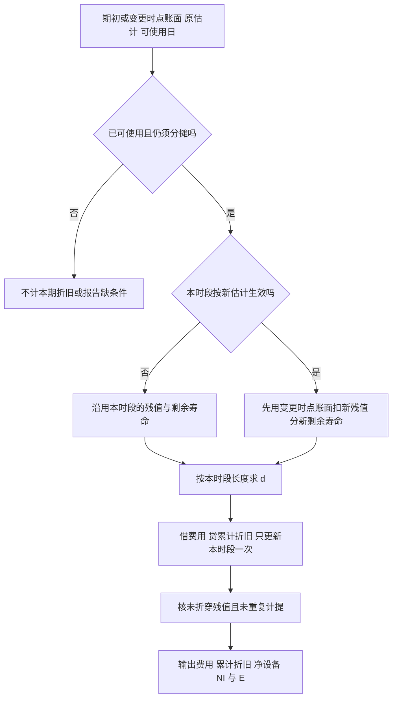

箭头是计量控制和状态更新，不是市场价格预测。

**沿例子读图（笔记补充）**：成本 1,000,000、残值 100,000、寿命 10 年，7/1 已可使用。先在“已可使用且仍须分摊吗”走“是”。没有新估计，沿用原残值和寿命，求全年 90,000、本期半年 45,000，再更新账面一次。另一组状态从第 4 年期初账面 730,000 开始，新估计已在此时生效，先用新残值与剩余寿命算 130,000，再记第 4 年折旧，期末为 600,000；不能先扣旧折旧 90,000 再重算。

**图旁边界**：半年例与第 4 年期初变更例是两组教学状态。若年中变更，先按原估计处理变更前时段，再以变更时点账面进入新时段；不得重复计提。10 月可使用改为 3/12，缺约定不称官方 45,000。

**文字替代**：折旧分配成本至使用期，借费用贷累计折旧；估计变化影响未来分摊，现金另记。

<details><summary>读图自测：贷现金45,000能表示本期折旧吗？</summary>

不能。购入现金另记；“借费用、贷累计折旧”贷累计折旧，净设备与利润下降，现金不因分摊改变。

</details>

失败 1：漏残值会多摊 100,000；征兆是终点净额零而题设残值 100,000，改为扣残值。失败 2：贷 Cash 会少记现金，把非现金分摊当再付款；查银行流水和抵减账户。失败 3：新寿命追改前三年破坏估计变更的前瞻例，若原来是错误而非新估计，则更正路径又不同。

<details><summary>迁移 1：三完整年末只改残值为 80,000、剩余寿命为 10 年，下一年与账面？</summary>

$(730,000-80,000)/10=65,000$；次年净设备 665,000。原累计 270,000 保留，不能把原成本重新除 10。
</details>

<details><summary>迁移 2：机器付款 1 月，7 月可使用，题目没给部分年约定，能给官方首年 45,000 吗？</summary>

不能直接称官方答案。上述 45,000 建立在明确月均半年假设；缺政策应标条件待核，可展示假设下结果而不能编原题要求。
</details>

**所以呢**：折旧改变利润与净资产，现金在购入时另记；读年报必须同时读残值、寿命和时间口径。🔗 [IAS 16 官方简介](https://www.ifrs.org/issued-standards/list-of-standards/ias-16-property-plant-and-equipment/)支持资产/折旧/减值的区分；2026-10-02 已访问简介，详细最新条款未完整验读，本例明确是教学假设复算。


#### 2.2.4 非流动资产（二）：无形资产与商誉（讲义 p.7）

**是什么**

讲义 p.7 原文：

> **Intangibles**
> - *"Patents, trademarks, copyrights, etc."*
> - *"**Purchased goodwill** in M&A transactions：purchase price – fair value of target's net asset"*
> - *"**Internally generated goodwill is generally not shown as an asset**：e.g., customer relationship, trained employee skills, reputation built in the market；hard to identify and value in a reliable way"*

**无形资产（Intangible Assets）** = 没有实体形态、但能带来未来利益的资产：专利、商标、版权、特许权、软件。

**商誉（Goodwill）** 是企业合并中单独呈报的剩余项目，不能与所有可辨认无形资产混成一类。讲义给了下面的简化公式；在本节 100% 收购股权的教学例中，须先在购买日辨认并按公允价值计量所取得的资产和承担的负债，再把剩余差额列为商誉：

$$
\text{外购商誉}=\text{收购付出的价格}-\text{被收购方可辨认净资产的公允价值}
$$

$$
\text{Purchased Goodwill}=\text{Purchase Price}-\text{Fair Value of Target's Net Assets}
$$

**💡 用数字走一遍（笔记补充，讲义只给了公式没给数）**

A 公司花 **1,000 万** 收购 B 公司 100% 股权。B 公司的账上：

| B 公司 | 账面价值 | 公允价值（重新评估后） |
|---|---|---|
| 厂房 | 300 万 | 500 万（地段涨了） |
| 存货 | 100 万 | 100 万 |
| 专利 | 0（自创的，没上表） | 200 万（可单独辨认、可估值） |
| **资产合计** | 400 万 | **800 万** |
| 银行贷款（负债） | 200 万 | 200 万 |
| **可辨认净资产** | 200 万 | **600 万** |

- 付出价格：1,000 万
- 可辨认净资产公允价值：600 万
- **商誉 = 1,000 − 600 = 400 万** ⇒ A 公司的合并报表上多出一行 `Goodwill 400 万`

**这 400 万是什么？** 它是本例在先确认厂房、存货、可辨认专利和负债之后留下的剩余差额，可能包含预期协同、持续经营价值，也可能包含买贵了的部分。它不是“客户关系、品牌、团队默契各值多少”的逐项清单：如果品牌或客户关系在购买日满足可辨认和可计量条件，就应先作为单独无形资产确认，不能再整包塞进商誉。表中的专利 200 万正是在商誉之前先分离出来的例子。

**为什么"自创商誉不上表"**

讲义 p.7 说得很直接：*"hard to identify and value in a reliable way"*（难以可靠地辨认和计价）。

**💡 展开这条（笔记补充的假设例，不对应真实公司金额）**：假设一家饮料公司多年自行建立品牌与客户关系，没有发生购买该品牌的独立交易。它不能只凭管理层觉得“品牌很值钱”就在表内确认一个任意金额。若另一家公司以后收购该业务，购买日要先辨认能分离或来自合同／法律权利的品牌、专利、客户关系等无形资产并计量公允价值；处理完可辨认资产与负债后，剩余才可能进入商誉。

> ⚠️ **这里的不对称针对自创商誉及不满足确认条件的自创无形价值：自行积累的整体声誉通常不上表；企业合并中支付的剩余差额可形成外购商誉。** 这个不对称是 p.13 "Weaknesses" 里 "intangible assets developed within the firm" 的一种来源，也可能是某些科技公司账面权益低于市值的原因之一；具体公司还可能受预期未来现金流、市场情绪、未确认增长机会和计量政策影响，不能在没有公司证据时断言它是定量“主因”。🔗 [IAS 38 官方页](https://www.ifrs.org/issued-standards/list-of-standards/ias-38-intangible-assets/)说明可辨认无形资产须可分离或源于合同／法律权利，自创商誉因不构成可辨认资源而不予确认为资产；获取日 2026-10-25。

**课件原例**

讲义 p.25 给了 Nike 的原话定义：*"Identifiable Intangible Assets and Goodwill: This account represents the **excess of the purchase price of acquired businesses over the market values of identifiable net assets**"* —— 与 p.7 的简化公式方向一致。这里保留课件的 `market values` 用词，但不能把日常“市场价”无条件等同 IFRS 13 的公允价值；后者是计量日市场参与者有序交易的退出价格，必要时可用估值技术。Nike 的商誉在 2014/2015/2016 三年均为 **131 百万美元**（见 §2.4.2），分别约占总资产 **0.7%／0.6%／0.6%**。金额三年不变，只能说明列示净额未变，不能证明没有并购、减值或抵销变化，须读并购／商誉附注。

**🎙️ 课堂补充**（`01:04:40`–`01:08:30`，约 3.8 分钟，教授自带的数字例子，与本节笔记自己的例子数字不同）
无形资产先照讲义念了专利/商标/版权（`01:04:40`–`01:05:23`）。

商誉部分，教授先解释 M&A：

> *"M means merger[,] a means acquisition ... one company try[ing] to buy another company"*

（`01:05:36`–`01:05:55`），然后给了一个例子：**A 公司想收购 B 公司**，B 的**总资产 10 million，总负债 8 million**，

> *"the equity or the net value of the company is 2 million"*

（`01:06:13`–`01:06:29`）。

若按"最简单情形"，A 只需付 2 million；

但

> *"if there is another company C also trying to take over company B[,] it will increase the selling price"*

（`01:07:01`–`01:07:09`），假设最终**成交价 5 million**（`01:07:09`–`01:07:26`），

> *"the difference remaining would be [the] goodwill ... this is intangible assets"*

（`01:07:26`–`01:07:41`）。教授没有明说减法结果。只有在额外假设“10 million 资产与 8 million 负债已经是购买日可辨认项目的公允价值，且忽略其他调整”时，才可作笔记推算：$5-2=3$ million。若 10/8 只是账面金额，就不能直接把 2 million 当作正式商誉公式中的公允价值净资产；本轮没有核原音，不能替教授补判计量口径。

随后照讲义念了"自创商誉不上表"：

> *"internally generated good[will] is generally not shown [as an] asset ... your company [has a] good customer relationship ... trained employee skills and reputation ... this goodwill cannot be realized ... [it] cannot be identified and evaluat[ed in a] reliable way"*

（`01:07:51`–`01:08:30`）。

**这段改变了什么**：新增了一个与本节笔记原有例子（1,000 万/600 万/400 万）不同的竞购情形，并保留“自创商誉不上表”的课堂说明；但正式商誉金额仍取决于购买日可辨认净资产的公允价值，不能只凭竞价故事或账面净额完成计算。🔗 [IFRS 3 官方页](https://www.ifrs.org/issued-standards/list-of-standards/ifrs-3-business-combinations/)说明先按公允价值分配到可辨认资产与负债，剩余才归商誉；获取日 2026-10-25。

A 状态。

**💡 换个说法（笔记补充）**
商誉是**企业合并中的剩余差额**。买一辆二手车付 12 万，不能把比某个估值高的 2 万直接叫商誉；那是单项资产购买，先按适用的成本规则计量。企业收购也须先辨认能分离的品牌、专利与客户关系并计量公允价值，剩余部分才是商誉。

**⚠️ 常见误解**
- ❌ "商誉就是给公司名声直接估一个价"。→ 商誉是收购对价扣除可辨认净资产公允价值后的**剩余差额**。声誉、客户关系或预期协同可能提高买方愿付的价格，从而影响这个残差，但报表不会把“名声好”直接计成一项商誉金额；一次买贵了的收购同样可能产生大额商誉。
- ❌ “商誉会像设备一样每年摊销。”本讲完整 IFRS 口径下，企业合并商誉不按年摊销，而是每年做减值测试；不能泛指所有 US GAAP 私营企业的可选处理。

   被收购业务表现不及预期时，需测试账面金额是否可收回；确认减值会降低利润。§2.2.11 的商誉为 138.97 亿元，占总资产 23.8%，因此其减值风险值得重点查附注。
- ❌ "无形资产 = 商誉"。→ 商誉与可辨认无形资产必须分开。专利、商标或客户关系可能因可分离，或因源于合同／法律权利而满足“可辨认”；它们不一定都能自由转让。有限使用寿命的无形资产在寿命内摊销，无限使用寿命项目不作年度摊销而须按适用规则测试减值，不能把“可辨认”直接等同“每年摊销”。

**与其他概念的关系**
商誉 ← §2.1.3 合并报表：本节 100% 股份收购例在购买方合并报表确认商誉。其他取得业务的法律形式和报表呈现要按交易结构另判，不能把“只在合并层面产生”写成普遍规则；无形资产的“未确认”问题 → §2.2.10 Weaknesses → **W4 REA 模型的动机之一**。

---

#### 2.2.5 流动资产（一）：存货（讲义 p.8）

**是什么**

讲义 p.8 原文四条：

> **Inventories**
> - *"Sizable item for manufacturing / retailing corporations"*
> - *"Essential for business, but tie up capital: putting in warehouses before being sold"*
> - *"Conservatively reported at the **lower of historical cost or net realizable value**."*
> - *"Could be an easy item for **earnings management or even fraud** (e.g., delay impairment, fake inventories)"*

**存货（Inventories）** = 为出售而持有的商品、在产品、以及生产用的原材料。

逐条拆：

**（a）对制造业和零售业是大项。** Nike 的存货占总资产 20.1%~22.6%（§2.4.2），是它最大的单一资产。

**（b）业务必需，但占用资源与营运资金。** 存货躺在仓库时，公司已有资源被锁在尚未售出的商品中。若货款已付，体现为现金占用；若是赊购，则先形成应付账款，现金何时流出取决于采购条款。无论哪一种，这部分资源都还没有通过销售收回，处在“营业周期”（§2.2.2）的中段。

**（c）计量口径：成本与可变现净值孰低（Lower of Cost or Net Realizable Value）** ⭐

> **净变现价值（Net Realizable Value, NRV）** = 预计售价 − 预计还要发生的完工与销售费用。
>
> **规则**：期末账面金额取两者较低：
>
> $$
> \text{期末存货账面金额}=\min(\text{成本},\text{NRV})
> $$
>
> **💡 走一遍（笔记补充）**：你花 1,000 元进了一批手机壳。
> - 情形一：市场好，预计售价为 1,500 元。若本例没有其他完工及销售费用，则 NRV = 1,500；即使还有少量必要费用，只要扣除后 NRV 仍高于成本 1,000，账上仍记 **1,000**。不能只看到售价高于成本就跳过 NRV 中的必要费用。
> - 情形二：新机型上市，这批壳只能卖 600 元，还要花 50 元清仓促销。NRV = 600 − 50 = **550**。→ 账上必须调到 **550**，同时确认 **450 元的存货减值损失**（进利润表）。
>
> **注意初次比较的不对称**：若 NRV 高于成本，不能把尚未实现的增值记到成本以上；若 NRV 低于成本，则须减记。这个不对称体现**谨慎性 / 稳健性（Conservatism / Prudence）**——讲义 p.8 用的词正是 "**Conservatively** reported"。但这不等于减记后永远不能转回：以前已经减记的存货，只有在 IAS 2 第 33 段条件满足时才可限额转回，且账面仍不得高于成本与修订后 NRV 的较低者；见下方 100 件补例。

> **减值（Impairment）** ⭐ 新概念：资产账面金额不能高于适用准则允许报告的金额，但**不同资产不是共用一条“都降到可收回金额”的公式**。本节存货比较成本与 NRV；PP&E 等适用 IAS 36 的非金融资产比较账面金额与可收回金额；应收账款按 IFRS 9 的预期信用损失（Expected Credit Loss, ECL）计量。三类比较对象、确认方法和后续转回条件不同。商誉不得转回不代表存货也不得转回；本节回升情境见下方补例。

**（d）容易被用来做盈余管理甚至舞弊。** 讲义点了两种手法：

| 手法 | 讲义原文 | 机制 | 后果 |
|---|---|---|---|
| **拖延减值** | *"delay impairment"* | 明知这批货卖不掉了，就是不计提减值 | 当期费用少记 ⇒ 利润虚高；资产虚高 |
| **虚构存货** | *"fake inventories"* | 仓库里根本没有那批货，账上有 | 资产虚增；且因为 `期末存货 ↑ ⇒ 销货成本 ↓ ⇒ 利润 ↑` |

> **盈余管理（Earnings Management）** ⭐ 新概念：这是分析报告动机时使用的统称，指管理层利用估计、方法或确认时点影响报告数字；具体处理是否合规，必须回到适用准则、事实与管理层意图判断。正常、合理的估计是编制报表的必要部分，不等于操纵。若管理层明知存货已符合减记条件却故意延迟确认，或虚构并不存在的存货，就不能因为“涉及判断”而把它留在准则允许的灰区；这可能已构成错误、重大错报或舞弊。

**💡 为什么"期末存货多记 ⇒ 利润多"（笔记补充，讲义没解释这条机制，但它是理解舞弊动机的关键）**

对**商品买卖企业的简化例**，若“本期采购”取净采购／取得成本，并暂不考虑退货、折扣、运费口径、损耗、盘盈盘亏和其他转入转出，可以写：

$$
\text{销货成本}=\text{期初存货}+\text{本期净采购（取得成本）}-\text{期末存货}
$$

$$
\text{Cost of Goods Sold}=\text{Beginning Inventory}+\text{Net Purchases / Acquisition Cost}-\text{Ending Inventory}
$$

制造企业还要把直接材料、直接人工及适当分配的生产间接成本等转换成本计入可供销售商品成本，不能把“采购”二字直接套到所有企业。

本例只改变期末存货，固定期初存货和净采购，并忽略所得税及其他联动。在这些前提下，期末存货虚增 100 万会使销货成本少 100 万、毛利多 100 万，税前利润也多 100 万；净利润是否同额增加还取决于所得税。

采购、期初存货和计价方法本身也可能发生错报，不能说只有期末存货有弹性。**资产负债表仍可能保持等式平衡**，所以“报表平衡”不能证明存货真实存在或计价正确。本节不在缺少案件一手来源时扩展具体历史案件或量化其常见程度。

**🎙️ 课堂补充**（`01:08:30`–`01:12:09`，约 3.6 分钟）
存货部分照讲义念了定义和四条（`01:08:30`–`01:09:09`），然后展开"盈余管理"这个词：

> *"now we have a terminology[,] earnings management ... the company can make a lot of [use of] methodology to try to change the numbers"*

（`01:09:09`–`01:09:57`）。

**教授举的具体例子不是存货，而是折旧方法的选择**（呼应 §2.2.3）：

> *"the simplest case would be the straight line[, and] there is another one[,] so called[,] accelerated depreciation method[,] which means that in the first year ... previously we argue[d] that every year the [expense is] 1,[000]. But if the company choose[s] this accelerated depreciation method ... probably up[,] like[,] 3,000"*

（`01:09:57`–`01:10:46`），并算了对净利润的影响：

> *"this number is increasing by 2000[,] which means [that] the net income is decrease[d] by 2000[,] when you change this accounting policy"*

（`01:11:19`–`01:11:33`）。

这组 1,000 → 3,000、利润少 2,000 是教授的**简化课堂例**。只有在其他收入费用与所得税影响均忽略或不变时，折旧费用多 2,000 才能直接对应简化的净利润少 2,000。真实报表中，折旧方法应反映资产经济利益的预期消耗方式，估计也应依据最新可靠信息；“不同方法会改变数字”不等于企业可以只为把利润调成目标数而任意选择方法。

教授总结：

> *"compan[ies'] measures can make their own judgment[,] choose the different options in the different accounting policies[,] or sometimes it's not a choice[,] it's misleading or [some] certain fake numbers ... [that's the] so-called earnings management[,] just to make the numbers look good"*

（`01:11:54`–`01:12:09`）。

**这段改变了什么**：课堂确认“拖延减值／虚构存货”是讲义点出的报告风险，并补了一个有数字的折旧方法例子；它没有把故意延迟应确认的减值说成准则内选择。教授也在 `01:11:54`–`01:12:09` 把会计选择与转录中的 `misleading`、`fake numbers` 分开提到，因此阅读时要继续区分合理估计、错误和有意错报。折旧例按内容与 §2.2.3 交叉，不冒充存货本身的计量例。

🔗 **当前补充来源**：[IAS 8 官方简介](https://www.ifrs.org/issued-standards/list-of-standards/ias-8-basis-of-preparation-of-financial-statements/)说明会计政策须产生相关、可靠信息，估计变化来自新信息或新发展，既往期间错误则包括未使用或误用当时可得可靠信息；官方公开文本另说明合理估计是编表必要部分。本轮用它限定“合理估计 ≠ 自动操纵”，不据此替具体案件定性。访问 2026-10-25。

A 状态。

🔴 **见 §6.2**：教授明确给出了会计政策选择改变净利润的具体数字。

**⚠️ 常见误解**
- ❌ "存货越多说明生意好"。→ 存货增速持续快于收入增速，是应调查备货、销售和减值的信号，不能单凭比重证明卖不动。
- ❌ "存货按市价记"。→ 是 `min(成本, NRV)`。涨价不体现。
- ❌ "NRV 就是售价"。→ 要**减去**还要发生的完工成本和销售费用。

**与其他概念的关系**
存货 ← 营业周期（§2.2.2）；`min(成本, NRV)` ← [[M01-会计与商业]] 的计量（成本）原则 + 谨慎性；盈余管理 → §2.5.4 利润表的 Weaknesses → §2.7.3「用现金流交叉验证利润」。

---

**💡 100 件库存的估值—减记—售出链（笔记补充）**

> 🧭 **第二遍 / 进阶复做**：首遍先掌握 `账面取 min(成本, NRV)` 与“减记会降低资产和利润”。本块再追减记后的销售、剩余库存和有条件转回。

企业有 100 件货，每件成本 10，账面 1,000；现在预计每件可卖 6、必须支付销售费 0.5，不需完工费。问题是期末还应报告多少资产，随后卖出时如何避免重复记损失。输入是数量、单位成本、预计售价和必要完成/销售成本；输出为 NRV、减记、剩余库存和销售损益。

$$NRV=q(p-c_{finish}-c_{sell})=100(6-0-0.5)=550.$$

$q$ 是件数、$p$ 是每件售价、两个 $c$ 是每件必要费用，NRV 是整批货币金额；不能拿单位 NRV 5.5 与整批成本 1,000 比。成本与 NRV 孰低，账面取 550，损失 $1,000-550=450$。

1. 期末 Dr Inventory Write-down Loss 450 / Cr Inventory 450（本补例采用直接减记口径），A/NI/E 各少 450、现金不动，单位账面变 5.5。
2. 后售 60 件、全额收款 360：Dr Cash 360 / Cr Sales 360；转出已减记账面 Dr Cost of Goods Sold（COGS，销货成本）330 / Cr Inventory 330；另付售费 30，Dr Selling Expense / Cr Cash 30。
3. 这**一次销售交易**的净损益为 0。

   - **计算**：销售毛利为 $360-330=30$，再扣本例唯一列出的销售费 30，得到 0。
   - **为什么恰好为 0**：期末估值的单位 NRV 为 $6-0.5=5.5$；实际出售仍用售价 6 和销售费 0.5，单位净售价正好等于当前单位账面 5.5。
   - **范围**：这是假设无其他期间费用、所得税或相关交易的题设结果，不是全年净利润，也不表示减记后的销售必然为 0。
   - **状态更新**：现金净入 330，剩 40 件账面 $40\times5.5=220$。此前已经确认 450 损失，不能再按原成本 600 记 COGS 重复扣损。
4. IAS 2 第 33 段要求后续期间重新评估 NRV。

   - **允许条件**：原减记原因不再存在，或经济情况变化使 NRV 上升有明确证据；转回后账面仍取成本与修订后 NRV 孰低。
   - **本例计算**：剩余 40 件的单位 NRV 由 5.5 升到 8，目标为 $\min(40\times10,40\times8)=320$，因此从 220 增回 100。
   - **上限与范围**：账面不能超过原成本 400，100 也未超过这 40 件原减记 180；不能把存货规则套到商誉。本轮只核该公开条款及本例，不宣称逐条验读 2026 年全部 IAS 2 正文。

**看图前先问**：减记后的单价怎样传给下一次售货？

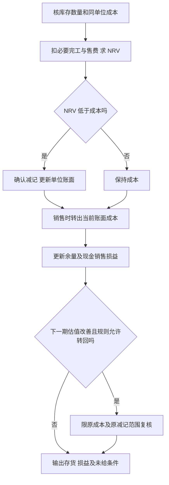

箭头表示从期末估值到下一次销售的状态传递。

**沿例子读图（笔记补充）**：先在“核库存数量和同单位成本”输入 100 件、每件成本 10。扣除必要销售费 0.5 后，每件 NRV 为 5.5，整批为 550。“NRV 低于成本吗”走“是”，减记 450。随后出售 60 件时转出当前账面成本 330，剩 40 件账面 220。

**图旁边界**：NRV含必要销售费0.5；转回规则仅本补例明确假设，不能套商誉。

**文字替代**：库存估值后的当前单位账面传给销售，避免把原成本再扣一次；转回需适用规则。

<details><summary>读图自测：售60件还能转原成本600吗？</summary>

不能。单位账面已降5.5，转600会重复损失并使剩余账面负50。

</details>

失败 1：仅用售价算 NRV，会把必要售费 50 漏掉，期末库存多 50；核每单位完整可净收金额。失败 2：销售后还转原成本，会重复扣先前减记，检查数量与当前单位账面。批次、退货、损耗或不同分组需要新输入，不以总额孰低掩盖各项目差异。

<details><summary>迁移 1：售费改为每件 1，其余原数据不变，减记与售 60 件后库存？</summary>

单位 NRV 5、总 500、减记 500；售出账面成本 300、售费 60、毛利 60，销售净损益仍为 0；余 40 件账面 200。这里仍为 0，是因为期末估值和实际销售继续使用同一单位净售价 $6-1=5$，并非“减记后必为 0”。
</details>

<details><summary>迁移 2：为什么不能“NRV 550，再售货时借 COGS 600”？</summary>

原成本 10 已通过整批 450 减记降到 5.5；售出 60 件应转 330，余 220。再转 600 导致余库存负 50，既重复费用又与 40 件实物不符。
</details>

<details><summary>迁移 3：减记后实际单位净售价降到 4.8，会发生什么？</summary>

估值后的单位账面仍是 5.5。假设销售当时收款并付清销售费，实际每件售价 5.3、销售费 0.5：售出 60 件确认销售收入（Sales）$60\times5.3=318$，转出销货成本（COGS）$60\times5.5=330$，另确认销售费用（Selling Expense）$60\times0.5=30$。该次销售损益为 $318-330-30=-42$，即再损失 42。现金收 318、另付 30，净现金流入为 288；扣销售费后的单位净收款 4.8 不是销售收入。若其他条件不变、实际单位净收款高于账面 5.5，该次销售会有利润；重算时仍把销售收入、销货成本和销售费用分开。
</details>

**所以呢**：估值后的账面状态必须传给下一次销售。🔗 [IAS 2 官方简介](https://www.ifrs.org/issued-standards/list-of-standards/ias-2-inventories/)确认成本/NRV 孰低、存货成本包含采购／转换／使其达到当前位置和状态的其他成本，以及销售时把账面金额转为费用；[IAS 2 公开文本第 33 段](https://www.ifrs.org/content/dam/ifrs/publications/pdf-standards/english/2022/issued/part-a/ias-2-inventories.pdf?bypass=on)支持上述有限条件转回。访问 2026-10-25；本轮未声称逐条验读 2026 年全部正文。


#### 2.2.6 流动资产（二）：应收账款与现金（讲义 p.9）

**是什么**

讲义 p.9 只有两小段，字数最少，但两句话都有分量：

> **Accounts Receivables**
> *"Normally readily available within a short period without significantly affecting the presented value"*
>
> **Cash and Cash Equivalents**
> *"The prime item to verify liquidity"*

**（a）应收账款（Accounts Receivable）**：客户已经取得商品或服务，但公司尚未收回的合同款项（[[M01-会计与商业]] 已引入）。讲义这里强调其**通常能在短期内变现**，但这只是一般描述，不保证实际收款一定等于表上金额。

> 💡 **“不会差太多”这半句怎样理解（笔记补充）**：应收账款在表上常列示**净额**——真实年报里写作 "Accounts receivable, **net**"（Nike 的表就是这么写的，见 §2.4.2）。净额 = 应收总额 − **坏账准备（Allowance for Doubtful Accounts）**。Nike 2016 原表在这里仅证明 net 列示；下文的预期信用损失是当前 IFRS 9 的补充框架，不能反推该历史 US GAAP 报表采用 IFRS 9。

**从历史原表转到当前 IFRS 9 解释（笔记补充）**

在 IFRS 9 语境下，坏账准备体现对预期信用损失（Expected Credit Loss, ECL）的估计，信用风险可能来自客户经营困难、争议、宏观变化等，并不都等于主观“赖账”。这个估计会让列示金额更接近预期可收回额，但不能保证最终实收与期末净额完全相同；新信息、实际违约、退货或折让都可能使结果改变。

**（b）现金及现金等价物（Cash and Cash Equivalents）**：*"The prime item to verify liquidity"*——**验证流动性的首要项目**。

这里的**流动性（Liquidity）**回答的是：公司能否按时拿出现金履行近期付款义务。判断时既看资产能多快、以多小的价值损失变成现金，也看负债什么时候到期；所以不能只看“现金多不多”。

> **现金等价物（Cash Equivalents）** ⭐ 新概念：为了满足短期现金承诺而持有的短期、高流动性投资；它必须能随时转换为**已知金额**的现金，而且价值变动风险不重大。IAS 7 说“通常三个月或以内”时，是看企业**取得该投资之日起到到期日**的期限，不是证券从最初发行日起算的期限。国库券、定期存款或货币市场基金都不能只凭名称自动归类，仍要逐项核转换金额、风险、取得日剩余期限和持有目的。
>
> ⚠️ **这个 3 个月的界线在 §2.10 会制造一个非常经典的困惑**：讲义截图里的资产负债表写 `Cash and bank balances 11,911,210`，现金流量表写 `Cash and cash equivalents at end of year 10,631,210`，两个数相差 **1,280,000**。讲义与课堂没有提供现金附注，所以仅凭原课堂材料不能解释差额。2026-10-25 回到中国生物制药 2019 年报 Note 25 后，外部原年报明确把 1,280,000 列为“取得时原到期超过三个月的定期存款”；2018 年对应金额为 441,013。这个结论是后来外部回源补证，不是课堂确认。

**为什么这一页只有两句**

这两项看起来比存货和无形资产直观，但仍有分类与估计：应收账款要估计预期信用损失、退货或折让；银行余额要区分现金、现金等价物、其他存款以及受限制金额。**讲义篇幅短不能推出风险低，也不能推出“需要估计的地方永远最容易出问题”**；真实分析仍要查会计政策与附注。

受限制的余额不能一刀切。现金（cash）本身包括库存现金与活期存款。

IFRS 解释委员会说明：若企业仍可按要求提取活期存款，且第三方合同限制没有改变存款性质，它仍可能属于现金及现金等价物。此时仍要考虑单列、流动／非流动分类和受限金额披露。其他定期或投资余额另按现金等价物条件判断。

本例 Note 25 已逐项列出余额，所以能确认两年差额来自超过三个月定期存款；不能据此把所有公司的 `Cash and bank balances` 普遍定义成同样三类。

**🎙️ 课堂补充**（`01:12:09`–`01:12:39`）：教授只用了半分钟带过，照讲义念了应收账款与现金及现金等价物两句定义，没有展开：

> *"the current asset is the [accounts] receivable[,] normally it's readily available within a [short period without] significant[ly] affecting the presented value ... and the cash and the[re's not] much [more] to say"*

（`01:12:09`–`01:12:39`）。教授只是简略带过，不能据此推出这些项目不需要分类或信用损失判断；本段记 B 状态。

**⚠️ 常见误解**
- ❌ "现金多 = 公司好"。→ 现金多本身不能判好坏。它可能是近期付款、未来投资或收购的储备，也可能反映资金使用效率问题；要核用途、限制、负债到期与持续性。§2.7.3 的三类现金流符号只是阶段候选，CFF 为负也只说明筹资活动净付出，不能据此认证健康成熟或反推现金留存不合理。
- ❌ “现金及现金等价物 = 银行账户里的所有余额”。→ 活期存款先按现金定义判断；投资或定期余额须满足“已知金额、风险不重大、短期且用于短期现金承诺”等条件。超过三个月要看企业取得日至到期日，受限活期存款也不自动失去 cash 身份；限制的性质、期限、列报与披露需分别判断。

**与其他概念的关系**
现金 → §2.7 现金流量表的期末余额；坏账准备与 §2.2.5 存货减记都在降低资产账面金额，但前者用预期信用损失，后者用成本与 NRV 孰低，不能互换计量规则。

🔗 **当前补充来源**：[IAS 7 官方简介](https://www.ifrs.org/issued-standards/list-of-standards/ias-7-statement-of-cash-flows/)给出 cash 与 cash equivalents 的核心定义；IAS 7 第 7 段进一步说明短期现金承诺、已知金额、价值变动风险和“取得日起通常三个月或以内”；[IFRS 解释委员会受限活期存款最终议程决定（2022 年 4 月发布）](https://www.ifrs.org/news-and-events/updates/ifric/2022/ifric-update-march-2022/)区分现金身份、列报与披露。访问 2026-10-25。

---

#### 2.2.7 负债：流动与非流动（讲义 p.10）

**是什么**

讲义 p.10 原文：

> **Current Liabilities**：*"settled within one year or operating cycle, whichever is longer"*
> - accounts payable（应付账款）
> - short-term debt; **long-term debt comes to due**（短期借款；**一年内到期的长期借款**）
> - accrued expenses（应计费用）
> - deferred revenue（递延收入 / 预收收入）
>
> **Non-Current Liabilities**
> - long-term debt（长期借款）
> - bonds payable（应付债券）

“一年或一个营业周期，取较长者”是讲义 p.10 的入门记忆句，不是现行流动负债分类的全部条件。按 IAS 1 在本讲 2026 年语境下的完整边界，只要满足下列任一项就列流动：预计在正常营业周期内结算；主要为交易目的持有；报告期后 12 个月内到期；或企业在**报告日**没有权利把结算至少推迟 12 个月。正常营业周期可同时解释应收、存货、应付和部分应计项目，但资产与负债并不是只靠“取较长者”这一条完全对称地切分。

逐项拆（**四项里有两项是新概念**）：

| 项目 | 中文 | 是什么 | 状态 |
|---|---|---|---|
| Accounts payable | 应付账款 | 已收货未付款 | [[M01-会计与商业]] 已有 |
| Short-term debt | 短期借款 | 按合同到期安排及报告日权利判断为流动的借款，不限于单一银行 | 直觉可懂 |
| **Long-term debt comes to due** | **一年内到期的长期负债** | 原为长期融资，报告日满足任一流动条件；到期与延迟结算权见下方时间轴 | ⭐ 需要解释 |
| **Accrued expenses** | **应计费用** | 商品或服务已经收到／费用已经发生，但尚未支付、开票或与供应方正式结算；金额有时需要估计 | ⭐ 新概念 |
| Deferred revenue | 递延收入 | 客户已付或已到付款期，但企业尚未履行相应商品／服务义务的合同负债 | [[M01-会计与商业]] 已有（那里叫 unearned revenue） |
| Long-term debt | 长期借款 | 在报告日不满足流动条件的长期融资；可能来自一家银行、银团或其他贷款人 | 直觉可懂 |
| **Bonds payable** | **应付债券** | 企业按发行／合同条款向投资者发行债券形成的负债；可公开发行，也可私募 | ⭐ 新概念 |

**⭐ 一年内到期的长期负债（Current portion of long-term debt）**
先固定一个教学时间轴：公司在 2022 年 7 月 1 日借入一笔五年期贷款，到 2027 年 6 月 30 日一次偿还，报告日均为 12 月 31 日。分类只按报告日已经存在的合同权利判断，不假设另有展期安排：2025 年末，合同到期日本身允许公司在未来 18 个月内不结算；2026 年末，合同只允许再延迟 6 个月。

- **2025 年 12 月 31 日**：距离到期仍有 18 个月，本例列非流动。
- **2026 年 12 月 31 日**：距离到期只剩 6 个月，本例列流动。
- **条件变化**：若合同分期还本，只把满足流动条件的部分转列；若报告日已有实质权利把结算推迟至少 12 个月，分类要重判。

Nike 的共同比表上就有 `Current portion of long-term debt`：2014 年 0.0%、2015 年 0.5%、2016 年 0.2%（§2.4.3）。该行突然变大是到期压力的调查信号，仍要同时查可用现金、再融资权利与现金流，不能只凭这一行断言无法偿债。

**⭐ 应计费用（Accrued Expenses）**
> **是什么**：本期已经收到商品／服务或已经发生、但期末尚未支付或完整结算的费用。典型是**已发生未支付的工资、水电、利息**；账单未到是常见情形，不是必要条件。
>
> **为什么必须记**：这是 [[M01-会计与商业]] **权责发生制 / 配比原则**的直接后果——12 月份的工资帮公司在 12 月赚了钱，就必须记在 12 月，哪怕 1 月 5 日才发。
>
> **怎么记**（M02 的语言）：
> ```
> Dr. Salaries Expense （工资费用）      50,000
>     Cr. Accrued Salaries Payable （应付工资）  50,000
> ```
> 看这笔分录造成的**余额变化**：资产变化为 0；负债增加 50,000；权益因费用减少 50,000。因此：
>
> $$
> 0=+50{,}000-50{,}000
> $$
>
> 这里比较的是该笔分录前后的变化量，不是拿负债余额与权益余额互相抵消；会计等式仍然平衡。
>
> **与应付账款的区别**：应付账款通常对应已经收到、且已开票或已与供应方正式议定的商品／服务；应计项目对应已经收到或发生、但尚未支付、开票或正式议定的金额。应计金额有时需要估计，但也可以由合同、工时或计费资料支持。正常估计是权责发生制的必要步骤，不能因“未收到发票”就自动判为操纵；有无发票是典型线索，不是唯一界线。

**⭐ 应付债券 vs 银行借款**
- **银行借款（Bank Loan）**：按贷款合同向一家银行、银团或其他贷款人借入本金，并约定利息、还款和契约条件；不必是一家银行“一对一谈”。
- **应付债券（Bonds Payable）**：企业按同一组发行条款把债务做成债券，向投资者融资。债券可以公开发行，也可以私募给机构；能否转让、投资者数量、发行程序、规模和期限取决于具体安排。

**🎙️ 课堂补充**（`01:12:39`–`01:13:55`）：教授照讲义念了流动/非流动负债的分类，并给了"一年内到期的长期负债"一个口语例子：

> *"you have long term debt[s] which [is] supposed to be paid back in 10 years. But now it's the last year[,] right[?] So [the] long term debt becomes [current]"*

（`01:12:51`–`01:13:03`）；

应计费用只照念一句：

> *"accru[ed] expenses [are] just [the] expenses payable[,] like salary expense payable[,] the administration expense payable"*

（`01:13:03`–`01:13:18`）；

应付债券也只照念：

> *"if[,] in the bond[,] it is specified that this borrowed [money] will be paid[,] like[,] more than one year ... we call it non[-]current or long term liabilit[y/ies]"*

（`01:13:35`–`01:13:55`）。

没有额外展开，B 状态。

**💡 换个说法（笔记补充）**
负债的四类流动项对应四种"欠"：
- 欠**供应商**的货款 → 应付账款
- 欠**贷款人**的钱 → 短期借款 + 一年内到期的长期借款
- 欠**员工/水电公司/债主**的、还没结账的 → 应计费用
- 已收或已到期收取客户对价、但还欠客户**尚未履行的商品或服务** → 递延收入／合同负债

最后一条最反直觉：企业承担的是尚未履行的商品或服务义务，所以先列负债。能否以及何时退款取决于具体合同；本节只解释合同负债，不另引退款负债专名，也不把它简化成“绝不会退钱”。

**⚠️ 常见误解**
- ❌ "deferred revenue 里有 revenue 所以是收入"。→ **是负债**。这是 [[M01-会计与商业]] 就强调过的第一大坑。
- ❌ "长期借款一直是非流动负债"。→ 只有按合同到期安排、已在报告期末进入流动分类条件的部分才转到流动侧；不是每笔长期借款每年必然都有一块转入。
- ❌ "应计费用和应付账款一回事"。→ 应计费用强调费用已经发生但尚未支付或完整结算，金额有时需估计；应付账款通常来自已收货或已获服务的供应商结算。有没有发票不是唯一界线。

🔗 **当前补充来源**（访问 2026-10-25）：

- [IAS 1 官方标准页](https://www.ifrs.org/issued-standards/list-of-standards/ias-1-presentation-of-financial-statements/)及其第 69–73 段支持流动负债四项条件与报告日延迟结算权利。
- [IAS 37 第 11 段公开文本](https://www.ifrs.org/content/dam/ifrs/publications/pdf-standards/english/2021/issued/part-a/ias-37-provisions-contingent-liabilities-and-contingent-assets.pdf)区分 trade payables 与 accruals。
- [IFRS 15 官方简介](https://www.ifrs.org/issued-standards/list-of-standards/ifrs-15-revenue-from-contracts-with-customers/)及第 105–106 段支持合同负债是尚待转移商品或服务的义务。
- [美国证券交易委员会（SEC）Investor.gov 私募说明](https://www.investor.gov/introduction-investing/general-resources/news-alerts/alerts-bulletins/investor-bulletins/private)明确 note 或 bond 也可通过 private placement 发行。

讲义 p.10 原文仍原样保留在上方。

**与其他概念的关系**
流动负债 vs 流动资产 → 净流动资产（§2.2.11）；应计费用 ← 权责发生制（[[M01-会计与商业]]）；递延收入 ← 收入确认原则。

---

#### 2.2.8 权益（一）：五个组成部分（讲义 p.11）

**是什么**

讲义 p.11 列出权益的五项：

> - **Common or Preferred Stock (share capital)** 普通股或优先股（股本）
> - **Additional Paid-in Capital (share premium)** 额外实收资本（股本溢价）
> - **Treasury Stock** 库存股
> - **Retained Earnings** 留存收益
> - **Accumulated other comprehensive income/loss** 其他综合收益累计额
>   - *"unrealized and usually related to the market price change of long-term holdings"*
>   - 讲义原例：*"e.g., unrealized gains or losses on available-for-sale securities: buy at \$100 and the price increases to \$150 at year-end. the \$50 is not realized as the security has not been sold. but needs to reflect such value change in the long-term held security."*

逐项（**五项里四项是新概念，只有留存收益 M01 讲过**）：

**① 普通股 / 优先股（Common / Preferred Stock）**

最朴素地说，买一股就是取得企业**剩余权益的一份权利**；股利、投票和清算顺位是三个不同的权利维度，不能混成一个标签。

先限定本表：它比较的是**普通股**与一个“已分类为权益、非参与型、股利率固定”的简化优先股例子。真实权利必须看发行条款、公司章程及适用法律；`preferred` 这个法律名称本身不会自动决定会计上属于权益。

| | 普通股 Common Stock | 优先股 Preferred Stock |
|---|---|---|
| 股利 | 金额不固定；通常须经宣告或按适用程序决定，不是每年无条件支付 | 本简例按固定股息率；在条款要求及可分配条件满足时，通常先处理优先股股利，才可向普通股分配 |
| 投票权 | 通常有，但实际权利按类别条款 | 常见为没有或受限，但并非名称决定 |
| 清算顺位 | 在本简例的权益类别中承担最后的剩余风险 | 本简例排在债权人之后、普通股之前 |
| 上涨收益 | 分享企业剩余价值的上升空间，也承担亏损；**不是“上涨一定全部归你”的保证** | 本简例为非参与型，回报通常受固定条款限制；参与型等设计可能不同 |

**合同分类边界**

> 💡 **怎样判断它究竟是负债还是权益**：先看合同是否让发行人承担交付现金或其他金融资产的义务。若必须在固定日期赎回、持有人可要求现金赎回，或股利构成强制现金义务，IAS 32 下可能是金融负债；若工具同时含负债与权益成分，可能要拆分。反过来，非赎回且分配由发行人酌情决定的优先股，才可能按权益处理。本节不展开衍生工具，只保留这个判断入口。🔗 [IAS 32 官方简介](https://www.ifrs.org/issued-standards/list-of-standards/ias-32-financial-instruments-presentation/)与官方应用指引均强调按合同实质及现金交付义务分类（2026-10-25 访问）。

**② 额外实收资本 / 股本溢价（Additional Paid-in Capital / Share Premium）** ⭐

**面值发行简例**

> **是什么**：股东买股票时**超出股票面值**的那部分钱。
>
> **💡 走一遍（笔记补充，讲义只给名字没给例子；假设适用面值制度）**：
> 公司发行 10,000 股，**面值（par value）每股 \$1**，实际以**每股 \$15** 卖给投资者，收到现金 \$150,000。分录是：
> ```
> Dr. Cash （现金）                              150,000
>     Cr. Common Stock, \$1 par （股本，按面值）      10,000
>     Cr. Additional Paid-in Capital （股本溢价）   140,000
> ```
> **为什么本例拆成两行**：这是“股份有面值且发行价高于面值”的教学假设。面值不是股票的市场价值或企业内在价值；它在具体法域、章程及资本制度下的法律作用须另核。若适用无面值制度，这个拆法可能根本不存在。例如香港公司注册处说明，香港本地有股本公司自 2014 年 3 月 3 日起采用无面值制度，发行股份的全部收益计入股本；这只证明**法域会改变处理**，不代表本讲报表发行人一定在香港注册。🔗 [香港公司注册处：废除股份面值](https://www.cr.gov.hk/sc/legislation/companies-ordinance/cap622/keychanges/nopar.htm)（2026-10-25 访问）。
>
> ⚠️ **怎样读这两行**：在这个单次发行简例中，$\text{Common Stock }10{,}000+\text{Additional Paid-in Capital }140{,}000=\text{本次现金缴入 }150{,}000$。不能把它外推成公司历年全部股东投入；真实累计余额还可能受发行费用、股份支付、回购／注销及权益内部重分类等影响，须查权益变动表与附注。股本行仍可帮助核对股份类别、法定／章程资本信息和历史变动，只是**不能拿面值当市场价值或内在价值**。
>
> Nike 共同比表中 Class A 与 Class B 普通股显示 **0.0%**，是按一位小数呈现后的舍入，不是精确为零；`Capital in excess of stated value` 为 **31.5%~36.4%**。这说明溢价行在该表中占比远大于股本行，不能由舍入结果推出“全部投入都在溢价”。

**③ 库存股（Treasury Stock / Treasury Shares）** ⭐

**库存股处理边界**

> **是什么**：在本节场景中，公司回购自己已发行的股票后**继续持有而未注销**。IAS 32 对这类库存股原则上按权益抵减列示；一次回购后来是继续持有还是注销，以及公司能否这样处理，仍要看适用法域、发行条款与公司决议，不能写成所有回购永远不注销。
>
> **为什么它在权益里是负数**：回购花掉了公司的现金，等于**把资本退还给了部分股东**。所以它是权益的**抵减项**，在表上以**括号（负数）**列示。§2.2.11 那张港股表上写着 `Treasury shares (412,837)`——带括号，就是负的。
>
> **公司为什么要回购**：可能包括管理层认为股价偏低、向股东返还现金、调整资本结构或满足股份激励等。回购相比分红是否更灵活、税后结果是否更有利，要看法域、投资者与交易结构，不能普遍保证。若利润、融资成本与其他条件不变，较少的加权平均在外股数**可能**提高 EPS；借债回购或费用变化也可能使净利润下降。🔗 [IAS 32 第 33 段官方文本](https://www.ifrs.org/content/dam/ifrs/publications/pdf-standards/english/2023/issued/part-a/ias-32-financial-instruments-presentation.pdf?bypass=on)说明回购本企业权益工具原则上抵减权益，买入、出售、发行或注销本企业权益工具不在损益中确认利得或损失（2026-10-25 访问）。

**④ 留存收益（Retained Earnings）**

[[M01-会计与商业]] 已讲：它是累计赚得、但尚未按适用分配处理而留在企业中的权益余额。

若一家单体企业在本期**只有净利润和股利这两类变动**，可用简化桥：

$$
RE_{\text{期末}}=RE_{\text{期初}}+NI_{\text{本期}}-D_{\text{本期}}
$$

集团报表要把归属拆开：母公司所有者的留存收益桥使用**归属于母公司所有者的利润**及对母公司所有者的股利；归属于非控制性权益（NCI）的利润不能塞进母公司留存收益。真实报表还可能有前期重述、储备转移及其他调整，须以权益变动表和附注为准。§2.8 的表格就是完整桥的落点。🔗 [IAS 1 权益变动表要求](https://www.ifrs.org/content/dam/ifrs/publications/pdf-standards/english/2021/issued/part-a/ias-1-presentation-of-financial-statements.pdf?bypass=on)要求列示期初至期末各权益组成部分的调节，[IFRS 10 B94](https://www.ifrs.org/content/dam/ifrs/publications/pdf-standards/english/2022/issued/part-a/ifrs-10-consolidated-financial-statements.pdf?bypass=on)要求把利润及各项 OCI 分归母公司所有者与 NCI（2026-10-25 访问）。

**⑤ 其他综合收益累计额（Accumulated Other Comprehensive Income, AOCI）** ⭐ **本页最难的一项，也是讲义唯一配了完整例子的一项。**

**OCI 流量与 AOCI 存量**

> **讲义原例逐步拆解（讲义 p.11）**：
> 1. 公司花 **\$100** 买了一支**打算长期持有**的证券（讲义说的是 available-for-sale securities，可供出售金融资产）。
> 2. 年末，这支证券的**市价涨到 \$150**。
> 3. **但公司没有卖它**。所以这 **\$50 是"未实现（unrealized）"的**。
> 4. 讲义原话：*"but needs to reflect such value change in the long-term held security"*——**账上还是要反映这个价值变化**。
>
> **于是问题来了：这 \$50 记到哪里？**
> - 原历史 available-for-sale 示例将变动计入其他综合收益（Other Comprehensive Income, OCI）；**不能因没出售便禁止进利润表**。以公允价值计量且变动计入损益（Fair Value through Profit or Loss, FVPL）的未实现价值变动恰恰计入损益。
> - 在这个已经指定按公允价值反映变动的历史 AFS 情境中，若完全不记，资产仍停在 \$100，就没有执行该类别要求的年末计量。但这句话只解释本例；不能推广成所有证券都必须随“市价”调整，其他工具要先看适用分类与计量规则。
>
> **本例的记账路径**：资产账面调到 \$150（+\$50）；本期 \$50 先列入**其他综合收益（Other Comprehensive Income, OCI）**，而不列入本期净利润。OCI 是**本期流量**；这笔流量累计进权益中的储备后，使期末**其他综合收益累计额（Accumulated Other Comprehensive Income, AOCI）**增加 \$50。这里为讲清机制暂忽略期初余额与税项；AOCI 是期末**存量**，不是另一份本期收入。
>
> **等式检查**：资产 ↑\$50 = 负债不变 + 权益 ↑\$50（AOCI）✅ 平衡。
>
> **出售后的处理要看类别**：原 AFS 是历史教学口径。IFRS 9 下选以公允价值计量且变动计入其他综合收益（Fair Value through Other Comprehensive Income, FVOCI）的权益投资，累计 OCI 不回收至损益，可在权益内部转移；FVOCI 债务工具另有规则，不能一律出售后转 NI。
>
> **⇒ 一句话记住：AOCI 是历年按适用规则计入 OCI 的累计权益存量，不能把所有浮盈都塞进去。**

> **已实现 vs 未实现（Realized vs Unrealized）** ⭐ 在讲义这个证券出售例中：
> - **已实现** = 证券已经出售，出售对价已经形成；
> - **未实现** = 证券仍持有，只发生了价值变化。
>
> 这只是本例用来描述“卖了没有”的状态，不把所有收入确认、合同结算或其他交易一律等同于“卖证券”。已实现／未实现也不能单独决定计入 NI 或 OCI；须先确定工具及计量类别，再核出售和重分类规则。不是“一切未卖进 AOCI、一切卖掉进 NI”。

**🎙️ 课堂补充**（`01:13:55`–`01:19:06`，约 5 分钟，教授给了完整数字例子——**与本节笔记自己举的例子数字不同，各自独立**）

**① 普通股与面值**：

> *"the first company issues 10,000 ordinary shares of one par[ value] for cash ... [if] these shares ha[ve] a physical instance[,] like a note ... on the surface ... it is printed as one dollar[,] that is the par value ... it is not necessarily [that it is] just worth one dollar"*

（`01:14:39`–`01:15:21`）。

**② 股本溢价**：同样 **10,000 股**，若按**每股 \$5** 发行，

> *"the cash received would be 50,000 ... the value is still \$1 for par value but the selling price is \$5 for each share. So the total receipt of the cash should be \$50,000 minus the \$10,000 value[,] that is the share premium[,] so called premium[,] 40,000"*

（`01:15:35`–`01:16:10`）——即**股本 \$10,000 ＋ 股本溢价 \$40,000 ＝ 现金 \$50,000**。

**③ 库存股**：公司在市场上以**每股 \$6** 买回 **1,000 股**，

> *"that is [treasury] stock"*

（`01:16:25`）；

> *"the value[,] we just know the price ... six ... times the shares ... it is [66,000] which is the [treasury] stock"*

（`01:17:09`——ASR 报出的数字是 "66,000"，与 \$6 × 1,000 = \$6,000 对不上，标 [?]，按讲义算法应为 \$6,000）；

并强调

> *"the [treasury] stock is a deduction from total equity ... this amount is not available in [the] capital market now"*

（`01:17:25`）。

**④ 留存收益**：

> *"company report[s] a profit[,] 20,000 and pay[s] the 5,000 dividend[,] so the return[ed, i.e. retained] earnings increased by how much difference[?] ... it's 15,000"*

（`01:17:37`–`01:17:52`；

ASR 把 "retained" 报成 "return[ed]"）——即 $20{,}000-5{,}000=15{,}000$，与讲义"期初+净利−股利=期末"的公式一致。

**⑤ AOCI**：与本笔记引用的讲义原例数字相同——买入证券 **\$100**，年末涨到 **\$150**，

> *"the company didn't [sell it] yet[,] so this 50 is not realized[,] as this security has not been sold[,] but needs to reflect such value change ... this 50 would be the profit[,] but this profit is not realized yet[,] so we call it accumulated other comprehensive income"*

（`01:18:19`–`01:18:49`）——B 状态，照讲义念，无增量。

**这段改变了什么**：前四个主题是讲义没有给数字的地方，教授当堂给了具体例子，确认了本节公式（库存股的最终数字有 ASR 疑点，标 [?]，不影响公式本身）；

⑤是照讲义原例复述，无新增。

A 状态。

**⚠️ 常见误解**
- ❌ "Common Stock 这一行在任何制度下都等于股东投入总额"。→ 在本节面值简例中，它只列面值部分，本次现金缴入还要加股本溢价；无面值制度与真实累计余额须另按法域、权益变动表和附注判断。
- ❌ "Treasury Stock 是公司持有的别人的股票"。→ 在本节情境中，它是公司回购后持有而未注销的**自己的**股票，原则上作为权益**抵减项**。
- ❌ "AOCI 是本期收入，所以本期直接进净利润"。→ 本期按适用规则列入 OCI 的项目不进入**当期**净利润，而进入综合收益并累积到权益储备。
  - 也不能说“AOCI 永远不可能影响以后净利润”：是否重分类（recycling）取决于项目和类别；IFRS 9 权益 FVOCI 不回收至损益，债务 FVOCI 等项目另按对应规则。§2.8.2 展示本期 OCI 流量怎样连接期末权益存量。

**与其他概念的关系**
本页五项是权益的**基础分类**，会在 §2.8 权益变动表中对应一列或若干更细的储备列。真实报表还可能展开资本储备、资产重估、汇兑、法定储备与 NCI 等；不能把“五项”理解成实际报表永远恰好只有五列。AOCI ← §2.2.3 公允价值；库存股 → §2.5.2 每股收益的分母。

---

**💡 100→150 先分类再记变动，不能先问“卖没卖”（笔记补充）**

> 🧭 **第二遍 / 进阶复做**：首遍先掌握“未出售不自动决定进 NI 还是 OCI；先判工具和类别”。本块再比较 FVPL、权益 FVOCI 与出售后的处理。

输入须先交代适用框架和日期、债务或权益工具、已确定计量类别与成本/公允价值（FV）；输出是 NI、OCI、累计权益及出售时处理。原 p.11 的 available-for-sale 保留作历史课程示例，不把此旧标签泛作所有现行投资。

两条分支都设期初现金 100，买权益投资 100，期末公允价值 150：初始 Dr Investment 100 / Cr Cash 100。分支 1 已按适用规则判为 FVPL：Dr Investment 50 / Cr Fair-value Gain in P&L 50，NI 与 E 各增 50。分支 2 已明确选择符合条件的权益 FVOCI：Dr Investment 50 / Cr OCI Reserve 50，NI 不变，OCI 流量与累计储备各增 50，E 增 50。两个分支都未出售，记损益的位置仍不同。

随后售价 150，全收现：Dr Cash 150 / Cr Investment 150，资产换形，**不再赚第二次 50**。FVPL 的此前 50 已进原期间 NI；IFRS 9 权益 FVOCI 的累计 50 可权益内部转移，不能回收至 NI。FVOCI 债務投资处置规则另判，不套权益结论。

**看图前先问**：未出售的50涨价一定都计入AOCI吗？

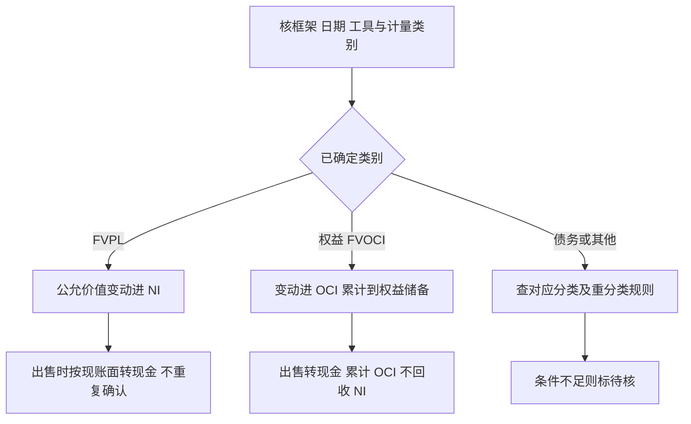

箭头表示分类后的记账处理；分支依据是类别而非有没有出售。

**沿例子读图（笔记补充）**：假设以 100 买入权益投资，期末价值 150。先核框架、日期和类别：FVPL 分支把 50 计入 NI；符合权益 FVOCI 条件的分支把 50 计入 OCI，NI 不变。随后以 150 出售，两条分支都不能再赚第二次 50。

**图旁边界**：原p.11是历史AFS示例；债务FVOCI另核，不能拿权益不回收规则套全部工具。

**文字替代**：未出售不能决定变动进NI或OCI，先确定工具和类别，再处理出售。

<details><summary>读图自测：两个分支都没卖，为什么利润不同？</summary>

计量类别不同。FVPL变动进NI，权益FVOCI变动进OCI；未出售不决定去向。

</details>

失败 1：把所有浮盈一律放 AOCI，会少记 FVPL 利润；核资产表计量长标签。失败 2：出售再记 50 或权益 FVOCI 自动 recycling，会重复/错分 NI；核初期变动和当前账面。原 p.43 列权益 FVOCI 处置损失 3,313，但缺对应附注，不能据单行推“所有权益都重分类”，也不擅判原表错。

<details><summary>迁移 1：公允价值从 100 跌到 80，尚未出售，两分支各怎样？</summary>

FVPL NI/E 各 −20；权益 FVOCI OCI/E 各 −20、NI 不变。是否未实现不能替代分类。
</details>

<details><summary>迁移 2：FVOCI 权益由 150 售为 150，有人又贷处置收益 50，错在哪？</summary>

现账面已是 150，转现金 150 无新增差额；历史 OCI 不回收 NI，该贷收益既重复又违反本分支规则。
</details>

**所以呢**：OCI 是本期流量、AOCI 是累计存量，能否回收由类别而非卖出动作独自决定。🔗 [IFRS Foundation 2018 年解释](https://www.ifrs.org/news-and-events/news/2018/04/ifrs-9-and-equity-investments/)支持权益 FVOCI 不回收损益及权益内部转移；2026-10-02 实际访问，引用其公开解释而非声称完整 2026 准则验读。


#### 2.2.9 权益（二）：少数股东权益（讲义 p.12）

**是什么**

讲义 p.12 用一个从头到尾的数字例子讲清了这一项，原文（分行照抄）：

> - *"parent firm A owns 80% of subsidiary firm B"*
> - *"net assets of subsidiary firm B is \$100"*
> - *"equity by parent firm A is \$80"*
> - *"remaining \$20 is owned by others"*
> - *"consolidated financial statement includes firm B's assets and liabilities, and lists the \$20 equity owned by other non-controlling holders of firm B"*
> - *"similarly, if firm B's net profit is \$10, then list \$2 for non-controlling interests on income statement"*

**逐步走完这个例子（把讲义的六行拆开）**

| 步 | 事实 | 合并报表上的处理 |
|---|---|---|
| 1 | 本例假设 A 持有 B **80% 的实质性表决权**，且没有协议、代理或其他安排推翻 A 对相关活动的主导能力，因此 A **控制** B | B 必须被并表；80% 这个比例本身不是独立、自动的控制结论 |
| 2 | B 的**净资产**（= B 的资产 − B 的负债）= **\$100** | — |
| 3 | 这 \$100 里，属于 A 的是 **\$80** | 属于母公司股东的权益 |
| 4 | 剩下的 **\$20** 属于 B 的**其他股东**（少数股东） | 单列一行 **Non-controlling interests \$20** |
| 5 | 合并报表把 **B 的资产与负债 100% 全部并进来** | ⚠️ 不是按 80% 并 |
| 6 | B 本年净利润 \$10，其中 **\$2（20%）** 归少数股东 | 利润表底部单列 **"Attributable to: Non-controlling interests \$2"** |

**为什么要这么做（讲义没解释，💡 笔记补充）**

因为合并先判断**是否控制**，再区分**权益归谁**。
- 从**控制**的角度：本例中的 A 有现时权力主导 B 中显著影响回报的相关活动，并能用该权力影响自己的可变回报，所以合并报表把 B 的资产与负债**全部**列入。控制不是“能越过公司法律、合同或治理限制，对 B 的全部资产做任何事”。
- 从**所有权**的角度：B 的 20% 确实不归 A 的股东。所以在权益侧诚实地标出来："这 \$20 虽然在我表上，但不是我股东的。"

**⇒ 结论：非控制性权益（Non-controlling Interests, NCI）是子公司中不直接或间接归属于母公司的权益。** 它是外部股东真实拥有的集团权益，不是为了让会计等式相等而临时塞入的“配平差额”。现行名称用 `non-controlling`，定义也不要求该比例一定小于 50%；关键是该部分**不归母公司、且其持有人不控制该子公司**。🔗 [IFRS 10 官方定义与控制模型](https://www.ifrs.org/content/dam/ifrs/publications/pdf-standards/english/2022/issued/part-a/ifrs-10-consolidated-financial-statements.pdf?bypass=on)要求同时判断权力、可变回报及用权力影响回报的能力（2026-10-25 访问）。

**在真实报表上长什么样**

§2.2.11 那张港股资产负债表的最底部（讲义 p.15）：

| 原表运算 / 状态 |
|---|
| Equity attributable to owners of the parent          31,111,658   ← 母公司股东的 |
| Non-controlling interests                             9,172,910   ← 少数股东的 |
| Total equity                                         40,284,568 |

少数股东权益占期末总权益的 **22.8%** —— 说明集团期末权益余额中有一部分归属于受控制子公司的外部股东。仅凭这一行不能判断是一家还是多家非全资子公司；数量和业务分布须查合并范围附注。

利润表（讲义 p.34）底部同样分两行：

| 原表运算 / 状态 |
|---|
| Attributable to: |
| Owners of the parent      2,706,794 |
| Non-controlling interests 1,987,580 |
| 4,694,374 |

⚠️ **这里有一个极其实用的观察点（💡 笔记补充）**：这家公司 2019 年集团净利润为 4,694,374，其中归属于母公司所有者 2,706,794，归属于 NCI 1,987,580（占集团净利润 **42.3%**）。上面的 **22.8%** 以期末总权益为分母，是**余额占比**；这里的 **42.3%** 以本期集团净利润为分母，是**期间利润归属占比**。分母和时间属性不同，不能把两者差异解释成持股比例变化；它们还可能汇总多家盈利能力不同的非全资子公司。

**市盈率（Price-to-Earnings Ratio, P/E）**把普通股价格与对应的每股盈利相比；它是一种估值比例，不是“这么多年一定回本”的承诺。这里先用正利润说明，亏损时不套普通正倍数直觉。

**先分清两个股数**：基本 EPS 使用利润所属期间的加权平均在外普通股数；总市值通常使用估值日当时的普通股数。两者都要匹配同一普通股类别与利润归属，但股数的时点仍可能不同：

$$
P/E_{\text{每股口径}}=\frac{\text{估值日每股市价}}{\text{基本 EPS}},
\qquad
P/E_{\text{总额口径}}=\frac{\text{估值日普通股总市值}}{\text{同期间归普通股利润}}.
$$

只有总市值所用股数与基本 EPS 的加权股数一致等条件齐备，才能把两种写法直接画等号。年中增发、回购或报告期后股数变化时，要先对齐股数基础，不能机械互换。

**改股数看区别（💡 笔记补充）**：假设年度普通股利润为 100、该年度加权股数为 100，基本 EPS 为 1。估值日已在增发后，当时有 200 股、每股市价为 10；股价除 EPS 为 10，而总市值 $200\times10=2,000$ 除年度利润为 20。两个数的差来自股数时点口径，不是 NCI 被扣了两次。

若把集团净利润 4,694,374 错当归母口径，在尚未进行优先股等普通股调整的这一层，错误利润分母会比 2,706,794 高约 **73.4%**；同一母公司普通股市值下，算出的 P/E 会偏低。

讲义 p.30 的 *"Profit after tax, attributable to Shareholders of the company => **Earnings per share**"* 给出第一步：先从归属于母公司所有者的利润出发。IAS 33 的第二步更精确：再调整成**归属于母公司普通股股东**的金额，例如按适用条款处理权益型优先股股利、结算差额等项目。不能把 NCI 利润放进普通股 EPS，也不能无条件把 `归母利润 2,706,794` 当作已完成普通股调整的最终分子。🔗 [IAS 33 官方简介](https://www.ifrs.org/issued-standards/list-of-standards/ias-33-earnings-per-share/)及[官方标准第 10–14 段](https://www.ifrs.org/content/dam/ifrs/publications/pdf-standards/english/2022/issued/part-a/ias-33-earnings-per-share.pdf?bypass=on)（2026-10-25 访问）。

**🎙️ 课堂补充**（`01:19:06`–`01:20:30`）：教授照讲义 p.12 的例子念了一遍，数字与本节引用的讲义原文一致——

> *"the parent owns 80% of the subsidiary[,] on B[,] and [the net] asset[s] of the [subsidiary] is 100. So the equity by [the] parent[,] [from A][,] is [80] because they only own the 80%"*

（`01:19:18`–`01:19:36`；

ASR 把 80 报成 "800"，按讲义应为 80）；

> *"remaining 20 is owned by others['] shareholders"*

（`01:19:36`–`01:19:45`）；

> *"similarly[,] the firm B's net profit is 10[,] and[ we] list two for the non-controlling interest[,] [on the] income statement"*

（`01:19:57`）。

没有超出讲义的展开，B 状态。

**💡 换个说法（笔记补充）**
你和朋友合开一家奶茶店。这里额外假设：你拥有 80% 的实质性表决权，也确实能主导影响奶茶店回报的经营活动，因此构成控制。现在你要提交这个集团的合并报表：
- 奶茶店的全部设备、全部存货、全部欠款，**统统写进集团表**（因为它是受控制子公司）
- 但在"这些东西归谁"那一栏，你必须写明：其中 20% 归你朋友

那 20% 就是少数股东权益。

**⚠️ 常见误解**
- ❌ "持股 80% 就自动控制，而且只并 80% 的资产"。→ 先按权力、可变回报及两者联系判断控制；本例已经给定控制，所以对子公司的资产负债全额并入，再把不归母公司的权益列为 NCI。已控制子公司的并表与共同安排不同；共同安排也不能一概说比例合并，须判安排类别及框架。
- ❌ "少数股东权益只是配平项，或者一定是小于 50% 的那一块"。→ NCI 是子公司中不归属于母公司的真实权益；名称中的 non-controlling 描述控制地位，不是固定比例阈值。
- ❌ "少数股东权益在任何报表框架、任何合同下都一定列权益"。→ 本讲采用 IFRS 下普通权益型 NCI 的情形。其他框架的列示要求、可赎回或含强制现金义务的工具要按对应准则与合同重新分类，不能把“夹层只属于历史”推广为全球结论。
- ❌ "归母净利润就是股东现在能分的钱"。→ 归属正确只是第一步；利润不是现金，也不等于已宣告股利或当然可分配金额。还要看现金流、权益型优先股等权利、法定／合同分派条件及董事会或股东会的适用决策程序。

**与其他概念的关系**
少数股东权益 ← §2.1.3 合并报表；→ §2.5.2 利润表底部结构与 EPS；→ §2.8 权益变动表的最后两列。

---

**💡 控制后的全额并表，追踪到母公司与 NCI（笔记补充）**

> 🧭 **第二遍 / 进阶复做**：首遍先掌握“控制后全额并入、外部股东份额列 NCI”。本块再走投资抵销、取得日假设和利润归属。

先要解决“取得控制后，哪一部分资产负债在集团里，哪一部分利润属于外部股东”。输入是控制结论、收购对价、可辨认净资产公允价值、持股和双方报表；输出是抵销后的集团 A/L、商誉、归母权益/NCI 与利润归属。持股比例有助判断，不能孤立替代控制测试。

原例 100% 对价 1,000 万、可辨认资产公允价值（FV）800 万、负债 200 万：FV 净资产 $800-200=600$ 万，商誉 $1,000-600=400$ 万。该残差简式限定 100% 简化收购；先识别资产和负债，不能把整笔品牌/客户价值一概当商誉。

另设清楚的小数据：母公司 A 收购前资产 200、负债 20、权益 180（资产中现金 200）；B 资产 160、负债 60、净资产 100。A 支付 80 取得 B 的 80% 且控制，假设 FV=账面、无商誉、无内部交易、NCI 按净资产比例 20。

1. A 单体付款：Cash 200→120，Investment in B 0→80；A 总资产仍 200。
2. 先把双方全额行合在一起：资产 $200+160=360$、负债 $20+60=80$、A 权益 180、B 权益 100。
3. 集团不能同时持有“对子投资 80”和自己拥有的子资产：抵销投资 80 与 B 权益的归母 80；B 权益余 20 改列 NCI。集团 A $360-80=280$、L 80、E $180+20=200$，$280=80+200$。
4. 假设 B 本期赚 10、全变成新资产且无分配/其他变动：集团 A 290、L 80、E 210；利润 10 分母公司 $10\times80\%=8$、NCI 2，归母 E 188、NCI E 22。原 p.12 只给净资产 100 和利润 10，没有标 100 是期初，本补例的前后推移不是课件原话。

**看图前先问**：持股 80% 且已确认控制，为何仍把子资产负债 100% 并入？

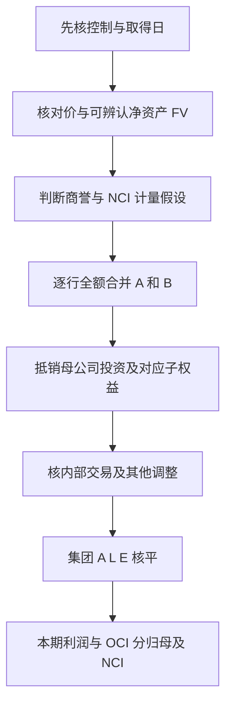

箭头是合并计算步骤，不是母子公司的现金转移图。

**沿例子读图（笔记补充）**：母公司 A 原有现金 200，以 80 取得 B 的 80% 控制权。按图先核控制、对价与 NCI 假设，再逐行全额合并，得到抵销前资产 360、负债 80。随后抵销投资 80 与对应子权益 80，余下 20 列 NCI；集团资产 280 等于负债 80 加权益 200。B 后续赚 10 时，在末框分为归母 8、NCI 2。

**图旁边界**：假设FV等账面、无商誉/内部交易，NCI按净资产比例；原净资产100未标期初，后期推移是补例。

**文字替代**：控制后的全额并表先抵销投资与子权益，再单列NCI并分配本期利润。

<details><summary>读图自测：不抵销投资，等式平就可以吗？</summary>

不可以。同一子业务重复计入；“抵销母公司投资及对应子权益”必须先做抵销，“集团 A L E 核平”平衡只是一项核对。

</details>

失败 1：只并 80% 子资产/负债会把集团控制的资源和义务漏掉；100% 行项目并入后再分权益归属。失败 2：不抵销投资，A 多 80 并重复计同一业务。失败 3：用账面净资产代替 FV 可误算商誉；取得日 FV 和可辨认项都须核。集团内部交易需抵销，本无内部交易补例不能直接代所有复杂集团。

<details><summary>迁移 1：B 利润改为 15，其余前提不变</summary>

集团 A 295/L 80/E 215；归母利润 12、NCI 3；归母 E 192、NCI 23，$295=80+192+23$。
</details>

<details><summary>迁移 2：集团列 A 360/L 80/E 280，为什么虽平却仍错？</summary>

子公司的权益 100 被整个重复留在集团权益，投资 80 也没抵销。等式平不证合并正确；应抵销 80 并把 20 另列 NCI，回到 A280/L80/E200。
</details>

**所以呢**：集团 NI 不是全部归母，NCI 是外部股东对受控制子公司净资产的权益。母公司普通股 EPS 只使用归属于母公司普通股股东、并完成适用优先股等调整后的利润，不能把 NCI 利润放进分子。


#### 2.2.10 资产负债表能告诉你什么、不能告诉你什么（讲义 p.13）

这一页是资产负债表一节的**总结页**。讲义把它分成 Key information 与 Weaknesses 两栏，适合用来组织论述复习；现有材料没有教授对实际出题概率的明示，不能写成“最可能出题”。

**Key information（六条，讲义 p.13 原文）**

下面一行是p.13提出的一个读表问题。英文原句移到同编号条目，保留中文问题与报表定位。

| # | 中文 | 具体去看哪几行 |
| --- | --- | --- |
| 1 | 主要拥有哪些资产 | 资产侧金额最大的两三行 |
| 2 | 公司规模（总资产，或扣负债后的净资产） | Total assets / Net assets |
| 3 | 资产靠什么融来的：**债 / 股 / 内部积累** | 负债合计 vs 股本+溢价 vs 留存收益 |
| 4 | 明年必须还多少债 | 流动负债，尤其"一年内到期的长期借款" |
| 5 | 手上有多少现金/速动资产来还它 | 现金及等价物、可流通短期投资、可收回应收款；再查限制与附注 |
| 6 | 一段时间内主要项目的**趋势或突变** | 需要**至少两年**的数据 ⇒ 这就是 §2.4.3 百分比变动分析的用途 |

编号是原题序号；中文列说要回答什么；最后一列定位应读的报表行。读第2行：看Total assets或Net assets判断不同口径的规模，不把两者混成一个数。

💡 **笔记补充**：第 5 行的**速动资产（quick assets）**是可较快变现、通常不含存货和预付项目的流动资产。本讲读表至少检查现金及等价物、可流通短期投资和可收回应收款；受限现金、难以收回的应收或不能及时出售的投资，不能只因科目名称就当成可立即偿债资源。

**1**

讲义原文：*Major assets owned*


**2**

讲义原文：*Size of the company (total assets or net assets after liabilities)*


**3**

讲义原文：*How assets are financed (debt, equity and internal financing)*


**4**

讲义原文：*How much debt the firm must repay next year*


**5**

讲义原文：*How much cash or quick assets the firm has on hand to repay the debt due next year*


**6**

讲义原文：*Trends or abrupt changes in major assets, liabilities and equity during a period of time*


> 💡 **第 3 条里的"三种融资"是一个非常好用的框架（笔记补充）**：
> - **有息债务融资（interest-bearing debt）** = 借入资金，通常要还本付息，不直接稀释控制权；**负债合计（total liabilities）** 还包括应付账款、应计项目等，不等于有息借款
> - **股权融资（equity）** = 发行权益取得股东投入；向新投资者发行可能稀释原股东比例或投票权，须看认购与股类条款 ⇒ 看 `股本 + 股本溢价`
> - **内部融资（internal financing）** = 自己赚的没分掉的 ⇒ 看 `留存收益`
>
> 拿 Nike 的共同比表（§2.4.3）套一下：Total liabilities 41.8%~42.7%，Capital in excess of stated value 31.5%~36.4%，Retained earnings 19.4%~26.2%。**⇒ 按这张共同比表，只能说约四成资产由负债合计支持、约三成对应资本溢价、约两成对应留存收益；其中负债不能全部称为有息债务。**这个一句话结论，就是共同比分析的产出。

**Weaknesses：两类信息限制**

以下两条保留讲义 p.13 原文：第一条讨论已确认资产的计量，第二条讨论未确认项目。

> **① *"Book value based on historical cost and depreciation is reliable but not representative of the current fair value at the market"***
> **账面价值基于历史成本与折旧，可靠，但不代表当前市场公允价值。**

注意讲义的措辞是 "**reliable but not representative**"——这是 [[M01-会计与商业]] 质量特征里 **相关性（relevant）与可靠性（reliable）的经典权衡**：
- 历史成本通常有原始交易凭证、较易验证，但仍可能被错计、错分或选择性处理；它也可能与当前价值脱节。
- 公允价值更贴近计量日市场条件；可靠程度取决于输入层级和估值方法，缺少活跃市场时模型不确定性更高，但不能一概称为不可靠。

不同项目可能采用成本、公允价值或其他适用计量基础，具体取决于准则、分类与企业政策；不能把全套财报压成“大部分历史成本、少数公允价值”的普遍规则。

> **② *"Some assets and liabilities are not recognized on the balance sheet. e.g., research and development ability, intangible assets developed within the firm, contingent lawsuits with uncertainty"***
> **有些资产和负债根本不在表上**：研发能力、自创无形资产、结果不确定的或有诉讼。

> **表外项目（Off-balance-sheet Items）** ⭐ 本讲把它作为分析用的宽泛标签：某项经济资源、义务或风险没有在资产负债表正表确认为一行。以 IAS 37 的预计负债为例，判断顺序是：① 报告日是否因过去事项存在现时法律或推定义务；② 清偿是否很可能导致经济资源流出；③ 金额能否可靠估计。三项均满足才确认预计负债；未确认事项再按或有负债披露边界处理，流出可能性 remote 时通常不披露。不能把“很可能流出”单独当成充分条件，也不能保证所有表外事项都会进附注。🔗 [IAS 37 现行文本第 14、23、25 段](https://www.ifrs.org/content/dam/ifrs/publications/html-standards/english/2026/issued/ias37.html#IAS37_14)；获取日 2026-10-25。

**先分清“记负债”和“只作附注说明”**。预计负债（provision）是已经确认为负债、但金额或支付时间仍不确定的项目，不是表外项目。法律义务来自合同或法律；推定义务（constructive obligation）则来自企业一贯做法或足够具体的公开表态，使有关人合理预期企业会承担该责任。

这里只讨论义务这一支；研发能力等未确认资源，要按对应资产准则另判。对义务按下表分叉，`remote` 指流出可能性极低，不是本讲自定一个统一百分比：

| 报告日已知条件 | 处理方向 |
|---|---|
| 过去事项形成现时义务，流出很可能且能可靠估计 | 在正表确认预计负债 |
| 可能义务，或现时义务但未满足流出／可靠估计条件 | 判断或有负债，通常在附注披露 |
| 流出可能性极低（remote） | 通常无需披露该或有负债 |
| 研发能力等未确认资源 | 按对应资产准则判断，不能套用义务分支 |

**走一个小例（💡 笔记补充）**：公司已造成污染，过去持续清理且已作具体公开承诺，使受影响者合理预期它会负责。假设清理支出很可能发生，报告日最佳估计为 100 万，则三项条件齐备，确认预计负债 100 万；不等签完合同或实际付款才记录。若改成仅有可能义务、流出不很可能，且并非极低可能，就通常只披露或有负债；若事实与估计变化，报告日须重新判断。

🔗 上述义务、确认和披露区分据 [IFRS Foundation 的 IAS 37 官方说明](https://www.ifrs.org/issued-standards/list-of-standards/ias-37-provisions-contingent-liabilities-and-contingent-assets/)，获取日 2026-10-25。小例为笔记补充，并非课堂原题或 A 公司事实。

**🎙️ 课堂补充：或有诉讼**

这段问“该不该记、记多少”，并比较 AI 与人的判断。时间是 `44:25`–`48:36`，约 4 分钟，位于 W2 顺延段试算表 AI 演示之后；讲义无对应页。
教授插了一个案例，先把问题摆出来：

> *"if a company gets s[ued,] the [accountants] have to answer a simple question[:] are we going to lose money on this? And if so, how much? Should we write down our record today?"*

（`44:48`）——这说明诉讼会同时带来“是否确认、确认或披露多少”的判断问题。但判断受适用准则、律师意见、案件事实与可获得证据约束，不是管理层可以自由挑选结果。

接着对比两种判断：

- **AI 的做法**：翻 1 万个旧案例算平均——

> *"eight out of 10 similar lawsuits end up costing a company like 100,000. So the AI automatically tends to suggest that there is [a] loss, which is approximately 100,000"*

（`45:38`）。

- **人的做法**：知道 AI 拿不到的现场信息——

> *"the lawyer says the trial started yesterday and the witness looked nervous. And the jury seemed angry at us"*

（`45:54`）；

甚至

> *"the other side['s] lawyer whispered over coffee[:] pay [us] \$250,000 today and we will drop the case. So the human [accountant] knows the real cost is probably \$250,000[,] not the AI['s] scan of the 100[,000]"*

（`47:31`）。

这笔和解报价是本例的重要现场证据，但不自动等于必须确认的最终金额；还要判断报价是否有效、企业义务与最可能结算范围，并按适用规则计量。

- **结论**：

> *"AI is great at looking at the average number from the past. But every lawsuit is unique."*

（`47:47`）；

预测这类损失

> *"[needs] human common sense"*

（`47:56`；

ASR 把末句录成

> *"the human judgment is unnecessary"*

，按上下文应为 **necessary**）。

教授也承认机器并非一无是处——表情识别、测谎

> *"sometimes the machine is doing better ... but most cases[,] maybe human is doing better"*

（`47:08`–`47:21`）。

- **收尾回到本课程主线**（`48:09`–`48:36`）：AI 能分析的只是我们喂给它的历史记录——

> *"what AI can do is based on what we have prepared for the AI to analyze. Especially [from] a historical perspective"*

——所以

> *"I tried to present you with another [accounting] system which include[s] more information in the system ... AI can answer more questions[,] which cannot be answered by the traditional double entry system"*

，即 W4–W5 的 **REA 模型**。

**这段改变了什么**：补入一个课堂诉讼例（历史样本约 \$100,000，对方提出 \$250,000 和解），说明确认／披露和计量需要结合案件现场与规范条件。复式记账不负责把所有证据编码成账户余额，但报表附注、律师函和其他非结构化材料仍可保存信息；REA 可显式记录更多业务事件和关系，也不会自动完成诉讼判断。AI 若取得附注、合同、律师材料和结构化历史数据，可以辅助分析；若输入只有账面数字，结论自然受限。→ [[M01-会计与商业]] 或有事项；→ W9/W10「AI 分析财报」。

**💡 把这两条 Weakness 连起来（笔记补充）**：

**看图前先问**：资产负债表的计量和确认范围怎样限制解读？

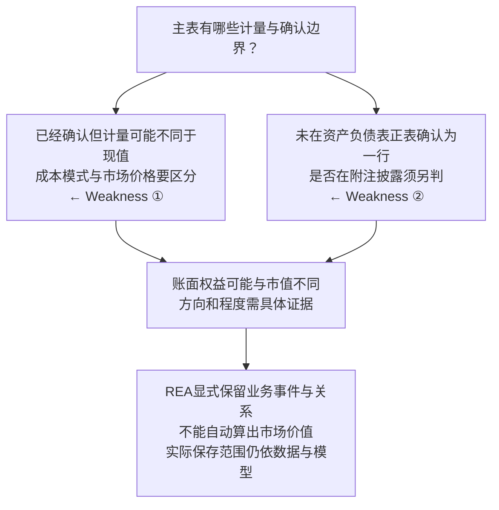

箭头表示限制对分析的影响，不是所有企业必然发生的因果关系。

**沿例子读图（笔记补充）**：先看“已经确认但计量可能不同于现值”：本讲土地成本与现价不同，提醒查计量政策。再看“未在正表确认为一行”：自创研发能力没有同样的确认基础，而或有诉讼是否附注披露还须按 IAS 37 判断。这两条都连到“账面权益可能与市值不同”，不能据此确定哪一边一定更大。

**图旁边界**：本图为笔记补充；历史成本不等于总是少记，REA也不自动估出市场价值。

**文字替代**：计量差异与未确认信息限制主表解读；市值方向和REA采集范围不能从图断言。

<details><summary>读图自测：公司市值低于账面权益，会推翻全部报表吗？</summary>

不会。计量、风险和市场预期不同；图说明信息边界，不能用单向大小关系认证。

</details>

**🎙️ 课堂补充**（`01:20:30`–`01:22:15`）：教授照讲义 p.13 念了 Key information 六条与 Weaknesses 两条，补了一句解释性的话：

> *"there is a debate ... in the current [world] about whether the [older] assets should be recorded as historical value ... if we still use the historical cost to measure the current value[,] it is a little bit [off]"*

（`01:21:23`–`01:22:00`）——与本笔记 §2.2.10 Weakness ① 的"可靠但不相关"判断一致，B 状态，无实质增量。

**🎙️ AI 分析资产负债表的课堂演示**（`01:22:37`–`01:34:12`，约 11.5 分钟，讲义无对应页）
教授先用一份现成的提示词模板演示：

> *"act as the financial statement analys[t]. Find the most recent annual report [for the company] ... using the company['s] investor relations site or the SEC[,] Edgar ... do not rely on press release[s], blogs or secondary summaries"*

（`01:23:48`–`01:25:28`），📄 **这份提示词教授 2026-09-21 已作为 `2 Analyze balance sheet.docx` 补发**，原文两段：

> "Act as a financial-statement analyst. Find the most recent annual report/10-K for [TESLA] for the fiscal year ended [2025] using the company investor-relations site or SEC EDGAR. Do not rely on press releases, blogs, or secondary summaries where the annual report is available. Report the document title, fiscal year-end, filing date, source URL, and the financial-statement currency/units."

/

> "Analyse how assets are financed (debt, equity and internal financing) only based on the information in balance sheet."

——方括号里的公司名与年份是留给你替换的占位符；

第二段就是本节"债务 / 股权 / 内部融资"三分法的题面。

**中文任务入口与限定词**：先到公司投资者关系网站或 SEC EDGAR 找指定年度的 10-K，报告文件标题、财年末、申报日、URL、币种和单位；再**只根据资产负债表**分析资产由债务、股东投入和内部留存怎样支持。`only based on` 限制证据范围：不能把利润表、现金流或新闻里的原因偷偷补进答案。

**来源边界**：DOCX 保存了两段提示词，转录保存了教授换工具、找到文件和继续提问的过程；**Gemini 当时显示的完整回答、具体数字、截图和逐项计算没有保存在本批原件中**。因此不能重造“教授的 Tesla 输出”，也不能把下面的方法型答案写成 Gemini 原答。

**English method answer（⚪ 笔记整理；不是课堂实际输出）**: First verify the filing title, fiscal year-end, filing date, source URL, currency and units. From the balance sheet, distinguish total liabilities from interest-bearing debt, identify contributed equity such as share capital and additional paid-in capital, and use retained earnings as the balance-sheet indicator of accumulated internal financing. Compare each amount with total assets only when the same date, scope and units are confirmed. The balance sheet can describe the financing structure, but it cannot by itself prove why management chose that structure or whether operating cash flows are sufficient.

并解释这是为了**避免 AI 幻觉**：

> *"we call this AI hallucinations"*

（`01:25:28`–`01:25:43`）。

教授先试了一个未指明的 AI 工具失败（`01:23:29`：

> *"I don't follow"*

）、又试了 **Kimi**（`01:23:38`），最后改用 **Gemini** 才找到 **Tesla 2025 财年 10-K**（`01:29:12`–`01:29:55`：

> *"here is [the] 10[-]K [and] [fiscal] year end[ing] December 31st[,] 2025"*

），并打开了 Tesla 的合并资产负债表（`01:29:55`–`01:30:29`）。

随后向 Gemini 提问

> *"analyze how the assets are financed[,] only based on the information [in the] balance sheet"*

（`01:31:12`–`01:31:27`）。课堂口述说 Gemini 按**债务融资／股权融资／内部融资（留存收益）**三分法给出分析，并提示“只用资产负债表”的局限；由于屏幕输出未保存，本笔记只记录教授的过程性描述（`01:33:44`–`01:34:12`：

> *"they argue that ... you have some limitation[s] ... which is very good"*

）。

讲到 Gemini 算出的 debt ratio（总负债 ÷ 总资产）时，教授明确**降权**：

> *"for such a ratio analysis, we don't have to worry about now because later we have one chapter. It's about all the models we can adopt when we rely on AI to make the financial analysis"*

（`01:32:35`–`01:32:49`）——**比率分析本讲只需看懂，留到后面专门章节**。

**这段改变了什么**：讲义完全没有的纯课堂内容——用 AI 工具（先失败，换 Gemini 才成功）演示"债务/股权/内部融资"三分法的自动化应用。能确认的是提示词、工具切换和教授对输出的口头评价；不能确认实际 Tesla 数字或完整回答。

是本讲最高价值的课堂增量之一。

**⚠️ 常见误解**
- ❌ "资产负债表能直接告诉你公司值多少钱"。→ 它提供账面净资产，不等于市场估值。账面净资产与市值可能显著不同；方向和程度须结合市场价格、计量政策、未确认资源、风险与具体公司证据判断，讲义没有提供“十倍”这一经验阈值。
- ❌ "表外就是藏起来了"。→ 表外**不等于**不披露。满足披露要求但不进主表的项目可在附注说明；故意隐瞒、虚构或违反确认/披露要求才可能构成错报或舞弊，不能只凭“表外”二字定性。

**与其他概念的关系**
本页 → §2.5.4（利润表的 Weakness）→ §2.7.3（现金流量表怎么交叉验证）；→ **W4 REA 的动机**；→ W9/W10「AI 分析财报」。AI 能否处理表外或非结构化信息取决于它实际拿到的附注、合同、事件数据与权限，不能说它天然只会看正表数字或必然看不见表外事项。

---

#### 2.2.11 读一份真实的资产负债表（讲义 p.14–15）

> 📄 **p.14 与 p.15 是两张纯图片页**（`python-pptx` 提取文本为空）。已转 PDF 后**视觉复核**，内容是一家**港股上市公司 2019 年度的合并财务状况表**，人民币千元（RMB'000），按 **HKFRS**（香港财务报告准则）编制。**讲义和课堂没有标明公司名称**，所以下文仍称 **A 公司**。2026-10-25 另行取得 HKEX 原年报并逐表匹配 p.14–15、p.34、p.43–44、p.46 后，已核实 A 公司是 **中国生物制药有限公司（Sino Biopharmaceutical Limited, 1177.HK）**；这是后来外部回源结果，不是教授点名或讲义署名。

**p.14 —— 资产侧**

下面连续两张资产负债表中，`Notes` 列是附注编号，不是金额或行号；例如 `15` 表示应查附注 15。`2019` 与 `2018` 两列才是 RMB'000 金额。

**Consolidated Statement of Financial Position ｜ 31 December 2019 ｜ 单位：RMB'000**

| | Notes | 2019 | 2018 |
|---|---|---:|---:|
| **NON-CURRENT ASSETS 非流动资产** | | | |
| Property, plant and equipment 物业、厂房及设备 | 13 | 6,913,728 | 5,804,369 |
| Investment properties 投资物业 | 14 | 563,395 | 367,664 |
| **Right-of-use assets 使用权资产** | 15 | 1,293,478 | – |
| Prepaid land lease payments 预付土地租赁款 | 15 | – | 1,222,099 |
| **Goodwill 商誉** | 16 | 13,896,976 | 13,896,976 |
| Intangible assets 无形资产 | 17 | 7,703,642 | 8,349,174 |
| Investments in associates 于联营公司的投资 | 18 | 808,443 | 326,329 |
| Equity investments designated at FVOCI 指定以公允价值计量且变动计入其他综合收益的权益投资 | 19 | 1,211,084 | 743,280 |
| Deferred tax assets 递延税项资产 | 30 | 580,944 | 470,559 |
| Prepayments 预付款项 | 24 | 414,466 | 61,633 |
| **Total non-current assets 非流动资产总计** | | **33,386,156** | 31,242,083 |
| **CURRENT ASSETS 流动资产** | | | |
| Inventories 存货 | 22 | 1,658,597 | 1,209,160 |
| Trade and bills receivables 应收账款及应收票据 | 23 | 2,712,209 | 2,924,045 |
| Prepayments, other receivables and other assets 预付款、其他应收及其他资产 | 24 | 6,903,251 | 5,728,193 |
| Amounts due from related parties 应收关联方款项 | 38 | 151,588 | – |
| Equity investments at FVPL 以公允价值计量且变动计入损益的权益投资 | 21 | 491,357 | 146,814 |
| Financial assets at FVPL 以公允价值计量且变动计入损益的金融资产 | 20 | 1,084,883 | 1,853,871 |
| **Cash and bank balances 现金及银行结余** | 25 | 11,911,210 | 6,676,042 |
| **Total current assets 流动资产总计** | | **24,913,095** | 18,538,125 |

**先认清本页新增行（💡 笔记补充）**

前文讲过应收、预付和公允价值。下面两张真实表还用了几组新名字；先认对象，再读金额，不能把一串英文当成已解释。

| 原表项目 | 它在问什么 | 本例查证入口 |
|---|---|---|
| Trade and bills receivables / payables 贸易应收／应付及票据 | 除普通赊销赊购款，还合列按票据条款到期收付的款项 | 收款看 Note 23，付款看 Note 26 |
| Prepayments, other receivables and other assets 预付款、其他应收及其他资产 | 几类项目合并列示，不能全读成客户欠款 | Note 24 已有拆分，见下文 |
| Financial assets at FVPL 以公允价值计量且变动入损益的金融资产 | 名称说明计量和变动去向，不说明具体持有哪些工具 | 按本行附注 20 查工具与风险 |
| Deferred tax assets / liabilities 递延税项资产／负债 | 会计与税务计入的时间不同，可能影响以后抵税或交税 | Note 30；不等于当前 Tax payable |
| Deferred government grants 递延政府补助 | 补助已按政策处理，但相关收益可能随以后成本分期确认 | Note 29；不是客户预付款 |

**票据先当作有条款的收付权利理解**：普通贸易应收／应付来自赊销赊购；改以票据约定金额、到期日等收付时，仍要看票据及承兑人的条款与信用风险。合并行只给总额，不能据名字认定全部由银行无条件保障。

**混合行确实不只含预付款**：原年报 Note 24（物理页 140）把 2019 流动合计 6,903,251 拆为预付款 805,925、其他应收 479,175、理财产品投资 5,618,104、预付费用 47；四项相加才是本行。这里按附注给实际组成，没有把整行当成普通销售应收。

**递延税的最小时间差例（笔记补充，金额单位：元）**：假设税率为 25%，公司会计上今年已确认一项费用 100，但税务只能等以后实际支付才扣。这会使今年应纳税利润相对会计口径多 100、当前税多 25；若满足准则的确认条件，以后那 100 可抵税所对应的 25，可能形成递延税项资产。

反过来，若税务比会计更早扣掉 100，且该暂时差异以后会转回，本简例现在少交的 25 对应以后税额影响，可能形成递延税项负债。它与已经按本期税单计出的应付税款不是同一时间问题；税率、例外、可抵扣利润和抵销条件仍须按准则与公司事实核。本例不是 A 公司税率或 Note 30 余额的推算。

**政府补助为什么可先列递延项目**：IAS 20 要求合理确信会满足条件并收到补助，再按相关成本成为费用的期间系统确认补助收益。与资产有关的补助可按递延收益方式列示，也可按准则规定抵减相关资产。因而“收到补助”不自动等于当期全额利润，也不等同客户尚未履约的合同负债；本公司的具体条件与摊转表仍按 Note 29 查。

🔗 一般规则据 [IAS 12 官方简介](https://www.ifrs.org/issued-standards/list-of-standards/ias-12-income-taxes/)与 [IAS 20 官方简介](https://www.ifrs.org/issued-standards/list-of-standards/ias-20-accounting-for-government-grants-and-disclosure-of-government-assistance/)，获取日 2026-10-25；Note 24 组成据中国生物制药 2019 年报。没有据一般规则给本公司补造税务或补助明细。

**这一页要读出来的五件事**

1. **排序方向与 M01/M02 的教学表不同。** 本页先列非流动资产，Nike 案例先列现金。报表可以采用流动／非流动分类，也可能按流动性顺序列示；只凭行序不能反推所有 IFRS 或 US GAAP 企业都必须这样排。作答时先读表头、分类与适用口径。
2. **许多具体项目旁列有 Note 编号。** 例如 PP&E 按附注 13 查组成。小计及部分项目没有号，不等于漏抄或不需解释；主表与附注共同提供财务信息，不把其中一个当成只有目录、另一个才是全部正文。
3. **先读列示变化**：2019 年出现 `Right-of-use assets 1,293,478`，2018 年的 `Prepaid land lease payments 1,222,099` 在 2019 年显示为破折号。破折号的列示不能单独证明相关业务消失。

   **再提出原因候选**：租赁准则采用、重分类、新增租赁和摊销都可能参与变化，但两行余额本身不能确认是哪一个制度或业务原因。

   **最后查附注 15**：要把两行桥接起来，需会计政策和使用权资产变动明细。现有两年余额不足以断言“这不是业务变化”。“owned or controlled”可帮助理解租赁使用权的确认，却不能替代这家公司的附注。
4. **商誉 13,896,976，两年净额相同。** 占 2019 总资产 **23.8%**（13,896,976 ÷ 58,299,251），因此是值得查看商誉、现金产生单元和减值测试附注的重大暴露。它不自动成为“头号风险”，减值也不会无条件按全部商誉一次冲减；影响取决于相关现金产生单元的可收回金额和实际确认的减值额。🔗 [IAS 36 官方页](https://www.ifrs.org/issued-standards/list-of-standards/ias-36-impairment-of-assets/)；获取日 2026-10-25。
5. **`Investments in associates 联营公司投资`** ⭐ 新概念：联营关系看的是**重大影响**，不是机械套 20%–50% 区间；持有 20% 或以上表决权通常形成重大影响推定，但须先排除控制或共同控制，也可能被相反证据推翻。确定为联营公司后通常采用权益法，按投资者份额确认被投资方损益；本表利润表的 `Share of profits and losses of associates 111,385` 是实例。🔗 [IAS 28 官方页](https://www.ifrs.org/issued-standards/list-of-standards/ias-28-investments-in-associates-and-joint-ventures/)；获取日 2026-10-25。

**权益法小例（💡 笔记补充）**：重大影响是能参与被投资方财务和经营政策决策，但不能单独控制或共同控制。

假设 A 持有联营公司 30%，期初投资账面额为 300；以下忽略收购差额、OCI、减值及其他调整。

- 联营公司本期赚 100：A 的利润表确认 `Share of profit 30`，资产负债表中的联营投资由 300 增至 330。
- A 随后收到股利 12：现金增加 12，投资账面额降至 318；股利不再重复确认为收入。

IAS 28 的权益法让损益份额与投资账面额同步更新，并在收到分配时减少投资。🔗 [IAS 28 官方页](https://www.ifrs.org/issued-standards/list-of-standards/ias-28-investments-in-associates-and-joint-ventures/)；获取日 2026-10-25。

**p.15 —— 负债与权益侧**

| | Notes | 2019 | 2018 |
|---|---|---:|---:|
| **CURRENT LIABILITIES 流动负债** | | | |
| Trade and bills payables 贸易应付款及应付票据 | 26 | 1,809,445 | 1,832,166 |
| Tax payable | | 189,873 | 246,498 |
| Other payables and accruals | 27 | 5,433,879 | 4,684,382 |
| Interest-bearing bank borrowings | 28 | 666,749 | 2,905,575 |
| Lease liabilities | 15 | 23,079 | – |
| **Total current liabilities** | | **8,123,025** | 9,668,621 |
| **NET CURRENT ASSETS 净流动资产** | | **16,790,070** | 8,869,504 |
| **TOTAL ASSETS LESS CURRENT LIABILITIES** | | **50,176,226** | 40,111,587 |
| **NON-CURRENT LIABILITIES 非流动负债** | | | |
| Deferred government grants 递延政府补助 | 29 | 480,652 | 532,941 |
| Interest-bearing bank borrowings | 28 | **7,884,802** | 507,066 |
| Lease liabilities | 15 | 41,270 | – |
| Deferred tax liabilities 递延税项负债 | 30 | 1,484,934 | 1,522,056 |
| **Total non-current liabilities** | | **9,891,658** | 2,562,063 |
| **Net assets 净资产** | | **40,284,568** | 37,549,524 |
| **EQUITY 权益** | | | |
| Share capital 股本 | 31 | 278,451 | 278,846 |
| **Treasury shares 库存股** | | **(412,837)** | (457,288) |
| Reserves 储备 | 33 | 31,246,044 | 29,391,280 |
| **Equity attributable to owners of the parent** | | **31,111,658** | 29,212,838 |
| **Non-controlling interests 少数股东权益** | | **9,172,910** | 8,336,686 |
| **Total equity 权益总计** | | **40,284,568** | 37,549,524 |

**⭐ 关键：这张表用的不是 $A=L+E$ 的排法**

它用的是**净资产格式**，一步步做的其实是移项：

| 步骤 | 项目 | 金额（RMB'000） |
|---|---|---:|
| | 非流动资产 | 33,386,156 |
| ＋ | 净流动资产（流动资产 − 流动负债 = 24,913,095 − 8,123,025） | 16,790,070 |
| **＝** | **资产总额 − 流动负债** | **50,176,226** |
| − | 非流动负债 | 9,891,658 |
| **＝** | **净资产** | **40,284,568** |
| **＝** | **权益总计** | **40,284,568 ✅** |

**💡 验证它仍然是 $A=L+E$（笔记补充，讲义没做这一步）**

- 资产总计 = 33,386,156 + 24,913,095 = **58,299,251**
- 负债总计 = 8,123,025 + 9,891,658 = **18,014,683**
- 权益总计 = **40,284,568**
- 检验：58,299,251 − 18,014,683 = **40,284,568** ✅ **完全相等。**

> **⇒ 结论：格式变了，等式没变。** M01 的 $A=L+E$ 在真实港股年报上一分不差地成立，只是表的排法把它写成了 $A-CL-NCL=E$。**这是本笔记为读者补的最重要的一次翻译。**

**💡 这张表还能立刻读出三条结论（笔记补充）**

1. **借款余额结构明显变化。** 流动银行借款从 2,905,575 降至 666,749（约 −77%）；非流动银行借款从 507,066 增至 7,884,802（约 +1455%）。合计由约 34.1 亿增至 85.5 亿。

   这说明总借款与长期借款增加、短期借款下降。是否逐笔短债换长债、利率怎样、款项用于何处，仍须查附注与交易。

   现金流表新借款 8,394,993 及偿还金额支持融资扩大的方向，但余额增量与净借款现金尚差 60,058（RMB'000），原因待借款附注。
2. **净流动资产由约 88.7 亿增至 167.9 亿。** 这是流动资产减流动负债的账面余量增加，不能直接证明短期偿债安全。还需知道资产可收回性、变现时间和负债到期安排。

   同期长期借款上升是可追问的融资线索；缺少资金用途及相关附注，不能确定净流动资产增加主要由该借款造成。
3. **库存股 (412,837) 带括号，是权益的减项**（§2.2.8）。其净余额由 (457,288) 变为 (412,837)，减项净减少 44,451；资产负债表只能给出这个净变化，不能单独证明全部来自注销。§2.8.2 另有 `Cancellation of treasury shares 76,502` 行，但 76,502 不是本行净变动 44,451，仍须把回购、注销及其他变动完整桥接后再归因。

**🎙️ 课堂补充**（`01:34:12`–`01:36:07`，约 2 分钟，教授回到讲义 p.14–15 的真实报表逐段讲解）
教授按格式念了一遍：

> *"we have the ... non-current asset category, current assets, and [when] we plug them together[,] we get the total current assets ... [and] we have [current] liabilit[ies] ... and we have net current assets[,] that is current assets minus current liability"*

（`01:34:32`–`01:34:45`）；

> ⚠️ **来源窗口边界**：`01:35:01` 的 ASR 短句把 `total assets less current liabilities` 直接接成 `total equity`，漏掉非流动负债，因此不能单独当作完整公式。本轮未核原音，不判断是口述省略还是 ASR 丢词。`01:35:16`–`01:35:55` 随后继续讲 non-current liabilities、total liabilities 和 $A-\text{全部负债}=E$，才恢复与原表一致的完整链。

> *"then we have the non[-]current liability and the equity ... [and] equity[,] assets minus total [liabilities] ... this net assets[,] this number is equal to the total equity"*

（`01:35:16`–`01:35:33`）；

并**明确点出这是同一个等式的改写**：

> *"we usually use the [formula] of total assets equal to total liability plus [total] equity[.] [But for] this example[,] you can see that they change the equation a little bit ... we are using total assets minus total liabilities equal to total [equity,] but still they are talking about the same thing[.] [The] underlying logic is the same"*

（`01:35:44`–`01:36:07`）。

**这段改变了什么**：课堂原话支持“净资产格式只是同一会计等式的移项”这条主线；上面的逐行加总和跨表差额仍是笔记复算，不能因教授确认代数方向就把全部分析升级为课堂逐项核验。

A 状态。

**⚠️ 常见误解**
- ❌ 看到"净资产格式"以为等式坏了。→ 只是移项，见上面的验证。
- ❌ 把 `Cash and bank balances 11,911,210` 当成现金流量表的期末现金。→ **差 1,280,000**，原因见 §2.10。
- ❌ 把 `Reserves 31,246,044` 当成一个单一科目。→ Reserves（储备）是一个**汇总栏**，里面包含股本溢价、资本储备、资产重估储备、AOCI、留存收益等等。它的明细就是 §2.8.2 权益变动表的那一排列。

**与其他概念的关系**
本页综合了 §2.2.2–§2.2.9 的全部概念，是资产负债表一节的落地；与 §2.5.5（利润表）、§2.7.4（现金流量表）、§2.8.2（权益变动表）来自**同一家公司同一年的年报**，因此可以做 §2.10 的四表勾稽。

---

### 2.3 共同比分析（讲义 p.16–18）

#### 2.3.1 是什么（讲义 p.16）

讲义 p.16 原文三条：

> - *"Common-size analysis converts financial statement line items into percentages of either **total sales** (for income statement) or **total assets** (for balance sheet)."*
> - *"Allows comparing financial statements **across firms** and **across time** for the same size."*
> - *"Help evaluating financial statements reported with **different currencies**, or financial statements of firms of **different size**"*

**一句话**：把报表上的每一行**除以一个共同的分母**，全表变成百分比。

| 报表 | 分母 | 结果 |
|---|---|---|
| 利润表 | **营业收入总额**（total sales） | 每一行 = 占收入的百分之几 |
| 资产负债表 | **资产总额**（total assets） | 每一行 = 占总资产的百分之几 |

#### 2.3.2 为什么需要它

如果直接看原金额，B 的各项往往比 A 大，先要分清规模和结构。

下面把每家总资产设为自己的 100%。同一张表的共同货币尺度被约掉；不同年份、计量政策和业务风险仍需分别判断：

| 干扰 | 例子 | 换分母后 |
|---|---|---|
| **规模不同** | A 公司总资产 300 万，B 公司 3,500 万 | 都变成 100% |
| **货币不同** | Nike 报美元，A 公司报人民币 | 百分比无量纲 |
| **时间不同（通胀、扩张）** | 同一家公司 2014 vs 2016，总资产涨了 15% | 每年分母为自身总资产；时间与计量差异仍在 |

> 💡 **一个更根本的说法（笔记补充）**：共同比分析把每家公司自己的总额设成 100%，让结构更容易横向比较。它会暂时淡化绝对规模，但原金额仍保留规模、偿债容量和数量级信息；报表“形状”只是商业模式的一条线索，不是商业模式本身的完整证明。

#### 2.3.3 讲义原例：两家公司的资产负债表（讲义 p.17–18）

讲义用两家规模差 11.7 倍的公司做对比，专门演示"共同比怎么把大小不同的公司放到同一把尺子上比较"。先看原始金额：

**p.17 —— 原始金额**

| | Company A | Company B |
|---|---:|---:|
| Current Assets | \$2,000,000 | \$25,000,000 |
| Non-current Assets | \$1,000,000 | \$10,000,000 |
| Current Liabilities | \$500,000 | \$3,000,000 |
| Non-current Liabilities | \$1,500,000 | \$12,000,000 |
| Shareholders' Equity | \$1,000,000 | \$20,000,000 |

**先做两步准备（讲义省略了，💡 笔记补充）**：

- A 的总资产 = 2,000,000 + 1,000,000 = **3,000,000**；A 的负债+权益 = 500,000 + 1,500,000 + 1,000,000 = **3,000,000** ✅ 等式成立
- B 的总资产 = 25,000,000 + 10,000,000 = **35,000,000**；B 的负债+权益 = 3,000,000 + 12,000,000 + 20,000,000 = **35,000,000** ✅ 等式成立

**⇒ B 的总资产约为 A 的 11.7 倍。** 原金额已经能告诉你项目规模、资产总额和可计算的覆盖倍数，只是两家公司大小差异会遮住结构比较；共同比用统一分母让结构差异更直观。

**p.18 —— 共同比（讲义给出的结果）**

> ✅ **真实显示复核**：现有 `sources/slides/slide-18.png`、PowerPoint 新鲜单页 PNG 和重新 SaveAs 的 PDF 页均能看到完整标题、Company A/B 表头、五个行名、边框与 10 个百分数。旧“静态导出只显示数字”的判断不能复现；当前可见差异只有 A 公司 Non-current Liabilities 写作 `50%`，而笔记计算表统一显示为 `50.0%`，数值相同。

下表每一行仍是同一项资产、负债或权益；Company A 与 Company B 两列分别回答该项目占本公司总资产的百分比，用来比较两家公司的结构而不是绝对规模。

| | Company A | Company B |
|---|---:|---:|
| Current Assets | 66.7% | 71.4% |
| Non-current Assets | 33.3% | 28.6% |
| Current Liabilities | 16.7% | 8.6% |
| Non-current Liabilities | 50% | 34.3% |
| Shareholders' Equity | 33.3% | 57.1% |

**💡 每一个数字是怎么算出来的（讲义只给结果，不给算式；这是本节唯一需要动手的地方）**

分母一律是**总资产**：A 用 3,000,000，B 用 35,000,000。

| 行 | A 的算式 | A | B 的算式 | B |
|---|---|---:|---|---:|
| Current Assets | 2,000,000 ÷ 3,000,000 | 66.7% | 25,000,000 ÷ 35,000,000 | 71.4% |
| Non-current Assets | 1,000,000 ÷ 3,000,000 | 33.3% | 10,000,000 ÷ 35,000,000 | 28.6% |
| Current Liabilities | 500,000 ÷ 3,000,000 | 16.7% | 3,000,000 ÷ 35,000,000 | 8.6% |
| Non-current Liabilities | 1,500,000 ÷ 3,000,000 | 50.0% | 12,000,000 ÷ 35,000,000 | 34.3% |
| Shareholders' Equity | 1,000,000 ÷ 3,000,000 | 33.3% | 20,000,000 ÷ 35,000,000 | 57.1% |

**把两家公司的结构放在同一把尺子上（笔记配图）**

要比较的是“每100元总资产里，各部分占多少”，不是哪家公司金额更大。下图左侧看资产构成，右侧看负债与权益构成，两边分别都是100%。

![[AC6761_Artificial_Intelligence_Accounting/notes/figures/m03-common-size/common-size.svg]]

图源：[[AC6761_Artificial_Intelligence_Accounting/notes/figures/m03-common-size/data.json|p.17金额与计算]]；[[AC6761_Artificial_Intelligence_Accounting/notes/figures/m03-common-size/plot-common-size.py|绘图代码]]。原数来自讲义 p.17，显示一位小数与 p.18 对照；横向是公司，纵轴是各公司总资产的百分比，没有时间箭头。

**走图例**：先看A左柱的深色段，2,000,000/3,000,000约66.7%，表示A每100元总资产中有约66.7元流动资产。再看B相同段，25,000,000/35,000,000约71.4%。右侧A负债合计66.7%，B约42.9%，分母仍各自总资产。

**文字替代与边界**：A与B的流动资产比例相近，但融资构成不同；图不能单独认证轻资产行业、短期偿债安全或融资目的。原金额、小计和所有原答案保留在上表，两面板不能一起相加成200%。

<details><summary>读图自测：A右柱权益33.3%，是否表示股东本期赚了33.3%？</summary>

不是。它是期末权益1,000,000除期末总资产3,000,000的结构占比；没有本期收益率分子或期间输入。

</details>

**两条自检**（做完共同比一定要验）：
- 资产侧：A 66.7% + 33.3% = 100% ✅；B 71.4% + 28.6% = 100% ✅
- 负债权益侧：A 16.7% + 50.0% + 33.3% = 100% ✅；B 8.6% + 34.3% + 57.1% = 100% ✅

**💡 按同一分母比较结构（笔记补充）**

下表每行比较一个结构维度，占比仍以各公司总资产为分母；流动比率另外用流动负债作分母。最后一列只解释这些已知数据能支持的结论。

| 维度 | Company A | Company B | 读出什么 |
|---|---|---|---|
| **资产结构** | 流动 66.7% / 非流动 33.3% | 流动 71.4% / 非流动 28.6% | 流动资产占比相近，尚不能认定两家属于轻资产行业 |
| **融资结构** | 负债 66.7%，权益 33.3% | 负债 42.9%，权益 57.1% | A 每元资产对应约 0.67 元负债，B 约 0.43 元 |
| **负债期限** | 非流动 50% / 流动 16.7% | 非流动 34.3% / 流动 8.6% | 两家账面负债均以非流动部分为主 |
| **流动比率** | 原金额相除约 4 倍 | 原金额相除约 8.3 倍 | B 的账面流动资产覆盖倍数较高 |

**结论限于结构**：A 的负债占资产比例更高，B 的权益占比与流动比率更高。负债还包括应付款等项目，不能都叫“借来的钱”。

缺少流动资产组成、可收回性、债务到期与融资条款，不能断言短期压力小或 B 经营更保守。原金额也能算出这些比例；共同比的作用是统一分母，让比较更直观。

**🎙️ 课堂补充**（`01:36:17`–`01:40:04`，约 3.7 分钟，教授逐项带做了一遍本节的同一张表）
教授照讲义念了共同比的定义与用途（`01:36:17`–`01:37:22`），然后**当堂算了一遍** Company A 的共同比：

> *"can you quickly check[,] for example[,] whether the current asset is 66.7 percentage[?] ... [for] company a[,] total asset is these two class[es] together[,] three million ... [the] current asset[,] [over] three million[,] is two million divided by three million[,] so it gives you 66.7 percentage"*

（`01:38:04`–`01:39:04`），并对 Company B 重复了同样算法（`01:39:29`–`01:40:04`）。

> ⚠️ **课堂数字冲突**：转录在 `01:39:40` 记录 Company B 总资产为 “3.5 million”，但讲义 p.17 原表是 **35 million**，且 $25/35=71.4\%$ 才与 p.18 及独立复算一致。正文计算采用可回源的讲义 35,000,000；本轮未核原音，因此只登记“口述／ASR 与书面源冲突”，不判断是教授口误还是转录误听。

**这段改变了什么**：课堂确认了“各行金额除以同一公司的总资产”这一算法；Company A 的口头演算与讲义一致，但 Company B 的总资产口头值与讲义冲突。最终金额和比例以讲义 p.17–18 与独立复算为准。A/B 状态（教授照讲了同讲义，并当堂演示了算法）。

- 2026-09-30 追加的舍入答疑（S4 `00:00`–`00:31`）：教授要求比例保留一位小数，*"You don't have to make the re-calculation whether all your calculated ratios is the plus together, whether the exact data or 100%."*（S4 `00:21`）。即各项目按同一正确分母计算后分别舍入；总资产自身写 100.0%，不为使已舍入明细凑足 100.0% 而擅调某一行。这不取消原始金额、分母和未舍入合计的核对。

**💡 换个说法（笔记补充）**
共同比分析可以类比**给报表拍 X 光**：它突出各部分比例，但暂时淡化绝对金额。比例本身只告诉你“结构是什么”，还要有同行、跨期和业务证据，才能判断是否异常；不能只凭 X 光形状宣布“正常”。

**⚠️ 常见误解**
- ❌ "共同比就是算比率"。→ 财务比率（流动比率、ROE）是**两个不同项目相除**；共同比是**全表除以同一个分母**。前者是点，后者是整张结构图。
- ❌ "共同比能取代绝对金额"。→ 不能。即使结构百分比相同，两家公司仍可能因绝对规模、资产质量、现金流、债务条款和集中度而呈现不同风险；不能只凭大小断言抗风险能力一定高或低。
- ❌ "分母可以随便选"。→ 本讲和对应题目规定利润表用 **total sales**、资产负债表用 **total assets**；作答须沿用题面和来源口径，而不是无依据改分母。

**与其他概念的关系**
共同比 → §2.4（Nike 资产负债表的应用）、§2.6.2（Nike 利润表的应用）；与 §2.4.3 的**百分比变动分析**是一对：**共同比看"结构"（纵向占比），百分比变动看"趋势"（横向增长率）**，Nike 的表把两者并排放在一起。

**所以呢**：两家虚构公司的练习讲完了方法，下面用一家真实公司——Nike——把共同比分析真正跑一遍。

---

#### 2.3.4 公开 Case 3：逐行共同大小计算至结束（教授补发教学题）

先看中文任务入口：你是权益分析师，要把两家上市公司在 2025-12-31 的简化合并资产负债表逐行转成共同比。两家公司采用同一会计准则，金额单位都是 HK$ million；**每一行**都除以本公司的总资产，最后才按一位小数舍入。`listed companies`、`simplified consolidated`、`every line item` 和 `round to one decimal place` 都会改变答案范围。

**先把英文情境读成人话（据 Case 3 DOCX 完整版译解）**：两张照片保存的背景更短；下面的完整业务情境以 `Case 3 with solution.docx` 为准，不冒称照片也写了全部背景。你是股票分析员，比较两家上市公司截至 2025 年 12 月 31 日最近财年的简化合并资产负债表，单位为百万港元，两家公司采用同一会计准则。

CloudSoft 提供通过云端使用的企业软件，即软件即服务（Software as a Service, SaaS）。题面给定它实物资产少，重视研发（Research and Development, R&D）与收购，以股权和留存收益支持增长。SteelForge 则生产钢铁和机械，需要较多工厂、设备与存货，传统上较依赖债务。它们是题面背景，不是仅凭一个比例反推的已证实原因。

<details><summary>Case 3 完整英文情境与 Required（原表紧随其后）</summary>

**Common Size Analyses**

You are an equity analyst comparing two listed companies at the end of their most recent financial year (31 December 2025):

CloudSoft Ltd is a software-as-a-service (SaaS) company that develops and sells cloud-based enterprise software. It has relatively few physical assets, invests heavily in R&D and acquisitions of other tech firms, and finances growth mainly through equity and retained earnings.

SteelForge Ltd is a heavy industrial manufacturer of steel products and machinery. It requires large investments in factories, equipment and inventory, and traditionally uses a higher proportion of debt financing.

Both companies report under the same accounting standards. You have been given their simplified consolidated balance sheets below (all figures in HK$ million).

**Simplified Balance Sheets as at 31 December 2025**

**Required:** Prepare common-size balance sheets for both companies. Convert every line item into a percentage of total assets. Round to one decimal place.

</details>

现在要把两家不同规模公司的每一行转成总资产百分比。原题来源为 `Case 3 with solution.docx` 及对应两张照片，2025 年 12 月 31 日、单位 HK$ million，题设同会计准则；要求**每行除总资产，保留一位小数**。以下原额与官方答案全部列出，解释和变式标为笔记补充；不是个人评分作业成品。

输入 CloudSoft 总 A10,000、SteelForge 总 A16,000；每行百分比 $w_i=x_i/A\times100\%$，$x_i$ 和 $A$ 须相同货币/单位/范围。先算原精度，再按一位小数舍入；SteelForge 无形 $600/16,000\times100=3.75\%$ 显示 3.8%，不要先把中间额舍入。

原题23行全部保留，每行是同一科目在两公司的金额与官方共同大小答案。单位HK$ million，日期2025-12-31。

| 原科目 | CloudSoft 原额 | SteelForge 原额 | CloudSoft 官方 % | SteelForge 官方 % |
| --- | ---: | ---: | ---: | ---: |
| Cash and cash equivalents | 1,800 | 450 | 18.0% | 2.8% |
| Accounts receivable | 1,200 | 1,350 | 12.0% | 8.4% |
| Inventories | 150 | 2,700 | 1.5% | 16.9% |
| Other current assets | 350 | 300 | 3.5% | 1.9% |
| Total current assets | 3,500 | 4,800 | 35.0% | 30.0% |
| Property, plant and equipment (net) | 800 | 9,600 | 8.0% | 60.0% |
| Intangible assets (including goodwill) | 4,200 | 600 | 42.0% | 3.8% |
| Long-term investments | 1,000 | 400 | 10.0% | 2.5% |
| Other non-current assets | 500 | 600 | 5.0% | 3.8% |
| Total non-current assets | 6,500 | 11,200 | 65.0% | 70.0% |
| Total assets | 10,000 | 16,000 | 100.0% | 100.0% |
| Accounts payable | 600 | 1,600 | 6.0% | 10.0% |
| Short-term borrowings | 200 | 1,200 | 2.0% | 7.5% |
| Other current liabilities | 700 | 800 | 7.0% | 5.0% |
| Total current liabilities | 1,500 | 3,600 | 15.0% | 22.5% |
| Long-term debt | 1,000 | 5,600 | 10.0% | 35.0% |
| Other non-current liabilities | 500 | 800 | 5.0% | 5.0% |
| Total non-current liabilities | 1,500 | 6,400 | 15.0% | 40.0% |
| Share capital and share premium | 3,500 | 2,000 | 35.0% | 12.5% |
| Retained earnings | 3,200 | 3,600 | 32.0% | 22.5% |
| Other equity (including NCI) | 300 | 400 | 3.0% | 2.5% |
| Total equity | 7,000 | 6,000 | 70.0% | 37.5% |
| Total liabilities and equity | 10,000 | 16,000 | 100.0% | 100.0% |

原科目按原顺序定位；两个原额列均用HK$ million；CloudSoft比例分母10,000，SteelForge分母16,000，都是总资产。读存货：150/10,000为1.5%，2,700/16,000按一位小数为16.9%。同层明细才可求和；小计/总计不重复累计。


**原题答案的读法**：CloudSoft 无形含商誉 42.0%、PP&E8.0%；SteelForge PP&E60.0%、存货16.9%，与题面软件服务/制造业务对照。CloudSoft equity70.0%、全部负债30.0%；SteelForge equity37.5%、全部负债62.5%。有息短借+长债分别12.0%与42.5%，**全部负债不能都叫银行债务**。“Other equity including NCI”不是全 NCI，无形“including goodwill”也不是全商誉或研发资本化。财表形状支持经营模式线索，融资目的须题面/附注，不由比例单独证明。

**English reference answer（官方比例 + 笔记整句）**:

For each company, divide every line item by that company's total assets and multiply by 100, then round only the final percentage to one decimal place.

CloudSoft has relatively low PP&E (8.0%), high intangible assets including goodwill (42.0%), and high total equity (70.0%), which is consistent with the stated SaaS and equity-funded profile.

SteelForge has high PP&E (60.0%), inventories (16.9%), and total liabilities (62.5%), which is consistent with the stated capital-intensive manufacturing and higher-debt profile.

These common-size patterns support a comparison of structure; they do not by themselves prove financing motives or asset quality.

**来源地位**：46 个百分比来自官方 solution；公式步骤和最后三句比较是把官方题面/答案组织成考试可写的完整英文，不冒充教授逐句原话。

**看图前先问**：23行比例为何都除本公司总资产，并只在最后舍入？

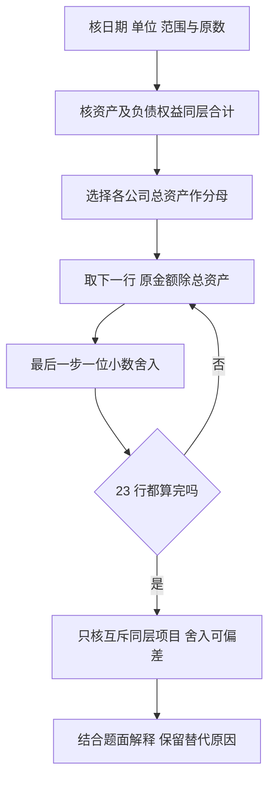

箭头是逐行计算循环；“23 行都算完吗”否返回“取下一行”，不重复加小计。

**沿例子读图（笔记补充）**：CloudSoft 现金为 1,800，总资产 10,000。核日期和合计后，选择本公司总资产作分母，算得 18%，最后显示 18.0%。在“23 行都算完吗”选“否”就取下一行；全部算完后，只对互斥的同层项目核合计。

**图旁边界**：日期2025-12-31、HK$ million；其他政策差异不被比例消除，保留官方全46个比例。

**文字替代**：每行除本公司总资产，算到原精度再舍入；只对同层互斥项目核合计。

<details><summary>读图自测：SteelForge无形600/16,000算出3.75%，如何显示？</summary>

按本题一位小数显示3.8%，不先改原金额，不为凑100%擅改某行。

</details>

失败 1：把明细、小计和总计一起加，结果大于100%，不是原表错；同层互斥穷尽项目才应接近100%。失败 2：金额全部统一倍增，比重不变，但只改一个资产的计量会连分母一起变；共同比不能消除政策差异。零基数增长率无定义，负基数如 Nike Other−103→+58，宜说损转益与增161，不把−156.3%误说收益下跌。

<details><summary>迁移 1：CloudSoft 所有金额同时乘 10，各比重怎样？</summary>

比重不变，因为 $10x_i/(10A)=x_i/A$；单位尺度取消不等消除时间/政策差异。
</details>

<details><summary>迁移 2：CloudSoft PP&E 合理新增计量 200、E 同增 200，其余金额不变</summary>

A 10,200、PP&E1,000，所以 PP&E9.8%；无形4,200/10,200=41.2%，不再42.0%；E7,200/10,200=70.6%。改计量后原分母不应继续用10,000，计量政策没有被比例神奇消除。
</details>

**所以呢**：原题全部23行计算与核对结束，才算覆盖完成；两行重点解读不能代替逐问逐行答案。官方46个比例由本任务 `calc-m03.py` 沿既有抽取表实际复算一致。


### 2.4 案例一：Nike 的资产负债表（讲义 p.19–27）

**原源与本轮外部补证分开**：p.22/p.36 图片没有显式金额单位；2026-10-25 回到 Nike 官方 FY2015/FY2016 10-K，已核金额以百万美元列示，EPS／每股股利以美元／股列示。p.24 缺的负债权益原额在 §2.4.4 以外部补证单列，原讲义数字不改。2015 比较列已在 FY2016 报告重列，2014 课件分类与旧报告又有差别，不能把三年当作同一版本直接下载的原表；具体限制随表说明。

> 📄 **讲义 p.19 是本节的分隔页**，整页只有两行：**"Case : Nike"** / **"Analyzing Balance Sheet"**。
> 它标志着讲义从"讲概念"切换到"练分析"。本节的教学顺序是：**先给商业背景（p.20–21）→ 再给数据（p.22–24）→ 再给会计政策（p.25）→ 最后提两个问题（p.26–27）**。这是本讲采用的一条有用路线，不是所有财报分析都必须遵守的唯一标准流程。


**所以呢**：先借 Nike 的业务背景预测资产形状，再把预测与原数、比例、政策和题目比较，单一比例不替代业务证据。

#### 2.4.1 Nike 是一家什么公司（讲义 p.20–21）

> 💡 **为什么分析报表要先读这两页？** 同一比例在不同经营模式下需要不同解释。PP&E 占比约 15% 对重资产制造商和外包生产企业提出的问题不同，但不能仅凭比例把前者判成“灾难”或把后者认证为“正常”。先读业务背景，是为了提出候选解释，再用数据、政策和附注核对。

**p.20 —— 业务与生产模式**（讲义原文要点，来源标注 `https://investors.nike.com/Home/default.aspx.`）。这些是讲义为 2014–2016 案例保存的历史背景，不自动代表 Nike 在 2026 年仍保持相同排名、产地或业务组合。

> - *"design, development, and worldwide marketing of athletic footwear, apparel, equipment, accessories, and services"* —— 设计、开发、全球营销运动鞋服器材
> - *"the largest seller of athletic footwear and apparel in the world"* —— 全球最大的运动鞋服销售商
> - 销售渠道：零售客户（批发）、自营门店与官网、独立经销商与被许可方
> - ⭐ *"Nike **outsources its production**: Nearly all of Nike's footwear and apparel products are produced in Asia (**Vietnam, China, and Indonesia**) and elsewhere outside of the United States by **independent manufacturers**, while equipment products are produced both in the United States and abroad."*

**⭐ 最后一条是 p.26 问题的重要背景证据**：外包生产与较低生产性 PP&E 需求相容，但仍要结合比例、资产附注和课堂方向回答，不能把一句背景直接当完整答案。

**p.21 —— 战略与增长方式**（讲义原文要点）

> - 目标客户：**专业运动员 + 休闲运动者**
> - 品类扩张路径：从跑步/训练/篮球/足球/休闲鞋 → 运动服、包、器材、球、眼镜、手表、配件 → 再扩到游泳、棒球、啦啦队、橄榄球、高尔夫、长曲棍球、网球、排球、滑板
> - 地域：近年**强调美国以外的增长**
> - 并购：收购了 **Cole Haan、Converse、Hurley、Umbro**
> - 研发：在 **Oregon 州 Beaverton** 设研究设施，持续改进产品线

**💡 用背景提出待检假设，再对照报表观察（笔记补充）**

| 商业模式事实 | 预期在报表上看到什么 | §2.4.2 原额与 §2.4.3 比例 |
|---|---|---|
| 生产外包给独立制造商 | 生产性 PP&E 需求可能较低 | PP&E 为 13.9%~16.5%；还需政策和资产附注 |
| 销售实物鞋服并经营批发／零售渠道 | 存货可能是重要营运资产 | 存货为 20.1%~22.6%；“高不高”仍需同行与周转数据 |
| 主要通过批发卖给零售商 | 应收账款可能较重要 | 应收账款为 15.1%~18.5%；还需信用政策和账龄 |
| 讲义列出历史并购 | 应检查商誉及并购附注 | 商誉占总资产 0.6%~0.7% |

金额的百万美元尺度已由本轮官方年报核对。商誉比例小，仍不能据此反推并购的经营影响或品牌价值。

**⇒ 这张表展示的是“背景 → 假设 → 数据核对”的分析步骤，不是四条都被单个比例完全验证。** 这一步可以迁移到其他公司，但每次都要保留替代原因，并回到政策、附注和跨期数据；现有材料也没有给它单独的考试评分地位。

**🎙️ 课堂补充**：⏭️ **教授明确让学生自己读，课上没有逐段讲。**

> *"before we see the questions, let's read from page 20 to page 25 by yourself. Because there are a lot of information here. I cannot just read. Right. So you can read by yourself"*

（`01:40:04`–`01:40:23`）。**建议**：p.20–21 的商业模式仍然重要（是 §2.4.6 两道题答案的依据），但课堂没有额外展开，靠讲义与本笔记自学即可，不必期待转录里有更多内容。

---

#### 2.4.2 Nike 的资产负债表原始数字（讲义 p.22）

> 📄 **p.22 是纯图片页**，已视觉复核并重画如下。⚠️ **讲义只给了资产侧**——标题就写着 "Nike: Balance Sheet (**Assets**)"，**负债与权益侧的原始金额在整份讲义里从未出现过**（p.24 只给了它的百分比）。这是讲义的一处缺口，见 §9.3。

**Nike, Inc. ｜ At Fiscal Year End, May 31 ｜ 百万美元（单位由本轮官方年报补证，原图数字不改）**

| ASSETS | 2014 | 2015 | 2016 |
|---|---:|---:|---:|
| Cash and equivalents | 2,220 | 3,852 | 3,138 |
| Short-term investments | 2,922 | 2,072 | 2,319 |
| Accounts receivable, net | 3,434 | 3,358 | 3,241 |
| Inventories | 3,947 | 4,337 | 4,838 |
| Prepaid expenses and other current assets | 818 | 1,968 | 1,489 |
| **Total current assets** | **13,341** | **15,587** | **15,025** |
| Property, plant, and equipment, net | 2,834 | 3,011 | 3,520 |
| Identifiable intangible assets, net | 282 | 281 | 281 |
| Goodwill | 131 | 131 | 131 |
| Deferred income taxes and other assets | 2,006 | 2,587 | 2,439 |
| **TOTAL ASSETS** | **18,594** | **21,597** | **21,396** |

**先注意三件排版层面的事**（都是真实报表的常识，讲义没说）：

1. **"At Fiscal Year End, May 31"** —— Nike 的**会计年度不是自然年**，而是每年 6 月 1 日到次年 5 月 31 日。这叫**财政年度（fiscal year）**。所以 "FY2016" 指的是 2015-06-01 至 2016-05-31。⚠️ 跨公司比较时必须先对齐会计期间。
2. **"Accounts receivable, **net**" 与 "Property, plant, and equipment, **net**"** —— 两个 net 要查各自政策和附注。应收净额通常扣信用损失等备抵；PP&E 净额在成本模式下通常扣累计折旧与累计减值，不能只写成“原值减折旧”或忽略其他适用计量模式。
3. **本表把现金放在资产侧最上方**，与 §2.2.11 的示例顺序不同。先按表头和分类读，不把两个案例的排法推广为所有 US GAAP／IFRS 企业的固定顺序。

**💡 先自己验一遍加总（笔记补充）**：
2014 年流动资产 = 2,220 + 2,922 + 3,434 + 3,947 + 818 = **13,341** ✅
2014 年总资产 = 13,341 + 2,834 + 282 + 131 + 2,006 = **18,594** ✅

**🎙️ 课堂补充**：⏭️ **同属"自己读 p.20–25"的范围**（`01:40:04`–`01:40:23`：*"let's read from page 20 to page 25 by yourself"*），课上没有逐行核对这张表的数字。**建议**：p.22 的原始金额本身不需要课堂讲解，直接用于验算共同比（§2.4.3）即可，不影响本节内容的可靠性。

---

#### 2.4.3 Nike 的共同比资产负债表：资产侧（讲义 p.23）

> 📄 **p.23 是纯图片页**，已视觉复核并重画。这张表**同时给了两样东西**：左边三列是**共同比（Common-Size）**，右边两列是**百分比变动（Percentage Change）**。

同一Nike资产表按结构和增长两个问题拆开，原行顺序/百分比全部保留。

结构表：每年各行除该年总资产。

| ASSETS | 共同比 2014 | 共同比 2015 | 共同比 2016 |
| --- | ---: | ---: | ---: |
| Cash and equivalents | 11.9% | 17.8% | 14.7% |
| Short-term investments | 15.7% | 9.6% | 10.8% |
| Accounts receivable, net | 18.5% | 15.5% | 15.1% |
| Inventories | 21.2% | 20.1% | 22.6% |
| Prepaid expenses and other current assets | 4.4% | 9.1% | 7.0% |
| **Total current assets** | **71.7%** | **72.2%** | **70.2%** |
| Property, plant, and equipment, net | 15.2% | 13.9% | 16.5% |
| Identifiable intangible assets, net | 1.5% | 1.3% | 1.3% |
| Goodwill | 0.7% | 0.6% | 0.6% |
| Deferred income taxes and other assets | 10.8% | 12.0% | 11.4% |
| **TOTAL ASSETS** | **100.0%** | **100.0%** | **100.0%** |

变化表：同一科目本年减上年，再除上年该科目金额。

| ASSETS | 变动% 2015 | 变动% 2016 |
| --- | ---: | ---: |
| Cash and equivalents | 73.5% | (18.5%) |
| Short-term investments | (29.1%) | 11.9% |
| Accounts receivable, net | (2.2%) | (3.5%) |
| Inventories | 9.9% | 11.6% |
| Prepaid expenses and other current assets | 140.6% | (24.3%) |
| **Total current assets** | **16.8%** | **(3.6%)** |
| Property, plant, and equipment, net | 6.2% | 16.9% |
| Identifiable intangible assets, net | (0.4%) | 0.0% |
| Goodwill | 0.0% | 0.0% |
| Deferred income taxes and other assets | 29.0% | (5.7%) |
| **TOTAL ASSETS** | **16.2%** | **(0.9%)** |


ASSETS定位同一原科目；结构三列分别以2014/2015/2016总资产18,594/21,597/21,396为分母，变化两列以各科目上年金额为分母。读现金：2014的2,220/18,594约11.9%；2015变动(3,852−2,220)/2,220约73.5%。括号是负变动；绝对金额单位沿本篇原材料限制，比例无单位。


**⭐ 百分比变动分析（Percentage Change Analysis）** ⭐ 新概念，讲义**没有给定义**，只给了这两列数字。补上：

> **是什么**：$(\text{本期} - \text{上期}) \div \text{上期} \times 100\%$，衡量**同一项目在时间上的增长率**。
> **与共同比的分工**：
> - **共同比 = 纵向切片**，回答"这一年，这家公司的结构是什么样"
> - **百分比变动 = 横向切片**，回答"这个项目，一年里变了多少"
> **括号 ( ) 表示负数**——这是财报的通用排版惯例，不是打错。

**💡 验算三个数（笔记补充，讲义只给结果）**

| 数字 | 算式 | 结果 |
|---|---|---|
| 2014 年现金的共同比 11.9% | 2,220 ÷ 18,594 | 11.94% ✅ |
| 2015 年现金的变动 73.5% | (3,852 − 2,220) ÷ 2,220 | 73.51% ✅ |
| 2016 年现金的变动 (18.5%) | (3,138 − 3,852) ÷ 3,852 | −18.54% ✅ |

> ⚠️ **课堂数字冲突**：教授在 `01:48:40` 口头说 2015 年现金增加 **76.5%**；讲义 p.22/p.23 与上式复算都是 **73.5%**。正文采用原表 $(3{,}852-2{,}220)/2{,}220=73.51\%$，并把 76.5% 保留为课堂口误/ASR 疑点。

**💡 从这张表读出四条结论（笔记补充）**

1. **本表呈现较低的 PP&E 结构占比。** 2014–2016 年流动资产约为 **70%~72%**，PP&E 为 **13.9%~16.5%**。结合讲义同期的外包生产背景，可提出“生产性固定资产需求较低”这一解释；是否属于“极端轻资产”、拥有多少设施及同行是否异常，仍须可比公司、计量政策和资产附注。
2. **存货连续两年增长，但相对速度不同**：2015 年库存 +9.9%，小于总资产 +16.2% 和收入 +10.1%，库存占比 21.2%→20.1%；2016 年库存 +11.6%，总资产 −0.9%、收入 +5.8%，占比 20.1%→22.6%。2016 更需调查销售、备货与减值；不能说连续两年都跑赢资产/收入，或单凭增速判卖不动。

3. **`Prepaid expenses and other current assets` 2015 年暴涨 140.6% 又在 2016 年跌 24.3%。** 这种大起大落的"其他"类科目，**正是应该去翻附注的地方**（§2.9）。
4. **商誉与无形资产几乎不动**（131 三年不变，变动 0.0%）。⇒ **净额稳定不能单独推出内生增长或无并购，仍需读并购与商誉滚动附注。** 与 p.21 说的"收购了 Cole Haan、Converse、Hurley、Umbro"并不矛盾；这些并购形成多少商誉、是否有处置或减值，仍需商誉与并购附注，不能仅由 0.6% 余额反推。

---

#### 2.4.4 Nike 的共同比资产负债表：负债与权益侧（讲义 p.24）

> 📄 **p.24 也是纯图片页**，已视觉复核并重画。⚠️ **只有百分比，没有原始金额**（讲义从未提供 Nike 的负债与权益的美元数字）。

**🔗 本轮外部补证：先看原额，再复做 p.24（2026-10-25）**

这不是课堂补出的数字。原额来自 [Nike FY2015 10-K](https://investors.nike.com/_assets/_5c5e7dfb9b8f3a4f8235c64466d81cf9/nike/db/950/9320/annual_report/nike-2015-form-10K.pdf) PDF 第 48 页（印刷 p.109）的 2014 比较列，以及 [FY2016 10-K](https://investors.nike.com/_assets/_07be80eb1a0b76dace4543b752eda1f2/nike/db/950/9321/annual_report/nike-2016-form-10K.pdf) PDF 第 48 页（印刷 p.101）的 2015 比较列／2016 当期列。单位均为百万美元；总负债为本表流动负债、长期债和其他非流动负债相加的笔记计算。

**先固定比较任务**：下表为复做 p.24 而拼接明确来源列，不是从同一份年报取得的三年统一比较表。先做逐列比例核对；跨年趋势须结合表后的重列与版本限制，不能把全部行直接视为同口径连续序列。

<details><summary>对应 p.24 的 16 行原额与版本</summary>

| Item | 2014：FY2015 旧比较 | 2015：FY2016 重列比较 | 2016：FY2016 当期 |
|---|---:|---:|---:|
| Current portion of long-term debt | 7 | 107 | 44 |
| Notes payable | 167 | 74 | 1 |
| Accounts payable | 1,930 | 2,131 | 2,191 |
| Accrued liabilities | 2,491 | 3,949 | 3,037 |
| Income taxes payable | 432 | 71 | 85 |
| Total current liabilities | 5,027 | 6,332 | 5,358 |
| Long-term debt | 1,199 | 1,079 | 2,010 |
| Deferred income taxes and other liabilities | 1,544 | 1,479 | 1,770 |
| Total liabilities（笔记合计） | 7,770 | 8,890 | 9,138 |
| Common stock at stated value: Class A convertible | — | — | — |
| Common stock at stated value: Class B | 3 | 3 | 3 |
| Capital in excess of stated value | 5,865 | 6,773 | 7,786 |
| Accumulated other comprehensive income | 85 | 1,246 | 318 |
| Retained earnings | 4,871 | 4,685 | 4,151 |
| Total shareholders' equity | 10,824 | 12,707 | 12,258 |
| Total liabilities and shareholders' equity | 18,594 | 21,597 | 21,396 |

</details>

**先复做一行**：2016 长期债共同比为 $2,010/21,396\times100\%\approx9.4\%$；同比变化为 $(2,010-1,079)/1,079\times100\%\approx86.3\%$。前者是期末结构，后者是同项金额变化。按相同算法，新外源可复算 45 个结构格与 30 个变动格，均与 p.24 舍入值一致；原 2015 一年内到期长期债的变动保留课件整数 1,429%。Class A 原额显示破折号，不能据此恢复精确美元值；该行三个 0.0% 与两个 na 只保留课件可见值，不伪造除以零的计算。

**版本限制不能略掉**：FY2015 原报告中 2015 总资产是 21,600，而 FY2016 重列后为 21,597。

FY2016 的 Note 1（PDF 第 55 页／印刷 p.108）说明提前采用 ASU 2015-17 并追溯调整：2015 流动资产减少 389，其他非流动资产增加 386，流动负债减少 2、其他非流动负债减少 1。不能把旧 21,600 替换进课件的 21,597。

2014 原报告流动资产 13,696、其他非流动资产 1,651，与课件 13,341／2,006 相差一项 355 的分类；加总相同不证明整套 2014 比较已按 FY2016 的全部规则重列。此处验证的是课件比例能否用明确版本的原额复做，不据此认证整个三年系列完全可比。

原讲义的两组百分比继续完整列在下面。


结构表：负债与权益也除当年总资产，不能改用各自小计。

| LIABILITIES AND SHAREHOLDERS' EQUITY | 共同比 2014 | 共同比 2015 | 共同比 2016 |
| --- | ---: | ---: | ---: |
| Current portion of long-term debt | 0.0% | 0.5% | 0.2% |
| Notes payable | 0.9% | 0.3% | 0.0% |
| Accounts payable | 10.4% | 9.9% | 10.2% |
| Accrued liabilities | 13.4% | 18.3% | 14.2% |
| Income taxes payable | 2.3% | 0.3% | 0.4% |
| **Total current liabilities** | **27.0%** | **29.3%** | **25.0%** |
| Long-term debt | 6.4% | 5.0% | 9.4% |
| Deferred income taxes and other liabilities | 8.3% | 6.8% | 8.3% |
| **TOTAL LIABILITIES** | **41.8%** | **41.2%** | **42.7%** |
| Common stock at stated value: Class A convertible | 0.0% | 0.0% | 0.0% |
| Common stock at stated value: Class B | 0.0% | 0.0% | 0.0% |
| Capital in excess of stated value | 31.5% | 31.4% | 36.4% |
| Accumulated other comprehensive income | 0.5% | 5.8% | 1.5% |
| Retained earnings | 26.2% | 21.7% | 19.4% |
| **TOTAL SHAREHOLDERS' EQUITY** | **58.2%** | **58.8%** | **57.3%** |
| **TOTAL LIABILITIES AND SHAREHOLDERS' EQUITY** | **100.0%** | **100.0%** | **100.0%** |

变化表：每项相对上年同项金额的变化。

| LIABILITIES AND SHAREHOLDERS' EQUITY | 变动% 2015 | 变动% 2016 |
| --- | ---: | ---: |
| Current portion of long-term debt | 1,429% | (58.9%) |
| Notes payable | (55.7%) | (98.6%) |
| Accounts payable | 10.4% | 2.8% |
| Accrued liabilities | 58.5% | (23.1%) |
| Income taxes payable | (83.6%) | 19.7% |
| **Total current liabilities** | **26.0%** | **(15.4%)** |
| Long-term debt | (10.0%) | 86.3% |
| Deferred income taxes and other liabilities | (4.2%) | 19.7% |
| **TOTAL LIABILITIES** | **14.4%** | **2.8%** |
| Common stock at stated value: Class A convertible | na | na |
| Common stock at stated value: Class B | 0.0% | 0.0% |
| Capital in excess of stated value | 15.5% | 15.0% |
| Accumulated other comprehensive income | 1,365.9% | (74.5%) |
| Retained earnings | (3.8%) | (11.4%) |
| **TOTAL SHAREHOLDERS' EQUITY** | **17.4%** | **(3.5%)** |
| **TOTAL LIABILITIES AND SHAREHOLDERS' EQUITY** | **16.2%** | **(0.9%)** |


科目列是原负债或权益组成；结构三列各年同总资产分母；变化两列各用上年同项分母。读2016长期债结构9.4%，不是一年借款利率；86.3%是其同比金额变化。0.0%可为舍入非精确零；na按原未适用/未报告口径保留，不解释成0。


**💡 六条读法（笔记补充）**

1. **两行普通股在一位小数下显示 0.0%，不等于余额精确为零或没有分析意义。** `Capital in excess of stated value` 占 31.5%~36.4%，是本表较大的缴入资本项目；但 `stated value` 与 `par value` 的法律和章程含义不能无条件视为完全相同，股份类别、权利与具体金额仍须查股本附注。
2. **Nike 的资产来源结构：负债合计约 42%、资本溢价约 36%、留存收益约 19%。** 套用 p.13 Key information 第 3 条的三分法（§2.2.10），一句话就能概括这家公司怎么融资。
3. **Notes payable 占比从 0.9% 降到显示 0.0%（2016 年 −98.6%）。0.0% 是舍入，不能当精确零。** Notes payable 是短期票据融资。**短票据余额明显下降；融资目的与相关借还交易待核，不能说所有短债已清掉。**
4. **Long-term debt 2016 年 +86.3%，占比从 5.0% 跳到 9.4%。** ⇒ 长期债增加、短票据下降可提出短债换长债的候选解释；没有逐笔借还及用途附注，不能确定是同一动作。⚠️ 注意这与 §2.2.11 那家港股公司 2019 年做的事余额方向相近；是否逐笔置换与目的仍待资料。
5. **AOCI 2015 年 +1,365.9%，2016 年 −74.5%。** 这些是该行金额的同比变化，首先提示去查 OCI／AOCI 附注。

   **读法边界**：AOCI 累积适用规则要求计入 OCI 的项目，范围不等于所有未实现变动。当期计入 OCI 的金额不进入当期净利润；以后是重分类至损益，还是在权益内部转列，取决于具体项目和准则类别。两列变化本身既不表示“本来就应大幅波动”，也不能判断经济风险大小。
6. **Retained earnings 占比连年下降**（26.2% → 21.7% → 19.4%），2015/2016 年绝对额也下降。

   **观察**：Nike 同期仍有净利润，见 §2.6.1。

   **判断方法**：先用 $\text{期末留存收益}=\text{期初}+\text{归属利润}-\text{股利}\pm\text{其他调整}$ 建桥。余额下降提示所有者分配或调整超过归属利润，但股利、回购注销及其他变动须查权益变动表和附注；回购通过哪一权益列处理也取决于交易与政策。

---

#### 2.4.5 Nike 的会计政策摘录（讲义 p.25）

讲义 p.25 摘录了 Nike 附注里的两段原文：

> **Property, Plant and Equipment and Depreciation**：*"Property, plant and equipment are recorded at cost. Depreciation is determined on a **straight-line basis** for buildings and leasehold improvements over **2 to 40 years** and for machinery and equipment over **2 to 15 years**."*
>
> **Identifiable Intangible Assets and Goodwill**：*"This account represents the **excess of the purchase price of acquired businesses over the market values of identifiable net assets**"*

**这一页在教什么（讲义没明说，💡 笔记补充）**

它在示范 §2.9「附注」的用法：**报表正文只给一个数（PP&E, net = 3,520），附注告诉你这个数是怎么算出来的**。

- **"recorded at cost"** ⇒ 历史成本，不是市价（§2.2.3、§2.2.10 Weakness ①）
- **"straight-line basis"** ⇒ 直线法折旧：每年折 $(\text{原值} - \text{残值}) \div \text{使用年限}$，各年金额相同。（另一类是加速折旧法，前几年折得多。）
- **"2 to 40 years"** ⇒ 使用寿命是需要证据支持并按实际情况复核的会计估计。
- **Goodwill 那句与 p.7 的课堂简式方向一致**。课件历史用词是 `market values`；正式计算仍须先辨认可辨认净资产并按购买日公允价值计量，不能把日常市场报价与 IFRS 13 公允价值无条件画等号，见 §2.2.4。

**估计边界**：只有在成本、残值、可使用时点、直线法和其他因素都相同的教学情形下，20 年与 40 年才会使年度折旧近似相差一倍。因新信息而合理更新估计不自动等于操纵；无依据地偏置年限以美化利润才是应调查的风险。IAS 8 把源于新信息的估计变更与错误更正分开，并采用未来适用处理。🔗 [IAS 8 官方页](https://www.ifrs.org/issued-standards/list-of-standards/ias-8-basis-of-preparation-of-financial-statements/)；获取日 2026-10-25。

**🎙️ 课堂补充**：⏭️ **同属"自己读 p.20–25"的范围**（自读指令见 `01:40:04`–`01:40:23`），课上没有专门讲 Nike 的折旧年限与商誉附注。**建议**：这条会计政策摘录仍要记住（§2.4.5 的分析用得到），只是靠自学，不靠课堂讲解，不代表它不重要。

---

#### 2.4.6 两道分析题（讲义 p.26–27）· ⚠️ 讲义未给答案

> ⚠️ **重要**：讲义 p.26 与 p.27 各是一整页，**每页只有一个问题，答案栏完全空白**。
> 这与 Week 1 讲义 p.47/p.48 的情况一样（见 [[M01-会计与商业]] §9）：**答案只存在于课堂上**。
> ✅ **2026-09-17 已从转录确认**：教授在 `01:50:14`–`01:54:10` 当堂讲了这两题的方向性答案（原话见本节末尾 🎙️ 课堂补充块）：近乎全部外包降低生产性 PP&E 需求，现金较多降低外部融资需要。下面答案中的其余数据解释与边界仍是笔记补充，不把整段都冒充课堂原答。

---

**【题 1】（讲义 p.26 原文）**

> *"Refer to the common-size and percentage change balance sheets for Nike at the end of 2014, 2015, and 2016. **What is the likely explanation for the relatively small percentages for property, plant, and equipment?**"*
>
> 参考 Nike 2014–2016 年的共同比与百分比变动资产负债表。**物业、厂房及设备占比相对较小，最可能的解释是什么？**

<details><summary>课堂确认方向 + 笔记补充的参考答案（2026-09-17）</summary>

**一句话**：因为 Nike 的鞋服生产**近乎全部**由独立制造商完成，所以生产性 PP&E 需求较低；这不等于 Nike 完全没有自有设施。

**完整作答（考试可直接套用的结构）**

1. **摆事实（引数据）**：PP&E 占总资产 **15.2% / 13.9% / 16.5%**（讲义 p.23），而流动资产占 **70%~72%**。题目本身称 PP&E 比例相对较小；讲义的“largest seller”是案例期历史描述，不用它证明 2026 排名或把比例判成全行业异常。
2. **给原因（引讲义 p.20 原文）**：*"Nike **outsources its production**: Nearly all of Nike's footwear and apparel products are produced in Asia (Vietnam, China, and Indonesia) … by **independent manufacturers**."* 这支持“生产资产需求较低”的解释；具体哪些设施或模具由谁拥有，仍需资产与供应链附注，不能由 nearly all 外包推成全部无自有工厂。
3. **说清表内结构**：存货（22.6%）、应收账款（15.1%）、现金与短期投资（25.5%）占比较大，显示营运资产的重要性。讲义只明确提到 Beaverton 研究设施；总部、门店、配送中心和具体 PP&E 构成须查资产附注，不能由余额自行补齐。
4. **补一条报表边界**：自创品牌价值通常不会作为自创商誉直接确认在表内，但这只能说明确认边界，不能据此断言品牌是 Nike“最值钱”的资产或给出金额。
5. **给有限评价**：外包模式可能降低生产性固定资产需求，也会带来供应商、质量、物流与集中度风险。关税、劳动成本和切换产地效果均需另有事实来源；本讲没有“可加分”评分依据。

**⚠️ 不要答成**："因为 Nike 是服务业"与题面实物鞋服业务不符；“因为设备全折旧完了”也没有附注支持。2016 年 PP&E 净额整体增长 16.9% 不能排除个别旧设备已经折完，须查原值、累计折旧、购置、处置与减值明细。

**English reference answer**: The relatively small PP&E percentages are likely explained by Nike's outsourcing model. Nearly all of its footwear and apparel products are produced by independent manufacturers, so Nike needs fewer production buildings and machines than a vertically integrated manufacturer. This does not mean that Nike owns no facilities; the conclusion is limited to lower production-asset needs and should be checked against the asset and supply-chain notes.

</details>

---

**【题 2】（讲义 p.27 原文）**

> *"**What is the likely explanation for the relatively small percentages for notes payable and long-term debt?**"*
>
> **应付票据与长期借款占比相对较小，最可能的解释是什么？**

<details><summary>课堂确认方向 + 笔记补充的参考答案（2026-09-17）</summary>

**一句话**：报表显示盈利、现金及短期投资占比较高且生产近乎全部外包，这些都可能降低融资需求；是否“不需要举债”以及实际举债动机仍须结合现金流、资本开支和借款附注。

**完整作答**

1. **摆事实**：Notes payable **0.9% → 0.3% → 0.0%**；Long-term debt **6.4% → 5.0% → 9.4%**；两者合计最高不到 10%，而**股东权益占 57%~59%**（讲义 p.24）。
2. **原因一 —— 盈利能力强，内部现金充裕**：Nike 的净利率是 **9.7% / 10.7% / 11.6%** 且逐年上升（讲义 p.37，§2.6.2）。持续盈利可能支持经营现金流，但利润不等于现金；要判断是否需要借款，还要看 CFO、营运资金、分配和到期安排。
3. **原因二 —— 资本开支需求小**：承接题 1，生产近乎全部外包通常降低生产设施投入，但 Nike 仍可能有门店、配送、办公、数字基础设施等资本开支；这里只能把较低生产性资本需求列作候选原因。融资也可能用于营运资金、再融资或其他安排；仅凭生产外包不能断定 Nike 没有资本开支需求。
4. **原因三 —— 手上现金本来就多**：现金及等价物 + 短期投资合计 **27.6% / 27.4% / 25.5%**（讲义 p.23）。较高流动资金可能降低短期融资压力，但公司仍可能因期限匹配、回购、税务、流动性缓冲或其他安排借款。
5. **原因四 —— 融资结构上以股权与留存为主**：`Capital in excess of stated value` 31.5%~36.4% + `Retained earnings` 19.4%~26.2%（讲义 p.24）。
6. **处理反例**：2016 年 long-term debt +86.3%，同年 notes payable −98.6%。短期票据下降而长期债务上升与期限置换相容，但用途、利率及是否同一融资链尚待借款附注；不能据余额变化确认“锁定低利率”。总负债占总资产由 41.2% 升至 42.7%，是增加 1.5 个百分点，不能再概括成“杠杆几乎没变”而忽略结构变化。

**第一次用“百分点”时这样读**：它是两个百分比直接相减，即 $42.7\%-41.2\%=1.5$ 个百分点，不是再以上期占比为分母的增长率。

**⚠️ 不要答成**："因为 Nike 没钱所以借不到"没有融资可得性证据；"因为运动品牌不需要负债"也把公司结构误写成行业定律。已有利润和现金只能支持候选解释，不能证明借款能力或管理层动机。

**English reference answer**: The relatively small notes payable and long-term debt percentages are likely related to Nike's outsourced production model and its substantial cash and short-term investments, both of which may reduce external financing needs. However, the balance sheet alone does not prove that Nike does not need debt. The purpose, maturity and cost of borrowing still require the cash-flow statement and debt notes.

</details>

**🎙️ 课堂补充**（`01:47:42`–`01:54:24`，约 6.7 分钟；明确自读指令与后段待核音区间之后，教授带着回答两道题——**✅ 讲义没给的答案，课堂给了**）

教授先用约 15 秒复述背景（`01:47:42`）：*"with the reading of the background of this [firm,] so [it's to] introduce the strategy of this company"*，然后回到共同比表逐列带读变化趋势（`01:47:56`–`01:49:40`）。这段确认了读表方法，但 `01:48:40` 将 2015 年现金变动口头说成 76.5%，与讲义 p.22–23 及复算的 73.5% 冲突；准确数字以讲义与 §2.4.3 复算为准。

**题 1（p.26，PP&E 占比为何小）的课堂答案**（`01:50:14`–`01:51:53`）：
> *"the question[:] refer to the common size and percent change balance sheet[s] for Nike ... what is [the] like[ly] explanation for the relatively small percentage for P[P&]E[?] ... [look at] the percentage ... around [15]% for PPE in the [balance] sheet ... it is quite low compared to other manufacturing firms or ... other industries. So the answer is very easy[:] if you look back [at] the strategy [on] this page[,] they use the word[:] Nike outsource[s] its production ... [which] means [that] ... [the] company[,] they do not have to produce using their own ... building[,] [or] their own land ... nearly all the native [Nike] footwear and [apparel] products are produc[ed] [in] Asia and elsewhere outside of the United States[,] which means [that] N[ike, as the] headquarters[,] [does] not have [much] PVE[PP&E] for production"*（`01:50:14`–`01:51:53`）。
**这确认了本笔记题 1 的方向**：近乎全部生产外包与较低生产性 PP&E 需求相容；课堂并未证明 Nike 没有任何自有设施，正文仍保留 `nearly all` 的限制。

**题 2（p.27，应付票据与长期借款占比为何小）的课堂答案**（`01:52:02`–`01:54:10`）：
> *"another question[,] which is [the] likely explanation for [the] relatively small percentage[s] for notes payable and long-term debt[?] ... notes payable[,] right? ... [it's] 0.9%[,] 0.3%[,] [and] zero percent for the three years ... absolutely very low ... long-term debt ... 6.4%[,] 5%[,] and 9.4% ... overall it's like six to seven percent ... not high ... [the] reason[,] again[,] can be attributed to the background and ... to the financial statement. So first ... [because] they don't have to buy some high value non-current assets or fixed assets like P[P&]E ... they do not need a large amount of money[,] so they don't have to borrow from the outsiders ... [a]nother reason is related to the characteristic of the balance sheet ... [the] current asset[,] cash and equivalent[s] ... percentage is quite high ... already larger than like 15[,] or around 15 to 16% ... so if you check the other companies across the different industries ... [Nike]'s cash equivalent percentage is quite high ... so that's why they can internally finance ... they have no need to ... borrow from creditors or get a long-term loan from the bank"*（`01:52:02`–`01:54:10`）。
**这支持本笔记题 2 的两项方向性解释：课堂原话确认了外包生产与现金较多的观察。**

**证据边界**：利润转现金、资本开支规模和融资动机仍待报表或附注核对。教授没有提到回购、分红、净利率上升或融资结构；这些仍是笔记补充，未获课堂确认。

**这段改变了什么**：把“近乎全部外包”和“现金较多”两项从笔记推断升级为课堂确认，其余原因保持笔记推断。

教授的理由链是：外包生产降低生产性固定资产需求；现金较多降低外部融资需要。利润转现金、资本开支规模、品牌、股利与回购仍是笔记补充。

🔴 **见 §6.2**：教授当堂回答了讲义留白的两道题，但确认范围只到上述原话。

---

### 2.5 利润表（Income Statement）

> 📄 **讲义 p.28 是本节的分隔页**，整页只有两行：**"Income Statement"** / **"(Statement of profit or loss)"**。
> 与 p.3 一样，它把**同一张表的两个常见名字**并列：`Income Statement` 常见于教材和美国公司材料，IFRS 文献常用 `Statement of Profit or Loss`。港式中文常叫**损益表**，内地叫**利润表**（见 [[AC6761_Artificial_Intelligence_Accounting/_meta/术语表|术语表]] §0 三地译法）；实际作答优先沿用题面或报表表头。

#### 2.5.1 定义与四个要素（讲义 p.29）

**是什么**

讲义 p.29 原文：

> - *"Shows financial performance **over a given period**"*
> - *"**Net Income = Revenues – Expenses + Gains – Losses**"*
> - *"Revenues (Expenses) represent the resources **Generated (Consumed)** by a firm"*
> - *"**Gains and losses** typically result from **non-operating or incidental activities** that are outside of the core business"*
> - *"When using the income statement to assess a firm's profitability, it is important to focus not only its current and past profitability, but also **the likeliness of sustainable earnings in the future**."*

**⭐ 注意公式变长了。** [[M01-会计与商业]] 教的是 $\text{净利润}=\text{收入}-\text{费用}$。这里变成四项：

$$
\text{Net Income}=\text{Revenues}-\text{Expenses}+\text{Gains}-\text{Losses}
$$

$$
\text{净利润}=\text{收入}-\text{费用}+\text{利得}-\text{损失}
$$

> ⚠️ **分类边界**：这是讲义把日常经营与非经营／附带结果拆开分析的表达，不表示 Gains 与 Losses 在概念框架中是独立于广义 income／expenses 的另外两种报表要素。IFRS 概念框架以资产、负债变化定义收入和费用，利得与损失可作为其中的类别或列报项目。🔗 [IFRS Foundation 概念框架教学材料，第 4.68–4.70 段](https://www.ifrs.org/content/dam/ifrs/meetings/2018/october/wss/wss5b-conceptual-framework.pdf)；获取日 2026-10-25。

**多出来的 Gains / Losses 是什么** ⭐ 新概念：

| | 来自 | 例子 | 中文 |
|---|---|---|---|
| **Revenues / Expenses** | **核心业务**（core business） | 已按条件确认的卖鞋收入／本期已售商品成本、已发生工资 | 收入 / 费用 |
| **Gains / Losses** | **非经营或偶发活动**（non-operating or incidental） | 处置资产利得、诉讼赔偿与汇兑损失 | 利得 / 损失 |

收入确认与收现分开：例如先交货并已满足确认条件、客户下月付款，本期可以有收入和应收而尚无收现。买入未售商品也不自动全变成本期费用；本期工资按已经取得的员工服务确认，不以是否已经付现判断。

**利得与损失的具体例子**：卖掉一栋闲置办公楼赚 500 万，是处置利得；打官司赔 200 万，是诉讼损失。汇兑损失是另一类例子，须按其实际业务与列报政策判断。

**为什么要把它们分开**

经营与非经营不能等同经常与非经常，二者都须按具体业务判断重复性。讲义最后一句说得很直白：分析盈利能力时，不能只看当期和历史利润，还要看**"未来盈利可持续的可能性"（the likeliness of sustainable earnings in the future）**。一笔卖楼利得让今年的净利润翻倍，但明年没有第二栋楼可卖。

> 💡 **§2.5.5 会给出一个笔记补充的数值例**：A 公司 2018 年净利润 107.3 亿、2019 年 46.9 亿；2018 年另有一笔 **65.99 亿视同处置联营公司利得**。若只在税前口径扣除这一项并保持其他项目不变，2019 年税前利润相对该调整基数增长 15.6%；这不是剔除全部非经常项目后的“真实净利增速”，也没有材料证明它是考试重点。

**🎙️ 课堂补充**（S2 `25:36`–`26:34`，B · 讲了同讲义）

教授接续 Week 3，按 p.29 说明利润表看一段期间的表现：*"income statement shows financial performance of a given period."*（S2 `25:44`）。随后复述收入减费用加利得减损失，并强调要看未来盈利能否持续（S2 `26:20`）。这一段确认定义和分析方向；没有把非经营项目一概说成不能重复。

**💡 换个说法（笔记补充）**
把公司想成一个上班族：
- **Revenue** = 工资
- **Expenses** = 房租、吃饭、交通
- **Gain** = 中了彩票、卖掉旧车赚了点
- **Loss** = 手机丢了、被罚款

年终算"今年赚了多少"要把四项都算进去；预测明年时，应分别判断工资、开销、利得和损失哪些可能重复、金额如何变化。不能把所有非工资项目一概删掉，也不能假定工资和开销会原样持续。

**⚠️ 常见误解**
- ❌ "Gain 就是 Revenue 的同义词"。→ Revenue 通常来自日常经营活动；Gain 往往来自非核心或附带事项。是否经常发生要看具体业务与期间，不能把“非经营”和“不可重复”画等号；现有材料没有“混用必扣分”的评分依据。
- ❌ "净利润是一段时间还是一个时点？" → **一段时间**（over a given period）。资产负债表才是时点。

**与其他概念的关系**
← [[M01-会计与商业]] 收入/费用定义；→ §2.5.4「盈余质量」与「经常性 vs 非经常性」；→ §2.7.3 用现金流验证利润。

---

#### 2.5.2 利润表的标准结构（讲义 p.30）

**讲义 p.30 给出一份本课使用的多步式利润表骨架**，原文照抄并逐行注解；它不是所有 IFRS 企业唯一允许的行名、顺序或小计格式。

每行沿p.30利润表的原顺序向下走；前两列保留英文行名和中文，理由在表后。

| 讲义原文行 | 中文 |
| --- | --- |
| `Revenue (Sales, Turnover)` | 营业收入（销售额、营业额） |
| `– Cost of revenue (Cost of sales, Cost of goods sold)` | − 营业成本（销货成本、销售成本） |
| `= Gross profit` | **= 毛利** |
| `+ Other income and gains` | + 其他收入及利得 |
| `– Distribution / administration / other expenses` | − 分销 / 管理 / 其他费用 |
| `= Profit from operations` | **= 营业利润** |
| `– Finance costs` | − 财务费用 |
| `= Profit before tax` | **= 税前利润** |
| `– Tax expense` | − 所得税费用 |
| `= Profit after tax, attributable to:` | **= 税后利润，归属于：** |
| `  Shareholders of the company => Earnings per share` | 母公司股东 ⇒ **每股收益** |
| `  Non-controlling interests` | 少数股东 |

英文行名前的加减号是从上一层利润继续计算的动作；中文列用于读法。读毛利：先营业收入减对应销售成本。小计不能和构成它的明细再次一起相加。

**`Revenue (Sales, Turnover)`**

说明：三个词是同义词，不同公司用词不同


**`– Cost of revenue (Cost of sales, Cost of goods sold)`**

说明：包含与本期已售商品或服务相对应的成本。制造企业的存货成本可包括采购成本、直接人工以及系统分配的生产间接费用；因此不能一边写“只含直接成本”，一边又把制造费用列入。🔗 [IAS 2 官方页](https://www.ifrs.org/issued-standards/list-of-standards/ias-2-inventories/)；获取日 2026-10-25。


**`= Gross profit`**

说明：第一层利润


**`+ Other income and gains`**

说明：利息收入、政府补助、处置资产利得（§2.5.1 的 Gains）


**`– Distribution / administration / other expenses`**

说明：详见 §2.5.3


**`= Profit from operations`**

说明：第二层利润


**`– Finance costs`**

说明：主要是利息支出


**`= Profit before tax`**

说明：第三层利润


**`– Tax expense`**


**`= Profit after tax, attributable to:`**

说明：第四层利润


**`  Shareholders of the company => Earnings per share`**

说明：⭐ EPS 的分子先从**归属于母公司所有者的利润**出发，再调整成归属于**普通股股东**的金额；不含 NCI，适用时还要扣除或调整权益型优先股等项目


**`  Non-controlling interests`**

说明：← §2.2.9


**⭐ 为什么要分四层（讲义没解释，💡 笔记补充）**

这叫 **多步式（multi-step）利润表**。每一层剥掉一类因素，让你能定位问题出在哪：

| 利润层级 | 再减掉什么 | 反映什么 |
|---|---|---|
| 毛利 | 收入减销售成本 | 价格、销量、产品组合、采购／制造成本与分类的共同结果 |
| 营业利润 | 再计入本表列示的其他收入／利得及经营费用 | 经营费用结构与其他经营项目，不能单独认证效率 |
| 税前利润 | 在本讲简化骨架中再扣财务费用 | 融资成本等项目的影响，不等于只看借了多少债 |
| 净利润 | 再扣所得税费用 | 税前表现与税项共同结果，不等于税务筹划的单独成绩 |

如果毛利率稳定而营业利润率下滑，经营费用或其他经营项目是优先调查方向；若毛利率下滑，则要检查售价、销量组合、采购／制造成本、存货计量与分类。多步式报表帮助定位调查层级，但不能只凭一个小计直接下“产品有问题”的结论。

**⭐ 每股收益（Earnings Per Share, EPS）** ⭐ 新概念：

下式是基本每股收益（Basic EPS）的笔记整理公式，课件 p.30 只给出利润归属方向：

$$\text{Basic EPS} = \text{归属于母公司普通股股东的净利润} \div \text{加权平均在外普通股股数}$$
下表逐项解释 EPS 公式使用的符号及本例取值。先确认利润属于谁，再用相同期间的加权股数作分母。

| 本式项目（笔记解释） | 是什么 | 本例取值 |
|---|---|---|
| 归属于母公司普通股股东的净利润 | 分子，已知 | Nike 2016 财年 \$3,760 百万 |
| 加权平均在外普通股股数 | 分母，讲义未给；本轮官方 Note 12 已补证 | 2016 基本 1,697.9 百万股 |
| EPS | 要算的结果 | 讲义直接给出 \$2.21（基本） |

**为什么还要看稀释 EPS（💡 笔记补充）**

基本 EPS 只使用期间实际在外普通股的加权股数。有些合同在条件满足时可能变成普通股，例如可转换债券或股票期权；这些是**潜在普通股（potential ordinary shares）**，还不是本期已经在外的股数。

稀释 EPS 问的是：若按准则假定这些工具转换，每股盈利会不会被更多股份分薄？先设一个只展示分母机制的小例：持续经营普通股利润为 100、加权普通股为 100，基本 EPS 为 $100/100=1$；若符合稀释条件的有效股数增量为 25，且本例无需调整利润分子，假定后为 $100/(100+25)=0.8$。

这里的 25 是按适用方法得到的有效增量，不是把任何 25 份期权直接当成 25 股。真实工具还可能改变分子，例如转换债券后利息处理会不同；必须同时核两端。

**反稀释（anti-dilution）**指按相应控制利润及工具条款计算后，假定转换反而提高每股盈利、或减轻每股亏损的情况。这样的工具不能混入稀释结果。本例只示范盈利且无已终止经营部分的简化情形，不替代 IAS 33 的逐工具筛选；Nike 的 44.6 百万股来自其披露，不冒称已重建每项期权。

**先看舍入为何不能倒推出官方精确股数**：只用课件净利润 3,760 百万美元除已舍入基本 EPS 2.21，会得到约 1,701 百万股；这是近似反推，不能把它当官方分母。

2026-10-25 本轮回源 [Nike FY2016 10-K Note 12](https://investors.nike.com/_assets/_07be80eb1a0b76dace4543b752eda1f2/nike/db/950/9321/annual_report/nike-2016-form-10K.pdf) PDF 第 63 页（印刷 p.116），基本加权平均股数实际列为 **1,697.9 百万股**。用该数计算 $3,760/1,697.9\approx2.2145$，舍入为 2.21；两种分母的差来自不能逆转已舍入结果，不是应改课件 EPS。

**分子也要核对象**：该 Note 12 与 Note 1 的本公司计算口径使用 Net income 作基本 EPS 分子；另一企业有 NCI 或权益型优先股时，仍先归母，再调成归属于普通股股东的利润，见下方 2,400 减 150 的教学例。

**再接稀释股数**：Note 12 另列潜在稀释期权／奖励的假定转换增量 44.6 百万股。稀释加权平均股数为 $1,697.9+44.6=1,742.5$ 百万股，$3,760/1,742.5\approx2.1578$ 舍入为 2.16。它还排除了反稀释期权；此处只核官方桥及舍入，全部期权定价和工具条款尚未逐项重建。

三个要点：
1. **分子先归母、再归普通股**：先排除 NCI 的利润份额，再按普通股与优先股等工具的权利调整成归属于母公司普通股股东的金额（§2.2.9）；讲义的箭头只给出第一步方向。
2. **分母是"加权平均"**：年中增发或回购的股票要按在外的月份加权。
3. **基本 vs 稀释（Basic vs Diluted）**：稀释 EPS 要按工具条款调整分子和分母并排除反稀释，不能把所有工具无条件转股；原 Nike 图只给结果而缺具体工具数据。Nike 的表上两个都有（§2.6.1：2016 年 basic \$2.21、diluted \$2.16）。

**🎙️ 课堂补充**（S2 `26:38`–`27:48`，B · 讲了同讲义）

教授沿收入、销售成本、毛利、经营费用、营业利润、财务费用、税前及税后利润往下讲，并提到 EPS 用利润与流通股数计算。结束时明确说：*"You don't have to remember these formulas."*（S2 `27:48`）。此处“这些公式”的最近语境是 p.30 的利润表结构及 EPS，属于本段的背诵降权；不推出全部课程公式都不用记，也不取消读取报表、区分利润归属与股份分母的能力。EPS 的严谨分子/加权股数限制仍按本节讲义与笔记解释保留。

**⚠️ 常见误解**
- ❌ "Gross profit 就是利润"。→ 它只减了成本，还没减销售、管理、利息、税。
- ❌ "Turnover 是周转率"。→ 在这里 `Turnover` = **营业额**（英式用法）。中文的"周转率"是另一个词（turnover **ratio**）。
- ❌ "EPS 高的公司好"。→ EPS 受股数影响。回购股票可以在利润不变的情况下拉高 EPS（§2.2.8）。

---

**💡 按时间权重真正算一次 EPS（笔记补充）**

> 🧭 **第二遍 / 进阶复做**：首遍先掌握 EPS 的分子用归母普通股口径、分母是同期间加权平均股数。本块再走年中增发/回购和稀释边界。

问题是年度利润由不断变化的普通股分享，用年末股数会把早期尚不存在的股票算进去。输入为归母利润、普通股股东适用的优先股股利调整、每次发行/回购日期与流通股数；输出为加权平均普通股数和 Basic EPS。

假设全年归母利润 2,400，应扣本期优先股股利 150；1 月初 1,000 股、4 月 1 日增发 200、10 月 1 日回购 100。教学用月份加权、忽略分股等特殊事项。

$$N_{WA}=\sum_j N_j\frac{m_j}{12}=1,000\frac3{12}+1,200\frac6{12}+1,100\frac3{12}=1,125.$$

$N_j$ 是第 $j$ 段流通普通股数，$m_j$ 是该段月份，三权重和为 1。分子 $P_{ordinary}=2,400-150=2,250$；$EPS=P_{ordinary}/N_{WA}=2$ 货币/股。各段输出为 250、600、275，不能把年末 1,100 当全年分母。

**看图前先问**：全年股数有变化，EPS分母怎么得到？

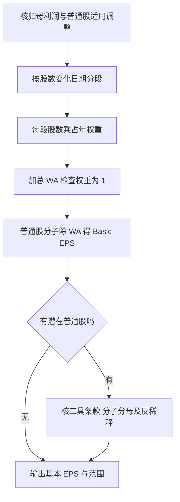

箭头是分子确认与时间加权的计算依赖，不是股价趋势。

**沿例子读图（笔记补充）**：利润 2,400 扣优先股股利 150，普通股分子为 2,250。沿“按股数变化日期分段”到“每段股数乘占年权重”，得到 250、600、275 的贡献。加总为 1,125，检查时间权重合计为 1，再相除得到 EPS 2 货币单位/股。

**图旁边界**：本图的 2,400／150 教学例按月加权；真实 Nike 分母已在上方由 Note 12 单列，不能从舍入 EPS 反造。实际稀释仍要逐工具核条款与反稀释。

**文字替代**：EPS分子按归母普通股口径，分母按股数在场时间加权，稀释须另核工具。

<details><summary>读图自测：只拿年末1,100股作分母会怎样？</summary>

得到约2.04545，少算中间六个月的股数；不是本例正确EPS。

</details>

稀释 EPS 不是“所有东西无条件转股”：可转债可能要调整利息等分子，期权有相应计算；反稀释工具须排除。上方官方 Nike Note 12 只补齐已披露的股数桥与结果，不把本讲原图变成含全部工具条款的材料，也不冒称已重建每项工具。复做时仍要检查股数时段覆盖全年、分子归属正确，以及分股等特殊事项是否已处理。

失败 1：拿集团 NI 当归母普通股利润，多计 NCI；先按利润归属分开。失败 2：用年末股数，忽略早期资本未在场；重建时段。回购若同时借债导致利润下降，EPS 未必升。

<details><summary>迁移 1：回购改为 7 月 1 日，其余不变</summary>

加权平均股数（WA）$1,000\times3/12+1,200\times3/12+1,100\times6/12=1,100$；EPS $2,250/1,100≈2.04545$。
</details>

<details><summary>迁移 2：错用年末 1,100 得 2.04545，为什么不是正确原例？</summary>

原例有 6 个月 1,200 股，全年平均为 1,125，正确 EPS 2。年末法少算分母而高估结果，试算表（TB）或利润表总额不会发现此时间权重错误。
</details>

**所以呢**：EPS 连接归属和资本在场时间，不能用“一股分多少”跳过分子调整与加权。🔗 [IAS 33 官方简介](https://www.ifrs.org/issued-standards/list-of-standards/ias-33-earnings-per-share.html/)支持归母普通股利润与加权股数概念，2026-10-02 已访问；实际工具的完整稀释条款尚未验读。


#### 2.5.3 收入侧与费用侧的明细（讲义 p.31–32）

**p.31 —— 收入侧（Revenues）**，讲义原文：

> - **Revenue**：*"Magnitude of mainstream source of income"*；*"Sometime called net revenue, turnover, or sales"*
> - **Gross profits**：*"GP = Revenue – Cost of Revenue"*；*"**Ability to generate profits from revenue**"*
> - **Other revenues**：*"Income from other sources"*

三个要点：
1. **Revenue 衡量的是"主流收入来源的量级"**（magnitude of mainstream source）。看一家公司先看这一行有多大。
2. **毛利衡量的是"从收入中制造利润的能力"**（ability to generate profits from revenue）。⇒ 所以真正要看的不是毛利额，而是**毛利率 = 毛利 ÷ 收入**——这正是共同比利润表的第一行（§2.6.2）。
3. **"net revenue"里的 net** 指的是扣除了销售退回、销售折让、商业折扣之后的净额。

**p.32 —— 费用侧（Expenses）**，讲义原文四类：

| 讲义原文 | 中文 | 是什么 | 典型内容 |
|---|---|---|---|
| *"**Distribution** – costs incurred while delivering products for sales"* | **分销费用** | 为把产品送到客户手上而发生的成本 | 运费、仓储、销售人员薪酬、广告推广 |
| *"**Administration** – costs to maintain daily operations, such as salary expense"* | **管理费用** | 维持日常运营的成本 | 行政人员工资、办公室租金、审计费、折旧 |
| *"**Others** – other operational expenses not classified as distribution or administration"* | **其他费用** | 前两类装不下的经营性费用 | ⚠️ §2.5.5 那家港股公司把 **研发费用 23.99 亿** 放在这里 |
| *"**Finance** – costs incurred in maintaining debt finances (bank loans, etc.)"* | **财务费用** | 维持债务融资的成本 | 利息支出、银行手续费 |

**⭐ 为什么本讲把财务费用单独放在营业利润之后（💡 笔记补充）**

对本讲采用的普通非金融企业骨架，借款利息主要来自融资安排，所以放在 `Profit from operations` 之后，帮助读者先看本表定义的经营小计，再看融资成本。这个结构不能推广为“利息永远不是经营结果”：银行等金融企业的利息收入与支出可能正是核心业务，其他企业的列报也须按适用准则和业务性质判断。

**⚠️ 一个提醒**：`Other expenses`（其他费用）是**费用侧最需要去翻附注的一行**——它是个筐，什么都可能装。§2.5.5 的实例里，它装着占收入 9.9% 的研发费用。

**🎙️ 课堂补充**（S2 `27:56`–`29:03`，B · 讲了同讲义）

教授简讲收入、毛利与其他收入，然后逐类说明分销、行政、其他经营费用与财务费用。财务费用用借款利息说明：*"which is the cost incurred in maintaining debt finance, like interest paid"*（S2 `29:03`）。因此这一类由融资安排产生，不能与交付产品时的经营费用混为一谈；本节更细的费用分类示例仍属笔记补充。

---

#### 2.5.4 利润表能告诉你什么、不能告诉你什么（讲义 p.33）

与 p.13 同构，这一页是利润表一节的**总结页**，适合组织“利润从哪里来、能否持续”的论述复习；现有材料没有实际出题频率依据。

**Key information（讲义 p.33 原文）**

> **Magnitudes and trends（量级与趋势）：**
> - *Profitability (net income or loss) for the period* —— 本期盈利/亏损
> - *Sales revenue for the period* —— 本期营业收入
> - *Major expenses* —— 主要费用项
> - *Income from operations* —— 营业利润
> - *Earnings per share (EPS)* —— 每股收益
>
> **How is the firm generating most of its income?（这家公司的钱主要从哪来？）**
> - *Through main business or **other activities**?* —— 靠主业还是靠其他活动？
> - *Through **recurring or nonrecurring** items?* —— 靠**经常性**项目还是**非经常性**项目？

**逐问参考方法（⚪ 笔记推断，不是教授给定公司答案）**

原页没有指定公司或提供一组待判断数据，所以两问都不能唯一判定。“钱从哪来”在这里指收益／盈利来源，不是本期现金收款来源。可以这样组织有条件的回答：

**第 1 问：主业还是其他活动？** 先按利润表和附注拆分主业结果、其他收入与利得；在同一利润／收益层级比较各自贡献。主营销售额是规模线索，不能直接与扣完成本后的净处置利得比较。分部利润、相关费用或其他项目拆分不足时，结论保留未知，不凭行名断言“主要靠主业”。

**English method answer（笔记整理）**：Use the income statement and notes to separate main-business results from other income and gains.

Compare their contributions on a consistent profit or earnings basis; do not compare gross sales directly with a net gain. If the required breakdown is missing, I cannot determine which source contributes most.

**第 2 问：经常还是非经常？** 检查每个重要项目的性质、出现频率、合同及跨期证据，再判断能否在未来相似业务中重复。经营／非经营与经常／非经常是两个分类问题，不能互相替代；非经常利得也是真实报告结果，须单独解释而非自动删除。

**English method answer（笔记整理）**：Assess each material item's nature, frequency and expected continuation using the notes and evidence across periods.

Assess recurrence separately from operating classification. If the evidence is insufficient, label recurrence as uncertain instead of assuming that all other gains are nonrecurring or deleting them.

**⭐ 经常性 vs 非经常性（Recurring vs Nonrecurring）** ⭐ 新概念（讲义只给了词，没给定义）：

| | 定义 | 例子 | 对估值的意义 |
|---|---|---|---|
| **经常性项目** | 在当前业务模式下预期较常重复，但金额和条件仍会变化 | 卖鞋收入、经常性员工工资、租金 | 可作为预测起点，再调整增长、周期与合同变化 |
| **非经常性项目** | 频率、性质或规模不代表正常持续水平 | 某次处置利得、特定诉讼、一次性重组 | 单独说明并判断是否需要规范化；不自动从全部分析中删除 |

**Weaknesses（讲义 p.33 原文，只有一条但极重）**

> *"Figures (revenues, expenses, gains and losses) **could be manipulated**: the **quality of earnings** may be low."*
> 收入、费用、利得、损失这些数字**可能被操纵**，**盈余质量**可能很低。

**⭐ 盈余质量（Quality of Earnings）** ⭐ 新概念（讲义只给了词）：

> **是什么**：报告利润在多大程度上由可核事实、适用确认计量和可持续经营活动支持，并能与现金流及附注相互解释。
> **较高质量的线索**：主要来源可解释、重复性有依据、现金转换与营运资金变化能对上、估计中立且有证据和充分披露。
> **风险线索**：一次性项目占比大、估计或截止缺少依据、利润与现金长期背离、分类和披露难以核对。所谓“保守”不自动等于高质量；无依据地系统低估也会误导。

**💡 为什么要检查利润的确认时点与估计依据（笔记补充）**

利润表很多项目都依赖至少两类判断：

1. **时点判断**（什么时候确认）——同一交易只能按合同与适用确认条件落在应属期间，不能为了报表好看任挑年份。发货也不自动等于控制权已转移；要看履约、交付条款、验收和退货权等事实。
2. **金额判断**（确认多少）——折旧年限、坏账、存货减值、商誉减值等会用到估计。因新信息合理更新估计不自动等于操纵；缺乏依据或带偏向的估计才是风险。🔗 [IAS 8 官方页](https://www.ifrs.org/issued-standards/list-of-standards/ias-8-basis-of-preparation-of-financial-statements/)；获取日 2026-10-25。

再看 §2.2.5 的商品买卖简例：$\text{销货成本}=\text{期初存货}+\text{净采购}-\text{期末存货}$。在该节固定其他项目的条件下，期末存货错报会同时影响资产和利润；这不证明利润表一定比资产负债表更容易被操纵。

**⇒ 所以要用现金流量表交叉核对。** 现金收付通常能与银行记录等证据核对，估计空间往往不同于应计项目；但现金流仍可能有截止、分类、完整性和受限资金问题，不能把它当成不会出错或不会被操纵的“真相表”。

**🎙️ 课堂补充**（S2 `29:12`–`33:49`，A · 课上展开）

- 教授把量级、趋势、收入来源与盈余管理连在一起，强调复杂会计判断仍需要人，AI 读到数字并不能自动判断估计是否合理（S2 `30:45`–`31:44`）。
- 跨年例子（S2 `31:50`–`33:14`）：假设财年末为 12 月 31 日，服务在 12 月 30 日提供，收入为一百万；把该笔收入落在不同年度会改变两年的利润外观。*"If you keep this one million in this year"*（S2 `32:35`）。教授借此解释盈余质量低可能来自使数字好看的判断。
- **来源限制**：转录没有提供完整合同、履约/验收条件与确认依据。本例能证明跨期确认影响利润，不能证明公司可随意挑选年度；若履约条件已满足就须按适用确认原则入账。教授在 S2 `32:54`–`33:14` 说 *"it's legal actually ... consistent with the accounting principle or accounting rules"*，但这句口语判断不等于该不完整案例已获合规核验。
- **这段改变了什么**：补上 p.33 的具体课堂动机与百万收入例子；本节其他估计机制、数字桥和真假判断仍分别标笔记补充。

**⚠️ 常见误解**
- ❌ "任何改变利润的政策或估计 = 操纵"。→ 合理选择适用政策、根据新信息更新估计，会正常改变利润；“操纵”应保留给有意偏置、机会主义选择或错报风险，并与违法造假程度分开。
- ❌ "净利润是最重要的一个数"。→ 本页要求继续问利润来自哪里、哪些因素可能重复、现金与附注是否支持。经常性经营利润通常更适合预测，但一次性利得也是真实报告结果，不能用“1 亿一定胜过 5 亿”替代具体分析。

**与其他概念的关系**
← §2.2.5 存货风险、§2.4.5 折旧估计；→ §2.7.3「净利润与 CFO 的差异是调查线索」；→ **W9/W10 AI 分析财报**。只给主表数字时，AI 难以判断合同、估计依据与一次性事项；若同时提供附注、合同和结构化业务证据，它可以辅助筛查与比对，但仍不能自动替代规范判断和来源核验。

---

#### 2.5.5 读一份真实的利润表（讲义 p.34）

> 📄 **p.34 是纯图片页**（提取文本为空），已转 PDF 视觉复核。与 p.14–15 是**同一家 A 公司**的 2019 年报。

下表的 `Notes` 列是附注编号；例如 `5` 指向附注 5。年份列才是金额，单位为 RMB'000。

**Consolidated Statement of Profit or Loss ｜ Year ended 31 December 2019 ｜ RMB'000**

| | Notes | 2019 | 2018 |
|---|---|---:|---:|
| **REVENUE 营业收入** | 5 | **24,234,030** | 20,888,584 |
| Cost of sales 销售成本 | | (4,926,268) | (4,196,932) |
| **Gross profit 毛利** | | **19,307,762** | 16,691,652 |
| Other income and gains 其他收入及利得 | 5 | 862,603 | **7,443,161** |
| Selling and distribution costs 销售及分销费用 | | (9,319,541) | (8,078,544) |
| Administrative expenses 管理费用 | | (2,589,219) | (2,189,501) |
| Other expenses 其他费用 | | (2,559,218) | (2,344,333) |
| *Including: Research and development costs 其中：研发费用* | | *(2,398,712)* | *(2,090,567)* |
| Finance costs 财务费用 | 7 | (229,950) | (153,264) |
| Share of profits and losses of associates 应占联营公司损益 | | 111,385 | 59,910 |
| **PROFIT BEFORE TAX 税前利润** | 6 | **5,583,822** | 11,429,081 |
| Income tax expense 所得税费用 | 10 | (889,448) | (696,236) |
| **PROFIT FOR THE YEAR 本年利润** | | **4,694,374** | **10,732,845** |
| **Attributable to 归属于：** | | | |
| 　Owners of the parent 母公司股东 | | 2,706,794 | 9,046,347 |
| 　Non-controlling interests 少数股东 | | 1,987,580 | 1,686,498 |
| | | 4,694,374 | 10,732,845 |
| **EPS（基本及摊薄）** | 12 | **RMB21.58 cents** | RMB73.16 cents |

**💡 先验算（笔记补充，讲义没做）**

- 毛利：24,234,030 − 4,926,268 = **19,307,762** ✅
- 税前利润：19,307,762 + 862,603 − 9,319,541 − 2,589,219 − 2,559,218 − 229,950 + 111,385 = **5,583,822** ✅
- 本年利润：5,583,822 − 889,448 = **4,694,374** ✅
- 归属分拆：2,706,794 + 1,987,580 = **4,694,374** ✅

**💡 共同比（分母 = 营业收入 24,234,030）** —— 讲义没做，这里补上，因为它是读懂这家公司的钥匙：

每行是同一损益项目的原金额和收入占比。分母为2019营业收入24,234,030，金额单位沿原表RMB千元；解释放在表后。

| 项目 | 2019 金额 | 占收入 |
| --- | ---: | ---: |
| 营业收入 | 24,234,030 | 100.0% |
| 销售成本 | (4,926,268) | (20.3%) |
| **毛利** | 19,307,762 | **79.7%** |
| 销售及分销费用 | (9,319,541) | (38.5%) |
| 管理费用 | (2,589,219) | (10.7%) |
| 其中：研发（已包含在 Other expenses，不另加减） | (2,398,712) | (9.9%) |
| **税前利润** | 5,583,822 | 23.0% |
| **本年利润** | 4,694,374 | 19.4% |
| **归母利润** | 2,706,794 | **11.2%** |

项目列定位原表行；2019金额列是原年度额，括号为减项；占收入列用该行金额除24,234,030。读毛利：19,307,762/24,234,030约79.7%，即每100收入扣销售成本后余79.7。该比例本身不能确定行业。

**研发不能重复扣除**：原图把 `Including: Research and development costs` 缩进放在 `Other expenses` 下。Other expenses 占收入约 $2,559,218/24,234,030=10.6\%$，其中研发约占 9.9%；研发是母项中的子集，重建税前利润时只能扣 Other expenses 一次，不能再额外扣研发。

**表后读法**：毛利率 79.7% 是本样本的高比例信号，行业解释须结合可比公司与口径；销售及分销费用占收入 38.5%，是重要费用项；研发约占收入 9.9%，但已包含在 Other expenses；约 42.3% 的本年利润归属于非控股权益，这是利润归属而非同额现金支付。

**⇒ 有限画像**：本表显示高毛利（79.7%）、高销售费用（38.5%）、研发占比 9.9%，且 NCI 获利占比 42.3%，说明研发投入和非控股权益归属都值得重点分析。公司是否属于某一行业、通过几家非全资子公司经营，仍须公司背景和合并范围附注，不能由这四个比例单独推出。

**💡 笔记补充：把 2018 → 2019 的报告利润变化拆开看**

表面看：本年利润 **10,732,845 → 4,694,374**，跌了 **56.3%**。归母利润 9,046,347 → 2,706,794，跌了 **70.1%**。EPS 从 73.16 分跌到 21.58 分。

**但同时，收入是涨的**：20,888,584 → 24,234,030，**+16.0%**。毛利也是涨的：16,691,652 → 19,307,762，**+15.7%**。

**⇒ 收入和毛利的报告金额上升，而净利润下降。** 这支持继续追查其他收入、费用、税项和利润归属；仅凭收入与毛利还不能认证全部“主业”增长或质量改善。

看 `Other income and gains`：2018 年 7,443,161，2019 年 862,603，差额是 **6,580,558（RMB'000，约 65.81 亿元）**。

现金流量表（讲义 p.43，§2.7.4）的间接法调整项另列出：

| 原表运算 / 状态 |
|---|
| Gain on deemed disposal of an associate    2019: –    2018: (6,598,691) |
| （视同处置一家联营公司的利得） |

**⇒ 2018 年利润包含一笔 6,598,691（RMB'000，约 65.99 亿元）的视同处置联营公司利得，2019 年该行没有。** 它与 `Other income and gains` 的同比减少 6,580,558 非常接近但并不相等，差 18,133（RMB'000）；因此可解释大部分变化，不能把两数写成同一金额或声称已经逐项解释完整差额。

**剔除这笔一次性利得后重算（💡 笔记推断）**：

| | 2018 调整后 | 2019 | 变化 |
|---|---:|---:|---|
| 税前利润（报告数） | 11,429,081 | 5,583,822 | −51.1% |
| 减：一次性处置利得 | (6,598,691) | — | |
| **税前利润（剔除后）** | **4,830,390** | **5,583,822** | **+15.6%** ✅ |

**⇒ 仅剔这一个利得后，税前对比增长 15.6%；这不是剔全部非经常因素后的税后/归母利润，也不能证明主业全部稳健。报告 NI 下降是真实报告结果，不能叫假象；须继续核税、其他收入费用与归属。**

> 这正是 p.33 那句 *"Through recurring or nonrecurring items?"* 的应用：报告净利润下降 56.3% 是真实结果；只剔除已识别处置利得后的税前比较又给出另一种有限视角。两者回答的问题不同，不能把一方叫“完全错误”或把 +15.6% 叫唯一正确增速。该练习是笔记补充，现有材料没有“考试很可能考”的明示。

**🎙️ 课堂补充**（S2 `33:54`–`34:16`，B · 讲了同讲义）

教授展示真实合并损益表，只提醒年报通常给两年作比较：*"We have the two years here for your comparison."*（S2 `33:59`）。没有逐行核算本表，也未讲解处置联营公司的税前利润调整；本节“利润腰斩”推算和数值验算仍是 💡 笔记补充，不能升级为教授确认。

---

### 2.6 案例二：Nike 的利润表（讲义 p.35–38）

> 📄 **讲义 p.35 是本节的分隔页**：**"Case: Nike"** / **"Analyzing Income Statement"**。
> 结构与 §2.4 完全平行：先给数据（p.36–37）→ 再给会计政策（p.38）。⚠️ **与资产负债表那一节不同的是：这一节讲义没有留练习题。**

#### 2.6.1 Nike 的利润表原始数字（讲义 p.36）

> 📄 **p.36 是纯图片页**，已视觉复核并重画。

**Nike, Inc. ｜ For the Fiscal Year Ended May 31 ｜ 百万美元；EPS 与股利为美元／股（单位由本轮官方年报补证）**

| | 2014 | 2015 | 2016 |
|---|---:|---:|---:|
| Revenues 营业收入 | 27,799 | 30,601 | 32,376 |
| Cost of sales 销售成本 | 15,353 | 16,534 | 17,405 |
| **Gross profit 毛利** | **12,446** | **14,067** | **14,971** |
| **Demand creation expense 需求创造费用** | 3,031 | 3,213 | 3,278 |
| Operating overhead expense 运营管理费用 | 5,735 | 6,679 | 7,191 |
| **Operating Income 营业利润** | **3,680** | **4,175** | **4,502** |
| Interest (expense) income, net 净利息（费用）收入 | (33) | (28) | (19) |
| Other income (expense), net 其他净收入（费用） | (103) | 58 | 140 |
| **Income before income taxes 税前利润** | **3,544** | **4,205** | **4,623** |
| Income tax expense 所得税费用 | 851 | 932 | 863 |
| **NET INCOME 净利润** | **2,693** | **3,273** | **3,760** |
| Earnings per common share – Basic 基本每股收益 | \$1.52 | \$1.90 | \$2.21 |
| Earnings per common share – Diluted 稀释每股收益 | \$1.49 | \$1.85 | \$2.16 |
| Dividends declared per common share 每股宣派股利 | \$0.47 | \$0.54 | \$0.62 |

**三处与 §2.5.2 标准结构的对照（💡 笔记补充）**

1. **`Demand creation expense`（需求创造费用）是 Nike 在本历史报表使用的科目名**，不是通用术语。按 p.38 的内容，它在本例功能上接近分销／营销费用，但不能宣称任何公司的 Distribution 都等于 demand creation。
2. **`Operating overhead expense`** 在本例功能上近似管理及其他运营开销；是否等同 Administration、包含哪些职能，须看 Nike 当期附注，不能把近似对应写成唯一分类。
3. **Nike 的表里没有"少数股东"归属行**，只能说明本图未单列可见的非控股权益；是否全部全资、金额不重大或归并列示，仍须查合并范围与权益附注。对照 §2.5.5，A 公司约 42.3% 本年利润归属于非控股权益，那是利润归属，不是少数股东当期拿走同额现金。

**💡 验算（笔记补充）**：
2016 年毛利 = 32,376 − 17,405 = **14,971** ✅
2016 年营业利润 = 14,971 − 3,278 − 7,191 = **4,502** ✅
2016 年税前 = 4,502 − 19 + 140 = **4,623** ✅
2016 年净利 = 4,623 − 863 = **3,760** ✅

**💡 三个可以直接读出的观察（笔记补充）**

- **股利在涨**（\$0.47 → \$0.54 → \$0.62），而**留存收益绝对额与占比都在下降**（占比 26.2% → 19.4%，§2.4.4）。这与股利分配消耗留存收益相容，但留存收益桥还可能含其他调整；回购通常先影响 treasury stock / APIC，是否触及留存收益取决于交易与政策。须查权益变动表和附注，不能只凭利润表把下降归因于“分红 + 回购”。
- **稀释 EPS 始终低于基本 EPS**（2016：\$2.16 vs \$2.21，差约 2%）。这表示适用稀释计算后每股金额较低，但差幅受潜在普通股条款、分子调整、加权股数及反稀释规则共同影响，不能据 2% 直接断言工具“规模不大”。
- **利息费用净额在缩小**（33 → 28 → 19）。⇒ 只说明该列净利息费用下降；是偿还短债、利率变化、现金收益变化还是分类变化，须结合借款及利息附注。

**🎙️ 课堂补充**（S2 `34:16`–`38:15`，A · 自读后简讲）

教授先给学生时间看 Nike 的三页案例（S2 `34:16`，实际静默/自读持续到 `37:47`），然后先看原始净利润，指出三年均为正：*"the net income of Nike is positive"*（S2 `38:06`）。这确认三年报告盈利；没有逐行验算毛利、税前利润、EPS 或股利，不把本节推算都当作课堂答案。

---

#### 2.6.2 Nike 的共同比利润表（讲义 p.37）

> 📄 **p.37 是纯图片页**，已视觉复核并重画。同样是**共同比 + 百分比变动**并排。

Nike利润表把收入占比和同比变动分开读，保留每个原值和括号。

结构表：各年以Revenues为100%。

| For the Fiscal Year Ended May 31 | 共同比 2014 | 共同比 2015 | 共同比 2016 |
| --- | ---: | ---: | ---: |
| Revenues | 100.0% | 100.0% | 100.0% |
| Cost of sales | (55.2%) | (54.0%) | (53.8%) |
| **Gross profit** | **44.8%** | **46.0%** | **46.2%** |
| Demand creation expense | (10.9%) | (10.5%) | (10.1%) |
| Operating overhead expense | (20.6%) | (21.8%) | (22.2%) |
| **Operating Income** | **13.2%** | **13.6%** | **13.9%** |
| Interest (expense) income, net | (0.1%) | (0.1%) | (0.1%) |
| Other income (expense), net | (0.4%) | 0.2% | 0.4% |
| **Income before income taxes** | **12.7%** | **13.7%** | **14.3%** |
| Income tax expense | (3.1%) | (3.0%) | (2.7%) |
| **NET INCOME** | **9.7%** | **10.7%** | **11.6%** |

增长表：各科目相对上年同项金额变化。

| For the Fiscal Year Ended May 31 | 变动% 2015 | 变动% 2016 |
| --- | ---: | ---: |
| Revenues | 10.1% | 5.8% |
| Cost of sales | 7.7% | 5.3% |
| **Gross profit** | **13.0%** | **6.4%** |
| Demand creation expense | 6.0% | 2.0% |
| Operating overhead expense | 16.5% | 7.7% |
| **Operating Income** | **13.5%** | **7.8%** |
| Interest (expense) income, net | (15.2%) | (32.1%) |
| Other income (expense), net | (156.3%) | 141.4% |
| **Income before income taxes** | **18.7%** | **9.9%** |
| Income tax expense | 9.5% | (7.4%) |
| **NET INCOME** | **21.5%** | **14.9%** |


第一列定位原损益科目；结构三列分母是27,799/30,601/32,376的各年收入，负占比表费用减项；变化两列用上年该项。读2016NI：3,760/32,376约11.6%。2015Other从−103转+58时负基数增长率不按普通正基数涨跌解读。


**⭐ 注意分母换了**：利润表的共同比分母是 **Revenues**（讲义 p.16 明写），所以第一行永远是 100.0%。

**💡 验算三个数（笔记补充）**

| 数字 | 算式 | 结果 |
|---|---|---|
| 2016 毛利率 46.2% | 14,971 ÷ 32,376 | 46.24% ✅ |
| 2016 净利率 11.6% | 3,760 ÷ 32,376 | 11.61% ✅ |
| 2015 收入变动 10.1% | (30,601 − 27,799) ÷ 27,799 | 10.08% ✅ |

**💡 用这张表练五个观察（笔记补充）**

1. **毛利率连续三年上升**：44.8% → 46.0% → 46.2%。这与售价、折扣、产品／地区／渠道组合、采购或制造成本等多种变化相容；销售成本占比下降是观察，不能单独认证定价权增强。
2. **净利率连续三年上升**：9.7% → 10.7% → 11.6%，且**上升幅度大于毛利率**。⇒ 说明改善不只来自毛利，还来自下面的环节。
3. **Operating overhead 占比上升**：20.6% → 21.8% → 22.2%（三年 +1.6 个百分点）。这会压低其他因素不变时的营业利润率，但可能来自扩张投入、数字能力、工资、分类或效率变化；须看用途和后续回报，不能自动贴“负面”标签。
4. **需求创造（广告）费用占比在下降**：10.9% → 10.5% → 10.1%，同时收入增长。这个组合与品牌/规模效应相容，但也可能来自渠道或地区组合、投放时点、费用分类变化或短期削减；须结合销量、价格、地区、渠道和后续期间，不能单独认证“品牌力增强”。
5. **用同一收入分母做净利率百分点桥**。每一项都用“2016 项目÷2016 收入 − 2014 项目÷2014 收入”，不是项目金额增长率：

$$
\begin{aligned}
\text{营业贡献（百分点）}&=(\frac{4,502}{32,376}-\frac{3,680}{27,799})\times100\approx+0.667,\\
\text{净利息贡献（百分点）}&=(\frac{-19}{32,376}-\frac{-33}{27,799})\times100\approx+0.060,\\
\text{其他净损益贡献（百分点）}&=(\frac{140}{32,376}-\frac{-103}{27,799})\times100\approx+0.803,\\
\text{税项贡献（百分点）}&=(\frac{-863}{32,376}-\frac{-851}{27,799})\times100\approx+0.396.
\end{aligned}
$$

四项分别按三位小数显示后，合计约 $0.667+0.060+0.803+0.396=1.926$ 个百分点。直接用原额先算差、最后舍入，也得到约 1.926 个百分点：

$$
\left(\frac{3,760}{32,376}-\frac{2,693}{27,799}\right)\times100
\approx1.926142\text{ 个百分点}.
$$

若先把两期净利率分别舍入成 11.614% 和 9.687%，再相减会得 1.927 个百分点；0.001 个百分点的差来自中间舍入。复算保留原额到最后一步，不能把显示数不成立的等号写成严格相等。其他净损益贡献大于税项贡献；有效税率或其他项目为何变化仍须附注，不能由百分点桥直接判定质量或持续性。

**所以呢**：读净利率变化先拆每个利润层贡献，分清百分点与百分比，才能找到真正需调查的变化。

**🎙️ 课堂补充**（S2 `38:15`–`39:26`，A · 课上展开）

教授回到共同大小，把收入设为 100%，各利润表项目除以收入：*"every other component in the income statement, we can use the number divided by revenues."*（S2 `38:36`）。随后指出 2014–2016 年净利润占收入比例上升，视为盈利趋势改善。

**这段改变了什么**：课堂确认利润表分母为收入及净利率上升；没有确认本节的完整百分点贡献拆桥，也没有将税贡献判为最大原因。原数与贡献解释保持 💡 来源。

#### 2.6.3 Nike 的收入与费用政策摘录（讲义 p.38）

讲义 p.38 摘录了 Nike 附注的两段原文：

> **Revenue Recognition（收入确认）**：*"Nike recognizes **wholesale revenues after the ownership of the products, along with the related risks and benefits, have been passed to the customer**, based on the terms of sale. This occurs **upon shipment or upon receipt by the customer** depending on the country of the sale and the agreement with the customer. **Retail store revenues are recorded at the time of sale** and **online store revenues are recorded upon delivery to the customer**. Provisions for post-invoice sales discounts, returns and miscellaneous claims from customers are estimated and **recorded as a reduction to revenue at the time of sale**."*
>
> **Demand Creation Expense（需求创造费用）**：*"Demand creation expense consists of **advertising and promotion costs, including costs of endorsement contracts, television, digital and print advertising, brand events and retail brand presentation**. Advertising production costs are **expensed the first time an advertisement is run**."*

> ⚠️ **历史来源边界**：上面是讲义为 Nike 2014–2016 案例摘录的历史 US GAAP 政策，原文使用“所有权及风险报酬转移”语言。它不能直接冒充 Nike 2026 当前政策，也不能与现行 IFRS 15 的控制权模型画等号。现行 IFRS 15 以向客户转移承诺商品或服务来描述收入确认，并使用五步模型；这里只作概念对照，不回写课件原句。🔗 [IFRS 15 官方页](https://www.ifrs.org/issued-standards/list-of-standards/ifrs-15-revenue-from-contracts-with-customers/)；获取日 2026-10-25。

**⭐ 第一段展示历史政策怎样把不同销售条款落到确认时点**（💡 笔记补充）：

| 渠道 | 历史政策中的确认时点 | 读法 |
|---|---|---|
| **批发**（卖给零售商） | 所有权及相关风险与报酬转移时；按国家与合同，可能是发货或客户收货 | 不能把“发货”无条件当成已满足确认条件 |
| **自营门店** | 销售发生时 | 付款、交货和销售确认在常见门店交易中可能同日，但须看实际交易 |
| **官网** | 交付客户时 | `delivery` 不必然等于快递签收这一种证据，要按合同、交付安排与退货条款判断 |

**⇒ 同一家公司可因销售条款不同而有不同确认时点，但三种渠道不保证必然形成三个不同日期。** 收现与确认是两个判断：有时同一时点，有时先收款或后收款；官网交易也不能无条件写成“必须等快递签收”。

**⭐ 最后一句藏着一个重要动作**：*"Provisions for post-invoice sales discounts, returns and miscellaneous claims … are **estimated** and recorded as a **reduction to revenue** at the time of sale."*
——预计会有多少退货和折让，**在销售当时就估出来、从收入里直接扣掉**。

> ⚠️ **注意 "estimated" 这个词。** 退货与折让估计会影响净收入，但估计本身不等于操纵。企业应依据历史、合同和当前信息作中立估计；因新信息合理更新与故意采用无依据偏低估计必须分开。后者可能构成失实陈述，不能用“这是估计”免责。🔗 [IAS 8 官方页](https://www.ifrs.org/issued-standards/list-of-standards/ias-8-basis-of-preparation-of-financial-statements/)；获取日 2026-10-25。

**⭐ 第二段解释了该历史披露中的 `Demand creation expense` 包含什么**：广告与推广，包括代言合同成本、电视／数字／平面广告、品牌活动与零售品牌陈列。它说明 Nike 当期科目的范围，不代表所有公司或所有代言合同采用同一确认模式。

以及一条历史会计政策：*"Advertising production costs are **expensed the first time an advertisement is run**."* —— 本摘录只支持 Nike 当期把**广告制作成本**在广告首次投放时费用化；不能扩成所有广告支出永远不得资本化，也不能推出全部代言合同在同一时点一次性费用化。

> 💡 **怎样读这条政策？** 原 p.38 只给“广告制作成本在首次投放时费用化”的 Nike 历史口径。它可与自创品牌难以单独确认的边界联系，但不能单凭一句话证明所有品牌相关支出、预付广告或合同资产为零；仍须看合同、期间和相关资产政策。

**🎙️ 课堂补充**（S2 `39:40`–`39:55`，C · 明确降低本页权重）

教授对 Nike 的这一页政策摘录说：*"the notes, this is not important"*（S2 `39:40`），只概括为收入和特定费用如何确认。最近语境是 p.38 的 Nike 收入确认/需求创造费用摘录；降低这页细节的背诵优先级即可，不能扩为“所有财报附注不重要”。S2 `53:13` 起教授仍专门讲 p.47 附注的用途。正文关于合同、退货估计和广告制作成本的来源边界全部保留。

---

### 2.7 现金流量表（Statement of Cash Flows）

> 📄 **讲义 p.39 是本节的分隔页**：**"Cash Flow Statement"** / **"(Statement of Cash Flow)"**。
> 现金流量表解释一个期间内现金及现金等价物怎样因经营、投资和筹资活动而变化，并帮助核对利润与现金。它不是只为“防操纵”而存在，也不是天然最可信：截止时点、完整性、虚构现金、受限余额和分类同样可能出错。（IFRS 正式名是 *Statement of Cash Flows*，带复数 s；讲义两处都写成单数。）

**现金也可能怎样记错（💡 笔记补充）**：下表解释本节反复用到的三个检查词，只是风险例，不是在指控 A 公司。

| 检查词 | 具体会错在哪一步 |
|---|---|
| 截止（cut-off） | 1 月才实际收到的钱提前记进 12 月，使收款落错期间 |
| 完整性（completeness） | 漏记一个银行账户或一笔现金收付，导致表内未包含全部范围 |
| 存在性／虚构余额（existence） | 账上写有现金，但缺少可核的银行余额或库存现金支持，须取得证据 |

受限余额与现金等价物条件见 §2.2.6，经营／投资／筹资分类见 §2.7.2；这些判断不能只靠“现金”两个字。先核实际收付、期间和范围，再用现金表与利润表交叉检查。

#### 2.7.1 直接法与间接法（讲义 p.40）

**是什么**

讲义 p.40 原文：

> - *"Shows **cash inflows and outflows** over a given period."*
> - *"**Direct** vs. **Indirect** method"*
> - *"**Direct method** partitions cash receipts and cash payments into logical categories, such as cash collected from customers, paid to suppliers, and paid to employees."*
> - *"**Indirect method** reconciles reported net income to cash flows from operations by **"unraveling" noncash (i.e., accrual) components of earnings**."*
> - *"**Almost all firms use the indirect method**"*
> - *"**Link net income to the change in cash on the balance sheet**"*
下表按比较维度并排读直接法和间接法：两列的起点与调整过程不同，目标都是同一期间的经营净现金。

| | 直接法 Direct | 间接法 Indirect |
|---|---|---|
| **起点** | 经营活动主要现金收入和现金支出 | 适用口径下的利润小计；A 公司历史表从税前利润开始 |
| **做法** | 分列客户收现、付供应商、付员工等主要总额 | 调整非现金项目、经营性递延／应计与属于投资或筹资现金流的损益项目 |
| **可读性** | ✅ 直观，像银行流水 | ❌ 需要理解每一项调整 |
| **适用范围** | 只改变 CFO 的列示方法 | 只改变 CFO 的列示方法；CFI、CFF 不因此换算法 |
| **准则与讲义** | IAS 7 允许且鼓励直接法 | 讲义历史原句是 *"Almost all firms use the indirect method"*，但没有给当前普及率证据 |

**⭐ 怎样理解讲义的“Almost all”句子（当前补充）**

这句话保留为 p.40 的历史课堂材料，不能升级成跨法域、跨行业的当前统计。IAS 7 允许两种方法，并鼓励直接法，因为它能提供有助预测未来现金流的主要总额信息；企业采用哪种方式还受本地要求、行业和系统影响。间接法利用利润与资产负债变化建立桥，但仍要拆非现金交易、处置、并购、汇兑及明细变化，不能只凭两张总表无成本准确推出。

讲义最后一句 **"Link net income to the change in cash"** 描述的是间接法的桥接用途：它用调整项连接利润与 CFO，让读者定位差异。直接法则直接展示主要经营收付；两种列示各提供不同信息，不能说其中一个拥有另一个“没有的全部好处”。

**💡 间接法的调整分三类（笔记补充，这是读懂 §2.7.4 那张真实报表的钥匙）**

| 步骤 | 调整内容 | 为什么调 |
|---|---|---|
| 起点 | A 公司历史表为税前利润；其他报表按适用准则与列报政策 | 起点不是永远固定为 NI 或 PBT |
| ① 调整非现金项目 | ＋ 折旧、＋ 摊销、＋ 适用减值损失等 | 它们影响利润，但当期不等额形成现金收付 |
| ② 反向剔除归属其他现金类别的损益 | A 公司列财务费用、利息／投资收益及处置损益等 | 按该公司现金分类把损益与实际现金收付分开；不是所有公司永远同类 |
| ③ 调整经营性递延、应计与营运资金变动 | − 存货增加、− 应收增加、＋ 应付增加…… | 利润确认与经营现金收付存在时间差 |
| **＝ 结果** | **经营活动产生的现金流量净额（CFO）** | |

**现行变化提醒**：IFRS 18 适用于 2027 年 1 月 1 日或之后开始的年度报告期间，并可提前采用；其配套 IAS 7 修订把间接法起点改为经营利润，并调整利息与股利现金流分类。A 公司 2019 年从税前利润起算的表是历史实例，不能当作 2027 年后唯一格式。

**🎙️ 课堂补充**（S2 `39:55`–`40:49`，A · 课上展开）

教授简讲现金流量表与两种方法：*"almost all firms use the so-called indirect method."*（S2 `39:55`）。他用应收、应付解释应计项目：收入已确认但现金尚未收到（S2 `40:29`），因而从利润到现金必须拆除非现金与收付时差。

**这段改变了什么**：确认间接法桥接利润与现金的动机；没有当堂走完本节小账的两法 CFO 数值例，完整例仍为 💡 笔记补充。

**⚠️ 常见误解**
- ❌ "间接法算出来的 CFO 和直接法不一样"。→ **完全一样**，只是列示路径不同。两种方法算出的 CFO 必须相等。
- ❌ "折旧要加回是因为折旧是收入"。→ 折旧是**费用**，它减少了利润但**没有减少现金**，所以在从利润倒推现金时要**加回**。

---

**💡 同一小账走两条 CFO 路径直到现金首尾（笔记补充）**

> 🧭 **第二遍 / 进阶复做**：首遍先掌握直接法看实际经营收付、间接法从利润调到 CFO，结果应相同。本块再逐笔过账并核现金首尾。

现在要回答“NI 700 为什么实际经营净入 750”。输入期初现金（Cash）1,000、Inventory 400、应付账款（AP）100；另设已有设备净额 1,000 与 E 2,300，期初 A 2,400=L100+E2,300。期间赊销 1,500，收客户 1,200，现购库存 300，销货成本 500；工资费用 200 只付 150，设备折旧 100。无税、投资筹资、内部交易等其他事项。

1. 销售：Dr AR 1,500 / Cr Sales 1,500；收款 Dr Cash 1,200 / Cr AR 1,200，期末 AR 300。
2. 采购 Dr Inventory 300 / Cr Cash 300；售出 Dr COGS 500 / Cr Inventory 500，期末库存 $400+300-500=200$，$Δ Inventory=-200$。
3. 工资 Dr Wage Expense 200 / Cr Cash 150 / Cr Wages Payable 50；折旧 Dr Depreciation Expense 100 / Cr Accumulated Depreciation 100。
4. 利润表 NI $1,500-500-200-100=700$；直接 CFO $1,200-300-150=750$，Cash $1,000+750=1,750$。
5. 间接 CFO $700+100-300-(-200)+50=750$：加回未付现金的折旧、减尚未收 AR、加库存下降释放的成本现金差、加工资暂欠；AP 无变不调。负的库存变化前再取减号，得到加 200，不能误减 200。
6. 核完整输出：净设备 900、A $1,750+300+200+900=3,150$；L $100+50=150$、E $2,300+700=3,000$，A=L+E，现金两法相同。

**看图前先问**：利润700为何与经营现金750不同，两条路径如何对上？

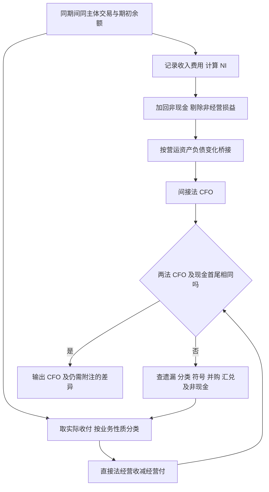

箭头表示直接收付与利润桥接的两条计算路径；“两法 CFO 及现金首尾相同吗”否进入查错，而非另填金额配平。

**沿例子读图（笔记补充）**：直接法走“取实际收付”到“经营收减经营付”：1,200 减 300 再减 150，得 750。间接法从 NI 700 出发，加回折旧 100、减应收增加 300、加库存下降 200 和工资暂欠 50，也得 750。最后在“两法 CFO 及现金首尾相同吗”核对期末现金 1,750。

**图旁边界**：无税/投资筹资等事项是本补例前提；A公司原表起点PBT，不能混NI重复扣税。

**文字替代**：同一小账的收付与利润桥接都到CFO750；多出的50来自工资延付。

<details><summary>读图自测：CFO高50就证明盈余质量更高吗？</summary>

不能。例中工资延付50提供现金时差；条件变为工资全付后CFO降700，NI仍700。

</details>

**依据与边界**：利润里的收入未必全收现，故减 AR 增；库存下降让本期成本大于本期采购付现，故加库存下降；已扣工资却暂欠 50，实际支付少 50，故加应付增。这些解释要求余额变化确实来自所讨论经营交易；并购取得 AR、汇兑等不等收款时差，必须拆开。同一供应商买库存是经营、买设备是投资，不能只看对手方定类。A 公司原表从 PBT 出发并末扣现金税，不能换用 NI 起点再扣一次全部税费。

失败 1：CFO>NI 直接叫高质量，忽略工资暂欠 50；征兆是应付增长，现金优势可能会逆转。失败 2：减库存的负变化又减 200，会错得 350；按库存链解释再定符号。三现金流符号只是经营阶段线索，卖资产、预收或延付均可能改符号而不改善持续经营。

<details><summary>迁移 1：工资全部支付 200，其他不变</summary>

NI 仍 700、工资应付增 0；直接 CFO $1,200-300-200=700$；间接 $700+100-300+200=700$，期末现金 1,700。此前多的 50 是延付时间差。
</details>

<details><summary>迁移 2：另收客户预付 100 尚未交货，会变 NI 吗？</summary>

Dr Cash 100 / Cr Unearned Revenue 100；NI 不变，直接 CFO 850、间接在原 750 上加预收增 100=850，Cash 1,850。CFO 高于 NI 不能独立证明赚到更多收入。
</details>

**所以呢**：只有把同一批交易两法勾到现金首尾，才明白“加回/减变化”的经济含义。


#### 2.7.2 三类现金流：CFO / CFI / CFF（讲义 p.41）

**是什么**

讲义 p.41 原文：

> *"Classifies cash flows by main activities:"*
>
> **Operating Activities (CFO)**
> - *"Regular business activities involving the production and delivery of goods or services"*
> - *"Include net income from the income statement and adjust non-cash items"*
>
> **Investing Activities (CFI)**
> - *"Relate to the acquisition and disposal of assets, such as plant and equipment, and investments in securities."*
> - *"**Negative value reflects spending cash on investment**"*
>
> **Financing Activities (CFF)**
> - *"Relate to cash received from and paid to capital providers such as banks, other lending institutions, and shareholders."*
> - *"**Reflect capital structure management**"*
下表一行是一类现金流：中文列给名称，“装什么”列限定业务范围，最后用一句话提示判断动作。

| | 中文 | 装什么 | 一句话 |
|---|---|---|---|
| **CFO** | 经营活动现金流 | 生产与交付商品/服务的日常活动 | **主业赚不赚现金** |
| **CFI** | 投资活动现金流 | 买卖长期资产及不属于现金等价物、也非交易目的持有的适用投资 | **长期资源与投资的现金流向**；净负只表示流出多于流入 |
| **CFF** | 筹资活动现金流 | 与银行、其他放贷机构、股东之间的现金往来 | **在借钱/融资还是在还钱/分红**（反映资本结构管理） |

**💡 三类的边界怎么记（笔记补充）**

先看**实际业务性质**：销售与日常经营收付通常归 CFO；购建长期资产及适用投资收付归 CFI；取得／偿还融资及所有者资金交易归 CFF。证券若属于现金等价物或为交易目的持有，不能机械地把每笔买卖都归 CFI。对手方只作线索，同一供应商买库存与买设备属于不同类别；利息和股利还要看生效版本、企业主要业务与披露政策。

**⚠️ 三个容易放错的项目**：
- **A 公司 2019 历史报表**：利息支出列 CFF，利息收入与投资收益列 CFI；这是该公司该期口径。
- **IFRS 18 配套 IAS 7 修订**：自 2027 年起生效且可提前采用。对没有特定主要业务的企业，利息收入和股利收入列 CFI，利息支出和股利支出列 CFF；有特定主要业务的企业，利息收入、利息支出和股利收入各按修订规则列入一个类别；股利支出仍列筹资。这里不能把三项的适用安排扩成所有现金项目都可任选类别。
- **比较动作**：上述分类另据 [IFRS Foundation 的 IFRS 18 Effects Analysis 第 27 页 Table 4](https://www.ifrs.org/content/dam/ifrs/publications/amendments/english/2024/effect-analysis-ifrs18-april2024.pdf)（获取 2026-10-25）。先确认企业采用的生效版本、主要业务判断与政策，不能把 2019 样表或旧版选择权套到所有公司和期间。

⇒ **跨公司比 CFO 前，先确认利息与股利的分类口径是否一致。**

**🎙️ 课堂补充**（S2 `40:54`–`42:58`，A · 课上展开）

教授逐类说明经营、投资、筹资活动；正数表示该活动现金流入超过流出（S2 `42:24`），不能单独等同经营成功。筹资例子是银行借款流入和还款流出：*"if the company paid back the loan together with the interest expense, that would be the cash outflow."*（S2 `42:52`）。

**口径限制**：教授把还本付息合在筹资例中，该港股案例 p.44 确把 Interest paid 列 CFF；这只是该课堂/案例口径，不能推出所有准则、公司和期间均须将利息列 CFF。贷款本金与利息仍须拆开，跨公司比较先核披露政策。

**这段改变了什么**：补上分类的实际交易例及正负号含义；保留本节已有分类边界和口径限制。

---

#### 2.7.3 现金流量表的用途：两把尺子（讲义 p.42）

这是现金流量表一节的**总结页**。它与 CILO 相关，但材料没有保证会以某一种具体题型或分值考核。讲义 p.42 原文：

> **Potential use of the Statement of Cash Flows:**
>
> **① Assess extent to which earnings represent economic reality.**（评估盈余在多大程度上反映经济现实）
> - *"Identify discrepancies between **net income and cash flow from operations**."*
> - *"**Ratio of net income to CFO**"*
> - *"**Directions and rates of change** of net income and CFO"*
> - *"**Increased discrepancy represents a red flag for further investigation**"*
>
> **② Assess health and maturity of firms:**（评估企业的健康程度与成熟度）
> - *"**Healthy, mature firms** are likely to have **positive CFO, negative or positive CFI, and negative CFF**."*
> - *"**Start-up firms** are likely to have **negative CFO, negative CFI and positive CFF**."*

**⭐ 尺子一：净利润与 CFO —— 盈余质量的调查入口**

讲义点名 `Ratio of net income to CFO`，即 $NI/CFO$。分子是净利润，分母是经营活动现金流；数学上只要 $CFO\ne0$ 就能计算，包括负值。解释正利润的现金转换时，两项均为正、且 CFO 不接近 0，倍数才较直观；若净利润或 CFO 非正，先解释符号组合，再查差额、趋势和调整项。CFO 为 0 时该比率无定义，接近 0 时结果会很不稳定。若另算 $CFO/NI$，必须明确它是倒数口径，不能与讲义比例混称。

**改条件看符号（💡 笔记补充）**：若 $NI=-100$、$CFO=50$，则 $NI/CFO=-2$ 可以算出，表示本期会计亏损但经营现金净流入；先查折旧、收回旧应收或营运资金变化，不能套用正利润的普通转换读法。倒数 $CFO/NI$ 的分母另换成 NI；NI 为 0 时该倒数无定义。

| 情形 | 含义 |
|---|---|
| CFO ≈ 或 > 净利润 | 现金转换线索；仍查预收、延付及分类，不单独判质量 |
| CFO << 净利润，且**差距在拉大** | 🚩 **红旗**。利润在增长、现金没跟上 ⇒ 可能是赊销太猛（应收暴增）、存货堆积、或收入确认过于激进 |
| 净利润在涨、CFO 在跌（**方向相反**） | 讲义要求比较 *"Directions and rates of change"*；这是进一步调查信号，但不能脱离金额、持续时间与业务原因断言一定比水平差异更危险 |

> 💡 **为什么这把尺子有用（笔记补充）**：利润和经营现金回答不同问题。赊销可先确认收入却尚未收现，折旧会减少利润却不减少当期现金，因此两者差异能暴露收付时差和非现金项目。现金也可能发生截止、完整性、虚构余额、受限余额或分类错误，所以它提供交叉核对，不是自动判定利润真假的证据。
>
> 💡 **笔记解释（未见于讲义）**：若净利润持续增长而 CFO 停滞或为负，应把差额当作进一步查应收、存货、非现金项目和确认时点的线索。它只是红旗，不证明存在舞弊；本笔记不在缺少具体案件来源时声称“多数大型舞弊”都呈现同一模式。

**⭐ 尺子二：三个符号读公司的生命阶段**

讲义只给了两种，我把常见的补全（**💡 笔记补充**，标注清楚哪两行是讲义原文）：

| 阶段 | CFO | CFI | CFF | 故事 | 来源 |
|---|:---:|:---:|:---:|---|---|
| **健康的成熟公司** | **＋** | **− 或 ＋** | **−** | 经营供现，投资和向出资者返现依阶段安排 | 📄 讲义 p.42 |
| **初创公司** | **−** | **−** | **＋** | 经营与扩张用现，融资补足资金 | 📄 讲义 p.42 |
| 扩张 / 成长融资候选 | ＋ | − | ＋ | 经营供现、投资净流出且仍净融资；也可能是并购、再融资或流动性储备 | 💡 补充，须另核阶段 |
| 衰退／困境候选 | − | ＋ | − | 可与经营流出、出售资产和向资金提供者净付出的情境相容，也可能受一次性交易影响 | 💡 补充，须另核原因 |

**困境模式（笔记补充）**：经营流出、卖资产取得流入，同时还债形成筹资流出。这是候选情境，不能仅由符号认定公司正在求生。

**初创公司的课堂模式**：主业还在烧钱，购买设备扩张也要现金，因此以融资流入支持两者。仅凭三个符号不能确认企业一定处于初创阶段。

**健康成熟公司的课堂模式**：主业赚现金；投资净额可能为负（继续投入），也可能为正（变现旧资产）。筹资为负可来自还债或分红，具体仍查明细。

**CFF 符号先读现金方向**：

- CFF 为负：向资金提供者净付出，可能含还本、付息、分红和回购；好坏还要看偿债压力与资金来源。
- CFF 为正：从资金提供者净取得，可能含借新债和增发；需要结合企业阶段、用途和后续偿还条件。

讲义 p.42 用 likely 描述阶段模式，不是由一个符号直接认证企业健康。

**⭐ 用这把尺子量一下 §2.7.4 的 A 公司（💡 笔记补充）**

A 公司 2019 年：**CFO = +5,324,634 ／ CFI = −3,824,344 ／ CFF = +2,800,837**

⇒ 符号组合是 **(＋, −, ＋)**，与“经营产生现金、投资净流出、同时外部融资净流入”的**扩张/成长融资候选**相容；它不符合讲义给出的典型成熟组合（CFF 为负），但也不能据此认证公司处于高速成长期。

**已知动作**：主业产生约 53 亿经营现金；投资活动净流出约 38 亿；筹资活动净流入约 28 亿，且列有 `New bank loans 8,394,993`。要判断是扩张、并购、再融资还是流动性储备，仍需资本开支/收购明细、收入或产能变化、借款用途与管理层说明。

**⇒ 两张表支持借款增加的方向，但净借还现与借款余额变动有 60,058（RMB'000）未解释差额，不能叫完整桥已吻合。**

**比例怎样读？** 按讲义口径，$NI/CFO=4{,}694{,}374/5{,}324{,}634\approx0.88$；若写倒数，则 $CFO/NI\approx1.13$。两者都只是现金转换线索，不能单独证明盈余质量好；预收、暂缓付款、现金税时差等都会改变比例。本例两项均为正且分母不接近 0，才可作普通倍数解释。借款用途与投资对应还须附注，已知杠杆增大需跟踪。

**🎙️ 课堂补充**（S2 `43:03`–`45:15`，A · 课上展开）

教授解释“盈利好”不保证能存活：利润若主要来自尚未收现的应计项目，仍可能无法偿付到期债务。*"if company do not have sufficient cash to pay the due debt, company probably will go bankrupt"*（S2 `43:57`）。接着复述净利润/CFO 的比例与趋势差异，以及成熟企业和初创企业的三类现金流组合。

**这段改变了什么**：课堂确认要把利润与现金互相核对的动机；教授没有算 A 公司的 1.13 或把全部应计利润判为造假，也没有证实本节为 A 公司推测的成长阶段。正常收款时差与风险需要分开调查。

**⚠️ 常见误解**
- ❌ "CFI 为负就是坏事，或一定代表扩张"。→ 它只表示投资活动净流出；购建设备、收购、买投资均可能造成负值，价值判断还需用途、回报与持续性。CFI 为正也可能来自出售资产或投资回收，不能自动判好坏。
- ❌ "现金流量表不能出错"。→ 现金同样可能有截止、遗漏、虚构余额、受限余额或分类问题；银行记录是核验来源之一，不是整张表自动可信的保证。

**与其他概念的关系**
← §2.5.4 盈余质量；→ §2.10 四表勾稽。论述题可用本页组织“利润与现金为什么要交叉看”，但材料不保证具体出题概率。

---

#### 2.7.4 读一份真实的现金流量表（讲义 p.43–44）

> 📄 **p.43 与 p.44 都是纯图片页**，已转 PDF 视觉复核。讲义未署名；2026-10-25 外部原年报匹配确认它们来自中国生物制药 2019 年报，**用的是间接法**。公司身份补证不是课堂证据。

**p.43 —— 经营活动（CFO）｜ RMB'000**

下表的 `Notes` 列是附注编号；例如 `7` 表示附注 7，不是现金金额。`2019` 与 `2018` 才是 RMB'000 金额列。

| CASH FLOWS FROM OPERATING ACTIVITIES | Notes | 2019 | 2018 |
|---|---|---:|---:|
| **Profit before tax 税前利润**（⚠️ 起点是税前利润，不是净利润） | | **5,583,822** | 11,429,081 |
| *Adjustments for 调整项：* | | | |
| Finance costs 财务费用 | 7 | 229,950 | 153,264 |
| Share of profits and losses of associates | | (111,385) | (59,910) |
| Bank interest income 银行利息收入 | 5 | (245,359) | (145,868) |
| Interest income on convertible bonds | 5 | (12,350) | (16,855) |
| Investment income 投资收益 | 5 | (295,159) | (383,310) |
| Dividend income from equity investments at FVOCI | 5 | (3,888) | (12,156) |
| **Depreciation of property, plant and equipment 折旧** | 13 | **541,471** | 426,151 |
| Revaluation (appreciation)/deficit of PP&E | 6, 14 | (5,031) | 1,421 |
| Depreciation of investment properties | 6 | 26,206 | 22,860 |
| Depreciation of right-of-use assets / Recognition of prepaid land lease payments | 6, 15 | 93,178 | 34,100 |
| **Amortisation of intangible assets 无形资产摊销** | 6, 17 | **898,351** | 727,113 |
| Loss on disposal of items of PP&E | 5,6 | 14,785 | 3,374 |
| **Gain on deemed disposal of an associate 视同处置联营公司利得** | | **–** | **(6,598,691)** |
| Loss on disposal of equity investments at FVOCI | | 3,313 | – |
| Gain on disposal of financial assets at FVPL | | (77,244) | – |
| Fair value (gain)/loss, net: equity investments at FVPL | | 9,232 | 53,671 |
| Fair value (gain)/loss, net: financial assets at FVPL | 5,6 | (4,544) | (10,239) |
| Impairment of an investment in an associate 减值 | 6 | 6,500 | 41,448 |
| Impairment of trade and bills receivables 应收减值 | 6 | 15,527 | 8,908 |
| Impairment of prepayments, deposits and other receivables | 6 | 38,003 | 15,250 |
| **小计（营运资金变动前）** | | **6,705,378** | 5,689,612 |
| Increase in inventories 存货增加 | | (449,437) | (102,160) |
| Increase/(decrease) in trade and bills receivables | | 196,309 | (436,208) |
| Increase in prepayments, other receivables and other assets | | (199,253) | (466,652) |
| (Decrease)/increase in trade and bills payables | | (90,915) | 875,983 |
| Increase in other payables and accruals | | 316,935 | 377,842 |
| Decrease in deferred government grants | | (52,289) | (5,506) |
| **Cash generated from operations 经营活动产生的现金** | | **6,426,728** | 5,932,911 |
| Profits tax paid 已付所得税 | | (1,102,094) | (838,547) |
| **Net cash flows from operating activities（CFO）** | | **5,324,634** | 5,094,364 |

**应收这一行先按“现金桥调整”读（原表文字歧义）**：课件 p.43 与原年报印的是 `Increase/(decrease)`，2019 却列正数 196,309，2018 列括号 (436,208)。正文保留原行名和数；在这张间接现金桥里，2019 是加 196,309、2018 是减 436,208。

通常经营性应收增加要从利润扣回、减少则加回；原行名的增减排列与数值符号存在张力，不能机械把 2019 叫“应收增加所以加回”。也不能仅凭此行把两张资产负债表的应收净额变化定为同额；并购、非现金及其他范围变化仍须相应附注。

**💡 用 §2.7.1 的三类调整框架读这张表（笔记补充）**

`6, 14` 表示同时参见 Notes 6 与 14；同理 `6, 15`、`6, 17` 都是两个附注编号，不是小数编号 6.14、6.15、6.17。

| 类别 | 这张表里的行 | 为什么调 |
|---|---|---|
| **① 加回非现金费用** | 折旧 541,471 ＋ 投资物业折旧 26,206 ＋ 使用权资产折旧 93,178 ＋ 无形摊销 898,351 ＋ 各项减值 60,030 | 减了利润但没花现金 ⇒ **加回**。合计约 **16.19 亿** |
| **② 反向剔除该表归入其他现金类别的损益** | 财务费用、利息与投资收益、联营损益和 2018 年处置利得 | 按 A 公司 2019 年列报把损益起点与实际投资／筹资现金收付分开；不把该分类推广成所有公司永久规则 |
| **③ 营运资金变动** | 存货增加 (449,437)、应付减少 (90,915)…… | 存货增加 = 现金变成了货 ⇒ **减** |

**非经营损益逐项怎样调**（单位 RMB'000）：

- 加回财务费用 229,950。
- 扣除利息收入 245,359 和投资收益 295,159。
- 扣除应占联营损益 111,385。
- 2018 年列另扣处置利得 6,598,691，不混入 2019 年。

这些行先从利润起点反向剔除，再在其所属现金流类别读实际收付；损益金额不直接等于现金金额。

**⭐ 三个必须注意的细节**

1. **A 公司 2019 年表从税前利润开始。** 因此已付所得税 1,102,094 在表末单独扣除。历史 IAS 7 间接法从 profit or loss 调整；IFRS 18 适用于 2027 年 1 月 1 日或之后开始的年度报告期间，并可提前采用，其配套修订要求从 operating profit or loss 开始。不能把本表的 PBT 起点或“美式 NI 起点”写成所有期间的永久规则。
2. **折旧 + 摊销合计 1,559,206（约 15.59 亿），占全年净利润 4,694,374 的 33.21%，约为三分之一但略低于三分之一。** 这些非现金费用是 **CFO(53.25 亿) > 净利润(46.94 亿)** 的重要贡献之一，不是唯一原因；若把列示减值 60,030 一并算入，须改称“折旧、摊销及列示减值”。
3. **`Gain on deemed disposal of an associate (6,598,691)` 只出现在 2018 年列。** 这就是 §2.5.5 用来解释“利润腰斩之谜”的那笔钱。它在间接 CFO 中被反向剔除，说明该损益不留在经营现金桥；这不等于同额现金必定在 CFI 出现，实际现金影响仍须看交易与附注。⇒ **现金流量表调整项有助识别非现金与非经营损益，但不是所有非经常项的完整保证清单。**

**p.44 —— 投资活动与筹资活动（CFI / CFF）｜ RMB'000**

| | 2019 | 2018 |
|---|---:|---:|
| Net cash flows from operating activities（承上） | 5,324,634 | 5,094,364 |
| **CASH FLOWS FROM INVESTING ACTIVITIES** | | |
| Interest received 已收利息 | 246,360 | 145,868 |
| Investment income received | 295,159 | 383,310 |
| Dividends received from unlisted investments | 3,888 | 12,156 |
| **Purchases of items of PP&E 购建固定资产** | **(1,449,485)** | (1,549,979) |
| Purchases of equity investments at FVOCI | (468,921) | (231,271) |
| Proceeds from disposal of equity investments at FVOCI | 27,420 | – |
| **Net cash (outflow)/inflow for acquisition of a subsidiary 收购子公司** | **(219,303)** | 1,058,548 |
| Decrease in wealth management products (FVPL) | 591,689 | 985,637 |
| **Increase in wealth management products (other receivables) 理财产品增加** | **(1,276,570)** | (2,220,940) |
| (Increase)/decrease in equity investments at FVPL | (310,326) | 743,241 |
| Proceeds from disposal of items of PP&E | 63,094 | 17,161 |
| Additions to intangible assets 无形资产增加 | (252,819) | (127,040) |
| Investment in associates 对联营公司投资 | (172,363) | – |
| Loan to an associate | (62,061) | 3,500 |
| Increase in prepaid land lease payments | (31,659) | (15,720) |
| Increase in other investing prepayments | (139,460) | (18,654) |
| **(Increase)/decrease in time deposits with original maturity of more than three months 超三个月定期存款** | **(838,987)** | 55,083 |
| Proceeds from disposal of a subsidiary | 170,000 | 143,000 |
| **Net cash flows used in investing activities（CFI）** | **(3,824,344)** | (616,100) |
| **CASH FLOWS FROM FINANCING ACTIVITIES** | | |
| **New bank loans 新增银行借款** | **8,394,993** | 398,484 |
| **Repayment of bank loans 偿还银行借款** | **(3,196,025)** | (93,819) |
| Dividends paid 已付股利 | (819,688) | (710,328) |
| Interest paid 已付利息 | (339,602) | (153,264) |
| Payment of lease liability 支付租赁负债 | (33,959) | – |
| Dividends paid to non-controlling shareholders 付给少数股东的股利 | (1,201,171) | (1,041,959) |
| Repurchase of shares 回购股份 | (32,050) | (604,419) |
| Contribution from non-controlling shareholders 少数股东注资 | 28,339 | 27,561 |
| **Net cash flows from/(used in) financing activities（CFF）** | **2,800,837** | (2,177,744) |
| **NET INCREASE IN CASH AND CASH EQUIVALENTS 现金净增加** | **4,301,127** | 2,300,520 |
| Cash and cash equivalents at beginning of year 年初现金 | 6,235,029 | 3,692,044 |
| Effect of foreign exchange rate changes, net 汇率变动影响 | 95,054 | 242,465 |
| **CASH AND CASH EQUIVALENTS AT END OF YEAR 年末现金** | **10,631,210** | 6,235,029 |

> 🔗 **2026-10-25 外部原年报补证（非课堂确认）**：讲义 p.44 截图到“年末现金”即结束；中国生物制药 2019 年报物理页 76（印刷页 75）在其下继续列出现金构成：
>
> | ANALYSIS OF BALANCES OF CASH AND CASH EQUIVALENTS | 2019 | 2018 |
> |---|---:|---:|
> | Cash and bank balances, unrestricted | 4,340,181 | 3,956,986 |
> | Time deposits with original maturity of less than three months when acquired | 6,291,029 | 2,278,043 |
> | **Cash and cash equivalents** | **10,631,210** | **6,235,029** |
>
> 同一原年报 Note 25（物理页 140／印刷页 139）另列“取得时原到期超过三个月的定期存款”1,280,000／441,013；所以本公司两年 BS `Cash and bank balances` 与 CF 现金等价物之差已有明确来源。原 PPT 与 ASR 没有给这三行或 Note 25，来源层必须分开。

**💡 验算（笔记补充，讲义没做）**

- CFO + CFI + CFF = 5,324,634 − 3,824,344 + 2,800,837 = **4,301,127** ✅ = 现金净增加
- 年初 6,235,029 + 净增加 4,301,127 + 汇率 95,054 = **10,631,210** ✅ = 年末现金

**💡 四条读法（笔记补充）**

1. **CFF 从 2018 年的 −21.78 亿翻成 2019 年的 +28.01 亿**，其中 `New bank loans` 从 3.98 亿增至 **83.95 亿**。资产负债表同时显示银行借款总额由 3,412,641 增至 8,551,551，且期末非流动部分上升；两表支持借款增加的方向，但新增借款期限、重分类及 60,058 差额仍未形成完整桥。
2. **CFI 从 −6.16 亿降至 −38.24 亿。** 要解释同比恶化，须比较每行两年的差额，而不是挑 2019 年几项较大的流出。

   理财产品（other receivables）流出减少，使 CFI 同比改善 944,370；超三个月定存由流入转流出，使其恶化 894,070。两项合计反而改善 50,300（RMB'000），不能解释总额恶化 3,208,244。

   更大的负向变化来自收购子公司现金流和 FVPL 权益投资现金流，完整桥接见下表。新借款与投资流出同年出现，不能证明逐笔借款被用于理财或定存；资金用途仍待附注。
3. **付给少数股东的股利 12.01 亿 > 付给自己股东的股利 8.20 亿。** ⇒ 再次印证 §2.2.9 的观察：NCI 本期利润 1,987,580/4,694,374≈42.3%，不是大部分；股利支付可涉及以前年度利润，不能据支付比例推出本期利润归属。
4. **有 `Effect of foreign exchange rate changes` 一行。** ⇒ 公司持有外币现金，汇率变动会让现金余额变化，**但它既不是经营也不是投资筹资**，所以单列。

**CFI 同比桥接（按上方 p.44 数据复算，笔记补充）**

每行差额等于 2019 减 2018，单位 RMB'000。正数使 CFI 改善，负数使 CFI 恶化；这是现金流变动，不是资产余额增减。

| 投资活动行 | 2019 − 2018 | 对净现金的方向 |
|---|---:|---|
| 已收利息 | +100,492 | 改善 |
| 已收投资收益 | −88,151 | 恶化 |
| 非上市投资股利 | −8,268 | 恶化 |
| 购建 PP&E | +100,494 | 改善 |
| 购入 FVOCI 权益投资 | −237,650 | 恶化 |
| 处置 FVOCI 权益投资 | +27,420 | 改善 |
| 收购子公司净现金 | −1,277,851 | 恶化 |
| FVPL 理财产品减少 | −393,948 | 恶化 |
| 其他应收款类理财产品增加 | +944,370 | 改善 |
| FVPL 权益投资增减 | −1,053,567 | 恶化 |
| 处置 PP&E | +45,933 | 改善 |
| 无形资产增加 | −125,779 | 恶化 |
| 联营公司投资 | −172,363 | 恶化 |
| 给予联营公司的贷款 | −65,561 | 恶化 |
| 预付土地租赁款增加 | −15,939 | 恶化 |
| 其他投资预付款增加 | −120,806 | 恶化 |
| 超三个月定存增减 | −894,070 | 恶化 |
| 处置子公司所得 | +27,000 | 改善 |
| **差额合计** | **−3,208,244** | **与两年 CFI 净额差一致** |

例如收购子公司一行，由 2018 年净流入 1,058,548 变为 2019 年净流出 219,303，差额为 $-219,303-1,058,548=-1,277,851$。它解释同比变化的一部分，但收购交易细节仍需相应附注。

**🎙️ 课堂补充**（S2 `45:42`–`48:53`，A · 课上展开）

教授带看两页现金流量表，重点盯 CFO、CFI、CFF 净额：CFI 两年为负表示投资付现较多；CFF 2019 正、2018 负，表示融资净现金方向变化。随后讲三类净额相加得到现金净增加，结合期初及调整走到期末：*"these financial statements can all be integrated together because they are interconnected."*（S2 `48:53`）。

**限制与纠偏**：教授口头把 CFF 转正称“good thing”（S2 `47:27`–`47:50`），这里能确认融资补入现金，不能单凭正号证明健康、盈利或可持续；须结合偿债及资金用途。课堂未逐项手算，也未解释现金口径差、借款桥差与股利差，本节全部具体勾稽仍属 💡 笔记验算。

---

### 2.8 权益变动表（Statement of Changes in Equity）

#### 2.8.1 定义与内容（讲义 p.45）

**是什么**

前三张表分别回答"某一天的家底"（资产负债表）、"这段时间赚了多少"（利润表）、"这段时间现金动了多少"（现金流量表）；第四张表补的是"这段时间股东权益具体是怎么一步步变化的"——这就是权益变动表。严谨地说，讲义 p.45 原文：

> - *"Shows major changes in the interests of company's shareholders **over time**."*
> - *"Major changes in **contributed capital** and **earned capital**:"*
>   - *"**Contributed capital** consists of common stock, preferred stock, additional paid in capital, and treasury stock."*
>   - *"**Earned capital** consists of retained earnings and accumulated other comprehensive income (AOCI)."*
> - *"Additional key information:"*
>   - *"Amount of **dividends declared** during period"*
>   - *"Number of shares and **cost of shares repurchased** during period"*
>   - *"Number of shares and **price of shares issued** during period"*

**⭐ 这一页给了 §2.2.8 那五项一个更好的二分法**：

| | 缴入资本 Contributed Capital | 赚得资本 Earned Capital |
|---|---|---|
| **来源** | 股东投入及与所有者进行的资本交易；实际累计余额还受发行费用、股份支付、回购／注销及重分类等影响 | 按讲义分类，包括留存收益及 AOCI；它不等于“已经赚到并收到的现金”，AOCI 还可能包含按准则列入 OCI 的未实现变动 |
| **包含**（讲义原文） | 普通股、优先股、**额外实收资本**、**库存股** | **留存收益**、**AOCI** |
| **怎么变** | 增发、回购／注销及其他所有者交易；方向与落在哪一列按交易和政策判断 | 留存收益的简例为归属利润减股利；AOCI 则累计本期按规则列入 OCI 的项目，重分类取决于具体类别 |

> 💡 **这个二分法回答了一个很实际的问题（笔记补充）**：股东权益增长了 100 亿，主要来自所有者投入、留存利润、OCI，还是其他权益变动？前者不等于经营收入，后两者也不都等于可分配现金。即使“赚得资本”增加，也可能混有 OCI、以前期间积累或内部重分类，不能直接翻译成“本期经营好”；须回到各列变化、利润表、现金流与附注。

**⭐ 三条"额外关键信息"是这张表独有的**（资产负债表和利润表都给不了）：

1. **本期宣派与支付股利的桥** —— 股利不是费用，不进利润表；权益变动表通常反映宣派/分配对权益的影响，现金流量表反映实际现金支付，两者时点可能不同。
2. **回购的股数与成本** —— 印证 §2.2.8 的库存股。
3. **发行的股数与价格** —— 印证 §2.2.8 的股本溢价。

**🎙️ 课堂补充**（S2 `49:03`–`50:13`，B · 讲了同讲义）

教授按 p.45 复述缴入资本、赚得资本与股利、回购、发行信息，补了一句发行股票的融资直觉：*"company issue shares. Shareholder can buy these issues."*（S2 `50:13`）。公司由股东投入得到资金，与从经营赚得利润是两种来源；股利则是分配，不是经营费用。

**⚠️ 常见误解**
- ❌ "股利是费用，所以在利润表上"。→ **股利是对所有者的分配，不是费用**：宣派／确认的分配在权益变动表反映，只有实际现金支付进入现金流量表；本期宣派额与本期支付额可能不同。本讲样表把实际支付列入筹资活动现金流（CFF），二者都不进利润表。
- ❌ "权益变动表就是留存收益表"。→ 留存收益只是其中**一列**。真实表会把股本、溢价、库存股及多种储备分列，并另列归母小计、NCI 与总权益；基础五项不是固定五列模板。

**与其他概念的关系**
本页 = §2.2.8 + §2.2.9 的**动态版本**：资产负债表给权益的**期末余额**，这张表给**从期初到期末的全过程**。

**所以呢**：下面先认清各列来源，再沿原表核每列的期初、列示变动和期末。表内能对上不等于已审计全部底账、合同或法律条件；未知原因继续标明。

---

#### 2.8.2 读一份真实的权益变动表（讲义 p.46）

> 📄 **p.46 是纯图片页**，已转 PDF 视觉复核。仍是 A 公司 2019 年报。这是四张表里**列数最多、最吓人**的一张，但结构其实极其简单：**每一列是权益的一个组成部分，每一行是一个让权益发生变化的事件。**

> ⚠️ **嵌入媒体边界**：可见幻灯片主体是 2019 表。PPT 还嵌有完整 2018 表，但页面把该图片裁到只剩标题/表头；§2.8.2 后半的 2018 数字来自 p.46 原始嵌入媒体 `ppt/media/image11.png`（SHA-256 `66eebeff3ab7ed4139a2ef63b374a6777559ea63d72f119aca56e185d8787287`），不是从可见裁图恢复。读者仅看幻灯片截图找不到完整 2018 表。

**Consolidated Statement of Changes in Equity ｜ Year ended 31 December 2019 ｜ RMB'000**

**权益变动表的列要分三层读**

母公司股东部分有 10 个明细列，按下列顺序列示：

1. Share capital：股本。
2. Share premium account：股本溢价。
3. Treasury shares：库存股。
4. Capital reserve：资本储备。
5. Asset revaluation reserve：资产重估储备。
6. Fair value reserve of financial assets at FVOCI：公允价值储备。
7. Contributed surplus：缴入盈余。
8. Reserve funds：储备基金。
9. Exchange fluctuation reserve：汇兑波动储备。
10. Retained profits：留存利润。

这 10 列后面的 **Total** 是归属于母公司股东的小计。再加 **Non-controlling interests（少数股东权益）**，得到最右侧 **Total equity（权益总计）**；两个 Total 不能相加。

**陌生储备先认“从哪里来”，再看是否变化（💡 笔记补充）**

Note 33（2019 年报物理页 150）给出本公司两项历史来源：**缴入盈余（contributed surplus）**来自 2000 年集团重组时，取得原控股公司的股本／溢价与本公司交换发行股份面值之间的差额；它不是本期营业收入。**资本储备（capital reserve）**来自内地合资企业法定储备获批转为实收资本，附注称该资本储备不可分配；不能把这一限制套给所有名为“储备”的余额。

**储备基金（reserve funds）**则是利润按相关规定／章程转留的储备。本年从留存利润转入 715,814，仍在权益内部；汇总表没有把它分解到每一家子公司，也不能拿集团净利润乘一个统一比例就重造它。这里依据的是 2019 历史附注，不认证 2026 年现行法对所有实体的分配后果。

其余三列按业务对象读：资产重估储备记录本表列入 OCI 的房屋重估份额；FVOCI 公允价值储备记录对应金融资产的 OCI；汇兑波动储备记录表中分配到这一列的折算差额。它们都不是另收一笔现金，也不自动都是当期净利润。

**逐列余额桥：先读 2019，再看 2018 的同源比较期**。下面每行是原表的一列，净变动是把该列各变动行相加的笔记计算；三列金额单位均为 RMB'000。期初使用重述后数，不把本年利润直接当所有储备的变化。

| 原表列 | 2019 重述后期初 | 净变动（笔记加总） | 2019 期末 |
|---|---:|---:|---:|
| Share capital 股本 | 278,846 | (395) | 278,451 |
| Share premium 股本溢价 | 13,020,536 | (76,107) | 12,944,429 |
| Treasury shares 库存股 | (457,288) | 44,451 | (412,837) |
| Capital reserve 资本储备 | (371,473) | 2,429 | (369,044) |
| Asset revaluation reserve 资产重估储备 | 301,940 | 31,713 | 333,653 |
| FVOCI fair value reserve 公允价值储备 | (14,741) | 23,632 | 8,891 |
| Contributed surplus 缴入盈余 | 22,691 | 0 | 22,691 |
| Reserve funds 储备基金 | 2,350,447 | 715,814 | 3,066,261 |
| Exchange fluctuation reserve 汇兑储备 | (378,576) | 54,131 | (324,445) |
| Retained profits 留存利润 | 14,460,456 | 1,103,152 | 15,563,608 |
| Total 归母小计 | 29,212,838 | 1,898,820 | 31,111,658 |
| NCI 非控制性权益 | 8,336,686 | 836,224 | 9,172,910 |
| Total equity 集团总权益 | 37,549,524 | 2,735,044 | 40,284,568 |

**挑最容易读错的列走一遍**：库存股先因回购减 32,051，再因注销加 76,502，净加 44,451，负余额变小。资本储备本年不是完全不动：原表把联营公司汇兑差额中的 2,429 分到它；另有 3,260 分到汇兑储备，两者合计 5,689。为什么该联营变动按此两列分配，仍需相应权益明细，不能把两项都重新塞入汇兑列。

汇兑储备因此净加 54,131，来自境外经营 50,871 加上述 3,260。留存利润净加 1,103,152，来自归母利润 2,706,794，减两次股利和转储备。其余列可用同一读法核“期初＋本列列示变动＝期末”；两个总计只作归属和合计，不能与它们包含的明细再相加。

原表星号储备合计 31,246,044 是股本溢价、资本／重估／FVOCI 储备、缴入盈余、储备基金、汇兑储备和留存利润的合计；再加股本 278,451、库存股 (412,837)，才得归母权益 31,111,658。这样就把 p.15 的合并行与 p.46 的明细列接起来。

🔗 来源为 [中国生物制药 2019 年报](https://www1.hkexnews.hk/listedco/listconews/sehk/2020/0421/2020042101098.pdf)物理页 74 及 Note 33（物理页 150），获取日 2026-10-25。净变动与读法为笔记补充，不冒称教授逐列算过。

**行（关键项，金额为 RMB'000）**：

| 行 | 归母小计 | 少数股东 | 权益总计 |
|---|---:|---:|---:|
| **At 31 December 2018 期初** | 29,212,838 | 8,336,686 | **37,549,524** |
| Effect of adoption of HKFRS 16（采用新租赁准则的影响） | – | – | – |
| **At 1 January 2019 (restated) 重述后期初** | 29,212,838 | 8,336,686 | **37,549,524** |
| Profit for the year 本年利润 | 2,706,794 | 1,987,580 | 4,694,374 |
| 　OCI：金融资产公允价值变动 | 23,632 | – | 23,632 |
| 　OCI：房屋重估增值 | 31,713 | 20,787 | 52,500 |
| 　OCI：境外经营汇兑差额 | 50,871 | 689 | 51,560 |
| 　OCI：联营公司汇兑差额 | 5,689 | – | 5,689 |
| **Total comprehensive income 综合收益总额** | **2,818,699** | **2,009,056** | **4,827,755** |
| Contribution from non-controlling shareholders | – | 28,339 | 28,339 |
| Dividends paid to non-controlling shareholders | – | (1,201,171) | (1,201,171) |
| Repurchase of shares for cancellation 回购注销 | (32,051) | – | (32,051) |
| **Cancellation of treasury shares 注销库存股**（明细：股本 −395 ／ 股本溢价 −76,107 ／ 库存股 +76,502） | **–** | – | **–** |
| Final 2018 dividend declared 2018 末期股利 | (221,957) | – | (221,957) |
| Interim 2019 dividend 2019 中期股利 | (665,871) | – | (665,871) |
| Transfer from retained profits 从留存利润转入储备基金 715,814 | – | – | – |
| **At 31 December 2019 期末** | **31,111,658** | **9,172,910** | **40,284,568** |

**💡 四次验算（笔记补充，讲义没做——但这正是这张表的意义所在）**

**① 权益总额从期初走到期末**

| 原表运算 / 状态 |
|---|
| 期初                                  37,549,524 |
| + 综合收益总额                            4,827,755 |
| + 少数股东注资                               28,339 |
| − 付给少数股东的股利                      (1,201,171) |
| − 回购注销                                  (32,051) |
| − 2018 末期股利                            (221,957) |
| − 2019 中期股利                            (665,871) |
| = 期末                                   40,284,568  ✅ |
**与资产负债表 p.15 的 `Total equity 40,284,568` 完全一致。**

**② 综合收益 = 净利润 + 其他综合收益**（把 §2.2.8 的 AOCI 概念坐实）

| 原表运算 / 状态 |
|---|
| 本年利润（来自利润表 p.34）              4,694,374 |
| + OCI：金融资产公允价值变动                  23,632 |
| + OCI：房屋重估增值                          52,500 |
| + OCI：境外经营汇兑差额                      51,560 |
| + OCI：联营公司汇兑差额                       5,689 |
| = 综合收益总额                             4,827,755  ✅ |
> ⭐ **这四项按原表列入 OCI**；是否列 OCI 要依具体分类及准则，不能以“未实现”一个词判定。按原表列示它们不进该期 NI 而进权益；具体分类需对应准则。§2.2.8 讲的 AOCI 逻辑，在这里看到了实物。

**③ 留存利润这一列自己走一遍**

| 原表运算 / 状态 |
|---|
| 期初留存利润                            14,460,456 |
| + 本年归母利润                             2,706,794 |
| − 2018 末期股利                             (221,957) |
| − 2019 中期股利                             (665,871) |
| − 转入储备基金                              (715,814) |
| = 期末留存利润                            15,563,608  ✅ |
> ⭐ 这张表在简化留存收益桥上多了一项 `Transfer from retained profits` 715,814：留存利润减少、`Reserve funds` 增加同额，集团总权益不变。仅凭主表仍不能把 715,814 分解到每一家子公司。现已回读 2019 Note 33 的储备来源与历史约束，但不把资本储备的不可分配说明套给全部储备基金，也不据历史附注认证 2026 年现行法。

**④ `Cancellation of treasury shares` 三个数加起来正好是 0**

| 原表运算 / 状态 |
|---|
| Share capital        −395 |
| Share premium     −76,107 |
| Treasury shares   +76,502 |
| 合计                    0   ✅ |
> 💡 **为什么是零？** 因为注销库存股只是**在权益内部搬家**：把原来"回购但没注销"（库存股的负数）转成"股本和溢价的正式减少"。**公司总权益不变，没有任何现金进出。** 这印证了 §2.2.8 说的库存股是权益抵减项。

**🎙️ 课堂补充**（S2 `50:28`–`53:05`，A · 看表后简讲）

教授让学生看真实权益变动表，然后定位 2018 年末期初行、2019 年末期末行：*"opening balance and the closing balance."*（S2 `52:13`）。两者之间是调整与变动事项；各列是股本、溢价、库存股、公允价值及汇兑等组成部分。他建议可借 AI 工具理解各项目（S2 `52:51`–`52:58`）。

**这段改变了什么**：补上教授亲自说明行列读取方法的证据；没有逐数字完成本节两年权益桥、库存股注销或股利差核算，所有已有完整机制与验算仍保留 💡 笔记来源。

**⚠️ 常见误解**
- ❌ "列太多，读不了"。→ **首遍可先抓三条主线**：`Total equity` 看总额桥，`Retained profits` 看归母利润、股利与转储备，`Non-controlling interests` 看外部股东份额；但这只是阅读入口。解释 OCI、回购、重估或汇兑时仍须回到对应列，不能把其余列视为无关明细。
- ❌ "OCI 也是利润，所以要加进 EPS"。→ **不直接加入**。先从归属于母公司所有者的利润出发，再调整成归属于母公司普通股股东的金额；OCI 不属于该利润分子，NCI 也不属于普通股股东，适用时还须处理权益型优先股等调整。

---

**💡 补齐 p.46 的 2018 年表，及两年跨表核对边界（原图数字，机制为笔记补充）**

> 🧭 **第二遍 / 进阶复做**：首遍先会读“一列一种权益、期初到期末由综合收益与所有者交易共同推动”。本块再复做 2018–2019 两年桥和未解释差额。

任务是把期初权益每种变化追到期末，避免把收购注资、OCI、内部转储备都叫净利润。输入为各权益列期初、重述、利润归属、OCI、所有者交易与内部重分类；输出为期末各列及集团总权益（E），核回资产负债表（BS）。

| 2018 原表变动（RMB'000） | 权益总额影响 | 累计状态 |
|---|---:|---:|
| 2017 年末权益 | 12,611,049 | 12,611,049 |
| HKFRS 9 首次采用重述 | +53,284 | 12,664,333 |
| 综合收益（NI 10,732,845；OCI 合计 104,060） | +10,836,905 | 23,501,238 |
| NCI 注资 | +27,561 | 23,528,799 |
| 收购子公司新增权益 | +16,377,431 | 39,906,230 |
| NCI 股利 | −1,041,959 | 38,864,271 |
| 回购注销 | −192,803 | 38,671,468 |
| 买回库存股 | −411,616 | 38,259,852 |
| 末期股利 | −146,131 | 38,113,721 |
| 中期股利 | −564,197 | **37,549,524** |

OCI 2018 $-68,025+81,909+83,552+6,624=104,060$，加 NI 10,732,845 得综合收益 10,836,905。不是 10,836,095。上述桥完整核到 2019 期初；收购新增 16,377,431 超过当年 NI，不可把全部权益增长当经营创造。原图显示并购权益来源，具体交易含义还需其附注。

**2018 各列也按重述后期初复做**：下表使用 2019 年报里的完整比较期间页（物理页 73，与 p.46 嵌入 image11 同源）。HKFRS 9 的 53,284 已在重述后期初 FVOCI 储备中，不能在净变动再加一次。

| 原表列 | 2018 重述后期初 | 净变动（笔记加总） | 2018 期末 |
|---|---:|---:|---:|
| Share capital 股本 | 170,033 | 108,813 | 278,846 |
| Share premium 股本溢价 | 1,128,455 | 11,892,081 | 13,020,536 |
| Treasury shares 库存股 | 0 | (457,288) | (457,288) |
| Capital reserve 资本储备 | (371,473) | 0 | (371,473) |
| Asset revaluation reserve 资产重估储备 | 251,091 | 50,849 | 301,940 |
| FVOCI fair value reserve 公允价值储备 | 53,284 | (68,025) | (14,741) |
| Contributed surplus 缴入盈余 | 22,691 | 0 | 22,691 |
| Reserve funds 储备基金 | 1,877,959 | 472,488 | 2,350,447 |
| Exchange fluctuation reserve 汇兑储备 | (466,887) | 88,311 | (378,576) |
| Retained profits 留存利润 | 6,596,925 | 7,863,531 | 14,460,456 |
| Total 归母小计 | 9,262,078 | 19,950,760 | 29,212,838 |
| NCI 非控制性权益 | 3,402,255 | 4,934,431 | 8,336,686 |
| Total equity 集团总权益 | 12,664,333 | 24,885,191 | 37,549,524 |

股本净增 108,813，等于收购发行 20,576、注销减 681、红股发行加 88,918；股本溢价净增 11,892,081，等于收购对应 12,127,449、注销减 146,450、红股内部转出 88,918。库存股净变动是回购注销 (192,803)、股份奖励计划回购 (411,616)、注销转回 147,131 的和。

这三列说明“买回”和“注销”是不同动作。其他储备列分别按 OCI／利润转留行计算，资本储备及缴入盈余在本比较期间表中未列净变化。净变动为 0 只描述这张表的合计，不能代替账户所有明细交易的审计。


2019 接着：$37,549,524+4,827,755+28,339-1,201,171-32,051-221,957-665,871=40,284,568$。库存股注销 $-395-76,107+76,502=0$，是**此前回购之后**的内部重分类；先前回购已经出现金，不能说整个回购注销都不出现金。

**看图前先问**：哪些权益变动改变总额，哪些只在内部搬列？

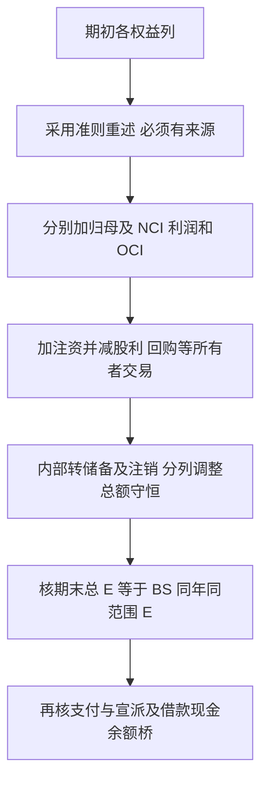

箭头是对权益变动逐类归集，“再核支付与宣派及借款现金余额桥”另核宣派与支付，不把现金桥同权益桥合并。

**沿例子读图（笔记补充）**：从“期初各权益列”合计 37,549,524 开始，加综合收益 4,827,755、少数股东注资 28,339，再减股利和回购。进入“内部转储备及注销”时，留存利润转储备 715,814 一减一加，不改总权益。最后核期末 40,284,568 与资产负债表一致，再另查支付与宣派差。

**图旁边界**：内部注销三列−395−76,107+76,502=0；此前回购已出现金。借款60,058/股利68,140/回购1仍待附注。

**文字替代**：综合收益和所有者交易改变总权益，内部转储备只改变列；现金支付另核。

<details><summary>读图自测：转储备715,814能记费用降低NI吗？</summary>

不能。“内部转储备及注销”是权益内部重分类；集团总权益（E）与净利润（NI）不因这项内部转储备本身改变。

</details>

跨表有三种尚未解释的差，数值一致方向不等完整余额桥：银行借款在资产负债表（BS）中增加 $666,749+7,884,802-2,905,575-507,066=5,138,910$；新借减偿现 $8,394,993-3,196,025=5,198,968$，差 **60,058** 未知，不能猜为汇兑。母股利宣派 $221,957+665,871=887,828$ vs 现金付 819,688，差 **68,140**，需期初/末应付及其他调整。现金流量表（CF）中的回购 32,050 vs equity32,051 差 **1**，原因待原附注；不能擅说舍入。

现金也要含汇兑：2019 $6,235,029+5,324,634-3,824,344+2,800,837+95,054=10,631,210$；2018 $3,692,044+5,094,364-616,100-2,177,744+242,465=6,235,029$。三类净现金流加汇兑影响才从期初走到期末现金等价物。2026-10-25 外部回源的原年报现金表底部和 Note 25 已确认：2019／2018 的 BS−CE 差额 1,280,000／441,013 正是取得时原到期超过三个月的定期存款；该补证不来自讲义或课堂。借款 60,058、股利 68,140、回购 1 的差额仍未知，不能类推其原因。

失败 1：把转留存收益至储备 715,814 当费用，会少记 NI 及 E；只是权益内一加一减。失败 2：把宣派与已付同义，会强迫抹掉应付期间差；必须用余额桥。NCI 净利份额 $1,987,580/4,694,374≈42.3\%$ 不是多数，支付比归母多也不能推本期利润贡献过半。

<details><summary>迁移 1：2019 内部转储备改为 800,000，其他原数不变</summary>

集团 E 与 NI 不变；期末 RE $14,460,456+2,706,794-221,957-665,871-800,000=15,479,422$，比原留存收益（RE）少 84,186，储备多同额。
</details>

<details><summary>迁移 2：仅看到 60,058 借款桥差，能加一笔汇兑使表闭合吗？</summary>

不能。差可能涉及未披露的非现金/期间/范围调整，但原因未知；记待借款附注并继续其他已知桥，不编分录。只有资料给具体变化才能补。
</details>

**所以呢**：跨表核数先区分流量、存量与权益内部变化，找不到原因就保留未知，不能为配平创造解释。


### 2.9 报表附注（讲义 p.47）

**是什么**

四张主表上的许多行是汇总数字，比如“无形资产 7,703,642”。**报表附注（Notes to Financial Statements）**是财务报表的组成部分，提供适用的拆分、会计政策、估计与风险说明；它能回答很多主表问题，但不保证穷尽所有经营、法律或估值信息。严谨地说，讲义 p.47（本讲最后一页）原文：

> - *"Provide **details** about items that appear in the financial statements"*
> - *"Specified by the **Companies Ordinance**"*
> - *"**Note 1 (sometimes Note 2) summarizes the firm's accounting policies** such as valuation method"*
> - *"**Breakdown** of financial statement items with detailed explanation and elaboration"*
> - *"Whenever you are curious about the aggregated numbers in financial statements, you can always look at their notes for detailed composition, assumption on valuation, etc."*

**四条要点**

1. **附注提供适用的项目细节。** §2.2.11 表中 Note 编号（13、14、15…）是索引；具体能否拆到所需粒度，要实际打开对应附注。
2. **法律与披露框架要先认主体。** 讲义 p.47 的 *"Specified by the Companies Ordinance"* 是历史课件原句，不能扩成所有港股公司只受同一部香港公司法约束。A 公司已由外部原年报核实为在开曼群岛注册的中国生物制药；其审计报告说明报表按 HKFRSs 编制，并符合香港《公司条例》的披露要求，企业法与可分配储备等事项还涉及开曼法。Nike 的历史报表则是 US GAAP 场景。
3. **先找会计政策，但不要死背 Note 编号。** 讲义说 Note 1（有时 Note 2）汇总政策，实际编号随公司变化。A 公司原年报 Note 1 是公司与集团信息，重要会计政策从 Note 2 展开；必须看目录和标题，不能凭编号猜内容。
4. **附注可拆主表项目，但本笔记只写已读取证据。** 例如现金 Note 25 已实际读到三类余额；本轮未读取 Note 17 的无形资产明细，所以不声称它必然按某种专利／商标／软件结构拆解；Note 33 的 2019 储备文字已读，来源与列桥见 §2.8.2，具体子公司分解和 2026 现行法律仍未认证。

**为什么需要它**

因为主表要保持可读，很多政策、组成和风险只能放在附注。讲义最后一句 *"Whenever you are curious about the aggregated numbers … you can always look at their notes"* 给的是**查找入口**：先按 Note 编号找证据，再判断是否足以回答问题。附注与主表共同构成财务报表，不能把其中一个说成只是目录、另一个才是全部正文。

> 💡 **本讲的查注动作（笔记补充）**：主表有疑问时，先按 Note 编号定位附注；若附注仍没给合同、估值或管理说明，就保留未知。以下是本讲出现的查注入口，不代表所有问题都能由附注单独回答：
> - §2.4.3 Nike 的 `Prepaid expenses and other current assets` 一年暴涨 140.6% —— 翻附注
> - §2.5.3 A 公司的 `Other expenses` 与研发费用关系 —— 回到实际费用附注核对
> - §2.6.3 Nike 的退货折让 *"estimated"* 用了什么假设 —— 翻附注
> - §2.2.11 A 公司的 `Reserves 31,246,044` 由哪些储备构成 —— 2019 Note 33 已提供两项历史来源，§2.8.2 已逐列桥接；仍不能替代全部当前法律及子公司明细

**🎙️ 课堂补充**（S2 `53:13`–`55:02`，A · 课上展开）

教授按 p.47 说明附注提供项目明细、会计政策和计价假设，并把它接回传统记账压缩信息的局限：*"these notes can, to some extent, address the issues we mentioned before."*（S2 `54:20`）。附注能部分补足主表没讲清的非财务及财务信息，所以对资本市场使用者仍有用。S2 `55:02` 宣布休息。

**这段改变了什么**：确认附注是解释汇总数与假设的入口；p.38 特定 Nike 政策细节的降权不扩为本页全部附注降权。课堂未逐条验证本节补充的法律细则。2026-10-25 后来从外部原年报补到 Note 25 的现金构成；借款 60,058 差额、股利 68,140 与回购 1 仍没有完整桥，不能由现金补证类推。

**💡 换个说法（笔记补充）**
报表 = **药盒上的"主要成分：布洛芬 0.3g"**；附注 = **说明书**（适应症、禁忌、不良反应、辅料清单）。只看药盒能知道吃什么，不能知道能不能吃。

**⚠️ 常见误解**
- ❌ "附注是补充材料，可看可不看"。→ 附注解释主表数字和政策，是财务报表不可缺的组成部分；它是否在本年审计意见覆盖范围内仍须核审计报告，不能因叫“附注”就自动跳过或自动认证。
- ❌ "或有事项不在主表，所以一定都在附注里"。→ 是否确认负债、只披露或无需披露取决于适用准则、概率与重要性；附注是重要入口，但不能用一个位置替代具体判断。

**与其他概念的关系**
附注 ← [[M01-会计与商业]] 充分披露原则 + 或有负债；← §2.2.10 表外项目；← §2.4.5 / §2.6.3 会计政策摘录；→ **W9/W10 的 AI 财报分析**：附注是**非结构化文本**，正是大语言模型最有用武之地、也最容易产生幻觉的地方（[[M01-会计与商业]] 的"AI 会漏掉附注"）。

**所以呢**：四张主表与附注构成一套相互关联的财务报表；本年审计意见实际覆盖什么，仍回到审计报告。最后一节只核当前可闭合的关系，找不到证据的差额继续保留未知。

---

### 2.10 💡 四张报表的勾稽验算（笔记补充，讲义无对应页）

> ⚠️ **本节没有对应的讲义页码。** 讲义给了 A 公司完整的四张报表（p.14–15、p.34、p.43–44、p.46），却**从头到尾没有一页把它们串起来**。但四张报表相互勾稽是财报分析的地基，而且已知主表恒等式可核，但跨表现金/借款仍有待附注差额，是难得的练手素材。以下全部是 💡 笔记验算。


**所以呢**：同一期间同一范围的利润和权益应能衔接。现金口径已由 2026-10-25 外部原年报 Note 25 补齐；借款、股利与回购差额仍保留未知，不能因其他几条闭合就宣布全表无误。

#### 三条主勾稽线

**① 利润表 → 权益变动表**
利润表的 `Profit for the year 4,694,374` **逐字出现**在权益变动表的 `Profit for the year` 行（归母 2,706,794 + 少数股东 1,987,580）。✅

**② 权益变动表 → 资产负债表**
权益变动表期末 `Total equity 40,284,568` = 资产负债表 p.15 的 `Total equity 40,284,568`。✅

**③ 现金流量表 → 资产负债表：两个现金口径怎样对上**

| | 金额（RMB'000） |
|---|---:|
| 现金流量表 p.44：`CASH AND CASH EQUIVALENTS AT END OF YEAR` | **10,631,210** |
| 资产负债表 p.14：`Cash and bank balances` | **11,911,210** |
| **差额** | **1,280,000** |

讲义截图与课堂没有给 Note 25，因此旧稿只能把定存作为候选。2026-10-25 取得并核对中国生物制药 2019 年报后，原因已由外部原年报确认：

| Note 25 / 现金表底部构成（RMB'000） | 2019 | 2018 |
|---|---:|---:|
| Cash and bank balances, unrestricted | 4,340,181 | 3,956,986 |
| 取得时原到期少于三个月的定期存款 | 6,291,029 | 2,278,043 |
| **Cash and cash equivalents** | **10,631,210** | **6,235,029** |
| 取得时原到期超过三个月的定期存款 | 1,280,000 | 441,013 |
| **Cash and bank balances** | **11,911,210** | **6,676,042** |

所以两年都可直接复做：$10{,}631{,}210+1{,}280{,}000=11{,}911{,}210$；$6{,}235{,}029+441{,}013=6{,}676{,}042$。两年超三月定存余额增加 $1{,}280{,}000-441{,}013=838{,}987$，也与 CFI 的净流出 838,987 对应。

> ⭐ **这个练习值得单独记住**：当两张表的“现金”不同，先核标签、现金等价物定义与现金附注，再建立余额桥。本例已由 Note 25 闭合；这不能推广成所有公司的差额都来自超三月定存，也不能把资产负债表所有现金行普遍定义成“全部银行存款”。


**所以呢**：利润归属、期末权益与现金口径已核到外部原年报；借款、股利与回购的未解释差额仍须相应附注与余额桥。

#### 其他可验证的交叉印证

以下每一行比较两个不同视角的原数；观察方向相同与完整数量桥闭合是两种证据，未解释差额必须单列，不能把整表全部打勾。

| 观察 | 报表 A | 报表 B | 结论 |
|---|---|---|---|
| 银行借款总额增加，期末非流动部分上升 | BS 总借款：2018（2,905,575 + 507,066 = 3,412,641）→ 2019（666,749 + 7,884,802 = 8,551,551），增加 5,138,910 | CF：新增 8,394,993 − 偿还 3,196,025 = 净流入 5,198,968 | 两个总变化方向一致，但相差 60,058，待 Note 28；现有主表不能证明新增借款全是长期，重分类或非现金变化也未闭合 |
| 库存股减少 | 资产负债表：(457,288) → (412,837)，减 44,451 | 权益变动表：注销库存股 +76,502、回购注销 −32,051 → 净 **+44,451** | ✅ 完全对上 |
| 少数股东权益增长 | 资产负债表：8,336,686 → 9,172,910，增 **836,224** | 权益变动表：+2,009,056（综合收益）+28,339（注资）−1,201,171（股利）= **+836,224** | ✅ 完全对上 |
| 利润腰斩之谜 | 利润表：`Other income and gains` 7,443,161 → 862,603 | 现金流量表：2018 年调整项 `Gain on deemed disposal of an associate (6,598,691)` | 仅一项税前比较调整成立，不等全部经常利润已净化 |
| 折旧摊销的规模 | 现金流量表：折旧 541,471 + 摊销 898,351 + 其他折旧 119,384 ≈ **1,559,206** | 利润表：**看不见**（被摊进了各项费用） | ⚠️ **利润表看不到折旧总额，需看现金流调整及费用/资产附注，不应断言只有现金流量表能看到** |

> 💡 **最后一行是一条非常实用的经验**：多步式利润表把折旧摊销分摊进了销售成本、管理费用等各行，**表面上看不见**。想知道一家公司折旧摊销有多少，**去现金流量表的调整项里找**。

**🎙️ 课堂补充**（S2 `48:09`–`48:53`，与 §2.7.4 同段）

课堂讲过三类现金净额加总，再从期初走到期末，及报表之间互联的概念：*"This number actually will go to the balance sheet."*（S2 `48:48`）。因此不再说课堂完全未提勾稽。

**来源边界仍保留**：课堂只强调报表互联，没有逐项完成本节验算。现金口径于 2026-10-25 由外部原年报 Note 25 闭合，不能写成课堂确认；60,058 借款桥差、68,140 股利差和回购 1 仍是未知，不能从 Note 25 猜原因。

---


**所以呢**：跨表观察要分已闭合和未解释差额，下一节的图只压缩已给依据，不将未知改成肯定结论。

## 3. 一图看懂

### 图 1 · 年报的解剖：13 个部分分三层（对应讲义 p.2）

**看图前先问**：年报哪些部分提供数字、哪些解释数字与意见？

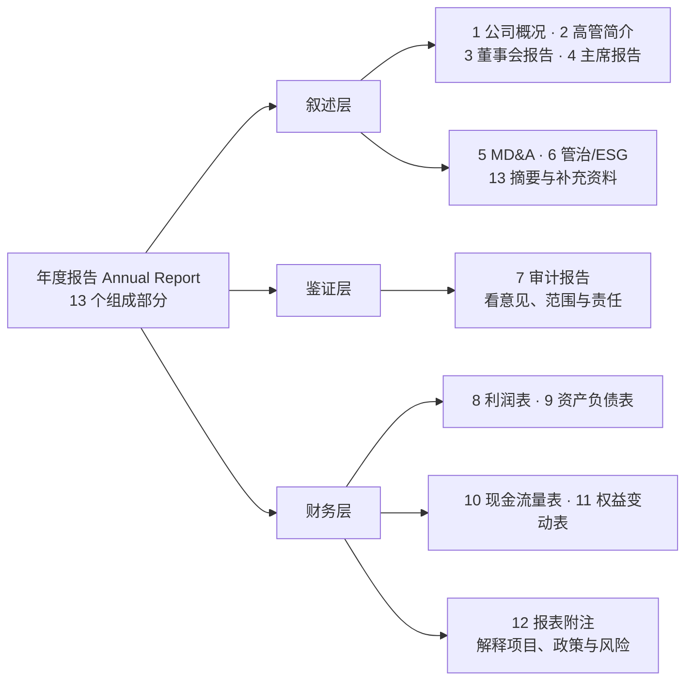

由左向右沿组成关系读。箭头是文档组成关系，不是阅读的唯一时间顺序。

**沿例子读图（笔记补充）**：要解释无形资产 7,703,642，先从“年度报告”沿财务层找到“资产负债表”，再到“报表附注”查组成和计量政策。“审计报告”说明意见和范围，不能替代该项附注。

**图旁边界**：三层是本讲辅助分组，审计/其他鉴证实际范围仍以报告为准；不把一个总开关当零错误保证。

**文字替代**：年报的组成、管理解释、审计意见和财务附注各回答不同问题，不能互相替代。

<details><summary>读图自测：只看MD&A能代替财务附注中的计量政策吗？</summary>

不能。MD&A是管理层解释，具体政策仍需报表附注及审计范围核对。

</details>

**这张图在说**：年报的 13 个部分分别承担叙述、鉴证和财务信息功能；四张主表与附注是核心财务证据，但实际审计意见覆盖哪些报表和附注必须回到本年审计报告，不能把“三层辅助分组”当固定审计范围。

---

### 图 2 · 四张报表的勾稽（用 A 公司 2019 年报的真实数字，对应 §2.10）

**看图前先问**：同一利润、权益和现金在不同报表间怎样连接？

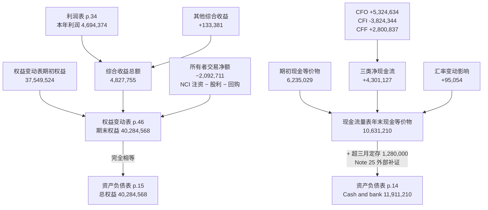

实线表示已由主表或 2026-10-25 外部原年报 Note 25 支持的加总／相等核对；Note 25 补证不是课堂证据。

**沿例子读图（笔记补充）**：“利润表”本年利润 4,694,374 加“其他综合收益”133,381，得综合收益 4,827,755。权益变动表不是从零开始：期初 37,549,524，加综合收益 4,827,755，再加所有者交易净额 −2,092,711，才得到期末权益 40,284,568，并与资产负债表相同。现金线也不是三类净额直接等于期末：三类合计净增 4,301,127，还要加期初 6,235,029 与汇率影响 95,054，才到 10,631,210；再加 Note 25 的超三月定存 1,280,000，才与资产负债表 11,911,210 对上。

**图旁边界**：RMB 千元；所有者交易净额只汇总本表已列项目，内部重分类不改总权益。现金口径由后来取得的 Note 25 闭合，不是讲义或转录提供；借款、股利与回购差额仍未知。

**文字替代**：期末权益 = 期初权益 + 综合收益 + 所有者交易净额；期末现金等价物 = 期初 + CFO + CFI + CFF + 汇率影响；本例再加 Note 25 的超三月定存，得到资产负债表现金及银行余额。

<details><summary>读图自测：为什么本例可以确认差额是超三月定存？</summary>

因为 2026-10-25 取得的外部原年报 Note 25 直接列出 2019／2018 超三月定存为 1,280,000／441,013，现金表底部又列出组成；不是只靠 838,987 的数值巧合。其他公司仍须逐份查附注。

</details>

**这张图在说**：利润表与 OCI 提供综合收益，但期末权益还必须从期初权益出发并纳入所有者及 NCI 交易。现金也必须从期初出发，加入三类净现金流和汇率影响；本例的资产负债表现金口径再由 Note 25 补上超三月定存。**四张表不是四份独立文件，是同一套账的四个投影。**

---

### 图 3 · 一份报表拿到手，按什么顺序读（本讲方法论的总结，💡 笔记补充）

**看图前先问**：分析一份报表时，怎样从业务背景走到有限结论？

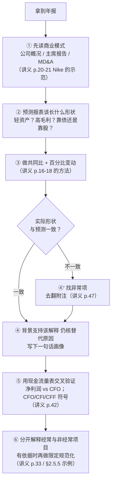

箭头表示分析步骤和条件分支，不能把‘预测吻合’读成因果证明。

**沿例子读图（笔记补充）**

1. 以 Nike 为例，从“① 先读商业模式”读到外包生产，再在“② 预测报表”预期生产 PP&E 较少。

2. “③ 做共同比”得到 13.9%–16.5% 等比例后，判断是否支持预期。

3. 发现异常就去“找异常项”并翻附注，随后交叉核现金流；对非经常项先单独解释，只有分析目的和来源支持时才做限定规范化，不把它从报告结果中抹掉。

**图旁边界**：Nike绝对尺度原件未新核；经营模式线索、现金及归因分别保留来源；没有附注不造后续结论。

**文字替代**：先读业务再算结构与变化，异常查附注，跨表核对后只给证据支持的有限结论。

<details><summary>读图自测：PP&E占比低，能直接断言没有任何自有工厂吗？</summary>

不能。比例支持结合p.20外包事实的解释，还受资产类别和计量影响；原文nearly all不等于all。

</details>

**这张图在说**：讲义 p.19–27 的教学顺序（商业模式 → 数据 → 会计政策 → 提问）不是随便排的，**它就是一套可复用的分析流程**。把这张图背下来，任何一份年报都可以照着走一遍。

---

## 4. 速查表

### 4.1 四张报表一页对照

| | 资产负债表 | 利润表 | 现金流量表 | 权益变动表 |
|---|---|---|---|---|
| **IFRS 正式名** | Statement of Financial Position | Statement of Profit or Loss | Statement of Cash Flows | Statement of Changes in Equity |
| **时间属性** | **时点**（某一天） | 时期 | 时期 | 时期 |
| **回答什么** | 有什么、欠什么、剩什么 | 赚了多少 | 现金从哪来到哪去 | 股东的钱怎么变的 |
| **核心恒等式** | $A=L+E$ | $NI=Rev-Exp+Gains-Losses$ | 三类净额相加为净现金流；余额另含汇兑等调整 | 原期初 ± 重述 → 调整后期初 → + 综合收益 ± 所有者及 NCI 交易 → 期末（权益内部重分类总额为 0） |
| **讲义 Key info 页** | p.13 | p.33 | p.42 | p.45 |
| **主要弱点** | 历史成本 ／ 表外项目 | **数字可被操纵**、盈余质量 | 讲义未列；仍可能有截止、完整性、受限余额与分类问题 | 讲义未列 |
| **本讲小节** | §2.2 | §2.5 | §2.7 | §2.8 |

### 4.2 资产负债表逐项速查

| 大类 | 项目 | 关键点 | 小节 |
|---|---|---|---|
| **流动资产** | 现金及现金等价物 | 等价物为短期现金承诺持有，须可迅速转换为已知金额且价值变动风险不重大；通常三个月从取得日起算 | §2.2.6 |
| | 应收账款 | 表上常为**净额**（已扣坏账准备）；准备是估计，不保证实际收款等于净额 | §2.2.6 |
| | 存货 | **成本与 NRV 孰低**；故意拖延必要减记或虚构存货会虚增资产／利润 | §2.2.5 |
| **非流动资产** | PP&E | 成本模式含累计折旧与减值，其他适用计量模式另按政策判断；占比因行业而异 | §2.2.3 |
| | 投资 / 投资性房地产 | 可能按公允价值计量，会随市价波动 | §2.2.3 |
| | 无形资产 | 专利、商标、版权；有限寿命项目通常摊销，无限寿命项目与商誉不按同一年度摊销规则处理 | §2.2.4 |
| | **商誉** | 收购价减可辨认净资产公允价值，后续关注减值 | §2.2.4 |
| **流动负债** | 应付账款 / 短期借款 / **一年内到期的长期借款** / **应计费用** / 递延收入 | 流动性还看正常营业周期、交易目的、12 个月到期与报告日延迟结算权利；应计不以“无发票”为唯一条件 | §2.2.7 |
| **非流动负债** | 长期借款 / **应付债券** | 债券按发行／合同条款向投资者融资，可公开发行或私募；是否可转让及期限依具体安排 | §2.2.7 |
| **权益（缴入）** | 普通股/优先股 · **股本溢价** · **库存股（负数）** | 优先股先按合同判负债／权益，面值拆分仅适用于面值制度，持有未注销的库存股原则上抵减权益 | §2.2.8 |
| **权益（赚得）** | 留存收益 · **AOCI** | 简化 RE 桥须限定变动，OCI 是本期流量而 AOCI 是累计存量，重分类规则分项目／类别 | §2.2.8 |
| **权益（他人）** | **非控制性权益 NCI** | 已控制子公司全额并表后，单列不归母公司的真实权益；不是配平塞数，也不以固定低于 50% 定义 | §2.2.9 |

**商誉复习边界**：上表算式是 §2.2.4 的简化收购例。按本讲完整 IFRS 口径，企业合并商誉不按年摊销，而做减值测试；自创商誉不上表。

### 4.3 共同比与百分比变动

| | 共同比 Common-Size | 百分比变动 Percentage Change |
|---|---|---|
| **公式** | 每一行 ÷ 共同分母，再 $\times100\%$；或把所得小数设为百分比格式 | $(\text{本期}-\text{上期})\div\text{上期}\times100\%$ |
| **分母** | 利润表 → **营业收入**；资产负债表 → **总资产** | 上期同项 |
| **标准化什么** | 同一张表共同货币尺度；不能消除绝对规模、通胀、政策或汇率结构影响 | 以上期同一项目为基准表达相对变动；不消除公司规模、币种、政策或基数问题 |
| **回答** | **结构**：这家公司长什么形状 | **趋势**：这一项变了多少 |
| **自检** | 同层互斥穷尽明细之和约为 100%；小计/总计不可重复加 | 与总额的变动率对比，看谁跑得快 |
| **讲义页** | p.16–18、p.23–24、p.37 | p.23–24、p.37（**讲义未给定义**） |

**换算各走一步**：共同比中 $2\div3=0.6667=66.7\%$；增长率中 $(110-100)\div100=0.10=10\%$。小数 `0.10` 与百分数 `10%` 是同一比例的不同写法；百分点则用于两个百分比之差，例如 12% 减 10% 等于 2 个百分点。

### 4.4 现金流量表三符号速查

| CFO | CFI | CFF | 判断 | 来源 |
|:---:|:---:|:---:|---|---|
| ＋ | − 或 ＋ | **−** | 可能符合健康成熟公司的常见组合，仍须结合业务与一次性流量 | 📄 p.42 |
| **−** | − | ＋ | 可能符合融资支持的初创阶段，也可能是经营压力 | 📄 p.42 |
| ＋ | − | ＋ | 经营净入、投资净出、筹资净入；可提示扩张，仍需用途和附注（A 公司 2019 的已知符号） | 💡 |
| − | ＋ | − | 可能是出售资产维持现金，也可能受重组或一次性交易影响 | 💡 |

**另一把尺子**：讲义写的是 $NI/CFO$。正利润现金转换的普通读法以 NI 与 CFO 均为正、CFO 不接近 0 为前提。CFO 非零时负比率仍可计算；两项有非正数先解释符号组合。CFO 为 0 时无定义，接近 0 时倍数不稳定；回到 §2.7.3 的改条件例。差距拉大或方向背离是进一步调查信号，不自动证明舞弊，也没有材料支持“方向相反一定更危险”。

### 4.5 本讲三张总结页（论述复习入口，不代表出题概率）

| 讲义页 | 报表 | Key information | Weaknesses |
|---|---|---|---|
| **p.13** | 资产负债表 | 6 条（主要资产、规模、**融资方式**、明年到期债、手上现金、趋势与突变） | ① 账面计量未必等于当前市场价值 ② 有些资源、义务或风险未在正表确认；是否附注披露按具体准则与重要性判断 |
| **p.33** | 利润表 | 量级、趋势及收益来源，逐项回看 §2.5 | **数字可被操纵，盈余质量可能低** |
| **p.42** | 现金流量表 | ① 评估盈余是否反映经济现实（NI vs CFO） ② 评估企业健康与成熟度（三符号） | 讲义未列 |

**利润表复习的两个追问**：五条量级与趋势信息之外，还要问利润来自主业还是其他活动，以及是否经常发生。这两问用于分析盈余质量，不由利润总数直接回答。

---

## 5. 双语术语卡

术语表先用于定位名称和首现单元。**来源说明**：下方每条英文定义都是把讲义术语、正文机制和必要边界整理成考试可用完整句，统一标“笔记整理”，**不冒充逐字讲义原句**。需要背讲义原文时，回到“首现”小节的引用块；正文中明确标出的讲义原句仍保持原貌。

| 中文 | English | 首现 |
| --- | --- | --- |
| 年度报告 | Annual Report | §2.1 |
| 合并财务报表 | Consolidated Financial Statements | §2.1.3 |
| 管理层讨论与分析 | Management's Discussion and Analysis (MD&A) | §2.1.2 |
| 资产 | Assets | §2.2.1 |
| 负债 | Liabilities | §2.2.1 |
| 权益 | Equity | §2.2.1 |
| 营业周期 | Operating Cycle | §2.2.2 |
| 流动资产 | Current Assets | §2.2.2 |
| 非流动资产 | Non-Current Assets | §2.2.2 |
| 物业、厂房及设备 | Property, Plant & Equipment (PP&E) | §2.2.3 |
| 折旧 | Depreciation | §2.2.3 |
| 摊销 | Amortisation | §2.2.3 |
| 账面价值 | Book Value / Carrying Amount | §2.2.3 |
| 公允价值 | Fair Value | §2.2.3 |
| 无形资产 | Intangible Assets | §2.2.4 |
| 外购商誉 | Purchased Goodwill | §2.2.4 |
| 自创商誉 | Internally Generated Goodwill | §2.2.4 |
| 存货 | Inventories | §2.2.5 |
| 净变现价值 | Net Realizable Value (NRV) | §2.2.5 |
| 减值 | Impairment | §2.2.5 |
| 盈余管理 | Earnings Management | §2.2.5 |
| 现金及现金等价物 | Cash and Cash Equivalents | §2.2.6 |
| 预期信用损失 | Expected Credit Loss (ECL) | §2.2.5、§2.2.6 |
| 一年内到期的长期负债 | Current Portion of Long-term Debt | §2.2.7 |
| 应计费用 | Accrued Expenses | §2.2.7 |
| 递延收入 | Deferred / Unearned Revenue | §2.2.7 |
| 应付债券 | Bonds Payable | §2.2.7 |
| 优先股 | Preferred Stock | §2.2.8 |
| 股本溢价 | Additional Paid-in Capital / Share Premium | §2.2.8 |
| 库存股 | Treasury Stock / Treasury Shares | §2.2.8 |
| 其他综合收益累计额 | Accumulated Other Comprehensive Income (AOCI) | §2.2.8 |
| 已实现 / 未实现 | Realized / Unrealized | §2.2.8 |
| 少数股东权益 | Non-controlling Interests (NCI) | §2.2.9 |
| 表外项目 | Off-balance-sheet Items | §2.2.10 |
| 使用权资产 | Right-of-use Assets | §2.2.11 |
| 联营公司 | Associates | §2.2.11 |
| 共同比分析 | Common-Size Analysis | §2.3 |
| 百分比变动分析 | Percentage Change Analysis | §2.4.3 |
| 毛利 | Gross Profit | §2.5.2 |
| 销货成本 | Cost of Revenue / Cost of Sales / COGS | §2.5.2 |
| 营业利润 | Profit from Operations / Operating Income | §2.5.2 |
| 财务费用 | Finance Costs | §2.5.3 |
| 每股收益 | Earnings Per Share (EPS) | §2.5.2 |
| 利得 / 损失 | Gains / Losses | §2.5.1 |
| 经常性 / 非经常性项目 | Recurring / Nonrecurring Items | §2.5.4 |
| 盈余质量 | Quality of Earnings | §2.5.4 |
| 直接法 | Direct Method | §2.7.1 |
| 间接法 | Indirect Method | §2.7.1 |
| 经营活动现金流 | Cash Flow from Operating Activities (CFO) | §2.7.2 |
| 投资活动现金流 | Cash Flow from Investing Activities (CFI) | §2.7.2 |
| 筹资活动现金流 | Cash Flow from Financing Activities (CFF) | §2.7.2 |
| 缴入资本 | Contributed Capital | §2.8.1 |
| 赚得资本 | Earned Capital | §2.8.1 |
| 报表附注 | Notes to the Accounts | §2.9 |

上表三列分别是中文名、英文名和首次解释位置，无金额单位；用首现位置回到具体例子。英文实文保留，但定义中的教学简化须结合正文条件。

**年度报告**

笔记整理的考试英文表达（非逐字讲义原句）：A comprehensive report published annually, comprising corporate profile, directors' and chairman's statements, MD&A, governance/ESG reports, the auditor's report, four financial statements, notes, and supplementary information.


**合并财务报表**

笔记整理的考试英文表达（非逐字讲义原句）：Statements that combine 100% of a subsidiary's assets and liabilities with the parent's, eliminating intra-group transactions, with the portion not owned by the parent shown as non-controlling interests.


**管理层讨论与分析**

笔记整理的考试英文表达（非逐字讲义原句）：The management's narrative explanation of reported figures, results and outlook.

Its status should be distinguished from the financial statements covered by the auditor's opinion, and any separate assurance must be checked in the relevant report.


**资产**

笔记整理的考试英文表达（非逐字讲义原句）：An economic resource controlled by the entity as a result of past events, with the potential to produce economic benefits.

Legal ownership is not always required; recognition and measurement follow the applicable requirements.


**负债**

笔记整理的考试英文表达（非逐字讲义原句）：A present obligation to transfer an economic resource as a result of past events.

The obligation need not have a fixed interest return or low risk; its terms, amount and timing must be examined.


**权益**

笔记整理的考试英文表达（非逐字讲义原句）：The residual interest in recognised assets after deducting recognised liabilities.

It is a book amount, not automatically the market value of the company.


**营业周期**

笔记整理的考试英文表达（非逐字讲义原句）：The time for a firm to convert cash back into cash (purchase material, manufacture product, sell product, and collect cash).


**流动资产**

笔记整理的考试英文表达（非逐字讲义原句）：Under the IAS 1 context used here, meeting any applicable criterion makes an asset current.

The criteria include realisation, sale or consumption in the normal operating cycle; trading purpose; or expected realisation within twelve months.

Cash or cash equivalents are also current, unless restricted from exchange or use to settle a liability for at least twelve months after the reporting period.

现金及现金等价物通常为流动；若兑换或用于清偿负债的限制持续到报告期后至少 12 个月，则不适用这一现金条件。其他条件及例外见 §2.2.2。


**非流动资产**

笔记整理的考试英文表达（非逐字讲义原句）：Assets that do not meet the applicable current-asset criteria.

Ease of sale alone does not determine the classification.


**物业、厂房及设备**

笔记整理的考试英文表达（非逐字讲义原句）：Tangible assets held for production, supply, rental or administration and expected to be used for more than one period.

Subsequent carrying amounts depend on the applicable cost or revaluation model, depreciation and impairment; land and other non-depreciable components need separate consideration.


**折旧**

笔记整理的考试英文表达（非逐字讲义原句）：The systematic allocation of an asset's depreciable amount, after estimated residual value, over its useful life.

Depreciation itself is a non-cash allocation; the original purchase may have required cash.


**摊销**

笔记整理的考试英文表达（非逐字讲义原句）：The systematic allocation of the depreciable amount of a finite-life intangible asset over its useful life.

Indefinite-life intangible assets and acquisition goodwill do not follow this annual amortisation rule in the IFRS context explained here.


**账面价值**

笔记整理的考试英文表达（非逐字讲义原句）：The amount at which an asset is recognised after applicable accumulated depreciation or amortisation and impairment adjustments.

Cost less those adjustments is the cost-model example, not the only measurement basis.


**公允价值**

笔记整理的考试英文表达（非逐字讲义原句）：The price that would be received to sell an asset in an orderly transaction between market participants at the measurement date.


**无形资产**

笔记整理的考试英文表达（非逐字讲义原句）：An identifiable non-monetary asset without physical substance.

Identifiability may arise from separability or contractual/legal rights; acquired goodwill is considered separately.


**外购商誉**

笔记整理的考试英文表达（非逐字讲义原句）：A residual recognised in a business combination after identifying and measuring the acquired assets and assumed liabilities.

In this section's simplified 100% acquisition with no previous holding or other adjustments, goodwill equals consideration less the fair value of identifiable net assets.


**自创商誉**

笔记整理的考试英文表达（非逐字讲义原句）：Internally generated goodwill is not recognised as an asset.

This does not mean that every internally developed intangible must be expensed: recognition of other items depends on their own applicable criteria and must be assessed separately.


**存货**

笔记整理的考试英文表达（非逐字讲义原句）：Inventories are assets held for sale, in the process of production for sale, or materials or supplies to be consumed in production or in rendering services.

They are measured at the **lower of cost and net realisable value**. Delaying a required write-down or recording fictitious inventory can overstate assets and profit.


**净变现价值**

笔记整理的考试英文表达（非逐字讲义原句）：Estimated selling price less the estimated costs of completion and of sale.


**减值**

笔记整理的考试英文表达（非逐字讲义原句）：A reduction in an asset's carrying amount under the applicable measurement rule.

Inventories use cost versus NRV, IAS 36 non-financial assets use recoverable amount, and receivables use expected credit losses.


**盈余管理**

笔记整理的考试英文表达（非逐字讲义原句）：Using estimates, methods or timing choices to influence reported earnings.

Reasonable estimates are necessary; knowingly delaying a required impairment or recording fictitious inventory may be an error, material misstatement or fraud rather than a permitted choice.


**现金及现金等价物**

笔记整理的考试英文表达（非逐字讲义原句）：Cash is cash on hand and demand deposits.

Cash equivalents are short-term, highly liquid investments held for short-term cash commitments, readily convertible to known amounts of cash and subject to an insignificant risk of changes in value; the usual three-month guide runs from acquisition to maturity.


**预期信用损失**

笔记整理的考试英文表达（非逐字讲义原句）：Expected credit loss (ECL) is a probability-weighted estimate of credit losses that uses reasonable and supportable information about past events, current conditions and forecasts.

A loss allowance reduces the net carrying amount of applicable receivables.


**一年内到期的长期负债**

笔记整理的考试英文表达（非逐字讲义原句）：The current portion of long-term debt is the part of long-term financing that meets any current-liability criterion, for example because it is due within twelve months after the reporting period.

A liability is also current if the entity has no reporting-date right to defer settlement for at least twelve months.


**应计费用**

笔记整理的考试英文表达（非逐字讲义原句）：Liabilities for goods or services already received, or expenses already incurred, that have not yet been paid, invoiced or formally agreed; the amount may require a reasonable estimate under the accrual basis.


**递延收入**

笔记整理的考试英文表达（非逐字讲义原句）：Consideration received or due before the entity transfers the promised goods or services; it is presented as a **contract liability** until the related performance obligation is satisfied.


**应付债券**

笔记整理的考试英文表达（非逐字讲义原句）：Debt raised by issuing bonds to investors under specified contractual terms.

Bonds may be publicly offered or privately placed; transferability, maturity and issue size depend on the arrangement.


**优先股**

笔记整理的考试英文表达（非逐字讲义原句）：In the simplified equity-classified, non-participating case, preference shares carry a fixed dividend preference and rank ahead of ordinary shares in distributions and liquidation, often with limited voting rights.

Classification depends on contractual cash and redemption obligations, not the legal label alone.


**股本溢价**

笔记整理的考试英文表达（非逐字讲义原句）：Under a par-value share regime, share premium is the amount subscribers pay above par or stated value.

A no-par regime may credit the full issue proceeds to share capital instead.


**库存股**

笔记整理的考试英文表达（非逐字讲义原句）：The entity's own equity instruments repurchased and held without cancellation; under IAS 32 they are generally deducted from equity.

Whether shares may be held or cancelled also depends on the applicable legal and contractual setting.


**其他综合收益累计额**

笔记整理的考试英文表达（非逐字讲义原句）：A cumulative equity balance at the reporting date for amounts recognised in other comprehensive income under the applicable rules.

Current-period OCI is a flow; AOCI is the accumulated balance.

Whether an amount is later reclassified to profit or loss depends on the item and category.


**已实现 / 未实现**

笔记整理的考试英文表达（非逐字讲义原句）：In this securities example, realized means the security has been sold, while unrealized means it remains held despite a value change.

This status alone does not determine whether the change goes to profit or loss or OCI.


**少数股东权益**

笔记整理的考试英文表达（非逐字讲义原句）：Equity in a controlled subsidiary that is not attributable, directly or indirectly, to the parent.

It is a real ownership interest rather than a balancing plug, and its share of profit and OCI is attributed separately.


**表外项目**

笔记整理的考试英文表达（非逐字讲义原句）：Resources, obligations or risks not recognised as line items on the balance sheet.

Whether they are disclosed in the notes depends on the applicable standard, materiality and facts; remote contingent liabilities are generally not disclosed under IAS 37.


**使用权资产**

笔记整理的考试英文表达（非逐字讲义原句）：An asset representing a lessee's right to use an underlying leased asset during the lease term.

IFRS 16 requires a lessee to recognise the right-of-use asset and the related lease liability under its general model.

The A-company 2019 presentation is compatible with a lease-accounting transition, but the specific bridge still requires Note 15; a general effective date alone does not prove this company's balance movement. 🔗 [IFRS 16 official page](https://www.ifrs.org/issued-standards/list-of-standards/ifrs-16-leases/), accessed 2026-10-25.


**联营公司**

笔记整理的考试英文表达（非逐字讲义原句）：Investees over which the investor has **significant influence**, after first excluding control or joint control.

A holding of 20% or more of voting power creates a rebuttable presumption, not a hard 20%–50% rule; associates are generally accounted for using the equity method.


**共同比分析**

笔记整理的考试英文表达（非逐字讲义原句）：Converts line items into percentages of **total sales** for an income statement or **total assets** for a balance sheet, making structure easier to compare while retaining the need to inspect absolute size, accounting policies, periods and underlying risks.


**百分比变动分析**

笔记整理的考试英文表达（非逐字讲义原句）：$(\text{current period}-\text{prior period})\div\text{prior period}\times100\%$; expresses the change relative to the prior-period amount as a percentage, without removing scale, currency, accounting-policy or base-value limitations.


**毛利**

笔记整理的考试英文表达（非逐字讲义原句）：$\text{Revenue}-\text{Cost of revenue}$; reflects the ability to generate profits from revenue.


**销货成本**

笔记整理的考试英文表达（非逐字讲义原句）：The cost attributable to the goods or services sold; for manufactured inventory it can include direct materials, direct labour and allocated production overhead.


**营业利润**

笔记整理的考试英文表达（非逐字讲义原句）：In this lecture's format, gross profit plus other income and gains, less distribution, administration and other expenses. The actual subtotal depends on the entity's applicable presentation.


**财务费用**

笔记整理的考试英文表达（非逐字讲义原句）：Costs incurred in maintaining debt finances (bank loans, etc.).


**每股收益**

笔记整理的考试英文表达（非逐字讲义原句）：Basic EPS divides profit attributable to ordinary equity holders of the parent by weighted-average ordinary shares outstanding.

Diluted EPS adjusts both numerator and denominator for dilutive potential ordinary shares and excludes anti-dilutive instruments. See §2.5.2 for the example and limits.


**利得 / 损失**

笔记整理的考试英文表达（非逐字讲义原句）：The lecture's labels for results typically arising from non-operating or incidental activities; in the broader conceptual framework they are categories within income or expenses, not separate financial-statement elements.


**经常性 / 非经常性项目**

笔记整理的考试英文表达（非逐字讲义原句）：Items assessed by whether their nature, frequency and magnitude represent an ongoing pattern.

Recurring items can inform forecasts after adjustment; nonrecurring items should be explained separately rather than automatically deleted.


**盈余质量**

笔记整理的考试英文表达（非逐字讲义原句）：The extent to which reported earnings are supported by verifiable activity, neutral estimates, understandable disclosures, repeatable sources and explainable cash conversion.


**直接法**

笔记整理的考试英文表达（非逐字讲义原句）：Reports major classes of gross operating cash receipts and gross operating cash payments, such as cash collected from customers and cash paid to suppliers and employees.

It is a method of presenting CFO, not a different method for CFI or CFF.


**间接法**

笔记整理的考试英文表达（非逐字讲义原句）：Reconciles the applicable profit subtotal to CFO by adjusting non-cash items, operating deferrals and accruals, and profit-or-loss items whose cash effects are investing or financing.

The lecture's “almost all firms” wording is historical and does not establish a current universal usage rate.


**经营活动现金流**

笔记整理的考试英文表达（非逐字讲义原句）：Cash flows from the entity's principal revenue-producing activities and other activities that are not investing or financing.

Positive CFO is evidence of operating cash generation, not automatic proof of profitability or earnings quality.


**投资活动现金流**

笔记整理的考试英文表达（非逐字讲义原句）：Cash flows from acquiring and disposing of long-term assets and investments not included in cash equivalents, subject to the applicable trading/dealing scope.

A negative net amount means investing outflows exceeded inflows; it does not by itself prove expansion or value creation.


**筹资活动现金流**

笔记整理的考试英文表达（非逐字讲义原句）：Cash flows that change the size or composition of contributed equity and borrowings, such as issuing shares, obtaining or repaying borrowings, and payments to owners.

The sign shows net financing direction, not whether financing is good or bad.


**缴入资本**

笔记整理的考试英文表达（非逐字讲义原句）：The lecture's contributed-capital grouping includes common stock, equity-classified preferred stock, additional paid-in capital and treasury stock; actual columns depend on the applicable capital regime and transactions.


**赚得资本**

笔记整理的考试英文表达（非逐字讲义原句）：The lecture groups retained earnings and accumulated other comprehensive income as earned capital. This grouping does not make the balance cash received or automatically distributable.


**报表附注**

笔记整理的考试英文表达（非逐字讲义原句）：Notes are an integral part of the financial statements and provide applicable details, accounting policies, estimates and risks.

The governing disclosure requirements and note numbering depend on the reporting framework, issuer and jurisdiction; notes do not guarantee an answer to every business or legal question.


---

## 6. 考点预判与答题框架

### 6.1 可信度分级

| 级别 | 含义 | 本讲数量 |
|---|---|---|
| 🔴 教授明示 | 教授明确说会考／要记，或课堂给出讲义留白题的答案；须按每条真实原话判断，课堂作答不自动等于“明确会考” | 7 条，原话与来源时段分别保留 |
| 🟡 CILO／Rubric 关联 | 内容与官方学习成果或评分能力相关，说明值得掌握；不保证具体题目、分值或必然出现 | 7 条 |
| ⚪ 笔记推断 | 依据教学结构整理的复习候选，不表示出题概率或官方优先级 | 7 条（Nike 两题因课堂给出答案另有课堂证据，但不据此声称必考） |

**教授明示计数说明**：7 条中含反向提醒，本轮材料整合记录新增 3 条；旧源和新源各自计时，不能拼成同一条连续录音。

> ⚠️ **当前版本已融合后续片段。** 早期 2026-09-17 版本只覆盖到 p.27；现稿对 p.28–47 已有追加课堂处理记录，但真实报表数字与完整勾稽并非逐项由课堂验证。各考点仍按具体证据分级。

**本讲挂靠的官方口径**（来自 `AC6761 Outline 2627.docx`）：
- **CILO 1**：*"Describe and explain the **basic accounting concepts** and the automation of financial analyses using contemporary AI technologies."*
- **期中考 Rubric**：*"Ability to explain the concepts, types, and implementation of AI, as well as **the knowledge related to basic accounting concepts**"*
- **期中考描述**：*"Students are required to explain the concepts, types, and implementation of AI, as well as the knowledge related to basic accounting concepts."* ⇒ explain 表示需解释，不能据一个动词排除计算；p.17–18 与公开 Case 3 都有比例计算。

### 6.2 考点清单

| 可信度 | 考点 | 依据 | 对应小节 |
|---|---|---|---|
| 🔴（反向） | p.30 利润表结构与 EPS 公式不必背诵 | 🎙️ S2 `27:48`：*"You don't have to remember these formulas."* → 仅当时公式语境降背诵权重，读表能力仍须掌握 | §2.5.2 |
| 🔴（反向） | Nike p.38 的具体收入/费用政策细节降低优先级 | 🎙️ S2 `39:40`：*"the notes, this is not important"* → 仅 Nike 这一页，不涵盖 p.47 全部附注 | §2.6.3 |
| 🔴 | 共同比比例分别保留一位小数，不重算舍入明细凑足 100% | 🎙️ S4 `00:21`：*"You don't have to make the re-calculation whether all your calculated ratios is the plus together, whether the exact data or 100%."* | §2.3.3 |
| 🟡 | **年报由哪些部分组成**，四张报表在其中的位置 | CILO 1「basic accounting concepts」；讲义用整页 p.2 列出 13 项 | §2.1 |
| 🟡 | **四张报表各报什么、时点还是时期、核心恒等式** | CILO 1；讲义每张表都配了独立的定义页 | §2.2.1 / §2.5.1 / §2.7.1 / §2.8.1 |
| 🟡 | **讲义的流动／非流动入门口径及现行分类边界**（含 "whichever is longer"） | CILO 1，讲义 p.5、p.10 简化句与 §2.2.7 当前边界 | §2.2.2 / §2.2.7 |
| 🟡 | **共同比分析的定义、分母、用途** | 讲义用 p.16–18 三页及多个案例反复演示，支持较高复习优先级；没有教授对具体考题的明示 | §2.3 |
| 🟡 | **三张总结页的 Key information / Weaknesses** | 讲义分别用 p.13、p.33、p.42 汇总分析入口；适合作为复习框架，但 CILO／Rubric 不保证具体会考这一题 | §2.2.10 / §2.5.4 / §2.7.3 |
| 🟡 | **CFO / CFI / CFF 的定义与三符号判断** | CILO 1；讲义 p.41–42 两整页 | §2.7.2–2.7.3 |
| 🟡 | **商誉的计算公式与"自创商誉不上表"** | CILO 1；讲义 p.7 + p.25 两处给出，且 p.25 是 Nike 附注原文 | §2.2.4 |
| 🔴 | **PP&E 占比小的 likely explanation：近乎全部生产外包，生产性资产需求较低** | 🎙️ `01:50:14`–`01:51:53`：*"Nike outsource[s] its production"*；📄 讲义 p.20 的独立制造商原句见 §2.4.1，两项证据都只支持生产性资产需求较低，不能推出没有任何自有设施 | §2.4.6 题 1 |
| 🔴 | **应付票据/长期借款占比小的 likely explanation：外包与较高现金可能降低融资需求** | 🎙️ `01:52:02`–`01:54:10`：*"they can internally finance ... they have no need to ... borrow from creditors or get a long-term loan from the bank"*；实际债务用途、资本开支与“不需要举债”仍须现金流及附注 | §2.4.6 题 2 |
| 🔴 | **折旧方法会改变当期费用；课堂简例中费用 1,000→3,000、简化净利润少 2,000（假设其他项目与所得税影响不变）** | 🎙️ `01:10:28`–`01:11:33`：*"if the company choose[s] this accelerated depreciation method ... [expense goes up to] 3,000 ... this number is increasing by 2000[,] which means [that] the net income is decrease[d] by 2000[,] when you change this accounting policy"* | §2.2.3 / §2.2.5 |
| 🔴（反向） | **财务比率分析（debt ratio 等）本讲不用记，后面有专门章节** | 🎙️ `01:32:35`：*"for such a ratio analysis, we don't have to worry about now because later we have one chapter"* → AI 演示里出现的比率**理解即可** | §2.2.10 |
| ⚪ | **少数股东权益的产生机制**（80%/20% 例题） | 讲义 p.12 用整页给了一个完整数字例题 | §2.2.9 |
| ⚪ | **AOCI 的例子**（\$100 买入涨到 \$150，\$50 未实现） | 讲义 p.11 是全讲**唯一**配了完整数字例子的权益项 | §2.2.8 |
| ⚪ | **存货为什么容易被用于盈余管理** | 讲义 p.8 点名 "delay impairment, fake inventories" | §2.2.5 |
| ⚪ | **给一组共同比数据，解读公司特征** | p.17–18 + p.23–24 + p.37 共 5 页都是这个动作 | §2.3.3 / §2.4.3–2.4.4 / §2.6.2 |
| ⚪ | **区分经常性与非经常性项目**，说明为什么重要 | 讲义 p.29 与 p.33 两处呼应 | §2.5.1 / §2.5.4 |
| ⚪ | **附注的作用与 Note 1 的内容** | 讲义 p.47 是全讲最后一页（收尾位置通常重要） | §2.9 |
| ⚪ | **为什么要把利润与现金流交叉核对** | p.33 提醒利润受判断影响，p.42 要求比较 NI 与 CFO；差异是调查入口，不是现金自动真实的保证 | §2.5.4 → §2.7.3 |

### 6.3 答题框架

#### 框架 A · "描述某张报表 / 某个项目"型（笔记参考结构）

期中考 Rubric 要求解释会计概念。下面四步是组织答案的笔记建议；实际题目问哪一部分，就回应哪一部分，不把它当作教师规定的固定段数或已知出题概率：

| 答题步骤 |
|---|
| 1. 定义      —— 用讲义原句（英文），一句话 |
| 2. 组成/分类 —— 列出它的主要构成，用讲义的分类 |
| 3. 用途      —— 它能告诉使用者什么（对应讲义的 Key information） |
| 4. 局限      —— 按题意解释局限和进一步需要的证据（对应讲义的 Weaknesses） |

**示范**（题：*"Explain what a balance sheet tells users and what its limitations are."*）

> **Definition.** A balance sheet, also called a statement of financial position, reports financial position at a given date. Its recognised amounts satisfy $A=L+E$.
> **Components.** Assets are controlled economic resources; liabilities are present obligations; equity is the residual. Current assets use the applicable operating-cycle, trading, twelve-month realisation or cash conditions. Current liabilities use their own operating-cycle, trading and twelve-month settlement criteria; they are also current when the entity lacks, at the reporting date, a right to defer settlement for at least twelve months. Each category is assessed against its applicable criteria, rather than one universal maturity rule. Debt terms and creditor risk must be checked.
> **Key information.** It shows recognised resources, obligations and financing structure, and provides starting amounts for analysing scale, near-term payments and changes. Amounts alone do not establish repayment ability or transaction purpose.
> **Weaknesses.** Measurement bases may differ from current market values, and some economically relevant matters are not recognised as separate balance-sheet items. Recognition and disclosure depend on the applicable requirements; notes and other evidence help investigate these limits without guaranteeing that all unknowns are resolved.

#### 框架 B · "给数据做分析"型

| 原表运算 / 状态 |
|---|
| 1. 先说商业模式（若题干给了背景段落，一定要用） |
| 2. 算/引共同比与百分比变动的关键数字（引具体数值，不要只说"较高"） |
| 3. 逐条解释异常项：为什么这个比例是这样 |
| 4. 用另一张报表交叉验证（现金流量表最好用） |
| 5. 给一句话结论 |

**示范骨架**（Nike 题 1 的作答已完整写在 §2.4.6）。

#### 框架 C · "为什么需要 X"型（论述题）

| 原表运算 / 状态 |
|---|
| 1. 先说没有 X 会怎样（缺口） |
| 2. 说 X 提供了什么（能力） |
| 3. 说 X 自己也有局限（诚实） |
| 4. 结论：说明各来源怎样互相补充，以及还有什么未被回答 |

**示范**（题：*"Why is the statement of cash flows necessary when the income statement already reports profit?"*）

> **The gap.** Profit is prepared on an accrual basis, so revenue and expense recognition can occur before or after the related cash receipt or payment. Estimates such as useful lives, credit losses and inventory write-downs also affect profit.
> **What cash flows add.** The statement reports cash inflows and outflows by operating, investing and financing activity. Comparing net income with CFO can reveal collection delays, working-capital movements and non-cash items that require further investigation. Sign patterns are clues about financing and investment direction, not automatic labels of maturity or health.
> **Its own limits.** Cash reporting can still contain cut-off, completeness, restriction and classification issues. Interest and dividend classification depends on the effective requirements and the entity's facts; the 2019 sample policy is not a permanent universal rule. Cash flow also does not measure profitability by itself.
> **Conclusion.** The statements and notes answer different questions. Position, performance, cash movements and equity changes should be reconciled, while unresolved contracts, estimates and business explanations remain matters for the notes and other evidence.

---

## 7. 自测

**概念题**

**1.** 先复述讲义 p.5 的流动资产入门句，再说明它为何不是完整的现行分类规则。主要为交易持有、但预计超过一年才卖出的资产，能否仅按持有期判为非流动？

<details><summary>答案</summary>

*"can be converted to cash within **one year or one operating cycle, whichever is longer**"*（讲义 p.5）

**先认清两种任务**：上引英文是讲义的简化句，保留 *whichever is longer* 才忠实。实际分类按 §2.2.2 的任一适用条件判断，不能只背这一句。英文概括可写：*An asset is current when any applicable IAS 1 criterion is met: normal-operating-cycle realisation, sale or consumption; trading purpose; realisation within twelve months; or cash/cash equivalents, unless restricted from exchange or use to settle a liability for at least twelve months after the reporting period.* 其余资产列非流动；这里沿用未提前采用 IFRS 18 的 IAS 1 语境。

**怎样迁移**：若船厂存货需在其正常营业周期内经过两年才售出，仍可能满足正常周期条件；不能只因超过一年就排除。若一项资产主要为交易持有，它也可能满足流动条件，不能只凭预计出售日判非流动。营业周期描述从投入、加工、销售到收现的循环，不意味着每个行业都必须经过制造环节。→ §2.2.2

</details>

**2.** A 公司花 800 万收购 B 公司 100% 股权。假设这是适用收购法的企业合并，无原持股或其他对价调整，购买日全部可辨认资产与承担负债已完成识别计量；可辨认净资产账面价值 300 万，公允价值 500 万。请计算商誉，并解释这项剩余差额。

<details><summary>答案</summary>

**商誉 = 800 − 500 = 300 万。**

⚠️ **被减去的是"可辨认净资产的公允价值 500 万"，不是账面价值 300 万**（讲义 p.7：*purchase price – **fair value** of target's net asset*）。用 800 − 300 = 500 万是最常见的错误。

**这 300 万代表**：购买价超过“已经单独识别并按公允价值计量的可辨认净资产”的剩余。可辨认品牌、客户关系等若满足条件，应先作为单独无形资产计量；协同效应、无法单独辨认的团队协作等剩余才进入 goodwill，不能把整笔溢价都说成某一种资产。

**⚠️ 追加考点**：被收购不等于所有自创价值都在收购日逐项上表。收购会触发对可辨认资产/负债的识别与计量，未能单独辨认的剩余才形成商誉；这与被收购方在自己报表上不能确认自创商誉是两个步骤。→ §2.2.4

</details>

**3.** 按讲义 p.11 的**历史 available-for-sale（AFS）示例口径**，公司花 \$100 买入一支长期持有证券，年末市价 \$150，尚未出售。这 \$50 本期先记在哪里、期末累积到哪里？为什么在这个示例中不进利润表？若题目不说明计量类别，还缺什么信息？

<details><summary>答案</summary>

**在讲义这个历史 AFS 示例中，本期 \$50 先列入 OCI；忽略期初余额和税项时，它使期末权益中的 AOCI 增加 \$50。** OCI 是本期流量，AOCI 是累计存量。

**为什么该示例不进利润表**：原 p.11 使用历史 AFS 口径；按类别规定进 OCI，不是因为没卖就一律不能进 NI。FVPL 未实现变动进 NI，IFRS 9 FVOCI 权益出售不回收损益。

**为什么本例又不能不记**：题目已经给定历史 AFS 公允价值变动情境，完全不记会使资产仍停在 \$100，没有执行该类别的年末计量。讲义原话：*"but needs to reflect such value change in the long-term held security."* 这不代表所有证券都无条件按市价调整。

**等式检查**：资产 +\$50 = 负债不变 + 权益（AOCI）+\$50 ✅

**将来卖掉时**：处理取决于类别；IFRS 9 权益 FVOCI 不回收至 NI，不能一概说 AOCI 转入利润表。→ §2.2.8

**若题目没有 AFS/FVPL/FVOCI 等分类信息**：答案不唯一。必须先确认适用框架、工具是债务还是权益、以及已确定的计量类别；“尚未出售”本身不能决定 NI/OCI 去向。

</details>

**4.** 假设 A 持有 B 80% 的实质性表决权，且没有其他安排推翻控制结论，因此 A 控制 B。**为避免补造讲义没有说明的时点，本题另作笔记假设：报告日净资产 100 已包含本年净利润 10；两组数字分别用于余额归属和本期利润归属，不组成从期初滚到期末的桥。** 合并报表上：（a）B 的资产负债按多少并入？（b）报告日权益里怎么体现？（c）本期利润怎么归属？

<details><summary>答案</summary>

（a）题目已确认 A 控制 B，因此 **B 的资产与负债 100% 全部并入**；80% 用于分配权益与利润归属，不是合并资产负债的比例。
（b）报告日权益里单列一行 **Non-controlling interests = 20**（讲义 p.12：*remaining \$20 is owned by others*）。这 20 是外部股东的真实权益。题设 100 已含本年利润，所以 20 就是报告日余额；若另设“期初净资产 100、之后赚 10 且无其他变动”，期末 NCI 会是 22。
（c）利润表底部分两行：`Attributable to: Owners of the parent 8 / Non-controlling interests **2**`（10 × 20%）。

**⚠️ 先明确是哪一个比率**：Basic EPS 的利润在分子。暂不考虑其他普通股调整、固定加权股数，若把集团利润 4,694,374 错当归母利润 2,706,794，EPS 的利润分子及所算 EPS 都会高约 73.4%。

**再切换到估值比率**：若采用“普通股总市值 ÷ 对应普通股利润”，利润改在分母，错误放大利润会使该比率偏低。股价除基本 EPS 与总市值除利润只有在股数基础一致等条件齐备时才相等，不能忽略估值日股数与期间加权股数的差别，见 §2.2.9 的 100 股／200 股例。利润也不等于现金、已宣告股利或当然可分配金额。

</details>

**5.** 共同比分析的分母是什么？两张表分别是什么？它标准化了什么，哪些差异仍不能消除？

<details><summary>答案</summary>

- **利润表 → total sales（营业收入）**
- **资产负债表 → total assets（总资产）**
（讲义 p.16 和本题都明确采用这个口径；作答沿用来源分母，不主张其他题目永远相同。）

**标准化共同金额尺度**：同表各项和分母同乘一个货币或规模因子时，比例不变；不能据此说消除通胀、会计政策、不同年份或汇率结构影响。讲义 p.16 原话：*"Allows comparing financial statements across firms and across time for the same size"*，以及 *"Help evaluating financial statements reported with different currencies, or financial statements of firms of different size"*。

**自检**：做完之后同层互斥穷尽明细之和应约为 100%，一位小数舍入可产生偏差。→ §2.3

</details>

**6.** 一家公司 CFO 为正、CFI 为负、CFF 为负。这是什么阶段？如果 CFF 变成正的，说明什么？

<details><summary>答案</summary>

**(＋, −或＋, −) 可能符合健康成熟公司的常见组合**（讲义 p.42 原文：*"Healthy, mature firms are likely to have positive CFO, negative or positive CFI, and negative CFF"*）。

它只给出一个阶段候选：经营活动净流入，投资活动可能净流入或流出，筹资活动净流出。要说“拿去投资”“有余力还债和分红”，还必须看各类现金流的具体行、持续性和期初流动性。

**CFF 变正**：只说明公司从借款、发行权益等筹资活动取得的现金多于还款、分红、回购等流出。它可能与初创融资、扩张、并购、再融资或流动性储备相容，不能单凭正号判断好坏或企业阶段。即使 CFI 同时为负，也只能确认投资活动净流出，不能证明每笔融资都用于扩张。

**⚠️ 讲义只给了两种组合，其余是推断。** → §2.7.3

</details>

**案例分析题**

**7.**（讲义 p.26 原题）参考 Nike 2014–2016 的共同比与百分比变动资产负债表，PP&E 占比相对较小最可能的解释是什么？

<details><summary>参考思路</summary>

**完整作答见 §2.4.6 题 1。骨架：**

1. **摆数据**：PP&E 只占 15.2% / 13.9% / 16.5%，流动资产占 70%~72%
2. **给原因（引 p.20 原文）**：*"Nearly all ... produced ... by independent manufacturers"* —— 多数生产由独立制造商承担，因此 Nike 对生产性厂房设备的需求较低；`nearly all` 不能推出 Nike 没有任何自有工厂或设施
3. **补其他表内结构**：存货、应收、现金与短期投资占比较大，显示营运资产的重要性；不能据此补造总部、门店或配送中心的具体构成
4. **说明表外边界**：自创品牌价值通常不作为自创商誉直接上表，但这不证明品牌一定是“最值钱”的资产，也不能从 p.38 历史广告政策推出全部品牌支出处理
5. **给有限评价**：外包可降低生产性固定资产需求，也可能带来供应链与质量风险；不把它自动判成优点或弱点

⚠️ **讲义页没有书面答案**。§2.4.6 已保存对应课堂答案；生产外包这一理由有课堂来源，其余拓展仍各自标笔记补充。

</details>

**8.** A 公司 2018 年净利润 107.3 亿、2019 年 46.9 亿，跌了 56%；但同期收入从 208.9 亿涨到 242.3 亿。请解释这个矛盾，并在统一税前口径、仅调整已知处置利得的前提下，给出条件性比较；不要称为唯一“真实增速”。

<details><summary>参考思路</summary>

**第一步：找显著变化。** `Other income and gains` 从 7,443,161 降到 862,603，减少约 65.8 亿。它是重要线索，但税、其他费用和归属也变了，不能只凭这一行解释全部净利润变化。

**第二步：交叉查来源。** `Other income and gains` 同比减少 6,580,558（RMB'000）；现金流量表间接法另列 `Gain on deemed disposal of an associate 2018: (6,598,691)`。两数接近但相差 18,133，不能写成同一金额。现金流调整项是一个有用入口，不是识别全部非经常损益“最快且完整”的保证；仍需附注和利润表分类。

**第三步：只剔这一个已识别利得，做税前比较。**

| 原表运算 / 状态 |
|---|
| 2018 税前利润（报告）        11,429,081 |
| 减：一次性处置利得            (6,598,691) |
| 2018 税前利润（剔除后）        4,830,390 |
| 2019 税前利润                  5,583,822 |
| 只剔此项后的税前比较增速 = 5,583,822 / 4,830,390 − 1 = +15.6% |

**第四步：交叉验证。** +15.6% 是只剔一项利得后的税前变化；与收入/毛利近似不证明全部经常利润已净化，更不是归母/税后增长。

**结论**：仅剔已识别的 2018 一笔利得，税前比较 +15.6%；不足证明全部经常利润/税后/归母均增长，原报告净利下降也是真实结果。这正是讲义 p.33 *"Through recurring or nonrecurring items?"* 要你做的动作。

⚠️ 全部为 💡 笔记推断，讲义未做此练习。→ §2.5.5

</details>

**9.** A 公司资产负债表的 `Cash and bank balances` 是 11,911,210，但现金流量表的期末现金是 10,631,210。差了 1,280,000。这是印错了吗？

<details><summary>参考思路</summary>

**只看讲义里的两张主表，不能确定原因；但 2026-10-25 取得的外部原年报 Note 25 已把本例闭合。**

- 2019：未受限现金 4,340,181 + 取得时原到期少于三个月定存 6,291,029 = CF 现金等价物 10,631,210；再加超三月定存 1,280,000 = BS 现金及银行余额 11,911,210。
- 2018：3,956,986 + 2,278,043 = 6,235,029；再加 441,013 = 6,676,042。
- 两年超三月定存余额增加 838,987，也与 CFI 列示的净流出 838,987 对应。

这项证据来自中国生物制药 2019 年报物理页 76 与 Note 25（物理页 140／印刷页 139），不是课堂确认。**通用经验**仍是：先读现金定义与附注，不能把本例推成所有公司现金差额都来自超三月定存。→ §2.10

</details>

**10.** 期中考若出一道 *"Explain the weaknesses of the balance sheet and how other statements compensate for them."*，你怎么组织？

<details><summary>参考思路</summary>

用 §6.3 框架 C：

**1. 资产负债表的两条弱点（讲义 p.13 原文）**
- 历史成本 + 折旧的账面价值 *"reliable but not representative of the current fair value"*
- *"Some assets and liabilities are not recognized"* —— 研发能力、自创无形资产、或有诉讼

**2. 其他三张表怎么补**
- **利润表**补"这一年发生了什么"（资产负债表只是两个时点的照片，中间发生了什么它不说）
- **权益变动表**补"权益的变化是股东投的还是自己赚的"（缴入资本 vs 赚得资本）
- **现金流量表**补经营、投资和筹资现金怎样变化，并用 NI 与 CFO 的差异定位应收、存货、非现金项目或确认时点等调查线索；它不能单独判定利润真假

**3. 但它们各自也有弱点**
- 利润表：*"could be manipulated: the quality of earnings may be low"*
- 现金流量表：也可能有截止、完整性、受限余额和分类问题；利息／股利分类还要按生效版本和企业情况判断

**4. 还有谁也补不上的**
- 未确认的自创无形资源不会因为另三张主表出现就自动成为资产；附注与 MD&A 可能提供定性信息，但也不保证回答全部估值和业务问题
- REA 或 AI 只有在实际取得相关业务事件、合同、权限和文本资料时才能补充分析，不能自动穷尽表外事项或替代附注与审计证据

</details>

**11.**（💡 笔记补充 · 完整共同比迁移）MiniCo 在同一日、同一范围、单位 HK$ million 的简化资产负债表如下。请选择分母，把**每一行**转成一位小数的共同比，完成两侧 100% 自检，并写一个不越界的结论。

| Item | Amount |
|---|---:|
| Cash | 200 |
| Accounts receivable | 300 |
| Inventories | 500 |
| PP&E, net | 1,000 |
| Total assets | 2,000 |
| Total liabilities | 1,000 |
| Total equity | 1,000 |

<details><summary>参考答案</summary>

1. 资产负债表共同比的分母是 **Total assets 2,000**，不是各小计。
2. 逐行结果：Cash 10.0%；Accounts receivable 15.0%；Inventories 25.0%；PP&E 50.0%；Total assets 100.0%；Total liabilities 50.0%；Total equity 50.0%。
3. 资产侧自检：10.0% + 15.0% + 25.0% + 50.0% = 100.0%。负债权益侧自检：50.0% + 50.0% = 100.0%。明细、小计与总计不能混在同一加总中。
4. 有限结论：PP&E 是最大的资产类别，占总资产一半；资产由负债和权益各支持一半。仅凭这张表不能判断盈利能力、现金充足、债务利率或行业好坏。

**English answer**: Divide every line item by total assets of HK\$2,000 million and round the final percentages to one decimal place. PP&E represents 50.0% of total assets, while total liabilities and total equity each represent 50.0%. The structure does not by itself establish profitability, liquidity or debt quality.

</details>

---

## 8. 讲义页码映射

> 逐页可查。「类型」列标出封面/分隔页；原 `M03-transcript.txt` 只到p.27，本表已加入2026-09-30 S2/S4证据，p.28–47具体处理见各行。保留不同录音的独立时钟，真实报表简讲不等于完整数字桥验证。

| 讲义页 | 类型 | 内容 | 笔记小节 | 转录时间 | 课堂覆盖 |
|---|---|---|---|---|---|
| p.1 | **封面页** | AC6761 / Chapter 3 Annual report analyses | §2.0 | — | ⚪ 封面 |
| p.2 | 内容 | Components of Annual Report（13 项） | §2.1 | `49:15`–`51:49` | ✅ 简讲 + 一段外部视频（`52:03`–`57:39`） |
| p.3 | **分隔页** | Balance Sheet (Statement of financial position) | §2.2 开头 | `57:39`–`57:48` | ⚪ 分隔页，一句带过 |
| p.4 | 内容 | 资产负债表定义；三要素与风险次序 | §2.2.1 | `57:48`–`58:54` | ✅ 简讲 |
| p.5 | 内容 | 流动 vs 非流动资产；营业周期 | §2.2.2 | `59:37`–`01:00:09` | ✅ 简讲 |
| p.6 | 内容 | 非流动资产：PP&E、Investments | §2.2.3 | `01:00:31`–`01:04:40` | ✅ 详讲 + 🎙️ **折旧数字例子（\$10,000/10年）** |
| p.7 | 内容 | 非流动资产：Intangibles、商誉 | §2.2.4 | `01:04:40`–`01:08:30` | ✅ 详讲 + 🎙️ **A/B/C 竞购推高商誉的例子** |
| p.8 | 内容 | 流动资产：存货、盈余管理 | §2.2.5 | `01:08:30`–`01:12:09` | ✅ 详讲 + 🎙️ **加速折旧法影响净利润的例子** |
| p.9 | 内容 | 流动资产：应收账款、现金及现金等价物 | §2.2.6 | `01:12:09`–`01:12:39` | ✅ 一句带过 |
| p.10 | 内容 | 流动负债与非流动负债 | §2.2.7 | `01:12:39`–`01:13:55` | ✅ 简讲 |
| p.11 | 内容 | 权益五项：股本、股本溢价、库存股、留存收益、AOCI | §2.2.8 | `01:13:55`–`01:19:06` | ✅ 详讲 + 🎙️ **完整数字例子（股本溢价/库存股/留存收益/AOCI）** |
| p.12 | 内容 | 权益：少数股东权益（80%/20% 例题） | §2.2.9 | `01:19:06`–`01:20:30` | ✅ 简讲，数字与讲义一致 |
| p.13 | 内容 | **资产负债表 Key information 与 Weaknesses** | §2.2.10 | `01:20:30`–`01:22:15` | ✅ 简讲 |
| — | **（讲义无对应页）** | 🎙️ **AI 分析资产负债表的课堂演示** | §2.2.10 附加 | `01:22:37`–`01:34:12` | 🎙️ **纯课堂内容 · 约 11.5 分钟**：Gemini 分析 Tesla 10-K 的债/股/内部融资三分法 |
| **p.14** | **图片页** ✅已视觉复核 | A 公司 2019 合并财务状况表（资产侧；外部原年报核为中国生物制药） | §2.2.11 | `01:34:12`–`01:36:07` | ✅ 简讲（与 p.15 合讲；公司身份不是课堂点名） |
| **p.15** | **图片页** ✅已视觉复核 | A 公司 2019 合并财务状况表（负债与权益侧；同一外部源） | §2.2.11 | `01:34:12`–`01:36:07` | ✅ 简讲（同上） |
| p.16 | 内容 | 共同比分析的定义与三大用途 | §2.3.1–2.3.2 | `01:36:17`–`01:37:22` | ✅ 简讲 |
| p.17 | 内容（表格） | Company A / B 的原始金额 | §2.3.3 | `01:37:22`–`01:39:04` | ✅ 详讲（当堂手算验证 66.7% 等） |
| p.18 | 内容（表格） | Company A / B 的共同比百分比 | §2.3.3 | `01:39:04`–`01:40:04` | ✅ 详讲（同上，Company B 重复算法） |
| p.19 | **分隔页** | Case: Nike — Analyzing Balance Sheet | §2.4 开头 | `01:40:04`–`01:40:23` | ⚪ 分隔页 |
| p.20 | 内容 | Nike 战略（一）：业务、渠道、生产外包 | §2.4.1 | — | ⏭️ **教授明说自读**（指令跨 `01:40:04`–`01:40:23`：*"before we see the questions, let's read from page 20 to page 25 by yourself ... you can read by yourself"*；`01:40:23` 后进入自读） |
| p.21 | 内容 | Nike 战略（二）：目标客户、品类扩张、并购、研发 | §2.4.1 | — | ⏭️ 同上，自读 |
| **p.22** | **图片页** ✅已视觉复核 | Nike 资产负债表（仅资产侧）2014–2016 | §2.4.2 | — | ⏭️ 同上，自读 |
| **p.23** | **图片页** ✅已视觉复核 | Nike 共同比 + 百分比变动（资产侧） | §2.4.3 | `01:47:56`–`01:49:40` | ⏭️ 自读为主，教授在 `01:47:56` 之后带回顾了变化趋势 |
| **p.24** | **图片页** ✅已视觉复核 | Nike 共同比 + 百分比变动（负债与权益侧） | §2.4.4 | `01:49:40`–`01:50:14` | ⏭️ 自读为主，同上有回顾 |
| p.25 | 内容 | Nike 附注摘录：PP&E 与折旧政策、无形资产与商誉 | §2.4.5 | — | ⏭️ 同上，自读 |
| p.26 | 内容（**练习，无答案**） | 问：PP&E 占比为何这么小？ | §2.4.6 题 1 | `01:50:14`–`01:51:53` | ✅ 详讲，**✅ 答案已确认**（原为 💡 推断） |
| p.27 | 内容（**练习，无答案**） | 问：应付票据与长期借款占比为何这么小？ | §2.4.6 题 2 | `01:52:02`–`01:54:10` | ✅ 详讲，**✅ 答案已确认**（原为 💡 推断） |
| p.28 | **分隔页** | Income Statement (Statement of profit or loss) | §2.5 开头 | — | ⚪ 分隔页；S2 `25:36` 接续利润表 |
| p.29 | 内容 | 利润表定义；$NI=Rev-Exp+Gains-Losses$ | §2.5.1 | — | ✅ 简讲 S2 `25:44`–`26:34` |
| p.30 | 内容 | 多步式利润表的完整结构、EPS | §2.5.2 | — | ✅ 简讲 S2 `26:38`–`27:48`；仅本页结构公式明说不用记 |
| p.31 | 内容 | 收入侧：Revenue、Gross profit、Other revenues | §2.5.3 | — | ✅ 简讲 S2 `27:56`–`28:19` |
| p.32 | 内容 | 费用侧：Distribution / Administration / Others / Finance | §2.5.3 | — | ✅ 简讲 S2 `28:27`–`29:03` |
| p.33 | 内容 | **利润表 Key information 与 Weaknesses** | §2.5.4 | — | ✅ 详讲 S2 `29:12`–`33:49`；百万收入跨期/盈余质量例 |
| **p.34** | **图片页** ✅已视觉复核 | A 公司 2019 合并损益表（外部原年报核为中国生物制药） | §2.5.5 | — | ✅ 一句带过 S2 `33:54`–`34:16`；公司身份不是课堂点名 |
| p.35 | **分隔页** | Case: Nike — Analyzing Income Statement | §2.6 开头 | — | ⚪ 分隔页；S2 `34:16` 进入 Nike 案例 |
| **p.36** | **图片页** ✅已视觉复核 | Nike 利润表 2014–2016 | §2.6.1 | — | ✅ 自读后简讲 S2 `34:16`–`38:15`；三年净利为正 |
| **p.37** | **图片页** ✅已视觉复核 | Nike 共同比 + 百分比变动利润表 | §2.6.2 | — | ✅ 简讲 S2 `38:15`–`39:26`；收入分母与净利率趋势 |
| p.38 | 内容 | Nike 附注摘录：收入确认政策、需求创造费用 | §2.6.3 | — | ⏭️ 细节明确降权 S2 `39:40`；只概述收入/费用确认 |
| p.39 | **分隔页** | Cash Flow Statement | §2.7 开头 | — | ⚪ 分隔页；S2 `39:55` 进入现金流量表 |
| p.40 | 内容 | 现金流量表定义；直接法 vs 间接法 | §2.7.1 | — | ✅ 简讲 S2 `39:55`–`40:49`；应计与间接法 |
| p.41 | 内容 | CFO / CFI / CFF 三类定义 | §2.7.2 | — | ✅ 简讲 S2 `40:54`–`42:58`；分类及还本付息案例口径 |
| p.42 | 内容 | **现金流量表的两大用途** | §2.7.3 | — | ✅ 简讲 S2 `43:03`–`45:15`；利润现金差异/生命周期 |
| **p.43** | **图片页** ✅已视觉复核 | A 公司 2019 合并现金流量表（经营活动；外部原年报核为中国生物制药） | §2.7.4 | — | ✅ 简讲 S2 `45:42`–`46:40`；CFO 净额 |
| **p.44** | **图片页** ✅已视觉复核 | A 公司 2019 合并现金流量表（投资与筹资活动；PPT 裁掉底部现金构成三行） | §2.7.4 | — | ✅ 简讲 S2 `46:48`–`48:53`；外部原年报另补现金构成，非课堂证据 |
| p.45 | 内容 | 权益变动表：缴入资本 vs 赚得资本 | §2.8.1 | — | ✅ 简讲 S2 `49:03`–`50:13`；资本二分及发行融资 |
| **p.46** | **图片页** ✅已视觉复核 | A 公司 2019 合并权益变动表（13 列；外部原年报核为中国生物制药） | §2.8.2 | — | ✅ 看表后简讲 S2 `50:28`–`53:05`；公司身份不是课堂点名 |
| p.47 | 内容 | 报表附注：课件的 Companies Ordinance / Note 1–2 入门说法 | §2.9 | — | ✅ 简讲 S2 `53:13`–`55:02`；实际法域、编号与覆盖须查具体公司 |
| —（无对应页） | 💡 笔记补充 | 四张报表的勾稽验算 | §2.10 | S2 `48:09`–`48:53` | ✅ 课堂讲到现金首尾与报表互联；具体利润／权益桥为笔记复算，现金口径由 2026-10-25 外部 Note 25 补证 |
| **→ M02 §2.6.4 / §2.7.2** | **W2 顺延内容** | 课堂练习 2 解答 + 当堂小测 + 试算表/AI 演示 | — | `00:01`–`49:04` | ✅ **顺延段全部在录音范围内**，已回填到 M02（见 M03 文首提示块） |

**课堂覆盖统计**（47 页，依逐页映射）：原录音 p.20–25 自读状态保留；2026-09-30 追加 p.28–47 共 20 个页码有课堂处理记录（p.28/p.39 为分隔转场；p.38 具体政策细节降权）。已不再存在“后半全部未录到”的整体缺口；真实表数字细节及完整勾稽验算未逐项课堂验证。

**课堂时间分配**（总录音 1h54m23s，按时间戳）：

| 内容块 | 转录区间 | 用时 | 占比 |
|---|---|---|---|
| W2 顺延：课堂练习 2 解答 | `00:01`–`17:43` | ~17.7 min | 15.4% |
| W2 顺延：当堂小测（含做题空档） | `17:43`–`40:14` | ~22.5 min | 19.6% |
| W2 顺延：试算表概念 + AI 演示 + 或有诉讼案例（→ §2.2.10） | `40:14`–`49:04` | ~8.8 min | 7.7% |
| §2.1 年报组成 + 外部视频 | `49:04`–`57:48` | ~8.7 min | 7.6% |
| §2.2 资产负债表逐项讲解 | `57:48`–`01:22:15` | ~24.4 min | 21.2% |
| 🎙️ AI 分析资产负债表演示 | `01:22:37`–`01:34:12` | ~11.6 min | 10.1% |
| §2.2.11 真实报表 + §2.3 共同比方法与例题 | `01:34:12`–`01:40:04` | ~5.9 min | 5.1% |
| 学生自读 p.20–25（有明确自读指令的前段） | `01:40:23`–`01:43:33` | ~3.2 min | 2.8% |
| ASR 严重乱码，性质待核原音频 | `01:43:33`–`01:47:42` | ~4.2 min | 3.6% |
| §2.4.6 两道练习题答案 | `01:47:42`–`01:54:24` | ~6.7 min | 5.9% |

**说明**：§2.2（资产负债表）+ 附加的 AI 演示合计约 **31.3%** 的录音时间，是本讲课堂的绝对重心；本表只统计早期那一场录音；当时未覆盖 §2.5–§2.9。现稿另有后续片段，见下表，不能把这句当作当前全部材料状态。

**课堂时间分配**（本表仅统计本篇追加片段；三份媒体合计1h55m38s，不是课堂墙钟总时长，按时间戳）：

| 内容块 | 时间戳 | 用时 | 占比 |
|---|---|---|---|
| W3 续讲：利润表与盈余质量 | S2 `25:36`–`34:16` | ~8.7 min | 29.4% |
| Nike 学生自读 | S2 `34:16`–`37:47` | ~3.5 min | 11.9% |
| Nike 净利率与附注降权 | S2 `37:47`–`39:55` | ~2.1 min | 7.2% |
| 现金流方法、分类与用途 | S2 `39:55`–`45:42` | ~5.8 min | 19.6% |
| 真实现金流量表净额与首尾 | S2 `45:42`–`49:03` | ~3.4 min | 11.4% |
| 权益表及附注 | S2 `49:03`–`55:02` | ~6.0 min | 20.3% |


## 9. 延伸与勘误

> **来源增补**：公开 `Case 3 with solution.docx` 与两张同题照片 → §2.3.4，23 行×2 公司官方比例完整保留。该补发题不属于 PPT 页码，不虚构 PPT p.48 或课堂时间戳。

### 9.1 课件有但课上略过（⏭️ 可降优先级）／ ❓ 录音没覆盖（不可降）

| 讲义页 | 内容 | 判定 | 依据 | 建议 |
|---|---|---|---|---|
| p.36–38 | Nike 利润表、比例与政策 | 自读后分级处理 | S2 `34:16`–`37:47` 自读，随后 p.36 简讲正利润、p.37 讲比例趋势、p.38 细节降权 | 按页看 §2.6／§8，不把录到自读当作逐表讲解 |
| p.20–21, p.22, p.25 | Nike 战略、资产负债表原始数字、折旧与商誉附注 | ⏭️ **教授明说自读** | 指令跨 `01:40:04`–`01:40:23`：*"before we see the questions, let's read from page 20 to page 25 by yourself ... you can read by yourself"*；`01:40:23` 后进入自读 | 仍要记住，只是靠自学；p.23–24 教授在 `01:47:56` 之后带回顾了变化趋势，不算完全略过 |
| p.28–47 | 利润表、现金流量表、权益变动表、附注 | ✅ 后续录音已补 | S2 `25:36`–`55:02`，09-16 原录音缺口保留为历史 | 多数真实表为简讲；具体数值桥仍看讲义及笔记验算 |
| — | 四张报表勾稽验算（§2.10） | ✅ 互联概念已讲，数字桥仍为💡 | S2 `48:09`–`48:53`讲现金首尾和报表互联，未逐项讲笔记完整差额桥 | 保留笔记复算来源及其限制 |
| p.38 | Nike 收入/需求创造费用政策摘录 | ⏭️ 细节降权 | S2 `39:40` 明说本页不重要；`39:55` 转入现金流量表 | 保留正文自学，降低此页政策细节背诵优先级；不泛化为所有附注 |

### 9.2 课上讲了但课件没有（🎙️ 最高价值清单）

| # | 内容 | 时长 | 时间戳 | 小节 | 为什么值钱 |
|---|---|---|---|---|---|
| 1 | 🔴 **Nike 两道练习题（p.26/p.27）的课堂标准答案** | ~6.7 min | `01:47:42`–`01:54:24` | §2.4.6 | 讲义故意留白、只有课堂才有的答案，直接对应任务单第一优先级问题 |
| 2 | **AI 分析资产负债表的课堂演示**（Tesla 10-K + Gemini 三分法） | ~11.6 min | `01:22:37`–`01:34:12` | §2.2.10 附加 | 讲义完全没有，展示真实 AI 工具使用（含失败重试）与 AI 主动披露自身局限 |
| 3 | **折旧 / 商誉 / 权益三段课堂数字例子** | ~13 min | `01:00:31`–`01:19:06` | §2.2.3 / §2.2.4 / §2.2.8 | 讲义 p.6/p.7/p.11 只给概念不给数字，教授当堂补了三套完全独立的数字案例 |
| 4 | **W2 课堂练习 2 的完整解答**（交易 3–12 + 期末余额） | ~17.7 min | `00:01`–`17:43` | → M02 §2.6.4 | 解决了 M02 §9.5 #7 的 ❓；这是本讲录音里价值最高但**不属于 M03 讲义**的一段 |
| 5 | 加速折旧法改变净利润的具体数字（1,000 → 3,000，净利润 −2,000） | ~1.6 min | `01:09:57`–`01:11:33` | §2.2.5 / §2.2.3 | 讲义只说"会计估计可被操纵"，教授给了唯一一处有具体数字变化的例子 |
| 6 | **或有诉讼案例：AI 看历史平均（\$100,000）vs 人看现场信号（\$250,000）** | ~4 min | `44:25`–`48:36` | §2.2.10 | 讲义无；本课程「AI × 会计」主线的第一个具体案例，并直接引出 REA 的动机（`48:24`） |
| 1 | 跨年度百万收入判断与盈余质量 | 约 1.5 min | S2 `31:50`–`33:18` | §2.5.4 | 解释判断怎样影响利润外观；完整履约条件缺失，不能解释成年度可任选 |
| 2 | 盈利但现金不足仍可能无法偿债 | 约 2.5 min | S2 `43:03`–`45:15` | §2.7.3 | 补上利润不等现金、为什么必须单列现金流的动机 |
| 3 | 附注部分弥补传统记账的信息压缩 | 约 0.8 min | S2 `54:20`–`55:02` | §2.9 | 将附注用途接回课程 AI/记账信息局限主线 |
| 4 | 🔴 共同比一位小数与舍入合计答疑 | 约 0.5 min | S4 `00:00`–`00:31` | §2.3.3 | 不为凑 100.0% 改动已正确计算的比例，保留金额核对 |

> ✅ **2026-09-17 首次 v0.9 → v1.0 融合记录**：当时 32 处「🎙️ 课堂补充」占位格全部落到 A/B/C/D 四态之一，见 §9.6 变更记录。frontmatter 已改 `transcript: merged`、`status: v1.0`；§6.1 已重做分级（3 条 🔴 + 1 条 🔴（反向））。

### 9.3 课件自身的问题

> 下列 **10 条**同时保留讲义问题、历史显示报告及其当前更正；有日期的旧判断不追改为当时已经知道新证据，当前状态在对应条目另写。

**① 🔴 两道练习题（p.26、p.27）完全没有答案**
整页只有一个问题，下方大片空白。与 Week 1 的 p.47/p.48 是同一模式。讲义本身没有给答案；2026-09-17 已用原 W3 转录核对 §2.4.6 两题，课堂解答与原笔记推断一致，现保留该确认记录。

**② 🔴 Nike 的负债与权益侧从未给出原始金额**
p.22 标题写着 "Nike: Balance Sheet (**Assets**)"，只给了资产侧的美元数字。**p.24 直接跳到负债与权益的百分比**，中间缺了一页"Nike: Balance Sheet (Liabilities and Shareholders' Equity)"。
**原讲义缺口及本轮补证**：仅凭课件不能复算 p.24 原额；2026-10-25 已从 Nike 官方 FY2015/FY2016 10-K 补得明确版本，见 §2.4.4 的 16 行原额与 75 个数值格复算。Class A 破折号／na 未反造，2014 旧比较与 2015 重列的版本局限仍保留。

**③ 🟡 讲义里的六张真实报表没有署名；外部回源现已补出来源**
六页真实报表，**没有任何一处写公司名称、也没有写数据来源**。对照 Nike 案例——p.20/p.21 明确标了来源 `https://investors.nike.com/Home/default.aspx.`——这是明显的不一致。
**当前补证**：2026-10-25 取得 HKEX 原年报后，物理页 69、71–76 的六张报表在行名、年度、单位、关键金额和版式上与课件 p.34、p.14–15、p.43–44、p.46 匹配，页脚署名 **Sino Biopharmaceutical Limited**。因此 A 公司身份已外部核实；讲义和课堂仍未署名，不能改写成教授曾点名。

**④ 🟡 讲义从头到尾没有把四张报表串起来**
四张表齐备，已知主表恒等式可核，但部分跨表桥仍缺附注，**却没有一页讲它们之间的勾稽关系**。这是财报分析最基础的一环（"利润表的净利润流进权益变动表"），讲义完全没提。本笔记 §2.10 补上了。

**⑤ 🟡 「百分比变动分析」出现了三次却从未被定义**
p.23、p.24、p.37 三页的右半边都是 "Percentage Change" 列，但讲义**只在 p.16 定义了 common-size，没有定义 percentage change**。学生看到 `1,429%` 和 `(58.9%)` 这样的数字，不知道分母是什么。本笔记 §2.4.3 补了定义。

**⑥ 🟡 现金流量表的 "Weaknesses" 一栏缺失**
资产负债表（p.13）和利润表（p.33）都有对称的 `Key information / Weaknesses` 两栏，**唯独现金流量表（p.42）只有 "Potential use"，没有 Weaknesses**。权益变动表（p.45）同样没有。
**这会让学生误以为现金流量表没有弱点。** 实际上它仍可能有截止、完整性、受限余额和分类问题；利息／股利分类还会受生效版本与企业主要业务影响。

**⑦ ✅ p.18 旧“静态页面只显示 10 个数字”报告当前无法复现；保留一处格式差异**
现有 `sources/slides/slide-18.png`、PowerPoint 新鲜单页 PNG 与重新 SaveAs 的 PDF 都完整显示标题、Company A/B 表头、五个行名、边框和 10 个百分数。旧报告作为历史发现保留，但当前不能继续把“只显示数字”列为事实。仍有一处纯格式差异：Company A 的 Non-current Liabilities 写作 **"50%"**，本笔记按同列格式显示 50.0%，数值没有改变。

**⑧ ⚪ 分隔页把 IFRS 报表名写成了单数**
p.39 写 `Cash Flow Statement (Statement of Cash Flow)`。IFRS 的正式名称是 **Statement of Cash Flow**s**（带 s）**。p.3、p.28 的两个名称都写对了，只有这一处漏了复数。小问题，但考试写英文名时要注意。

**⑨ ⚪ 权益变动表一节只有 1 页文字 + 1 页图，明显偏薄**
资产负债表用了 11 页文字，利润表 5 页，现金流量表 3 页，**权益变动表只有 p.45 一页**。而 p.46 那张真实的权益变动表有 13 列、20 多行，是四张表里最复杂的一张。**教学投入与难度严重不匹配。** 本笔记 §2.8.2 做了四次验算来补这个缺口。

**⑩ 🟡 p.46 的嵌入比较图容易被误认成另一份 2018 年报**
当前幻灯片主体显示 2019 变动表；嵌入图片 `image11.png` 保存完整的 2018 比较期间列／行，但图头仍属于 2019 年报。应按 `At 31 December 2017`、`At 1 January 2018`、`At 31 December 2018` 等行日期识别比较期间，不能把它说成独立的“2018 年报”。§2.8.2 的 2018 桥继续登记图片 SHA 与来源边界。

**🎙️ 课堂口头数字与讲义冲突（不改原件）**

- `01:39:40` 把 Company B 总资产说成 3.5 million；讲义原表与共同比算法要求 35 million。正文按 35,000,000 计算，并保留口误/ASR 疑点。
- `01:48:40` 把 Nike 2015 现金变动说成 76.5%；讲义 p.22/p.23 与复算均为 73.5%。正文按 73.5%，不写成课堂与正文一致。

### 9.4 课外补充

- 🔗 **Companies Ordinance 的法域边界** —— 讲义 p.47 保留 *"Specified by the Companies Ordinance"* 原句，但具体公司须先认注册地与报告框架。A 公司在开曼注册，其审计报告同时说明报表按 HKFRSs 编制并符合香港《公司条例》的披露要求；Nike 则是 US GAAP 场景。不能把课件一句话扩成所有港股发行人只受同一部香港公司法约束。（外部原年报核对日期 2026-10-25。）
- 🔗 **HKFRS 16 / IFRS 16「租赁」** —— §2.2.11 那张表 2019 年突然出现 `Right-of-use assets`、`Prepaid land lease payments` 归零，与该准则在 2019 年的实施时间相容，但余额变化还可能含新增租赁、摊销及重分类。**讲义没有提供租赁附注**，故这里只能列为待附注确认的候选解释。（获取日期 2026-09-09。）
- 💡 **本课跳过了「调整分录」章节** —— 见 §1.3。M02 的试算表到 M03 的财务报表之间缺三步（调整分录 → 调整后试算表 → 编表；结账是后续清零）。公开 Case 2 已有耗用调整，不能从没有独立章节断言期中不考，但知道这个缺口的存在，能避免"我是不是漏学了什么"的困惑。
- 💡 **与 [[M01-会计与商业]] 的口径关系** —— M01 的 $\text{净利润}=\text{广义收入}-\text{广义费用}$ 是概念框架层的恒等式；M03 p.29 按讲义标签把主营 Revenues／Expenses 与非经营或附带 Gains／Losses 分开展示。分类口径一致时两式不矛盾，也不能把已包含在广义收入／费用中的利得／损失再加减一次；题目若沿用 p.29 四项标签，就按题面展开并说明口径。
- 📝 **2026-09-11 按「预习可读性」规则重写 §2** —— 零基础试读逐节过了一遍 §2 全部 `###`/`####` 小节，对 §2.3.3、§2.8.1、§2.9 三个直接以表格/英文定义开头的小节补上"人话 + 具体例子"再接"严谨地说"的正式定义，并各补了"所以呢"收尾；把 §2.2.10、§2.2.11、§2.5.2、§2.7.1 四处用代码块画的示意图改成表格/Mermaid；给 §2.5.2 的 EPS 公式补上缺失的符号表与数字例子（用 Nike 2016 财年净利润与讲义给出的 EPS 倒推股数，标 💡 笔记推算）。**原内容一字未删，只改写法与呈现顺序。** 本讲其余小节试读后判定已符合"人话开头 + 术语就地解释"，未动。检查结果见 [[AC6761_Artificial_Intelligence_Accounting/_meta/可读性返工进度|可读性返工进度]]。

### 9.5 待核对

| # | 事项 | 说明 |
|---|---|---|
| 1 | ✅ **本讲转录已合并**（2026-09-17） | `M03-transcript.txt`：`00:01 → 01:54:24`，366 段，1h54m23s，无时序倒退，5 处 ≥2 分钟空档（见 #2） |
| 2 | ⚠️ **后段空档性质待核音** | ① `18:29`→`20:29`（2m00s）、`23:35`→`32:44`（9m09s）、`32:44`→`40:14`（7m30s）均位于 `17:43` 布置的小测时段，前后文本与做题／走动情境相容，但未听原音不能证明期间绝无讲解；② 自读指令跨 `01:40:04`–`01:40:23`，`01:40:23`→`01:43:33`（3m10s）为其后的自读空档，支持自读判断但不证明每一秒都无口头内容；③ `01:43:33`→`01:47:42`（4m09s）中，`01:43:33` 与 `01:47:02` 只有严重乱码／零散词，`01:47:42` 才恢复正式讲解。未核原音频时，不能确定丢失或未丢失了什么。 |
| 3 | ⚠️ **完整性判定**：缺开头；结尾基本完整但末句被截 —— ⚪ 推断 | 依据：(a) 第一句 `00:01` 已在讲一笔交易的 T 账户，讲义式的开场（问候/议程/上节回顾）不在录音里；(b) 末段 `01:54:24` *"I think that today we stop here ... By the way, if you didn't send a group name"* 有下课语，但"group name"这句没说完，可能丢了几十秒的行政说明 |
| 4 | ✅ **顺延边界已核实** | `00:01`–`17:43` = 课堂练习 2 的解答（交易 3–12 + 期末余额，回填 M02 §2.6.4）；`17:43`–`40:14` = 当堂小测（参与证据）；`40:14`–`49:04` = 试算表内部用途 + AI 演示 + 诉讼案例；`49:04` 起才是 W3 讲义（p.2） |
| 5 | **p.26 / p.27 两道练习题的方向性答案** | ✅ **2026-09-17 已从转录确认**（`01:50:14`–`01:54:10`）：课堂支持“外包降低生产性 PP&E 需求、较高现金可能降低外部融资需要”两项方向；其余数据解释与证据边界仍属笔记补充 |
| 6 | ✅ **A 公司的真实身份已由外部原年报核实** | 讲义未署名，转录里教授也没有点名（`01:34:12` 只说 *"the case, AI application to analyze the balance sheet"*）。2026-10-25 取得 HKEX 2019 年报后，物理页 69、71–76 的六张报表与课件 p.34、p.14–15、p.43–44、p.46 在行名、单位、年度、关键值和版式上匹配，页脚明确 `Sino Biopharmaceutical Limited`。因此可记为中国生物制药有限公司（1177.HK）；来源是后来外部回源，不是课堂确认。 |
| 7 | Nike 原额、单位与 EPS 分母 | 原讲义仍缺相应标记／原额／股数；2026-10-25 已回到官方 FY2015/FY2016 年报，§2.4.4 单列 16 行原额与版本，75 个数值格可复算；§2.5.2 补 Note 12 真实股数。Class A 精确原额及整套 2014 统一重列口径仍未由现有课件确定，不混版本覆盖原图 |
| 8 | 教授是否口头补充了权益变动表 | ✅ S2 `49:03`–`53:05`已录到缴入/赚得资本与期初期末简讲；完整两年数字桥仍是笔记验算 |
| 9 | 小组名单（3–5 人）的**提交渠道** | ❓ **转录里没有出现渠道说明**。唯一相关的一句在末段被截：`01:54:24` *"if you didn't send a group name"*——只提到"名字"，没有说提交到哪里。[[AC6761_Artificial_Intelligence_Accounting/_meta/作业与DDL\|作业与DDL]] 记录的截止日期"第 3 周末"仍待去 Canvas 确认渠道 |
| 10 | **上课日期 2026-09-16 是推断值** | W1 = 2026-09-02（周三），按每周一次推算 W3 = 09-16。转录本身不含日期信息，**仍未经确认**，frontmatter 的 `date` 字段维持推断值 |
| 11 | 本讲讲义**没有学习目标页** | M02 的讲义有 7 页 `Learning Objective` 分隔页，本讲一页都没有；转录里教授也没有单独念过学习目标，这一疑点维持不变 |
| 12 | ✅ **本讲新增的 ASR 错误样本**（已同步到 `reference/asr-dictionary.md`） | `Grieving`（句首，`00:01`）→ [?]（语境是"设备增加"，可能是 "Receiving"）；`cash command` → cash account（`00:01`）；`office slides` → office supplies（`00:36`）；`camera` → Canvas（`01:26:11`）；`pancake` / `50 UN`（选公司语境，`01:24:40`）→ [?]（可能是 Pinduoduo / S&P 500，未还原） |
| 13 | 〔?〕折旧例子的贷方金额 | `01:03:06` 教授把折旧分录的贷方也报成 "10,000"，与借方（1,000）算法不符，标 [?]，按讲义逻辑应为 1,000（§2.2.3） |
| 14 | 〔?〕库存股买回金额 | `01:17:09` ASR 报出 "66,000"，与 \$6 × 1,000 股 = \$6,000 的算法不符，标 [?]，按算法应为 \$6,000（§2.2.8） |
| 15 | 〔?〕少数股东权益例子里的 "800" | `01:19:18` ASR 把 "80" 报成 "800"（*"the equity by parent[,] from A[,] is 800"*），按讲义 p.12 与前后语境应为 80（§2.2.9） |
| 16 | 2026-09-30 三源登记与范围 | S2 = `M04-transcript-part1-partial.txt`（录音 2，258 段）；S3 = `M04-transcript-part2-partial.txt`（录音 3，130 段）；S4 = `M04-transcript-part3-partial.txt`（录音 4，235 段）。各源独立计时；顺序结合文件日期、课间语和内容衔接核实，接缝连续性及缺口长度未知。 三源媒体时长合计 6938.178166 秒（1h55m38s，`source_manifest.py`），仅为录音长度，不是墙钟课长。S2 `06:09` 起有有效教学，前段噪声/残留幻觉不引用；S2 `34:16`→`37:47` 是教授安排的 Nike 自读；S3 从视频中段开始；S4 `37:30` 后无有效教学转录，末端残留幻觉不作为课堂结尾。 |
| 17 | ✅ p.28–47 后半内容现有追加源 | S2 `25:36`–`55:02` 接续 Week 3，至 p.47 后宣布休息；原 09-16 转录只到 p.27 的历史事实保留，新整体缺口说明须相应修正 |
| 18 | ⚠️ 跨期收入例不构成可任选年度规则 | S2 `31:50`–`33:14` 缺完整履约条件，只说明确认时点影响利润；按适用确认原则判断 |
| 19 | ⚠️ CFF 为正不自动证明健康 | S2 `47:27`–`47:50` 口语称转正是好事，仅能确认融资补入现金；偿债、借款用途与可持续性仍待核 |
| 20 | ✅ 权益变动表已录到简讲 | S2 `50:28`–`53:05` 教授解释期初期末和各列；两年数值桥、库存股注销及差额仍是笔记验算，未获逐项课堂验证 |
| 21 | ⚠️ 历史追加源分片记录（S2/S3/S4 融合阶段） | 当时作者自述：读取 PPT 全部页文字及 notes，图片页沿用既有视觉与复算证据，未新回看；未扩写法律/准则。此行为历史分片边界，不代表 2026-10-25 全篇查看状态。 |
| 22 | ✅ **2026-10-25 HKEX 原年报补证** | `hkex-2019-annual-report.pdf` SHA-256 `f4ebe43aea14f8963ddf8073931d9c020f8112a36e47acdf20e0be2853cdd64d`，167 页。root 已实际查看物理页 69、71–76 与课件六图；本片另读物理页 76 和 140。Note 25 确认 BS−CE 差额 1,280,000／441,013 为超三月定存；现金表底部确认 4,340,181 + 6,291,029 = 10,631,210，2018 同理。借款 60,058、股利 68,140、回购 1 仍未闭合。 |

**反方视角（对抗自检第 12 项，2026-09-17 历史记录）**

> 下列三问原样保留为 09-17 历史判断；其中后半课堂证据缺口已由 09-30 S2 更新，A 公司身份与现金口径已由 2026-10-25 外部原年报补证。历史第 3 问仍反映当时不确定性，不代表当前状态；借款、股利、回购等数值桥仍未全部闭合。

1. **最薄弱的一节：** §2.5–§2.9（利润表、现金流量表、权益变动表、附注）——课堂证据为 0，全靠讲义与 💡 笔记推断（§2.5.5 的"利润腰斩之谜"、§2.7.3 的三符号分析、§2.10 的四表勾稽都未获课堂验证）。
2. **如果考了这一讲，我现在答不上的：** ① 教授对利润表"盈余质量"这一页有没有额外举例（讲义 p.33 是本讲三大论述题高发页之一，但完全没录到）；② 现金流量表"CFO vs 净利润"这把尺子教授有没有当堂算过 A 公司的比率（§2.7.3 的 1.13 是笔记自己算的）；③ 权益变动表 13 列全表教授是怎么带读的（§2.8.2 的四次验算全是笔记补充）。
3. **我做的推断，以及错了会怎样：** ① "折旧分录贷方 1,000"——若教授原话真的是 10,000（记错科目或口误），则那一处课堂例子本身有误，但不影响本节讲义规则的正确性；② "库存股 \$6,000"——若 ASR 的 "66,000" 是对的（教授口误多说了一个 6），则只是这一处课堂例子的数字有误，不影响讲义公式；③ "A 公司仍是中国生物制药"——若错了，§9.5 #6 那条推断连同引用的具体数字画像都要撤，但正文其余分析不受影响（数字本身来自讲义，不依赖公司身份）。

### 9.6 变更记录

| 日期 | 变更 |
|---|---|
| 2026-10-25 | **全篇按高中知识起点重审**：重新使用 `gpt-6.1-sol` 三个连续分包独立审查并定向修复；明确 P/E 股数时点、折旧估计生效、税／补助与陌生储备、基本／稀释 EPS；补两年 13 列权益桥及 p.33 两问就地中英方法，修正图义、显示与舍入。旧 5.6 审查保留为历史，不作本次放行依据。正式写回、本地／Notion／Git 各自状态见全库重审进度与本篇主回执；不代填本人学习或提交。 |
| 2026-09-11 | 链接修复：本文件 5 处 Markdown 形式的同文件锚点（`[§x](#slug)` 写法）改为 Obsidian 双链 `[[#标题原文\|§x]]`——Obsidian 按标题原文匹配，GitHub 式小写连字符 slug 一律点不开（对抗自检清单 9b）。只改链接写法，标题与正文未动 |
| 2026-09-17 | **合并 W3 转录**（`M03-transcript.txt`，`00:01 → 01:54:24`，366 段）→ v1.0：32 个 🎙️ 格全部回填（15 个因录音只到 p.27 而标 ❓，3 个 p.20/21/25 标 ⏭️ 自读，其余 A/B 状态），§6 增 3 条 🔴（Nike 两题答案确认 + 折旧盈余管理例子），§8 加课堂覆盖列与时间分配表，§9.1/9.2/9.5 按转录重写并加反方视角；前 49 分钟（课堂练习 2 解答 + 当堂小测 + 试算表 AI 演示）顺延回填 M02 §2.6.4 |
| 2026-09-17 | **文件恢复**：合并当天 20:28 前后本文件被截断至 49,125 字节（§2.2.5 存货处，原因是脚本整读整写 + Remotely Save 同步抓到半截快照并回传覆盖）。恢复方式：把 v0.9 原稿（从会话 Read 记录完整拼回，213,727 字节）复原后，按顺序重放合并用的 10 个 `str.replace` 脚本（每处 `assert count == 1`），结果与截断版前 26,849 字符逐字一致，audit PASS、note_quality 与基线相同；再经独立 sonnet 语义验收（15 条抽样引文 14/14 忠实、M02 §2.6.4 十笔交易全对、任务单 9 问一致、零基础 5/5），按其意见补了两处转录有而笔记漏写的内容：§2.2.10 新增 `44:25`–`48:36` 或有诉讼「AI 看历史平均 vs 人看现场信号」案例（并接到 REA 动机），以及 `01:32:35` 比率分析「本讲不用记」的 🔴（反向）信号（§6.2 / 考点库）。此后写文件一律 `safe_write.atomic_write`，见根 CLAUDE.md「文件安全协议」 |
| 2026-09-22 | **并入教授 9/21 补发的 `2 Analyze balance sheet.docx`**：即 §2.2.10 课堂 AI 演示所用的提示词原文（Tesla 10-K，两段），已附在该段 |
| 2026-10-07 | 合并9月30日转录 S2/S3/S4：本次更新 17 个课堂格，新增 3 条明示/反向提醒；保留独立时钟、ASR与具体验算来源限制；按2026-10-02简化流程，不新增全量Q/R盲读。 |


> **历史记录（不能替代本次独立审查）**：2026-10-02 曾记录 8 个核心主题、Case 3、p.46 两年权益和当时的计算/图形检查；该轮未做独立全篇审查，且“沿用图形检查证据”不证明当前版本视觉通过。本次作者修订不自行给出通过结论，须由原独立审查者定向复核 IR-01–IR-18。

### 9.7 本次融合范围与检查记录（2026-10-07）

| 项目 | 本次结果及范围 |
|---|---|
| 正文变更 | 17 个课堂格定向更新；新增 3 条明示/反向提醒；当前§6.2共7条 |
| 检查 | 合并副本audit PASS；note_quality legacy L=0且G不退；S2/S3/S4逐源时间戳与直接引文核对，无新增匹配失败。脚本通过不等于每个课堂主张已独立验证。 |
| 保留的限制 | 旧引文保留A13 4条ASR提示；本次未新回看既有图片或重跑旧数字桥，未做独立全量Q/R。 |
| 执行方式 | 按2026-10-02简化流程；仅对新增事实/矛盾做定向核对，未补造读者评分。备份、原子写入、最终文件完整性及索引检查另见任务回执。 |
