# M04 · REA 会计模型（REA Accounting Model）

> **本讲问题**：同一笔销售，怎样同时保存金额、商品、客户和经手人的关系？
>
> 先对比科目汇总与 REA 事件记录，再学 UML 的类、关联、属性和多重性，最后决定关联怎样转换成外键或独立表。
>
> 本讲简化科目汇总不直接展示全部业务细节，真实凭证/ERP 明细仍可保留它们。REA 显式建模已正确捕获的关系，也不自动保证资料完整。
> **原始材料**：`Week 4 PPT.pptx`（53 页） ｜ **转录**：`merged`（S2/S3/S4 + S6；S6 与 M05 共用同一完整时钟，M04 段 `00:01`–`01:13:46`）。

> ✅ **本笔记为 v1.0**。S3/S4 覆盖 p.2–29；新源 S6 从 p.30 续讲到 p.53，并在 `01:13:52` 切换至 M05。S2 的 Quiz 1 讲评与年报顺延分别回填 M02/M03；四个源各自保留独立时钟和来源别名。S6 首句已在续讲，故缺该录音开头；末尾属于 M05 且有正式下课语。

> ⚠️ **本讲讲义 53 页里只有 1 页是封面，没有任何学习目标页或章节分隔页**——也就是说 **52 页全部是实质内容**，一页都不能跳。本笔记 §2 对这 52 页**逐页展开**，逐页归属见 [[#8. 讲义页码映射|§8]]。

> 🔴 **期中考（2026-10-14 19:00–21:00）的范围是 W1–W5，本讲在范围内。** 时间依据本课 `AC6761_Artificial_Intelligence_Accounting/_meta/canvas-materials-20261011.json` 的2026-09-22公告id `635034`；较早19:30–21:30仅保留为历史口径。闭卷见Outline原件；范围原话见W01 `13:28`、`14:04`，本次已重读ASR文字，未核原音。
> ⚠️ **REA 的 W4–W5 属于上述范围；W6 Access 是后续上机内容，不能因为占了三周就把W6纳入期中。** S6另对“概念模型转表”明确说out of scope；概念图所需属性、关联名和多重度则有后续课堂的具体要求，见§6.2。

---

> **转录来源**：S2 = `M04-transcript-part1-partial.txt`；S3 = `M04-transcript-part2-partial.txt`；S4 = `M04-transcript-part3-partial.txt`；S6 = `M04-M05-transcript-source6-partial.txt`（761段，`00:01`→`01:48:21`）。各自保留原时钟；S6的M04段为`00:01`–`01:13:46`，M05从`01:13:52`起。§6.2另引M05段回提的考试格式，明确标作后续回提。W01 = `M01-transcript.txt`，仅用作范围对照，不计入M04课堂时长。

## 0. 三分钟速览

**这一讲讲了什么**

本讲先看一种信息压缩：同一曲奇故事，**若只给出下面的简化科目金额**，可以算财务影响，却不能单靠这些金额还原所有人物、商品和地点。原故事是1月1日Paul在又一城7-11把成本8、售价10的曲奇卖给Joe；这里只先展示给货阶段的四行，收款阶段在§2.4.4补上。

```
Dr. 销货成本 8    Cr. 存货 8
Dr. 应收账款 10   Cr. 销售收入 10
```

**只看这四行科目金额，不能直接知道 Paul、Joe、曲奇和地点的关系。** 要回答这些问题，需查保留相应身份与明细的业务记录。

货币计量限定财务金额如何表达，不禁止真实凭证保留客户、商品和经手人。本节对照的是所展示的简化科目汇总与显式事件关系。

讲义p.9介绍Bill McCarthy在1982年的主张：借、贷、账户属于人为设计的**人工构造物（artifacts）**，不是业务活动本身；只看这层表示会遮住部分非会计分析所需细节。下面按讲义主张，用三类业务对象组织资料，不据此断言所有实际会计系统都会丢失明细：

- **Resources 资源**（现金、存货、设备）—— 回答 **what**
- **Events 事件**（销售、采购、收款）—— 回答 **what / when / where**
- **Agents 参与者**（员工、客户、供应商）—— 回答 **who**

这就是 **REA 模型**。

讲义的 53 页分成清晰的四段：

| 段 | 页 | 在讲什么 |
|---|---|---|
| **① 论点** | p.2–10 | 复式记账与 REA 的论点、会计史及 McCarthy 1982 |
| **② 例子** | p.11–19 | 用一块曲奇把两种记法各跑一遍；引出 REA 三要素与**二元性（duality）** |
| **③ 工具** | p.20–35 | 怎么把 REA 画出来：概念/逻辑/物理三层模型 + **UML 类图**四构件（类、关联、属性、**多重性**）+ 四道多重性练习 |
| **④ 落地** | p.36–53 | 怎么把画出来的图变成**真正的数据库表**：关系模型三原则 + **五步转换法** |

**论点段的阅读顺序**：先比较复式记账与 REA 的强项和局限，再用会计历史理解 McCarthy 在 1982 年提出主张的背景。

**⚠️ 注意第③④段占了 34 页（64%），而且几乎全是可操作的规则。** 这一讲的重心**不在哲学思辨，在动手建模**。W6 的 ACCESS 上机就是把这些规则敲进软件。

**学完你应该能**

1. **对比**复式记账与 REA 的核心原理、强项与局限（讲义 p.2–5 给了完整的四栏对照）
2. **说清** McCarthy 为什么要消灭"借、贷、账户"，以及 "artifact" 这个词的意思
3. **把一笔交易**同时写成**复式记账分录**和 **REA 的资源—事件—参与者结构**
4. **解释 duality（二元性）**，并说明它与复式记账的对应关系
5. **画 UML 类图**：三格框、构造型、关联、属性、**多重性**
6. ⭐ **读懂多重性**：`1..1` / `0..*` 写在哪一侧、各自约束的是谁（**这是本讲最容易错、也最可能考的一点**）
7. **判断**一张关系表是否违反实体完整性、参照完整性、一事一地
8. ⭐ **执行五步转换法**：给一张概念模型，决定每个关联是**做成独立的表**还是**过账一个外键**

**如果只记三件事**

1. **REA 不是"另一种记账法"，是"不记账"。** 它不产生分录，它记录**事件本身**；借贷账户可以在需要时**从事件数据里算出来**（这是 W5–W6 的内容）。
2. ⭐ **多重性的位置约定：写在类 Y 旁边的那对数字，说的是"一个 X 能关联几个 Y"。** 讲义 p.30 与 p.31 用两种说法反复讲这件事，p.32–35 四道练习全在考它。**记错方向，后面五步转换法全盘皆错。**
3. **五步转换法按顺序处理关联**：先多对多建表，再处理两端 1..1、剩余单端 1..1，最后对 0..1 比较载荷；低载荷也可能建关联表。结果必须包括 PK/FK、是否可空、是否 UNIQUE 和额外业务检查，不能只画外键。

> 🎙️ **课堂实况**：S3/S4 从 p.2 讲到 p.29；S6 从 `00:01` 续 p.30，经四道多重度题、关系模型原则、Case 4 Q1–Q3 实讲及 Q4 官解展示，至 `01:13:46` 收束 p.53，`01:13:52` 切换 M05。p.30–53 已有直接课堂证据；p.44 被明确带过，转换题型整体明确不考但仍保留讲义自学。S6 的 `39:18`–`41:22` 是性质未核的 ASR 空档，不能证明期间没有口述。


---

## 1. 开始之前 · 知识衔接

### 1.1 你已经有的

| 概念 | 一句话唤醒 | 回看 |
|---|---|---|
| 复式记账 | 每笔交易做金额相等的借贷记录，等式恒平衡 | [[M02-交易的会计处理]] §2.4.2 |
| 借 / 贷 | **就是账户的左侧 / 右侧**，与中文"借钱/贷款"无关 | [[M02-交易的会计处理]] §2.4.1 |
| 账户 / 总账 | 针对某一具体项目记录增减的一份记录 / 全部账户的集合 | [[M02-交易的会计处理]] §2.2.1、§2.3 |
| 日记账分录 | 日期、科目、借贷金额、说明；借在上、贷缩进 | [[M02-交易的会计处理]] §2.5.1 |
| 试算表 | 全部账户余额的清单，借贷两栏相等 = **数学校验和** | [[M02-交易的会计处理]] §2.7 |
| 会计等式 | $\text{Assets}=\text{Liabilities}+\text{Equity}$ | [[M01-会计与商业]] §2.7.1 |
| **货币计量假设** | 确认/计量的财报行项以货币表达；仅有科目金额汇总时看不到部分业务细节，不能推出整个信息系统无法记录非财务资料 | [[M01-会计与商业]]（L1） |
| GAAP / IFRS | 本讲比较美国 GAAP 与 IFRS 时的概括；两者均有原则和具体规则，不能当互斥二分 | [[M01-会计与商业]] §2.6.1–2.6.2 |
| 财务报表（四张） | 利润表、资产负债表、现金流量表、权益变动表 | [[M03-年报分析]] §2.2、§2.5、§2.7、§2.8 |
| **表外项目 / 自创无形资产不上表** | 某些资源/风险不满足财报确认条件；REA 可设计业务记录，但不自动改变财报资产确认规则 | [[M03-年报分析]] §2.2.10 |
| 销货成本 / 销售收入 | 已售商品/服务对应的成本（可含适用的制造费用分摊）／按条件确认的收入，收现另判 | [[M03-年报分析]] §2.5.2 |
| 应收账款 | 已确认而尚未收回的合同款项 | [[M01-会计与商业]] §2.7.2 |
| 表、字段、行、主键、外键 | 本讲首次按零数据库起点建立精确定义；§2.4.5 只看业务行例，§2.9 再正式学习表和键 | §2.9.1–2.9.3 |
| SQL | 不是本讲前置；先完成关系模型教学，再在 §2.9.9 读可执行查询 | §2.9.9 |

> ⚠️ **L0 不是免讲理由**：台账只帮助定位，不证明读者会数据库。正文先用曲奇业务行例说明“每行记什么”，到 §2.9 再从零解释表、行、列、主键、外键和连接；可执行 SQL 放在这些依赖之后。

### 1.2 本讲全新引入的概念

| 概念 | English | 展开于 |
|---|---|---|
| REA 模型 | REA (Resource-Event-Agent) Model | §2.1.3 |
| 人工构造物 | Artifact | §2.3.1 |
| 语义语境 | Semantic Context | §2.1.3 |
| 经济资源 / 事件 / 参与者 | Economic Resource / Event / Agent | §2.5.1 |
| 内部参与者 / 外部参与者 | Inside / Outside Agent | §2.5.3 |
| 二元性 | Duality | §2.5.2 |
| 经济减量 / 经济增量 | economicDecrement / economicIncrement | §2.7.8 |
| 概念模型 | Conceptual Model | §2.6.1 |
| 逻辑模型 | Logical Model | §2.6.2 |
| 物理数据库模型 | Physical Database Model | §2.6.3 |
| XML / XBRL | eXtensible Markup / Business Reporting Language | §2.6.1 |
| UML 类图 | UML Class Diagram | §2.7.1 |
| 类 / 实体 | Class / Entity | §2.7.2 |
| 构造型 | Stereotype | §2.7.3 |
| 关联 | Association | §2.7.4 |
| 关联类 / 具象化关联 | Association Class / Reified Association | §2.7.4 |
| 属性 | Attribute | §2.7.6 |
| 主键 | Primary Key | §2.7.6 |
| 简单 / 复合属性 | Simple / Composite Attribute | §2.7.6 |
| 可导出属性（静态 / 易变） | Derivable Attribute (Static / Volatile) | §2.7.6 |
| 多重性（最小 / 最大） | Multiplicity (Minimum / Maximum) | §2.7.7 |
| 关系数据库 | Relational Database | §2.9.1 |
| 外键 | Foreign Key | §2.9.1 |
| 元组 / 表的外延 / 内涵 | Tuple / Table Extension / Intension | §2.9.2 |
| 空值 | Null | §2.9.4 |
| 实体完整性 | Entity Integrity | §2.9.4 |
| 参照完整性 | Referential Integrity | §2.9.4 |
| 一事一地 | One Fact, One Place | §2.9.4 |
| 重复组 | Repeating Group | §2.9.7 |
| 冗余 | Redundancy | §2.10.1 |
| 载荷 | Load | §2.10.1 |
| 复合主键 | Composite / Concatenated Primary Key | §2.10.3 |

### 1.3 为什么这一讲放在这里 · 重排说明

**承接三条线，全部在 W1–W3 埋好了：**

1. **[[M01-会计与商业]] 的货币计量假设** —— 本讲 p.3 用 "Limited scope: Captures only monetary transactions, ignoring non-financial data" 批评仅看财务金额的局限。这里比较的是本讲展示的科目/主表信息；附注、原凭证及实际业务系统仍可有非财务资料，不能从计量单位直接推出它们被整个系统排除。
2. **[[M02-交易的会计处理]] 的整套借贷机制** —— 本讲 p.9 要你**把它当成一个可以被推翻的设计选择**，而不是自然法则。⚠️ **这个视角转换是本讲最大的认知跳跃**：刚学会一套东西，马上被告知它是人造的、可替代的。
3. **[[M03-年报分析]] 的两条 Weakness** —— "账面价值不代表公允价值" + "**有些资产和负债根本不在表上**"。REA 的建模方向是先记录业务事件及其关系，再按需要生成视图；是否“完整”仍取决于模型范围、字段设计和实际采集，不能由 REA 名称自动保证。

**铺路**：
- **W5「REA Business Process Modeling」** —— 本讲教的是单个 give/get 对；W5 把它扩展成完整的**业务循环**（收入循环、采购循环、生产循环）。
- **W6「Accounting Information Querying with ACCESS」** —— 本讲 §2.10 的五步转换法产出的表结构，W6 直接在 ACCESS 里建出来并查询。**本讲的规则学不扎实，W6 上机会寸步难行。**
- **W9–W10 的 AI 财报分析** —— 若系统实际保存结构化、细粒度且关系正确的事件数据，它可能为分析提供更多输入；效果仍取决于数据质量、口径与任务。这是 💡 笔记补充，不是讲义或实证结论。

**重排说明**：讲义的顺序**基本合理，我只做了三处调整**：

| 讲义原顺序 | 本笔记 | 理由 |
|---|---|---|
| p.2–5 论点摘要 → p.6–9 历史 | 保持 | 讲义先给"两种范式的结论"再讲历史。虽然倒叙，但让读者先知道要往哪走，是合理的 |
| p.10 McCarthy 的例子（COGS 与 Sales 是同一个类的属性）**紧跟在 p.9 之后** | 保持在 §2.3.2 | ✅ 位置正确 |
| p.11–16 曲奇例子只给了**复式记账**版本，**从未给 REA 版本** | **新增 §2.4.5**：把同一个故事用 REA 记一遍 | ⚠️ 讲义的最大缺口：花 6 页讲例子，却只演示了它要批判的那一半。不补上，读者根本看不出 REA 好在哪 |
| p.32–35 四道练习，**p.34/p.35 的讲义答案留白** | §2.8.3–2.8.4：🎙️ **结论由 S6 课堂确认**；💡 逐端解释、英文句与转表为笔记补充 | 保留“讲义留白 / 课堂确认 / 笔记解释”三层来源 |
| — | **新增 §2.10.12**：五步转换法的**决策树总结** | 讲义把五步散在 p.43–53 共 11 页，没有一页总结。自学转换和后续W6上机时可借助这张决策树 |

对应关系逐页可查，见 [[#8. 讲义页码映射|§8 讲义页码映射]]。

---

## 2. 正文

### 2.0 封面（讲义 p.1）

讲义 p.1 是封面：**AC6761 Artificial Intelligence Accounting ／ Chapter 4 REA Accounting Model**。

课程大纲 `AC6761 Outline 2627.docx` 的 Tentative Schedule 里 Week 4 的主题正是 **"REA Accounting Model"**，与封面一致。

⚠️ **本讲讲义从 p.2 起就是正文，全程没有学习目标页、没有章节分隔页、没有小结页**。53 页里 52 页是内容。**这与 M02 的讲义（47 页里 7 页是学习目标分隔页）风格完全不同**，可能是因为本章内容改编自另一套教材（见 §9.3 ①）。

**所以呢**

封面页本身没有知识点，但它标出了本讲的坐标——Week 4、53 页里 52 页是正文；下面从 p.2 开始，讲义会先把两种记账范式摆在一起对照。

---

### 2.1 两种范式的对撞（讲义 p.2–5）

> 讲义用 p.2–p.5 **整整四页**先把结论摆出来：两页讲复式记账（原理 + 强项与局限），两页讲 REA（原理 + 强项与局限）。**这四页是本讲最可能出对比论述题的地方**，而且**四页的排版是严格对称的**，非常适合做成一张表背下来。

#### 2.1.1 传统复式记账的核心原理（讲义 p.2）

**是什么**

讲义 p.2 原文（`Traditional Double-Entry Bookkeeping`）：

> **Core Principle：**
> *"Records every transaction with dual entries (debit/credit) to maintain the accounting equation: **Assets = Liabilities + Equity**. It focuses on **financial outcomes** (e.g., profits, cash flows) and uses **standardized financial statements** (income statement, balance sheet)"*

三个要素，逐个对照前三讲：

| 讲义原文 | 中文 | 我们在哪学过 |
|---|---|---|
| *dual entries (debit/credit)* | 每笔交易做一对借贷记录 | [[M02-交易的会计处理]] §2.4.2 |
| *to maintain the accounting equation* | 目的是维持会计等式恒平衡 | [[M01-会计与商业]] §2.7.1 |
| *focuses on **financial outcomes*** | **关注的是财务结果**（利润、现金流），不是业务过程 | ⭐ 新的强调点 |
| *uses **standardized** financial statements* | 输出是**标准化的**财务报表 | [[M03-年报分析]] 整讲 |

**⭐ 这一页真正要你注意的是 "focuses on financial **outcomes**" 这个词。**

**为什么重要（💡 笔记补充，讲义没展开）**

本讲展示的简化总账汇总主要呈现**财务结果**（这一年赚了多少、现在有多少现金），分录本身不直接呈现完整业务过程（这些钱是怎么赚来的、经过了哪些环节、谁参与了、花了多长时间）。

用 [[M02-交易的会计处理]] 的例子：FastForward 那 16 笔交易记完之后，你能算出净利润和试算表，但你**说不出**：
- 哪个客户贡献最多？（账上只有 "Accounts Receivable" 一个总数）
- 咨询服务从签约到交付平均要几天？（账上只有日期，没有流程）
- 哪个员工的产出最高？（账上只有 "Salaries Expense" 一个总数）

**仅有本讲给出的科目金额不足以回答这些问题。** 这不等于整个复式制度不打算记录业务过程；实际系统可另有凭证、辅助账和业务明细。

**🎙️ 课堂补充**（S3 `08:36`–`09:02`，B · 讲了同讲义）

教授把借贷维持会计等式、关注利润/现金流与标准化四张报表作为复习，原话：*"so we already know that"*（S3 `08:36`）。这里是已学会计流程的唤醒，没有新分录或考试范围声明。

**💡 换个说法（笔记补充）**
如果系统只保留本讲示例中的科目汇总，它像一台只输出摘要的记录仪：报表无法反推出未保存的客户、商品与流程细节。真实企业还可能在凭证、辅助账或 ERP 中保留这些明细，是否可回查取决于实际系统。

**⚠️ 常见误解**
- ❌ "复式记账是记录业务的方法"。→ 它是**记录业务的财务影响**的方法。这些字段不在复式分录本身的必备结构里；真实凭证、辅助账或 ERP 可以另行记录。

**与其他概念的关系**
本页是 §2.1.3 REA 的对照组；"focuses on financial outcomes" 这一句是 §2.1.4 "holistic view" 的反面。

**所以呢**

先分清“本讲金额汇总能直接回答什么”与“还须哪些业务明细”，下一节再比较其强项和局限。

---

#### 2.1.2 复式记账的强项与局限（讲义 p.3）

**讲义 p.3 原文**（`Strengths and limitations`，指复式记账）：

> **Strengths：**
> - *"Ensures **mathematical accuracy** through **trial balances**."*
> - *"Simplifies **compliance** with regulatory standards (e.g., **GAAP, IFRS**)."*
> - *"Widely supported by software (e.g., **QuickBooks**) and integrates with **tax reporting**"*
>
> **Limitations：**
> - *"**Limited scope**: Captures **only monetary transactions**, ignoring **non-financial data** (e.g., customer satisfaction, production efficiency)."*
> - *"**Historical focus**: Emphasizes **past performance** rather than **real-time operational insights**"*

**逐条解释（讲义只给了短语，展开如下）**

**强项 ①：试算表保证数学准确性。**
[[M02-交易的会计处理]] §2.7 讲过：试算表把所有账户余额分列到借贷两栏，**两栏必须相等**。这是一个**免费的、自动的校验和**。
⚠️ 但 M02 也强调过：**试算表平衡 ≠ 账记对了**——记错科目、整笔漏记、重复记账，它一概查不出。所以这条强项要精确表述为"保证**数学上的**准确性"，讲义用的正是 *mathematical* 这个词。

**强项 ②：便于合规。**
GAAP 与 IFRS（[[M01-会计与商业]] §2.6.1–2.6.2）都是**围绕复式记账建立的**。借贷相等只验证算术自洽，确认、计量、列报与披露仍须遵守适用规则；REA 的事件数据也可生成合规报表，但不会自动合规——这正是 §2.1.4 说 REA "缺乏标准化"的根源。

**强项 ③：软件生态成熟 + 与税务申报打通。**
讲义只点名 **QuickBooks** 作为软件支持例子。💡 **笔记说明**：这能说明复式记账已有成熟软件支持，但本讲材料没有给市场份额、同类产品比较或沉没投资数据，因此不据此作行业排名。

**局限 ①（讲义的对比口径）：仅有货币金额的财务表示不能直接呈现全部非财务资料。**
讲义给的两个例子极其精准：
- **customer satisfaction 客户满意度**：不是由总账金额本身直接给出的指标，实际业务系统或报告其他部分可另存。
- **production efficiency 生产效率**：通常还须产出、投入时间等明细，不由一个财务金额自动还原。

⭐ 财报项目以货币确认/计量，与“实际系统能否另记非财务信息”是两件事。也不能由此说自创无形项目只要进入REA就自动满足财报资产确认。

**局限 ②：历史导向 —— 强调过去的业绩，而不是实时的经营洞察。**
财务报表是**期后**产出的（月结、年结）。等你拿到 2019 年年报，已经是 2020 年 3 月了。**决策需要的是现在的数据。**

**🎙️ 课堂补充**（S3 `07:43`–`09:59`，A · 课上展开）

教授先把课堂视频中的实时决策支持接到传统报表的历史导向，再讲 p.3 的强项与局限。*"because it can only reflect historical data, right?"*（S3 `08:02`）；但他同时明确 *"some sections of the annual report, for example notes to the statement, can provide us some non-financial information, right?"*（S3 `09:35`）。

**这段改变了什么**：范围有限应限定为传统财务主表/本讲简化科目汇总，不等于整份年报或所有真实复式系统完全没有非财务信息；REA 把业务语境直接存为结构化事件关系。

**课堂播放材料（视频旁白，不是教授原话；S3 `00:00`–`04:02`、`04:40`–`07:37`）**：第一段讲自动发票捕获的输入（纸张、PDF、扫描图）与输出（供应商、发票编号、日期、金额、行项目及采购订单号）；

在 `01:31` 区分 OCR（把图中文字识别成文本）与 IDP（智能文档处理，按版面/语境抽取字段），`01:59` 提到完整性与异常数值检查。

它把正确录入视为后续对单、审批、付款的起点，最终目标是减少人工触碰的处理流程。

第二段列安全隐私、实施成本、监管与培训挑战，以及自动化、预测分析、人员技能和实时决策支持趋势。

**这些是课堂播放视频的主张，未获独立性能/合规验证，不能由此保证全自动永远正确。**

`04:11` 是教师切换视频的说明；

`07:43` 后才是教师对视频的评价。

**💡 换个说法（笔记补充）**
仅看本讲展示的历史科目汇总，像只看一张过去路程/油耗清单，不能恢复未记载的路况和乘客信息。真实复式凭证、附注与业务系统可另有明细；资料是否可靠、是否有法律效力都还要按来源/制度核，不能由比喻保证。

**⚠️ 常见误解**
- ❌ "局限说明复式记账过时了"。→ 讲义列了三条强项，**每一条都还成立**。REA 的定位是**补充与重构**，不是废除。§2.1.4 明确列出了 REA 自己的两条硬伤。

**与其他概念的关系**
两条局限 ↔ §2.1.4 REA 的两条强项（holistic view 对 limited scope；real-time analytics 对 historical focus）——**讲义的四页是严格一一对应的**，见 §4.1 速查表。

**所以呢**

本讲的比较提示：主表/科目汇总不足以单独回答全部经营问题；REA 可显式组织事件和关系，但能回答哪些问题仍取决于实际范围与采集。下一节看这种建模方式。

---

#### 2.1.3 REA 会计模型：一次范式转移（讲义 p.4）

**是什么**

讲义 p.4 原文（标题就叫 `REA Accounting Model: A Paradigm Shift`）：

> **Core Principle：**
> *"Models business activities around **three core elements**:*
> - ***Resources** (e.g., inventory, cash, equipment),*
> - ***Events** (e.g., sales, purchases, production),*
> - ***Agents** (e.g., customers, employees, suppliers).*
>
> *Unlike double-entry, REA records economic events in their **semantic context** rather than as debits/credits. For example, a sales event links to **the sold resource (product)**, **involved agents (salesperson, customer)**, and **related events (payment, delivery)**."*

**三个核心元素**（讲义给的例子照抄）：

| 元素 | 中文 | 讲义举例 | 回答 |
|---|---|---|---|
| **Resources** | 经济资源 | inventory 存货、cash 现金、equipment 设备 | **什么东西** |
| **Events** | 经济事件 | sales 销售、purchases 采购、production 生产 | **发生了什么** |
| **Agents** | 经济参与者 | customers 客户、employees 员工、suppliers 供应商 | **谁参与了** |

**⭐ 关键句：*"records economic events in their semantic context rather than as debits/credits"***

> **语义语境（Semantic Context）** ⭐：把当前建模范围中实际采集的事件、资源和参与者等关系显式保存，而不只保留科目金额；“有语境”不保证周围一切关系已被采全。
>
> 讲义自己给了这句话的分解：一个销售事件（sales event）连着三样东西——
> - **被卖出的资源**（the sold resource: product）
> - **参与的参与者**（involved agents: salesperson, customer）
> - **相关的事件**（related events: payment, delivery）

**为什么这叫"范式转移"（Paradigm Shift）**

因为它**换了记录的基本单位**：

```
复式记账的基本单位 = 账户（Account）
    本讲简化科目汇总不能直接呈现全部业务关系，真实凭证仍可保留事件ID与明细
    ↓
REA 的基本单位 = 事件（Event）
    一笔销售有明确身份，并关联商品、经手员工、客户与收款等业务资料
    本篇逻辑设计：Sale存事件头；价格/成本快照在SaleLine；收款经Duality分配关联
```

**💡 用数据库的话说（笔记补充，这是理解 REA 最快的路径）**

复式记账的数据结构大致是：

```
Journal(date, account, debit, credit, description)
```

⇒ **这张简化 Journal 只有这些字段**，不能直接查询客户；真实日记账/凭证/辅助核算/ERP 可保留客户、商品及人员。REA 的优势是把业务语义关系显式建模，不是证明所有复式系统都丢这些信息。

REA 的数据结构是：

```
Sale(saleID, saleDate, location, empID, custID)
Inventory(itemID, description, currentReferenceCost)
SaleLine(saleID, lineNo, itemID, quantity, unitPrice, unitCost)
CashReceipt(receiptID, receiptDate, amount, cashAccountID, empID, custID)
Duality(saleID, receiptID, amountApplied)
```

⇒ 这是 §2.9.9 唯一完整 schema 的提前索引，不要求此处会读键。销售收入和成本都从 SaleLine 汇总；Sale 不另存 amount/cost，避免两套权威事实。完整 PK/FK/约束与可执行查询等学完 §2.9 再处理。

**REA 的这条建模思路是：先采集可关联的业务资料，再按任务与适用规则生成汇总。** 正式报表还需确认、计量、调整、列报及定性披露，不能理解成所有报告内容都是自动算术输出。

**🎙️ 课堂补充**（S3 `10:08`–`11:31`，B · 讲了同讲义）

教授按 p.4 解释资源、销售/采购/生产事件，以及客户/员工/供应商等参与者：*"And the agent means all those parties who are involved in such events, like the customers or employees or the suppliers."*（S3 `10:57`）。*"We don't have to use complicated concepts like debits or credits."*（S3 `11:20`）说的是 REA 的记录方式，**不是“考试不考借贷”**；业务关系仍须记录，不能把不记科目理解为不记录交易。

**💡 换个说法（笔记补充）**
- **另设厨房类比（笔记补充，单位为元）**：财务摘要可给本期已确认收入500、已售食品对应成本200。在忽略其他费用/税的本小例中，毛利为 $500-200=300$；不能把买菜付款/销售收现直接替代这两个确认金额。
- 若还问“哪位厨师用了多少材料、做给谁、等了多久”，就须实际保存这些业务明细。REA式模型可把所选对象和关系组织起来，真实复式系统也可另存这些资料。
- 从明细生成财务汇总还须适用的确认、计量与调整规则；不能用“装了摄像头”比喻保证全采集或自动生成完整报表。

**⚠️ 常见误解**
- ❌ "REA 是不记录业务了"。→ 它不以借贷科目作为业务事件的基本记录方式，仍要采集事件和关系；是否更细取决于实际字段与采集。
- ❌ "采用REA就不能生成财务报表"。→ 可在完整期初/业务资料和适用会计规则基础上组织账表；不是仅记几个事件就完成了报表确认、调整和披露。
- ❌ "Resources/Events/Agents 是三张表"。→ 是**三类**表。一个企业会有很多个资源类（现金、存货、设备）、很多个事件类（销售、采购、收款、付款）、很多个参与者类（客户、员工、供应商）。

**与其他概念的关系**
→ §2.5 三要素的详细定义与二元性；→ §2.7 怎么把它画成 UML 类图；→ §2.10 怎么把类图变成真正的表。

**所以呢**

REA 把"事件"当成一等公民来记录的野心讲完了，它是否真的完美还要看下一节的强项与局限。

---

#### 2.1.4 REA 的强项与局限（讲义 p.5）

**讲义 p.5 原文**（`Strengths and limitations`，这次指 REA）：

> **Strengths：**
> - *"**Holistic view**: Integrates **financial and non-financial data** (e.g., order fulfillment time, resource utilization), enabling **multidimensional decision-making**."*
> - *"**Process optimization**: Identifies inefficiencies by **mapping event sequences** (e.g., bottlenecks in production)"*
> - *"Example: **A manufacturing firm using REA reduced costs by 15%** by analyzing "resource-event" linkages to eliminate waste"*
> - *"**Adaptability**: Supports **real-time data analytics and AI-driven forecasting**"*
>
> **Limitations：**
> - *"**Complex implementation**: Requires **redesigning databases and training personnel** to capture granular event/agent data."*
> - *"**Lack of standardization**: **No universal guidelines for REA-based reporting**, complicating **audits and cross-company comparisons**"*

**逐条解释**

**强项 ①：整体视图 —— 财务与非财务数据一体化。**
讲义举的两个例子值得记住，因为它们精确对应 p.3 的两条局限：
- **order fulfillment time 订单履行时长** ⇒ 要算订单履行时长，必须另有 `Order.orderDate` 及与交付/销售履行记录的关联；若只有 `Sale.date` 与 `Delivery.date`，最多只能算销售至交付间隔。**仅给科目汇总而没有订单/交付明细时，不能据此算出；采用复式记账的实际系统也可以另存并关联这些业务记录。**
- **resource utilization 资源利用率** ⇒ 只有模型确实采集设备身份、投入时长、可用时长和生产关联等所需数据时，才可按定义计算；REA 名称本身不保证已采全。

**强项 ②：流程优化 —— 通过映射事件序列识别低效环节。**
讲义举例 *"bottlenecks in production"*（生产瓶颈）。
💡 **笔记说明**：若事件数据真的包含统一身份、时间戳和步骤关系，可按序列寻找等待时间或瓶颈；这与流程挖掘的分析直觉相似，但讲义没有证明 REA 数据自动满足流程挖掘所需的数据质量。

**强项 ③：⚠️ 一个没有出处的量化断言。**
*"A manufacturing firm using REA **reduced costs by 15%**"* —— 讲义**没有给公司名、没有给年份、没有给文献引用**。⚠️ **这是本讲最可疑的一句话，详见 §9.3 ②。考试不要引用这个数字。**

**强项 ④：适应性 —— 支持实时数据分析与 AI 驱动的预测。**
⭐ **这是全讲唯一一处把 REA 与 AI 直接挂钩的句子**，也是本讲与课程主题（Artificial Intelligence Accounting）的接口。
💡 **展开（笔记补充，讲义只有一行）**：机器学习需要的是**细粒度、结构化、有语境**的数据。
- 若只向 AI 提供本讲示意的月度科目余额，输入就缺少逐笔业务语境；复式记账系统仍可通过凭证、辅助账或 ERP 提供明细。
- REA 将事件、资源和参与者关系明确建模，便于组织逐笔特征；实际记录是否完整、样本是否足够，仍取决于采集与数据质量。
- ⇒ **数据粒度、对象关系和质量会限制可回答的问题；模型选择与任务设计也共同影响结果。** 这是连接本课前后半段的一种条件化理解，不是讲义给出的单因果结论。

**局限 ①：实施复杂 —— 需要重新设计数据库并培训人员，才能采集细粒度的事件/参与者数据。**
两层成本：**技术成本**（重建数据库）+ **人的成本**（员工要学会录入更多字段）。

**局限 ②：⭐ 缺乏标准化 —— 没有通用的 REA 报告指引，使审计与跨公司比较变得复杂。**
这一条**最致命**，而且与 p.3 强项 ② 完全对称：
- 报表可比性取决于适用的 GAAP/IFRS、会计政策及披露口径；采用复式记账不保证任意两家公司可以不经调整直接比较。
- REA 是内部数据建模方式，模型会随业务而异，但财务报告仍须遵守适用的确认、计量和列报规则；内部模型本身不决定报告是否合规或可审计。

💡 **内部模型与对外报告怎样衔接（笔记补充）**：REA 可以组织内部业务事实，再按适用会计规则生成对外报表。跨企业可比性取决于一致的确认、计量和披露口径，不能由底层是否采用 REA 直接判定。内部系统若用于集团汇总或企业间比较，同样需要统一口径。

**🎙️ 课堂补充**（S3 `11:44`–`13:35`，A · 课上展开）

教授说明理论模型→表→物理数据库→同时分析财务和非财务信息的后续路线：*"Once we learn the theoretical model, then convert the model into those tables"*（S3 `12:15`），再说 *"we can make all the analysis, including both financial and non-financial information."*（S3 `12:26`）。实施须重建数据库并培训，缺乏统一 REA 报告口径造成审计与跨企业比较困难。

**数值与来源边界**：S3 `11:58` 的 ASR 写成本降低13%，讲义 p.5 为15%；均未给公司/年份/原始研究，既不能任选一个当事实，也不能用课堂重复补足外部验证。保留 p.5 的原文记录和此冲突，具体效果待核。**这段改变了什么**：确认数据库落地是后续课的学习路线，未将无出处量化案例升级为可靠数据。

**⚠️ 常见误解**
- ❌ "REA 更先进所以会取代复式记账"。→ 讲义自己列了两条硬伤。企业可将详细业务系统与财务报告衔接；不能据本课材料断言所有 ERP 内部都是 REA——两者并存，前者喂后者。
- ❌ "15% 是可以引用的数据"。→ **无出处，不要引用**（§9.3 ②）。

**与其他概念的关系**
四页（p.2–5）构成一张完整的 2×2 对照表，见 §4.1；强项 ④ 是与 **W8–W11 的 AI 部分**的唯一接口。

**所以呢**

两种范式的对照表已经摆全，下一节退一步看历史：会计记录的方法为什么会演变、又为什么会走到需要 REA 的这一步。

---

### 2.2 历史：会计作为"经济故事的讲述"（讲义 p.6–8）

#### 2.2.1 七千年的记账人（讲义 p.6）

> 📄 **p.6 是图文页**（四张图片 + 一句话），已转 PDF 视觉复核。

讲义 p.6 标题：**Accounting Systems for Economic Storytelling**（用于讲述经济故事的会计系统），正文只有一句：

> *"Throughout history, accountants recorded and reported the **economic stories** of enterprises."*
> 纵观历史，会计人一直在**记录并报告企业的经济故事**。

**页面下方并排四张图片**（视觉复核内容）：

| 位置 | 图像内容 | 代表的时代 |
|---|---|---|
| 第 1 张 | 古埃及壁画风格：三个人物，一人执笔在板上书写，一人操作类似算珠/计数器的装置，另有人跪坐记录 | **古代**：手工计数与刻记 |
| 第 2 张 | 一幅文艺复兴油画：一位修士/学者模样的人手持圆规与直尺，面前有书、画板、年轻人物和悬挂的多面体 | 笔记结合后页 p.7 的 1494 节点作历史对照，p.6 图面本身未标 1494；本轮未取得该图片的独立图源或人物鉴定，不能据画面断定为 Pacioli、"著名画像"或传播者身份 |
| 第 3 张 | 一双手在使用带打印纸带的台式计算器，桌面有铅笔与账簿 | **20 世纪**：机械/电子计算器时代 |
| 第 4 张 | 一个人俯身在摊满报表与电子表格的桌面上，桌上有平板/键盘与多份打印的表格 | **当代**：电子表格与信息系统 |

**💡 这一页在说什么（笔记补充，讲义只给了一句话）**

**记账工具变了四次，记账的目的一次没变**：记录并报告企业的经济故事。

⇒ 讲义用这张图埋了一个论点：**"复式记账"只是这条历史长河里的一个阶段性工具**，就像算盘和纸带计算器一样。既然工具可以换，**记账的方法论也可以换**——这正是 p.9 McCarthy 主张的铺垫。

**⭐ 注意讲义在这里选了 "storytelling（讲故事）" 这个词，不是 "recording（记录）"。** 一个故事需要有**人物、时间、地点、情节**——而这四样，正好对应 §2.5.1 那句 *"When? Where? What? Who?"*。**讲义在 p.6 就把 REA 的框架埋进了一个隐喻里。**

**🎙️ 课堂补充**（S3 `13:43`–`13:58`，B · 讲了同讲义）

教授用一句历史主题引入：*"Throughout history, accountants recorded and reported the economic stories of enterprises."*（S3 `13:52`）。新录音没有逐张辨认 p.6 四幅图片；图像细节仍来自此前对讲义的视觉复核，不能写成教师已逐图确认。

**所以呢**

记账工具换了四次、记账的目的一次没变——下一节具体看这条历史线上最关键的两次转折：复式记账的出现，和公司制的出现。

---

#### 2.2.2 历史的四步（讲义 p.7）

**讲义 p.7 原文四条**（标题 `Histories`）：

> - *"**7000 years ago**, people of **Babylonia** touched the concepts of **economic value and profit**. Record information – **making notches in sticks**."*
> - *"**1494**, the **double-entry bookkeeping system was introduced by Pacioli**."*
> - *"After **industrial revolution**, **corporation** emerges as financial needs were beyond the ability of most **sole traders or partnerships**."*
> - *"The **separation between ownership and control** in corporation triggered the **importance of financial statements**."*

**逐条读，第 3、4 条最重要**

**① 讲义称：七千年前的巴比伦人已触及“经济价值”和“利润”，并以木棍刻痕记录。**
→ 本讲借这句话表达“经济活动需要外部记录”的历史主线。`7000 years`、Babylonia 与 `notches in sticks` 的组合未由本轮正式来源核实；考试引用时应标明它是讲义 p.7 的口径，不扩写成“早于文字/货币”的已核结论。

**② 1494 年，Pacioli 引入了复式记账系统。**
讲义口径是 `introduced by Pacioli, 1494`。ICAEW 馆藏说明 Pacioli 的 1494 年《Summa》相关章节是**印刷书中首个复式簿记说明**；这支持“1494 年首次印刷说明”，不支持称他发明复式记账，也不证明威尼斯商人此前怎样使用。来源：[ICAEW, Turning the Pages](https://www.icaew.com/library/library-collection/historical-accounting-literature/turning-the-pages)（root 提供并核读，获取日期 2026-10-23）。

**③ ⭐ 工业革命之后，公司（corporation）出现，因为资金需求超出了大多数独资商人或合伙的能力。**

> 💡 **把讲义因果链拆开（笔记补充）**：
> 讲义只给出“工业革命后的资金需求超过多数独资或合伙能力，因此公司兴起”。从这句话可推出：当单个所有者难以提供所需资金时，企业会寻求更多出资者。铁路、采矿、有限责任制度及具体历史路径不在本轮来源中，因此不把它们写成这页已核事实。

**④ ⭐⭐ 公司里**所有权与控制权的分离**，触发了财务报表的重要性。**

> 这是全页的**结论句**，也是理解**为什么会有财务会计**的最根本答案。
>
> 💡 **展开（笔记补充）**：
> - **独资商人**的内部记录可帮助所有者了解经营；具体标准、审计和对外披露义务须看适用制度，本页没有给出一律豁免
> - **公司**：出钱的人（**股东，Owner**）和管事的人（**管理层，Control**）**不是同一批人**
> - ⇒ 股东看不见公司里发生了什么，**只能靠管理层给他一份报告**
> - ⇒ 但管理层有动机把报告做得好看（这就是[[M01-会计与商业]]讲的**代理问题**的会计后果）
> - ⇒ 所以需要：**统一的准则**（GAAP/IFRS，让报告可比）+ **独立审计师**（在适用审计范围内检查报表可信性，不保证全部信息绝对为真）+ **法定披露**（Companies Ordinance，强制必须报告）
>
> **⇒ [[M03-年报分析]] 讲的整套年报制度，根子就在"所有权与控制权分离"这一句上。**

**⭐ 本讲把重点放在外部股东的信息需求**：当所有者与管理者分开，外部所有者需要报告了解企业。内部管理者还会使用财务会计、管理会计和业务明细；讲义的批评是标准财务报表不能单独回答所有流程、客户与生产问题，不是“一个字都回答不了”。

**🎙️ 课堂补充**（S3 `13:58`–`17:36`，A · 课上展开）

讲完刻记、1494与公司制的主线后，教授用股东/经理解释代理冲突：*"Companies are owned by investors. But normally companies are controlled by managers."*（S3 `15:38`），*"So that's why we needed a financial disclosure."*（S3 `16:52`）。股东出资，管理者控制资源，二者利益可能不一致，披露帮助股东了解公司；审计是对报告可信性的检查机制，而不保证消除所有代理冲突。**这段改变了什么**：把讲义“所有权与控制权分离”接成具体因果链；这里的代理问题 agent 是经理代表股东的角色，与 REA 中所有参与者类要分别理解。

**💡 换个说法（笔记补充）**
四步可以串成一句话：
**讲义历史线：早期记录 → 1494 年印刷说明 → 公司制资金需求 → 所有权/控制权分离带来披露需求 → 1982 年 REA 主张用集成事件数据服务会计及其他业务信息需求。** 这是讲义的教学叙事，不是“传统制度只服务股东”或“REA 自动服务所有人”的实证结论。

**⚠️ 常见误解**
- ❌ "Pacioli 发明了复式记账"。→ 本轮 ICAEW 来源只支持其 1494 年《Summa》含印刷书中首个复式簿记说明；不据此判断发明者或更早商人实践。
- ❌ "财务报表只给公司内部或只给股东使用"。→ 本讲强调所有权/控制权分离带来的外部披露需求；内部决策还会结合财务、管理会计与业务数据。

**与其他概念的关系**
第 ④ 条 ← [[M01-会计与商业]] 的公司制与股东有限责任；→ [[M03-年报分析]] 的全部年报制度；→ p.8 的批评。

**所以呢**

所有权与控制权分离提高了对外披露的重要性；下一节讲义进一步追问：标准财务披露能否满足不同使用者的全部信息需要？

---

#### 2.2.3 批评：信息真的被完整、准确地披露了吗（讲义 p.8）

**讲义 p.8 原文**（标题 `Criticism`，只有四行）：

> - *"**Question: is the information completely and accurately disclosed to information users?**"*
> - *"Information users: **insiders and outsiders**"*
> - *"**Double-entry bookkeeping system** – mainstream"*
> - *"**Accounting information system** – different perspective"*

**这四行虽短，但结构非常清楚**

**① 提问**：信息**完整**且**准确**地披露给了使用者吗？
⭐ 注意是**两个**形容词：
- **accurately（准确）** —— 记录/披露是否正确；试算平衡只能做有限数学校验，不能排除漏记、重复或估计失真，审计也是另一个有范围的检查机制。
- **completely（完整）** —— 当前任务需要的信息是否都记录/披露；仅有金额汇总不能还原全部业务细节，实际系统是否保存须另查。

**⇒ 讲义同时提出完整与准确两个问题。** REA 从业务事件/关系组织数据提供另一种视角；换成 REA 也仍可能漏采、误录或错误建模，不能保证信息天然完整准确。

**② 信息使用者分内部人与外部人。**
这直接回到 [[M01-会计与商业]] §2.4 的**外部使用者 vs 内部使用者**：

| | 外部使用者 | 内部使用者 |
|---|---|---|
| 谁 | 投资者、银行、债权人、审计师、供应商、分析师、税务机关、监管机构 | 管理层、员工、董事会、审计委员会、风险委员会 |
| 想知道什么 | 该不该投钱 / 借钱给它 | 哪个环节有问题、怎么改 |
| 仅凭本讲金额汇总能否满足 | 可回答其中部分财务问题，仍核披露/准确性 | 不能单独回答全部流程/资源问题；可另查真实业务系统 |

**③④ 两条路线**：
- **复式记账系统** = **主流（mainstream）**
- **会计信息系统（Accounting Information System, AIS）** = **另一种视角（different perspective）**

> 💡 **会计信息系统（Accounting Information System, AIS）**：研究如何采集、存储、处理和报告会计与业务数据的领域；REA是本讲选用的建模思路。本讲没有提供它在整个领域影响力的排名证据。
> **⇒ 所以本讲的定位是：从"会计"跨进"会计信息系统"。** 这也解释了为什么后面 34 页几乎全是数据库内容——因为 AIS 本质上是一门信息系统课。

**🎙️ 课堂补充**（S3 `17:42`–`18:29`，B · 讲了同讲义）

教授按 p.8 追问披露完整性与准确性：*"is the information completely and accurately disclosed to information users?"*（S3 `17:47`），列经理、员工以及分析师、股东、债权人、供应商、客户、税务和监管等使用者。REA/AIS 提供不同视角，不能由此断言传统会计本来不关心准确性。

**💡 换个说法（笔记补充）**
一份年报可以做到**每个数字都准确无误**，同时**完全无法回答"我们公司最大的问题是什么"**。准确和有用是两件事。

**⚠️ 常见误解**
- ❌ "批评复式记账 = 已证明它造假"。→ 讲义是在追问完整与准确；提出问题不等于证明某系统造假，采用 REA 也不免除这两个检查。

**与其他概念的关系**
← §2.1.2 的两条局限；→ §2.3 McCarthy 的具体方案。

**所以呢**

本页同时追问完整性与准确性，单靠试算平衡不能回答任一问题的全部内容。下一节介绍 McCarthy 以业务事件/关系组织数据的另一种方案；仍须核采集、记录与披露。

---

### 2.3 McCarthy 1982：重新发明会计系统（讲义 p.9–10）

#### 2.3.1 那篇 1982 年的论文（讲义 p.9）

**是什么**

讲义 p.9 原文（标题 `Re-Inventing Accounting Systems`，七条）：

> - *"In **1982**, **Bill McCarthy** published a research article explaining his ideas for **re-engineering accounting systems**"*
> - *"He didn't call it re-engineering, but it was"*
> - *"He focused on **natural phenomena** common to most enterprises for various types of transactions."*
> - *"He recommended **eliminating artifacts such as debits, credits, and accounts**"*
> - *"**Artifacts are manufactured, not naturally occurring**"*
> - *"**Accounting artifacts obscure details of business transactions needed for non-accounting purposes**"*
> - *"This course explains and discusses McCarthy's ideas for developing **integrated enterprise systems** that can satisfy accounting needs **while also satisfying needs of other business areas**"*

**⭐ 全讲最重要的一个概念在这里：Artifact（人工构造物）**

> **Artifact** ⭐ 新概念。讲义给了它一句精确的定义：
> *"**Artifacts are manufactured, not naturally occurring.**"*
> **人工构造物是被制造出来的，不是自然发生的。**
>
> **讲义点名的三个 artifact：debits（借）、credits（贷）、accounts（账户）。**

**💡 把这句话讲透（笔记补充——这是本讲的认知核心，不讲透后面全白学）**

想一想：一笔销售发生时，**世界上真实发生了什么？**

```
自然发生的（natural phenomena）：
  · 一块曲奇从 Paul 手里到了 Joe 手里          ← 真的发生了
  · 10 块钱从 Joe 手里到了 Paul 手里            ← 真的发生了
  · 时间是 2013 年 1 月 1 日                     ← 真的
  · 地点是又一城 7-11                            ← 真的
  · 人是 Paul 和 Joe                             ← 真的

人造的（artifacts）：
  · "销货成本" 这个账户                          ← 世界上没有这个东西
  · "借方" 和 "贷方"                             ← 只是纸上的左边和右边
  · "8 记在左边，8 记在右边"                     ← 一个记账约定
```

**⇒ McCarthy 的主张是：把人造的那一层拆掉，只记自然发生的那一层。**

**为什么要拆掉（讲义原句给了答案）**

> *"Accounting artifacts **obscure** details of business transactions **needed for non-accounting purposes**"*
> 会计的人工构造物**遮蔽了**业务交易的细节，而**这些细节是非会计用途所需要的**。

**注意 "obscure（遮蔽）" 这个动词。** 讲义没说 artifact 是错的，说的是它**挡住了后面的东西**。
- 对**会计**用途：借贷科目刚好够用 ✅
- 对**非会计**用途（生产、销售、客服、供应链）：完全不够用 ❌

**⭐ 最后一条给出了本课的目标：**
> *"developing **integrated enterprise systems** that can satisfy accounting needs **while also satisfying needs of other business areas**"*
> 开发**集成的企业系统**，既满足会计需求，**同时也满足其他业务领域的需求**。

💡 这与 ERP（企业资源规划系统）的集成目标可作类比；原 p.9 不足以证明 ERP 的思想起源：一套数据库同时供财务、生产、销售、采购、人力使用，而不是每个部门各建一套。

**"He didn't call it re-engineering, but it was" 这句在说什么**

**业务流程再造（Business Process Reengineering, BPR）** 在这里仅作为讲义 `He didn't call it re-engineering, but it was` 的教学类比：不要只给旧会计表加字段，而要重新设计信息结构。讲义没有给 Hammer & Champy 文献，也不足以证明“领先十年”；本轮不把这些外部历史判断写成已核事实。

**🎙️ 课堂补充**（S3 `18:43`–`19:45`，B · 讲了同讲义）

教授介绍 McCarthy 1982 的重构思路：*"So he recommended eliminating artifacts such as debits, credits, and accounts."*（S3 `19:00`）。目标是同时满足财务与其他业务的信息需要。S3 `19:45` 说 *"So the example, let's have a break."*，只是课间，S4 从 p.10 继续；不是本讲下课或后续页略过的证据。

**💡 换个说法（笔记补充）**
把复式记账想成**摄氏度**：它是一个人造刻度，非常好用，但**它不是热本身**。如果你只记录温度计读数、扔掉温度计以外的一切（谁在场、在哪个房间、开着什么设备），那么当有人问"为什么这个房间这么热"时，你答不上来。
这个类比只说明“单一汇总值无法反推未保存的语境”。记录哪些房间/设备数据仍要按任务选择，不能由事件描述就保证算出温度；会计汇总也只有在必要资料与规则齐备时才能生成。

**⚠️ 常见误解**
- ❌ "McCarthy 认为复式记账是错的"。→ 他认为它是**人造的、可以被更好的设计替代的**，而不是错的。它在自己的目标范围内工作良好。
- ❌ "REA 之后就没有借贷了"。→ 在 REA 数据库里**没有借贷字段**，但**需要出财务报表时，借贷科目可以从事件数据里推算出来**（这是 W5–W6 的内容）。

**与其他概念的关系**
← p.8 的批评；→ §2.3.2 的具体例子；→ §2.5 的三要素就是"自然现象"的分类。

**所以呢**

artifact（借贷、账户都是人造物）这个概念讲清楚了，下一节用一个具体例子看它在实际记账里造成了什么后果。

> 🔗 **外部书目补证**：William E. McCarthy, “The REA Accounting Model: A Generalized Framework for Accounting Systems in a Shared Data Environment,” *The Accounting Review*, 57(3), 554–578（1982）。2026-10-23的AAA DOI元数据核对记录见§9.4；本次不冒称重新取得论文全文。这里关于McCarthy主张的教学依据仍是p.9原文，书目已核不等于论文全文已读。

---

#### 2.3.2 McCarthy 的例子：两个账户其实是同一个类的两个属性（讲义 p.10）

**讲义 p.10 原文**（标题 `Bill McCarthy's example`，只有两句）：

> - *"**Double entry bookkeeping system**: "cost of goods sold" and "sales revenue" are **two distinct accounts**."*
> - *"**REA model**: the two accounts represent **attributes of the same class "sale events"**."*

**这两句话极其精炼，但信息量很大。展开如下（💡 笔记补充）**

**在复式记账里：**

一笔卖出曲奇的交易，产生**两个独立账户**的记录：

| 账户 | 位置 | 金额 |
|---|---|---|
| Cost of Goods Sold 销货成本 | 费用类，进利润表 | 8 |
| Sales Revenue 销售收入 | 收入类，进利润表 | 10 |

它们在总账里是两个科目的汇总（真实分录可通过凭证ID保持联系），各有各的余额。**若只剩两个科目合计，就无法还原每笔收入与成本的配对；若原凭证/明细保存统一交易 ID，可按 ID 回查，不必靠日期或摘要猜配对。**

只留下月末两科目合计时，不能从合计数反推出逐销售配对关系。若原凭证或业务明细保留交易 ID，仍可回查。

REA 的具体优势是把售价、成本和 Sale 的身份关系显式保存；前提仍是录入正确、明细粒度明确。

**在 REA 里：**

下面是**本单品曲奇故事的概念资料示意**，展示一笔 Sale 所属的收入/成本，不是可直接建库的最终表定义。最终逻辑设计在 §2.9.9 把商品明细放在 SaleLine，由数量×该次成交价/成本汇总：

```
Sale
 - saleID          : S001
 - date            : 2013-01-01
 - location        : Festival Walk 7-11
 - sales revenue   : 10      ← 原来的 "销售收入" 账户
 - cost of goods   : 8       ← 原来的 "销货成本" 账户
 - employeeID      : Paul
 - customerID      : Joe
```

**⇒ 同一业务事件的收入与成本可以显式关联。** 概念上说“销售收入/成本属性”不要求最终 Sale 表就存两列；一单多商品时，应先以 SaleLine 保存每条成交明细，再求该 Sale 的总额。

**这带来三个直接后果（💡 笔记补充）**

1. **配对有明确依据。** 当身份、商品明细及交易价格/成本正确采集并关联时，可从同笔销售的明细求收入、成本和毛利；要按客户/员工/门店/商品分组，还须确实保存相应身份和归属，不能保证关系永不丢失。
2. **可按需要生成汇总。** 先筛出属于本年度的销售，再逐条计算明细数量×成交单价和数量×成本，分别加总收入/成本。具体查询放在 §2.9.9，使用同一套 Sale/SaleLine 字段；形成正式报表还须适用确认、调整与列报规则，不能把全部借贷科目简单说成查询结果。
3. **多出来的问题现在能回答了**："Paul 卖出的商品毛利率是多少""又一城门店的毛利率比其他门店高吗""Joe 这个客户一年买了多少" —— 本讲简化汇总不能直接回答，真实凭证与业务明细可另查询。

**⭐ 这个例子说明汇总与明细回答的问题不同。** 原讲义没有证明两个科目的划分是纸笔时代为借贷平衡而作的妥协；收入与成本各有经济含义，数据库可以同时保留业务明细和科目汇总。

**🎙️ 课堂补充**（S4 `00:46`–`01:55`，B · 讲了同讲义）

教授对照两个独立账户与同一销售事件的属性，原话：*"So these are two distinct accounts."*（S4 `01:12`）。同段 ASR 把 Sale/REA 多次误为 share/IE，按讲义 p.10 定名，未把错误专名直接作为可信定义。这里确认收入和相关成本是同一业务事件的资料，没有新数据库字段或 SQL 示范。

**💡 换个说法（笔记补充）**
只看收入/成本两个抽屉里的**合计**，像只拿到两张汇总清单，无法还原每件商品的对应关系；带交易 ID 的原始明细像共同目录，可以查回同一销售。REA 强调显式保存事件/关系，不是声称所有复式系统都先撕掉目录。

**⚠️ 常见误解**
- ❌ "REA 就是把两个账户改成同一表的两列"。→ 关键还包括对象身份、每条业务记录的粒度和关系；最终可用多表保存并按键重连，不以“放同一行”代替完整设计。

**与其他概念的关系**
→ §2.4 用完整的曲奇例子把这件事跑一遍；→ §2.7.6 属性（attributes）的正式定义。

**所以呢**

"两个账户其实是同一条记录的两个属性"这个抽象结论，下一节用一个完整的曲奇交易故事从头演示一遍。

---

### 2.4 一个完整的经济故事：7-11 的曲奇（讲义 p.11–16）

> 讲义用 **6 页**讲同一个例子。⚠️ **但它只演示了复式记账那一半**（p.13–16），**从头到尾没有给出 REA 版本**。这是本讲讲义最大的缺口——**不给 REA 版本，读者根本无法对比**。本笔记在 §2.4.5 补上，标 💡。

#### 2.4.1 抽象版的故事（讲义 p.11）

**讲义 p.11 原文**（标题 `Example of Economic Story Telling`，三行）：

> - *"Company A **sells** products to Company B."*
> - *"Company A **gives** products to Company B."*
> - *"Company A **gets** cash from Company B."*

**⭐ 注意这三行的结构：第一行是"一件事"，第二三行把它拆成了"两件事"。**

| 行 | 动词 | 说的是 |
|---|---|---|
| 1 | **sells 卖** | 日常语言里的一次交易 |
| 2 | **gives 给出** | A 失去了产品 |
| 3 | **gets 得到** | A 获得了现金 |

**💡 为什么要拆成 give / get（笔记补充，讲义此处没解释，但这是 §2.5.2 二元性的伏笔）**

本讲外部交换案例通常表现为给出与收到；内部生产、耗用或毁损不能强造一个外部交换方。因此本例可写：你给出一样东西，换回另一样东西。
- **借/贷**在每次会计记录内按账户类型记录增减，并核借贷总额相等。卖货确认成本8/存货8和应收10/收入10，之后收款现金10/应收10，三组各自平衡。
- **give/get 与 duality**在本例把 Sale 与 CashReceipt 两个业务事件关联。Sale 不是简单“贷方事件”，CashReceipt 也不是简单“借方事件”；成本8无需等于收款10。

⇒ **`give` 和 `get` 这两个词，就是讲义在为 duality 铺路。** p.19 那张图上明确写着 "Give" 和 "Get" 两个标签。

**⚠️ 一个细节**：讲义写的是 "Company A **gives** products"，用的是**给出资源**的视角。在 REA 术语里这叫 **economic decrement（经济减量）**——公司的资源变少了。对应地，"gets cash" 是 **economic increment（经济增量）**。这两个术语在 p.30 的 UML 图上以 `<<economicDecrement>>` 的形式出现（§2.7.8）。

**🎙️ 课堂补充**（S4 `02:00`–`02:49`，A · 课上展开）

教授把一次销售分成“给货”和“收钱”两个子事件，并强调日常付款拿货可以同时发生：*"Although, for example, when you buy something, this happens simultaneously, right?"*（S4 `02:27`）。**这段改变了什么**：确认概念拆分不必代表两个动作隔着日期；更不能仅因两步教学分录而推断真实赊销期限。

**所以呢**

抽象的三行故事定了骨架（卖、给出、得到），下一节把日期、地点、人物、金额全部填进去，变成一个可以真正记账的例子。

---

#### 2.4.2 加上细节（讲义 p.12）

**讲义 p.12 原文**（标题 `Details`）：

> - *"On **Jan 1, 2013**, **Paul** of **7-11 in Festival Walk** sold **one cookie** to customer **Joe**."*
> - *"Paul **give** a cookie to Joe."*
> - *"Paul **gets** cash from Joe."*
> - *"**Specifics**:"*
>   - *"**Price was \$10**"*
>   - *"**Cost was \$8**"*

**⭐ 把 p.11 的抽象故事填上了六个具体信息。这六个信息正好覆盖 §2.5.1 的四个问句：**

| 信息 | 值 | 对应 REA 的哪一问 | 对应 REA 的哪一类 |
|---|---|---|---|
| **When 何时** | Jan 1, 2013 | when | Event 的属性 |
| **Where 何地** | 7-11 in Festival Walk（又一城 7-11） | where | Event 的属性 |
| **Who 谁**（卖方） | **Paul** | who | **Agent（内部参与者）** |
| **Who 谁**（买方） | **Joe** | who | **Agent（外部参与者）** |
| **What 什么** | one cookie（一块曲奇） | what | **Resource** |
| **How much 多少** | Price \$10 ／ Cost \$8 | — | Event 的属性 |

**现在把这六条资料与§2.4.3–§2.4.4所展示的科目金额对照**：仅从这组金额能否直接查出人物、地点和商品？比较的是题示表示，不是断言所有真实复式凭证都会删除明细。

**来源边界**：讲义只给出 `7-11 in Festival Walk` 作为故事地点。本轮不核地理距离、连锁普及度，也不推断教授选择该地点的动机。

**🎙️ 课堂补充**（S4 `02:54`–`03:24`，B · 讲了同讲义）

教授使用 Paul、Festival Walk 7-11、Joe与一块曲奇，金额由 *"The price of the cookie is \$10, and the cost was \$8."*（S4 `03:24`）确认。日期 ASR `02:54` 为 January 3rd，讲义 p.12 为 Jan 1；笔记按书面讲义保留2013-01-01，并登记冲突，未经核听不替换日期或伪造一致引文。

**所以呢**

六个细节（何时、何地、谁、谁、什么、多少）都齐了，下面两节先看复式记账怎么把这个故事拆成分录——这是讲义唯一真正演示到底的记法。

---

#### 2.4.3 用复式记账记（一）：Paul 给出曲奇（讲义 p.13–14）

> 📄 **p.13与p.14是一组空表题面/官答**，p.15–16另有收款组。本组答案直接见讲义；p.34–35则是讲义留白、后续S6课堂确认。

**p.13 —— 题面**

标题 `Double-Entry System`，正文一句：*"Paul gives a cookie to Joe."*
下方一张三列表格，表头 `Account | DR | CR`，**下面 5 行全是空的**。

⇒ **这一页要你做的是**：用 [[M02-交易的会计处理]] 学的借贷规则，把"Paul 把曲奇给了 Joe"写成分录。

**💡 先自己想一遍（笔记补充）**：这件事影响了哪些账户？
- 曲奇从店里出去了 ⇒ **存货（Inventory，资产）减少 8**
- 卖出商品的成本要确认 ⇒ **销货成本（COGS，费用）增加 8**
- 客户还没付钱但已经拿走了货 ⇒ **应收账款（A/R，资产）增加 10**
- 收入已经赚到了（商品已交付，符合[[M01-会计与商业]]的**收入确认原则**）⇒ **销售收入（Sales Revenue，收入）增加 10**

**p.14 —— 答案**（讲义原表照抄）

| Account | DR | CR |
|---|---:|---:|
| Cost of Goods Sold | 8 | |
| 　　Inventory | | 8 |
| | | |
| A/R | 10 | |
| 　　Sale Revenue | | 10 |

**English reference answer（笔记自拟；金额来自讲义 p.14 官答）**：Paul should debit Cost of Goods Sold for \$8 and credit Inventory for \$8. He should also debit Accounts Receivable for \$10 and credit Sales Revenue for \$10. Total debits of \$18 equal total credits of \$18.

**逐笔走完整流程（讲义只给了表，以下展开是 💡 笔记补充）**

**第一笔：结转成本**

| 账户 | 类型 | 增/减 | 借/贷 | 金额 | 为什么 |
|---|---|---|---|---:|---|
| Cost of Goods Sold 销货成本 | 费用 | **增加** | **借（Dr.）** | 8 | 费用的正常余额在借方（[[M02-交易的会计处理]] §2.4.3） |
| Inventory 存货 | 资产 | **减少** | **贷（Cr.）** | 8 | 资产借增贷减，减少记贷方 |

**会计等式检验**：
存货使资产减少8，费用增加使权益减少8，负债不变。

$$
\text{资产变动}=-8,\qquad \text{负债变动}=0,\qquad \text{权益变动}=-8
$$

左右核对为 $-8=0+(-8)$。
✅ 两边同减 8，等式保持平衡。

**第二笔：确认收入**

| 账户 | 类型 | 增/减 | 借/贷 | 金额 | 为什么 |
|---|---|---|---|---:|---|
| A/R 应收账款 | 资产 | **增加** | **借（Dr.）** | 10 | 资产借增贷减 |
| Sale Revenue 销售收入 | 收入 | **增加** | **贷（Cr.）** | 10 | 收入的正常余额在贷方 |

**会计等式检验**：
应收使资产增加10，收入使权益增加10，负债不变。

$$
\text{资产变动}=10,\qquad \text{负债变动}=0,\qquad \text{权益变动}=10
$$

左右核对为 $10=0+10$。
✅ 两边同增 10。

**两笔合起来的净效果**：
- 给货阶段资产净变动 $-8+10=2$：存货减少8、应收增加10。
- 同阶段权益净变动 $-8+10=2$：费用使其减少8、收入使其增加10；本简例的毛利是2。
✅ 两边都增加2，本例毛利为 $10-8=2$。

**⚠️ 为什么教学上分两组展示？**
为了分别追踪存货转成本、确认应收与收入两种影响。配比涉及相关收入/费用的期间对应，不强制必须写成两张分录；在本例永续盘存制下可分组观察，也可按系统规则合成一笔复合记录。
（这种一次交易做两笔分录的做法在实务中叫"**永续盘存制**下的销售分录。）

**🎙️ 课堂补充**（S4 `03:28`–`04:17`，B · 讲了同讲义）

教师按 p.14 讲成本借记8、存货减少贷记，并在暂未收款假设下借记应收、贷记销售收入10。原话 *"because the cost of goods sold is the same as expense."*（S4 `03:40`）说明费用增加的借记逻辑；应收/借记被 ASR 写成 counter/debt，科目名称以讲义为准。未把这些 ASR 错词当新账户。

**⚠️ 常见误解**
- ❌ 只记 `Dr. A/R 10 / Cr. Sale Revenue 10` 就完事。→ **漏了成本结转**，存货会一直虚挂在账上，毛利也算不出来。
- ❌ 把 `Cost of Goods Sold` 记在贷方。→ 费用增加记**借方**（[[M02-交易的会计处理]] 的正常余额表）。

**所以呢**

give 的一半（曲奇出去、成本与收入一起确认）已经记完，下一节记 get 的一半——Paul 收到现金——看它对等式和利润各有什么影响。

---

#### 2.4.4 用复式记账记（二）：Paul 收到现金（讲义 p.15–16）

**p.15 —— 题面**

标题 `Double-Entry System`，正文：*"Paul gets cash from Joe."*，下方空白表格 3 行。

**p.16 —— 答案**（讲义原表）

| Account | DR | CR |
|---|---:|---:|
| Cash | 10 | |
| 　　A/R | | 10 |

**English reference answer（笔记自拟；金额来自讲义 p.16 官答）**：Paul should debit Cash for \$10 and credit Accounts Receivable for \$10. This entry converts the receivable into cash and does not recognize revenue again.

**走完整流程（💡 笔记补充）**

| 账户 | 类型 | 增/减 | 借/贷 | 金额 | 为什么 |
|---|---|---|---|---:|---|
| Cash 现金 | 资产 | **增加** | **借（Dr.）** | 10 | 资产借增贷减 |
| A/R 应收账款 | 资产 | **减少** | **贷（Cr.）** | 10 | 客户付了钱，这笔债权消失 |

**会计等式检验**：
资产中现金增加10、应收减少10：

$$
\text{资产净变动}=10-10=0
$$

负债和权益均不变。
✅ **等式两边都没变。** 这是一笔**纯粹的资产内部转换**：一种资产（债权）换成了另一种资产（现金）。

**⭐ 一个必须理解的点：这一笔没有产生任何利润。**

利润在 §2.4.3 那两笔里**已经全部确认完了**（收入 10、成本 8、毛利 2）。**收钱只是把已经赚到的钱拿到手**。

在**本例商品已交付且满足收入确认条件、应收已确认**的前提下，后来收回应收不会再确认同一笔收入。它说明确认与收现可分开，不把“任何交货均立即认收入”当完整规则；预收、服务进度及其他合同须另核。

**🎙️ 课堂补充**（S4 `04:17`–`04:28`，B · 讲了同讲义）

教师收款时明确 *"In a double entry system, the company will debit cash."*（S4 `04:17`），随后总结两个子步骤。此短段没有清晰口头说出贷记应收；完整 Cash 10 / A/R 10 分录仍由讲义 p.16 支持，不冒称两边均有课堂逐项原话。

**⚠️ 常见误解**
- ❌ "收到钱才算赚到"。→ **收现本身不足以决定收入确认**。本例已满足确认条件所以此前认收入；若只是预收而尚未满足条件，则不能只凭收到钱认收入。
- ❌ 收现金时再记一次 `Cr. Sale Revenue`。→ **收入重复计算**，是初学者最典型的错误。

**所以呢**

给货和收款两个阶段的三组借贷已经列全；下一节补业务关系表示，看同一完整故事的财务影响与业务资料怎样对照。

---

#### 2.4.5 💡 曲奇事件先怎样保留业务关系（笔记补充）

这一节只做一件事：先把完整故事拆成几行人人看得懂的业务记录。此时不要求会主键、外键或 SQL；这些概念到 §2.9 才正式学习。

Paul 在 2013-01-01 于 Festival Walk 7-11 向 Joe 交付一块曲奇，售价 10、成本 8；同日又收到现金 10。讲义没有给真实时间差或信用政策，因此这里只把“销售”和“收款”视为两个需要分别保存、再建立联系的动作。

**先看最小业务行例**：每一行只回答一个对象或动作。

| 记录 | 一行代表什么 | 本例的行 |
|---|---|---|
| 商品 | 一种可出售的商品 | `C01 → Cookie → 参考成本 8` |
| 员工 | 一个经手人 | `E01 → Paul` |
| 客户 | 一个交易对手 | `U01 → Joe` |
| 销售 | 一次交货/销售事件 | `S001 → 2013-01-01 → Festival Walk → Paul → Joe` |
| 销售明细 | 某次销售中的一种商品 | `S001 → 第 1 行 → Cookie → 数量 1 → 售价 10 → 成本 8` |
| 收款 | 一次收到现金的事件 | `R001 → 2013-01-01 → 金额 10 → Paul → Joe` |
| 分配 | 某次收款抵到某次销售的金额 | `S001 → R001 → 应用 10` |

表前两列告诉你怎样读：先选一种记录，再问“一行代表什么”。例如销售明细行不是“Cookie 的永久价格”，而是 S001 当时卖出 1 件、成交价 10、成本快照 8；以后商品参考成本变化，不应改写这笔历史交易。

**从这些行得到什么**：销售明细给出收入 $1\times10=10$、成本 $1\times8=8$，所以毛利是 2。分配行说明 R001 的 10 全部抵到 S001，所以该销售剩余应收是 $10-10=0$。如果只有收款行、没有分配行，就只能知道收到了钱，不能知道它抵了哪笔销售。

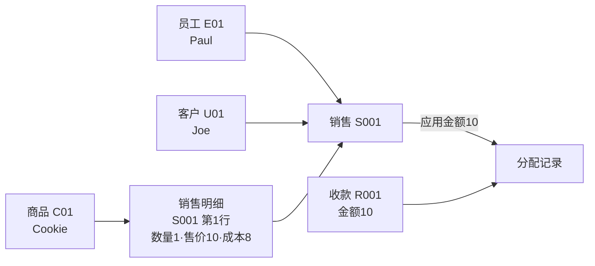

**读图**：从商品、员工和客户走到 S001，再把 R001 经“应用金额 10”连回 S001。箭头表示本例的数据依赖，不表示真实现金一定在交货后多久到达。

<details><summary>读图自测：R001 金额是 10，但漏了分配行，能否据此把 S001 应收写成 0？</summary>

不能。收到 10 与“这 10 抵 S001”是两件不同的事实；后一件必须另有关系记录。

</details>

到 §2.9 学完表、行、列、主键、外键后，[[#2.9.9 曲奇事件落地：统一 schema 与可执行 SQL（笔记补充）|§2.9.9]] 会把同一组业务行变成一套唯一 schema，并实际查询毛利、截止日应收和收款未应用余额。

**所以呢**：这里先建立业务对象和动作；下一节回到讲义的 REA 三要素。数据库实现延后，是为了先懂“要保存什么”，再学“怎样用键和 SQL 保存”。

---

### 2.5 REA 的三要素与二元性（讲义 p.17–19）

#### 2.5.1 Resource — Event — Agent（讲义 p.17）

> 📄 **p.17 是图形页**（三个方框 + 连线 + 文字），已转 PDF 视觉复核。

**图（讲义 p.17 的原图，重画为 Mermaid）**

**看图前先问**：资源、事件、参与者各在问同一业务的哪一部分？


无箭头的关联线连接对象，不表示现金从资源流向参与者。

**沿例子读图（笔记补充）**：曲奇对应 Economic Resource，出售它的 S001 对应 Economic Event；Paul 和 Joe 对应 Economic Agent。日期 2013-01-01、地点 Festival Walk、收入 10 和成本 8 描述这次事件或明细，不另建成参与者。

**图旁边界**：布局按REA字母便于读；不是借左贷右约定。

**文字替代**：资源回答涉及什么，事件回答发生什么/何时/何地，参与者回答谁。

<details><summary>读图自测：2013-01-01应新建一个参与者类吗？</summary>

不应，它描述事件时间；参与者回答谁。

</details>

**图下方的文字（讲义原文）**

> *"**When? Where? What? Who?**"*
> - *"**Resources**: what"*
> - *"**Event**: what, when, where"*
> - *"**Agent**: who"*

**是什么**

| 要素 | 中文 | 定义（结合 p.4 与 p.17） | 回答 |
|---|---|---|---|
| **Economic Resource** | 经济资源 | 企业拥有或控制、具有经济价值、会因事件而增减的**东西** | **what**（是什么东西） |
| **Economic Event** | 经济事件 | 使资源发生增减的**一次业务活动** | **what / when / where**（发生了什么、何时、何地） |
| **Economic Agent** | 经济参与者 | 参与事件、对资源拥有或转移控制权的**人或组织** | **who**（谁） |

**⭐ 注意 "what" 出现了两次**：
- **Resource 的 what** = "涉及的是哪一种资源"（曲奇？现金？）
- **Event 的 what** = "发生的是哪一类事件"（销售？收款？）

**为什么是这三类，不多不少（💡 笔记补充，讲义没解释）**

因为任何一次经济活动都可以写成同一个句式：

> **谁（Agent）** 在 **什么时候、什么地方（Event）** 对 **什么东西（Resource）** 做了 **什么（Event）**

⇒ 这就是 §2.2.1 说的 "**economic storytelling**"：**一个故事的最小要素就是人物、情节、物件。** REA 的三个字母就是把这三样各给一个类。

**⚠️ 讲义的四问里少了什么（💡 笔记补充）**

*"When? Where? What? Who?"* —— 少了 **Why（为什么）** 和 **How much（多少）**。
- **How much** 其实有，只是它是 Event 的**属性**（数量、金额），不是独立的类
- **Why** 确实不在基本 REA 里。⇒ 后来的扩展模型（REAL、REA 本体）加入了 **Commitment（承诺，如订单）** 和 **Contract（合同）** 来回答"为什么会发生这个事件"。**本讲不展开 Commitment/Contract。M05 的原材料本轮未核，因此这里只标为后续待核主题，不宣称 M05 已经讲授。**

**🎙️ 课堂补充**（S4 `04:41`–`07:06`，A · 课上展开）

教师说明三框分别保存资源的问题、事件的 what/when/where、参与者的 who；Paul 属内部参与者。*"So in this case, who is internal agent? Paul."*（S4 `06:44`）。`04:55` 明确资源在左、参与者在右只是便于按 REA 字母顺序阅读，**不是借方必须左/贷方必须右的记账约定**。**这段改变了什么**：图的横向布局可变化，R/E/A 的业务含义与关联保持，别把位置当科目方向。

**💡 换个说法（笔记补充）**
新闻写作的 5W1H（Who / What / When / Where / Why / How）里，**REA 覆盖了 Who / What / When / Where 这四个**。⇒ REA 就是**让会计系统学会写新闻，而不是只会报比分**。

**⚠️ 常见误解**
- ❌ "Resource 无条件等于财务报表 Asset"。→ 本讲只把 Resource 解释为业务事件涉及的经济资源，并举 Inventory、Cash、Equipment 为例。它与财报 Asset 有重合，但两者的完整边界、确认和计量关系不能仅凭本讲判定；本轮也没有来源把产能或员工工时直接列为 Resource 类。
- ❌ "Agent 就是人"。→ 也可以是组织（供应商公司、客户公司）。
- ❌ "三个方框之间的连线是数据流"。→ 是 **association（关联）**，表示"这个事件涉及这个资源""这个事件由这个参与者参与"。§2.7.4 会给它正式定义。

**与其他概念的关系**
→ §2.5.3 的完整图把每个方框都实例化了；→ §2.7 教你怎么把这张图画成规范的 UML 类图。

**所以呢**

Resource / Event / Agent 三个方框有了，下一节讲清楚方框之间那条线——二元性——具体是什么规则。

---

#### 2.5.2 二元性（讲义 p.18）

**是什么**

讲义 p.18 原文（标题 `Duality`，三条）：

> - *"There is usually **a pair of events** at the heart of REA. One represents a resource being **given away or lost**, while another represents a resource being **received or gained**."*
> - *"Two events are linked – **a cash receipt occurs in exchange for a sale**, and vice versa."*
> - *"Could be more complicated – **a product conversion occurs in exchange for a usage of raw material, labor cost and overhead**."*

**二元性（Duality）**：在本讲的交换模式中，关联把资源给出与资源获得事件配对。p.18 用的是 usually。

先看曲奇销售和现金收款；再看生产的多种投入与一次产出。毁损、内部耗用等情形不凭这句描述强造一个外部收款事件。

| | give（给出） | get（得到） |
|---|---|---|
| 讲义用词 | *given away or lost* | *received or gained* |
| 曲奇例子 | **Sale**（曲奇出去了） | **Cash Receipt**（现金进来了） |
| 正式术语（见 p.30） | `<<economicDecrement>>` **经济减量** | `<<economicIncrement>>` **经济增量** |

**为什么需要它**

在这笔曲奇销售中，公司给出商品，客户给出现金。把两项事件连起来，才能回答“这笔收款抵哪笔销售”。

这说明本交换例为何需要 duality；它不是所有资源损失都必有补偿的普遍规则。

**⭐⭐ Duality 与复式记账是什么关系（讲义没说，💡 笔记补充——但这是本讲最重要的一个类比）**

| 检查 | 复式记录 | REA 本交换例 |
|---|---|---|
| 对象 | 一次记录中的账户及借贷金额 | Sale、CashReceipt 及它们的关联 |
| 要核什么 | 借方合计与贷方合计是否相等，仍另核遗漏/错科目 | 哪笔收款对应哪笔销售，仍另核金额、时间和完整采集 |
| 本例 | 成本8/存货8、应收10/收入10、现金10/应收10各自平衡 | Sale S001 与收款R001相连，不把成本8与收款10要求相等 |

**两个“双”不能据词根当成同一机制。** 借贷的两侧不是 Sale 与 CashReceipt 两个事件的一一映射；duality 记录业务关系，不是把事件“配平”。

**⭐ 讲义第三条给了一个"更复杂"的例子，很重要**

> *"a **product conversion** occurs in exchange for a **usage of raw material, labor cost and overhead**"*
> 一次**产品转换**（生产），交换的是**原材料的耗用、人工成本与制造费用**。

**💡 展开（笔记补充）**：
- **give 侧**：Raw Material Usage（领用原材料）、Labor Usage（耗用工时）、Overhead Application（分摊制造费用）—— **三个** give 事件
- **get 侧**：Product Conversion（产出成品）—— **一个** get 事件

**⇒ duality 不一定是 1 对 1，可以是多对一、一对多。** 这一点在 §2.8 的多重性练习里会被反复考（"一次销售可以对应多次收款吗"）。

**⭐ 本页举的是企业内部的生产转换**，不必强配一个外部交换方。简化科目分录可记录原材料转在产品等成本变化；实际复式系统也可保留生产明细。REA 模型若确实采到机器、员工、时间和批次关联，才能进一步回答“哪批料、谁、多久、变成何批成品”，不能无条件保证已经采全。

**🎙️ 课堂补充**（S4 `07:11`–`11:28`，A · 课上展开）

教授从公司视角区分现金流入、曲奇流出，销售和收款由 duality 相连；生产再用原材料、人工与 overhead 三种耗用连接成品生产，原话 *"This is three-to-one association."*（S4 `11:25`）。**这段改变了什么**：duality 不强制一对一，案例中三种投入连到一次产出；这是生产举例而非给所有生产系统固定“恰三”基数。S4 `07:38` 仍用 usually，不能把交换类故事强套到所有损失事件。

**💡 换个说法（笔记补充）**
在赊销例中，Sale 已发生，Cash Receipt 可以暂时没有。duality 保存后来哪个收款对应哪笔销售的关系。

文字替代：事件配对回答业务联系，不自动证明金额已付清，也不把所有损失都解释成获得另一项资源。

**⚠️ 常见误解**
- ❌ "duality 就是复式记账换了名字"。→ 借贷核每次记录内的金额平衡，duality核业务事件关联。销售10、第一次收5时，应收还剩5；再收5才结清。单次关联不必等于整笔销售，但累计应用不能超过实收/销售额，标已结清才要求相等；单靠一条关系线不执行这些金额约束。
- ❌ "每个事件都必须立刻有配对"。→ 赊销时，Sale 已发生而 Cash Receipt 还没发生。**这正是 §2.8 练习 2、3 要处理的情况**：最小多重性为 0 就是在表达"可以暂时没有配对"。

**与其他概念的关系**
→ §2.5.3 的图把 duality 画成了横贯全图的一条线；→ §2.8 四道练习全部围绕 Sale–CashReceipt 这一对的 duality 多重性；→ §2.10.6–2.10.10 教你把这个关联转成表。

**所以呢**

duality 把 give 事件和 get 事件配对的规则讲完了，下一节看讲义怎么把这条规则画成一张完整的图。

---

**适用范围**：p.18 写 usually，p.19 是外部销售交换模式。内部生产/耗用可无 external agent，毁损不必有立即对应现金；duality 关联次数不自动保证数量金额完整。

#### 2.5.3 完整的 give / get 图（讲义 p.19）

> 📄 **p.19 是纯图形页**（无正文文字，全部由形状与艺术字构成），已转 PDF 视觉复核。**这是全讲最重要的一张图**，把 §2.5.1 与 §2.5.2 合成了一张。

**讲义 p.19 的原图（视觉复核后重画为 Mermaid）**

**看图前先问**：给货和收钱为什么画两事件却能引用同一客户和员工？

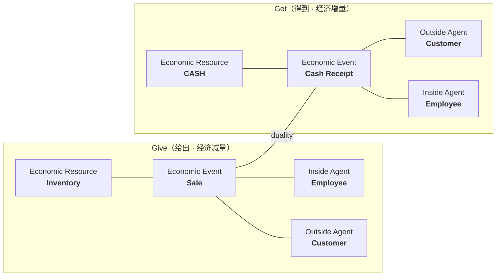

无方向线表示参与/资源关联，duality连接事件，不是时间或因果箭头。

**沿例子读图（笔记补充）**：在Give区固定Sale S001，资源是曲奇，员工Paul、客户Joe。Get区固定同一补例的Cash Receipt R001，现金为10，经手人也可为Paul，客户仍为Joe；duality保存两事件的应用关系。

**图旁边界**：重复角色框便于布局，不复制两套客户档案；可赊销时不要求立即CR。

**文字替代**：给货与收款各连自己的资源和角色，同一人可被两个事件引用，duality连事件。

<details><summary>读图自测：两Employee框能证明两名不同自然人吗？</summary>

不能，角色/引用可指同一个人；职责分离须实际身份/权限核对。

</details>

**按重画后的区名定位标签**：
- `Give` 区：`Economic Resource: Inventory`、`Economic Event: Sale`、`Inside Agent: Employee`、`Outside Agent: Customer`。
- `Get` 区：`Economic Resource: CASH`、`Economic Event: Cash Receipt`、`Outside Agent: Customer`、`Inside Agent: Employee`。
- 中央 `duality` 连接 Sale 与 Cash Receipt。当前重画为 Get 在上、Give 在下；原课件的上下位置不同，空间位置不承载业务顺序。

**⭐ 两个新概念在这张图上第一次出现**

> **内部参与者（Inside Agent）** ⭐：**属于本企业的**参与者——员工、部门。
> **外部参与者（Outside Agent）** ⭐：**企业之外的**参与者——客户、供应商。
>
> **为什么要分内外（💡 笔记补充，讲义没解释）**：
> 1. **本外部销售交换示例分别记录内部和外部参与者**。Paul 是企业经手人，Joe 是客户；内部生产/耗用可以没有外部参与者，不能把此图模板强套全部事件。
> 2. **内部参与者是问责的落点**（[[M01-会计与商业]] 讲的**内部控制**与**审计轨迹**在这里落地：出了问题能查到具体是谁经手的）。
> 3. **外部参与者是关系管理的落点**（哪个客户买得多、哪个供应商供货慢）。

**💡 这张图要读出的五件事（笔记补充）**

1. **上下两半结构完全对称**：每一半都是 `Resource — Event — Inside Agent + Outside Agent` 的四件套。
2. **当前重画上半是 Get，下半是 Give**，中间那条线就是 duality。
3. **Customer 出现了两次**（Sale 一次、Cash Receipt 一次），**Employee 也出现两次**。⇒ 在数据库里它们是**同一张 Customer 表、同一张 Employee 表**，只是被两个事件分别引用。（这就是为什么 §2.10 要讲外键。）
4. **Inventory 与 Cash 是两种不同的资源**，各自连到自己那一侧的事件。
5. ⚠️ **卖货与收款是两个可分别记录的 Employee 角色**（图上画了两个 Employee 框）。同一人或不同人都能被系统如实引用；是否必须分开，取决于企业的内控设计、实际权限、风险与补偿性控制，本讲没有给出按企业规模一律强制分开的规范。

**⭐ 把 §2.4 的曲奇故事填进这张图**

| 图上的框 | 曲奇故事里的实例 |
|---|---|
| Economic Resource: Inventory | 一块曲奇（成本 \$8） |
| Economic Event: Sale | 2013-01-01，又一城 7-11，金额 \$10 |
| Inside Agent: Employee | **Paul** |
| Outside Agent: Customer | **Joe** |
| Economic Event: Cash Receipt | 2013-01-01，金额 \$10 |
| Economic Resource: CASH | \$10 |
| duality | 这次 Sale ↔ 这次 Cash Receipt |

**⇒ 这张图 + 这张表，就是 §2.4.5 那套关系表的来源。**

**🎙️ 课堂补充**（S4 `11:37`–`13:32`，A · 课上展开）

教师逐块说明 Sale→Inventory、CashReceipt→Cash，两事件分别连客户与员工，且解释图上重复画人是为了清楚：*"we don't have to show employee and customer twice"*（S4 `12:53`）。**这段改变了什么**：重复框是教学图呈现，不要求数据库复制两套员工/客户事实；两个事件应指向统一身份记录。Sale 在 ASR 多次为 share/FAIR，名称以 p.19 为准。

**⚠️ 常见误解**
- ❌ "Inside Agent 一定是一个人"。→ 也可以是承担职责的部门等组织角色；“仓储部门”若作为经手责任主体可建参与者，“仓库地点/库房资产”则不能仅凭名称当参与者。
- ❌ "duality 连的是资源"。→ **连的是两个事件**（Sale ↔ Cash Receipt），不是 Inventory ↔ Cash。

**与其他概念的关系**
这张图是 §2.7 之后所有 UML 练习的底图；**W5「REA Business Process Modeling」就是把这张图从"一对事件"扩展成"一整个业务循环"**。

**所以呢**

三要素与二元性的图已经能覆盖曲奇故事的全部事实，下一节退回到方法论：这张图属于数据库设计的哪一层，后面还要经过几层才能变成真正能跑的数据库。

---

### 2.6 三层模型：概念 → 逻辑 → 物理（讲义 p.20–22）

> 讲义用三页各讲一层。**这三层是数据库设计的标准流程**，也是本讲后半段（§2.7 画图 → §2.10 转表）的路线图。

#### 2.6.1 概念模型（讲义 p.20）

**是什么**

讲义 p.20 原文（标题 `Conceptual model`，四条）：

> - *"**Conceptual model** is a representation that depicts **the important objects and relationships between the objects** that must be captured in a database."*
> - *"Different conceptual modeling languages: **narrative descriptions**, **diagrams of various types with different notations**, **XML (Extensible Markup Language)**, **XBRL (Extensible Business Reporting Language)**"*
> - *"**Universal Modeling Language** is a widely accepted notation for system analysis and design."*
> - *"The **class diagrams of UML** are appropriate for conceptual modeling of REA concepts."*

**⭐ 概念模型（Conceptual Model）**：一种表示法，描绘**数据库中必须捕获的重要对象以及对象之间的关系**。

**关键在于它"不管技术"**：概念模型只回答"我们要记录哪些东西、它们之间什么关系"，**不回答"用什么数据库软件、字段是什么类型"**。

**四种概念建模语言（讲义列举）**

| 语言 | 中文 | 是什么 | 优缺点（💡 笔记补充） |
|---|---|---|---|
| **Narrative descriptions** | 叙述性描述 | 用自然语言把规则写成句子（如"每笔销售只能有一个客户"） | ✅ 谁都看得懂 ❌ 有歧义、难以检查完整性 |
| **Diagrams with different notations** | 各种记法的图 | ER 图、UML 类图、Chen 记法、乌鸦脚记法…… | ✅ 直观、易检查 ❌ **记法不统一是最大的坑**（见下面的警告） |
| **XML** | 可扩展标记语言 | 用标签把数据结构化：`<Sale><Date>2013-01-01</Date></Sale>` | ✅ 机器可读、跨平台 ❌ 冗长 |
| **XBRL** | **可扩展商业报告语言** | 用可机读标签表达数字商业报告中的概念、期间、单位与上下文 | ✅ 支持机器读取、验证与交换数字报告；具体监管采用情况须另核 |

> **XBRL（eXtensible Business Reporting Language）** ⭐ 新概念：XBRL International 将它定位为数字商业报告（digital business reporting）的全球标准。它用可机读标签说明“这个数是什么概念、属于什么期间、用什么单位”，使软件能够交换、验证和分析报告数据。
>
> 讲义把 XBRL 列在“conceptual modeling languages”一页，这是**本课编排位置**；不要因此把 XBRL 的正式定义写成概念建模语言。官方来源：[XBRL International, What is XBRL?](https://www.xbrl.org/the-standard/what/what-is-xbrl/)（获取日期 2026-10-23）。
>
> 💡 **与本课 AI 的连接（笔记说明）**：结构化标签减少从 PDF 猜表格结构的步骤，但不会自动保证会计口径一致，也不会让模型免于数据质量错误。

**⚠️ 讲义把 UML 的全称写错了**

讲义 p.20 写的是 *"**Universal** Modeling Language"*。
**正确名称是 "**Unified** Modeling Language"（统一建模语言）。**
这是一个实质性的名称错误，记在 §9.3 ⑥。**考试请写 Unified。**

**为什么本课用 UML 类图**

讲义最后一句：*"The **class diagrams of UML** are appropriate for conceptual modeling of REA concepts."*
💡 **原因（笔记补充）**：UML 类图恰好有 REA 需要的四件东西——**类**（对应 Resource/Event/Agent）、**关联**（对应它们之间的连线）、**属性**（对应事件的日期金额）、**多重性**（对应"一次销售能有几个客户"这类业务规则）。§2.7 就讲这四样。

**🎙️ 课堂补充**（S4 `13:40`–`17:12`，A · 课上展开）

教授说明叙述/图也是表达同一业务的语言，并用 XBRL 的结构化报告解释比较便利性。*"Just some boxes, then connect them together, what happens?"*（S4 `17:08`），随后 *"So actually, this is one language."*（S4 `17:12`）。**这段改变了什么**：框与线是表示对象关系的符号体系，并非无来由的画图。S4 `16:17` 重复“universal modeling language”与 p.20 相同错误，正确 Unified 名称仍保留勘误；结构格式便利不等于不同会计口径自动可比。

**⚠️ 常见误解**
- ❌ "概念模型就是画图"。→ 讲义明确说**叙述性描述也是一种概念建模语言**。图只是最常用的一种。
- ❌ "XML 和 XBRL 是两回事"。→ **XBRL 是基于 XML 的**，是它在财务报告领域的专门化。

**所以呢**

概念模型只回答"记什么、什么关系"，不回答"用什么数据库"——下一节看选定了数据库类型之后，模型要经历的第一次转换。

---

#### 2.6.2 逻辑模型（讲义 p.21）

**讲义 p.21 原文**（标题 `Logical model`，两条）：

> - *"A conceptual model is converted into a logical model **once the type of database to be used has been determined**."*
> - *"Examples of logical model include **relational, object-oriented, hierarchical, network, and others**."*

**⭐ 关键触发条件**：**一旦确定了要用哪一类数据库**，概念模型就转成逻辑模型。

**四类数据库（讲义列举）**

| 类型 | 中文 | 数据怎么组织 | 现状（💡 笔记补充） |
|---|---|---|---|
| **Relational** | **关系型** | 二维表 + 主键/外键 | ⭐ 本课 §2.9–2.10 深入这一类，W6 的 Access 也采用关系模型 |
| Object-oriented | 面向对象 | 对象与继承 | 讲义只列名称，本讲不比较采用率 |
| Hierarchical | 层次型 | 树状结构（一个父节点多个子节点） | 讲义只列名称，本讲不判断是否仍在使用 |
| Network | 网状型 | 用链接组织更复杂关系 | 讲义只列名称，本讲不判断是否仍在使用 |

**⇒ 讲义列了四类，但后面 18 页只讲关系型。** 这说明本讲的学习范围选择了关系模型；不能仅凭这一页推出其他类型“已淘汰”或全球采用率排名。

**💡 概念模型 → 逻辑模型 具体发生了什么变化（笔记补充，讲义完全没说，但这就是 §2.10 五步转换法在做的事）**

| | 概念模型（UML 类图） | 逻辑模型（关系模型） |
|---|---|---|
| 一个**类** | 一个三格框 | ⇒ 一张**表** |
| 一个**属性** | 框里的一行 | ⇒ 一个**列** |
| 一个**实例** | （图上不画） | ⇒ 一**行** |
| 一个**关联** | 两框之间的一条线 | ⇒ **要么是一个外键列，要么是一张独立的表** ⭐ |

**⭐ 最后一行就是 §2.10 五步转换法要解决的全部问题**：一条线，到底变成"一列"还是"一张表"？

**🎙️ 课堂补充**（S4 `17:30`–`18:30`，A · 课上展开）

教授用熟悉的 Excel 表辅助理解：*"the information can be converted into those Excel tables"*（S4 `18:05`）。**这段改变了什么**：把概念图的数据变成行列是逻辑层的直觉；Excel 类比不证明普通工作表自动具有关系数据库的键与完整性约束，也不表示逻辑模型定义等于 Excel 软件。

**所以呢**

四类逻辑模型里关系型是本课唯一深入的一种，下一节看逻辑模型再往下一层、落到具体软件时还要决定什么。

---

#### 2.6.3 物理数据库模型（讲义 p.22）

**讲义 p.22 原文**（标题 `Physical database model`，只有一句）：

> *"Physical database model is created based on the **specific database software package** in which the database is implemented."*

**⭐ 触发条件再往下一层**：**具体用哪一款数据库软件**。

**💡 这一层具体包含什么（笔记补充，讲义只有一句话，太薄了）**

| 决策 | 例子 |
|---|---|
| 每个列的**数据类型** | 日期精度和金额类型须在具体软件中选择 |
| **索引**建在哪些列上 | 常按客户查 ⇒ 在 `Sale.custID` 上建索引 |
| **存储**与分区 | 数据放哪个磁盘、按年份分表 |
| **软件特定的语法** | ACCESS 的 `AutoNumber` vs SQL Server 的 `IDENTITY` vs MySQL 的 `AUTO_INCREMENT` |

**数据类型的两个物理层问题**：日期字段是 `DATE` 还是 `DATETIME`，关系到是否保留时间；金额字段是 `CURRENCY` 还是 `DECIMAL(12,2)`，关系到范围和精度。选择须服从实际软件与业务要求。

**⇒ W6 的 ACCESS 上机就是在做这一层**：同样一套逻辑模型，在 ACCESS 里实现和在 Oracle 里实现，物理模型不一样。

**三层的关系（三页合起来看）**

**看图前先问**：怎样把每Sale恰一客户从业务规则细化到数据库？

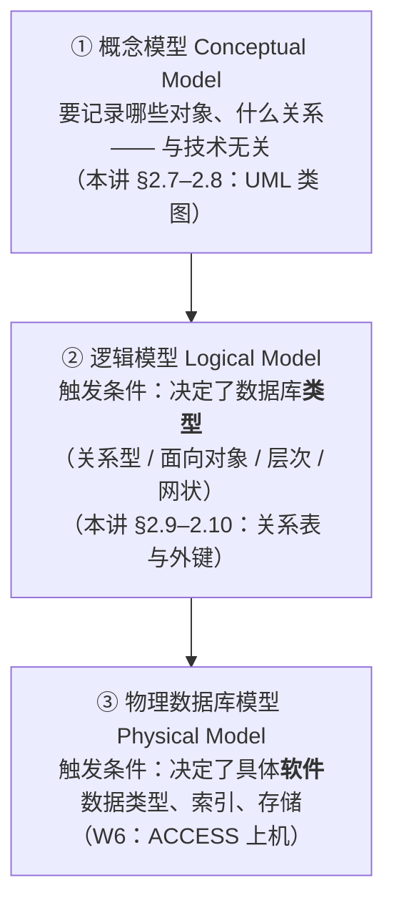

箭头是模型层次细化，软件变化不自动改变业务规则。

**沿例子读图（笔记补充）**

1. ① 概念模型先规定 S001 属于客户 U01。

2. ② 逻辑模型把 Customer 的键作为 Sale.custID 保存。

3. ③ 物理模型再在 Access 选择字段类型、设置参照完整性和必填要求。

4. 每一步细化上一层，不能倒过来用字段类型决定业务规则。

**图旁边界**：Excel只是行列类比；不表示其自动带FK约束或所有业务规则。

**文字替代**：业务对象关系先转表与键，再按具体软件设类型和约束，三层解决不同问题。

<details><summary>读图自测：在概念层先定varchar长度，能代替每Sale几个客户的讨论吗？</summary>

不能，字段尺寸属物理层；业务基数错了，类型正确仍会存错关系。

</details>

**⭐ 为什么要分三层（💡 笔记补充，讲义完全没解释，但这是本节存在的理由）**

因为**每一层解决的问题不同，混在一起会灾难**：
- 如果一上来就想"这个字段用 varchar(50) 还是 varchar(100)"，你会**忘记问业务规则**（一笔销售能不能有两个客户？）
- 而**业务规则错了，字段类型再完美也没用**
- 反过来，概念模型定好之后，**换数据库软件不需要重新分析业务**——这是分层带来的最大好处

**🎙️ 课堂补充**（S4 `18:30`–`18:55`，A · 课上展开）

教授明确后续共同用 Access 建库：*"We will use the software of so-called Access"*（S4 `18:37`），再学习用物理数据库分析。**这段改变了什么**：确认具体软件落地路线；这段是安排预告，没有现场建表、执行查询或成功软件测试。

**⚠️ 常见误解**
- ❌ "三层是三次重复劳动"。→ 是**逐步细化**。每一层都在上一层基础上加信息，不是重做。
- ❌ "小项目可以跳过概念模型"。→ 跳过的后果是业务规则没被显式讨论过，等表建好了才发现"原来一笔销售可以分两次付款"，那时改表结构代价极大。

**所以呢**

三层模型的路线图画完了，下一节回到概念模型这一层，正式学画 UML 类图要用到的四个构件。

---

### 2.7 UML 类图的四个构件（讲义 p.23–31）

> 讲义用 **9 页**讲 UML 类图。**这是本讲的技术核心**，四个构件在 p.23 一次列出，然后 p.24–31 逐个展开。

#### 2.7.1 四构件总览（讲义 p.23）

**讲义 p.23 原文**（标题 `Conceptual modeling with UML class diagrams`，只有一句）：

> *"The **four constructs**: **classes**, **associations**, **attributes**, and **multiplicities**."*

**四个构件 = 本节的四个小节**

| 构件 | 中文 | 回答什么问题 | 讲义页 | 本笔记 |
|---|---|---|---|---|
| **Classes** | 类 | 我们要记录**哪些种类**的东西？ | p.24–25 | §2.7.2–2.7.3 |
| **Associations** | 关联 | 这些东西**之间有什么关系**？ | p.26–27 | §2.7.4–2.7.5 |
| **Attributes** | 属性 | 每一类要记录**哪些具体信息**？ | p.28 | §2.7.6 |
| **Multiplicities** | 多重性 | 一个 X 能关联**几个** Y？ | p.29–31 | §2.7.7–2.7.9 |

> ⭐ **四个里面，多重性最难也最重要。** 讲义给了它 **3 页讲解（p.29–31）+ 4 页练习（p.32–35）= 7 页**，是四个构件里投入最多的。而 §2.10 的五步转换法**完全建立在多重性之上**——多重性读错，表就建错。

**💡 用曲奇例子把四个构件串一遍（笔记补充）**

```
Classes（类）        ：Inventory、Sale、CashReceipt、Employee、Customer、Cash
Associations（关联）  ：Sale—Inventory（卖了什么）、Sale—Customer（卖给谁）、
                      Sale—Employee（谁卖的）、Sale—CashReceipt（duality）
Attributes（属性）    ：Sale概念上有关联的收入/成本；逻辑Sale存saleID、saleDate、location等，总额由SaleLine汇总
Multiplicities（多重性）：一笔 Sale 只能有 1 个 Customer；一个 Customer 可以有 0 到多笔 Sale
```

**🎙️ 课堂补充**（S4 `19:07`–`20:53`，A · 课上展开）

教授以框=class、连接=association、相关特征=attribute来唤醒四构件，把多重性放到模型转成表的困难上：*"And that would be the most difficult issue in the IEA model that we will introduce later."*（S4 `20:31`）。

IEA为REA的ASR错误。

S4 `20:00` 还口述把曲奇售价与成本放在 Inventory 框；这是该时点的转录口径（原音未核）。

**笔记补充另分层**：商品参考资料可在 Inventory；每次成交价与成本快照放 SaleLine；p.10讨论事件的概念资料归属，不直接规定最终存储列。不能把笔记最终模式冒称教师当时逐列给出的模式。

**这段改变了什么**：课堂确实把多重性作为学习难点，不能仅因“最难”就升为教授明确会考。

**所以呢**

四个构件的清单列出来了，下面几节逐个展开，先从"类"开始。

---

#### 2.7.2 类与实体（讲义 p.24）

**讲义 p.24 原文**（标题 `Conceptual Modeling Constructs`，一句）：

> *"**Classes**: **sets of entities** (a real world object that has a separate existence, either **physical or conceptual**) that **share the same characteristics**."*

**两个概念嵌套在一句话里，要拆开：**

> **实体（Entity）** ⭐：一个**具有独立存在性**的**现实世界对象**，可以是**物理的**（一块曲奇、一台机器、一个人）**也可以是概念的**（一次销售、一份合同、一个课程）。
>
> **类（Class）** ⭐：**一组共享相同特征的实体的集合**。

**💡 用具体例子把这两层讲清楚（笔记补充）**

| | 实体（Entity，一个个具体的） | 类（Class，它们的集合） |
|---|---|---|
| 物理的 | Paul、Joe、Mary…… | **Employee / Customer** |
| 物理的 | 这块曲奇、那块面包…… | **Inventory** |
| **概念的** | 1 月 1 日那次卖曲奇、1 月 2 日那次卖面包…… | **Sale** ⭐ |
| 概念的 | 会计 101 这门课、市场学 153…… | **Course** |

**⭐ 注意 "either physical or conceptual" 这半句极其重要。**
一次**销售**摸不着看不见，但它**有独立的存在性**（它确实发生了，有时间地点金额），所以它是一个实体。**⇒ 这就是 REA 能把"事件"当成一等公民建模的理论依据。**

**💡 类与实体的关系 = 表与行（笔记补充，用 L0 里的数据库直觉）**

```
Class  ──转换成──▶  Table（表）
Entity ──转换成──▶  Row（行）
```
这正是 §2.10 Step 1 说的：*"Each attribute of the class becomes a column… Each instance (member) of the class becomes a row"*。

**⚠️ 术语提醒**：UML 用 "class / instance"，数据库理论用 "entity set / entity"，ER 图用 "entity type / entity"。**讲义在这里把它们混着用**（说 class 是 "sets of entities"）。**意思是一样的，不必纠结。**

**🎙️ 课堂补充**（S4 `21:01`–`21:26`，B · 讲了同讲义）

教师先给出 ASR 原句 *"The class is a set of entities and a real-world object that has a separated system, either physical or conceptual."*（S4 `21:01`）。其中 `separated system` 按讲义 p.24 的书面定义理解为 separate existence；Cash/Sale 又被转成 TESH/SEER，因此不把校正词拼进教授直引。

**⚠️ 常见误解**
- ❌ "只有看得见的东西才能建模"。→ 讲义明确说 conceptual 也算。**销售、订单、租约、保修承诺全都是实体。**
- ❌ "类 = 一张表"。→ 在概念模型里类还不是表；**要经过 §2.10 Step 1 才变成表**。而且**关联有时也会变成表**（多对多的情况）。

**所以呢**

类和实体的关系（类是集合、实体是集合里的成员）搞清楚了，下一节看类在图上具体画成什么样子——三格框与构造型。

---

#### 2.7.3 类图上的三格框与构造型（讲义 p.25）

**讲义 p.25 原文**（标题 `UML Class Diagrams: Classes`，四条）：

> - *"Each class is drawn with a **three compartment box**."*
> - *"**The first compartment** contains **the stereotype (if any) and the class name**"*
> - *"A **stereotype** is a **generalized type of class to which other classes may belong**"*
> - *"**The second compartment** contains **the attributes** of the class"*
> - *"**The third compartment** contains **the operations** the class may perform (**we will leave these blank**)"*

**三格框的画法**

```
┌─────────────────────────┐
│  <<stereotype>>         │  ← 第一格：构造型（若有）+ 类名
│  ClassName              │
├─────────────────────────┤
│  -attribute1            │  ← 第二格：属性
│  -attribute2            │
├─────────────────────────┤
│                         │  ← 第三格：操作（本课一律留空）
└─────────────────────────┘
```

**⭐ 构造型（Stereotype）** ⭐ 新概念

> **讲义的定义**：*"a **generalized type of class** to which other classes may belong"*
> **一种更概括的类别，其他类可以归属于它。**
>
> **在 REA 里，构造型就是"这个类属于 R、E、A 中的哪一类"**。写在类名上方，用 `<< >>` 包起来。

**本课会用到的构造型（从 p.30 与 p.19 汇总）**

| 构造型 | 中文 | 用在哪些类上 |
|---|---|---|
| `<<Resource>>` | 经济资源 | Inventory、Cash、Equipment |
| `<<Agent>>` | 经济参与者 | Customer、Employee、Supplier |
| `<<economicDecrement>>` | **经济减量事件**（give：资源流出） | **Sale**、Cash Disbursement（付款） |
| `<<economicIncrement>>` | **经济增量事件**（get：资源流入） | **Cash Receipt**、Purchase（采购入库） |

> ⚠️ **讲义 p.30 上写的是 `<<Agent>>` 和 `<<economicDecrement>>`**，这是唯一一处明确出现构造型写法的地方。`<<Resource>>` 与 `<<economicIncrement>>` 是我按对称补的（💡）。**讲义从未给出完整的构造型清单**——记在 §9.3 ⑦。

**💡 为什么构造型有用（笔记补充）**

因为**它让图自我解释**。看到 `<<economicDecrement>> Sale`，你立刻知道三件事：
1. 这是一个**事件**（不是资源、不是参与者）
2. 它使某种资源**减少**
3. 在本交换模式中，继续检查对应增量事件及 duality（§2.5.2）。允许赊销时可暂时没有收款；毁损等事件另核，不能仅凭减量类型判模型不完整

**⇒ 构造型把 REA 的规则编码进了图形记法本身，成了一种检查清单。**

**⚠️ "第三格留空"是本课的特殊约定**

标准 UML 的第三格放**操作（operations / methods）**，即这个类能执行的动作（如 `calculateTotal()`）。**讲义明说 "we will leave these blank"** —— 因为**概念数据建模只关心数据结构，不关心行为**。⇒ p.25示范保留空第三格；课堂 S4 `22:04`–`23:01` 明确可省空 operations 格，画类名/属性两格。两种教学画法均出现，正式考试的评分格式尚未另明示。

**🎙️ 课堂补充**（S4 `21:26`–`23:01`，A · 课上展开）

教师先复述三格（类型/类名、属性、操作），随后允许简化：*"we just use the two compartments"*（S4 `22:04`），*"and then we ignore the third compartment because it is actually blank."*（S4 `23:01`）。**这段改变了什么**：本课可省空operations格；Cash例另外列账户编号、金额、银行名与地址。S4当时尚未说明构造型考试要求，后续S6 `01:25` 已允许不写，见§2.7.8。

**⚠️ 常见误解**
- ❌ “第三格任何时候都必须画，不能省”。→ p.25示范三格标准形式；教师S4 `22:04`允许two compartments，并在S4 `23:01`明确省空operations格。本课数据模型可画两格；具体考试评分格式尚未另明示。
- ❌ “所有本课考试图都必须填构造型”。→ p.25写if any；后续S6 `01:25` 明确可不写构造型。它仍可帮助识别角色，但不能捏造对应分值。

**所以呢**

构造型让图能自我解释这一点记住了，下一节讲四个构件里的第二个——关联，以及两种容易混淆的关联子类型。

---

#### 2.7.4 关联、关联类与具象化关联（讲义 p.26）

**讲义 p.26 原文**（标题 `Conceptual Modeling Constructs`）：

> **Associations**
> - *"Relationships between classes"*
> - *"Association class: there can be only one link between the related entities."*
> - *"Reified association: there can be multiple links between the related entities."*

先把三层分开，否则同一个 `Enrollment` 会被误当成三种东西。

1. **普通关联（Association）**是 Student 与 Course 之间“takes”的关系线。
2. **UML AssociationClass** 是同时具有 Association 与 Class 性质的建模元素。它可承载属于“这对对象之间关系”的属性，例如本次选课的 `grade`。这是 OMG UML 的正式层。
3. **具象化（Reification）**是把一次关系记录提升成可独立识别的对象，例如为每次修读建立 `EnrollmentID`。这样同一学生可在不同学期重修同一课程。
4. **逻辑关联表**是转到关系数据库后的表。它可能用复合主键，也可能用独立 ID；这是逻辑层实现，不等于概念层的每个关联都天然是“第三个类”。

**课程口径与正式口径要分开**：讲义用“同一对只能一条 / 可以多条”帮助区分 association class 与 reified association；答本课题时先保留这套判别口径。正式 UML 中，AssociationClass 的定义不等于“只能一条”，而是它同时具有 Association 和 Class 的性质，并可拥有关系本身的 features。来源：[OMG UML 2.5.1](https://www.omg.org/spec/UML/2.5.1/PDF)（获取日期 2026-10-23）。

**图 A：AssociationClass 教学结构示意——非标准 UML 画法，不可照作考试 UML 答案**

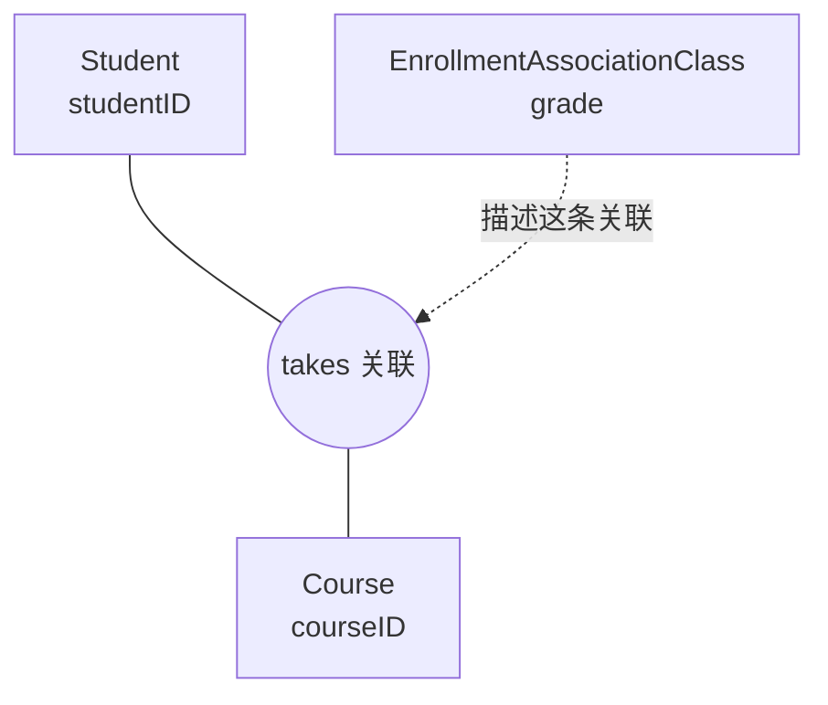

这张图是为了在 Mermaid 中把“关系本身”做成可指向对象：中间小圆不是第三个业务实体，也不是标准 UML 符号。真正的 UML AssociationClass 应画 Student–Course 的 association line，再由 `EnrollmentAssociationClass` 类框用虚线连接到那条 association line。考试若要求 UML，应采用该标准记法，不能照抄本图的小圆。`grade` 属于学生与课程之间这次关系，不属于 Student 或 Course 的永久属性。

**实际关系行（不允许同一学生×课程重复）**

| studentID | courseID | grade | 一行代表什么 |
|---|---|---|---|
| S1 | AC201 | A- | 学生 S1 与课程 AC201 的唯一选课关系 |

若业务范围不允许重修，同一学生×课程只能有一条关系记录；S1–AC201 再出现就重复。先掌握这项身份规则，组合列怎样成为主键留到 §2.9–§2.10；图的名字不自动指定数据库键。

**图 B：具象化后的独立 Enrollment——每次修读有自己的身份**

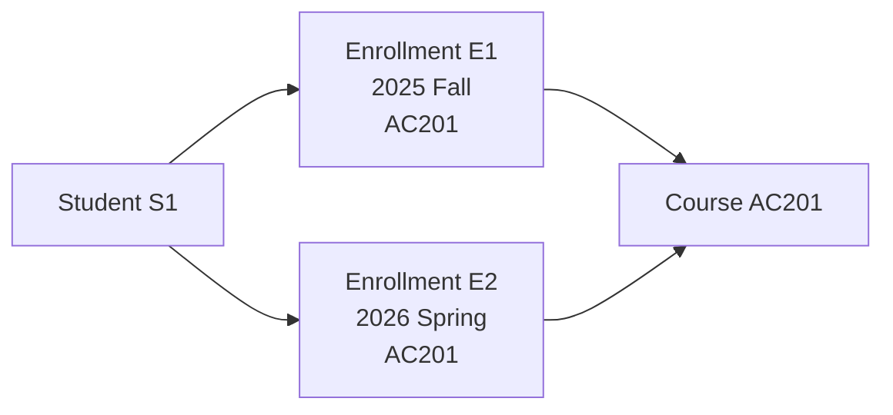

现在同一 `S1–AC201` 出现两次，但 E1 与 E2 的学期不同、身份不同。逻辑表应写成：

| enrollmentID | studentID | courseID | term | 一行代表什么 |
|---|---|---|---|---|
| E1 | S1 | AC201 | 2025 Fall | 第一次修读 |
| E2 | S1 | AC201 | 2026 Spring | 重修 |

E1/E2 用各自编号区分两次修读，并各自指向同一学生/课程；若还不允许同学期重复，就把“学生+课程+学期不能重复”列为业务规则。主键/外键和联合唯一约束怎样执行该规则，待 §2.9 学完表与键后再实现；此处无需先会 SQL。

**REA 中同类判断**：同一销售与收款若只允许一条当前分配，记录这对对象及应用额即可；若需多次重分配/冲销历史，就要把每次分配另行编号并记录何时生效。是否有金额属性，不足以决定是否需要独立事件身份。技术键实现见 §2.9.9，不在此提前要求编写。

**🎙️ 课堂补充**（S4 `23:09`–`23:30`，B · 讲了同讲义）

教师的最低要求是记住关联为类间关系：*"we just remember they are relationships between classes"*（S4 `23:20`）。课堂没有展开 OMG 正式定义或两种图；上面的区分是讲义口径加官方规范/笔记解释，不能写成教授原话。

**⚠️ 常见误解**

- ❌ “AssociationClass 就是一张中间表”。→ 前者是概念建模元素；表是逻辑实现。
- ❌ “有多个 Student 或 Course 就叫 reified”。→ 要问的是同一对象对是否需多条独立关系记录。
- ❌ “复合主键永远比独立 ID 正确”。→ 键取决于业务行粒度和是否允许同一对重复。

**所以呢**：先确定一行 Enrollment 代表“对象对”还是“某一次修读”，再决定是否需要单独编号；键的实现稍后展开。下一节只读取讲义 p.27 的当前实例快照，不用快照反推未标出的业务上限。

---

#### 2.7.5 例：学生、课程与选课（讲义 p.27）

> 📄 **p.27 是纯图片页**（提取文本只有标题），已转 PDF 视觉复核。

**讲义 p.27 实例关系的逐对转录与可编辑重画**

标题 `Example Classes and Association`；中间 Enrollment 标出选课联系。下表每行固定一名学生，右列逐项列出原图中与其相连的课程，不将并排名单误当成一一配对：

| 学生 | 原图当前连到的课程 |
|---|---|
| Margaret | Accounting 201；Economics 242 |
| Joe | Accounting 201；MIS 179 |
| Frank | MIS 179、Marketing 153、Economics 242 |
| Susie | Accounting 201；MIS 179 |
| Hilda | 无 |

Physics 678 没有学生连到。原图线型有实/虚区别但未解释业务含义，下图**只画九条已存在的联系**；Hilda与Physics 678两个孤例已在表/此句单列，避免把线经过孤例框误读成关联。线型统一不自造两种选课状态，也不添加min/max规则。

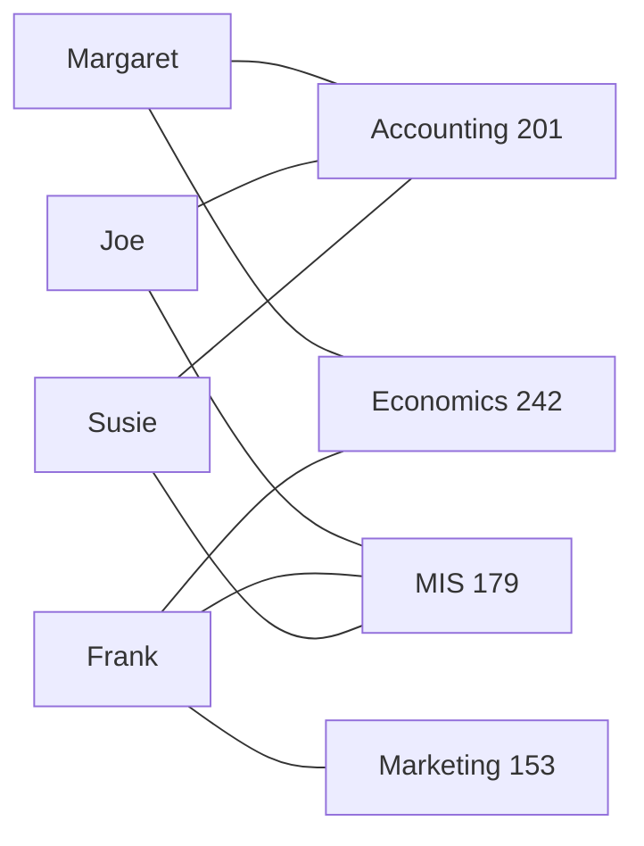

**读一条再反读**：Margaret 当前选了两门；固定 Accounting 201 可找到 Margaret、Joe、Susie。Hilda 与 Physics 是当前孤例。来源为讲义 p.27 图片；这九条当前联系不能单独证明所有未来记录的业务上下限。


**💡 这张图在教什么（笔记补充，讲义只有一个标题，一句解释都没有）**

**① 它把"类"和"实例"的区别画出来了**：椭圆是**类**（Student / Course），椭圆里的每一个名字是**实例（实体）**。

**② 中间的 `Enrollment` 标出当前实例之间的选课联系。** p.27 没有说明它采用 OMG AssociationClass、具象化对象还是哪一种逻辑键；这些层次须回到 §2.7.4 的业务粒度判断。

**③ Hilda 与 Physics 678 只证明当前快照里存在未连线实例。** Hilda 当前没有连接任何 Course，Physics 678 当前没有连接任何 Student。这个观察不能单独证明业务规则允许最小值 0，也不能从有限连线证明最大值必为 `*`。

**④ 当前图显示曾出现一名学生连多门课、一门课连多名学生。** 这支持“样例中出现多对多连接”的观察；正式业务多重性仍需题面叙述或图上端点数字。p.46–47 另行明确标出 `1..* —— 1..*`，两页有正式端点而 p.27 没有，不能把两者宣称为同一规则下的矛盾。

**🎙️ 课堂补充**（S4 `23:30`–`23:59`，B · 讲了同讲义）

教授用学生/课程与 enrollment 说明一个学生多课、一课多生，引用 *"one student can take two courses, and one course can be taken by the different students."*（S4 `23:30`）。这确认多关联的直觉，未清晰讨论 Hilda/Physics 孤例；有限当前实例不能证明所有业务允许无限上限。

**所以呢**

Hilda 和 Physics 678 两个当前孤例提醒我们继续问业务是否允许零个关联；图本身没有给出规则。下一节先讲属性，再系统讲多重性。

---

**图实例与业务规则的边界**：p.27 的 Hilda/Physics 孤例展示当前未关联实例，但图未给 min/max 标记；多个现有链接只说明出现过“多”，不能证明最大无限。若另假设允许未选课/无人选课程，才可讨论0..*；p.46–47 的1..*另有显式原标记，不把两者混作同一原业务规则。

#### 2.7.6 属性（讲义 p.28）

**讲义 p.28 原文**（标题 `Conceptual Modeling Constructs`，六条）：

> **Attributes**
> - *"**Characteristics or elementary properties** of classes and/or associations"*
> - *"**Primary key attribute** uniquely and universally identifies each instance of a class or association"*
> - *"**Simple** (cannot be further decomposed) versus **composite** attributes (may be decomposed into other attributes)"*
> - *"**Derivable** attributes (can be derived / computed from the values of other attributes in the database."*
>   - *"**Static** – will not change if new data is entered into system"*
>   - *"**Volatile** – will change if new data is entered into system"*

**⭐ 属性（Attribute）**：类**和/或关联**的特征或基本性质。
（⚠️ 注意 "and/or associations" —— **关联也可以有属性**，比如 Enrollment 关联可以有 `grade 成绩` 属性。）

**四组概念，逐个讲：**

**① 主键（Primary Key）** ⭐

> 讲义定义：*"uniquely and **universally** identifies each instance"*
> **唯一且普遍地**标识类或关联的每一个实例。

**两个词都要抠**：
- **uniquely（唯一）**：不同实例的主键值必须不同 ⇒ 不能有两个学生的 Student# 都是 1
- **universally（普遍）**：**每一个**实例都必须有值 ⇒ **不能为空**

**⇒ 这两条正好就是 §2.9.4 的「实体完整性（Entity Integrity）」原则**：*"A primary key in a table must not contain a null value"*。

**💡 主键怎么选（笔记补充）**：优先用**没有业务含义的流水号**（saleID、custID），不要用姓名、电话、身份证。因为业务数据会变（改名、换号），而主键一旦被别的表引用（外键）就极难改。

**② 简单属性 vs 复合属性** ⭐

| | 定义（讲义原文） | 例子（💡 笔记补充） |
|---|---|---|
| **Simple 简单属性** | *cannot be further decomposed*（不可再分解） | `date`、`amount`、`quantity` |
| **Composite 复合属性** | *may be decomposed into other attributes*（可分解成其他属性） | ⭐ **`address`** 可以拆成 street / city / postcode；**`name`** 可以拆成 firstName / lastName |

**💡 为什么要区分（笔记补充，讲义没说）**：
因为 §2.9.2 有一条硬规则：*"Each cell in a database table can contain **only one value**"*。
⇒ 若任务需要可靠按城市筛选/邮编排序，把地址拆为独立列更直接；整串地址也可能通过文本解析查询，但格式不一致时容易出错。简单/复合是相对当前任务需要的粒度，date若需年/月也可再拆或提取，不是物理上永远不可分。
⇒ **实务上通常把复合属性拆开成多列。**

**③ 可导出属性（Derivable Attribute）** ⭐

> 讲义定义：*"can be derived / computed from the values of **other attributes in the database**"*
> **可以从数据库里其他属性的值计算出来。**

可导出值优先从权威数据算。若性能需要存缓存或汇总，要有更新、失效和重算机制；本节后面给出易变属性的维护边界。存了一个值并不自动使它成为第二份独立权威事实。

**④ 静态 vs 易变** ⭐ —— 讲义把可导出属性又分成两类：

| | 讲义原文 | 中文 | 例子（💡 笔记补充） |
|---|---|---|---|
| **Static 静态** | *will **not** change if new data is entered into system* | **录入新数据不会改变它** | 概念层可把一笔已完成销售的毛利写成 $\text{amount}-\text{cost}$；在本篇唯一逻辑 schema 中，这两个量由 SaleLine 的数量×售价/成本汇总，不是 Sale 表的存储列 |
| **Volatile 易变** | *will change if new data is entered into system* | **录入新数据会改变它** | ⭐ `某客户累计购买金额`、`存货结存数量`、`应收账款余额`——**每来一笔新交易就变** |

**💡 这个区分为什么重要（笔记补充，讲义只给了定义没给用途）**

**它影响缓存维护成本，不能仅凭静态/易变标签决定能不能存**：
- **静态可导出**：可选择计算或缓存；即使不随新交易自然变化，原数据纠错后仍须相应更新/重算，不能保证“存了就无风险”。
- **易变可导出**：⚠️ 优先从权威事件查询；若因性能存缓存/物化汇总，必须有事务更新、失效与重算机制。一旦漏维护会不一致，不能把“易变”本身解释为课件绝对禁止存储。

**⇒ 典型错误**：在 Customer 表里存一列 `totalPurchases`。每卖一次就要记得更新它；漏了一次，这个客户的累计金额就会错。按本篇逻辑设计，先按客户编号找到他的销售，再找到每笔销售的商品明细，逐行算数量×该次成交价并加总；§2.9.9 学完表、键与连接后再读 SQL。

**🎙️ 课堂补充**（S4 `24:01`–`29:11`，A · 课上展开）

教授解释主键标识每个实例、简单与复合属性、可导出属性及静态/易变；课堂举例将教室位置拆为房间/楼等，把学生累计成绩作为由各课成绩计算且会随新课程变化的例子。GPA在ASR为gk/decay等，按语境转述，未伪造完整数字公式。

教师明确要求 *"you should be able to name some examples."*（S4 `29:06`），并说 *"That is my request."*（S4 `29:11`）；同段说明不要求机械复述概念。**这段改变了什么**：学习验收至少包括能判分类、给对应实例，不能只背定义；此处没有具体考试题分值/格式承诺。ID是常见标识名，是否叫ID不是主键的充分条件，仍须唯一且非空。

**💡 换个说法（笔记补充）**
可导出属性 = **Excel 里的公式格**。你不会把公式的结果手动抄成数字（那样源数据一改结果就错了）。数据库同理。

**⚠️ 常见误解**
- ❌ "属性只能属于类"。→ 讲义明写 *"classes **and/or associations**"*。
- ❌ "主键只要唯一就行"。→ 还要 **universally**（不能为空）。
- ❌ "静态就是永远不变"。→ 是"**录入新数据**时不变"。人为改错误数据当然还是会变。

**与其他概念的关系**
主键 → §2.9.1 外键、§2.9.4 实体完整性、§2.10.3 复合主键；复合属性 → §2.9.2 "一格一值"；可导出属性 → §2.9.4 一事一地。

**所以呢**

属性的四组概念（主键、简单/复合、可导出、静态/易变）讲完了，下一节进入四个构件里最难也最重要的一个——多重性。

---

#### 2.7.7 多重性（讲义 p.29）

> ⭐ **本讲最重要的一页。** 后面 4 页练习（p.32–35）和 11 页转换规则（p.43–53）全部建立在它之上。

**讲义 p.29 原文**：

> *"**Multiplicities**: **how many times an instance of a class is allowed to participate in an association**."*
>
> **Minimum**: *"expresses the **minimum** number of times **one instance of a class must participate** in an association with the related class."*
> - *"**0 = optional participation** (any specific instance of the class can exist in the database **without a corresponding instance** of the associated class)"*
> - *"**1 = mandatory participation** (must be related to **at least one** instance)"*
>
> **Maximum**: *"expresses the **maximum** number of times one instance of a class **may** participate in an association with the related class"*
> - *"**1 = one-time only participation**"*
> - *"**\* = as many times as needed, no restrictions**"*

**⭐ 定义**：多重性 = **一个类的实例被允许参与某个关联多少次**。

**写法**：`最小..最大`，例如 `0..*`、`1..1`、`0..1`、`1..*`。

**四种取值的含义**

| 位置 | 取值 | 讲义原文 | 中文 |
|---|---|---|---|
| **最小** | **0** | *optional participation* | **可选参与**：该实例可以在数据库里存在，而**没有**任何对应的关联实例 |
| **最小** | **1** | *mandatory participation* | **强制参与**：**至少**要关联一个 |
| **最大** | **1** | *one-time only participation* | **最多一次** |
| **最大** | **\*** | *as many times as needed, no restrictions* | **多少次都行**，无限制 |

**四种组合的完整含义（💡 笔记补充，把讲义的两个维度交叉起来）**

| 多重性 | 读作 | 业务含义 |
|---|---|---|
| `1..1` | 恰好一个 | 必须有，而且只能有一个 |
| `0..1` | 零或一个 | 可以没有；有的话只能一个 |
| `1..*` | 一个或多个 | 必须至少有一个；上不封顶 |
| `0..*` | 零或多个 | 可以没有；有的话不限个数 |

**⭐⭐ 但最难的不是这四个组合，而是「写在哪一边」。这是 p.30–31 两页专门讲的事。**

**🎙️ 课堂补充**（S4 `29:14`–`37:30`，A · 课上展开）

教师先讲 min 为0/1、max 为1/星，再以 Sale–CashReceipt 白板情境解释：

> *"Sale is associated with zero cash receipt"*

（S4 `32:39`）表示允许赊销；

`34:05` 用“两个月、每月一半”示范一售多收的部分付款；

> *"In addition to sales, this company has other cash sources."*

（S4 `35:06`）说明收款可无销售；

> *"That means the combined payment is not allowed."*

（S4 `37:06`）说明一收至多一售禁止合并。

**这段改变了什么**：把四个数字接回实际业务规则，白板的 A/B/C/D 字母被ASR混乱记录，不硬写位置对应；位置读法仍按讲义p.30–33的书面规则。`30:16` 的“至少2就是star”是宽松口语/ASR，星只代表不设最大上限，不代表最小必为2。S4 `37:30` *"And we have some examples in the discussion next week."* 只说明当时的 S4 文件没有继续覆盖；后来取得的 S6 已直接覆盖 p.30–53。两份来源按各自时钟保留，不能把 S4 的旧缺口继续写成全篇未覆盖。

**⚠️ 常见误解**
- ❌ "多重性说的是有多少个实例"。→ 说的是**一个实例参与关联的次数**。Course 类里可以有 1000 门课，但 `Student 参与 Enrollment 的最大次数` 说的是"**一个**学生最多选几门"。
- ❌ “*本身允许零次”。→ *只表示最大不设固定上限；能否为零由最小值决定。因此0..*可零，1..*不能零。

**所以呢**

多重性的四种取值定义完了，但真正容易出错的不是取值本身，而是它画在图的哪一侧——下一节用一个具体例子把这件事钉死。

---

#### 2.7.8 ⭐ 例：Customer 与 Sale —— 多重性写在哪一边（讲义 p.30）

> ⭐⭐ **这一页是本讲最容易读错、也最必须读对的一页。** 讲义 p.30 与 p.31 用两种不同的说法讲同一件事，就是为了把这个约定钉死。

> 📄 **p.30 是图形页**（两个 UML 三格框 + 连线 + 多重性标签），已转 PDF 视觉复核。

**讲义 p.30 的原图（视觉复核后重画）**

```
┌──────────────────┐                          ┌────────────────────────┐
│   <<Agent>>      │  1..1        0..*        │ <<economicDecrement>>  │
│   Customer       │──────── participation ───│        Sale            │
├──────────────────┤                          ├────────────────────────┤
│ -customer ID     │                          │ -sale ID               │
│ -name            │                          │ -date                  │
│ -address         │                          │ -dollar value          │
├──────────────────┤                          ├────────────────────────┤
│                  │                          │                        │
└──────────────────┘                          └────────────────────────┘
     ↑ 「1..1」紧贴 Customer 这一侧            ↑「0..*」紧贴 Sale 这一侧
```

**图下方讲义给的四行解释（原文照抄）**

> - *"**Customer** can participate in the association **0 time**."*
> - *"**Customer** can participate in the association **multiple times**."*
> - *"**Sale** can participate in the association **at least once**."*
> - *"**Sale** can participate in the association **at most once**."*

**⭐⭐ 现在做那个关键的对照**

先定位数字和贴在哪个类旁，再逐条读原讲义事实。固定一个对象时，数的是另一端对象个数。

| 这对应哪一对数字 | 那对数字**画在图上的哪一侧** |
| --- | --- |
| `0..*` | ⚠️ **画在 Sale 那一侧！** |
| `1..1` | ⚠️ **画在 Customer 那一侧！** |

数字列是min..max，位置列是被数类；两者无货币单位。Customer旁1..1，读成一笔Sale对应恰一个Customer；Sale旁0..*，读成一个Customer可有零到多笔Sale。

**固定一个Customer时，可关联0到多笔Sale；0..*贴在Sale端。**

讲义称“Customer可以参与0次或多次”，说的是固定Customer看其关联次数，不是把0..*贴回Customer。


**固定一笔Sale时，恰有一个Customer；1..1贴在Customer端。**

讲义称“Sale至少/至多参与一次”，说的是一笔Sale对应的Customer数。仍按被数类的位置标端点。


> # ⭐ 位置约定（本讲最重要的一条规则）
>
> **写在类 Y 旁边的那对数字，说的是「一个 X 能关联几个 Y」。**
>
> 换句话说：**每对数字描述的是「它自己这一侧的类」，但约束的是「对面那个类的实例能连几个它」。**
>
> 等价的三种说法（都对，挑一个你能记住的）：
> 1. `1..1` 贴着 Customer ⇒ **一笔 Sale 恰好对应 1 个 Customer**
> 2. `0..*` 贴着 Sale ⇒ **一个 Customer 对应 0 到多笔 Sale**
> 3. 讲义的说法：「Customer 参与关联 0 到多次」这个事实，**写在对面（Sale 侧）**

**💡 为什么这个约定容易搞反（笔记补充）**

因为直觉会以为"贴着 Customer 的数字就是在说 Customer"。**实际上贴着 Customer 的 `1..1` 是在说"每笔销售只有一个客户"。**

**⭐ 一个 100% 可靠的自检方法**：把手指按在 `1..1` 上（它贴着 Customer），然后念：

> "**对面**那个类（Sale）的**每一个**实例，能连 **1..1** 个 **我这边**的类（Customer）。"
> ⇒ **每一笔销售恰好有一个客户。** ✅ 符合本例题面业务规则。

再试另一边：手指按在 `0..*` 上（它贴着 Sale），念：

> "**对面**那个类（Customer）的**每一个**实例，能连 **0..*** 个 **我这边**的类（Sale）。"
> ⇒ **每一个客户可以有 0 到多笔销售。** ✅ 符合本例允许尚未购买客户的规则（新注册但还没买过东西的客户 = 0）。

**⇒ 两边都念一遍，对照题面给定的业务规则核位置；常识可帮助提问，不能代替题面条件。**

**⭐ 两个新构造型在这一页首次出现**

- `<<Agent>>` 贴在 Customer 上 —— 客户是**参与者**
- `<<economicDecrement>>` 贴在 Sale 上 —— 销售是**经济减量事件**（卖出去了，存货减少）

> **经济减量 / 经济增量（economicDecrement / economicIncrement）** ⭐ 新概念：
> - **减量事件**：使企业的某项资源**减少**的事件 ⇒ Sale（存货出去）、Cash Disbursement（现金出去）
> - **增量事件**：使企业的某项资源**增加**的事件 ⇒ Cash Receipt（现金进来）、Purchase（存货进来）
> - **本讲交换模式的 duality 关联减量与增量事件**（§2.5.2）；检查这类关联只是完整性检查的一项，还须核范围、参与者、业务上下限与金额，不能保证全模型完整。

**⭐ 关联名 `participation`**

线上写着 `participation`（参与）。这是 REA 里**事件与参与者之间**关联的标准名称。（duality 是**事件与事件**之间的关联名；**事件与资源**之间通常叫 `stockflow`——⚠️ **本讲讲义从未提到 stockflow 这个词**，记在 §9.3 ⑦。）

**🎙️ 课堂补充**（S6 `00:01`–`04:05`，约 4.1 分钟，A · 课上展开）

- 教授从“上周已讲过多重性定义”直接续到 Customer–Sale 图，依次指出类名、属性、Participation 与两端多重度。答题时构造型可不写：*"don't bother for that. Just put in the name of the class. That's enough."*（S6 `01:25`）
- 属性中标识符要作为主键：*"ID attribute, always the primary key attribute."*（S6 `02:51`；ASR 将 Sale 听成 `SEAR`）。
- **这段改变了什么**：S6补上p.30课堂覆盖，并说明本例类框要标类名/标识符、构造型可省；不代表整张概念图只需这两项。后续M05段对属性、关联名和多重度的具体要求见§6.2。

**⚠️ 常见误解**
- ❌ 把贴着 Customer 的 `1..1` 读成"Customer 只能参与一次"。→ **正好相反**，讲义明说 Customer 可以参与多次。
- ❌ 认为 `0..*` 里的 `0` 是"这个客户不存在"。→ 是"这个客户存在于数据库里，但还没有任何一笔销售"。

**与其他概念的关系**
→ §2.7.9 用另一种说法再讲一遍；→ §2.8 四道练习全考这个；→ §2.10 五步转换法完全依赖它。

**所以呢**

位置约定和自检法都验证过了，下一节换一个例子、换一个方向（从文字描述推图），再练一遍同一条规则。

---

#### 2.7.9 例：员工与部门 —— 换一种说法再讲一次（讲义 p.31）

**讲义 p.31 原文**（标题 `Example: Employee/Department multiplicities`，四组八行）：

> - *"Employees are **not necessarily** assigned to departments"*
>   - *"**Minimum participation of employee = 0** (**put next to dept**)"*
> - *"**Every department has at least one employee** assigned to it"*
>   - *"**Minimum participation of department = 1** (**put next to emp**)"*
> - *"An employee can work for **no more than one** department"*
>   - *"**Maximum participation of employee = 1** (**put next to dept**)"*
> - *"A department **may have many employees** assigned to it"*
>   - *"**Maximum participation of department = \*** (**put next to emp**)"*

**⭐ 讲义在这一页把位置约定写成了明文规则**：*"put next to dept"* / *"put next to emp"*。

**把四条整理成一张表**

| 业务规则 | 这是谁的多重性 | 值 | **画在哪一侧** |
|---|---|---|---|
| 员工不一定被分配到部门 | Employee 的最小 | **0** | **dept 侧** |
| 员工最多只能属于一个部门 | Employee 的最大 | **1** | **dept 侧** |
| 每个部门至少有一名员工 | Department 的最小 | **1** | **emp 侧** |
| 一个部门可以有很多员工 | Department 的最大 | **\*** | **emp 侧** |

**⇒ 画出来是：**

```
┌────────────┐   1..*              0..1   ┌──────────────┐
│  Employee  │──────── assignment ────────│  Department  │
└────────────┘                            └──────────────┘
   ↑ 贴 Employee 侧是 1..*                  ↑ 贴 Department 侧是 0..1
     （Department 的多重性）                  （Employee 的多重性）
```

**⭐ 用 §2.7.8 的自检法验一遍**

- 手指按 `1..*`（贴 Employee 侧）：「**对面**（Department）的每一个实例，能连 `1..*` 个**我这边**（Employee）」⇒ **每个部门有 1 到多个员工** ✅ 与规则 3、4 一致
- 手指按 `0..1`（贴 Department 侧）：「**对面**（Employee）的每一个实例，能连 `0..1` 个**我这边**（Department）」⇒ **每个员工属于 0 或 1 个部门** ✅ 与规则 1、2 一致

**✅ 两边都对。位置约定确认无误。**

**💡 为什么讲义要用两页讲同一件事（笔记补充）**

因为 p.30 是**给图读文字**（看着图说出它的含义），p.31 是**给文字画图**（听到业务规则决定数字写哪边）。**考试两个方向都可能考**：
- 给你一张图，问"一笔销售能对应几次收款"（读图）
- 给你一段业务描述，让你标上多重性（画图）

**⇒ §2.8 的四道练习考的是第一种（读图），本笔记 §7 的自测题补了第二种。**

**🎙️ 课堂补充**（S6 `04:26`–`08:08`，约 3.7 分钟，A · 课上展开）

- “Employees are not necessarily assigned to departments” 被拆成数据能否先入库：*"Employees … can be [stored] in [the] database without any department assigned."*（S6 `05:07`–`05:36`），所以固定 Employee 时 Department 的最小值为 0，数字放在 Department 旁。
- “Every department has at least one employee” 决定 Employee 端最小值为 1（S6 `06:09`–`06:49`）；`no more than one department` 与 `many employees` 再给两个最大值（S6 `06:53`–`07:31`）。
- **这段改变了什么**：S6 用“某条数据可否独立存在”解释端点方向，解决了旧稿“只靠讲义、课堂未录到”的缺口。

**⚠️ 常见误解**
- ❌ 把 "Minimum participation of employee = 0" 直接写在 Employee 旁边。→ **讲义明确写着 "(put next to dept)"**。这是本讲最高频的错误。

**所以呢**

位置约定从"读图"和"画图"两个方向都验证过了，下一节用四道递进的练习把它用到 Sale–CashReceipt 这一对关系上。

---

### 2.8 多重性练习 1–4（讲义 p.32–35）

> ⚠️ **重要说明**：p.32–35 这四页在 pptx 里，那张 UML 图是**嵌入的 OLE 对象**，`python-pptx` 读不到。本笔记通过 **PowerPoint COM 转 PDF + `pdftotext` + 视觉复核**三重手段还原了图上的多重性数字。
>
> ⚠️ **来源分层**：练习 1、2 的答案写在讲义；练习 3、4 的讲义页留白，但 S6 `24:47`–`29:45` 已逐题确认答案。中文推导与英文完整句由笔记补充；不得把 S6 课堂确认改写成讲义官答。

**四道题的共同结构**

每一页都是：一个 `Sale ——duality—— Cash Receipt` 的关联图 + **同样的四个问题** + 一句 "In other words..." 的业务场景说明。

**四个问题（四页完全一致，原文照抄）**

> - **Q1**: *"Can at least one **sale** exist in the database **without** a related instance of **cash receipt**?"*（能不能有销售没有对应的收款？）
> - **Q2**: *"Can at least one **sale** in the database relate to **multiple** instances of **cash receipt**?"*（一笔销售能不能对应多次收款？）
> - **Q3**: *"Can at least one **cash receipt** exist in the database **without** a related instance of **sale**?"*（能不能有收款没有对应的销售？）
> - **Q4**: *"Can at least one **cash receipt** in the database relate to **multiple** instances of **sale**?"*（一次收款能不能对应多笔销售？）

**⭐ 四个问题与多重性的对应关系（把它记死，四道题就全会做）**

| 问题 | 问的是 | 答案取决于 | 位置 |
|---|---|---|---|
| **Q1** | 销售能否没有收款 | **CR 的最小多重性** | **贴 CR 那一侧的第一个数** |
| **Q2** | 一笔销售能否有多次收款 | **CR 的最大多重性** | **贴 CR 那一侧的第二个数** |
| **Q3** | 收款能否没有销售 | **Sale 的最小多重性** | **贴 Sale 那一侧的第一个数** |
| **Q4** | 一次收款能否对应多笔销售 | **Sale 的最大多重性** | **贴 Sale 那一侧的第二个数** |

**⇒ 完全符合 §2.7.8 的位置约定**：问"一笔 Sale 能连几个 CR"，就看**贴着 CR 的那对数字**。

**所以呢**

四个问题与多重性的对应关系记熟之后，下面四道练习就是反复应用这张对照表，从最简单的情形开始。

---

#### 2.8.1 练习 1：全部现销（讲义 p.32）· ✅ 讲义给了答案

**图**：`Sale ──[1..1]────── duality ──────[1..1]── Cash Receipt`
（`1..1` 贴 Sale 侧，`1..1` 贴 CR 侧）

**业务场景**（讲义原文）：
> *"In other words, **all sales are paid for immediately with cash**, and **sales are the company's only source of cash**"*
> 所有销售都当场现金付清，且销售是公司**唯一**的现金来源。

**讲义给的四个答案（原文照抄）**

| 问题 | 讲义答案 | 依据 |
|---|---|---|
| Q1 销售能否无收款 | **No – 1 min next to CR** | CR 侧最小 = 1 ⇒ 每笔销售必须有收款 |
| Q2 一笔销售能否多次收款 | **No – 1 max next to CR** | CR 侧最大 = 1 ⇒ 最多一次 |
| Q3 收款能否无销售 | **No – 1 min next to Sale** | Sale 侧最小 = 1 ⇒ 每笔收款必须有销售 |
| Q4 一次收款能否对应多笔销售 | **No – 1 max next to Sale** | Sale 侧最大 = 1 ⇒ 最多一笔 |

**English reference answers（笔记自拟；结论来自讲义 p.32 官答）**：Q1: No. Every sale must relate to one cash receipt because the minimum next to Cash Receipt is 1. Q2: No. A sale cannot relate to multiple cash receipts because the maximum next to Cash Receipt is 1. Q3: No. Every cash receipt must relate to one sale because the minimum next to Sale is 1. Q4: No. A cash receipt cannot relate to multiple sales because the maximum next to Sale is 1.

**💡 验证业务场景与多重性一致（笔记补充）**

- "all sales are paid for **immediately**" ⇒ 不存在赊销 ⇒ **每笔 Sale 都立刻有 CR** ⇒ CR 最小 = 1 ✅
- 讲义给定图额外规定每笔 Sale 只对应一笔 Cash Receipt，因此 CR 最大 = 1。`paid immediately with cash` 本身只说明无欠款，不自动排除同一时点拆成多笔收款。
- "sales are the company's **only** source of cash" ⇒ 不存在别的收款来源 ⇒ **每笔 CR 必有 Sale** ⇒ Sale 最小 = 1 ✅
- Sale最大为1同样是图额外规定的一收至多一售；仅凭“当场付清/销售是唯一现金来源”不能单独排除同一时点的合并付款。

**⇒ `1..1 – 1..1`，一对一。** 这是最简单的情形，也是 §2.10.6（Step 3）要处理的类型。

**所以呢**

一对一是最简单的起点，下一题在这个基础上放开一个条件——允许赊销——看图上哪个数字会跟着变。

---

#### 2.8.2 练习 2：赊销、不分期、不合并（讲义 p.33）· ✅ 讲义给了答案

**图**：`Sale ──[1..1]────── duality ──────[0..1]── Cash Receipt`
（`1..1` 贴 Sale 侧，**`0..1`** 贴 CR 侧 —— **只有 CR 侧的最小从 1 变成了 0**）

**业务场景**（讲义原文）：
> *"In other words, **sales may be made on credit** with **no partial payments** or **combined payments** accepted, and **sales are the company's only source of cash**"*
> 销售可以赊账；**不接受分期付款**，也**不接受合并付款**；销售仍是唯一的现金来源。

**讲义给的四个答案**

| 问题 | 讲义答案 | 依据 | 与练习 1 相比 |
|---|---|---|---|
| Q1 销售能否无收款 | ⭐ **Yes – 0 min next to CR** | CR 侧最小 = 0 | **变了**（赊销 ⇒ 卖了还没收钱） |
| Q2 一笔销售能否多次收款 | **No – 1 max next to CR** | CR 侧最大 = 1 | 不变（no partial payments） |
| Q3 收款能否无销售 | **No – 1 min next to Sale** | Sale 侧最小 = 1 | 不变（only source of cash） |
| Q4 一次收款能否对应多笔销售 | **No – 1 max next to Sale** | Sale 侧最大 = 1 | 不变（no combined payments） |

**English reference answers（笔记自拟；结论来自讲义 p.33 官答）**：Q1: Yes. A credit sale may exist before any cash receipt, so the minimum next to Cash Receipt is 0. Q2: No. Partial payments are not accepted, so the maximum next to Cash Receipt is 1. Q3: No. Sales are the only source of cash, so the minimum next to Sale is 1. Q4: No. Combined payments are not accepted, so the maximum next to Sale is 1.

**⭐ 这道题教的是：业务规则的一个字变了，图上就有一个数字变。**

| 业务措辞 | 对应哪个数字 |
|---|---|
| **on credit**（赊销） | CR 侧的**最小** 1 → **0** |
| **no partial payments**（不分期） | CR 侧的**最大**保持 1 |
| **no combined payments**（不合并支付） | Sale 侧的**最大**保持 1 |
| **only source of cash**（唯一现金来源） | Sale 侧的**最小**保持 1 |

**⇒ 这张对照表就是解练习 3、4 的钥匙。**

**所以呢**

业务措辞与数字的对照表已经建好，下一题讲义不再给答案，要靠这张表自己推。

---

#### 2.8.3 练习 3：赊销 + 分期，不合并（讲义 p.34）· 🎙️ 讲义留白，S6 课堂确认

> ⚠️ **讲义 p.34 的图和四个答案留白。** 下列 Yes/Yes/No/No 由 S6 `24:47`–`27:39` 课堂确认；逐端推导、具体设备例和英文完整句是笔记补充。

**业务场景**（讲义原文，这是唯一给出的信息）：
> *"In other words, **sales may be made on credit with partial payments** but **no combined payments** accepted, and **sales are the company's only source of cash**"*
> 销售可以赊账，**且接受分期付款**；但**不接受合并付款**；销售仍是唯一的现金来源。

<details><summary>🎙️ 课堂确认的答案 + 💡 笔记逐端推导</summary>

**先用 §2.8.2 的对照表把四条业务规则翻译成四个数字：**

| 业务措辞 | 影响哪个数字 | 值 |
|---|---|---|
| *may be made **on credit*** | CR 侧最小 | **0**（卖了可以还没收钱） |
| *with **partial payments*** | CR 侧最大 | ⭐ **\***（一笔销售可以收很多次） |
| *no **combined payments*** | Sale 侧最大 | **1**（一次收款只针对一笔销售） |
| *sales are the **only source of cash*** | Sale 侧最小 | **1**（每笔收款必有对应销售） |

**⇒ 图应该是：**

```
Sale ──[1..1]────── duality ──────[0..*]── Cash Receipt
```

**四个问题的答案：**

| 问题 | 答案 | 依据 |
|---|---|---|
| **Q1** 销售能否无收款 | **Yes – 0 min next to CR** | 赊销时销售已发生、收款尚未发生 |
| **Q2** 一笔销售能否多次收款 | ⭐ **Yes – \* max next to CR** | **接受分期付款** |
| **Q3** 收款能否无销售 | **No – 1 min next to Sale** | 销售是唯一现金来源 |
| **Q4** 一次收款能否对应多笔销售 | **No – 1 max next to Sale** | 不接受合并付款 |

**English reference answers（笔记自拟；Yes/Yes/No/No 由 S6 课堂确认）**：Q1: Yes. A credit sale may exist without a related cash receipt, so the minimum next to Cash Receipt is 0. Q2: Yes. Partial payments allow one sale to relate to multiple cash receipts, so the maximum next to Cash Receipt is many. Q3: No. Every cash receipt must relate to a sale because sales are the only source of cash. Q4: No. One cash receipt cannot relate to multiple sales because combined payments are not accepted.

**具体场景想象一下**：客户买了一台 \$12,000 的设备（Sale S001），约定分 12 期、每月付 \$1,000。
⇒ S001 对应 CR001…CR012 共 **12 笔收款** ⇒ CR 最大 = `*` ✅
⇒ 每一笔 CR 都只针对 S001 这一笔销售 ⇒ Sale 最大 = 1 ✅
⇒ 设备已经交付并确认 Sale S001、但第一期尚未收到时，S001 存在而没有任何 CR ⇒ CR 最小 = 0 ✅

**这个关联的类型**：`1..1 – 0..*` ⇒ 按 §2.10.8（Step 4），**从 1..1 那一侧（Sale）过账一个外键到 Cash Receipt 表**：
```
CashReceipt(receiptID, date, amount, saleID*)
```
（每笔收款记录它属于哪一笔销售；一笔销售的多笔收款各占一行。）

</details>

**所以呢**

分期让 CR 侧的最大变成了 `*`，最后一题再放开两个条件（合并付款、其他现金来源），会把关联类型推向四道题里唯一的多对多。

---

#### 2.8.4 练习 4：赊销 + 分期 + 合并，且有其他现金来源（讲义 p.35）· 🎙️ 讲义留白，S6 课堂确认

> ⚠️ **同 p.34，讲义 p.35 的图和四个答案留白。** 下列四个 Yes 由 S6 `27:51`–`29:45` 课堂确认；逐端推导、批发商例和英文完整句是笔记补充。

**业务场景**（讲义原文）：
> *"In other words, **sales may be made on credit with partial payments and combined payments accepted**, and **cash comes from sources other than sales**"*
> 销售可以赊账，**接受分期付款，也接受合并付款**；且**现金来自销售以外的来源**。

<details><summary>🎙️ 课堂确认的答案 + 💡 笔记逐端推导</summary>

**四条业务规则 → 四个数字：**

| 业务措辞 | 影响哪个数字 | 值 |
|---|---|---|
| *on credit* | CR 侧最小 | **0** |
| *with **partial payments*** | CR 侧最大 | **\*** |
| ⭐ *and **combined payments accepted*** | Sale 侧最大 | ⭐ **\***（一次收款可以覆盖多笔销售） |
| ⭐ *cash comes from **sources other than sales*** | Sale 侧最小 | ⭐ **0**（收款可以与任何销售无关） |

**⇒ 图应该是：**

```
Sale ──[0..*]────── duality ──────[0..*]── Cash Receipt
```

**⭐ 这是一个「多对多」关联 —— 四道题里唯一的一个。**

**四个问题的答案：**

| 问题 | 答案 | 依据 |
|---|---|---|
| **Q1** 销售能否无收款 | **Yes – 0 min next to CR** | 赊销 |
| **Q2** 一笔销售能否多次收款 | **Yes – \* max next to CR** | 分期付款 |
| **Q3** 收款能否无销售 | ⭐ **Yes – 0 min next to Sale** | **现金还有其他来源**（银行贷款、投资收益、股东注资……） |
| **Q4** 一次收款能否对应多笔销售 | ⭐ **Yes – \* max next to Sale** | **接受合并付款**（客户月底一次结清本月三笔订单） |

**English reference answers（笔记自拟；四个 Yes 由 S6 课堂确认）**：Q1: Yes. A credit sale may exist without a cash receipt. Q2: Yes. Partial payments allow one sale to relate to multiple cash receipts. Q3: Yes. A cash receipt may come from a source other than sales. Q4: Yes. A combined payment may relate to multiple sales. Therefore, both maxima are many and both minima are zero.

**具体场景**：一家批发商，客户 A 本月下了三笔订单 S001/S002/S003，月底一次性汇款 \$30,000（CR001）覆盖全部三笔；同月公司还收到一笔银行贷款 \$500,000（CR002），与任何销售都无关。
⇒ CR001 对应 3 笔 Sale ⇒ Sale 最大 = `*` ✅
⇒ CR002 对应 0 笔 Sale ⇒ Sale 最小 = 0 ✅

**⭐ 这个关联的类型**：`0..* – 0..*` ⇒ 按 §2.10.3（Step 2），**多对多必须建一张独立的关联表**：

```
Sale(saleID, date, amount, ...)
CashReceipt(receiptID, date, amount, ...)
Duality(saleID, receiptID)          ← 复合主键 (saleID, receiptID)
```
（如果还要记录"这次收款抵扣了这笔销售的多少钱"，就在 Duality 表里加一个 `amountApplied` 列——这正是 §2.7.4 说的**关联也可以有属性**。）

**⚠️ 练习4同时允许四种业务情形，练习1的规则更严格。** 企业应按自身业务规则建模；本讲未给行业占比，不能据此断言绝大多数企业采用哪组端点。

</details>

**⭐ 四道练习的总结表（💡 笔记补充）**

| 练习 | 业务场景关键词 | Sale 侧 | CR 侧 | 关联类型 | 转成表怎么做（§2.10） |
|---|---|:---:|:---:|---|---|
| **1**（p.32）✅有答案 | 现销、唯一现金来源 | `1..1` | `1..1` | 一对一 | **Step 3**：任选一侧过账外键，**不要两边都过** |
| **2**（p.33）✅有答案 | 赊销、不分期、不合并 | `1..1` | `0..1` | 一对零一 | **Step 4**：Sale 主键放入 CR，CR.saleID 应 NOT NULL、UNIQUE、FK |
| **3**（p.34）🎙️讲义留白／S6 确认 | 赊销、**分期**、不合并 | `1..1` | `0..*` | 一对多 | **Step 4**：从 `1..1`（Sale）过账外键到 CR 表 |
| **4**（p.35）🎙️讲义留白／S6 确认 | 赊销、分期、**合并**、**其他现金来源** | `0..*` | `0..*` | **多对多** | **Step 2**：**必须建独立的关联表** |

> ⭐ **这张表把 §2.8 与 §2.10 连接起来**：考试优先掌握业务文字→多重性的四问；把关联转表只作理解和 W6 前置，因为 S6 已明确转换题 out of scope。

**🎙️ 课堂补充**（S6 `08:11`–`30:07`，约 21.9 分钟，A · 课上展开；含两段做题时间）

- **Exercise 1（p.32）**：即时现金销售、销售是唯一现金来源。课堂逐问确认 Q1–Q4 均为 **No**（S6 `10:37`–`17:24`）。教授把 Q1 译成“是否允许赊销”（`11:21`–`11:41`），把 Q2 译成“是否允许分期付款”（`13:24`–`14:18`），把 Q4 译成“一笔收款能否合并多笔销售”（`15:59`–`16:45`）。
- **Exercise 2（p.33）**：只把 credit sale 改为允许，因此 Q1 = **Yes**，Q2–Q4 = **No**（S6 `17:39`–`19:31`）。
- **Exercise 3（p.34）**：允许赊销与分期、不允许合并、销售仍是唯一现金来源，因此 Q1 = **Yes**、Q2 = **Yes**、Q3 = **No**、Q4 = **No**（S6 `24:47`–`27:39`）。
- **Exercise 4（p.35）**：赊销、分期、合并均允许，且还有其他现金来源，因此 Q1–Q4 均为 **Yes**（S6 `27:51`–`29:45`）。
- 教授把题干这类业务文字命名为 narrative description：*"We are using some wording … to show the company's real business practice. That is so-called a narrative description."*（S6 `25:05`–`25:17`）。
- **这段改变了什么**：旧 S4 白板只解释过政策逻辑，未逐题讲 p.32–35；S6 现在把四题全部变为课堂确认。英文原题与讲义给定/笔记答案仍保留在正文，课堂证据不覆盖原题来源。

**所以呢**

四道练习把多重性的四种组合都跑了一遍，也提前对上了 §2.10 五步转换法的四种情形；下一节先补上转换法需要的关系数据库基础规则。

---

### 2.9 关系数据库模型（讲义 p.36–42）

> 从这里开始，讲义从**概念模型**跨到**逻辑模型**（§2.6.2）。7 页讲关系模型的规则，其中 3 页是纯图片的反例演示。

#### 2.9.1 表、主键与外键（讲义 p.36）

**讲义 p.36 原文**（标题 `Relational Database Model`，两条）：

> - *"A relational database consists of **tables (relations)** that are **linked together via the use of primary and foreign key (attribute)**"*
> - *"**A FOREIGN KEY in a table is a primary key from a different table that has been posted into the table to create a link between the two tables**"*

**⭐ 关系数据库（Relational Database）**：由一组**表（relations）** 组成，**表与表之间通过主键与外键连接**。

**⭐ 外键（Foreign Key）** ⭐ —— 讲义给的定义要逐字读：

> *"a primary key **from a different table** that has been **posted into** the table to create a link between the two tables"*
> **来自另一张表的主键**，被**过账（posted）**到本表中，以在两张表之间建立连接。

**⭐ "post（过账）" 这个动词在本讲反复出现（p.44、p.45、p.48、p.50、p.53 全都在用），必须先定死它的意思：**

> **post = 把 A 表的主键，作为一个列，复制到 B 表里去。**
>
> ⚠️ 注意这个词与 [[M02-交易的会计处理]] §2.5.2 的**过账（posting）**是**同一个英文词、完全不同的意思**：
> - **M02 的 posting**：把日记账的信息誊抄到总账账户
> - **本讲的 posting**：把一张表的主键放进另一张表当外键
>
> **讲义没有提醒这个一词二义。** 记在 §9.3 ⑨。

**用曲奇演示外键（笔记补充的简化展示视图）**：此处只看客户编号怎样连到一次销售。表中的date对应最终Sale.saleDate，amount是由SaleLine明细求出的销售总额；它们是展示简写，不是另建一套带存储amount的Sale表。

```
Customer 表（custID 是它的主键）
┌────────┬───────┐
│ custID │ name  │
├────────┼───────┤
│ U01    │ Joe   │
└────────┴───────┘

Sale 表（saleID 是它的主键；custID 是"过账"进来的外键）
┌────────┬────────────┬────────┬──────────┐
│ saleID │ date       │ amount │ custID*  │  ← * 表示外键
├────────┼────────────┼────────┼──────────┤
│ S001   │ 2013-01-01 │ 10     │ U01      │  ← 指向 Customer 表的 U01
└────────┴────────────┴────────┴──────────┘
```

**⇒ 通过 `Sale.custID = Customer.custID` 就能把两张表连起来查询："这笔销售是卖给谁的"。**

**🎙️ 课堂补充**（S6 `30:22`–`31:09`，约 0.8 分钟，B · 讲了同讲义）

教授照 p.36 定义关系数据库、主键与外键，说明外键取自另一表的主键，再放进本表以连接两表：

> *"So the foreign key in the table is the primary key from a different table that has been posted into the table to create a link between the two tables."*（S6 `31:00`）

**这段改变了什么**：补上直接课堂覆盖，定义与正文一致。

**⚠️ 常见误解**
- ❌ "外键必须叫和主键一样的名字"。→ 不必，但**实务上通常保持一致**以便阅读。讲义 p.38 的例子里，Salesperson 表的主键叫 `SalespersonID`，过账到 Sale 表里那一列叫 `Salesperson`——**名字就不完全一样**。
- ❌ "外键值必须唯一"。→ **恰恰相反，外键通常会重复**（多笔销售属于同一个客户）。唯一的是**主键**。

**所以呢**

外键"过账"的机制讲完了，下一节看表本身的两条基本规则——行怎么数、列怎么数、一格能放几个值。

---

#### 2.9.2 行、列与一格一值（讲义 p.37）

**讲义 p.37 原文**（标题 `Relational Database Model`，六条）：

> - *"Relational database tables are made up of **rows and columns**"*
> - *"**Rows** are called the **table extension** or **tuples**"*
>   - *"**Order does not matter**"*
> - *"**Columns** are called the **table intension** or **schema**"*
>   - *"**Order does not matter**"*
>   - *"**Data format does matter** (e.g. date, text, currency, etc.)"*
> - *"**Each cell** in a database table (a row-column intersection) **can contain only one value**"*
>   - *"**no repeating groups are allowed**"*

**术语表**

| 讲义术语 | 中文 | 指什么 |
|---|---|---|
| **Rows / table extension / tuples** | 行 / 表的**外延** / 元组 | 表里的**数据** |
| **Columns / table intension / schema** | 列 / 表的**内涵** / 模式 | 表的**结构** |

> 💡 **"extension（外延）"与"intension（内涵）"是逻辑学术语（笔记补充）**：
> - **内涵**是"是什么"的定义 ⇒ 对应表的**结构**（有哪些列、什么类型）
> - **外延**是"有哪些"的集合 ⇒ 对应表的**内容**（有哪些行）
>
> ⚠️ 注意 `intension` 拼写里是 **s** 不是 **t**（不是 intention）。
> ⚠️ 严格说，**一行叫一个 tuple，全部行的集合才叫 extension**。讲义把两者并列有点松，但意思清楚。

**三条规则**

**① 行的顺序无所谓。** 数据库里"第一行"没有意义——要排序就在查询时 `ORDER BY`。

**② 列的顺序无所谓，但列的数据格式很重要。**
- 顺序无所谓：`Sale(saleID, date, amount)` 和 `Sale(amount, saleID, date)` 是同一张表
- ⭐ **格式重要**：在本课的 Access 物理模型中，`date` 应设为 Date/Time 类型，便于日期验证与计算；某些数据库（如 SQLite）也可按受控 ISO 文本约定存日期，所以不能泛化为所有数据库都禁止文本（"这笔销售到收款隔了几天"）。**这正是 §2.6.3 物理模型要决定的事。**

**③ ⭐ 每一格只能有一个值，不允许重复组（repeating groups）。**

**⇒ 这条规则就是 §2.9.7 那一页要演示的违例**：`Degree Earned` 一格里写 "BS,MBA" 就是违规。

**💡 为什么"一格一值"如此重要（笔记补充，讲义没解释）**

因为一旦一格塞了多个值：
- **没法查询**：`WHERE Degree = 'MBA'` 匹配不到 "BS,MBA"（除非用字符串模糊匹配，性能差且不可靠）
- **没法统计**：想算"有多少人有 MBA"，得先拆字符串
- **没法保证一致性**：有人写 "BS,MBA"，有人写 "MBA, BS"，有人写 "MBA;BS"

**🎙️ 课堂补充**（S6 `36:42`–`37:02`，约 0.3 分钟，B · 讲了同讲义）

教授只快速提到关系表由行列组成，并强调一格一个值：*"each [cell] in the database can contain only one value."*（S6 `36:49`–`36:55`）。**这段改变了什么**：本页为课堂简讲，没有新增术语或例子。

**⚠️ 常见误解**
- ❌ "行有编号所以有顺序"。→ 编号是一个**列的值**（主键），不是行的物理位置。

**所以呢**

"一格一值"这条规则记住了，下一节用一个更完整的双表例子，把外键的实际用法过一遍。

---

#### 2.9.3 外键实例：销售员与销售（讲义 p.38）

**讲义 p.38 的两张表**（原文照抄）：

**Salesperson 表**（`SalespersonID` 是主键）

| SalespersonID | Name |
|---|---|
| 123456 | Fred |
| 654321 | Francis |

**Sale 表**（`SaleID` 是主键，`Salesperson` 是外键）

| SaleID | Date | Amount | Salesperson |
|---|---|---|---|
| 061401A | 6/14 | \$4,218 | **123456** |
| 061401B | 6/14 | \$6,437 | **654321** |
| 061501A | 6/15 | \$1,112 | **654321** |

讲义在两表之间画了一条箭头，从 `Sale.Salesperson` 指向 `Salesperson.SalespersonID`。

**💡 逐点读出来（笔记补充）**

1. **`Salesperson` 这一列的值（123456、654321）全部来自 Salesperson 表的主键** ⇒ 这就是"posted into"。
2. **外键值可以重复**：654321 出现了两次（Francis 做了两笔生意）。
3. **主键值不能重复**：Salesperson 表里 123456 和 654321 各只有一行。
4. ⭐ 样本只显示当前三笔销售各有一个销售员，Francis 当前出现两次；**不能从有限样本反推出允许的上限或必须参与规则**。业务明确每 Sale 恰一 Salesperson 时才按 Step 4 处理。
5. 原编号为 `061401A`、`061401B`、`061501A`，**原源没有定义编码规则**，不猜日期/序号位含义，也不推断一天最多 26 笔；它们在此作为不重复的标识值。

**⚠️ 注意列名不一致**：Salesperson 表里叫 `SalespersonID`，Sale 表里那一列叫 `Salesperson`。**允许，但会给阅读增加负担。**

**🎙️ 课堂补充**（S6 `31:11`–`36:39`，约 5.5 分钟，A · 课上展开）

- 教授用 p.38 两张表解释相同编号连接记录：*"by linking the same column of the two different tables, we can actually combine the two tables"*（S6 `33:09`）。`SalespersonID` 在来源表是 PK，贴入 Sale 表后成为 FK。
- 具体查询例是：从 6 月 15 日的一笔 Sale 找到金额，再经 SalespersonID 找到 Francis（S6 `33:31`–`34:34`）。
- **这段改变了什么**：课堂补了“为什么连接表”：让分散表回答组合问题；并再次口头定义 posted foreign key（S6 `36:07`–`36:39`）。

**所以呢**

这张表展示实例及外键引用；允许多重性仍须业务规则，下一节把散落的规则收进三条正式原则：实体完整性、参照完整性、一事一地。

---

#### 2.9.4 关系模型的三条原则（讲义 p.39）

**讲义 p.39 原文**（标题 `Relational Database Model`，`Some principles of the relational model`）：

> **Entity Integrity**
> - *"A **primary key** in a table **must not contain a null value**"*
>
> **Referential Integrity**
> - *"A value for a **foreign key** in a table must either"*
>   - *"**Be null (blank)**"*
>   - *"**Match exactly** a value for the primary key in the table from which it was posted"*
>
> **One Fact, One Place**
> - *"**Fact** = a pairing of a **candidate key attribute value** with **another attribute value**"*
> - *"(candidate key attributes are those attributes which can be used as primary key attributes)"*

**三条原则逐个讲**

**① ⭐ 实体完整性（Entity Integrity）：主键不能为空。**

> **空值（Null）** ⭐ 新概念：表示"**没有值 / 未知**"的特殊标记。⚠️ **它不是 0，也不是空字符串** —— 0 是一个确定的数字，空字符串是一个确定的（空）文本，**null 是"这里什么都没有"**。

**为什么主键不能为空**：它应唯一标识每一行。若键为NULL，就没有通过这个键可靠定位/引用该行的保证；不能由此说任何数据库都无法借其他信息或内部行号删除它。实体完整性禁止的正是缺失行身份。

**② ⭐ 参照完整性（Referential Integrity）：外键的值要么是空，要么必须精确匹配它来源表的某个主键值。**

**⇒ 只有两种合法状态，没有第三种：**
- `null`（还没指定）✅
- 精确匹配某个存在的主键 ✅
- **指向一个不存在的主键 ❌ 违规**

**为什么**：外键是引用。若编号不存在，就找不到对应的销售员；只输出匹配行的连接会漏掉该销售，即使查询保留销售行，销售员资料也仍缺失。不能把这一情况泛化成所有JOIN方式都必然删除左行。

**③ ⭐ 一事一地（One Fact, One Place）**

讲义给了 **fact** 一个精确的定义：

> *"**Fact = a pairing of a candidate key attribute value with another attribute value**"*
> **一个事实 = 一个候选键属性值与另一个属性值的配对。**

**⭐ 候选键（Candidate Key）**：*"those attributes which can be used as primary key attributes"* —— **有资格当主键的最小属性集合**：必须唯一、非空，而且移除其中任何一部分后就不再能唯一标识。一张表可能有多个候选键（如学号和身份证号都能唯一标识学生），从中选一个当主键。

**💡 把 "fact" 这个定义讲透（笔记补充，讲义只给了一行公式，不展开根本看不懂 p.41/p.42）**

拿 §2.9.3 的 Sale 表的第一行：

| SaleID | Date | Amount | Salesperson |
|---|---|---|---|
| 061401A | 6/14 | \$4,218 | 123456 |

`SaleID` 是候选键。所以这一行包含 **3 个事实**：

```
事实 1：(061401A, 6/14)      —— "这笔销售发生在 6/14"
事实 2：(061401A, $4,218)    —— "这笔销售金额是 $4,218"
事实 3：(061401A, 123456)    —— "这笔销售由 123456 完成"
```

**⇒ 在这个只含本销售属性的简表中，SaleID 分别与三个非键值配对。** 不能把它扩成所有混合表均以本表主键决定每个属性的规则；下面客户例要换到客户对象的身份来判断。

**"One Fact, One Place" 要求**：**每个事实在数据库里只出现一次，且只出现在一个地方。**

**违反它有两种方式**（正好是 p.41 与 p.42 各演示一种）：

| 违例类型 | 讲义页 | 长什么样 |
|---|---|---|
| **一事多地**（one fact in multiple places） | **p.41** | 同一个事实在**多行**里重复出现 |
| **多事一地**（multiple facts in one place） | **p.42** | 一个格子里塞了**多个值** |

**🎙️ 课堂补充**（S6 `37:07`–`48:04`，约 11 分钟，A · 课上展开）

- Entity Integrity：PK 不能空；其他普通字段缺值不等于违反这条原则（S6 `37:07`–`38:11`）。
- Referential Integrity：FK 可以为空；不为空时必须精确匹配来源表 PK（S6 `41:22`–`43:58`）。
- One Fact, One Place：课堂把 fact 简化为 *"a pair between one ID attribute and another attribute"*（S6 `45:04`–`45:18`）。
- 教授把三者称为关系模型的三条最重要原则：*"these are the three most important principles related to the relational model."*（S6 `48:04`）。
- **这段改变了什么**：旧 D 格升级为 A；新增了考试可用的 fact 简化定义与“普通字段可空≠PK可空”的边界。

**💡 换个说法（笔记补充）**
三条原则可以记成三句话：
- **实体完整性**：每一行都要有身份证。
- **参照完整性**：不许指向不存在的人。
- **一事一地**：同一句话不要说两遍，也不要把两句话挤在一格里。

**⚠️ 常见误解**
- ❌ "外键不能为空"。→ 讲义明写 **可以为 null**。这一点在 §2.10.11（Step 5 的载荷问题）极其关键。
- ❌ "null 就是 0"。→ 完全不同。`SUM()` 会跳过 null，但会把 0 算进去。

**所以呢**

三条原则里"参照完整性"最抽象，下一节用一组合规与违规的对照表把它具体化。

---

**参照完整性边界**：p.39 对 nullable 外键允许 Null；业务必参与另加 NOT NULL（Access 中 Required 等属性须原生验证）。Null 不是0，无匹配行/全Null聚合不保证自动返回0，须区分缺信息与无业务后用 Nz/COALESCE 按语义处理。

#### 2.9.5 参照完整性实例（讲义 p.40）

> 📄 **p.40 是纯图片页**，已转 PDF 视觉复核。左右并排两组表，左边标 `(a) Meets referential integrity principle`，右边标 `(b) Violates referential integrity principle`。

**(a) 符合参照完整性**

**Sale 表**

| SaleID | Date | Amount | Salesperson |
|---|---|---|---|
| 061401A | 6/14 | \$4,218 | 123456 |
| 061401B | 6/14 | \$6,437 | 654321 |
| 061501A | 6/15 | \$1,112 | 654321 |
| 061501B | 6/15 | \$3,300 | **（空白）** |
| 061501C | 6/15 | \$1,776 | **（空白）** |

**Salesperson 表**

| SalespersonID | Name | Telephone |
|---|---|---|
| 123456 | Fred | 555-0063 |
| 654321 | Francis | 555-0007 |

**⭐ 为什么这是合法的**：最后两行的 `Salesperson` 是 **null**，而讲义 p.39 明确说外键 *"Be null (blank)"* 是允许的。
**业务含义**：这两笔销售可能是**自助结账、网店订单、或者销售员还没录入**。

**(b) 违反参照完整性**

| SaleID | Date | Amount | Salesperson |
|---|---|---|---|
| 061401A | 6/14 | \$4,218 | 123456 |
| 061401B | 6/14 | \$6,437 | 654321 |
| 061501A | 6/15 | \$1,112 | 654321 |
| 061501B | 6/15 | \$3,300 | （空白） |
| 061501C | 6/15 | \$1,776 | ⚠️ **234567** |

Salesperson 表仍然只有 123456 和 654321 两行。

**⭐ 违规点**：`234567` **在 Salesperson 表里根本不存在**。既不是 null，也不 *"match exactly a value for the primary key"*。

**💡 这会造成什么后果（笔记补充）**

- 只取有匹配销售员的查询会漏掉这笔1,776；保留销售行的查询仍会缺销售员信息，不能据该编号找出真实姓名。
- 想联系这位销售员？**没有电话号码，因为那一行不存在**
- ⚠️ 从**内部控制**角度（[[M01-会计与商业]]）：**一笔销售无法追溯到责任人 = 审计轨迹断裂**

**如何实施（笔记补充）**：定义外键并在软件中启用参照完整性后，才可据相应约束拒绝不存在的234567。Access须核“实施参照完整性”设置；本篇SQLite演示显式设置PRAGMA foreign_keys=ON，不能只看到声明就保证所有软件/连接都已启用。

**🎙️ 课堂补充**（S6 `38:44`–`43:58`，约 5.2 分钟，A · 课上展开；`39:18`–`41:22` 为性质未核的 ASR 空档，未核听，不能判为演示或无讲话）

教授对 p.40 逐行判断：FK 留空可以接受；填入 `234567` 之类未在 Salesperson 主表 PK 中出现的编号不可接受。规则原话是：*"if it is not missing, it should be matching exactly the value from the original table."*（S6 `43:47`–`43:58`）。**这段改变了什么**：讲义图的两种情形已得到直接课堂解释。

**所以呢**

外键指向不存在的主键是参照完整性的违例，下面两节换一条原则——一事一地——分别看它的两种违反方式。

---

#### 2.9.6 一事一地违例（一）：一个事实出现在多处（讲义 p.41）

> 📄 **p.41 是纯图片页**，已转 PDF 视觉复核。标题下有一行橙色小标题 **"One fact in multiple places"**。

**讲义 p.41 的表（视觉复核后照抄）**

**Sale**

| SaleID | Date | Amount | CustomerID | CustomerName | CustomerAddress |
|---|---|---|---|---|---|
| 8532 | Oct. 2 | \$13 | **C422** | **Andy** | **456 Pine St.** |
| 9352 | Oct. 14 | \$14 | C821 | Jennifer | 987 Forest St. |
| 10215 | Oct. 27 | \$20 | **C363** | **Arlie** | **321 Beech St.** |
| 14332 | Nov. 5 | \$18 | **C422** | **Andy** | **456 Pine St.** |
| 17421 | Nov. 16 | \$22 | **C363** | **Arlie** | **321 Beech St.** |

**⭐ 先分清两种身份（笔记补充）**：SaleID 标识一次销售，CustomerID 标识一个客户。CustomerID 在 Sale 表可重复，所以**它不是这张 Sale 表的候选键**；它原本可以是 Customer 表的候选键。把客户姓名/地址混进多笔销售，会重复记录同一客户的属性事实。`(8532,C422)` 和 `(14332,C422)` 是两笔不同销售各归哪个客户，不能混成同一个销售事实。

**⭐ 违规点**：

- 事实 `(C422, Andy)` 出现了 **2 次**（第 1 行和第 4 行）
- 事实 `(C422, 456 Pine St.)` 出现了 **2 次**
- 事实 `(C363, Arlie)` 出现了 **2 次**
- 事实 `(C363, 321 Beech St.)` 出现了 **2 次**

**⇒ 同一个事实存在于多个地方 = 违反 One Fact, One Place。**

**💡 三个具体危害（笔记补充，讲义只给了图没给后果）**

1. **更新异常（update anomaly）**：Andy 搬家了，你必须**同时**改第 1 行和第 4 行。漏改一行 ⇒ **数据库里同一个客户有两个地址，谁对谁错无法判断**。
2. **插入异常（insertion anomaly）**：一个新客户还没下过单，**你就没地方存他的姓名和地址**（因为客户信息只存在于 Sale 表里，没有 Sale 就没有行）。
3. **删除异常（deletion anomaly）**：把 Jennifer 那一笔销售删掉，**Jennifer 这个客户的姓名和地址就一起消失了**。

**⭐ 正确做法（💡 笔记补充）**：拆成两张表，只留外键。

```
Customer(custID, name, address)          ← 每个客户只有一行
   C422 | Andy     | 456 Pine St.
   C821 | Jennifer | 987 Forest St.
   C363 | Arlie    | 321 Beech St.

Sale(saleID, date, amount, custID*)      ← 只留外键
   8532  | Oct. 2  | $13 | C422
   9352  | Oct. 14 | $14 | C821
   10215 | Oct. 27 | $20 | C363
   14332 | Nov. 5  | $18 | C422
   17421 | Nov. 16 | $22 | C363
```

⇒ **Andy 的地址只存一次**，改一处全局生效。
⇒ ⚠️ **Sale 中 custID 可重复**：每个不同 SaleID 指向 C422 是不同的销售归属事实。Customer 表的 `(C422,Andy)`、`(C422,地址)` 只保存一次；不是“任何外键都不代表事实”，也不是“不同客户姓名相同就重复事实”。

**⭐ 这一页与 §2.10.2 的规则直接相连**：p.44 说 *"You can NEVER post from a * class table. This causes 'repeating groups' redundancy"* —— 这里首先演示的是把 Customer 的 `name/address` 等非键事实复制到多笔 Sale 行造成更新冗余。另一类错误是把多端的多个键塞进一端单格，形成重复组；两者不要混称为同一个“从多端过账”问题。

**🎙️ 课堂补充**（S6 `44:05`–`47:08`；`01:00:33`–`01:03:05`，A · 课上展开）

- 教授直接定义：*"Fact is a pair between one ID attribute and another attribute."*（S6 `45:08`–`45:18`），再用 CustomerID–Address 重复说明“一个事实出现在多处”（S6 `46:11`–`47:08`）。
- 休息后因学生讨论再次说明可拆 Customer 表：*"we can totally have another table"*（S6 `01:02:26`），并说知道 CustomerID 后可取回姓名和地址（S6 `01:03:01`–`01:03:05`）。
- **这段改变了什么**：课堂不仅判违例，还给出消除重复的拆表动作和原因——节省存储并避免重复维护。

**所以呢**

这一节看的是"一个事实重复出现在多行"，下一节看它的镜像问题——"多个事实挤在一格"。

---

#### 2.9.7 一事一地违例（二）：多个事实挤在一格（讲义 p.42）

> 📄 **p.42 是纯图片页**，已转 PDF 视觉复核。标题下有橙色小标题 **"Multiple facts in one place"**。

**讲义 p.42 的表**

**Employee**

| EmployeeID | Name | Office | Degree Earned |
|---|---|---|---|
| 1 | Tony | Cleveland | ⚠️ **BS,MBA** |
| 2 | Emily | New York | ⚠️ **BA,MBA,PhD** |
| 3 | Leigh | Birmingham | BA |

原图五条彩弧分别指向Tony的两个学位和Emily的三个学位事实；下面另按Emily整行列出姓名、办公室及三个学位的五个配对。两种“五”对象不同，不把原图五条线说成全指Emily。

**讲义在图下方给的解释（原文照抄）**

> *"**Each value of each attribute in a row is paired with the primary key**, so if any cell has two or more attribute values, **by definition there are multiple facts in one place** (also known as a **repeating group**)"*

**⭐ 逐字读这句话，它是 §2.9.4「fact」定义的直接应用**

按 §2.9.4，$\text{fact}=(\text{候选键值},\text{另一个属性值})$。所以 Emily 那一行包含：

```
(2, Emily)        ← 事实：员工 2 叫 Emily
(2, New York)     ← 事实：员工 2 在纽约办公
(2, BA)           ← 事实：员工 2 有学士学位   ┐
(2, MBA)          ← 事实：员工 2 有 MBA       ├ 三个事实挤在一个格子里 ⚠️
(2, PhD)          ← 事实：员工 2 有博士学位   ┘
```

**⇒ `Degree Earned` 那一格装了 3 个事实，违反"一格一值"（§2.9.2）。**

**⭐ 重复组（Repeating Group）** ⭐ 新概念：一个格子里放了同一类属性的多个值。讲义明确说它就是 "multiple facts in one place" 的别名。

**💡 危害（笔记补充）**

- **查不了**：`WHERE Degree = 'MBA'` 匹配不到 "BA,MBA,PhD"
- **统计不了**：想知道公司有几个 PhD，得写字符串解析
- **加不进去**：Emily 又拿了一个学位，要改这个字符串（而不是插一行）
- **格式不统一**：有人写 "BS,MBA"，有人写 "MBA, BS"，有人写 "BS/MBA"

**⭐ 正确做法（💡 笔记补充）**：把重复组拆成一张独立的表。

```
Employee(empID, name, office)
   1 | Tony  | Cleveland
   2 | Emily | New York
   3 | Leigh | Birmingham

EmployeeDegree(empID*, degree)      ← 复合主键 (empID, degree)
   1 | BS
   1 | MBA
   2 | BA
   2 | MBA
   2 | PhD
   3 | BA
```

**这个修复把员工与各学位值的联系独立存成行。** 本简例用(empID,degree)共同标识，不要求两列都来自别的主表；这里没有另建Degree主表，degree也不会仅因进入复合键就自动成为外键。它与多对多保存联系的思路相通，不能反写成所有复合键必由两外键组成。

**🎙️ 课堂补充**（S6 `47:08`–`48:04`，约 0.9 分钟，A · 课上展开）

教授把 `EmployeeID = 1, Degree = BS/MBA` 解释为两个事实挤进一个单元格，并总结：*"one fact in multiple places is not acceptable, and multiple facts in one place is not acceptable as well."*（S6 `47:41`–`47:56`）。**这段改变了什么**：给出重复组的直接课堂判据。

**⚠️ 常见误解**
- ❌ “逗号字符串会自动当作多个学位”。→ 数据库先把整串当一个文本值；可以另写解析，但会增加格式和维护负担，不满足本课关系表的一格一值要求。
- ❌ 把 p.41 与 p.42 的两种违例搞混。→ **p.41 是"同一个事实在多行重复"（纵向），p.42 是"多个事实在一格"（横向）**。两者都违反 One Fact One Place，但方向相反。

**所以呢**

关系模型的规则和两种典型违例都过了一遍，下一节正式进入本讲最终的落地步骤：把一张概念模型图系统地转换成一组表。

---

#### 2.9.8 Case 4：逐问完成公开课堂练习

本块对应 `Case 4 with Solution.docx`，不是讲义 p.32–35 的四题。课堂来源为 S6 `48:18`–`01:00:27`。原件有 4 个编号题；Q3 包含两张表，因此共有 5 个实际作答单元。Q1–Q3 在课堂实讲，Q4 被明确降权但原件给了答案，所以仍完整保留。

**Case 4 Q1 · Supplier–Purchase**

**中文读题**：先固定一个 Supplier，问它能有几笔 Purchase；再固定一笔 Purchase，问它能属于几个 Supplier。`without any purchase` 决定最小值 0；`only one supplier` 决定另一端恰为 1。

> **English original question**
>
> 1. Supplier can exist in database without any purchase. One purchase can only be made to one supplier.
>
> Required: Decide multiplicities between purchase and supplier using narrative description and common business sense.

**逐端推导**：

1. 固定一个 Supplier：它可以还没有 Purchase，也可以有很多笔 Purchase，所以贴在 Purchase 旁边的是 `0..*`。
2. 固定一笔 Purchase：题目说只能向一个 Supplier 采购，所以贴在 Supplier 旁边的是 `1..1`。
3. 结果：`Purchase [0..*] — [1..1] Supplier`。

**English reference answer（原件官解结论 + 笔记完整句）**：A supplier may be related to zero or many purchases, while each purchase must be related to exactly one supplier. Therefore, the multiplicities are `Purchase 0..* — 1..1 Supplier`.

**来源地位**：✅ 原件官解给出端点；🎙️ S6 `48:18`–`54:03` 课堂逐端解释。

**Case 4 Q2 · Purchase–Purchase Return**

**中文读题**：题面允许正常无退货及问题批次退货；本题一采购可分多次退货，还由S6 `55:51`–`56:12` 明确确认，不能仅由“有多批次”推成所有业务必允许多次退货。合并不同采购号的退货决定一次Purchase Return可对应多笔Purchase。

> **English original question**
>
> 2. Company purchased goods from its supplier. Normally the quality of goods is satisfactory and there is no purchase return. During May of 2015, Company noticed that there are some batches of goods (with the same purchase reference number) with problems and requested purchase returns. The supplier allowed purchase returns for these batches. Noted that: The supplier also allowed combined returns for different purchases (with the different purchase reference number).
>
> Required: Decide multiplicities between purchase and purchase return using narrative description and common business sense.

**逐端推导**：

1. 固定Purchase：正常可无退货，最小0；本题课堂明确允许同采购多次退货，最大*，贴Purchase Return端0..*。
2. 固定一次 Purchase Return：退货不能凭空存在，至少对应一笔 Purchase；combined returns 允许对应多笔。贴 Purchase 端 `1..*`。
3. 结果：`Purchase [1..*] — [0..*] Purchase Return`。

**English reference answer（原件官解结论 + 笔记完整句）**：A purchase may have no return or multiple purchase returns, and one purchase return must relate to one or more purchases because combined returns are allowed. Therefore, the multiplicities are `Purchase 1..* — 0..* Purchase Return`.

**来源地位**：✅ 原件官解给出端点；🎙️ S6 `54:10`–`57:49` 课堂确认 0、`*`、`*`、1 的理由。

**Case 4 Q3-a · Entity Integrity**

**中文读题**：CustomerID 是每行身份。第三行 Stephen 的 CustomerID 为空，问它是否违反关系模型原则。

> **English original question**
>
> 3. Do the following examples violate principles of relational model?

下表一行代表一个 Customer；CustomerID 是该行的主键。

| CustomerID | CustomerName | CustomerAddress |
|---|---|---|
| 05233 | Jack | 123 A street |
| 05234 | Sarah | 343 B street |
| **（blank）** | Stephen | 318 C street |
| 05235 | Ana | 846 D street |

**直接答案与理由**：违反实体完整性（Entity Integrity）。主键 CustomerID 不能为 null；姓名和地址存在也不能替代缺失的行身份。

**官解原文**：`Violate entity integrity.`

**English reference answer（按官解结论自拟完整句）**：Yes. The row for Stephen violates entity integrity because its primary key, CustomerID, is null.

**来源地位**：✅ 原件官解 `Violate entity integrity.`；🎙️ S6 `57:56`–`58:52` 课堂确认。

**Case 4 Q3-b · One Fact, One Place**

**中文读题**：两行都叫 Andy、年龄都 21，但 CustomerID 分别是 C123 与 C124。判断“事实”时必须连同 ID；不同 ID 表示不同客户，因此不能只凭同名同龄判重复事实。

| SaleID | CustomerID | CustomerName | CustomerAge |
|---|---|---|---:|
| 45631 | C123 | Andy | 21 |
| 63123 | C124 | Andy | 21 |
| 132123 | C125 | Jennifer | 29 |
| 313213 | C126 | Arlie | 33 |

**直接答案与理由**：按题示当前配对，不违反One Fact, One Place；(C123,Andy)与(C124,Andy)不同，同名同龄不足以证明同一客户。若另证二ID指同一自然人，再查重复身份。本题No不代表可把客户可变属性长期复制到多笔Sale而永远没有冗余风险。

**English reference answer（原件官解结论 + 笔记完整句）**：No. The two rows do not violate One Fact, One Place because the same name and age are paired with different CustomerID values, so they represent different facts.

**来源地位**：✅ 原件官解 `No.`；🎙️ S6 `58:52`–`01:00:09` 强调 fact 必须包含 ID。

**Case 4 Q4 · Cash Receipt–Cashier 转成关系表（反向降权但保留）**

**中文读题**：一名 Cashier 可暂时没有收款，也可经手多笔；每笔 Cash Receipt 必须恰由一名 Cashier 经手。应把 Cashier 的键放进 CashReceipt，每笔收款保存一个 Cashier#。

> **English original question**
>
> 4. Convert into relational tables.
>
> `Cash receipt 0..* ----- 1..1 Cashier`
>
> Narrative description: Cashier F takes cares of CashR# 1, 3 and Cashier J takes care of CashR# 2, 4.

**原题输入表**

| CashR# | Amount |
|---|---:|
| 1 | 200 |
| 2 | 100 |
| 3 | 300 |
| 4 | 400 |

第二张输入表一行代表一名 Cashier；Cashier# 是收银员身份。

| Cashier# | Name |
|---|---|
| C1 | F |
| C2 | G |
| C3 | H |
| C4 | I |
| C5 | J |

**转换结果（原件官解表）**

| CashR# | Amount | Cashier# |
|---|---:|---|
| 1 | 200 | C1 |
| 2 | 100 | C5 |
| 3 | 300 | C1 |
| 4 | 400 | C5 |

最终约束（结构简写）为Cashier主键与CashReceipt中的Cashier# NOT NULL FK；Cashier#不加UNIQUE，因为F/J各可经手多笔。**固定Cashier时可有0笔CashReceipt，0贴CashReceipt端；Cashier端仍为1..1**。不能把参与次数与数字贴在哪端混说。

**English reference answer（原件官解表 + 笔记完整句）**：Post `Cashier#` from Cashier into CashReceipt as a NOT NULL foreign key. The value may repeat, because one cashier may handle many cash receipts. Cash receipts 1 and 3 reference C1, while cash receipts 2 and 4 reference C5.

**来源地位**：✅ 原件给出转换结果；🎙️ S6 `01:00:09`–`01:00:27` 明确说 Q4 不要求、out of scope，但展示答案。考试可降权，学习解析不能删除。

**本 Case 的解题顺序**：先固定一端数另一端，再写端点；遇表格先找主键是否空，再按 ID 判断事实；转表时最后写 PK、FK、NOT NULL、是否 UNIQUE。改条件时只重算受影响端点或约束。

---

#### 2.9.9 曲奇事件落地：统一 schema 与可执行 SQL（笔记补充）

现在已经学过表、行、列、主键、外键与完整性，才进入实现。以下只使用一套字段名；`Sale` 不另存 `amount`，销售金额由 `SaleLine` 汇总，避免表头金额与明细金额成为两套权威事实。

**从零读实现（笔记补充）**：这里是 SQLite 教学演示，不是讲义原题，也不是 Access 原样代码。把数据放进表后，要回答三问：曲奇卖给谁/成本多少、截至某日两笔销售还欠多少、每笔收款还有多少未应用。下面先讲语法和数据，再给查询；折叠块给完整可运行 Python 脚本，只依赖标准库 `sqlite3`。

- `CREATE TABLE`创建表；本例TEXT存文字/日期字符串，INTEGER用于行号，NUMERIC用于数量/金额。SQLite的列型并非全面严格输入校验，不等同所有数据库。主键这里显式NOT NULL，避免普通SQLite文本主键可接受NULL的例外；复合键各列也非空。
- `REFERENCES 表(列)` 是外键；本演示用 `PRAGMA foreign_keys=ON` 开启检查。`CHECK`检查一行给定条件，例如数量 `>0`、单价/成本 `>=0`；它们不自动核跨行应用总额。
- `INSERT INTO ... VALUES` 加入给定顺序的一行；单引号包文字（包括日期字符串），逗号分列，分号结束语句。全部日期统一为补零的 `YYYY-MM-DD`，本例才可用文本次序比较日期；不能把任意日期文本都这样比。
- 读查询先找 `FROM` 的起始表，再按 `JOIN ... ON` 条件拼相同编号的行；`AS s` 给表取短名，`s.saleID` 指这张表的列。接着看 `WHERE` 筛哪些行，`SELECT` 输出哪些列/计算，`AS revenue` 给输出列命名；这只是理解顺序，不承诺数据库物理执行顺序。

**两组输入分开**：S001/R001 是10/8曲奇故事的补充数据库表达；S1/S2与R1–R4是用于截止日/部分应用的自拟变式，不是讲义p.52原表。沿用此前作者实际脚本的输入，现完整放入正文，不要求读者依赖库外隐藏文件。此补例假设分配在收款同日生效且以后不重分配；若真实系统保存重分配历史，须另记分配生效时间，当前表不能完整重建所有历史时点。

**一行粒度与键**

| 表 | 一行代表什么 | 主键 | 关键外键/约束 |
|---|---|---|---|
| Inventory | 一种商品 | `itemID` | — |
| Employee | 一名员工 | `empID` | — |
| Customer | 一名客户 | `custID` | — |
| CashAccount | 一个现金资源账户 | `cashAccountID` | — |
| Sale | 一次销售事件 | `saleID` | `empID`、`custID` 均 NOT NULL FK |
| SaleLine | 一次销售中的一条商品明细 | `(saleID,lineNo)` | `saleID`、`itemID` 为 NOT NULL FK；数量严格为正，单价/成本可为0 |
| CashReceipt | 一次收款事件 | `receiptID` | `cashAccountID`、`empID`、`custID` 为 NOT NULL FK；金额非负 |
| Duality | 一笔收款应用到一笔销售的一次分配 | `(saleID,receiptID)` | 两列均 FK；`amountApplied>0` |

```sql
PRAGMA foreign_keys = ON;
CREATE TABLE Inventory(itemID TEXT NOT NULL PRIMARY KEY, description TEXT NOT NULL, currentReferenceCost NUMERIC NOT NULL);
CREATE TABLE Employee(empID TEXT NOT NULL PRIMARY KEY, name TEXT NOT NULL);
CREATE TABLE Customer(custID TEXT NOT NULL PRIMARY KEY, name TEXT NOT NULL);
CREATE TABLE CashAccount(cashAccountID TEXT NOT NULL PRIMARY KEY, name TEXT NOT NULL);
CREATE TABLE Sale(
  saleID TEXT NOT NULL PRIMARY KEY, saleDate TEXT NOT NULL, location TEXT NOT NULL,
  empID TEXT NOT NULL REFERENCES Employee(empID),
  custID TEXT NOT NULL REFERENCES Customer(custID)
);
CREATE TABLE SaleLine(
  saleID TEXT NOT NULL REFERENCES Sale(saleID), lineNo INTEGER NOT NULL,
  itemID TEXT NOT NULL REFERENCES Inventory(itemID), quantity NUMERIC NOT NULL CHECK(quantity>0),
  unitPrice NUMERIC NOT NULL CHECK(unitPrice>=0), unitCost NUMERIC NOT NULL CHECK(unitCost>=0),
  PRIMARY KEY(saleID,lineNo)
);
CREATE TABLE CashReceipt(
  receiptID TEXT NOT NULL PRIMARY KEY, receiptDate TEXT NOT NULL, amount NUMERIC NOT NULL CHECK(amount>=0),
  cashAccountID TEXT NOT NULL REFERENCES CashAccount(cashAccountID),
  empID TEXT NOT NULL REFERENCES Employee(empID), custID TEXT NOT NULL REFERENCES Customer(custID)
);
CREATE TABLE Duality(
  saleID TEXT NOT NULL REFERENCES Sale(saleID),
  receiptID TEXT NOT NULL REFERENCES CashReceipt(receiptID),
  amountApplied NUMERIC NOT NULL CHECK(amountApplied>0),
  PRIMARY KEY(saleID,receiptID)
);
```

建表执行完只产生空表，不会自动出现S001或任何输入记录。下一段才按列次序载入两组教学数据；载入以后，后续查询才可能得到所示输出。

**完整输入（按上面的列顺序）**：

```sql
INSERT INTO Inventory VALUES ('C01','Cookie',8),('X01','Example item',0);
INSERT INTO Employee VALUES ('E01','Paul');
INSERT INTO Customer VALUES ('U01','Joe');
INSERT INTO CashAccount VALUES ('CA01','Store cash');
INSERT INTO Sale VALUES
 ('S001','2013-01-01','Festival Walk 7-11','E01','U01'),
 ('S1','2013-01-02','Example','E01','U01'),
 ('S2','2013-01-03','Example','E01','U01');
INSERT INTO SaleLine VALUES
 ('S001',1,'C01',1,10,8),('S1',1,'X01',1,100,0),('S2',1,'X01',1,200,0);
INSERT INTO CashReceipt VALUES
 ('R001','2013-01-01',10,'CA01','E01','U01'),
 ('R1','2013-01-03',40,'CA01','E01','U01'),
 ('R2','2013-01-04',30,'CA01','E01','U01'),
 ('R3','2013-02-01',250,'CA01','E01','U01'),
 ('R4','2013-01-04',1000,'CA01','E01','U01');
INSERT INTO Duality VALUES
 ('S001','R001',10),('S1','R1',40),('S1','R2',30),('S1','R3',30),('S2','R3',200);
```

R1的40与R2的30在1月应用给S1；2月R3的250中，30给S1、200给S2，余20；R4没有应用行。编号相近不代表自动配对，Duality每行明确是哪两个事件及应用多少。

**曲奇查询**：`JOIN ... ON` 只把键相同的行拼起来；它不会自动把金额相加。

```sql
SELECT s.saleID, i.description, e.name AS employee, c.name AS customer,
       sl.quantity,
       sl.quantity*sl.unitPrice AS revenue,
       sl.quantity*sl.unitCost AS cost
FROM Sale AS s
JOIN SaleLine AS sl ON sl.saleID=s.saleID
JOIN Inventory AS i ON i.itemID=sl.itemID
JOIN Employee AS e ON e.empID=s.empID
JOIN Customer AS c ON c.custID=s.custID
WHERE s.saleID='S001';
```

沿一行走：先筛Sale的S001，按saleID接到一条SaleLine；商品C01接到Cookie，员工E01接到Paul，客户U01接到Joe。数量1×单价10得revenue10，数量1×成本8得cost8；输出 `S001 | Cookie | Paul | Joe | 1 | 10 | 8`，毛利2。`JOIN`若找不到对应键会丢掉该行，不能以查询有输出代替完整性检查。

**读汇总再读应收**：`SUM`把同组金额相加，`GROUP BY`决定一组是谁；`WITH 名称 AS (...)`给临时查询结果命名，不创建持久表。`LEFT JOIN`保留左边每笔销售，即使还没有任何应用；右边缺行会给NULL，`COALESCE(值,0)`在本业务含义下把“尚无应用”当0。`:asof`是运行时要提供的截止日参数，不是表中已有列。

**截止日应收**：先按销售汇总明细金额，再按销售汇总截至 `:asof` 的应用额；两个汇总都变成“每笔销售一行”后才连接，避免把销售金额重复计算。

```sql
WITH sale_total AS (
  SELECT s.saleID, s.saleDate, SUM(sl.quantity*sl.unitPrice) AS saleAmount
  FROM Sale AS s JOIN SaleLine AS sl ON sl.saleID=s.saleID
  WHERE s.saleDate<=:asof
    AND s.saleID IN ('S1','S2')
  GROUP BY s.saleID, s.saleDate
), applied AS (
  SELECT d.saleID, SUM(d.amountApplied) AS appliedAmount
  FROM Duality AS d
  JOIN CashReceipt AS r ON r.receiptID=d.receiptID
  WHERE r.receiptDate<=:asof
  GROUP BY d.saleID
)
SELECT st.saleID, st.saleAmount, COALESCE(a.appliedAmount,0) AS applied,
       st.saleAmount-COALESCE(a.appliedAmount,0) AS accountsReceivable
FROM sale_total AS st
LEFT JOIN applied AS a ON a.saleID=st.saleID
ORDER BY st.saleID;
```

给 `asof=2013-01-31`：sale_total中S1=100、S2=200，每笔一行；applied只有S1=40+30=70，S2没有行。左连接并填0后输出S1:100/70/30、S2:200/0/200，总应收230。给 `2013-02-28`，applied分别变100和200，两笔应收均0。先汇总可避免一笔销售因多条应用行而被重复加总；若直接把原始销售明细与多条应用行交叉连接，同一金额可能出现多次。

**收款未应用余额**也要单独核：从CashReceipt起，LEFT JOIN保留没有任何Duality行的R4；按receiptID及amount分组后求已应用合计，空组补0，最后原实收减已应用。下式对当前已载入的全部记录求余额，不是截至1月31日的历史余额：

```sql
SELECT r.receiptID, r.amount, COALESCE(SUM(d.amountApplied),0) AS applied,
       r.amount-COALESCE(SUM(d.amountApplied),0) AS unapplied
FROM CashReceipt AS r
LEFT JOIN Duality AS d ON d.receiptID=r.receiptID
WHERE r.receiptID IN ('R1','R2','R3','R4')
GROUP BY r.receiptID, r.amount
ORDER BY r.receiptID;
```

本例得到 R1 余 0、R2 余 0、R3 余 20、未关联销售的 R4 余 1,000（该补例不再推断其具体业务性质）。`PRIMARY KEY`、`FOREIGN KEY`、`NOT NULL` 和 `CHECK(amountApplied>0)` 仍不足以保证金额守恒：还要在事务或触发器中检查每笔收款的应用合计不超过收款金额、每笔销售的应用合计不超过销售金额；标成已结清时才要求相等。若要保留同一销售–收款配对的多次冲销历史，应改用 `allocationID` 并增加生效时间，不能硬塞进当前双键粒度。

<details><summary>完整复做：复制为 m04_sql_demo.py 后用 Python 运行（不需安装包）</summary>

输入就是前述完整表；输出依次为曲奇明细、两个截止日的应收、收款余款。代码先用`connect(':memory:')`建仅本进程存在的空库；`executescript`执行建表/输入SQL；`execute(..., {'asof': cutoff})`把日期绑定到参数，`fetchall()`取全部结果行；循环分别看两日，`sum(row[3]...)`相加每行第4项应收，最后关闭库。SQL正文的关键块已在上面拆开解释，脚本不改课程数据库。

```python
import sqlite3

# 输入：以下完整自拟教学表；内存库每次运行从空库开始。
db = sqlite3.connect(':memory:')
schema_sql = r"""PRAGMA foreign_keys = ON;
CREATE TABLE Inventory(itemID TEXT NOT NULL PRIMARY KEY, description TEXT NOT NULL, currentReferenceCost NUMERIC NOT NULL);
CREATE TABLE Employee(empID TEXT NOT NULL PRIMARY KEY, name TEXT NOT NULL);
CREATE TABLE Customer(custID TEXT NOT NULL PRIMARY KEY, name TEXT NOT NULL);
CREATE TABLE CashAccount(cashAccountID TEXT NOT NULL PRIMARY KEY, name TEXT NOT NULL);
CREATE TABLE Sale(
  saleID TEXT NOT NULL PRIMARY KEY, saleDate TEXT NOT NULL, location TEXT NOT NULL,
  empID TEXT NOT NULL REFERENCES Employee(empID),
  custID TEXT NOT NULL REFERENCES Customer(custID)
);
CREATE TABLE SaleLine(
  saleID TEXT NOT NULL REFERENCES Sale(saleID), lineNo INTEGER NOT NULL,
  itemID TEXT NOT NULL REFERENCES Inventory(itemID), quantity NUMERIC NOT NULL CHECK(quantity>0),
  unitPrice NUMERIC NOT NULL CHECK(unitPrice>=0), unitCost NUMERIC NOT NULL CHECK(unitCost>=0),
  PRIMARY KEY(saleID,lineNo)
);
CREATE TABLE CashReceipt(
  receiptID TEXT NOT NULL PRIMARY KEY, receiptDate TEXT NOT NULL, amount NUMERIC NOT NULL CHECK(amount>=0),
  cashAccountID TEXT NOT NULL REFERENCES CashAccount(cashAccountID),
  empID TEXT NOT NULL REFERENCES Employee(empID), custID TEXT NOT NULL REFERENCES Customer(custID)
);
CREATE TABLE Duality(
  saleID TEXT NOT NULL REFERENCES Sale(saleID),
  receiptID TEXT NOT NULL REFERENCES CashReceipt(receiptID),
  amountApplied NUMERIC NOT NULL CHECK(amountApplied>0),
  PRIMARY KEY(saleID,receiptID)
);"""
input_sql = r"""INSERT INTO Inventory VALUES ('C01','Cookie',8),('X01','Example item',0);
INSERT INTO Employee VALUES ('E01','Paul');
INSERT INTO Customer VALUES ('U01','Joe');
INSERT INTO CashAccount VALUES ('CA01','Store cash');
INSERT INTO Sale VALUES
 ('S001','2013-01-01','Festival Walk 7-11','E01','U01'),
 ('S1','2013-01-02','Example','E01','U01'),
 ('S2','2013-01-03','Example','E01','U01');
INSERT INTO SaleLine VALUES
 ('S001',1,'C01',1,10,8),('S1',1,'X01',1,100,0),('S2',1,'X01',1,200,0);
INSERT INTO CashReceipt VALUES
 ('R001','2013-01-01',10,'CA01','E01','U01'),
 ('R1','2013-01-03',40,'CA01','E01','U01'),
 ('R2','2013-01-04',30,'CA01','E01','U01'),
 ('R3','2013-02-01',250,'CA01','E01','U01'),
 ('R4','2013-01-04',1000,'CA01','E01','U01');
INSERT INTO Duality VALUES
 ('S001','R001',10),('S1','R1',40),('S1','R2',30),('S1','R3',30),('S2','R3',200);"""
cookie_sql = r"""SELECT s.saleID, i.description, e.name AS employee, c.name AS customer,
       sl.quantity,
       sl.quantity*sl.unitPrice AS revenue,
       sl.quantity*sl.unitCost AS cost
FROM Sale AS s
JOIN SaleLine AS sl ON sl.saleID=s.saleID
JOIN Inventory AS i ON i.itemID=sl.itemID
JOIN Employee AS e ON e.empID=s.empID
JOIN Customer AS c ON c.custID=s.custID
WHERE s.saleID='S001';"""
ar_sql = r"""WITH sale_total AS (
  SELECT s.saleID, s.saleDate, SUM(sl.quantity*sl.unitPrice) AS saleAmount
  FROM Sale AS s JOIN SaleLine AS sl ON sl.saleID=s.saleID
  WHERE s.saleDate<=:asof
    AND s.saleID IN ('S1','S2')
  GROUP BY s.saleID, s.saleDate
), applied AS (
  SELECT d.saleID, SUM(d.amountApplied) AS appliedAmount
  FROM Duality AS d
  JOIN CashReceipt AS r ON r.receiptID=d.receiptID
  WHERE r.receiptDate<=:asof
  GROUP BY d.saleID
)
SELECT st.saleID, st.saleAmount, COALESCE(a.appliedAmount,0) AS applied,
       st.saleAmount-COALESCE(a.appliedAmount,0) AS accountsReceivable
FROM sale_total AS st
LEFT JOIN applied AS a ON a.saleID=st.saleID
ORDER BY st.saleID;"""
balance_sql = r"""SELECT r.receiptID, r.amount, COALESCE(SUM(d.amountApplied),0) AS applied,
       r.amount-COALESCE(SUM(d.amountApplied),0) AS unapplied
FROM CashReceipt AS r
LEFT JOIN Duality AS d ON d.receiptID=r.receiptID
WHERE r.receiptID IN ('R1','R2','R3','R4')
GROUP BY r.receiptID, r.amount
ORDER BY r.receiptID;"""
db.executescript(schema_sql)
db.executescript(input_sql)
print('cookie:', db.execute(cookie_sql).fetchall())
for cutoff in ['2013-01-31', '2013-02-28']:
    rows = db.execute(ar_sql, {'asof': cutoff}).fetchall()
    print(cutoff, rows, 'total AR:', sum(row[3] for row in rows))
print('receipt balances:', db.execute(balance_sql).fetchall())
db.close()
```

</details>

**实跑边界**：上述 schema、曲奇查询、截止日应收和收款余款已在 scratch 的 SQLite 内存库运行，输入现已完整置于正文，当前候选的实际运行结果另存本次回执；此前 `author/schema-run-evidence.json` 为旧作者证据，不冒称本次新复跑。SQLite 结果不证明 Access 的日期字面量或数据类型语法相同；移植到 Access 时要改物理层语法，逻辑行粒度与键关系不变。

**所以呢**：统一 schema 使商品、人员、销售、收款和分配可以回查；先聚合再连接避免重复金额，金额守恒还需跨行检查。

---

### 2.10 从概念模型到关系模型：五步转换法（讲义 p.43–53）

> ⭐ **这是本讲的最终产出，也是 W6 ACCESS 上机的直接前置。** 讲义用 **11 页**（p.43–53）讲这套方法：5 页规则 + 4 页例子 + 2 页总纲。
> **核心问题只有一个**：概念模型上的**一条关联线**，在关系模型里应该变成 **一个外键列** 还是 **一张独立的表**？

#### 2.10.1 总目标、Step 1、冗余与载荷（讲义 p.43）

**讲义 p.43 原文**（标题 `Converting Conceptual to Relational`）：

> **GOAL**: *"Make **as few tables as necessary**, and **avoid redundancy** (repeating groups or one fact multiple places), and **minimize null values**"*
>
> **Step 1**: *"Create a **separate table to represent each class** in the conceptual model"*
> - *"**1A**: Each **attribute** of the class becomes a **column** in the relational table"*
> - *"**2A**: Each **instance (member)** of the class becomes a **row** in the relational table"*
>
> *"Steps 2-5 (detailed in the next few slides) involve determining whether **each association** in the conceptual model should be represented as **a separate table** or as **a posted foreign key**"*
> - *"**Redundancy** and **Load** are important determinants"*
> - *"**Redundancy** = one fact in multiple places or multiple facts in one place"*
> - *"**Load** = the percentage of non-null values in a column"*
> - *"**Multiplicities communicate some of the information regarding redundancy and load**"*

**⭐ 三个目标（GOAL 那一行有三个并列的要求，缺一不可）**

| 目标 | 英文 | 意思 | 违反了会怎样 |
|---|---|---|---|
| ① **表尽量少** | *as few tables as necessary* | 不要为每个关联都建表 | 表太多 ⇒ 查询要做很多 JOIN，慢且难写 |
| ② **避免冗余** | *avoid redundancy* | 就是 §2.9.4 的 One Fact One Place | 更新/插入/删除异常（§2.9.6） |
| ③ **最小化空值** | *minimize null values* | 列里不要有大片空白 | 浪费存储；且"空"的含义模糊 |

⚠️ **三个目标会互相冲突。** 为避免冗余，可能需要增加表；为减少表，又可能引入空值。五步转换法在表的数量、冗余与空值之间作权衡，不能把任何单个目标当成唯一标准。

**⭐ Step 1：每个类建一张表**

```
类（Class）    ⇒  表（Table）
属性（Attribute）⇒  列（Column）      [1A]
实例（Instance）⇒  行（Row）          [2A]
```

⚠️ 讲义原样编号为1A和2A，两项都放在Step1内。可能存在编号编辑问题，但原件没有确认应改成什么；本笔记按两项映射理解，不冒称已证实笔误。

**⭐ 两个决定性概念**

> **冗余（Redundancy）** ⭐ 讲义定义：*"one fact in multiple places **or** multiple facts in one place"*
> ⇒ **就是 §2.9.6 与 §2.9.7 演示的两种违例。**

> **载荷（Load）** ⭐ 讲义定义：*"the **percentage of non-null values** in a column"*
> ⇒ **一列里非空值所占的百分比。**
>
> **💡 举例（笔记补充，讲义只给了定义没给例子）**：
> Sale 表有 1,000 行，`Salesperson` 这一列有 950 行有值、50 行是 null
> ⇒ $\text{Load}=950/1000=95\%$，作为相对稠密的示例；不是从这一个百分数就证明方案最优。
>
> 如果反过来，只有 30 行有值、970 行是 null
> ⇒ $\text{Load}=30/1000=3\%$；该列97%的行无关联值，不等于实测97%的磁盘字节都被空值占用。
> ⇒ 可比较只保存30条关联的独立表方案；还须权衡额外键/表及连接等成本，不能把3%当全库固定分界线。

**⭐ 最后一句是全节的枢纽**

> *"**Multiplicities communicate some of the information regarding redundancy and load**"*
> **多重性传达了关于冗余与载荷的部分信息。**

**⇒ 这就是为什么 §2.7.7–2.7.9 要花那么大力气讲多重性**：

| 多重性 | 告诉你什么 |
|---|---|
| **最大 = \*** | **过账过来会产生重复组** ⇒ 冗余风险 |
| **最小 = 0** | **过账过来会产生空值** ⇒ 载荷风险 |

**⇒ 五步法的全部逻辑就是这两行。**

**🎙️ 课堂补充**（S6 `01:04:14`–`01:06:29`，B · 讲了同讲义并明确降权）

教授先明确 *"it is out of scope"*（S6 `01:04:14`），随后讲 Step 1：*"create a separate table to represent each class in the conceptual model"*（S6 `01:05:02`）。属性变列、ID 标成 PK；材料覆盖升级但考试不要求做转换题。**这段改变了什么**：材料覆盖升级，考试优先级下降；正文机制仍保留用于自学。

**所以呢**

冗余和载荷这两个判据定义好了，下一节看它们具体怎么落成"该从哪一侧过账"的两条通则。

---

#### 2.10.2 关联转换的两条通则（讲义 p.44）

**讲义 p.44 原文**（标题 `Association Conversion`）：

> **Maximum Multiplicities**
> - *"The general rule is to **post from a "1" class table**"*
> - *"This **avoids "repeating groups" redundancy**"*
> - *"You can **NEVER post from a \* class table**"*
> - *"This **causes "repeating groups" redundancy**"*
>
> **Minimum Multiplicities**
> - *"The general rule is to **post from a "1" (mandatory) class table**"*
> - *"This **avoids null values in the foreign key column**"*
> - *"This rule **should be violated in some circumstances** (to be discussed soon)"*

**⭐ 先把术语钉死：什么叫"the 1 class"**

按 §2.7.8 的位置约定，**"1 class" = 图上贴着 `1..1`（或最大为 1）的那个类**。而贴着 `1..1` 的类，意味着**对面每个实例只关联一个它**。

**⭐ 规则一（最大多重性）：只能从 "1" 那一侧过账，绝对不能从 "\*" 那一侧过账。**

**💡 为什么（笔记补充，用 §2.9.6 的例子）**

以 `Sale [0..*] —— [1..1] Customer` 为例（`1..1` 贴 Customer，`0..*` 贴 Sale）：

| 方向 | 做法 | 结果 |
|---|---|---|
| ✅ **从 Customer 过账**（"1" 侧） | 把 `custID` 放进 Sale 表 | 每笔 Sale 只有**一个** custID ⇒ 一格一值 ✅ |
| ❌ **从 Sale 过账**（"\*" 侧） | 把 `saleID` 放进 Customer 表 | 一个 Customer 有**多笔** Sale ⇒ 一格要塞 "S1, S3" ⇒ **重复组** ❌ |

**⇒ "NEVER post from a \* class" 就是在防止 §2.9.7 那种"多事一地"。**

**⭐ 规则二（本讲减少空值的布局偏好）**：在满足最大多重性、可行方向等条件下，优先选择使接收表每行都有外键值的方向。它借用 min 信息比较空值，不等于可放弃业务规定的最小参与次数。

**💡 为什么（笔记补充）**

以 `Sale [0..1] —— [1..1] Cash Receipt` 为例（这是 §2.10.10 的例子）：
- `1..1` 贴 CR ⇒ 每笔 Sale 必有一笔 CR ⇒ 把 `receiptID` 放进 Sale 表，**每一行都有值**，载荷 100% ✅
- `0..1` 贴 Sale ⇒ 每笔 CR 可能没有 Sale ⇒ 把 `saleID` 放进 CR 表，**有些行是 null**，载荷 < 100% ⚠️

**⚠️ 但讲义明说这条规则 *"should be violated in some circumstances"***——因为**规则一（最大）优先级更高**。如果从最小=1 那侧过账会违反最大规则，就必须让步。**这个让步的具体处理就是 Step 5（§2.10.11）。**

**⭐ 两条规则的优先级（💡 笔记补充，讲义没明说但这是全节的逻辑）**

```
方向可行性：不能把多端多个键塞入一端单格；可用一端键过账或关联表落实关系
布局偏好：在可行方案中减少外键空值，可为整体存储方案让步
业务最小参与：是独立要求，选哪种布局都仍须落实；父侧至少一子项通常另核
```

**🎙️ 课堂补充**：⏭️ **本页两条通则只被带过。** 教授在 S6 `01:06:41` 说要忽略相关细节，并直接跳到 Step 2（`01:07:05`）。转换主题已在 `01:04:14`–`01:04:28` 明确列为考试范围外。**建议**：考试可降权，但为了理解后续 PK/FK 例子，仍保留正文自学。

**⚠️ 常见误解**
- ❌ 把 "post from the 1 class" 理解成"把外键放进 1 那一侧的表"。→ **正好相反**：是**取** "1" 类的主键，**放进对面**那张表。讲义 p.50 写得更清楚：*"Post a foreign key **FROM** the 1..1 class' table **INTO** the other class' table"*。

**所以呢**

两条通则确定了过账的大方向，下面几节按多重性的四种组合逐一给出具体步骤，先看最大值都是 `*` 的多对多情形。

---

#### 2.10.3 Step 2：多对多必须建独立的表（讲义 p.45）

**讲义 p.45 原文**：

> **Step 2**: *"Create a **separate table** to represent **each many-to-many association** in the conceptual model, I.e., for the following multiplicity patterns **0..\*-0..\*, 0..\*-1..\*, 1..\*-0..\*, 1..\*-1..\***"*
> - *"**You must create a separate table** to represent the association"*
> - *"The **primary keys of the related class tables are posted into the association table to form its primary key**. This kind of primary key is called a **composite or concatenated primary key**"*
> - *"This **avoids redundancy**"*
> - *"If you post a foreign key in **either** direction, redundancy will be a problem for many-to-many associations"*

**⭐ 适用的四种多重性模式（讲义列全了）**

`0..*—0..*` ／ `0..*—1..*` ／ `1..*—0..*` ／ `1..*—1..*`

**⇒ 判断标准很简单：两侧的最大值都是 `*`。** 最小值是 0 还是 1 不影响这一步的结论。

**⭐ 为什么必须建表（讲义给了理由）**

*"If you post a foreign key in **either** direction, redundancy will be a problem"* ——
**两个方向都不行**：从 A 过账到 B 会产生重复组，从 B 过账到 A 也会。⇒ **没有第三条路，只能建表。**

**⭐ 复合主键（Composite / Concatenated Primary Key）** ⭐ 新概念：

> **由两个或更多列共同组成的主键。** 讲义说：关联表的主键就是**两张相关表的主键拼起来**。

**💡 为什么复合主键能保证唯一（笔记补充）**：
在 `Enrollment(Student#, Course#)` 里，单看 `Student#` 会重复（一个学生选多门课），单看 `Course#` 也会重复（一门课多个学生），**但 `(Student#, Course#)` 的组合不会重复**——前提是当前逻辑行粒度不允许同一学生重修同一门课。这个前提与讲义“同一对只能一条”的课程判别口径相容，但不是 OMG AssociationClass 的完整正式定义。

⚠️ **如果允许重修，`(Student#, Course#)` 会重复**，应把每次修读具象化，例如加 `EnrollmentID`，并可用 `UNIQUE(studentID, courseID, term)` 限制同一学期重复。概念层的 AssociationClass、具象化对象与逻辑表键须按 §2.7.4 分层，不写成完全同一件事。

**🎙️ 课堂补充**（S6 `01:07:05`–`01:07:41`，约 0.6 分钟，A · 课上展开）

教授把两端都有 `*` 定义为 many-to-many，并说：*"We must create a separate table to [represent] the association."*（S6 `01:07:20`–`01:07:41`）。**这段改变了什么**：Step 2 的核心规则得到直接课堂确认，但题型整体仍被降权。

**所以呢**

复合主键的原理讲完了，下一节用一个反例具体看"从任一侧过账"会踩中什么坑。

---

#### 2.10.4 例：多对多的错误做法（讲义 p.46）

> 📄 **p.46 是图文混合页**，已转 PDF 视觉复核。图上有**两个大红色禁止符号**盖在错误的列上。

**概念模型**（讲义原图）

```
┌────────────────────┐  1..*        1..*  ┌────────────────────┐
│     Student        │────── Takes ───────│      Course        │
├────────────────────┤                    ├────────────────────┤
│ -student# (PK)     │                    │ -course# (PK)      │
│ -name              │                    │ -description       │
│ -address           │                    │                    │
├────────────────────┤                    ├────────────────────┤
└────────────────────┘                    └────────────────────┘
```
⇒ `1..*—1..*`，属于 Step 2 列出的四种多对多模式之一。

**❌ 错误做法一：把 Course# 过账进 Student 表**（讲义用红色禁止符划掉）

| Student# | Name | Address | ~~Course# \*~~ |
|---|---|---|---|
| 1 | Tony | Cleveland | ~~Acg4401, Acg3101~~ |
| 2 | Emily | New York | ~~Acg4401, Acg3101~~ |
| 3 | Leigh | Birmingham | ~~Acg4401, Acg3101~~ |

**❌ 错误做法二：把 Student# 过账进 Course 表**（同样被划掉）

| Course# | Description | ~~Student# \*~~ |
|---|---|---|
| Acg4401 | AIS | ~~1, 2, 3~~ |
| Acg3101 | FAR 1 | ~~1, 2, 3~~ |

**⭐ 两种做法犯的是同一个错**：一个格子里塞了多个值 ⇒ **重复组** ⇒ 违反 §2.9.2 的"一格一值"与 §2.9.4 的 One Fact One Place（§2.9.7 演示过完全一样的问题）。

**⇒ 这就是 §2.10.2 说的 "You can NEVER post from a \* class table" 的可视化演示——而多对多的两侧都是 `*`，所以两个方向都不行。**

**🎙️ 课堂补充**（S6 `01:07:41`–`01:09:14`，约 1.6 分钟，A · 课上展开）

教授分别演示两个方向并总结：*"these two, both of them are not acceptable"*（S6 `01:09:10`）。把 CourseID 塞进 Student 或反向贴 StudentID，都会造成 One Fact, One Place 违例。**这段改变了什么**：课堂明确说明 M:N 不能靠单向 FK 解决的失败机制。

**所以呢**

两种过账方向都被红叉划掉了，下一节看唯一可行的做法——建一张独立的关联表。

---

#### 2.10.5 例：多对多的正确做法（讲义 p.47）

> 📄 **p.47 是图文混合页**，已转 PDF 视觉复核。同一个概念模型，但表结构变了。

**✅ 正确做法：三张表**

**Student 表**（不含课程信息）

| Student# | Name | Address |
|---|---|---|
| 1 | Tony | Cleveland |
| 2 | Emily | New York |
| 3 | Leigh | Birmingham |

**Course 表**（不含学生信息）

| Course# | Description |
|---|---|
| Acg4401 | AIS |
| Acg3101 | FAR 1 |

**⭐ 关联表**（讲义没给它起名字；按惯例可叫 `Takes` 或 `Enrollment`）

| **Student#** | **Course#** |
|---|---|
| 1 | Acg4401 |
| 1 | Acg3101 |
| 2 | Acg4401 |
| 2 | Acg3101 |
| 3 | Acg3101 |

**⭐ 三个要点**

1. **关联表的主键是 `(Student#, Course#)` 的组合** —— 这就是 §2.10.3 说的**复合主键**。讲义在表头把两列都加了下划线，表示两列共同构成主键。
2. **每一格只有一个值** ✅ 不再有重复组。
3. **`Student#` 与 `Course#` 在关联表里同时也是外键**，分别指向 Student 表和 Course 表。

**💡 用这张表能回答什么（笔记补充）**

- "Tony 选了哪些课"：`WHERE Student# = 1` ⇒ Acg4401、Acg3101
- "AIS 这门课有几个人选"：`WHERE Course# = 'Acg4401'` ⇒ 学生 1、2，共 2 人
- 新增一门选课 ⇒ **插一行**（不用改任何已有的行）
- 退课 ⇒ **删一行**

**⚠️ 一处数据不一致（💡 笔记发现）**：
p.46 的错误示例里，**三个学生**的课程都写着 "Acg4401, Acg3101"（都选了两门）；但 p.47 的正确关联表里，**学生 3（Leigh）只选了 Acg3101**（没有 Acg4401）。
**⇒ 同一个例子在前后两页的数据不一致。** 不影响理解规则，但对照着看会困惑。记在 §9.3 ⑪。

**🎙️ 课堂补充**（S6 `01:03:34`–`01:04:09`；`01:09:14`–`01:09:44`，A · 课上展开）

正确做法是独立关联表：*"student ID and [course] ID, we put them together as so-called composite primary key attributes"*（S6 `01:09:14`–`01:09:26`）。同一学生可有多门课，同一课程可有多名学生。**这段改变了什么**：课堂补齐了错误方案之后的可执行修复。

**所以呢**

多对多的处理方式（Step 2）讲完了，下一节看多重性光谱另一端的最简单情形——两侧都是 `1..1` 时该怎么办。

---

#### 2.10.6 Step 3：一对一（1..1 – 1..1）（讲义 p.48）

**讲义 p.48 原文**（标题 `Association Conversion`）：

> **Step 3**: *"For multiplicity pattern **1..1 – 1..1**,"*
> - *"**3A**: **Post the primary key from one class' table into the other class' table as a foreign key**"*
> - *"**3B**: It **doesn't matter which** class' primary key is posted into the other class' table, but **DO NOT post both**"*
> - *"**DO NOT make a separate table**"*
> - *"**Redundancy is automatically avoided and load is not an issue** when you post a foreign key into either table in a 1..1 – 1..1 association"*

**⭐ 两条禁令与一条自由**

| | 规则 |
|---|---|
| ✅ **自由** | 从哪一侧过账**都可以**（3B: *"It doesn't matter which"*） |
| ❌ **禁令 1** | **不要两边都过账**（*"DO NOT post both"*） |
| ❌ **禁令 2** | **不要建独立的表**（*"DO NOT make a separate table"*） |

**⭐ 为什么这种情况最省心（讲义给了理由）**

*"Redundancy is automatically avoided and load is not an issue"*

用 §2.10.1 的两个指标检查：
- **冗余**：两侧最大都是 1 ⇒ 过账过来每格只有一个值 ⇒ **不会有重复组** ✅
- **载荷**：两侧最小都是 1 ⇒ 每一行都必有配对 ⇒ **不会有空值，载荷 100%** ✅

按本讲既定1..1—1..1业务，可任选一边保存外键。落到数据库时还要落实NOT NULL、UNIQUE与参照完整性；来源端每行也至少被引用一次，仍须额外检查，不能由“有外键列”自动保证全部业务成立。

**💡 为什么不能两边都过账（讲义只说了"不要"，没说为什么。笔记补充）**

如果 Sale 表里存 `receiptID`，同时 CashReceipt 表里也存 `saleID`，那么"S001 与 CR001 配对"这**同一个事实存在于两个地方** ⇒ **违反 One Fact One Place**（§2.9.4）。
更糟的是：如果有人只改了一边（把 Sale 表里的 receiptID 改成 CR002，忘了改 CR 表），**数据库里就出现了自相矛盾的两条记录，且无法判断哪条对**。

**💡 为什么不建独立表（笔记补充）**

建表当然也能正确表达关系，但违反 GOAL ① *"as few tables as necessary"*——多一张表就多一次 JOIN，而这里完全没必要。

**🎙️ 课堂补充**（S6 `01:09:59`–`01:10:10`，约 0.2 分钟，B · 讲了同讲义）

教授把 `1..1 – 1..1` 归为可过账外键的模式：*"this is very easy, we just use the posted foreign key"*（S6 `01:10:05`）。随后用 p.49 展开。**这段改变了什么**：只有规则过渡，无额外边界。

**所以呢**

Step3两条禁令和一个可选方向已列出，下一节对照原表看两个方案。

---

#### 2.10.7 例：1..1 – 1..1（讲义 p.49）

> 📄 **p.49 是图文混合页**，已转 PDF 视觉复核。图上有一个大括号把两个选项括起来，旁边用粗体写着 **"Choose ONE of these; DO NOT do both!!!"**（三个感叹号是讲义原有的）。

**概念模型**

```
┌──────────────────┐  1..1              1..1  ┌────────────────────┐
│      Sale        │──────── Duality ─────────│   Cash Receipt     │
├──────────────────┤                          ├────────────────────┤
│ -saleID (PK)     │                          │ -CR-ID (PK)        │
│ -date            │                          │ -date              │
│ -amount          │                          │ -amount            │
├──────────────────┤                          ├────────────────────┤
└──────────────────┘                          └────────────────────┘
```

**⇒ 这正是 §2.8.1 练习 1 的那张图**（全部现销、销售是唯一现金来源）。

**选项 A：把 CR-ID 过账进 Sale 表**

| SaleID | Date | Amount | **CR-ID \*** |
|---|---|---|---|
| S1 | 6/12 | \$10 | CR1 |
| S2 | 6/12 | \$15 | CR2 |
| S3 | 6/13 | \$12 | CR3 |

**选项 B：把 S-ID 过账进 Cash Receipt 表**

| CR-ID | Date | Amount | **S-ID \*** |
|---|---|---|---|
| CR1 | 6/12 | \$10 | S1 |
| CR2 | 6/12 | \$15 | S2 |
| CR3 | 6/13 | \$12 | S3 |

**⭐ 两个选项都正确，但只能选一个。**

**💡 验证两个指标（笔记补充）**

| | 选项 A | 选项 B |
|---|---|---|
| 有重复组吗 | ❌ 没有（每格一个值） | ❌ 没有 |
| 载荷 | **100%**（3/3 有值） | **100%**（3/3 有值） |
| 表的数量 | 2 张 | 2 张 |

**⇒ 完全等价。** 实务上选哪个看查询习惯：如果经常"从销售查收款"，放在 Sale 表里更方便。

**💡 一个补充观察（笔记补充）**：这张表里 Sale 和 CashReceipt 的 `amount` 完全一致（\$10/\$15/\$12）、`date` 也一致——**因为练习 1 的场景是"当场现金付清"**。这也从侧面印证了 §2.8.1 的多重性判断。

**🎙️ 课堂补充**（S6 `01:10:10`–`01:10:56`，约 0.8 分钟，A · 课上展开）

Sale 与 CashReceipt 都是一对一时，CR-ID 可以贴进 Sale，也可把 SaleID 贴进 CashReceipt；*"Either is okay, but not both."*（S6 `01:10:46`–`01:10:56`）。**这段改变了什么**：课堂确认“一向即可，不能双向重复”。

**所以呢**

两个选项等价、任选其一的情形看完了，下一节处理更常见的情形——只有一侧是 `1..1` 时，方向就不再是任选的。

---

#### 2.10.8 Step 4：从 1..1 那一侧过账（讲义 p.50）

**讲义 p.50 原文**：

> **Step 4**: *"For remaining associations that have **1..1 beside one class**, **post that class' primary key into the related class' table as a foreign key**"*
> - *"I.e., for the following multiplicity patterns **0..\*-1..1, 1..\*-1..1, 1..1-0..\*, 1..1-1..\*, 0..1-1..1, 1..1-0..1**"*
> - *"**Do NOT make a separate table**"*
> - *"**Post a foreign key FROM the 1..1 class' table INTO the other class' table**"*
> - *"**Redundancy is avoided and load is not an issue** if you follow this instruction"*
> - *"If you post the **opposite direction**, either **redundancy [for \* maximums]** OR **load [for 0 minimums]** will be a problem"*
> - *"**Posting FROM a 1..1 guarantees that each related class instance will have a value and that each related class instance will have only one value**"*

**⭐ 适用条件：一侧是 `1..1`，另一侧是任何东西（但不是 `1..1`，那是 Step 3）。**

讲义列出的六种模式：
`0..*—1..1` ／ `1..*—1..1` ／ `1..1—0..*` ／ `1..1—1..*` ／ `0..1—1..1` ／ `1..1—0..1`

**⇒ 归纳：只要有一侧写着 `1..1`，就走 Step 4，从那一侧过账。**

**⭐ 最后一句是这一步的全部理由，值得逐字读：**

> *"Posting FROM a 1..1 guarantees that **each related class instance will have a value** and that **each related class instance will have only one value**"*
下表把每句讲义要求与它实现的效果对应起来。最后一列说明它服务于减少冗余、表数量或空值的哪项指标。

| 讲义原句 | 保证了什么 | 解决哪个指标 |
|---|---|---|
| *will have **a** value* | **不会有空值** | **载荷 = 100%** ✅ |
| *will have **only one** value* | **不会有重复组** | **无冗余** ✅ |

**⇒ 此处最小1要求本行有引用值，最大1要求本行至多一个引用值。** 后者不是整列 UNIQUE；是否一对一及父侧至少一个子项仍须另落实。

**从哪取键、往哪放（笔记补充）**

固定一笔 Sale S1，它恰好引用 Customer U1：从 Customer 取主键 U1，写进 Sale.custID。这里“from 1..1”是取键来源，不是外键接收表。

每个 Sale 只有一个客户值，不表示全表的 custID 值各不相同；S1、S2 可都属于 U1。一对一时才另加 UNIQUE，父侧“至少一子”仍需单独检查。

**⭐ 反方向会怎样（讲义也说了）**

> *"If you post the opposite direction, either **redundancy [for \* maximums]** OR **load [for 0 minimums]** will be a problem"*
下表固定被引用的一端，观察把外键反向放置的后果；“对面是”列给多重性，“后果”列说明会丢失或重复什么关系。

| 对面是 | 反向过账的后果 |
|---|---|
| 最大是 `*` | **重复组**（一格塞多个值）⇒ §2.9.7 那种错误 |
| 最小是 `0` | **空值**（很多行没值）⇒ 载荷低 |

**🎙️ 课堂补充**（S6 `01:11:10`–`01:11:34`，约 0.4 分钟，B · 讲了同讲义）

教授给出记忆口径：*"As long as we have [1..1] pattern, we always post from the [1..1] table."*（S6 `01:11:28`）。**这段改变了什么**：课堂给出 Step 4 的记忆口径；细节仍以讲义与正文为准。

**⚠️ 常见误解**
- ❌ 把 "1..1 class" 理解成"实例只有一个的类"。→ 是**图上贴着 `1..1` 的那个类**。Customer 表可以有一万行，但如果 `1..1` 贴在它旁边，它就是这个关联里的 "1..1 class"。

**所以呢**

从 `1..1` 那一侧过账的道理讲完了，下面两节各用一个例子演示正确做法与错误做法分别长什么样。

---

#### 2.10.9 例 1：Sale 与 Customer（讲义 p.51）

> 📄 **p.51 是图文混合页**，已转 PDF 视觉复核。图上有**一个红色禁止符**盖在错误的那张表上。

**概念模型**（讲义原图，注意左侧写着 `0..*` 下面还有 `or 1..*`）

```
┌──────────────────┐  0..*  (or 1..*)     1..1  ┌────────────────────┐
│      Sale        │───────── Participation ────│     Customer       │
├──────────────────┤                            ├────────────────────┤
│ -saleID (PK)     │                            │ -cust-ID (PK)      │
│ -date            │                            │ -name              │
│ -amount          │                            │ -address           │
└──────────────────┘                            └────────────────────┘
```

**⇒ `1..1` 贴 Customer ⇒ Customer 是 "1..1 class" ⇒ 按 Step 4，把 `cust-ID` 过账进 Sale 表。**

（讲义写 `0..* or 1..*`，意思是：**Sale 侧的最小是 0 还是 1 都不影响结论**——业务上"客户可以一笔销售都没有"或"每个客户至少买过一次"两种假设都可以，Step 4 的做法一样。）

**✅ 正确做法：cust-ID 过账进 Sale 表**

| SaleID | Date | Amount | **Cust-ID \*** |
|---|---|---|---|
| S1 | 6/12 | \$10 | C1 |
| S2 | 6/12 | \$15 | C2 |
| S3 | 6/13 | \$12 | C1 |

**Customer 表保持干净**

| Cust-ID | Name | Address |
|---|---|---|
| C1 | Heather | Walnut Creek |
| C2 | Steven | Cincinnati |
| **C3** | **Dave** | **Cincinnati** |

**❌ 错误做法：S-ID 过账进 Customer 表**（讲义用红色禁止符划掉）

| Cust-ID | Name | Address | ~~S-ID \*~~ |
|---|---|---|---|
| C1 | Heather | Walnut Creek | ~~**S1, S3**~~ ⚠️ 重复组 |
| C2 | Steven | Cincinnati | ~~S2~~ |
| C3 | Dave | Cincinnati | ~~**（空白）**~~ ⚠️ 空值 |

**⭐ 这张错误表同时踩了两个坑（这正是 §2.10.8 说的 "either redundancy OR load"，而这个例子两个都占了）**

1. **C1 那一格塞了 "S1, S3" 两个值** ⇒ **重复组**（因为 Sale 侧最大是 `*`）
2. C3（Dave）那格为空，非空2行/共3行，载荷约 $2/3\times100\%\approx67\%$；该样本只适用Sale端最小0的分支。

**⭐ 反过来看正确做法：**
- Sale 表的 `Cust-ID` 列：**每一行都有值**（3/3 = 100% 载荷），**每一格只有一个值**（无重复组）✅
- Dave（C3）**照样存在于 Customer 表里**，他只是不出现在 Sale 表里——**这完全正常，不需要任何特殊处理。**

**💡 这个例子的教学价值（笔记补充）**：它一次演示了两种失败模式，是四个例子里信息密度最高的一个。可用它练习“给表指出问题”；这只是笔记选题建议，不是教师对出题概率或题型的承诺。

**🎙️ 课堂补充**（S6 `01:11:34`–`01:12:42`，约 1.1 分钟，A · 课上展开）

Sale–Customer 例中，从 Customer 向 Sale 贴 CustomerID；反向会造成缺值。教授用载荷比较：*"the first one is better because there is no missing"*（S6 `01:12:34`–`01:12:42`）。**这段改变了什么**：新增“为何不能反贴”的空值/载荷理由。

**所以呢**

第一个例子同时踩中重复组和空值两个坑，下一个例子换一种多重性组合，看错误做法是不是总有这么严重。

---

**p.51 最小参与限制**：C3 Dave 无 Sale，只符合 Sale 端0..*分支；若业务选择1..*，同表结构还需父侧最小参与检查，这组样本就不满足该规则。Customer当前地址与Sale历史送货地址若语义不同，应分别定义事实，不因“一事一地”覆盖历史地址。

#### 2.10.10 例 2：Sale 与 Cash Receipt（0..1 – 1..1）（讲义 p.52）

> 📄 **p.52 是图文混合页**，已转 PDF 视觉复核。图上同样有一个红色禁止符。

**概念模型**

```
┌──────────────────┐  0..1                1..1  ┌────────────────────┐
│      Sale        │────────── Duality ─────────│   Cash Receipt     │
├──────────────────┤                            ├────────────────────┤
│ -saleID (PK)     │                            │ -CR-ID (PK)        │
│ -date            │                            │ -date              │
│ -amount          │                            │ -amount            │
└──────────────────┘                            └────────────────────┘
```

**读这张图（用 §2.7.8 的自检法）**：
- `1..1` 贴 Cash Receipt ⇒ **每笔 Sale 恰好有 1 笔 Cash Receipt**（现销）
- `0..1` 贴 Sale ⇒ **每笔 Cash Receipt 有 0 或 1 笔 Sale**（⭐ **现金还有其他来源**）

**⇒ 属于 Step 4 列出的 `0..1—1..1` 模式 ⇒ 从 `1..1` 那一侧（Cash Receipt）过账。**

**✅ 正确做法：CR-ID 过账进 Sale 表**

| SaleID | Date | Amount | **CR-ID \*** |
|---|---|---|---|
| S1 | 6/12 | \$10 | CR1 |
| S2 | 6/12 | \$15 | CR2 |
| S3 | 6/13 | \$12 | CR3 |

**Cash Receipt 表保持干净** —— 注意它比 Sale 表**多一行**

| CR-ID | Date | Amount |
|---|---|---|
| CR1 | 6/12 | \$10 |
| CR2 | 6/12 | \$15 |
| CR3 | 6/13 | \$12 |
| **CR4** | **6/13** | **\$1,000** ⭐ |

**❌ 错误做法：S-ID 过账进 Cash Receipt 表**（讲义划掉）

| CR-ID | Date | Amount | ~~S-ID \*~~ |
|---|---|---|---|
| CR1 | 6/12 | \$10 | ~~S1~~ |
| CR2 | 6/12 | \$15 | ~~S2~~ |
| CR3 | 6/13 | \$12 | ~~S3~~ |
| CR4 | 6/13 | \$1,000 | ~~**（空白）**~~ ⚠️ |

**⭐ 错误做法的问题：空值，载荷 = 3/4 = 75%。**

**⭐ CR4 那 \$1,000 是什么？（讲义没说，💡 笔记补充）**

原表只显示 **CR4 没有关联 Sale**，不能由金额1,000较大推断具体来源或作者意图。贷款、注资等只是可能的非销售收款例；要确定本笔性质仍需原业务凭证。它在当前图中无Sale联系，才是讨论可空外键的直接依据。

**⇒ 这正是 §2.8.4 练习 4 里那句 "cash comes from sources other than sales" 的具体化。**

**💡 与 §2.10.9 的对比（笔记补充）**

| | 例 1（p.51） | 例 2（p.52） |
|---|---|---|
| 多重性 | `0..* — 1..1` | `0..1 — 1..1` |
| 反向过账的问题 | **重复组 + 空值**（两个都有） | **只有空值**（没有重复组，因为最大是 1） |
| 载荷（错误做法） | 67% | 75% |

**⇒ 例 2 的错误做法"没那么错"** —— 它不产生重复组，只是浪费空间。**⚠️ 这一点在 Step 5 会变得关键**：当载荷足够高时，讲义允许你接受一些空值。

**🎙️ 课堂补充**（S6 `01:12:53`–`01:13:02`，B · 讲了同讲义）

教授只把 p.52 当作第二个例子带过：*"Again, I think we always post from [1..1]."*（S6 `01:12:53`）。**这段改变了什么**：没有新增判断条件。

**所以呢**

这个例子的错误做法只产生空值、不产生重复组，说明"错得有多重"取决于多重性组合本身——下一节正式处理载荷这个判断标准。

---

#### 2.10.11 Step 5：0..1 与载荷的权衡（讲义 p.53）

> ⭐ **这是讲义的最后一页，也是五步里最复杂的一步。** 前四步都是"照做就对"，这一步要**判断**。

**讲义 p.53 原文**（标题 `Association Conversion`）：

> **Step 5**: *"For remaining associations that have **0..1 multiplicities beside one or both classes**, **consider load**"*
> - *"I.e., for the following multiplicity patterns **0..\*-0..1, 1..\*-0..1, 0..1-0..\*, 0..1-1..\*, 0..1-0..1**"*
> - *"The rule for **maximum** multiplicities requires **posting from a 0..1** or **making a separate table**; you **CANNOT post into the 0..1**"*
> - *"The rule for **minimum** multiplicities says you **really shouldn't post from the 0..1** because doing so will **create null values that waste valuable space** in the database"*
> - *"However, **if a separate table would waste more space**, then it is **better to follow the maximum rule and break the minimum rule**"*
> - *"**5A**: **Post the 0..1 class' table into the related class' table as a foreign key if doing so results in a HIGH LOAD**"*
> - *"**5B**: **Create a separate table** for any associations for which posting a foreign key results in **LOW LOAD**"*
> - *"Note: For **0..1-0..1** for step 5A, **post whichever direction results in highest load**; if **neither** direction yields high load, then **follow step 5B**"*

**⭐ 适用条件：一侧或两侧是 `0..1`，且不属于前四步。**

讲义列出五种模式：`0..*—0..1` ／ `1..*—0..1` ／ `0..1—0..*` ／ `0..1—1..*` ／ `0..1—0..1`

**⭐ 为什么这一步要"判断"而不是"照做"（讲义把两条规则的冲突讲得很清楚）**

```
最大多重性先决定可行方向：若把多端类的多个主键复制进一端表的一格，就会产生重复组；因此应把一端类的主键作为外键放入多端表，或建立关联表。这里直接写源类与目标表，不能只靠“对面 *”猜方向
                     ⇓
可选关联的外键布局还要考虑空值：若某行允许无对应对象，该行外键可以为空
                     ⇓
在直接存外键与另建关联表之间比较存储载荷；业务要求的最小参与次数必须另外落实
```

**⭐ 讲义给的裁决原则（原文）**：
> *"However, if **a separate table would waste more space**, then it is better to **follow the maximum rule and break the minimum rule**"*
> **如果建独立表浪费的空间更多，那就遵守最大规则、违反最小规则。**

**这里必须区分两种“最小规则”（笔记补充）**：讲义这句话讨论的是为减少外键空值而提出的布局偏好。“break the minimum rule”不能解释成可以违反业务规定的最小参与次数。

可以用载荷比较直接存外键和另建关联表的空间成本，但选定布局后仍须落实业务约束。例如每个父对象至少关联一个子对象，需要额外的程序或事务检查；外键与 Required 本身不能保证这一点。

**⭐ 两个分支**

| 分支 | 条件 | 做法 |
|---|---|---|
| **5A** | 过账后**载荷高** | **过账外键**（接受少量空值） |
| **5B** | 过账后**载荷低** | **建独立的关联表** |

**⭐ 特殊情形 `0..1—0..1`**：
- **先试 5A**：两个方向都算一下载荷，**选载荷最高的那个方向**
- **若两个方向载荷都低** ⇒ **回到 5B 建表**

**💡 用数字把这个判断做实（笔记补充——讲义完全没给例子，这一步没有例子根本无法执行）**

**场景**：`Sale [0..*] —— [0..1] Salesperson`（对应讲义 p.40 的那张表：有些销售没有销售员）

按最大规则：Sale 侧最大是 `*` ⇒ **不能把 saleID 过账进 Salesperson 表**（会有重复组）
⇒ 只剩两个选择：**把 salespersonID 过账进 Sale 表**，或**建关联表**。

**情形一：门店 95% 的销售都由销售员完成**
- Sale 表 1,000 行，`salespersonID` 列有 950 个值、50 个 null
- 载荷95%是相对稠密的例子；若比较后直接外键方案更合适，可选5A，不把95%定义成通用阈值。
- 这列有50行没有销售员关联；是否值得另表，须比较完整方案，而非把空行直接当实测空字节。
- 另建表需保存950条关联及相应键/连接；这是比较成本的输入，没有给出实际字节数，不能仅由行数宣称一定“更亏”。

**情形二：这是一家自助便利店，只有 3% 的销售有销售员参与（大额商品才叫店员）**
- Sale 表 1,000 行，`salespersonID` 列只有 30 个值、970 个 null
- 载荷3%作为相对稀疏例，可比较5B的30条关联表；最终选择仍按存储/查询等完整权衡。
```
SaleSalesperson(saleID PRIMARY KEY/FK, salespersonID NOT NULL/FK)     ← 只有 30 行；saleID 唯一保证每 Sale 最多一个销售员
```
- 代价：多一张表 + JOIN
- 这样Sale表不再需要那一可空外键列；少了970个未填关联的单元格，但不等于已测量节省多少实际字节。

**⭐ 载荷多高才算"高"？** ⚠️ **讲义没有给阈值**（既没说 50% 也没说 80%）。**这是讲义的一处实质性空缺**，记在 §9.3 ⑫。
💡 **我的建议**：考试时**不要背一个数字**，而是**说明权衡逻辑**（"如果绝大多数行都有值就过账；如果绝大多数是空的就建表"），并**给出一个具体例子**说明你的判断。**讲义的口径是定性的，答题也应当定性。**

**🎙️ 课堂补充**（S6 `01:13:02`–`01:13:30`，约 0.5 分钟，B · 讲了同讲义）

Step 5 被概括为：*"all the remaining would be step 5"*（S6 `01:13:10`），并从 `0..1` 表过账（S6 `01:13:17`）。教授没有给“high load / low load”的数值阈值，也没有展开独立关联表的取舍。**这段改变了什么**：确认课堂只讲粗略规则；正文的载荷决策树仍是讲义与笔记展开，不能写成教授完整讲授。

**⚠️ 常见误解**
- ❌ "CANNOT post into the 0..1" 是说不能把外键放进 0..1 那张表。→ 这个泛禁令只适用于对面最大为 * 时反向单列会造成多值；两端都是 0..1 时，p.53 明确允许选任一侧 nullable UNIQUE FK，再比较载荷。不能把特例也禁掉。
- ❌ "Step 5 有标准答案"。→ **没有**。它依赖实际数据分布，同一个概念模型在两家公司可能有不同的正确答案。

**所以呢**

五步规则已讲完，下一节用决策树辅助自学和W6前置练习；不把S6明确排除的转换题重新列为本次考试要求。

---

**把“图转换成功”落实成可验证约束（笔记补充）**：输入是业务 min/max 和每表主键，输出是列、约束与尚需检查的规则。不要只决定“post 到哪”就结束。

每行是一个业务约束问题。局部键/可空/唯一约束的作用与剩余业务检查，放在同名说明中分别读。

| 业务要求 |
| --- |
| 每 Sale 恰一 Customer；每 Customer 可多 Sale |
| 每收款至多配一 Sale、且每收款须有 Sale |
| 多对多销售/收款 |
| Sale 可无 Salesperson、最多一人；关联表替代空列 |
| 两端最多一、两端可选 |

业务要求列是模型输入，不是字段名。读每Sale恰一Customer：先决定子记录中的FK与非空，再问父侧最小参与和金额守恒，不能只看到FK便说全部业务成立。

**每 Sale 恰一 Customer；每 Customer 可多 Sale**

局部物理约束能做什么：Sale.custID NOT NULL + FK，每 Sale 一列一值且引用存在客户；不加 UNIQUE

还缺什么：每 Customer 至少一 Sale 若为规则，另查父侧无子记录


**每收款至多配一 Sale、且每收款须有 Sale**

局部物理约束：`CashReceipt.saleID` 使用 NOT NULL 与 FK。单个字段给每笔收款指定一个存在的 Sale；本条要求没有禁止多笔收款引用同一 Sale，因此不加 UNIQUE。

例如 R1、R2 分别收取 S1 的部分款项，两行的 saleID 都是 S1，符合本条规则。加 UNIQUE 会拒绝第二笔，额外施加“一次销售至多一次收款”。

如果另一道题明确要求一对一，才按那个题面加入 UNIQUE；若还要求每个 Sale 至少有一次收款，仍须另查没有收款的销售，单靠 FK 或 UNIQUE 均不能保证。


**多对多销售/收款**

局部物理约束能做什么：Duality(saleID,receiptID)复合 PK、两 FK、amountApplied>0

还缺什么：金额合计、同客/同币种、有效日期与父侧最少参与


**Sale 可无 Salesperson、最多一人；关联表替代空列**

局部物理约束能做什么：SaleSalesperson.saleID 为 PK/FK，salespersonID NOT NULL/FK

还缺什么：两侧可选；员工可多 Sale 不在员工FK上加 UNIQUE


**两端最多一、两端可选**

局部物理约束能做什么：任一侧 nullable UNIQUE FK，或关联表两个 FK 分别 UNIQUE

还缺什么：不是只复合 PK 就保证各端最多一


**贯穿小例（结构与约束说明）**：Customer U1/U2，Sale S1/S2均指U1时，允许同客多售；U2无销售说明仅设FK不保证父对象至少一个子对象。可逐个父对象检查有没有子行引用它，代码可用NOT EXISTS表达，语法不是本段前置。另一个P1/P2—Child的简化实验中，UNIQUE拒绝两个Child同指P1，但仍允许P2无Child。该独立实验及超额分配已本次实际复跑，见[[_meta/vault-notes-review-20261023/ac6761-m04/calculations/constraint-experiments.py|局部约束实验源码]]；它不是§2.9.9的完整schema，旧草稿的calc.py简称不再作为可定位文件。

**金额反例**：收款 OVER 实收1、给销售分配5，复合PK/FK/正金额检查仍允许插入；应当核该收款分配总额≤实收，发现超4。同时核每销售分配≤可结算额、客户/币种一致；并发分配须在事务中核，单次 SQLite 例不证明并发安全。

**看图前先问**：外键列已经存在，什么时候仍需额外业务检查？

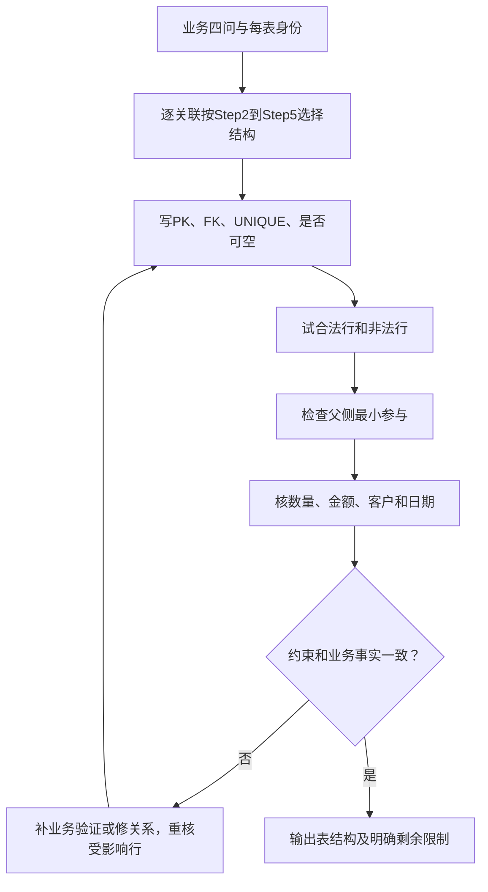

箭头是补充约束实施与查缺流程；重核受影响业务，不能填另一行配平。

**沿例子读图（笔记补充）**：假设客户 U1、U2 中，销售 S1、S2 都属于 U1。先定业务规则和表结构，再设 NOT NULL 与 FK，不设 UNIQUE，允许同客多笔销售。试行后进入“检查父侧最小参与”，会发现 U2 无销售；是否违规要看题面。金额、客户和日期另核，若不成立则沿回路修受影响规则或记录。

**图旁边界**：FK不保证每父至少一个子；复合键不保证分配合计≤付款，金额守卫另核。

**文字替代**：键约束之后还要核父侧最小参与、分配金额和业务范围，不靠FK包办全部规则。

<details><summary>读图自测：一收款实收1却分配5，PK/FK成立足够吗？</summary>

不够。“核数量、金额、客户和日期”阶段核分配总额，必须拒绝超额4或按明确业务修正。

</details>

**变式与答案**：若 S1 可重复与同 CR 做独立冲销/重分配，原两键 PK 不能容纳多次同对动作，需另定义 allocationID、时间/动作和业务粒度；若只有一次分配但需要 amountApplied，关联表直接带金额即可，不强制独立事件。空表 load 分母为0，不能凭空算100%；课件未给高低阈值，只能陈述分布条件和设计权衡。

#### 2.10.12 💡 五步转换法决策树（笔记补充，讲义无对应页）

> 讲义把五步放在p.43–53；下图是笔记为顺序执行和后续上机整理的总结。本次考试范围按S6的out of scope保留，不称考场必须使用。

**看图前先问**：面对不同min/max，哪一步先判断？

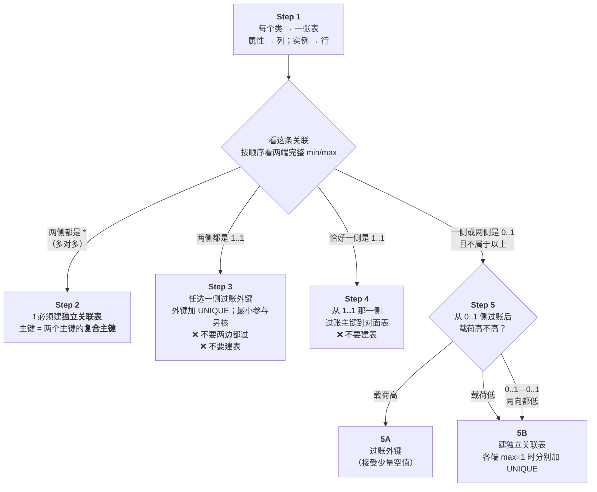

箭头代表按顺序选择结构，Step 5高低是给定分布的设计权衡。

**沿例子读图（笔记补充）**：练习 2 为 Sale 端 1..1、收款端 0..1。建类表后按顺序排除多对多和两端均 1..1，进入 Step 4，把 saleID 放入收款表；不能看到 0..1 就直接跳 Step 5。练习 4 两端最大值都是 *，因此在 Step 2 建 Duality 表。

**图旁边界**：无高低统一阈值；两端0..1比较两向，结果还须PK/FK/UNIQUE/额外检查。

**文字替代**：先按完整min/max依序选Step2–5，再写唯一/可空与额外约束；载荷没有通用阈值。

<details><summary>读图自测：两端1..1能把两边都存对方FK吗？</summary>

按本讲Step3选择一侧，避免同一配对两份独立权威事实；一对一须另核UNIQUE与父侧参与。

</details>

**⭐ 一句话记忆版**

> **多对多 → 建表；有 1..1 → 从它过账；只剩 0..1 → 算载荷，高就过账、低就建表。**

**⭐ 四道练习（§2.8）套进这棵树**

| 练习 | 多重性 | 走哪一步 | 结果 |
|---|---|---|---|
| 1（p.32） | `1..1 — 1..1` | **Step 3** | 任选一侧过账（讲义 p.49 演示） |
| 2（p.33） | `1..1 — 0..1` | **Step 4**（因为有一侧是 `1..1`） | 从 `1..1`（Sale）侧过账 saleID 进 CR 表 |
| 3（p.34）🎙️ 结论 / 💡 解释与转表 | `1..1 — 0..*` | **Step 4** | 从 `1..1`（Sale）侧过账 saleID 进 CR 表 |
| 4（p.35）🎙️ 结论 / 💡 解释与转表 | `0..* — 0..*` | **Step 2** | **必须建 Duality 关联表** |

> ⚠️ **练习 2 有一个容易搞混的地方**：`1..1 — 0..1` 同时出现在 Step 4 的列表（`1..1-0..1`）和 Step 5 的适用描述里（"一侧是 0..1"）。
> **正确判断：Step 4 优先。** 因为 Step 5 的开头写着 *"For **remaining** associations"*——"剩下的"意味着**前四步处理不了的才走第五步**。既然有一侧是 `1..1`，Step 4 就能给出无冗余、满载荷的答案，不需要走 Step 5。
> **⇒ 五步是有顺序的，必须从 Step 2 依次往下试。** 讲义没有明说这一点，记在 §9.3 ⑫。

**🎙️ 课堂补充**（S6 `01:04:14`–`01:13:46`，B · 讲了同讲义并明确降权）

课堂确实走完 Step 1–5 的基本想法，但开头明说转换题 *"is out of our scope"*（S6 `01:04:14`–`01:04:28`），结尾只要求 *"try to understand some basic ideas, that's enough"*（S6 `01:13:40`–`01:13:46`）。**这段改变了什么**：决策树可作为理解材料保留，考试复习优先级应低于多重度、属性和关系原则。

**所以呢**

五步转换法讲完，§2 的全部内容到此为止；下面用几张图把整讲的框架收束一遍。

---

## 3. 一图看懂

### 图 1 · REA 的完整结构（对应讲义 p.17 + p.19；展示构造型，端点多重性另见 §2.7–2.8）

**看图前先问**：这张REA概览怎样定位一次销售交换？

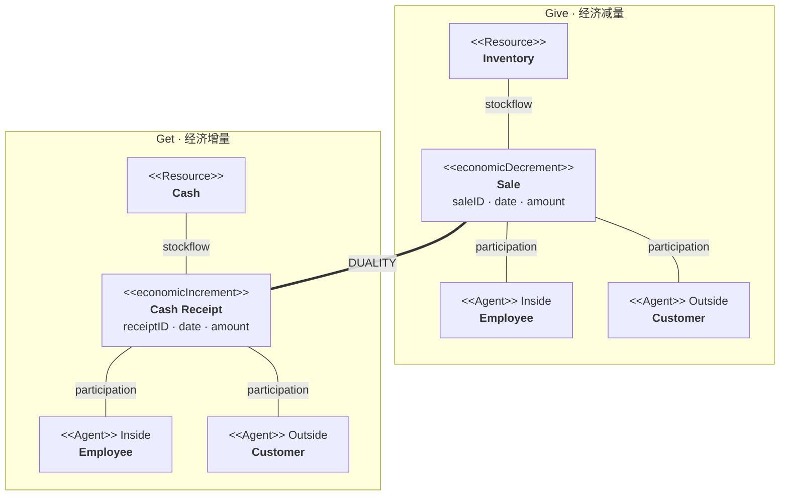

Give 表示企业失去资源，Get 表示企业获得资源。无方向关联分别是 stockflow 或 participation；粗线强调 DUALITY，不表示立即收款。

**沿例子读图（笔记补充）**：Give区的Sale关联Inventory曲奇、Paul与Joe，再沿DUALITY找到同一补例的Cash Receipt R001和现金10。此处是概念图，可列派生金额属性；最终Sale存储仍不另存amount，须由SaleLine汇总。

**图旁边界**：此图只做概念结构定位，未标min/max；Sale.amount等为概念层可导出资料，不是照抄的存储列。内部生产另按自身参与规则。

**文字替代**：总图定位give/get与资源角色，具体min/max必须回局部模型按两方向读。

<details><summary>读图自测：DUALITY能直接连Inventory与Cash吗？</summary>

不能。它连Sale和CashReceipt；两个资源各由stockflow连事件。

</details>

**这张图呈现本讲外部销售交换**：give/get 连接资源与内外参与者。

标题保留既有锚点；此总览图源未标具体 min/max，多重性请读 §2.7.8 和 §2.8 的局部图，不能把它当完整端点答案。内部生产/耗用不能强套外部参与者，事件配对也不自动证明金额完整。⚠️ `stockflow` 这个关联名是我按 REA 通行术语补的（💡），**讲义从未提到它**（§9.3 ⑦）。

---

### 图 2 · 两种范式的信息流（💡 笔记补充，对应 §2.3.2 与 §2.4.5）

**看图前先问**：两种表示各能直接回答什么，哪些仍需原明细？

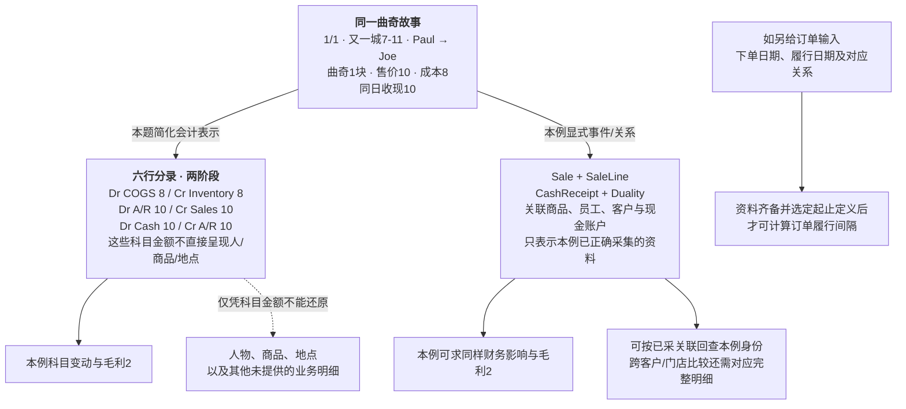

箭头表示同一完整故事被组织成两种表示，不代表删除原凭证；额外订单问题由另一组必要输入支持。

**沿例子读图（笔记补充）**：会计表示与事件表示都包含给货和收款。本例现金增加10、应收先加10再减10而净变动0、存货减少8、权益净增2。六行分录中的毛利仍为收入10减成本8；事件关系另外保留Paul、Joe、曲奇与地点，不能把只有给货四行的一路与已收现的一路当成同一完整状态。

**图旁边界**：这些是本例财务影响，不是完整财务报表；后者还需期初余额、其他业务及相应确认/计量/调整/列报规则。REA不自动无损或合规，实际复式系统也可另存业务明细。

**文字替代**：同一故事两种表示都要完整；本例的财务影响一致，能否进一步回查业务关系或比较其他对象取决于实际输入。

<details><summary>读图自测：把月末两总数放一起能反推每次毛利吗？</summary>

不能。需要逐笔配对的收入与成本明细；有没有它依实际保存结构。

</details>

这张图对照本讲简化科目汇总与显式事件关系。只剩科目合计，不能反推出未保存的商品/人员配对；真实凭证或业务明细有交易ID时仍可回查。

REA 也只回答已正确采集并关联的数据。生成财务报表仍要确认、计量、时间口径与适用规则，不能把图里的“查询生成”当自动合规。

---

### 图 3 · 从业务规则到数据库表的完整流水线（本讲方法论总结）

**看图前先问**：业务文字怎样经过多重性与表结构形成可建数据库？

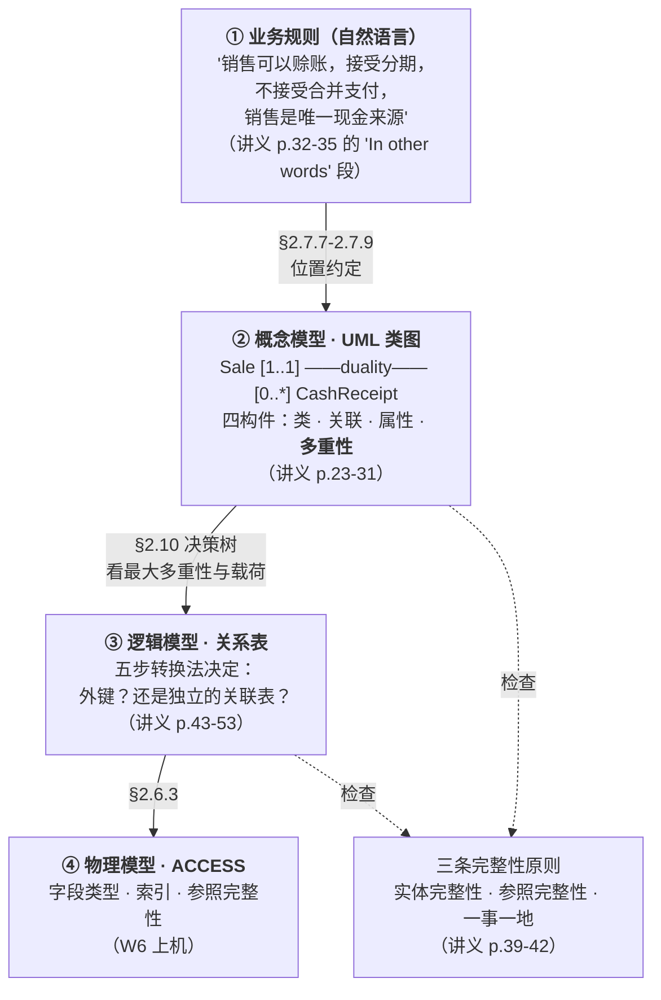

箭头是模型转换依赖，末尾完整性检查是检查条件，不表示所有完整性只靠FK。

**沿例子读图（笔记补充）**

1. ① 业务规则规定赊销、可分期、不合并支付且只收销售款。

2. ② 概念模型因此取 Sale 端 1..1、收款端 0..*。

3. ③ 逻辑模型走 Step 4，把 saleID 放入收款表。

4. ④ Access 物理模型落实外键和非空，再按末框检查实体、参照与一事一地原则。

**图旁边界**：练习 3 的 Yes/Yes/No/No 结论由 S6 `24:47`–`27:39` 课堂确认；逐端解释与转表是笔记补充。图是逻辑示意，未在 Access 物理环境执行。

**文字替代**：业务文字决定多重性，多重性决定表结构，软件实现后仍须完整性与业务核对。

<details><summary>读图自测：放saleID在CR后，需要Sale各行都有CR吗？</summary>

不需要，CR端最小0允许Sale未收款；每个已有CR必须对应一Sale。

</details>

**这张图在说**：本讲 52 页内容其实是**一条流水线**。业务规则 → 多重性 → 表结构，每一步都有明确的规则可循。**⚠️ 最关键的一步是①→②（把中文业务规则翻译成多重性数字），因为一旦这一步错了，后面全错。**

---

## 4. 速查表

### 4.1 复式记账 vs REA（讲义 p.2–5 的四页压成一张）

| | **传统复式记账**（p.2–3） | **REA 模型**（p.4–5） |
|---|---|---|
| **核心原理** | 每笔交易做一对借贷记录，维持 $A=L+E$（A为资产、L为负债、E为权益） | 围绕 **Resources / Events / Agents** 三要素建模 |
| **关注什么** | **财务结果**（利润、现金流） | **经济事件及其语义语境** |
| **记录单位** | **账户（Account）** | **事件（Event）** |
| **输出** | 标准化财务报表 | 结构化事件数据库（报表**查询生成**） |
| **强项 1** | 试算表检查**借贷算术相等**；不能发现整笔漏记、错科目或等额错记 | **整体视图**：财务 + 非财务数据一体 |
| **强项 2** | 便于符合 **GAAP / IFRS** | **流程优化**：映射事件序列找瓶颈 |
| **强项 3** | 软件生态成熟（**QuickBooks**）+ 税务打通 | **适应性**：支持实时分析与 **AI 预测** |
| **局限 1** | 本讲展示的**财务记录层**聚焦货币交易；真实凭证/ERP 可另存客户、商品和流程明细 | **实施复杂**：要重建数据库 + 培训人员 |
| **局限 2** | **历史导向**：主表着重过去业绩；仅凭该汇总不能回答全部实时运营问题，实际系统可另有实时明细 | ⭐ **缺乏标准化**：没有通用 REA 报告指引，**审计与跨公司比较困难** |

> ⚠️ 讲义 p.5 那句 *"reduced costs by 15%"* **无任何出处，不要引用**（§9.3 ②）。

### 4.2 REA 三要素与二元性

| 概念 | 英文 | 回答 | 例子 |
|---|---|---|---|
| 经济资源 | Economic Resource | **what** | Inventory、Cash、Equipment |
| 经济事件 | Economic Event | **what / when / where** | Sale、Cash Receipt、Purchase |
| 经济参与者 | Economic Agent | **who** | Employee（内部）、Customer（外部） |
| 内部参与者 | Inside Agent | 我方是谁 | Employee、Department |
| 外部参与者 | Outside Agent | 对方是谁 | Customer、Supplier |
| **二元性** | **Duality** | 核心交换中通常连接 give/get 事件；赊销可暂未收款，损耗/内部事件须按自身规则 | Sale ↔ Cash Receipt |
| 经济减量 | economicDecrement | 资源**流出**的事件 | Sale、Cash Disbursement |
| 经济增量 | economicIncrement | 资源**流入**的事件 | Cash Receipt、Purchase |

### 4.3 UML 类图四构件

| 构件 | 画法 | 要点 |
|---|---|---|
| **类 Class** | 标准三格框；本课可省空操作格，画类名/属性两格（S4 `22:04`–`23:01`） | 类 = 共享特征的实体集合；实体可以是**物理的或概念的** |
| **关联 Association** | 两框之间一条线 + 关联名 | 课程口径用“同一对一次/多次”区分；OMG AssociationClass 同时具有 Association 与 Class 性质，逻辑关联表是下一层实现 |
| **属性 Attribute** | 写在第二格 | 主键、简单与复合属性、可导出属性 |
| **多重性 Multiplicity** | 线两端的 `min..max` | ⭐ **写在类 Y 旁的数字 = 一个 X 能连几个 Y** |

**属性速查展开**：主键必须唯一且非空。普通属性要区分简单与复合；可导出属性还应区分静态与易变，以决定如何存储和维护。

### 4.4 ⭐ 多重性四问对照表（讲义 p.32–35 四道练习的通用解法）

| 问题 | 看哪个数字 |
|---|---|
| **Q1** 一个 X 能不能**没有** Y？ | **贴 Y 那侧的最小值**（0 = 能，1 = 不能） |
| **Q2** 一个 X 能不能有**多个** Y？ | **贴 Y 那侧的最大值**（`*` = 能，1 = 不能） |
| **Q3** 一个 Y 能不能**没有** X？ | **贴 X 那侧的最小值** |
| **Q4** 一个 Y 能不能有**多个** X？ | **贴 X 那侧的最大值** |

**业务措辞 → 数字**

| 业务描述 | 影响哪个数字 |
|---|---|
| *paid immediately / cash sale*（现销） | CR 侧最小 = **1** |
| *on credit*（赊销） | CR 侧最小 = **0** |
| *no partial payments*（不分期） | CR 侧最大 = **1** |
| *with partial payments*（分期） | CR 侧最大 = **\*** |
| *no combined payments*（不合并支付） | Sale 侧最大 = **1** |
| *combined payments accepted*（可合并支付） | Sale 侧最大 = **\*** |
| *sales are the only source of cash* | Sale 侧最小 = **1** |
| *cash comes from other sources* | Sale 侧最小 = **0** |

### 4.5 关系模型三原则

| 原则 | 讲义定义 | 违例长什么样 | 讲义页 |
|---|---|---|---|
| **实体完整性** | 主键**不能为 null** | 有一行没有主键值 | p.39 |
| **参照完整性** | 外键**要么 null，要么精确匹配**来源表的某个主键 | 外键值 234567 在来源表里不存在 | p.39–40 |
| **一事一地** | $\text{fact}=(\text{候选键值},\text{另一属性值})$，每个事实只出现一次一处 | ① **一事多地**：同一 CustomerID 对应的同一客户姓名/地址在多笔销售行重复（p.41）；不同ID的同名客户另判<br/>② **多事一地**：一格写 "BS,MBA"（**重复组**）（p.42） | p.39, 41, 42 |

### 4.6 ⭐ 五步转换法速查（考前一页纸）

| 情形 | 多重性模式 | 做法 | 讲义页 |
|---|---|---|---|
| **Step 1** | — | 每个类建立一张表 | p.43 |
| **Step 2 多对多** | `0..*—0..*` `0..*—1..*` `1..*—0..*` `1..*—1..*` | ❗**必须建独立关联表**，主键 = **复合主键** | p.45–47 |
| **Step 3 一对一** | `1..1—1..1` | 任选一侧过账外键 | p.48–49 |
| **Step 4 有一侧 1..1** | `0..*—1..1` `1..*—1..1` `1..1—0..*` `1..1—1..*` `0..1—1..1` `1..1—0..1` | **从 `1..1` 那侧过账**主键到对面表；❌不要建表 | p.50–52 |
| **Step 5 剩下的 0..1** | `0..*—0..1` `1..*—0..1` `0..1—0..*` `0..1—1..*` `0..1—0..1` | 比较载荷：高选 5A，低选 5B | p.53 |

**Step 5 的判断**：先尝试从可选一端过账，载荷高时接受少量空值（5A），低时另建关联表（5B）。两端均为 `0..1` 时比较两种方向，选载荷较高者；两向都低则建表。

**Step3的限制**：按本讲规则选一侧存对方键，不两边重复存同一配对，也不另建关联表；实施时相应FK须NOT NULL、UNIQUE并有参照完整性，另一侧每行至少被引用一次仍须额外核验。

**Step 1 的映射**：类变表，属性变列，每个实例变成一行；三者不是三个独立的建表动作。

**两条通则**（p.44）：
- **最大多重性**：只能**从 "1" 那侧过账**；**绝不能从 "\*" 那侧过账**（会产生重复组）— **硬约束**
- **减少空值的布局偏好**：讲义称 minimum rule；可在可行方向中权衡载荷，但不取消业务 min。
- **业务最小参与**：例如父对象至少一个子项，FK/Required若不能保证，须另用查询、表单流程或约束核验。

**两个指标**（p.43）：
- **冗余 Redundancy** = 一事多地 或 多事一地
- **载荷 Load** = **一列中非空值的百分比**

---

## 5. 双语术语卡

每行定位名称及首现处。下面英文表达依据讲义、正文和补充来源整理，不把整句都冒称逐字课件原文；需要原句时回§2有页码的引用块。

| 中文 | English | 首现 |
| --- | --- | --- |
| 复式记账 | (Traditional) Double-Entry Bookkeeping | §2.1.1 |
| REA 会计模型 | REA Accounting Model | §2.1.3 |
| 语义语境 | Semantic Context | §2.1.3 |
| 人工构造物 | Artifact | §2.3.1 |
| 经济资源 | Economic Resource | §2.5.1 |
| 经济事件 | Economic Event | §2.5.1 |
| 经济参与者 | Economic Agent | §2.5.1 |
| 内部 / 外部参与者 | Inside / Outside Agent | §2.5.3 |
| 二元性 | Duality | §2.5.2 |
| 经济减量 / 增量 | economicDecrement / economicIncrement | §2.7.8 |
| 概念模型 | Conceptual Model | §2.6.1 |
| 逻辑模型 | Logical Model | §2.6.2 |
| 物理数据库模型 | Physical Database Model | §2.6.3 |
| XBRL | eXtensible Business Reporting Language | §2.6.1 |
| UML 类图 | UML Class Diagram | §2.7.1 |
| 实体 | Entity | §2.7.2 |
| 类 | Class | §2.7.2 |
| 构造型 | Stereotype | §2.7.3 |
| 关联 | Association | §2.7.4 |
| 关联类 | Association Class | §2.7.4 |
| 具象化关联 | Reified Association | §2.7.4 |
| 属性 | Attribute | §2.7.6 |
| 主键 | Primary Key | §2.7.6 |
| 候选键 | Candidate Key | §2.9.4 |
| 简单 / 复合属性 | Simple / Composite Attribute | §2.7.6 |
| 可导出属性 | Derivable Attribute | §2.7.6 |
| 静态 / 易变 | Static / Volatile | §2.7.6 |
| 多重性 | Multiplicity | §2.7.7 |
| 最小多重性 | Minimum Multiplicity | §2.7.7 |
| 最大多重性 | Maximum Multiplicity | §2.7.7 |
| 关系数据库 | Relational Database | §2.9.1 |
| 外键 | Foreign Key | §2.9.1 |
| 元组 | Tuple | §2.9.2 |
| 表的内涵 / 模式 | Table Intension / Schema | §2.9.2 |
| 空值 | Null | §2.9.4 |
| 实体完整性 | Entity Integrity | §2.9.4 |
| 参照完整性 | Referential Integrity | §2.9.4 |
| 一事一地 | One Fact, One Place | §2.9.4 |
| 重复组 | Repeating Group | §2.9.7 |
| 冗余 | Redundancy | §2.10.1 |
| 载荷 | Load | §2.10.1 |
| 过账（数据库义） | Post | §2.9.1 |
| 复合主键 | Composite / Concatenated Primary Key | §2.10.3 |

中文/English对照名称，首现是学习定位；数量/金额没有从定义表产生。读Load时，分母是所讨论表的行数，完整950/1000例见2.10.1。

**复式记账**

笔记整理的考试英文表达：Records every transaction with dual entries (debit/credit) to maintain the accounting equation $\text{Assets}=\text{Liabilities}+\text{Equity}$; focuses on financial outcomes and uses standardized financial statements.


**REA 会计模型**

笔记整理的考试英文表达：Models business activities around three core elements — Resources, Events and Agents — recording economic events in their **semantic context** rather than as debits/credits.


**语义语境**

笔记整理的考试英文表达：Recording an event together with the resource exchanged, the agents involved and the related events, instead of translating it into account balances.


**人工构造物**

笔记整理的考试英文表达：Something **manufactured, not naturally occurring**; debits, credits and accounts are artifacts that **obscure details of business transactions needed for non-accounting purposes**.


**经济资源**

笔记整理的考试英文表达：The "what": things of economic value that events increase or decrease (inventory, cash, equipment).


**经济事件**

笔记整理的考试英文表达：The "what, when, where": a business activity that changes resources (sale, purchase, production).


**经济参与者**

笔记整理的考试英文表达：The "who": persons or organisations participating in events (customers, employees, suppliers).


**内部 / 外部参与者**

笔记整理的考试英文表达：The agent belonging to the enterprise / to the outside party. External exchange events usually involve inside and outside agents; internal events and losses require their own participation rules.


**二元性**

笔记整理的考试英文表达：There is usually **a pair of events** at the heart of REA: one represents a resource being **given away or lost**, another a resource being **received or gained**; the two are linked.


**经济减量 / 增量**

笔记整理的考试英文表达：Stereotypes marking events that decrease / increase a resource; in the core exchange pattern, duality usually links a give event with a get event. Credit sales, losses and internal events require their stated participation rules.


**概念模型**

笔记整理的考试英文表达：A representation that depicts **the important objects and the relationships between the objects** that must be captured in a database.


**逻辑模型**

笔记整理的考试英文表达：A conceptual model converted **once the type of database has been determined** (relational, object-oriented, hierarchical, network).


**物理数据库模型**

笔记整理的考试英文表达：Created based on **the specific database software package** in which the database is implemented.


**XBRL**

笔记据XBRL官方来源整理的英文表达（非逐字引用）：XBRL is a global standard for machine-readable digital business reporting. It tags reporting concepts together with their contexts, periods and units. The lecture lists XBRL on a conceptual-modeling slide, but that slide position is not its formal definition.


**UML 类图**

笔记整理的考试英文表达：The four constructs: **classes, associations, attributes and multiplicities**; appropriate for conceptual modeling of REA concepts.


**实体**

笔记整理的考试英文表达：A real world object that has a **separate existence, either physical or conceptual**.


**类**

笔记整理的考试英文表达：A **set of entities that share the same characteristics**; drawn as a three-compartment box.


**构造型**

笔记整理的考试英文表达：A **generalized type of class to which other classes may belong**, written in `<< >>` above the class name.


**关联**

笔记整理的考试英文表达：A relationship between classes.


**关联类**

考试作答分层：For this course, the slide distinguishes it from reification by allowing only one link for the same entity pair. In formal UML, an AssociationClass has both Association and Class properties and may own features of the relationship.


**具象化关联**

笔记整理的考试英文表达：An association in which there can be **multiple links** between the related entities, so it needs its own identifier.


**属性**

笔记整理的考试英文表达：Characteristics or elementary properties of **classes and/or associations**.


**主键**

笔记整理的考试英文表达：An attribute that **uniquely and universally identifies** each instance of a class or association.


**候选键**

笔记整理的考试英文表达：Attributes which **can be used as** primary key attributes.


**简单 / 复合属性**

笔记整理的考试英文表达：Simple cannot be further decomposed; composite may be decomposed into other attributes.


**可导出属性**

笔记整理的考试英文表达：Can be derived / computed from the values of other attributes in the database.


**静态 / 易变**

笔记整理的考试英文表达：Static: **will not change** if new data is entered into the system. Volatile: **will change** if new data is entered.


**多重性**

笔记整理的考试英文表达：**How many times an instance of a class is allowed to participate in an association**; written `minimum..maximum`.


**最小多重性**

笔记整理的考试英文表达：The minimum number of times one instance **must** participate. **0 = optional participation**, **1 = mandatory participation**.


**最大多重性**

笔记整理的考试英文表达：The maximum number of times one instance **may** participate. **1 = one-time only**, **\* = as many times as needed, no restrictions**.


**关系数据库**

笔记整理的考试英文表达：Consists of **tables (relations)** linked together via the use of **primary and foreign keys**.


**外键**

笔记整理的考试英文表达：**A primary key from a different table that has been posted into the table** to create a link between the two tables.


**元组**

笔记整理的考试英文表达：A tuple is one row. The extension is the collection of rows, whose order does not determine their meaning.


**表的内涵 / 模式**

笔记整理的考试英文表达：A table’s structure, including its column definitions and stated constraints; data types matter, while column position alone does not define the business meaning.


**空值**

笔记整理的考试英文表达：A marker for missing or unknown information, distinct from numeric zero and an empty string.


**实体完整性**

笔记整理的考试英文表达：**A primary key in a table must not contain a null value.**


**参照完整性**

笔记整理的考试英文表达：A value for a foreign key must either **be null (blank)** or **match exactly** a value for the primary key in the table from which it was posted.


**一事一地**

笔记整理的考试英文表达：A **fact = a pairing of a candidate key attribute value with another attribute value**; each fact must appear once and in one place only.


**重复组**

笔记整理的考试英文表达：Two or more attribute values in one cell — i.e. **multiple facts in one place**; not allowed.


**冗余**

笔记整理的考试英文表达：**One fact in multiple places, or multiple facts in one place.**


**载荷**

笔记整理的考试英文表达：**The percentage of non-null values in a column.**


**过账（数据库义）**

笔记整理的考试英文表达：To copy a table's primary key into another table as a foreign key. ⚠️ Different from the accounting "posting" (journal → ledger).


**复合主键**

笔记整理的一般英文定义：A primary key consisting of two or more columns that jointly identify a row. In the lecture's many-to-many conversion example, it combines the foreign keys copied from the related class tables.

一般定义不是“必来自两张主表”：`(saleID,lineNo)`也可为复合主键；完整组合才唯一，不能把其中一列单独当键。


---

## 6. 考点预判与答题框架

### 6.1 可信度分级

| 级别 | 含义 | 本讲数量 |
|---|---|---|
| 🔴 教授明示 | 转录里教授明确说过会考 / 要记 / 规定答题方式或降权 | 4 条（含 1 条反向） |
| 🟡 CILO 反推 | 对应官方 CILO 或期中考 Rubric | 4 条（含课堂确认） |
| ⚪ 笔记推断 | 根据篇幅分配、页面设计、题型惯例 | 8 条 |

**计数说明**：§6.2 当前有 4 条教授明示（含 1 条反向）、4 条 CILO／课堂确认和 8 条笔记推断。2026-10-07 的“新增 1 条”属于历史批次；本次另补多重度、关系原则的考试例示及转换段反向降权。

> 本次 S6 补入多重度、关系原则和转换段范围的明确课堂证据；其余未获题型明示的条目继续保留 🟡/⚪。没有由课表周次推断具体考题。

**本讲挂靠的官方口径**：
- **CILO 1**：*"Describe and explain the **basic accounting concepts** …"*
- **期中考 Rubric**：*"Ability to **explain** the concepts, types, and implementation of AI, as well as the knowledge related to **basic accounting concepts**"*
- ⚠️ **官方 Keyword Syllabus 完全没有提到 REA / UML / 数据库建模**，但据 [[AC6761_Artificial_Intelligence_Accounting/00-课程总览|00-课程总览]] 记录的 W01 转录，**期中考范围明确是 W1–W5，REA 占 W4–W5 两周**。**⇒ 具体范围结合课表和教师通知核对；Keyword列表不列每个细项，不能据此贬低整份官方大纲。** Outline 的 Abstract/Tentative Schedule 本来就包含业务流程建模及W4/W5 REA主题。


### 6.2 考点清单

| 可信度 | 考点 | 依据 | 对应小节 |
|---|---|---|---|
| 🔴 | **理解属性分类并能举例，不能只机械复述概念** | 🎙️ S4 `29:06`：*"you should be able to name some examples"* | §2.7.6 |
| 🟡 | **复式记账 vs REA 的对比**（原理、强项各 3 条、局限各 2 条） | 讲义用 **4 整页**（p.2–5）对称呈现；CILO 1 | §2.1、§4.1 |
| 🟡 | **REA 三要素的定义与 what/when/where/who 对应** | 讲义 p.4、p.17 两处给出；这是模型的名字本身 | §2.5.1 |
| 🟡 | **duality（二元性）的定义与 give/get 结构** | 讲义 p.18 整页 + p.19 整页图 | §2.5.2–2.5.3 |
| 🔴 | 多重性读法及概念图填图要求 | 后续M05段S6 `01:24:55`：*"you need to determine the multiplicities, okay?"*；完整属性/关联名要求及“最难不等于会考”的解释见表后 | §2.7–§2.8 |
| 🔴 | **关系模型三原则**（实体完整性、参照完整性、一事一地） | 🎙️ S6 `48:04`：*"these are the three most important principles related to the relational model"*；Entity Integrity 例题信号见 `38:11`–`38:37` | §2.9.4–2.9.7 |
| 🔴（反向） | **五步转换法只需理解基本想法，不作为考试题** | 🎙️ S6 `01:04:14`–`01:04:28`：*"it is out of scope, which means that you are not required to [answer] any questions related to this part"*；`01:13:40`–`01:13:46` 再次降权 | §2.10 |
| ⚪ | **McCarthy 1982 与 "artifact" 的含义** | 讲义 p.9 整页，且是全章的理论支点 | §2.3.1 |
| ⚪ | **给一段业务描述，标出多重性** | p.31 就是这种题型的示范；p.32–35 是它的反向 | §2.7.9、§7 |
| 🟡（课堂确认） | **p.34 / p.35 两道讲义空白练习** | S6 `24:47`–`29:45` 已逐题讲评；答案来源是课堂确认，不是讲义官答 | §2.8.3–2.8.4 |
| ⚪ | **给一张有问题的表，指出违反了哪条原则** | p.40/41/42 三页都是这个形态 | §2.9.5–2.9.7 |
| ⚪ | **把一笔交易同时写成分录与 REA 结构** | p.11–16 用 6 页讲一个例子 | §2.4 |
| ⚪ | **概念/逻辑/物理三层模型的区别与触发条件** | 讲义 p.20–22 各一页 | §2.6 |
| ⚪ | **属性的四种分类**（主键、简单/复合、可导出的静态/易变） | 讲义 p.28 整页 | §2.7.6 |
| ⚪ | **载荷（load）的定义与它在 Step 5 里的作用** | 讲义 p.43 给定义、p.53 用它做判断 | §2.10.1、§2.10.11 |
| ⚪ | **REA 与 AI 的关系** | 讲义 p.5 唯一一处 *"AI-driven forecasting"*；课程名里有 AI | §2.1.4 |

**后续M05段回提的期中格式（同一S6时钟，非M04当时时段）**：教师说会提供连接好的类骨架，学生补信息：

> *"I will provide the pattern to you by link all the classes together, but you need to determine the attributes."*（S6 `01:24:30`）

> *"You need to put the name for the associations, and you need to determine the multiplicities, okay?"*（S6 `01:24:55`）

S6 `01:32:58`–`01:33:36`、`01:45:25`–`01:45:55`再次说明骨架与要填项目。它支持上述具体题型要求，不保证某张已知图会原样出现或给定分值；“最难”本身仍不是会考承诺。

**属性举例的课堂要求（S4）**：

> *"you should be able to name some examples."*（`29:06`）

> *"That is my request."*（`29:11`）

教师要求能举例解释属性分类，不能只机械复述概念；原话未承诺具体题型或分值。

### 6.3 答题框架

#### 框架 A · "对比复式记账与 REA"型（🟡 最可能的论述题）

期中考 Rubric 的动词是 **explain**，所以：

```
1. 各自的 Core Principle（一句话，用讲义原句）
2. 关键差异（记录单位：account vs event；关注点：outcome vs semantic context）
3. 复式记账的 3 强 2 弱（讲义 p.3）
4. REA 的 3 强 2 弱（讲义 p.5）
5. 条件结论：本讲简化科目汇总与事件资料回答不同问题；正确采集的细粒度数据可衔接汇总/对外报告，并非唯一架构，也不自动改变确认与列报规则
```

**示范开头**（可背）：

> *"Traditional double-entry bookkeeping **records every transaction with dual entries (debit/credit) to maintain the accounting equation**, focusing on **financial outcomes**. The REA model instead **models business activities around three core elements — Resources, Events and Agents — and records economic events in their semantic context rather than as debits/credits**. The essential difference is the unit of record: double-entry records **accounts**, REA records **events**."*

#### 框架 B · "读多重性 / 标多重性"型（⭐ 最可能的计算/判断题）

**读图（给图问业务）**：
```
1. 先指出哪对数字贴在哪一侧
2. 用自检句念一遍："对面那个类的每一个实例，能连 [数字] 个我这边的类"
3. 逐条回答 Q1–Q4（用 §4.4 的对照表）
4. 每个答案都写明依据："No – 1 min next to CR"（照讲义的答案格式）
```
笔记建议用 `Yes/No – [数值] [min/max] next to [类名]`清楚写出依据；这是按p.32–33示范整理的答法，不冒称教师规定的唯一英文句式或得分保证。

**标图（给业务标数字）**：
```
1. 把业务描述拆成四句话（对应 Q1–Q4）
2. 用 §4.4 下半张表把措辞翻译成数字
3. ⚠️ 注意写在对面那一侧
4. 用自检句反向验证一遍
```

#### 框架 C · "把概念模型转成表"型（🔴 反向降权：只作理解/W6 前置，本次考试不要求）

```
1. Step 1：先把每个类写成一张表（列出属性）
2. 对每一条关联，走 §2.10.12 的决策树：
   看两侧最大多重性 → 多对多？一对一？有 1..1？剩下的 0..1？
3. 写出最终的表结构，用 * 标出外键，用下划线标出主键
4. ⭐ 说明理由：为什么这样做能避免冗余、保证载荷
5. （加分）指出如果反方向做会出什么问题（重复组 or 空值）
```

> 🎙️ S6 `01:04:14`–`01:04:28` 明确转换题 out of scope。以下示范用于理解为什么多重性会影响表结构，并为 W6 Access 铺路，不列为本次期中优先题型。

**示范**（练习：把 §2.8.4 练习 4 的模型转成表）

> The association is `Sale 0..* — duality — 0..* Cash Receipt`, a **many-to-many** association. By Step 2, I **must create a separate table**; posting a foreign key in either direction would cause **repeating-group redundancy**, because a sale may relate to multiple cash receipts and a cash receipt may relate to multiple sales.
>
> ```
> Sale(saleID, date, amount, ...)
> CashReceipt(receiptID, date, amount, ...)
> Duality(saleID, receiptID)     ← composite primary key
> ```
> The primary keys of the two related class tables are posted into the association table to form a **composite (concatenated) primary key**, which avoids redundancy.

#### 框架 D · "指出这张表的问题"型

```
1. 逐条对照三原则：主键有 null 吗？外键指向存在吗？有重复的事实或一格多值吗？
2. 指名违反了哪一条（用英文原名：Entity Integrity / Referential Integrity / One Fact One Place）
3. 说明具体在哪一行哪一列
4. 说明后果（更新异常 / 无法查询 / 审计轨迹断裂）
5. 给出修正方案（拆表 + 外键）
```

---

## 7. 自测

**概念题**

**1.** McCarthy 说 debits、credits、accounts 是 "artifacts"。请解释 artifact 的定义，以及他为什么主张消灭它们。

<details><summary>答案</summary>

**定义**（讲义 p.9 原句）：*"**Artifacts are manufactured, not naturally occurring.**"* —— 人工构造物是**被制造出来的，不是自然发生的**。

**为什么要消灭**（讲义 p.9）：*"Accounting artifacts **obscure details of business transactions needed for non-accounting purposes**."* —— 它们**遮蔽了**业务交易中那些**非会计用途所需要的细节**。

**展开**：一笔销售真实发生的是"某人在某时某地把某物给了某人换回多少钱"；若只保留本讲简化分录和科目汇总，谁、地点、商品等字段无法从汇总数反推；真实凭证、辅助账或 ERP 若另存明细则仍可回查。对会计够用，对生产/销售/客服完全不够。

**McCarthy 的替代方案**：聚焦 *"natural phenomena common to most enterprises"* —— 即 Resources、Events、Agents 三类自然存在的对象。

**目标**（讲义 p.9 最后一句）：*"developing **integrated enterprise systems** that can satisfy accounting needs **while also satisfying needs of other business areas**"*。→ §2.3.1

</details>

**2.** 什么是 duality？它与复式记账的 "double entry" 是同一件事吗？

<details><summary>答案</summary>

**定义**（讲义 p.18）：*"There is usually **a pair of events** at the heart of REA. One represents a resource being **given away or lost**, while another represents a resource being **received or gained**."* 两个事件被链接起来——收款与销售相交换。

**不是同一机制，不能由词根推断同源。** 本曲奇交换例中，借贷核一次记录内的金额平衡；duality关联Sale与CashReceipt，不把两个事件当借和贷：

| | 复式记账 | REA |
|---|---|---|
| 检查什么 | **金额**（借方合计 = 贷方合计） | 核心交换中的 give/get 关联；未结清与内部事件另行判断 |
| 约束对象 | 每次记录借方合计等于贷方合计；仍另核漏错 | 销售10先收5尚欠5，再收5才结清；单次关联可只应用部分，累计应用不能超过销售/实收，标结清才要求相等 |

**讲义还给了一个"更复杂"的例子**：*"a **product conversion** occurs in exchange for a **usage of raw material, labor cost and overhead**"* —— 说明 duality **不一定是一对一**，可以是多对一。→ §2.5.2

</details>

**3.** 图上写着 `Customer [1..1] —— participation —— [0..*] Sale`。请回答：（a）一笔销售能有几个客户？（b）一个客户能有几笔销售？（c）这两对数字分别贴在哪一侧？

<details><summary>答案</summary>

（a）**恰好 1 个。** 依据：`1..1` 贴在 **Customer** 侧 ⇒ 对面（Sale）的每个实例能连 1..1 个 Customer。
（b）**0 到多笔。** 依据：`0..*` 贴在 **Sale** 侧 ⇒ 对面（Customer）的每个实例能连 0..* 个 Sale。
（c）**`1..1` 贴 Customer 侧，`0..*` 贴 Sale 侧。**

⚠️ **注意这与直觉相反**：`1..1` 贴着 Customer，说的却是"每笔销售一个客户"，**不是**"每个客户参与一次"。讲义 p.30 的四行文字正是在纠正这个直觉：*"Customer can participate in the association 0 time / multiple times; Sale can participate at least once / at most once."*

**自检句**（背下来）：「**对面**那个类的**每一个**实例，能连 **[这对数字]** 个 **我这边**的类。」→ §2.7.8

</details>

**4.** 什么是 load（载荷）？它在五步转换法的哪一步起作用？举例说明。

<details><summary>答案</summary>

**定义**（讲义 p.43）：*"**Load = the percentage of non-null values in a column**"* —— **一列中非空值所占的百分比**。

**在 Step 5 起作用**（讲义 p.53）：先排除 Step2–4 已处理的模式，**剩余**含 `0..1` 的五种模式才比较载荷。最大规则限制可行方向；为减少空值提出的布局偏好可以让步，业务最小参与仍须落实：
- **5A 载荷高** ⇒ **过账外键**（接受少量空值）
- **5B 载荷低** ⇒ **建独立的关联表**
- `0..1—0..1` ⇒ 选载荷最高的方向；两向都低则建表

**例**：1000笔销售中950笔有销售员，Load=95%；若只有30笔则Load=3%。前者可作较稠密、后者较稀疏的示例，再比较直接FK和另表成本，不由这两个数定义全局阈值或唯一方案。

⚠️ **讲义没有给"高/低"的阈值**，答题时说清权衡逻辑即可，不要编一个数字。→ §2.10.1、§2.10.11

</details>

**5.** 下面这张表违反了哪条原则？为什么？怎么改？

| EmployeeID | Name | Office | Degree Earned |
|---|---|---|---|
| 1 | Tony | Cleveland | BS,MBA |
| 2 | Emily | New York | BA,MBA,PhD |

<details><summary>答案</summary>

**违反 One Fact, One Place**，具体形态是 **"multiple facts in one place"**，也叫 **repeating group（重复组）**；同时违反 §2.9.2 的 *"Each cell can contain only one value"*。

**为什么**（讲义 p.42 原句）：*"Each value of each attribute in a row is **paired with the primary key**, so if any cell has **two or more attribute values**, by definition there are multiple facts in one place."*

Emily 那一行的 `Degree Earned` 格里其实藏着 3 个事实：`(2, BA)`、`(2, MBA)`、`(2, PhD)`。

**后果**：`WHERE Degree='MBA'` 把整格与 `MBA` 比较，因此 `BS,MBA` 与 `BA,MBA,PhD` 两格都不相等。直接按原字符串分组会把两种组合各算一组，不能直接得到每种学位的人数。仍可另写拆分解析或校验规则，但需要额外处理；新增学位也要改同一字符串。

**改法**：拆成两张表
```
Employee(empID, name, office)
EmployeeDegree(empID*, degree)   ← 复合主键 (empID, degree)
```
→ §2.9.7

</details>

**6.** `Sale [1..1] —— duality —— [0..*] Cash Receipt`。用五步转换法把它转成表，并说明理由。

<details><summary>答案</summary>

**Step 1**：先各建一张表
```
Sale(saleID, date, amount)
CashReceipt(receiptID, date, amount)
```

**判断走哪一步**（用 §2.10.12 决策树）：
- 两侧最大是 `1` 和 `*` ⇒ **不是多对多**（排除 Step 2）
- 不是 `1..1—1..1`（排除 Step 3）
- ⭐ **恰好有一侧是 `1..1`（Sale 侧）⇒ 走 Step 4**

**Step 4 做法**：*"Post a foreign key **FROM the 1..1 class' table INTO the other class' table**"* ⇒ 把 `saleID` 过账进 CashReceipt 表：

```
Sale(saleID, date, amount)
CashReceipt(
  receiptID PRIMARY KEY,
  receiptDate, amount,
  saleID NOT NULL REFERENCES Sale(saleID)
)
```

`CashReceipt.saleID` **不加 UNIQUE**，因为同一 Sale 可被多笔 CashReceipt 重复引用；`NOT NULL + FK` 保证每笔收款恰好引用一笔存在的 Sale。本题**每笔 Sale 可对应0个 CashReceipt，0贴在CR端；Sale端仍为1**。因此不强迫每笔Sale已有收款，不能把“谁的参与次数”与“数字贴谁旁边”混说。

**理由**（讲义 p.50 原句）：*"Posting FROM a 1..1 guarantees that **each related class instance will have a value** and that **each related class instance will have only one value**"* ⇒ 每笔收款必有且只有一个对应的销售 ⇒ **载荷 100%、无重复组**。

**如果反方向做会怎样**：把 `receiptID` 过账进 Sale 表 ⇒ 一笔销售可能有多笔收款（分期）⇒ 一格要塞 "CR1, CR2, CR3" ⇒ **重复组**，违反 One Fact One Place。→ §2.10.8

</details>

**案例分析题**

**7.**（讲义 p.34 原题）业务规则是："销售可以赊账**并接受分期付款**，但**不接受合并付款**，且销售是公司唯一的现金来源。" 请标出 `Sale —— duality —— Cash Receipt` 的多重性，并回答 Q1–Q4。

<details><summary>答案（讲义留白；S6 课堂确认）</summary>

**完整推导见 §2.8.3。结论：**

```
Sale ──[1..1]────── duality ──────[0..*]── Cash Receipt
```

| 问题 | 答案（照讲义格式） |
|---|---|
| Q1 销售能否无收款 | **Yes – 0 min next to CR**（赊销） |
| Q2 一笔销售能否多次收款 | **Yes – \* max next to CR**（分期付款） |
| Q3 收款能否无销售 | **No – 1 min next to Sale**（销售是唯一现金来源） |
| Q4 一次收款能否多笔销售 | **No – 1 max next to Sale**（不接受合并付款） |

**转成表**：走 Step 4，从 `1..1`（Sale）侧过账 ⇒ `CashReceipt(receiptID, date, amount, saleID*)`

⚠️ 讲义 p.34 留白；Yes/Yes/No/No 已由 S6 `24:47`–`27:39` 课堂确认。逐端理由与英文表述为笔记补充。最终表约束为 `CashReceipt.saleID NOT NULL FK`，且不加 UNIQUE，因为一笔 Sale 可对应多笔收款。

</details>

**8.**（讲义 p.35 原题）业务规则是："销售可以赊账，**接受分期付款也接受合并付款**，且**现金来自销售以外的来源**。" 同样标多重性、答 Q1–Q4，并把它转成表。

<details><summary>答案（讲义留白；S6 课堂确认）</summary>

**完整推导见 §2.8.4。结论：**

```
Sale ──[0..*]────── duality ──────[0..*]── Cash Receipt     ⭐ 多对多
```

| 问题 | 答案 |
|---|---|
| Q1 | **Yes – 0 min next to CR**（赊销） |
| Q2 | **Yes – \* max next to CR**（分期） |
| Q3 | **Yes – 0 min next to Sale**（现金有其他来源，如银行贷款） |
| Q4 | **Yes – \* max next to Sale**（合并付款：一次汇款结清三笔订单） |

**转成表**：多对多 ⇒ **Step 2，必须建独立关联表**
```
Sale(saleID, date, amount)
CashReceipt(receiptID, date, amount)
Duality(
  saleID NOT NULL REFERENCES Sale(saleID),
  receiptID NOT NULL REFERENCES CashReceipt(receiptID),
  amountApplied NOT NULL CHECK(amountApplied > 0),
  PRIMARY KEY(saleID, receiptID)
)
```
复合主键保证同一 Sale–Receipt 配对当前只出现一次；两个 FK 保证端点存在。局部键约束仍不保证金额守恒：还必须检查每笔收款的 `SUM(amountApplied) <= CashReceipt.amount`，每笔销售的 `SUM(amountApplied) <= Sale` 明细总额；只有标为结清时才要求相等。若要保留同一配对的多次重分配/冲销历史，则改用 `allocationID` 与有效时间。

**为什么不能过账外键**（讲义 p.45）：*"If you post a foreign key in **either** direction, redundancy will be a problem for many-to-many associations."*

⚠️ 讲义 p.35 留白；四个 Yes 已由 S6 `27:51`–`29:45` 课堂确认。表结构与金额守恒检查为笔记补充。

</details>

**9.** 把 §2.4 的曲奇故事（1/1/2013，又一城 7-11，Paul 卖给 Joe 一块曲奇，售价 \$10、成本 \$8）**同时**写成复式记账分录和 REA 结构，并说明仅凭本题简化的科目金额汇总不能直接回答哪些业务细节。

<details><summary>参考思路</summary>

**复式记账**（讲义 p.14、p.16）：
```
Dr. Cost of Goods Sold  8      Cr. Inventory       8
Dr. A/R                10      Cr. Sale Revenue   10
--- 收款时 ---
Dr. Cash               10      Cr. A/R            10
```

**REA 与唯一逻辑 schema**（💡 §2.4.5、§2.9.9）：
```
Resource:    Inventory(C01, Cookie)、CashAccount(CA01)
Event:       Sale(S001, 2013-01-01, Festival Walk 7-11, E01, U01)
Detail:      SaleLine(S001, line 1, C01, quantity 1, unitPrice 10, unitCost 8)
             CashReceipt(R001, 2013-01-01, amount 10, CA01, E01, U01)
Agent:       Employee(E01, Paul)、Customer(U01, Joe)
Allocation:  Duality(S001, R001, amountApplied 10)
```
概念层可以说 Sale 有“金额/成本”这样的可导出属性；本篇逻辑存储不在 Sale 表重复保存它们，而是由 SaleLine 汇总。

**本讲简化科目汇总不直接展示以下信息；真实复式凭证/业务明细可另保存**：
- ❌ **地点**（Festival Walk 7-11）
- ❌ **卖方是谁**（Paul）
- ❌ **买方是谁**（Joe——A/R 只有一个总额）
- ❌ **商品是什么**（Inventory 只有一个总额）
- ❌ **售价与成本属于同一笔交易的配对关系**（只剩合计时不能反推；若原凭证/明细留存ID仍可回查，§2.3.2）

本题简化表示直接给出了日期、各科目和相关金额；它还包含收款分录，不能把完整故事的财务内容数成只有日期/售价/成本三项。

**⭐ 关键结论**：已正确采集的事件与明细仍能生成会计数字。销售收入来自 `SUM(SaleLine.quantity*unitPrice)`，销货成本来自 `SUM(SaleLine.quantity*unitCost)`；能否反查人员、地点和商品取决于系统是否实际保存并正确关联这些字段。→ §2.9.9

</details>

**10.** 期中考若出 *"Explain the strengths and limitations of the REA model compared with traditional double-entry bookkeeping."*，你怎么组织？

<details><summary>参考思路</summary>

可用§6.3框架A组织四段，保留讲义关键术语并说明其范围；逐字引文、中文解释和笔记补充区分，不把机械背整句当理解。

**1. 两者的 Core Principle**（p.2、p.4）—— 一句一个，点出 "financial outcomes" vs "semantic context" 的对立。

**2. 复式记账的 3 强 2 弱**（p.3）
- 强：mathematical accuracy via trial balances；GAAP/IFRS compliance；软件生态（QuickBooks）+ 税务打通
- 弱：**limited scope**（只记货币交易，忽略客户满意度与生产效率）；**historical focus**（报过去而非实时洞察）

**3. REA 的 3 强 2 弱**（p.5）
- 强：**holistic view**（订单履行时长、资源利用率）；**process optimization**（找生产瓶颈）；**adaptability**（实时分析 + AI 预测）
- 弱：**complex implementation**（重建数据库 + 培训）；⭐ **lack of standardization**（没有通用 REA 报告指引，审计与跨公司比较困难）

**4. 结论（加分段）**
- 两者的强弱**恰好互补**：REA 的 holistic view 对复式记账的 limited scope，REA 的 real-time 对它的 historical focus；反过来复式记账的 GAAP 合规正是 REA 缺乏标准化的解药
- **有限结论**：细粒度业务系统可以与对外财务报告衔接；本讲材料不证明所有企业内部系统采用 REA，也不证明采用 REA 就会自动生成合规 IFRS 报表
- 引 McCarthy 的目标（p.9）：*"integrated enterprise systems that can satisfy accounting needs while also satisfying needs of other business areas"*

**⚠️ 不要引用 p.5 那句 "reduced costs by 15%"** —— 无出处（§9.3 ②）。

</details>

---

## 8. 讲义页码映射

> 逐页可查。p.1 为封面；S3/S4 覆盖 p.2–29，S6 覆盖 p.30–53。各源时钟独立记录；S6 在 `01:13:52` 切换至 M05。白板、讲义页与 Case 4 外部原题的来源分别标明。

| 讲义页 | 类型 | 内容 | 笔记小节 | 课堂覆盖 |
|---|---|---|---|---|
| p.1 | **封面页** | AC6761 / Chapter 4 REA Accounting Model | §2.0 | ⚪ 封面，无实质内容 |
| p.2 | 内容 | 传统复式记账的 Core Principle | §2.1.1 | ✅ 简讲 S3 `08:36`–`09:02` |
| p.3 | 内容 | 复式记账的 3 强 2 弱 | §2.1.2 | ✅ 详讲 S3 `09:02`–`09:59` |
| p.4 | 内容 | REA：范式转移；三要素；semantic context | §2.1.3 | ✅ 详讲 S3 `10:08`–`11:31` |
| p.5 | 内容 | REA 的 3 强 2 弱（含无出处的 15% 断言） | §2.1.4 | ✅ 详讲 S3 `11:44`–`13:35` |
| **p.6** | **图片页** ✅已视觉复核 | Accounting Systems for Economic Storytelling（四张历史图片） | §2.2.1 | ✅ 一句带过 S3 `13:43`–`13:58` |
| p.7 | 内容 | 历史四步：巴比伦 → Pacioli 1494 → 公司制 → 所有权与控制权分离 | §2.2.2 | ✅ 详讲 S3 `13:58`–`17:36` |
| p.8 | 内容 | Criticism：完整且准确地披露了吗；内外部使用者；AIS 的不同视角 | §2.2.3 | ✅ 简讲 S3 `17:42`–`18:29` |
| p.9 | 内容 | **McCarthy 1982；artifact 的定义；消灭借贷与账户** | §2.3.1 | ✅ 简讲 S3 `18:43`–`19:45` |
| p.10 | 内容 | McCarthy 的例子：COGS 与 Sales Revenue 是同一个类的两个属性 | §2.3.2 | ✅ 简讲 S4 `00:46`–`01:55` |
| p.11 | 内容 | 经济故事（抽象版）：sells / gives / gets | §2.4.1 | ✅ 详讲 S4 `02:00`–`02:49` |
| p.12 | 内容 | 加细节：2013-01-01、又一城 7-11、Paul、Joe、\$10、\$8 | §2.4.2 | ✅ 详讲 S4 `02:54`–`03:24` |
| p.13 | 内容（**空白表格 = 题面**） | 复式记账：Paul 给出曲奇（待填） | §2.4.3 | ✅ 简讲 S4 `03:28`–`04:17` |
| p.14 | 内容（**答案**） | 分录：COGS 8 / Inventory 8；A/R 10 / Sale Revenue 10 | §2.4.3 | ✅ 简讲 S4 `03:28`–`04:17` |
| p.15 | 内容（**空白表格 = 题面**） | 复式记账：Paul 收到现金（待填） | §2.4.4 | ✅ 简讲 S4 `04:17`–`04:28` |
| p.16 | 内容（**答案**） | 分录：Cash 10 / A/R 10 | §2.4.4 | ✅ 简讲 S4 `04:17`–`04:28` |
| **p.17** | **图形页** ✅已视觉复核 | REA 三要素图 + When/Where/What/Who | §2.5.1 | ✅ 详讲 S4 `04:41`–`07:06` |
| p.18 | 内容 | Duality 的定义；产品转换的复杂例子 | §2.5.2 | ✅ 详讲 S4 `07:11`–`11:28` |
| **p.19** | **纯图形页** ✅已视觉复核 | 完整 give/get 图（Inventory-Sale-Employee/Customer ／ Cash-CashReceipt-…） | §2.5.3 | ✅ 详讲 S4 `11:37`–`13:32` |
| p.20 | 内容 | 概念模型；四种建模语言（叙述、图、XML、**XBRL**）；UML | §2.6.1 | ✅ 详讲 S4 `13:40`–`17:12` |
| p.21 | 内容 | 逻辑模型；四类数据库（关系、面向对象、层次、网状） | §2.6.2 | ✅ 详讲 S4 `17:30`–`18:30` |
| p.22 | 内容 | 物理数据库模型 | §2.6.3 | ✅ 详讲 S4 `18:30`–`18:55` |
| p.23 | 内容 | UML 类图的四构件总览 | §2.7.1 | ✅ 详讲 S4 `19:07`–`20:53` |
| p.24 | 内容 | 类与实体的定义（physical or conceptual） | §2.7.2 | ✅ 简讲 S4 `21:01`–`21:26` |
| p.25 | 内容 | 三格框；**构造型（stereotype）**；第三格留空 | §2.7.3 | ✅ 详讲 S4 `21:26`–`23:01` |
| p.26 | 内容 | 关联；**关联类 vs 具象化关联** | §2.7.4 | ✅ 简讲 S4 `23:09`–`23:30` |
| **p.27** | **图片页** ✅已视觉复核 | Student / Course / Enrollment 实例图（含孤立的 Hilda 与 Physics 678） | §2.7.5 | ✅ 简讲 S4 `23:30`–`23:59` |
| p.28 | 内容 | 属性：主键、简单/复合、可导出（静态/易变） | §2.7.6 | ✅ 详讲 S4 `24:01`–`29:11` |
| p.29 | 内容 | **多重性**：最小（0 可选/1 强制）、最大（1/\*） | §2.7.7 | ✅ 详讲 S4 `29:14`–`37:30` |
| **p.30** | **图形页** ✅已视觉复核 | ⭐ Customer/Sale 例：`1..1` 与 `0..*` 的**位置约定**；`<<Agent>>`、`<<economicDecrement>>` | §2.7.8 | ✅ 详讲 S6 `00:01`–`04:05`：Customer–Sale、PK、端点读法 |
| p.31 | 内容 | 员工/部门例：把位置约定写成明文（"put next to dept/emp"） | §2.7.9 | ✅ 详讲 S6 `04:26`–`08:08`：Employee–Department 四端点 |
| **p.32** | 内容（**OLE 嵌入图**）✅已转 PDF 还原 | 练习 1：`1..1—1..1` 全部现销 · **✅ 讲义给了四个答案** | §2.8.1 | ✅ 详讲 S6 `08:11`–`17:39`：Exercise 1 四问 |
| **p.33** | 内容（**OLE 嵌入图**）✅已转 PDF 还原 | 练习 2：`1..1—0..1` 赊销不分期 · **✅ 讲义给了四个答案** | §2.8.2 | ✅ 详讲 S6 `17:39`–`19:31`：Exercise 2 |
| **p.34** | 内容（**OLE 嵌入图**）✅已转 PDF 还原 | 练习 3：赊销 + 分期 · ⚠️ **讲义留白** | §2.8.3（🎙️ S6 确认 + 💡 推导） | ✅ 练习+讲评 S6 `19:31`–`27:39`：Exercise 3 |
| **p.35** | 内容（**OLE 嵌入图**）✅已转 PDF 还原 | 练习 4：赊销 + 分期 + 合并 + 其他现金来源 · ⚠️ **讲义留白** | §2.8.4（🎙️ S6 确认 + 💡 推导） | ✅ 详讲 S6 `27:51`–`30:07`：Exercise 4 |
| p.36 | 内容 | 关系数据库；表；主键与**外键**的定义（posted into） | §2.9.1 | ✅ 简讲 S6 `30:22`–`31:09`：PK/FK |
| p.37 | 内容 | 行=tuples/extension，列=intension/schema；**一格一值，禁止重复组** | §2.9.2 | ✅ 简讲 S6 `36:42`–`37:02`：行列与一格一值 |
| p.38 | 内容（表格） | 外键实例：Salesperson ← Sale | §2.9.3 | ✅ 详讲 S6 `31:11`–`36:39`：Sale–Salesperson FK 实例 |
| p.39 | 内容 | **三原则**：实体完整性、参照完整性、一事一地（fact 的定义） | §2.9.4 | ✅ 详讲 S6 `37:07`–`48:04`：三条关系模型原则 |
| **p.40** | **图片页** ✅已视觉复核 | 参照完整性正反例（(a) 合法含 null ／ (b) 234567 不存在） | §2.9.5 | ✅ 详讲 S6 `38:44`–`43:58`：Referential Integrity 实例 |
| **p.41** | **图片页** ✅已视觉复核 | 一事多地：客户姓名地址在多行重复 | §2.9.6 | ✅ 详讲 S6 `46:11`–`47:08`、`01:00:33`–`01:03:05` |
| **p.42** | **图片页** ✅已视觉复核 | 多事一地：`Degree Earned` 一格写 "BA,MBA,PhD"；**重复组** | §2.9.7 | ✅ 详讲 S6 `47:08`–`48:04`：多个事实挤一格 |
| p.43 | 内容 | 转换总目标；**Step 1**；**冗余**与**载荷**的定义 | §2.10.1 | ✅ 简讲 S6 `01:04:57`–`01:06:29`；🔴 反向：转换不考 |
| p.44 | 内容 | 关联转换两条通则（最大：只能从 "1" 过账；最小：优先从强制侧） | §2.10.2 | ⏭️ 明确略过 S6 `01:06:41`–`01:07:05`；理解即可 |
| p.45 | 内容 | **Step 2**：多对多必须建独立表；**复合主键** | §2.10.3 | ✅ 详讲 S6 `01:07:05`–`01:07:41`：M:N 独立表 |
| **p.46** | 内容（图 + 表）✅已视觉复核 | 多对多的错误做法（两个方向都被红色禁止符划掉） | §2.10.4 | ✅ 详讲 S6 `01:07:41`–`01:09:14`：错误 FK 方案 |
| **p.47** | 内容（图 + 表）✅已视觉复核 | 多对多的正确做法（三张表 + 复合主键） | §2.10.5 | ✅ 详讲 S6 `01:09:14`–`01:09:44`：复合 PK 关联表 |
| p.48 | 内容 | **Step 3**：`1..1—1..1` 任选一侧过账；不要两边都过；不要建表 | §2.10.6 | ✅ 简讲 S6 `01:09:59`–`01:10:10`：Step 3 |
| **p.49** | 内容（图 + 表）✅已视觉复核 | `1..1—1..1` 例："Choose ONE of these; DO NOT do both!!!" | §2.10.7 | ✅ 详讲 S6 `01:10:10`–`01:10:56`：二选一、不能两向 |
| p.50 | 内容 | **Step 4**：从 `1..1` 那侧过账；六种适用模式 | §2.10.8 | ✅ 简讲 S6 `01:11:10`–`01:11:34`：从 1..1 端过账 |
| **p.51** | 内容（图 + 表）✅已视觉复核 | 例 1：Sale/Customer；错误做法同时产生**重复组 + 空值** | §2.10.9 | ✅ 详讲 S6 `01:11:34`–`01:12:42`：Sale–Customer 与 Load |
| **p.52** | 内容（图 + 表）✅已视觉复核 | 例 2：Sale/CashReceipt `0..1—1..1`；CR4 \$1,000 是销售外的现金来源 | §2.10.10 | ✅ 一句带过 S6 `01:12:53`–`01:13:02` |
| p.53 | 内容 | **Step 5**：`0..1` 与载荷的权衡；5A 过账 / 5B 建表 | §2.10.11 | ✅ 简讲 S6 `01:13:02`–`01:13:30`；未给载荷阈值 |
| —（独立 DOCX） | 🎙️ 公开课堂练习 | Case 4 Q1–Q4：多重性、关系原则、转表 | §2.9.8 | ✅ S6 `48:18`–`01:00:27`；Q4 明确降权但保留官解 |
| —（无对应页） | 💡 笔记补充 | 曲奇业务最小行例 | §2.4.5 | — |
| —（无对应页） | 💡 笔记补充 | 统一 schema 与可执行 SQL | §2.9.9 | — |
| —（无对应页） | 💡 笔记补充 | 五步转换法决策树 | §2.10.12 | — |

**页面统计**

| 类型 | 页数 | 页码 |
|---|---|---|
| **封面页** | **1** | p.1 |
| **学习目标页** | **0** | 本讲**没有** |
| **章节分隔页** | **0** | 本讲**没有** |
| **纯图片 / 图形页** | **7** | p.6, p.17, p.19, p.27, p.40, p.41, p.42 —— **全部视觉复核并重画** |
| **含 OLE 嵌入对象的页** | **4** | p.32–35 —— `python-pptx` 取不到，**已用 PowerPoint COM 转 PDF 还原** |
| **图 + 表混合页** | **6** | p.30, p.46, p.47, p.49, p.51, p.52 —— 已视觉复核 |
| 纯文字内容页 | 35 | 其余 |
| **合计** | **53** | |

> ### ✅ 全部 53 页已覆盖
>
> - **§2 正文里有实质讲解的页数：52 / 53**（唯一例外是 p.1 封面页，它在 §2.0 有单独说明）
> - **只出现在本映射表、正文没有展开的页数：0**
> - 本讲**没有任何学习目标页或分隔页**，所以不存在"合并处理"的情形——**52 页全部逐页展开**
> - 7 页纯图形页 + 4 页 OLE 页 + 6 页图表混合页 = **17 页**全部经过 `Read(W4.pdf, pages=N)` 视觉复核，内容重画为 Markdown 表格或 Mermaid 图
> - 另有 **3 节是笔记补充**（§2.4.5业务行、§2.9.9实现与SQL、§2.10.12决策树），无对应讲义页，已在表末单列

**课堂时间分配**（S2/S3/S4 为旧独立时钟；S6 为同一跨 M04/M05 时钟。各源不能合成课堂墙钟或统一百分比；空档单列）：

| 来源 / 内容块 | 时间戳 | 用时 | 说明 |
|---|---|---:|---|
| S3 课堂视频 1 | `00:00`–`04:02` | ~4.0 min | 非教师正文 |
| S3 课堂视频 2 后半 | `04:40`–`07:37` | ~3.0 min | 非教师正文 |
| S3 教师桥接 + W4 p.2–9 | `07:43`–`19:45` | ~12.0 min | p.2–9 |
| S4 W4 p.10–29 | `00:46`–`37:30` | ~36.7 min | p.10–29 |
| S6 p.30–32 开场 | `00:01`–`08:24` | ~8.4 min | p.30–32 |
| S6 做题/读题空档 | `08:24`–`10:37` | ~2.2 min | 前后原文明示 Exercise 1 |
| S6 Exercise 1–2 | `10:37`–`20:04` | ~9.5 min | p.32–34 |
| S6 做题空档 | `20:04`–`24:47` | ~4.7 min | 前后原文明示 Exercise 3/4 |
| S6 Exercise 3–4 讲评 | `24:47`–`30:07` | ~5.3 min | p.34–35 |
| S6 关系模型前半 | `30:22`–`39:18` | ~8.9 min | p.36–40 |
| S6 ASR 空档 | `39:18`–`41:22` | ~2.1 min | 性质未核，不计作已查明教学时间 |
| S6 关系原则后半 | `41:22`–`48:11` | ~6.8 min | p.40–42 |
| S6 Case 4 Q1–Q3 实讲 + Q4 展示 | `48:18`–`01:00:27` | ~12.2 min | Q4 明确 out of scope 但展示官解 |
| S6 转换 Step 1–5 | `01:00:27`–`01:13:46` | ~13.3 min | p.41–53，考试降权 |

---

## 9. 延伸与勘误

### 9.1 课件有但课上略过（⏭️）／录音未覆盖（❓ 不可降权）

| 讲义页 | 内容 | 判定 | 依据 | 建议 |
|---|---|---|---|---|
| p.44 | 关联转换两条通则 | ⏭️ 明确略过 | S6 `01:06:41` 说忽略细节，`01:07:05` 直接进入 Step 2 | 考试可降权；理解后续例子仍建议阅读 |
| p.43–53 | 概念模型转关系表 | 🔴 反向降权 | S6 `01:04:14`–`01:04:28` 明确 out of scope / not required to test；仍简讲 Step 1–5 | 不删正文；复习优先级低于多重度和三条关系原则 |

### 9.2 课上讲了但课件没有（🎙️ 最高价值清单）

| # | 内容 | 时长 | 时间戳 | 小节 | 为什么值钱 |
|---|---|---|---|---|---|
| 1 | **三格图可省空操作格，改用两格** | 约1.6分钟 | S4 `21:26`–`23:01` | §2.7.3 | 修正原“必须保留第三格”的过严要求 |
| 2 | **代理冲突→披露的因果链** | 约2.7分钟 | S3 `15:20`–`17:36` | §2.2.2 | 解释公司制与报告需求，不只背历史 |
| 3 | **属性分类需能举例的明确要求** | 约5.2分钟 | S4 `24:01`–`29:11` | §2.7.6 | 含复合位置与累计成绩例子，新增学习目标证据 |
| 4 | **课堂播放发票自动捕获与AI挑战/趋势视频** | 见逐段时间 | S3 `00:00`–`04:02`、`04:40`–`07:37` | §2.1.2 | 非教师原话；教师07:43后评价衔接REA |
| 1 | 🔴 **p.32–35 四组多重度题的完整课堂讲评** | ~19.5 min | S6 `10:37`–`30:07` | §2.8 | 讲义 p.34/35 原本答案空白；课堂首次给出四问答案及 credit/partial/combined/other source 判据 |
| 2 | **Case 4 Q1–Q4 的课堂讲评/展示** | ~12 min | S6 `48:18`–`01:00:27` | §2.9.8 | 原题来自公开 `Case 4 with Solution.docx`；Q1–Q3 实讲，Q4 明确不考但展示官解 |
| 3 | **fact 的考试可读简化定义与拆表修复** | ~6 min | S6 `45:04`–`47:56`、`01:00:33`–`01:03:05` | §2.9.4–7 | 把抽象 candidate key 定义改成 ID + another attribute，并解释如何消除重复 |

### 9.3 课件自身的问题

> 下列12项包含明确原文错误、来源待核及已撤回的旧判断，不是12个当前教学阻塞；每项按其真实地位阅读。

**① p.2–p.5 的文本含零宽空格，来源/转换过程未核**

这些页可观察到 U+200B 零宽空格及部分句尾空格。这只证明文件中存在这些字符，不能由此确定用了什么生成工具、经历了何种粗体转换或删引用过程。

学习时分别回源核每个主张；形式相似或文内自洽都不能认证正确性。下面15%例子仍因缺可追溯证据而保留来源限制，不据排版判它出自某种工具。


**② 🔴 p.5 的 "reduced costs by 15%" 完全没有出处**

> *"Example: **A manufacturing firm using REA reduced costs by 15%** by analyzing "resource-event" linkages to eliminate waste"*

**没有公司名、没有年份、没有文献引用、没有链接。** 排版特征不能补足量化断言的来源。
**⇒ 建议：知道有这个例子即可，但绝对不要写进作业或考卷。** 一个无法追溯的量化断言在学术写作里是硬伤。

**③ 🟡 p.9 提到 McCarthy 1982 的论文，却不给文献引用**

*"In 1982, Bill McCarthy published **a research article**"* —— **既没有标题也没有期刊**。这与 [[M03-年报分析]] p.20/p.21 明确给出 Nike 投资者关系网址的做法不一致。
学生只看讲义无法定位原文；§2.3.1 与 §9.4 已补 AAA DOI 页面，并在 2026-10-23 核对题名、期刊、卷期、日期与页码。

**④ 🟡 p.7 的两处历史表述不够严谨**

- *"the double-entry bookkeeping system was **introduced by** Pacioli"* —— ICAEW 馆藏只支持 Pacioli 1494 年《Summa》相关章节是印刷书中首个复式簿记说明；不据此称他发明，也不补写更早威尼斯商人实践。来源见 §2.2.2，获取日期 2026-10-23。
- *"Record information – **making notches in sticks**"* 归给巴比伦人 —— 本轮没有取得足以核对“巴比伦 + 七千年 + 木棍刻痕”组合的一手/馆藏来源，因此保留为讲义口径，不替换成另一套泥板/陶筹历史。
**⇒ 考试可准确转述讲义；作业若要写会计史，应另行查正式史料。**

**⑤ p.12–p.16 同日两动作不能单独推出信用政策**

场景给出同日售曲奇与收现金，未给真实间隔/信用政策；p.14/16 的应收是教学中间清算。不能由两步分录认定跨期赊销。

**原题限制**：未核课堂说明，不猜教学动机。p.32 的 *"all sales are paid for immediately with cash"* 是另一项明确业务条件；曲奇同日两动作不必与之矛盾。

**⑥ 🟡 p.20 把 UML 的全称写错了**

讲义写 *"**Universal** Modeling Language"*，正确是 **"Unified Modeling Language"（统一建模语言）**。
**⇒ 考试请写 Unified。**

**⑦ 🟡 构造型（stereotype）与关联名从未给出完整清单**

- **构造型**：讲义只在 p.30 出现过 `<<Agent>>` 与 `<<economicDecrement>>` 两个，**从未列出完整清单**（缺 `<<Resource>>`、`<<economicIncrement>>`）。而 p.25 花了整整一页讲 stereotype 是什么。
- **关联名**：p.30 用了 `participation`、p.32–35 与 p.49 用了 `duality`、p.46–47 用了 `Takes` —— 但**从未说明 REA 里事件与资源之间的关联叫什么**（通行术语是 `stockflow`，讲义一次都没提）。
**⇒ 学生画完整的 REA 图时不知道该怎么标注。**

**⑧ 🟡 p.27 实例快照与 p.46–47 显式多重性的信息地位不同**

- **p.27**：Hilda 与 Physics 678 在当前实例快照中没有连线；页面未标 min/max，所以只能说“当前未关联”，不能据此断言业务允许 `0..*`。
- **p.46–47**：图上明确写 **`1..* — 1..*`**。

两处信息地位不同：p.27 是实例快照，p.46–47 是显式业务端点。旧笔记把快照升级为 `0..*—0..*` 后再宣称矛盾，证据不足；现已收回该断言。
（另外，p.26 的课程判别口径与 p.45 的复合主键有关联，但分别属于概念说明与逻辑实现；不能写成完全同一件事，见 §2.7.4。）

**⑨ 🟡 "post / posting" 一词二义，讲义没有提醒**

- [[M02-交易的会计处理]] §2.5.2 的 **posting** = 把日记账誊抄到总账
- 本讲 p.36/44/45/48/50/53 的 **post** = 把一张表的主键复制到另一张表当外键

**同一门课、隔两周、同一个英文词、完全不同的意思，讲义一个字都没提醒。** 对会计零基础的学生是明确的陷阱。

**⑩ p.43 的子步骤编号原样与疑点**

原文为1A: Each attribute、2A: Each instance，两项均列在Step1内。可将其视作编号编辑疑点，不能在未获更正时冒称已证明必须改为1A/1B。
p.48和p.53分别使用3A/3B、5A/5B，可作比较；原编号仍保留在引文，不将推测写成官方勘误。

**⑪ ⚪ p.46 与 p.47 的示例数据不一致**

- **p.46**（错误做法）：三个学生的课程栏都写着 "Acg4401, Acg3101"（**都选了两门**）
- **p.47**（正确做法）：关联表里学生 3（Leigh）**只选了 Acg3101**

同一个例子的前后两页，数据对不上。不影响规则的理解，但对照着看会困惑。

**⑫ ⚪ Step 5 缺两样东西：载荷阈值，以及五步的执行顺序**

- **没有阈值**：p.53 反复说 "high load" / "low load"，但**从头到尾没给一个百分比**。学生无法判断 60% 算高还是低。
- **没有明说五步是有序的**：`1..1—0..1` 这个模式**同时出现在 Step 4 的列表和 Step 5 的适用描述里**。正确做法是 Step 4 优先（因为 Step 5 开头写的是 *"For **remaining** associations"*），但讲义**没有明确说"必须依次尝试"**。
- **Step 5 是唯一没有配例子的一步**（Step 2 有 p.46–47，Step 3 有 p.49，Step 4 有 p.51–52，**Step 5 什么都没有**），而它偏偏是最需要判断的一步。（本笔记 §2.10.11 补了一个数字例子。）

### 9.4 课外补充

- 🔗 **McCarthy 1982 的完整文献**：William E. McCarthy, *"The REA Accounting Model: A Generalized Framework for Accounting Systems in a Shared Data Environment,"* **The Accounting Review**, 57(3), 554–578。正式元数据已由 [American Accounting Association DOI 页面](https://doi.org/10.2308/TAR-4487748) 核对（获取日期 2026-10-23）；讲义 p.9 未给完整引用。
- 💡 **Commitment / Contract 边界**：它们是基本 R/E/A 之外的扩展概念。本讲与本轮来源没有完成其机制教学；M05 原材料未在本轮核验，所以只登记“后续待核”，不写成 M05 已教。
- 💡 **REA 与 ERP 的有限类比**：p.9 提到集成企业系统可同时满足会计与其他业务需要，这与共享业务数据的 ERP 理念相似。仅凭讲义不能推出 SAP、Oracle、用友、金蝶直接实现 REA，也不能下结论“REA 思想赢了”；这些产品与历史判断留待独立来源核验。
- 💡 **本讲与 AI 的条件化连接**（讲义只有 p.5 一行）：数据粒度、结构和关系会影响可回答的问题。若输入只有月度科目余额，就不能反推出未保存的客户、商品或流程配对；若事件数据被正确采集和关联，则可提供这些分析维度。模型效果仍取决于数据质量、口径与任务，不能由 REA 名称直接保证。
- 💡 **对照 [[M03-年报分析]] 的 Weakness（条件化说明）**：若业务系统另行采集了财务报表未列示的对象或关系，REA 式事件模型可帮助组织这些数据；它是否有用取决于实际采集、定义和治理。不能据本讲断言 REA 不受可靠计量门槛，也不能保证该表述在考试中加分。

> 🔧 **译名已统一（2026-09-09 主 agent 裁决）**：`referential integrity` 全库统一译 **参照完整性**，本篇原用的「引用完整性」已全部替换（14 处）。理由：中文数据库文献（SQL Server / MySQL / Oracle 官方中文文档及国内教材）以「参照完整性」为主流译法，M06 也用这个；「引用完整性」易与 UML 的 reference 混淆。已登记进 [[AC6761_Artificial_Intelligence_Accounting/_meta/术语表|术语表]] 与根 [[术语总表]]。

> **历史验收口径提示**：以下为当时规则下的记录，不代表满足2026-10-22现行独立审查，也不作为本次放行依据。
>
> 🔧 **2026-09-11 按「预习可读性」规则重写 §2**：对 §2 全部 54 个 `###`/`####` 小节做了逐节零基础试读。本讲原文已经很完整（术语随讲随解释、无裸公式、无未说明代码），试读发现的唯一系统性缺口是**缺少小节收尾的"所以呢"句**——全部 54 个小节补齐；另外 §2.7.3→§2.7.4、§2.6.2→§2.6.3 两处过渡在第一次编辑时遗漏，复查后补上。未发现需要整段重写"是什么"开头的小节。详见对抗自检清单第 11 项的执行记录。

### 9.5 待核对

| # | 项目 | 说明 |
|---|---|---|
| 1 | ✅ **p.34 / p.35 两道练习已由 S6 课堂讲评补证** | p.34：Q1 Yes / Q2 Yes / Q3 No / Q4 No（S6 `24:47`–`27:39`）；p.35：Q1–Q4 全 Yes（S6 `27:51`–`29:45`）。讲义原页仍为空白，答案来源须写课堂确认，不改成讲义官答。 |
| 2 | **多重性的位置约定** | ✅ S4 `29:14`–`37:30`用Sale/CashReceipt两方向解释赊销、分期及合并支付；ASR字母位置仍不清，符号方向按讲义交叉验证；p.34/p.35 的四问答案已由 S6 `24:47`–`29:45` 课堂确认，讲义页本身仍留白 |
| 3 | ⚠️ **Step 5 的载荷阈值仍未知** | S6 `01:13:02`–`01:13:30` 只概括从 `0..1` 端过账，没有给 high/low load 百分比；讲义也未给。继续保留未知，不编阈值。 |
| 4 | **完整的构造型清单** | 讲义只出现 2 个（§9.3 ⑦）。`<<Resource>>`、`<<economicIncrement>>`、`stockflow` 是我按 REA 通行术语补的，**未经讲义确认**。 |
| 5 | ✅ **McCarthy 1982 的文献信息** | 讲义未给完整引用；题名、期刊、卷期、日期和页码已由 AAA DOI 页面核对（获取日期 2026-10-23）。 |
| 6 | 后续M05段回提的期中概念图格式 | S6 `01:24:30`–`01:24:55`、`01:32:58`–`01:33:36`、`01:45:25`–`01:45:55`确说明提供类/链接骨架，学生填关联名、属性和多重度；属于M05时段回提而非M04时段。M04段S6 `01:25`已允许省构造型，具体分值未给。 |
| 7 | **旧版本曾把上课日期推定为 2026-09-23** | 当前 frontmatter 已按现有三源登记更新为 2026-09-30；09-23 只保留为历史推定记录，不再解释当前字段 |
| 8 | ✅ **W5 与本讲的分界已由同一 S6 时钟确认** | M04 在 `01:13:46` 收束转换部分；`01:13:52` 明说 chapter five，`01:14:00` 起进入 Resource / ResourceType。 |
| 9 | 2026-09-30 三源登记与范围 | S2 = `M04-transcript-part1-partial.txt`（录音 2，258 段）；S3 = `M04-transcript-part2-partial.txt`（录音 3，130 段）；S4 = `M04-transcript-part3-partial.txt`（录音 4，235 段）。各源独立计时；顺序结合文件日期、课间语和内容衔接核实，接缝连续性及缺口长度未知。 三源媒体时长合计 6938.178166 秒（1h55m38s，`source_manifest.py`），仅为录音长度，不是墙钟课长。S2 `06:09` 起有有效教学，前段噪声/残留幻觉不引用；S2 `34:16`→`37:47` 是教授安排的 Nike 自读；S3 从视频中段开始；S4 `37:30` 后无有效教学转录，末端残留幻觉不作为课堂结尾。 |
| 10 | 三源课程路由 | 本片使用S3及S4原始时钟；S4 `00:00`–`00:31`为M03比例问题，交M03片，不重复记入M04时长 |
| 11 | 课堂接缝与完整性 | S3 `19:45`为break；S4 `00:46`继续p.10。S4 `37:30`预告next week，媒体40:10末段为过滤的重复/结尾幻觉；未获正式下课语，不冒称整堂完整 |
| 12 | 成本降低的数值冲突 | S3 `11:58` ASR13%，讲义p.5 15%，均缺具名源；保留冲突，不用课堂复述验证效果 |
| 13 | 曲奇日期冲突 | S4 `02:54` January3rd，讲义p.12 Jan1；书面讲义为准，原话不悄改 |
| 14 | UML名称错误 | S4 `16:17`沿用universal，原讲义也错；仍用Unified，保留源错误记录 |
| 15 | 多重性白板ASR | S4 `31:34`–`37:30`各字母位置与stock/星存在混乱；保留业务含义，方向回源p.30–33，不硬写字母标签 |
| 16 | 过滤28:55问句 | source4正文在29:06仍完整保留“name some examples”要求；被过滤28:55可能是静态/易变举例提问，已核最终正文相邻段，29:02–29:11仍保留理解分类及举例要求；未另回听被过滤问句，不重建学生回答 |
| 17 | S6 登记与空档边界 | `M04-M05-transcript-source6-partial.txt`：761 段，`00:01`→`01:48:21`；M04 段 `00:01`–`01:13:46`。`08:24`→`10:37`、`20:04`→`24:47` 有做题原话；`39:18`→`41:22` 性质未核，不能证明期间没有口述；ASR 高风险词 `IE/IEA`、`SEAR/CER/share/fair`、`cash reimbursement` 已另存术语纠错增量。 |

**反方视角（2026-10-21 简化流程的来源检查，未做全量 Q/R 盲读）**

1. **课堂证据最薄弱的内容**：p.44 只得到明确略过信号；Step 5 没有课堂或讲义给出的 high/low load 数值阈值。
2. **仍未确认**：具体分值、Step5阈值及ASR空档的真实内容；构造型可省已由S6 `01:25`文字明确，但未经原音核听，不捏造额外评分规则。
3. **本次推断及后果**：p.30–53 已由 S6 补证，不能再记为录音未覆盖；转换题型按教授原话降权但正文保留。`39:18`–`41:22` 仅能说前后同主题，不能判成板书/休息或已查明。

### 9.6 变更记录

| 日期 | 变更 |
|---|---|
| 2026-09-11 | 链接修复：本文件 3 处 Markdown 形式的同文件锚点（`[§x](#slug)` 写法）改为 Obsidian 双链 `[[#标题原文\|§x]]`——Obsidian 按标题原文匹配，GitHub 式小写连字符 slug 一律点不开（对抗自检清单 9b）。只改链接写法，标题与正文未动 |
| 2026-10-07 | 合并9月30日转录 S2/S3/S4：本次更新 48 个课堂格，新增 1 条明示/反向提醒；保留独立时钟、ASR与具体验算来源限制；按2026-10-02简化流程，不新增全量Q/R盲读。 |
| 2026-10-21 | 融合 S6（全源761段，M04/M05共用原时钟）：48个课堂格，补齐本篇实际覆盖、课堂题解与考试范围信号；保留原有材料及ASR/开头缺口，教学与视觉验收另见本次回执。 |
| 2026-10-25 | 按独立审查 B1–B10 修订候选：重排 §2.4.5/§2.9.9、补 Case 4 与英文答案、修术语/状态/图/自测/引文/期中时间；作者自查完成，机制与可读性继续 pending，等待原独审者定向复核。 |

### 9.7 本次融合范围与检查记录（2026-10-21）

| 项目 | 本次结果及范围 |
|---|---|
| 正文候选 | 保留旧 S2/S3/S4 的 26 个 A/B 格；S6 更新原 22 个 D 格。候选五态为 A 27 / B 20 / C 1 / D 0 / E 0；p.30–53 §8 覆盖补齐。 |
| 来源与原题 | `M04-M05-transcript-source6-partial.txt` 761 段；M04 `00:01`–`01:13:46`。W4 p.32–35 共 16 小问逐源定位，p.34/35 答案为课堂确认；Case 4 Q1–Q3 实讲，Q4 明确不考但官解和表格完整保留于 §2.9.8。 |
| 机械作者自查 | Patch JSON 可解析；48 格均已五态化；S6 时间戳/引文预览 audit 为 0 unmatched、A13=0、A14=0。完整候选的 §6/§9 结构、current L/C/R 和视觉仍由主代理集中验收。 |
| 保留限制 | `39:18`–`41:22`空档性质未核，Step5阈值未知；构造型可省有ASR文字，具体分值未给。S2/S3/S4和S6不合并为课堂墙钟。 |
| 状态 | 2026-10-25 作者修订候选与自查证据已写入 scratch；机制/可读性仍 pending，待原独审者按 7 组范围定向复核。未修改 vault、candidate、baseline、Notion 或 Git。 |
