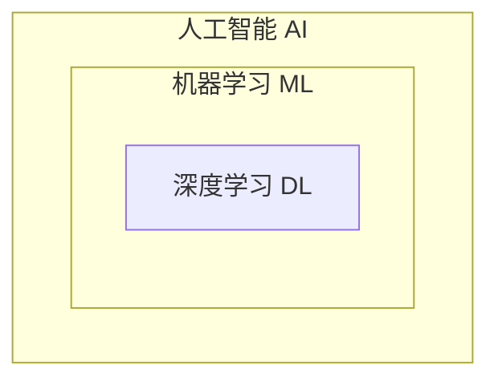
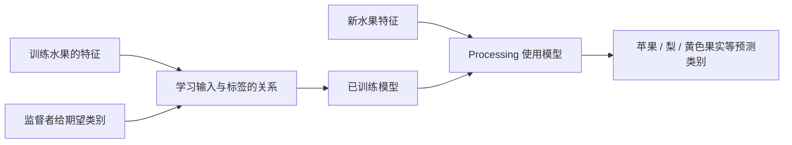
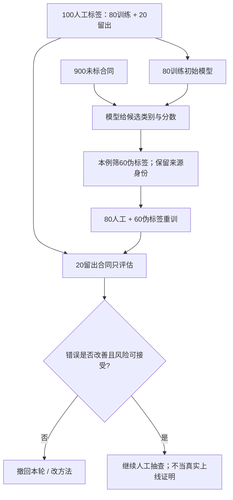
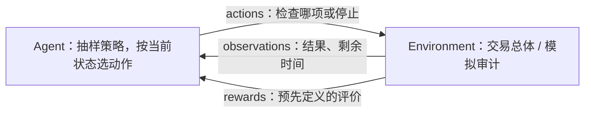
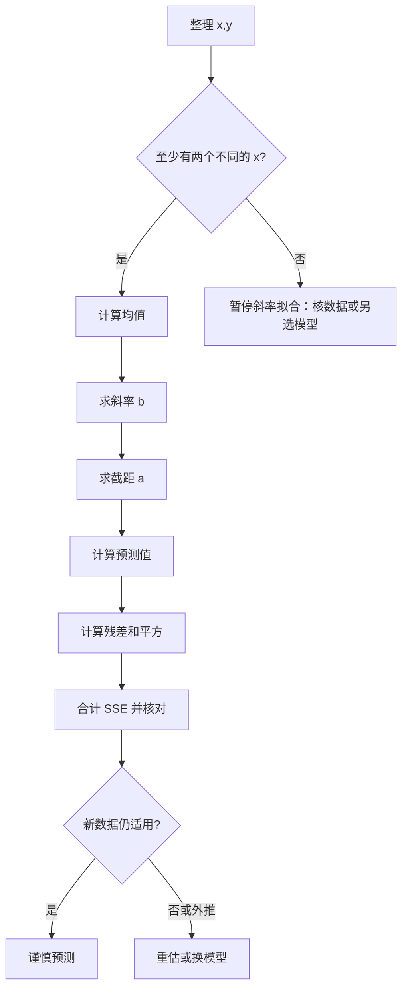
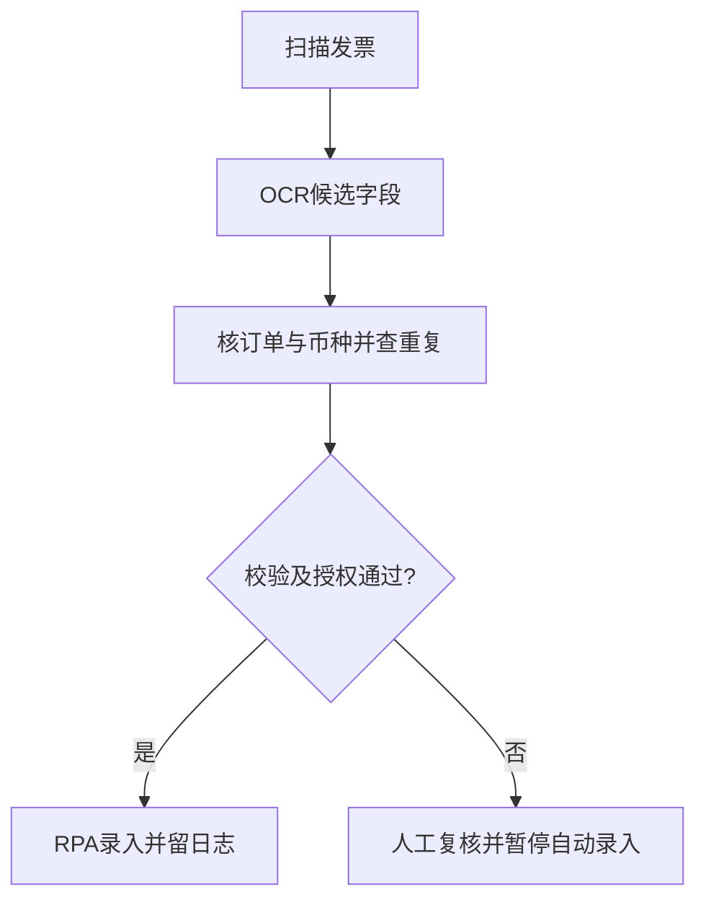
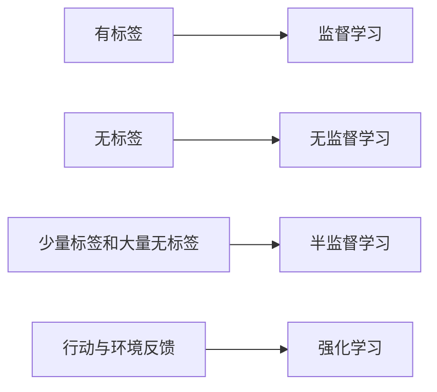

# M08 · AI 基础与会计技术

> ✅ **材料 v1.0（2026-10-31 融合）**：S23=`M06-M08-transcript-source23-partial.txt`，948 段，`00:00`–`01:46:24`。原时钟不重置：`00:00`–`20:20` 是 M06 六题续讲、项目及补课要求，已回填 M06 §2.25–§2.26；`20:27` 后转 M08，`20:39` 明确新章开场，`01:46:24` 有下课告别。源首缺完整课堂开头，不能称整堂课完整。实际授课日期未知，保留 `date: null`。本次新增及受影响教学内容的独立审查已完成；执行证据分别记录，写回与同步状态不由此推定。旧全篇审查仍只覆盖原有范围。
>
> **影片与教授分开**：S23 `22:32`–`28:22` 图灵测试影片、`31:14`–`35:48` AI/ML/DL 影片、`01:34:13`–`01:38:27` NLP 影片、`01:41:21`–`01:42:43` OCR 影片，均不当作教授本人逐字原话或考试明示。

## 0. 三分钟速览

本讲从 AI 的范围出发，区分四种机器学习训练方式，用线性回归展示模型如何拟合预测线，最后把 OCR、RPA、NLP 和生成式 AI 放进会计工作流。

学完你能：

- 区分窄人工智能与人工通用智能的能力范围。
- 根据标签和反馈类型判断监督、无监督、半监督或强化学习。
- 解释会计分类模型的输入、标签、输出与漂移风险。
- 手算最小二乘回归并区分预测值、残差和平方误差。
- 说明 OCR、RPA、NLP、生成式 AI 的输入输出、失败方式和控制点。

课程前置材料将 W8 对应 CILO 2：识别会计中的 AI 技术与模型。课程没有为 CILO 分配权重，不能据此推断考试比重。

> 🎙️ **课堂实况**：S23 `20:39` 起介绍 AI 与历史；四类学习用发票、分录、合同、审计抽样说明，`01:13:06` 后新增 Excel/Grok 回归演示；末段通过影片和工具附件介绍会计技术。p.43–45 未逐页录到，不能标略过，也不由“周六细讲工具”推定这三页全部明确顺延。

## 1. 开始之前 · 知识衔接

### 1.1 你已有的

| 概念 | 一句话唤醒 | 回链 |
|---|---|---|
| AI 与 ML 直觉 | AI 是计算系统承担感知、学习、判断或语言任务；ML 从数据学习预测或结构。 | [[AC6761_Artificial_Intelligence_Accounting/_meta/知识层级台账\|知识层级台账]] |
| 标注数据 | 标签是训练样本中已知的正确答案。 | [[AC6761_Artificial_Intelligence_Accounting/_meta/知识层级台账\|知识层级台账]] |
| 生成式 AI 与幻觉 | 模型会按提示生成内容，但流畅文字仍可能错误。 | [[AC6761_Artificial_Intelligence_Accounting/notes/M01-会计与商业\|M01：会计与商业]] |

### 1.2 本讲全新引入的概念

Narrow AI 和 AGI 在 §2.1。四类学习在 §2.2–§2.5。线性回归和最小二乘在 §2.6。深度学习、会计应用与 OCR、RPA、NLP、生成式 AI 在 §2.7–§2.10。

### 1.3 为什么这一讲放在这里 · 重排说明

前七周以会计基础为主，W8 才正式引入 AI。笔记先讲概念和训练信号，再讲回归计算，最后讨论会计工具链。这样读者先理解模型怎样工作，再判断案例数字和工具输出能否采信。课件历史、生活应用等顺序相应后移；映射表保留原页位置。

## 2. 正文

讲义 p.1 只有课程标题，是封面页而非教学内容页；按规则不展开。正文从内容页 p.2 开始，p.1 不计作讲解遗漏。

### 2.1 AI、Narrow AI 与 AGI（讲义 p.2–7）

**是什么**

人工智能（Artificial Intelligence, AI）是被设计来模拟学习、解决问题、决策和语言理解等认知功能的计算系统（讲义 p.2）。窄人工智能（Narrow AI）在特定领域表现好，但不能自动把能力迁移到其他任务；人工通用智能（Artificial General Intelligence, AGI）指能适应广泛任务的类人能力（讲义 p.3）。

讲义 p.2 的标题问题原文是 **“What is Artificial Intelligence?”**，没有选项或独立编号练习。下面保留原定义，避免把笔记英语改写当作原句。

**讲义英文原文（p.2）**：

> Artificial Intelligence (AI) refers to computer systems engineered to simulate human cognitive functions—including learning, problem-solving, decision-making, and language understanding—enabling autonomous task execution without explicit programming.

**中文读题与边界**：问题要求解释 AI 是什么；原文说系统模拟学习、解决问题、决策和语言理解。末尾“without explicit programming”若读成所有 AI 都没有显式程序，会过宽：本讲自己也列了规则式 ELIZA/专家系统。这里应区分按规则编写的系统与从数据学习的系统，二者都可能承担 AI 任务。

**English reference answer（笔记自拟）**: Artificial intelligence refers to computer systems designed to perform tasks involving learning, problem-solving, decision-making or language understanding. Some systems use explicit rules, while machine-learning systems learn patterns from data.

讲义 p.3 对 AGI 写“currently unrealized and debated among researchers”；这是课件时点的说法，不作为本次已核实的 2026 实时发展判断。

**为什么需要它**

发票科目分类模型能提出类别，不等于它理解全部会计，也不等于能处理从未见过的合同。先说清任务范围，才不会夸大能力。

**课件原例**

p.3 用 Deep Blue 下棋说明窄 AI：它专门搜索棋局并选择走法，不能因此处理其他领域。p.4–6 的时间线是讲义的简化回顾，逐项读法如下。

- **1943：** McCulloch 与 Pitts 提出人工神经元的数学模型，尝试用简化单元表达神经活动。
- **1950：** 图灵提出用对话行为测试机器是否表现得像人；测试的是可观察表现，不直接证明机器有人的意识。
- **1956：** 达特茅斯会议将 Artificial Intelligence 作为研究领域名称。
- **1966：** ELIZA 用脚本规则模拟心理治疗对话，说明自然的对话表象也可能来自固定回应。
- **1969：** Shakey 将感知、规划与行动结合，在受控环境中导航和操作物体。
- **1973–1980：** 课件称为第一轮 AI winter，并把资金收缩与 Lighthill Report 对未兑现承诺的批评相连。
- **1980 年代：** 专家系统（如 XCON）用规则支持技术配置决策，重新带来商业兴趣。
- **1986：** 课件把反向传播归于 Geoffrey Hinton，属于简化归因。反向传播由多位研究者发展；Rumelhart、Hinton、Williams 共同署名的 1986 年论文讨论以反向传播学习内部表示（Nature 323, 533–536，[论文 DOI](https://doi.org/10.1038/323533a0)），不能写成 Hinton 独创。🔗 论文作者及书目信息已于 2026-10-22 核 Nature 记录，未据此重建整段 AI 史。
- **1997：** Deep Blue 击败 Kasparov，展示专门搜索系统的棋类能力。
- **2012：** AlexNet 在 ImageNet 推动深度学习图像识别。讲义 p.6 另声称“slashing image recognition errors by 41%”；未给错误率基准、分母或原研究，保留为课件数字，不据此说本次已证实。
- **2020–2025：** 课件列 GPT-3（2020）、ChatGPT（2022）、GPT-4/Gemini 多模态模型和 MCP（2024–2025）。这些时间与“革命性”“标准化”等评价仍是课件声称；MCP 的起始时间和“标准化”说法待核。

p.7 原 SmartArt 是三个套叠圆：AI 包含 ML，ML 包含 DL；p.8 文字也说明这一关系。下图按原包含语义重画，框的空间大小不是市场份额或性能比较。

从外向内读：一个 DL 方法属于 ML，因而也属于 AI；反过来，规则式专家系统可以属于 AI，却不必属于 DL。这个变式只检验集合包含，不由“更里面”推出更强。

**🎙️ 课堂补充**（S23 `20:39`–`29:56`；A · 讲义与图灵测试影片）

教授先介绍定义和能力范围，再播放图灵测试（Turing Test）影片。这个测试让评判者仅凭文字对话分辨人或机器；不能可靠分辨表示机器在这次对话表现得像人，不直接证明理解、意识或所有任务能力。

影片 S23 `22:32`–`28:22` 补充测试流程、聊天机器人例与局限；它提到中文房间（Chinese room）论证，用来质疑“按符号回应看起来正确”是否足以证明理解。本讲只需知道它提出的区别，不从影片推出某个现有模型已通过测试或具有人类意识。

教授回到现场：*"although the Turing test is not perfect at all"*（S23 `28:26`）。中文：图灵测试并不完美。随后按讲义概述 AI 冬天、Deep Blue、现代模型与 MCP；ASR 的 MCT 按 p.6 校为 MCP，历史说法仍保留前文的来源边界。

**💡 换个说法（笔记补充）**

计算器能算总账，不代表会判断收入确认；模型能处理一类任务，也不自动拥有通用判断力。

**常见误解**

AI 不是单一算法。ML 是 AI 的方法家族之一；Narrow / General 则是能力范围分类，两者不是同一分类轴。

**与其他概念的关系**

本节先限定 AI 的能力范围，下一节按训练信号解释 ML 模型怎样学习。

**所以呢**

识别范围能帮助会计人员把模型输出限制在它实际承担的任务内。

### 2.2 监督学习（讲义 p.8–13）

**是什么**

监督学习（Supervised Learning）用带标签样本训练：每条样本有输入和已知正确输出。模型学习输入到标签的映射，再预测新样本（讲义 p.10）。

**讲义英文原文（p.10）**：

> Supervised learning is a type of machine learning in which the model is trained on labeled data. Each training example consists of an input and a known correct output (the label). The algorithm learns the mapping from inputs to outputs so that it can predict the correct label for new, unseen data.

**为什么需要它**

当业务类别预先定义，且历史记录有人工确认答案时，可用这些记录训练并用已知答案检查预测。

**课件原例**

p.12：会计人员已为历史发票和信用卡交易编码，模型读取供应商、描述、金额、部门、日期等特征。讲义举例 “Uber or taxi receipts → Travel” 和 “Adobe subscription → Software / IT”。新发票由模型提出科目。课件未给出真实数据、精度或上线结果。

p.10 水果图中的监督者（Supervisor）提供训练数据集和期望输出（Desired Output），算法据此学习；后面的 Processing 表示使用学得的规则处理输入，并输出水果类别。训练时知道答案，使用时正要预测新记录的答案。下面把这两个阶段展开为同一流程，水果只作原图对象，不假称讲义给了分类算法。

沿发票例迁移：历史出租车单及核准 Travel 供学习；新出租车单只有字段，模型提出 Travel 再供复核。改变新单金额并不能唯一推出会分到哪类：特征、训练方式和模型尚未具体给定，不能凭三条示例保证分类规则。

**完整小例（笔记补充）**

构造三条教学数据：出租车 28 元→差旅；酒店 120 元→差旅；设计软件订阅 40 元→软件服务。输入是描述、金额等字段，标签是经核准科目。简化规则可学到“出租车/酒店→差旅”“软件订阅→软件服务”。给新单据预测后，应由人复核低置信、新供应商和重大金额。小样本只能解释流程，不能证明真实准确率。

**机制、失败与边界**

训练输入是历史单据和特征，目标是核准标签，输出是新记录的类别或类别分数。若旧编码错误，模型会复制错误；政策或供应商变化会产生数据漂移。应在未参与训练的样本上评估，并监测错分类型。准确率相同，重大错分的会计后果仍可能不同。

课件称监督学习可直接比较预测和标签、标签良好时有效、相对容易解释；缺点是标签成本高、未来分布变化时退化，且不善于发现未定义的新模式（p.11、13）。

**🎙️ 课堂补充**（S23 `36:18`–`44:14`；A · 发票编码与评价）

教授用已贴水果名称的图片解释标签，再把同一机制用于核准过科目的发票：历史描述、供应商等是输入，已确认科目是训练标签，新单据输出建议科目。

课堂举 Adobe 订阅归入软件/IT 费用（S23 `42:18`–`42:28`）。*"New invoice is automatically suggested a code"* 是 p.12 的讲义表述，不能冒作音频直引。现场原话为 *"that this belongs to travel expense"*（S23 `42:08`），中文：这种收据归差旅费用；具体书面例仍按 p.12。新供应商或新政策不在旧训练中时，建议可能错，不能只因能自动给码就直接过账。

课堂 S23 `42:49`–`44:05` 说明标签良好时有效、可以比较预测与答案；标签成本高、未来不同于训练会退化。准确率（accuracy）看全部预测中答对比例，精确率（precision）看被模型判为某类别的记录中有多少真属该类别；二者分母不同，不能混报。

**💡 换个说法（笔记补充）**

像新员工参考已复核凭证学习编码；遇到新供应商仍需请教和复核。

**常见误解**

有标签不等于标签正确；指标好也不代表业务后果可接受。

**与其他概念的关系**

监督学习回答预先定义的类别/数值；无监督学习寻找没有答案标签的数据结构。

**所以呢**

标签质量、评估样本和人工复核共同决定自动建议是否能进入账务流程。

### 2.3 无监督学习（讲义 p.14–17）

**是什么**

无监督学习（Unsupervised Learning）面对没有正确答案标签的数据，寻找群组、规律或异常（p.14）。

**讲义英文原文（p.14）**：

> Unsupervised learning works with unlabeled data. The algorithm is not told what the “correct” answer is. Instead, it searches for hidden patterns, groupings, or structures within the data itself.

**为什么需要它**

大组织可能有大量分录，逐笔标“正常/错误”很贵；分析人员也未必预先知道所有异常类型。

**课件原例与完整小例**

p.14 原图把未标类别的水果输入 Model，输出相似果实的不同组：红苹果一组、黄色果实一组、西瓜切片一组。模型没有事先收到“正确组别”；分出的组还须人解释。它和 p.10 的区别是有没有期望输出参与训练，而不是有没有输出结果。

沿图读分录：金额相近、相似科目/时点/用户的记录可能在一组；不同相似标准会改变分组。图只解释结构发现，不指定距离算法或保证任何异常都能找到。讲义 p.16 的固定规则例是“amounts over \$10,000”：它只按金额截断，会放过小额但不寻常的记录。

讲义 p.16 说模型观察金额、科目组合、时间、用户和摘要，学习“正常”模式并标出离群项。

构造例子：同类耗材分录通常为 80、90、95 元，另有一笔 9,800 元记录。模型可能把后者标成异常。

调查者再核发票、采购、审批和业务背景。若它是年度批量采购，异常不代表舞弊。小额拆分也可能不突出。此例不保证特定算法一定发现这笔记录。

课件称其不需标签、适合发现隐藏模式和新型异常；但客观评估难、群组需人工解释，对预定义类别未必精确（p.15、17）。

**🎙️ 课堂补充**（S23 `44:14`–`52:12`；A · 分组、异常及答题要求）

教授在 S23 `44:24`–`45:57` 说明未贴名称的水果可以按特征分组，但算法并不知道组名。会计上从分录金额、科目、时点、用户和摘要学常见结构，再标离群线索；不是先提供全部舞弊标签。

教授以现金/总资产很低作为调查线索（S23 `48:16`–`49:08`）。这个比率是现金占资产比例，低现金可能提示支付压力，但不能单凭该比率确认破产：还须查到期债务、融资、现金流及行业背景。该段的“无成本”口语也不改变模型/数据/人工调查有成本。

*"at least two of each, you should be familiar"*（S23 `51:59`）。中文：监督与无监督的优点、缺点要分别熟悉至少两项。S23 `52:06`–`52:12` 又点名无监督的 two pros and two cons；这是明确答题数量要求，不是承诺原题必考。详见 §6 的可作答对照。

**💡 换个说法（笔记补充）**

算法先指出“这笔和同类差很多”，会计人员再查清原因。

**常见误解**

异常分数不是舞弊结论。算法受变量尺度、距离定义和样本范围影响。

**与其他概念的关系**

它常用于筛查线索；监督模型可在已有调查结论后学习预定义类别。

**所以呢**

无监督输出应进入调查队列，不能直接形成会计定性。

### 2.4 半监督学习（讲义 p.18–21）

**是什么**

半监督学习（Semi-supervised Learning）用少量标注数据和大量未标注数据共同学习（p.18）。

**讲义英文原文（p.18）**：

> Semi-supervised learning sits between supervised and unsupervised approaches. It uses a small amount of labeled data together with a large amount of unlabeled data.

**为什么需要它**

合同专家的时间有限，给数千份合同逐一标注可能不可行。

**课件原例与完整小例**

讲义 p.20 设企业有数千份合同，只能仔细标注几百份；特征可有条款、交易方、付款条件、期限和关键词。模型结合两类数据分类剩余合同。

**可追踪的方法示例（笔记补充，非讲义指定算法或实测）**：仍设专家标注 100 份合同，40 份含自动续约、60 份不含，另有 900 份未标。为说明 900 份怎样参与学习，选一种自训练（self-training）办法：先用人工标签训练初始模型，再把部分预测暂作伪标签（pseudo-label）加入训练；伪标签是模型猜测，不能升级成人工真答案。

1. 先留 20 份人工标签合同作检查集（含/不含续约各 8/12 份），不参与拟合；初始模型只用其余 80 份（32/48 份）学习。特征可为原文条款、关键词及期限，目标是“是否含自动续约条款”，不是决定合同实际上是否续约。
2. 初始模型处理 900 份未标合同。为追踪流程，**设定**其中 60 份的类别分数为 0.95，其余 840 份分数不超过 0.60；这些是示意中间输出，没有运行一个真实分类器。分数是模型对类别的倾向，不是已经校准的真实正确概率。
3. 本示例临时选分数至少 0.90 的 60 份，把模型预测类别记作伪标签，并单独记录其身份；0.90 只为演示筛选，不是行业或课程阈值。
4. 用 80 份人工标签加 60 份伪标签重新训练，共 140 份参与拟合。**900 份正是在第 2–4 步提供候选及新增训练样本**；若移除这 900 份，就没有这 60 个伪标签，训练仍只用 80 份。剩下 840 份此轮不并入。
5. 再用始终留出的 20 份人工标签比较重训前后错误。若错误增加，就撤销这一轮伪标签或调整方法，不能因数据多就宣布改善。真实评估还要有更充分的独立数据，本小例不证明精度。

伪标签若错，重训可能强化自己的错误；跨业务线/法域时，100 份也可能不具代表性。合同判断仍须回原文复核。讲义只要求联合利用两类数据，没有规定必须用伪标签；其他半监督方法也存在。

课件称其可减少标注量，适合文档分类；仍依赖高质量、具代表性的少量标签，无标签噪声也会影响结果（p.19、21）。

**🎙️ 课堂补充**（S23 `52:13`–`59:19`；A · 少量标签与合同例）

教授用 10% 标注、90% 未标作示意，再说明专家只能检查几百份合同，模型联合这些标签与剩余文本学习分类。10/90 是课堂示例，不是半监督定义的固定比例；要如前文真正利用未标材料，不能只把它放在文件夹里。

*"a representative sample of contracts"*（S23 `56:43`）。中文：标注样本要有代表性。现场 S23 `57:40`–`58:26` 曾调整“更准确”的比较句，ASR 的基准不稳定；这里只保留条件结论：在数据分布和方法适当时，利用未标数据可能比只用少量标签好，但不保证胜过大量高质量标签，也不保证每轮都改善。

**💡 换个说法（笔记补充）**

专家批改少量练习后，模型利用所有材料寻找相似写法；未批改材料提供结构，不会自动提供真答案。

**常见误解**

数据多不能补救标签偏差；样本分布不一致时模型会把错误推广到更大范围。

**与其他概念的关系**

它介于监督与无监督思路之间：有少量正确答案锚定分类，又利用无标签数据。

**所以呢**

先评估标签代表性和人工抽查方案，再判断半监督能否降低工作量。

### 2.5 强化学习（讲义 p.22–25）

**是什么**

强化学习（Reinforcement Learning, RL）让智能体（agent）在环境中行动，根据奖励/惩罚学习策略，以提高长期累计奖励（p.22）。状态是当前信息，动作是选择，环境反馈改变下一状态。

**讲义英文原文（p.22）**：

> Reinforcement learning (RL) is a type of machine learning in which an agent learns to make decisions by interacting with an environment. The agent receives rewards or penalties based on its actions and learns a policy that maximizes cumulative reward over time.

p.22 原图以狗作 agent、训练者作 environment：actions 箭头由 agent 指向环境；rewards 和 observations 从环境返回 agent。会计类比中，这三方向对应选择下一项检查、返回检查结果/奖励、更新剩余时间与风险信息。

箭头是行动与反馈回路，不是把狗的训练当作审计实证。下一段只用自拟数值解释多次反馈。

**为什么需要它**

审计抽样顺序会影响剩余时间、已知风险和下一步行动，属于连续决策，而非对静态记录单次分类。

**课件原例与完整小例**

讲义 p.24 将抽样策略设为 agent，交易总体设为 environment，下一项检查设为 action。奖励可按错误发现率、高风险覆盖或每小时发现数定义。

**两回合可复做模拟（笔记补充）**：每回合重新开始，审计员有 2 小时，A 为普通费用，B 为新供应商，C 为期末手工分录。同一项每回合最多查一次，也允许停止。状态至少含剩余时间、已检查集合和已观察结果；动作不能超过剩余时间。

下表每行是一项检查；耗时为小时，重大错误/高风险覆盖为本次模拟设定的实际反馈，不是事先知道的真实审计结论。奖励把三部分**相加**：发现重大错误给 5，覆盖高风险给 2，每耗时半小时扣 1。

| 项目 | 耗时 | 模拟反馈：重大错误 | 模拟反馈：高风险覆盖 | 本次奖励 |
|---|---:|---:|---:|---:|
| A 普通费用 | 0.5 | 0 | 0 | 0+0−1=−1 |
| B 新供应商 | 1 | 1 | 1 | 5+2−2=5 |
| C 期末手工 | 1 | 1 | 1 | 5+2−2=5 |

第一回合先探索 A：用 0.5 小时得−1，剩 1.5 小时、已查集合为 A。再查 C，用 1 小时得 5，累计奖励 4，剩 0.5 小时；B 需 1 小时不可选，停止。第二回合改为探索 B：用 1 小时得 5，剩 1 小时，再查 C 得 5，累计 10，时间用完。

学习步骤是把“状态—动作—收到的反馈”记下来，比较从相似起点取得的累计奖励，再调整以后动作选择的倾向。本示例只比较两条已试路径：在所设反馈下，B→C 比 A→C 好，C→B 也能得到 10；不是已证明真实最优策略，更不是声称两次就学会全部审计。真实反馈有不确定性，须多次审计或模拟和足够探索。讲义 p.24 明确写“Over successive audits or simulations”。

**改条件**：若 C 改需 1.5 小时，B→C 共 2.5 小时已不可行。C 自身奖励变为 5+2−3=4；B 独查仍得 5，之后可停止，不能照搬旧路径。若只奖小错数量而不管重大性/耗时，目标会改变，策略可能偏向容易的小错。所有数值、简化比较和停止动作均属笔记补充，不是课程标准或实测。

如果只奖励“发现数量”，策略可能总查容易发现的小错而忽略重大风险；模拟环境不代表真实总体时，策略也会失效。课件列出优点为适合序列决策和反馈优化；缺点是奖励和环境难定义、计算成本与解释/审计困难（p.23、25）。

**🎙️ 课堂补充**（S23 `59:19`–`01:05:31`；B · 狗训练类比与审计抽样）

教授以狗对指令反应后获得食物/奖励说明行动反馈，再映射到审计：抽样策略是智能体，交易总体是环境，选择下一项检查是动作；错误发现、高风险覆盖或效率可作为设计奖励的线索。真实审计不应探索未经授权的危险动作。

*"learning occurs through trial and error rather than from labelled examples"*（S23 `01:01:06`）。中文：主要从尝试与反馈学习，而非固定标签。奖励必须预先定清且符合审计目的；课堂没有提供已训练模型或真实效果，本节两回合数值仍是笔记补例。

**💡 换个说法（笔记补充）**

它像不断调整巡检顺序的排班员：每次行动后看结果，再决定下一步。奖励设计决定它追求什么。

**常见误解**

奖励高不等于审计质量高；目标设计遗漏约束时，策略可能优化错目标。

**与其他概念的关系**

监督学习用固定标签学预测；强化学习（Reinforcement Learning, RL）根据行动和环境反馈学策略。

**所以呢**

RL 在此是优化思路示例；实际审计要约束目标、权限、解释和复核。

### 2.6 线性回归与最小二乘（讲义 p.27–30）

**是什么**

**讲义英文原文（p.27）**：

> Linear regression is a statistical method used to model the relationship between a dependent variable (target) and one or more independent variables (features) by fitting a linear equation to observed data.

如果要根据订单批次估计对账工时，可以用直线描述输入与目标的关系。课件给出的观测关系是 $Y=a+bX+e$（p.27）。符号含义如下。

| 符号 | 含义 | 本例读法 |
|---|---|---|
| $X$ | 输入变量；订单批次数 | 一周有 2 个订单批次 |
| $Y$ | 目标变量；实际对账工时 | 该周实际 3 小时 |
| $a$ | 截距；输入为零时的基线预测 | 拟合后为 $1/3$ 小时 |
| $b$ | 斜率；输入每增加 1 单位时预测变化量 | 拟合后每批次增加 $1.5$ 小时 |
| $e$ | 观测误差项 | 实际值与总体关系的差异 |
| $\hat{Y}$ | 模型给出的预测值 | $\hat{Y}=a+bX$ |
| $e_i$ | 第 $i$ 条数据的残差 | 实际工时减预测工时 |

符号表中的 $a$ 和 $b$ 来自下方教学数据，不是课件给出的参数。残差按 $e_i=y_i-\hat{y}_i$ 计算。

**为什么需要它**

回归把“业务量变化时工时如何变化”的问题转为可复算的关系。残差还能显示每条记录的预测差异。

**课件原例**

**讲义英文原文（p.29）**：

> The most common method for fitting a regression line is the method of least squares.

**讲义英文原文（p.29）**：

> It calculates the best-fit line for the observed data by minimizing the sum of the squares of the vertical deviations from each data point to the line.

p.28 图示 X 是输入变量，Y 是待预测的因变量，散点周围画有上升直线。p.29 说明最小二乘法（Least Squares）使观测点到拟合线的竖直偏差平方和最小。p.30 的示意线为 $\hat{Y}=X+4$，箭头表示竖直残差。讲义没有提供绘图数据，因此不能从该图复算参数。p.28、p.30 图已通过原件渲染检查。

**可复算小例（笔记补充）**

假设订单批次 $x$ 与对账工时 $y$ 的教学数据是 $(1,2)$、$(2,3)$、$(3,5)$。每对数字依次表示订单批次和小时数；这组数据仅为笔记示例。

最小二乘选择 $a$ 和 $b$，使平方误差和最小：
$$
SSE=\sum_i(y_i-a-bx_i)^2
$$

先读记号。下表将“索引/相加/平均”的操作分开，每行保留同一三点例的读法。

| 记号 | 怎样读与怎样做 | 本例 |
|---|---|---|
| $i$ | 记录的行号 | 依次为 1、2、3 |
| $\sum_i$ | 把各行所指定的结果相加 | 例如把三个平方残差相加 |
| $\bar{x}$ | 输入的平均数，三批次值先相加再除行数 | $\bar{x}=(1+2+3)/3=2$ |
| $\bar{y}$ | 工时的平均数，三工时值先相加再除行数 | $\bar{y}=(2+3+5)/3=10/3$ |

SSE 是三行残差平方相加，单位为小时²；平方防止正负误差互相抵消，也使大误差的代价更高。

下面的斜率/截距公式适用于有截距的一元最小二乘，并要求$x$不全相同；算完小例后再用高中配方说明公式为何使 SSE 最小。

第一步，计算均值：$\bar{x}=2$，$\bar{y}=10/3$。

第二步，计算斜率。分子逐项计算为 $(-1)(-4/3)+0(-1/3)+(1)(5/3)=3$。分母逐项计算为 $(-1)^2+0^2+1^2=2$。因此：
$$
b=\frac{\sum_i(x_i-\bar{x})(y_i-\bar{y})}{\sum_i(x_i-\bar{x})^2}
=\frac{3}{2}=1.5
$$

第三步，计算截距：$a=\bar{y}-b\bar{x}=10/3-1.5\times2=1/3$。因此拟合式为 $\hat{y}=1/3+1.5x$。

第四步，对每个样本代入拟合式。以第一行为例，$x=1$ 时 $\hat{y}=1/3+1.5=11/6$，残差是 $2-11/6=1/6$，平方残差是 $1/36$。

| $x$（订单批次） | 实际 $y$（小时） | 预测 $\hat{y}$（小时） | 残差 $y-\hat{y}$（小时） | 平方残差（小时²） |
|---:|---:|---:|---:|---:|
| 1 | 2 | 11/6 | 1/6 | 1/36 |
| 2 | 3 | 10/3 | −1/3 | 1/9 |
| 3 | 5 | 29/6 | 1/6 | 1/36 |
| 合计 | 10 | 10 | 0 | 1/6 |

以第二行说明读法：$x=2$ 表示 2 个订单批次，实际工时为 3 小时，预测工时为 $10/3$ 小时。实际减预测得到残差 $3-10/3=-1/3$ 小时，再平方得到 $1/9$ 小时²。

三行预测值合计为 10 小时，与实际值合计相同。残差合计为 0。平方残差相加得到 $SSE=1/36+1/9+1/36=1/6$ 小时²。

**为什么这条线使 SSE 最小：只用平方非负与配方（笔记补充）**

先把每条数据减去各自平均数：$d_i=x_i-\bar{x}$、$q_i=y_i-\bar{y}$。这些“离平均数多少”的数相加都是 0。再把$c=a+b\bar{x}-\bar{y}$定义为平均输入处的预测减平均实际。于是每行残差可改写成$q_i-bd_i-c$。

展开平方后，含$c$的一次项为$-2c\sum_i(q_i-bd_i)=0$，所以：

$$
SSE=\sum_i(q_i-bd_i)^2+n c^2.
$$

这里$n$是数据行数，本例为 3。固定$b$时，前一项不随$a$变化，后一项是非负的平方；选$c=0$能使它最小。这就给出$a=\bar{y}-b\bar{x}$。这一步没有用偏导或“正交”作前置。

再把三种加总记短一点。每项把对象、加总式及本例数值放在一起：

1. 输入偏差平方和：$V=\sum_i d_i^2=2$。
2. 输入/目标偏差乘积和：$S=\sum_i d_iq_i=3$。
3. 目标偏差平方和：$T=\sum_i q_i^2=(16+1+25)/9=14/3$。

当$c=0$时，展开再配方：

$$
SSE=T-2bS+b^2V
=V\left(b-\frac{S}{V}\right)^2+T-\frac{S^2}{V}.
$$

下表把配方中暂用的记号对回同一三点例。每行只给一个量的意义、单位和数值；它们是计算中间量，不是又一组原始数据。

| 记号 | 对象与单位 | 本例 |
|---|---|---|
| $d_i$ | 每行输入减平均输入，单位批 | $-1,0,1$ |
| $q_i$ | 每行工时减平均工时，单位小时 | $-4/3,-1/3,5/3$ |
| $c$ | 平均输入处预测减平均实际，单位小时 | 待选；为最小时取 0 |
| $V$ | 输入偏差平方相加，单位批² | 2 |
| $S$ | 输入/工时偏差乘积相加，单位批×小时 | 3 |
| $T$ | 工时偏差平方相加，单位小时² | $14/3$ |

因为输入不全相同，至少有一个输入偏差非 0，所以输入偏差平方和为正，即$V>0$。配方后最后两项只由数据决定，调整斜率只改变前面的平方项。

取$b=S/V$时，平方项恰为 0；其他斜率使该项为正，所以这正是最小值。再代回截距式，就得到上面使用的两个公式。

本例的最小值为$14/3-9/2=1/6$，与逐行残差平方相加一致。

**零分母边界**：若所有$x$都为 2，每个$d_i$为 0，$V=0$，不能除以它。此时数据只能确定在$x=2$处的预测水平，不能独自确定斜率。

将全部$y$加 1 而$x$不变，则各$q_i$不变，斜率仍 1.5，截距加 1 变为 4/3。拟合的代数性质不证明订单批次导致工时变化。

**图形怎样读（笔记补充）**：下图仅用上述三个自拟点，横轴批次、纵轴小时，实线为拟合值，竖线为同一$x$处的实际减预测。$x=2$的点在线下，残差为−1/3；$x=1$和 3 在线上方，各为 1/6。空心点$x=4$只表示预测 19/3，没有真实工时，因此没有可知的实际残差。

![[AC6761_Artificial_Intelligence_Accounting/notes/figures/m08-novice-review-20261025/regression-three-points.svg]]

图源/数据见[[AC6761_Artificial_Intelligence_Accounting/notes/figures/m08-novice-review-20261025/plot-regression.py|可编辑绘图脚本]]。原 p.28 是上升散点/直线；p.30 左图点落在给定$\hat{Y}=X+4$线上，右图点偏离并用竖直箭头表示差。原图未给完整样本表，不从像素反推精确坐标；本图不冒称复刻了那组未知数据。

**计算流程（笔记补充）**：按刚才的三点例先整理数据，确认输入有变化，才依次求均值、斜率与截距，再逐行计算预测/残差/SSE。若改成所有输入都为 2，图在求斜率前暂停；不能先除以 0 再检查未来适用性。

**机制与边界**

平方使大残差权重更高，极端值会影响拟合。SSE 最小只说明样本内按该目标拟合较好，不证明因果，也不保证未来准确。小样本、弯曲关系、结构变化和超范围外推都可能误导；应看散点、残差模式和留出数据，并限定预测范围。

**🎙️ 课堂补充**（S23 `01:05:41`–`01:13:06`；A · 预测、散点与竖直误差）

教授从预测用途进入回归：每个点是一对输入与目标，直线概括样本中的关系，通常不能穿过全部点。最小二乘比较同一输入处的竖直差，平方后相加再最小化，不能改成点到线的斜向最短距离。

*"minimizing the sum of the squares of the vertical"*（S23 `01:11:52`）是语句片段，意思是最小化竖直偏差平方和；完整机制见本节。S23 `01:11:44` 同时出现 just for your information 与 you'll have to memorize，ASR/语境冲突，未逐字核听，不登记为必背或免背。

**💡 换个说法（笔记补充）**

直线像一根按规则摆放的尺；点到线的竖直差是残差。最小二乘让差值平方后总和最小，而不是让每个点都在线上。

**常见误解**

总体误差项 $e$ 与拟合后样本残差不是同一对象。回归残差是竖直距离，不是点到直线的斜向最短距离。

**与其他概念的关系**

回归是监督学习的数值预测方法。费用编码是类别预测；两者都需已知结果评估。

**所以呢**

能复算拟合值仍需判断样本是否适合未来业务，不能把预测当承诺。

#### 2.6.1 Excel 实课：从 25 年数据拟合到条件预测

现在把前面的三点教学例换成真实课堂附件。问题是：已知公司治理指数（Corporate Governance Index, CGI），怎样估计审计费用（AuditFee）？输入来自 `PredictAuditFee.xlsx` 的 25 行历史记录，年份为 2000–2024。CGI 是输入 $x$，AuditFee 是目标 $y$；Year 只标识记录，本次没有作为第二个解释变量。

原表没有给 AuditFee 的货币或缩放单位，因此下文只写原表数值单位。CGI 指标的构造、公司身份与收集方法也未给；不能把这些数当经外部验证的真实公司样本。

全部 25 行原始数据（XLSX 单元格；无额外预测行）

每行是一年，左列标识年，后两列分别是模型输入与实际目标。

| Year | CGI | AuditFee |
|---:|---:|---:|
| 2000 | 1.8 | 206 |
| 2001 | 3.3 | 150 |
| 2002 | 2.5 | 162 |
| 2003 | 3.6 | 127 |
| 2004 | 1.9 | 188 |
| 2005 | 2.8 | 128 |
| 2006 | 4.5 | 105 |
| 2007 | 3.2 | 111 |
| 2008 | 5.6 | 100 |
| 2009 | 6.1 | 108 |
| 2010 | 3.0 | 156 |
| 2011 | 6.6 | 88 |
| 2012 | 2.8 | 129 |
| 2013 | 1.9 | 138 |
| 2014 | 5.8 | 112 |
| 2015 | 7.6 | 90 |
| 2016 | 2.6 | 190 |
| 2017 | 3.2 | 186 |
| 2018 | 2.5 | 176 |
| 2019 | 4.7 | 123 |
| 2020 | 3.0 | 136 |
| 2021 | 2.5 | 138 |
| 2022 | 5.3 | 102 |
| 2023 | 3.9 | 158 |
| 2024 | 5.6 | 116 |

例如 2000 年的输入为 1.8、实际费用为 206。这是一对训练时同时已知的数，不是用 2000 年份数值预测 206。

**🎙️ 课堂补充**（S23 `01:13:06`–`01:29:34`；A · Excel 与 AI 的 OLS 演示）

老师用 Excel 的 Regression 功能拟合，再将相同数据与明确模型提示交给 AI。关键是两边使用同一数据、同一因变量/自变量和同一估计方法，而不是比较两个不明模型的数字。

*"I explicitly set the instruction here, which is independent, which is dependent, and which model we should use."*（S23 `01:27:38`–`01:27:44`）

中文：提示中要明确哪个变量是输入、哪个变量是目标，以及使用什么模型。课堂口头说不同工具模型可能不同是一种排查解释，未展示各工具完整输出，不能当作所有差异原因已证实。

**原附件完整步骤与提示词（`Excel.pptx`，1 页）**：下面逐行照录，自动换行合并成原句。

> Predicting audit fee using Excel
>
> Excel – File - Options – Add-ins – Excel Add-ins – Analysis ToolPak
>
> Data – Data Analysis – Regression
>
> Y and X range – Labels - Line Fit Plots – OK
>
> Design – Add Chart – Trendline
>
> Y = a + bX (a= intercept; b=coefficient)
>
> AI prompt: Based on the excel data, using CGI as independent variable and auditfee as dependent variable, show regression results of OLS estimation.

**实际跟做的动作**（界面名称沿附件；本次笔记核算未操作用户的 Excel）：

1. 先查看 Data 是否有 Data Analysis。没有时，按附件在 File → Options → Add-ins → Excel Add-ins 中启用 Analysis ToolPak；已启用就不重复操作。S23 `01:16:11` 说不用跟该步，只针对教室机器已经装好，不等于所有机器都不需插件。
2. 打开原表，Data → Data Analysis → Regression，进入回归设置窗口。
3. Input Y Range 选择 `C1:C26`，即 AuditFee 标题及 25 个目标值。Y 是要预测的费用，不能选 Year。
4. Input X Range 选择 `B1:B26`，即 CGI 标题及 25 个输入值。X/Y 要覆盖相同 25 条记录，不漏最后一行。
5. 因为范围含标题，勾 Labels；按附件勾 Line Fit Plots 后确认。若只选 `B2:B26`、`C2:C26`，就不勾 Labels。标题是否纳入与该开关必须一致。
6. 输出中先看系数表：Intercept 是截距 $a$，CGI 行的 coefficient 是斜率 $b$。需要显示线时按附件 Chart Design → Add Chart Element → Trendline 选 Linear；具体菜单随版本核对。
7. 核图的横轴是否确为 CGI，核散点来自原始 AuditFee；原始观测、拟合值和新条件预测应分别标记。增加趋势线不替代读取回归系数，更不能由线好看断言未来准确。

普通最小二乘（Ordinary Least Squares, OLS）就是前节按竖直残差平方和选择 $a,b$ 的拟合规则。本批作者从原 XLSX 单元格重新用精确分数计算，得到：

$$\widehat{\mathrm{AuditFee}}=198.903345374-16.091211156\times\mathrm{CGI}.$$

本式左边是模型预测费用；右边截距与费用同单位，斜率表示 CGI 每加 1，模型预测费用约少 16.0912 个原表单位。它是这 25 行的统计拟合，不证明治理指数使费用下降；“自变量”不等于变量由自身变化或具有已识别因果效应。

**用已教公式核系数**：25 行的 $\sum x=96.3$、$\sum y=3,423$、$\sum x^2=434.51$、$\sum xy=12,162.6$。这些分别是输入相加、目标相加、每行输入平方后相加、每行输入乘目标后相加。代入前节等价斜率式，分母不为零：

$$b=\frac{25\times12,162.6-96.3\times3,423}{25\times434.51-96.3^2}=-16.091211156,$$

$$a=\frac{3,423}{25}-b\frac{96.3}{25}=198.903345374.$$

S23 `01:23:13` 把截距识成 1998.903；后 S23 `01:28:05` 明确为 198.9033，且原数据复算一致，所以笔记采用 198.9033，不改写原转录。用错 1998 会使预测多约 1,800，不能按“差不多”保留。

下图每个点是一年原始观测，横轴是 CGI、纵轴是 AuditFee 原表数值；实线是同 25 行的 OLS 拟合线。星号仅表示 CGI=5 时的条件预测，没有真实未来费用，不给它画已知残差。

![[AC6761_Artificial_Intelligence_Accounting/notes/figures/m08-source23/auditfee-ols.svg]]

可编辑图源和完整数据：[[AC6761_Artificial_Intelligence_Accounting/notes/figures/m08-source23/plot-auditfee.py|plot-auditfee.py]]。例如左侧 CGI=1.8 的点为费用 206；沿同一横坐标看直线可读拟合值，二者的竖直差才是该行残差。图线下降不构成因果证据，也没有在横轴表示年份。

**把“下年 CGI=5”作为条件，走完预测**：老师在 S23 `01:22:05`–`01:22:43` 先假设或可靠估计新输入为 5，再预测目标；5 不是已确认未来事实。

$$\widehat{\mathrm{AuditFee}}=198.903345374-16.091211156\times5\approx118.447289593.$$

先算斜率乘 5，得约 −80.4561；再加截距，得约 118.4473 个原表单位。如果 CGI 改为 6，则同一拟合线给约 102.3561，减少量与斜率一致。实际 CGI 或业务关系改变时，条件预测也变；不能说已经预测“下一年一定收费 118.45”。

**训练、输出与验证分开**：训练输入是历史 CGI 和已知 AuditFee；学习输出是 $a,b$。使用时给新的 CGI，输出费用预测。原表 25 行都参与拟合，样本内残差平方和约 10,485.8136；没有留出新样本，所以没有据此完成样本外预测验证。费用还可能受公司规模、风险和审计范围等因素影响，这些这里只是遗漏变量提醒，不是已建多元模型。

**English reference answer（笔记复算）**：Using the 25 supplied observations and an intercept, the OLS model is predicted AuditFee = 198.903345374 − 16.091211156 × CGI. Conditional on CGI being 5, the prediction is about 118.4473 in the source data units. This is a fitted statistical association, not proof of causality or validated future accuracy.

### 2.7 ML 应用与 DL（讲义 p.8、26、37）

**是什么**

机器学习（Machine Learning, ML）从数据学习预测关系（p.8）。深度学习（Deep Learning, DL）是使用多层神经网络的 ML 分支，适合处理大量图像、音频和文本（p.8、37）。p.7 套叠圆已从渲染图确认 AI ⊃ ML ⊃ DL。

**讲义英文原文（p.8）**：

> Definition: ML is a subset of AI that focuses on the development of algorithms that allow computers to learn from and make predictions based on data.

**讲义英文原文（p.8）**：

> Definition: DL is a specialized area within ML that uses neural networks with many layers (hence "deep"). These networks are particularly effective for handling large amounts of unstructured data, such as images, audio, and text.

**“层”怎样理解（笔记补充）**：输入先变成数值，例如图像的像素；一层中的相连计算单元把前一层的数值作组合，再传给下一层，多次组合后给出类别分数或数值输出。神经网络（neural network）是这种相连处理单元的结构，“深”指多个处理层。早层可能组合局部线索，后层再组合较大模式；这只是理解多阶段处理，不保证某一层必学会人的某种概念。本讲不要求训练权重或反向传播运算。

**为什么需要它**

理解包含关系可避免把 DL 当成独立于 ML 的算法类别，也提醒复杂模型需更多数据和检查。

**课件原例**

p.26 列的是用途目录：推荐把历史互动变成候选排序；语音处理把声音变成文字/指令；图像诊断寻找影像模式供专业复核；目标识别/跟踪寻找图像中的对象及其随帧变化；大数据分析从历史特征找预测线索；分类输出已定义类别、聚类输出待解释群组。名称与产品是讲义示例，具体实现和成效未核。p.37 称 DL 持续胜过早期系统，但没有比较对象、任务或指标，不能推广为普遍结论。

**🎙️ 课堂补充**（S23 `30:02`–`35:52`；`01:05:41`–`01:06:18`；`01:33:11`–`01:33:41`；A · 现场与影片分开）

教授先讲 AI 包含 ML、ML 包含 DL，接着播放 S23 `31:14`–`35:48` 影片；之后在 ML 用途和会计技术段再回到预测与 DL。影片的学校类比只帮助看层级，不能理解为“DL 是最聪明学生，所以永远更好”。

现场原话：*"Machine learning is within the area of AI, and deep learning is within the area of machine learning."*（S23 `30:47`）。中文：ML 在 AI 范围内，DL 又在 ML 范围内。

影片谈推荐、图像识别和自动驾驶，且有“数据越多越好”的宽泛说法。它不是本班实验；数据质量、分布、任务与评价仍决定效果，不能当作持续改进保证。

**💡 换个说法（笔记补充）**

AI 是大集合，ML 是其中一类，DL 又在 ML 之内。集合位置说明分类关系，不表示里面的每个系统表现都更好。

**常见误解**

DL 的“深”指多层结构，不代表更懂会计或更可信。

**与其他概念的关系**

监督信号分类与模型结构分类是两条轴；DL 也可以在不同监督设置中使用。

**所以呢**

按任务需要选方法，不能仅因模型名称新或复杂就优先采用。

### 2.8 生活、商业与会计应用（讲义 p.31–35）

**是什么**

AI 应用把数据、方法和具体工作相连。会计例子包括录入记账、异常检测、现金流预测、合规监控和趋势分析（p.35）。

**为什么需要它**

场景说明技术要解决什么问题，但效果需要数据、指标和对照才能确认。

**课件原例**

p.31–34 的数字都是课件声称。讲义未附来源、时期、样本、指标定义或比较基准，因此逐项保留但不作事实认定。

**p.31 · 智能家居与健康**
- Nest：优化供暖/制冷，节省能源账单 12–15%。
- Ring：人脸识别并对可疑活动发出即时提醒。
- iRobot Genius：地图精度 99%。
- Fitbit / Apple Watch：监测健康指标，以 92% 准确率检测问题。
- Babylon Health：简化症状分析，急诊等待时间减少 30%。

**p.32 · 娱乐与交通**
- Netflix：按观看历史推荐内容，每月节省 10 亿小时。
- TikTok：按用户互动个性化 feed，用户留存提高 47%。
- Google Maps：预测交通堵塞，平均通勤时间减少 18%。
- Tesla：用实时物体检测和避撞降低事故率 40%。

**p.33 · 客服与金融**
- Zendesk / Intercom 聊天机器人：解决 85% 常规咨询，响应时间从 10 分钟降至 10 秒，人工成本减少 30%。
- 情感分析：以 90% 准确率识别邮件/社交媒体中的客户不满，以便主动服务补救。
- PayPal：通过实时交易模式分析，每年预防 40 亿美元欺诈。
- Kensho 算法交易：依据市场情绪以微秒级交易，取得比人类交易者高 20% 的回报。

**p.34 · 零售与制造**
- Amazon：按购买历史和浏览行为提供超个性化推荐，产生 35% 销售。
- Walmart：库存 AI 预测需求激增，准确率 98%，缺货和浪费减少 25%。
- Siemens：预测维护传感器提前 48 小时发现设备问题，停机减少 45%，每厂每年节省 170 万美元。
- 计算机视觉：每分钟检查 200 件，原文是 99.9% **precision**，对比人类 95%；讲义未定义其分母/评估协议，不把 precision 静默当成 accuracy，也不据此认定数字可比。

p.35 的五项会计用途没有效果数字，下面逐项读它们解决什么问题。

- **例行任务自动化**：单据字段进入系统，规则/模型提出编码，核验与授权后才记账；减少重复输入，不免除错误检查，具体流程见§2.9。
- **异常检测**：在分录中找不同寻常的金额/时点/科目组合，输出调查线索，再核业务证据，不能把线索直接当舞弊。
- **现金流预测与规划**：已知期初现金、预计收款与付款时间，可以逐期算余额，找可能短缺的时点。自拟一周例为期初 100、预计收 80、付 150，预测期末 30；若 80 延期未收，当周期变成−50，应核融资或支付安排。这里是预测情景，不是已经收到钱；ML 可帮助估计金额/时点，仍要核假设。
- **风险/合规监控**：把交易与适用规则比对，提出异常和待查依据，负责人确认主体、法域、时点与原规则后采取行动。大量数据扫描不等于自动保证守法。
- **趋势分析**：按一致期间和口径比较历史数据，定位变化并进一步查原因；看到趋势不证明原因、也不保证它持续。

教学工作流：发票进入系统→OCR 提取→规则/ML 校验→低置信或不匹配时人工复核→获授权后 RPA 录入→保存凭证与审批日志。此为笔记补充，不代表课件报告的部署。

**🎙️ 课堂补充**（S23 `01:29:54`–`01:32:46`；B · 按用途概述）

教授把日常/商业应用称为信息性例子，依次点到智能家居、健康、推荐、交通、客服、金融、零售与制造，再讲会计例行自动化、异常、预测、合规和趋势。

*"Actually, this is just for information"*（S23 `01:29:59`）。中文：这里是用途介绍。这不等于宣布整段不考，更不能把课件品牌效果数字升级成已核事实。会计合规仍需适用规则和人工判断，不由自动扫描保证守法。

**💡 换个说法（笔记补充）**

模型可以产生线索或草稿；会计人员核实证据后才形成账务判断。

**常见误解**

案例和公司名称不能证明宣称数字。效果需可追溯的原始来源及清楚的分母和比较基准。

**与其他概念的关系**

ML 提供预测/聚类，OCR/NLP 处理输入，RPA 执行规则化动作；错误可沿链条传播。

**所以呢**

把自动化流程按输入、校验、审批和日志拆开，才看得见控制点。

### 2.9 OCR 与 RPA（讲义 p.36、40–41）

**是什么**

**讲义英文原文（p.41）**：

> Optical Character Recognition (OCR) is a technology that converts text from scanned or digital documents into machine-readable text.

**讲义英文原文（p.40）**：

> Robotic Process Automation (RPA) primarily handles structured data and is best for rules-based transactions.

光学字符识别（Optical Character Recognition, OCR）把扫描或数字文档文字转换为机器可读文本（p.41）。机器人流程自动化（Robotic Process Automation, RPA）按规则处理结构化数据和系统操作（p.40）。

**为什么需要它**

OCR 将图像内容转成候选字段；RPA 可将核准字段用于订单匹配、报销检查、对账或应收发票录入。

**课件原例与输入输出**

课件 p.40 的应付账款（Accounts Payable, AP）流程会匹配供应商发票与采购订单、核差旅政策、对账；应收账款（Accounts Receivable, AR）流程先检查客户发票授权与价格，再过账到收入账户。这是源中的自动化例，不能推出所有发票均已满足收入确认条件。企业资源规划（Enterprise Resource Planning, ERP）在这里指保存业务/账务记录的系统，不要求先学它的架构。OCR 可减少输入并使文档可搜索，讲义未给误差率。

表中幂等（idempotency）指同一获批发票即使因断线重试，也只产生一次应有录入结果。例如先查“供应商+发票编号+期间”等可靠身份是否已处理，成功后记录状态；重试不能无条件再插一笔。具体去重键、事务和故障恢复实现仍须另行验证，此处只解释控制目标。

| 阶段 | 输入 | 中间输出 | 失败与控制 |
|---|---|---|---|
| OCR | 扫描发票 | 供应商、日期、金额候选字段 | 模糊/错位/小数点误读；低置信转人工并与订单核对 |
| 校验 | 字段、订单、政策 | 匹配状态和异常项 | 重复/币种不符；暂停处理并留痕 |
| RPA | 已通过校验的字段 | ERP 草稿或匹配结果 | 页面变化/权限错误/重复操作；授权、幂等检查、日志 |

下面把发票从读取走到入账，箭头表示处理顺序。每行阶段表说明谁接收什么，流程图补出不通过时的去向。

**走图例（笔记补充）**：订单是 100 元，OCR 错读成 1,000 元。金额不匹配使流程走向人工复核；复核后重新校验并获批，才允许 RPA 录入 100 元。未经批准时，终点是暂停，不是自动修成某个数。

看不到图时，主线是“读出候选、核验、审批、再录入”。这些控制属于笔记补充方案，原课件没有提供系统实现。

**读图自测**：金额正确但没有录入权限，应走哪条路？

答案

走否分支，暂停自动录入并交人工处理。金额正确只通过数据核验，仍未通过授权。

**🎙️ 课堂补充**（S23 `01:39:52`–`01:43:46`；A · RPA 与 OCR 影片）

教授在 S23 `01:39:52`–`01:40:21` 说明 RPA 处理规则化结构数据，并可结合 ML；OCR 把扫描文字变为机器文本。现场 ASR 的 Optimal Character Recognition 应按 p.41 校为 Optical Character Recognition，不能照误词背。

S23 `01:41:21`–`01:42:43` 是影片旁白：先矫正/去噪与二值化图像，再分行/字符，按笔画特征或整体模式匹配字符。二值图像是只保留黑白两种值的图；把字符像素排成 0/1 网格后再比较，是影片的传统方法示意，不代表所有现代 OCR 都采用同一流程。

现场 *"making them searchable and improving document management"*（S23 `01:43:28`）。中文：转成可搜索文字有助文档管理。S23 `01:41:02` 的 without error 属宽泛口语；模糊、小数点、字体与排版仍会误识，必须沿本节核验分支处理。

**💡 换个说法（笔记补充）**

OCR 像把纸表转成可搜索文本；RPA 像按清单搬运信息。前者可能读错，后者可能忠实执行错误输入。

**常见误解**

OCR 不等于理解语义；RPA 不必然使用 AI。自动操作需要异常队列和审批边界。

**与其他概念的关系**

OCR 输出可供 ML/NLP 校验，RPA 执行已确认的规则动作；任何环节出错都可能污染后续记录。

**所以呢**

在自动过账前验证关键字段并控制权限，避免错误被高速复制。

### 2.10 NLP、GenAI 与会计控制（讲义 p.36、38–45）

**是什么**

自然语言处理（Natural Language Processing, NLP）分析文本；可做摘要、合同信息提取和监管文本审阅（p.38）。生成式 AI（Generative AI）根据提示生成内容，可用于报告或财报草稿（p.39）。

**为什么需要它**

合同、评论和法规是文本。NLP 可整理内容，GenAI 可组织草稿；二者都需把输出追溯到原文。

**课件原例**

p.38 说评论可辅助退货准备估计/库存短缺判断。机制是先从评论抽取退货原因、缺货投诉等线索，再与实际销售、退货和库存数据核对；情绪文本本身不能给出应计准备金额或证明实际缺货。合同字段与监管原文也须回源，不能由一句摘要直接形成会计结论。

**讲义英文原文（p.38）**：

> Natural Language Processing (NLP) interprets words rather than numerical data.

原句“rather than numerical data”是本页的文字任务对照，不表示 NLP 系统不会使用数值表示或不能处理文本中的金额。

**讲义英文原文（p.39）**：

> Generative AI refers to the ability of certain deep-learning models to rapidly create content in response to text prompts. This technology marks a significant advancement in AI, as it can understand and generate natural language.

中文要点：本页说某些深度学习模型按文本提示生成内容；“understand”在此是任务表现描述，不据此认定它拥有人的理解或会计责任。

#### 2.10.1 工具名单怎样分类（讲义p.42）

p.42 列 ChatGPT、Claude、Copilot、Excel、Python、Vic.ai、Truewind、Karbon 等。前几项可作为助手/应用名称，Excel 是表格平台，Python 是编程语言；后面几个是会计相关工具名称。Excel/Python 可以承载或调用 AI 工作，但仅有名称不等于每项自身都是 AI 模型。讲义未给版本、权限、功能测试和排名，不能从名单推当前能力或推荐顺序。

#### 2.10.2 会计工具的六阶段变化（讲义p.43）

每行是一段课件概述；“新增能力”说明输入怎样更容易进入后续处理，不表示后一阶段完全替代前一阶段，年份和采用范围均未独立历史核验。

| 课件阶段 | 新增处理能力与仍需保留的检查 |
|---|---|
| 手工记账时期 | 人逐笔准备记录/报表，资料整理和核算依赖人的细致工作 |
| 1980 年代电子表格 | VisiCalc、Lotus 1-2-3、Excel 帮助输入/费用管理与公式计算；公式和引用错误仍会传播 |
| 1980 年代 OCR 采用 | 从发票图像提取文字，减少重录；错字、版面和金额仍要校验 |
| 1990 年代早期 AI | 人工神经网络用于舞弊检测、财务预测的尝试；讲义称复杂性限制采用，未给采用率 |
| 2000 年代 ML 增长 | 更好的算法支持预测、分析和风险评估；数据/标签/评估决定是否适用 |
| 2010 年代及以后 NLP 工具 | 处理语言、报告草稿及实时数据，支持预测线索；及时不等于正确，生成句仍须回原文 |

例如同一发票经历“手工重录→表格求和→OCR 提字段→模型建议编码”，每一步改变处理方式，却都要核金额、分类、权限与凭证。课件给演变概述，不证明某公司已完成这条路线。

#### 2.10.3 五项潜在优势怎样产生（讲义p.44）

课件把这些列为 advantages；下面补出条件链，而不是宣称已达到收益。

1. **Automation 自动化**：输入/编码/对账/开票的重复动作减少，可腾出时间给策略、客户和学习；若异常队列很大，节时未必兑现。
2. **Accuracy 准确性**：一致规则或模型可处理重复数据、提示人漏掉的模式；错误输入/规则也会一致地错，必须看具体指标与复核结果。
3. **Cost Savings 节约成本**：重复工时下降才可能降低成本或承接更多客户；还需扣软件、培训、复核和迁移成本，不能把节省分钟直接当利润。
4. **Real-Time Insights 实时洞察**：最新交易进入一致口径的报表，管理者更早看到变化；数据晚到、未核或口径不同会让“实时”失真。
5. **Enhanced Security 增强安全**：识别异常模式、通知合适负责人能更早调查/阻断；它不是不会泄露或不会舞弊的保证，权限与响应仍必要。

#### 2.10.4 四项成本与质量控制（讲义p.45）

- **Learning 学习新软件**：离开熟悉平台要重新学操作，原熟练速度会暂时下降；不是用户不会会计。
- **Training 培训**：员工和整个事务所需要时间与专门培训，费用可能增加；须安排负责人与练习/求助渠道，不能只采购软件。
- **Switching Costs 转换成本**：调整流程与迁移期间可能先掉产能，回报不立即出现。课件说“typically follows quickly”，但没有时长/样本，不能承诺快速回本。
- **Quality Control 质量控制**：过度采信自动建议会记错科目/金额，应复核建议。课件提 find-and-recode，是寻找符合条件的已录项目并重新编码；改之前要核筛选范围和授权，避免把一条错建议批量改成另一种错，并留变更记录。这是功能含义，未实际验证某产品按钮。

**输入—中间输出—失败—控制（笔记补充）**

合同原文进入系统后，NLP 分段并提出金额、期限、续约和付款字段；模型输出候选字段与原文位置；GenAI 可据此生成摘要草稿。若扫描不清、附录遗漏或把“不得续约”读成“可续约”，摘要会误导。会计人员需逐条打开原文，核实政策并签核。无法回到原文的句子不应采纳。保存版本、访问记录和审批证据。

**🎙️ 课堂补充**（S23 `01:33:48`–`01:39:52`；`01:43:46`–`01:46:24`；A · 语言影片、生成草稿与工具分类）

教授介绍 NLP 处理合同与其他非结构文本，GenAI 生成报告草稿，再播放 NLP 影片并介绍工具附件。S23 `01:34:13`–`01:38:27` 为影片，不作为教授本人考试明示。影片末只有 “Here is a question for you” 的入口，未录到完整选项；不能补造一道选择题和官答。

*"There's no need to memorize them."*（S23 `01:44:32`）。中文：这里的工具名称不必死背。老师 S23 `01:46:17` 说详细讨论留周六，但并未逐页点名 p.43–45 都顺延；这三页仍按讲义保留，课堂状态为未逐页录到。

**💡 换个说法（笔记补充）**

摘要像合同的索引卡，不是合同本身。流畅表达不能替代原文证据。

**常见误解**

文本抽取准确不等于会计判断正确；生成内容可能虚构条款。深度学习、NLP 和 GenAI 有交叉，不是互斥技术名单。

**与其他概念的关系**

OCR 先把图像转成文本，NLP 处理文本，GenAI 生成草稿，RPA 执行获批动作。每一步需保留可追溯来源。

**所以呢**

专业判断与签核责任仍需落在人，模型输出必须可核、可退回、可记录。

#### 2.10.5 NLP 影片里的处理动作怎样用于合同

先有一份合同，再将文本变成可分析的片段和字段；各动作来自 S23 `01:36:28`–`01:38:24` 的影片。下面用同一句付款条款解释，例句和风险判断为笔记补充，不是影片给定合同。

设原文是 “Acme Ltd shall not renew the contract after 31 December.”，意思是 Acme Ltd 不得在 12 月 31 日之后续约。当前任务要提取交易方、日期与是否可续约，不能先删掉决定含义的 not。

| 影片术语 | 对文本做什么 | 当前用途 |
|---|---|---|
| 句子切分（sentence segmentation） | 将文档分成句子 | 保留本条及相关上下文 |
| 分词（tokenization） | 把句子拆成词或其他文本单元 | 定位 Acme、not、renew 等成分 |
| 停用词（stop words）处理 | 某些传统任务删除常见低信息词 | 否定词影响本题结论，不能盲删 |
| 词干提取（stemming） | 截取相近词的简化词干 | 合并 renew/renewed 等线索 |
| 词形还原（lemmatization） | 按词形与语境还原词典形式 | 用规范词形查相关条款 |
| 词性标注（part-of-speech tagging） | 标记名词、动词等角色 | 辅助区分人/组织与动作 |
| 命名实体识别（named entity recognition） | 标记组织、日期等名称实体 | 提出 Acme Ltd 和 31 December |

读最后一行：识别组织与日期只产生候选字段，不证明合同允许续约；还要在原句内处理 shall not，并读附录/例外条款。影片称 named entity tagging，正文用常见完整名称说明同类任务，未把新名称当原话。

这些是传统 NLP 的处理动作，不是所有语言模型必须依次执行的固定清单。对合同抽取，清洗若删掉 not 会把禁止变成允许；字段和摘要均应保留原文定位，再由人核实际条款。前文 OCR 错字也会传入 NLP，故不能把文本已转换等同内容已理解。

#### 2.10.6 课堂工具附件：九类任务、样例与核验边界

`Key_AI_Tools_in_Accounting.docx` 按任务分类。以下一行是一个任务类别，例名沿原附件；用途是该附件的介绍，不是本次产品版本测试或推荐排名。

| 类别 | 附件例名 | 主要用途 |
|---|---|---|
| 日常助手 | ChatGPT、Claude、Copilot | 草拟邮件/备忘、解释规则、摘要与公式建议 |
| 电子表格 | Excel with Copilot | 公式、趋势和图表 |
| 定制数据工作 | Python with pandas / scikit-learn | 清洗/连接、重复处理、异常检查 |
| 记账与文档采集 | Dext、Hubdoc；QuickBooks / Xero auto-coding | 读取单据、输入与已识别交易编码 |
| 发票与付款 AP | Vic.ai、Ramp、BILL | 发票编码/订单匹配、审批与风险线索 |
| 月末关账/对账 | FloQast、BlackLine、Numeric、Truewind | 关账清单、匹配、对账和差异草稿 |
| 审计与鉴证分析 | MindBridge、DataSnipper | 交易分析、证据链接、异常线索 |
| 税务 | Blue Dot、Blue J、CoCounsel | 税费/费用处理与附引用的研究辅助 |
| 事务所管理 | Karbon | 工作/期限、资料催收、邮件摘要与计费支持 |

例如“发票与付款”处理收到的供应商发票；“审计分析”检查交易与证据。这是工作目的的区分，不表示一个产品只能做表中任务。

附件说审计工具可测试每笔交易、税务工具可适用跨境规则，这些是来源中的功能概括；仍须核数据接入、范围、权限、适用规则和证据，不能保证全量覆盖、正确税务结果或每个输出都有真实引用。Python 是编程语言，Excel 是表格平台，不因能搭载 AI 就都变成单一 AI 模型。

附件英文全文与原链接（来源原样；本批未播放链接或实测产品）

> Key AI-Powered Tools Used in Accounting
> Category (examples)
> What it does
> Everyday assistants(ChatGPT, Claude, Copilot)
> Drafts emails and memos, explains an accounting rule in plain English, summarises long documents, suggests formulas.
> 
> 
> Spreadsheets (Excel with Copilot)
> Writes and explains formulas, spots trends, builds quick charts — inside a file you already use.
> 
> 
> Custom data work(Python with pandas / scikit-learn)
> Cleans and joins large datasets, repeats tasks automatically, builds tailor-made anomaly checks.
> 
> 
> Bookkeeping & document capture(Dext, Hubdoc; auto-coding in QuickBooks / Xero)
> Reads receipts, bills and bank statements, types the data in, and codes the transactions it recognises.
> 
> 
> Invoices & payments (AP)(Vic.ai, Ramp, BILL)
> Reads supplier invoices, codes them, matches them to purchase orders, chases approvals, flags possible fraud.
> 
> 
> Month-end close & reconciliation(FloQast, BlackLine, Numeric, Truewind)
> Runs the close checklist, matches bank items, prepares reconciliations, drafts the explanation for a variance.
> 
> 
> Audit & assurance analytics(MindBridge, DataSnipper)
> Tests every transaction instead of a sample, links each number back to the source document, flags odd patterns.
> 
> 
> Tax(Blue Dot for VAT/GST & expenses; Blue J, CoCounsel for research)
> Recovers tax on expenses, applies cross-border rules, answers research questions with citations attached.
> 
> 
> Practice management(Karbon)
> Tracks jobs and deadlines, chases clients for documents, summarises email threads, supports billing.
> 
> Python with pandas   https://www.youtube.com/watch?v=8ES3x9xcCno&list=PLd23aGPYGa_CnoIsF6-x4aRRI--N_ZxSu&index=7
> 
> Vic.ai    https://www.youtube.com/watch?v=P9D1sGGOpdk

附件链接指向 pandas 和 Vic.ai 视频；仅存原出处，未据链接推定课堂实际播放。现场只按类别简述（S23 `01:44:41`–`01:46:17`），更详细讨论留后课。

## 3. 一图看懂

下图按可用反馈区分学习类型，箭头表示分类对应，不表示训练先后。OCR 入账的局部流程另见 §2.9。

图只按训练时实际利用的反馈分类，没有画单据工作流。半监督须同时利用人工标签与未标数据，不是只看数量；OCR 到 RPA 的工作流在§2.9，仍须校验和授权。

## 4. 速查表

| 方法 | 训练或处理时的输入 | 输出 | 会计用途 | 限制 |
|---|---|---|---|---|
| 监督学习 | 已标注样本 | 类别/数值预测 | 费用科目分类 | 标签偏差、漂移 |
| 无监督学习 | 无标签样本 | 群组/异常分数 | 分录筛查 | 异常不等于舞弊 |
| 半监督学习 | 少量标签+大量无标签 | 分类结果 | 合同分类 | 代表性与噪声 |
| 强化学习 | 状态、动作、反馈、奖励 | 决策策略 | 抽样优化设想 | 奖励设计、解释性 |
| 线性回归 | 拟合需特征及实际目标；预测时只给新特征 | 预测值；实际目标已知后才算残差 | 工时/现金流估计 | 输入须有变化，线性假设/外推另核 |
| OCR | 图像/扫描件 | 候选文本字段 | 发票读取 | 模糊、版面错误 |
| NLP | 文本 | 摘要/抽取 | 合同与法规 | 上下文遗漏 |
| GenAI | 提示与上下文 | 新文本草稿 | 报告辅助 | 幻觉、来源断链 |
| RPA | 结构化输入和规则 | 系统动作与日志 | 匹配、录入 | 规则或权限错误 |

例如“监督学习的训练输入是已标注样本”描述模型训练阶段；上线新发票尚无标签，模型正要预测它的科目。

## 5. 双语术语卡

下表英语为**笔记自拟参考定义**，不是整表逐字讲义原文；原句及过宽口径见正文对应节。

| 中文 | English | 笔记自拟英文参考定义 | 首现位置 |
|---|---|---|---|
| 人工智能 | Artificial Intelligence | AI systems simulate functions such as learning, problem-solving, decision-making, and language understanding. | §2.1 / p.2 |
| 窄人工智能 | Narrow AI | Narrow AI performs specific tasks but does not automatically transfer knowledge to unrelated tasks. | §2.1 / p.3 |
| 人工通用智能 | Artificial General Intelligence | AGI refers to human-like adaptability across a broad range of tasks. | §2.1 / p.3 |
| 机器学习 | Machine Learning | ML develops algorithms that learn from data and make predictions. | §2.7 / p.8 |
| 深度学习 | Deep Learning | DL is a specialized area of ML using neural networks with many layers. | §2.7 / p.8 |
| 监督学习 | Supervised Learning | It learns a mapping from inputs to known outputs using labeled examples. | §2.2 / p.10 |
| 无监督学习 | Unsupervised Learning | It searches for patterns or structure in unlabeled data. | §2.3 / p.14 |
| 半监督学习 | Semi-supervised Learning | It combines a small labeled dataset with a larger unlabeled dataset. | §2.4 / p.18 |
| 强化学习 | Reinforcement Learning | It learns a policy through interaction with an environment and reward feedback. | §2.5 / p.22 |
| 线性回归 | Linear Regression | It models a target as a linear function of one or more features. | §2.6 / p.27 |
| 最小二乘法 | Least Squares | It fits a line by minimizing the sum of squared vertical residuals. | §2.6 / p.29 |
| 残差 | Residual | A residual is the observed value minus its fitted value. | §2.6 / p.27–30 |
| NLP | Natural Language Processing | NLP processes human language, for example by summarizing text or extracting contract information. | §2.10 / p.38 |
| 生成式 AI | Generative AI | Generative AI creates content in response to prompts. | §2.10 / p.39 |
| RPA | Robotic Process Automation | RPA automates rule-based tasks involving structured data. | §2.9 / p.40 |
| OCR | Optical Character Recognition | OCR converts document text into machine-readable text. | §2.9 / p.41 |

## 6. 考点预判与答题框架

### 6.1 可信度分级

- 🟡 ILO 反推：CILO 2 要求识别会计中的 AI 技术和模型；课程前置资料没有权重，不能推算考试概率。
- ⚪ 笔记推断：学习方式比较、回归拟合步骤、OCR/RPA 流程控制适合检验理解。
- 🔴 教授明示答题格式：监督与无监督的优缺点，分别至少熟悉两项（S23 `51:51`–`52:12`）。
- 🔴（反向）本次工具名称不用背（S23 `01:44:32`），不扩大为不必理解用途。
- S23 `01:11:44` 最小二乘的 memorize 语句有 ASR/语境冲突，不作明示。

### 6.2 考点清单

本次两条明示及其范围：

| 可信度 | 要求 | 原话与时间 | 对应 |
|---|---|---|---|
| 🔴 | 监督/无监督各至少两优两缺 | *"at least two of each, you should be familiar"*（S23 `51:59`） | §2.2–§2.3 |
| 🔴（反向） | 工具名称不必背 | *"There's no need to memorize them."*（S23 `01:44:32`） | §2.10.6 |

**课堂明确的“两优两缺”怎样作答**：下表每行是一种学习方式，例子仍用正文发票或分录，不以只报术语代替理由。

| 方式 | 至少两个优点 | 至少两个缺点 |
|---|---|---|
| 监督 | 有真标签可直接比较预测；优质标签下适合已定义分类 | 标注费时且有成本；未来分布变动会退化 |
| 无监督 | 无需预先标舞弊标签；可找未预期的群组/异常 | 缺真答案使客观评价更难；群组/异常须人工解释 |

例如监督的标签成本是人工逐笔确认科目，不是只把文件上传的时间；无监督能发现异常也不意味着异常必是错误。

现场原话：*"you should be able to discuss two pros and two cons related to the unsupervised"*（S23 `52:06`）。中文：至少能讨论无监督的两优两缺，后一句 `52:12` 续完 learning。这个数量要求不等于宣布确定试题。

**English reference answer（笔记自拟）**：Supervised learning offers direct evaluation against known labels and can be effective for well-defined tasks with good labels. However, labeling is costly and performance can degrade under distribution changes. Unsupervised learning needs no prior fraud labels and can discover unexpected anomalies, but its results are harder to evaluate objectively and require human interpretation.

下列仍是学习任务清单，不全部升级为教授明示：

1. 根据训练信号判断四种学习方式，说明会计用途和限制。
2. 说明异常检测结果为何需要人工调查。
3. 复做最小二乘计算，并用平方非负/配方解释为何 SSE 最小；不要求未经教学的偏导或正交。
4. 描述 OCR 到 RPA 的输入、输出、失败点和审批控制。

### 6.3 答题框架

分类题写“反馈/标签→学习目标→输出→会计例→风险”。回归题写“变量→斜率→截距→预测与残差→SSE→适用边界”。工具题写“原始材料→转换→校验→动作→人工例外→日志”。

**完整英文作答示范（笔记自拟）**

- **Learning method**: Use supervised learning when historical invoices have verified account labels. Unlabeled contracts contribute to semi-supervised training only if the method actually uses them; pseudo-labels are predictions, so they require separate evaluation.
- **Regression**: Fit a line by minimizing squared vertical residuals. The slope formula requires variation in the inputs. For a future input, the model predicts a value; its actual residual is unknown until the outcome is observed.
- **Control**: OCR extracts candidate fields, while RPA performs authorized rule-based actions. Validate the amount, currency and invoice identity, review exceptions, and prevent a retry from creating a duplicate entry.
- **AI adoption**: Automation may reduce repetitive work, but migration, training and review have costs. Check the original evidence before accepting a generated report or an automatic coding suggestion.

这些完整句帮助把中文机制转为英文作答，不是教授规定句式或得分保证。

## 7. 自测

1. 手上有一批历史发票及各自核准科目，想预测一张新发票的科目，优先用什么学习方式？历史标签属于哪批数据？
2. 异常模型标记大额耗材分录，能否直接断言舞弊？
3. OCR 与 RPA 的工作分别是什么？小数点误读应如何拦截？
4. 数据 (1,2)、(2,3)、(3,5) 的最小二乘预测式是什么？X=4 的预测为何谨慎？

答案

1. 监督学习。标签是历史发票的已核准科目；新发票正等待预测，不能说它已经有正确答案。英文参考：Use supervised learning with verified historical invoice labels, then predict an account for the new invoice.
2. 不能。应核原始发票、采购订单、审批、供应商及业务背景。英文参考：An anomaly is an investigation lead, not proof of fraud.
3. OCR 提出机器可读字段，RPA 按规则操作系统。金额应与订单、总额和审批交叉核对；不一致转人工。英文参考：Validate the candidate amount and authorization before RPA posts the invoice.
4. $\hat{y}=1/3+1.5x$；$x=4$得$19/3\approx6.33$小时。它超出样本范围，且只有三个教学点，需先验证关系和代表性；没有实际$y$，不能给该新点真实残差。英文参考：The prediction is approximately 6.33 hours, but it is an extrapolation from only three teaching observations.

## 8. 讲义页码映射

每行将同一讲解单元的页码并列；课堂覆盖是实讲深度，不把概述写成逐页详讲。

| 小节 | 页码 | 内容 | 课堂覆盖（S23 原时钟） |
|---|---|---|---|
| §2 开头 | 1 | 封面 | ⚪ 封面，无需展开 |
| §2.1 | p.2–7 | AI 定义、类型、历史、包含图 | ✅ `20:39`–`29:56`，图灵影片另标 |
| §2.7 | 8 | ML / DL 定义 | ✅ `30:02`–`35:52`，含影片 |
| §2.2–§2.5 | 9 | 四类学习入口 | ✅ `36:00`–`36:18` |
| §2.2 | p.10–13 | 监督定义、特点、发票、优缺 | ✅ `36:18`–`44:14` |
| §2.3 | p.14–17 | 无监督、分录异常、优缺 | ✅ `44:14`–`52:12` |
| §2.4 | p.18–21 | 半监督、合同、优缺 | ✅ `52:13`–`59:19` |
| §2.5 | p.22–25 | RL、反馈、抽样例、优缺 | ✅ `59:19`–`01:05:31` |
| §2.7 | p.26 | ML 应用入口 | ✅ `01:05:41`–`01:06:18` 简讲 |
| §2.6 | p.27–30 | 回归、散点、最小二乘 | ✅ `01:06:25`–`01:13:06` |
| §2.6.1 | 讲义无对应页 | Excel 25 行与 OLS/预测 | 🎙️ `01:13:06`–`01:29:34`，Excel 附件 |
| §2.8 | p.31–34 | 生活与商业例子 | ✅ `01:29:54`–`01:31:31` 用途概述；数字未核 |
| §2.8 | p.35 | 会计应用 | ✅ `01:31:37`–`01:32:46` |
| §2.7、§2.9–§2.10 | p.36 | 会计技术入口 | ✅ `01:32:46`–`01:33:11` |
| §2.7 | p.37 | DL | ✅ `01:33:11`–`01:33:41` |
| §2.10、§2.10.5 | p.38 | NLP 与合同 | ✅ `01:33:48`–`01:38:51`，含影片 |
| §2.10 | p.39 | GenAI | ✅ `01:38:51`–`01:39:52` |
| §2.9 | p.40 | RPA | ✅ `01:39:52`–`01:40:21` |
| §2.9 | p.41 | OCR | ✅ `01:40:21`–`01:43:46`，含影片 |
| §2.10.1、§2.10.6 | p.42 | 工具名单与附件 | ✅ `01:43:46`–`01:46:24` 分类简述 |
| §2.10.2 | p.43 | 六阶段演变 | ❓ 未逐页录到，不降权 |
| §2.10.3 | p.44 | 五项优势 | ❓ 未逐页录到，不降权 |
| §2.10.4 | p.45 | 成本与控制 | ❓ 未逐页录到，不降权 |
| → M06 §2.25–§2.26 | M06 与课堂附件 | 六题续讲、项目、补课 | ✅ `00:00`–`20:20`，本篇仅索引 |

**课堂覆盖统计**：45 页中，p.1 封面，p.2–42 共 41 页有定义/案例/概述对应，p.43–45 共 3 页未逐页录到；明确略页为 0，明确点名顺延页为 0。所有 44 内容页在 §2 保留讲解。数字是按页码映射计算，不证明每页得到相同讲解时长。

**课堂时间分配**：仅按 S23 已记录端点差，不把源首 M06 内容计作 M08 新章讲解；区间含阅读/等待及影片。

| 内容 | S23 区间 | 区间秒数 |
|---|---|---:|
| M06 续讲、行政（跨篇） | `00:00`–`20:27` | 1,227 |
| AI 范围/历史与图灵影片 | `20:27`–`29:56` | 569 |
| AI/ML/DL、四类学习入口 | `29:56`–`36:18` | 382 |
| 四类学习、案例与阅读 | `36:18`–`01:05:41` | 1,763 |
| 预测与回归原理 | `01:05:41`–`01:13:06` | 445 |
| Excel/AI 的 OLS 演示 | `01:13:06`–`01:29:54` | 1,008 |
| 应用、技术、影片与工具 | `01:29:54`–`01:46:24` | 990 |

本篇区间 `20:27`–`01:46:24` 为 5,157 秒，包含边界转场；端点差不证明录音涵盖整堂课。完整对齐与算术保留在本批作者工作包。

复算附件：原三点[[AC6761_Artificial_Intelligence_Accounting/notes/figures/m08-checks/regression_recalc.py|三点回归脚本]] 与 [[AC6761_Artificial_Intelligence_Accounting/notes/figures/m08-checks/regression_recalc_result.txt|精确分数结果]]仍保留，新 25 点图/数据见 §2.6.1。

## 9. 延伸与勘误

### 9.1 课件有但课上略过

每行是一组课堂没有逐页录到的内容，不作略过或免考判断。

| 讲义页 | 内容 | 判定 | 依据与建议 |
|---|---|---|---|
| p.43–45 | 演变、优势、成本与控制 | ❓ 未逐页录到 | S23 末段在工具分类，未逐页讲这些内容；不可降权 |

S23 `01:46:17` 只说工具详细讨论留周六，不足以断言三页全明确顺延；本讲没有可靠的整页略过证据。

### 9.2 课上讲了但课件没有

下表按本次学习价值排列；秒数是区间端点差，影片不归为教授原话。

| # | 内容 | 区间长度 | S23 时间 | 小节 | 价值 |
|---|---|---:|---|---|---|
| 1 | Excel 原表、OLS 与条件预测 | 988 秒 | `01:13:06`–`01:29:34` | §2.6.1 | 数据、操作、参数和预测均可复做 |
| 2 | 两优两缺答题数量 | 21 秒 | `51:51`–`52:12` | §6 | 明确区分两类学习并分别回答 |
| 3 | NLP 影片的文本处理动作 | 254 秒 | `01:34:13`–`01:38:27` | §2.10.5 | 解释合同文本如何变候选字段 |

原末段端点 `01:38:27` 为影片问题入口；上表取近似播放区间的端点差用于定位，不当精确播放时长。

### 9.3 课件自身的问题

- p.7 渲染图确认 AI ⊃ ML ⊃ DL 的套叠关系；p.8 文本也支持该关系。
- p.27 的 $Y=a+bX+e$ 是含误差项的观测关系；预测拟合式应区分写成 $\hat{Y}=a+bX$。
- p.30 的 $\hat{Y}=X+4$ 未给生成数据，只能读作示意线。
- p.31–34 的产品效果数字没有来源/口径；不当作已核实事实。
- p.37 的“持续优于”无比较对象或指标，不能推广。
- p.42 工具名单没有版本或测试依据；不表示推荐排名。

### 9.4 课外补充

回归三点手算、监督分类、异常筛查、半监督合同、RL 奖励与 OCR→RPA 流程均为笔记补充例，不是课件实测。

### 9.5 待核对

**转录登记**：S23 共 948 段，`00:00`–`01:46:24`，无时序倒退。唯一至少 120 秒的段首空档为 `01:42`→`06:37`，4:55；前句让学生自试 Q3，后句进入讲评，支持 M06 练习等待判断，不保证每秒无漏录。本源开头已续讲 Q2，缺课堂起点；结尾有下课语。S22/S23 接缝仍未知，不据时间连续或告别判整个课堂完整。

**ASR 与来源冲突**：Turing's past→Turing Test，MCT→MCP，neutral networks→neural networks，Nature Language→Natural Language，Optimal Character Recognition→Optical Character Recognition，auditing/odyssey→AuditFee（按原表）。`01:23:13` 的 1998.903 与后 `01:28:05` 的 198.9033 冲突，按原 25 行复算取后者；`01:11:44` 的 memorize 语句不作考试范围明示。

**缺口仍在**：实际授课日、影片出处/版本与完整播放画面未核；本次依据转录识别影片区间，不称重新观看原片。p.31–34 产品效果数字、历史简化口径及品牌实际能力未回外部原始资料。p.43–45 没有逐页录到，仍保留讲义自学内容。

**反方视角**：最薄弱的是公司效果与工具现实能力，来源只有课件/附件概述；如果要证明这些效果，需要原研究、版本与测试，当前答不上。回归的 118.4473 是 CGI=5 条件预测，若输入或关系变动，数值不能沿用。二 AI 一致不能独立消除幻觉，也不能把本次原表拟合称样本外验证。

### 9.6 变更记录

| 日期 | 变更 |
|---|---|
| 2026-10-31 | 合并 S23 转录的 M08 段，材料升 v1.0；10 个原课堂格全部回填，补 25 行 Excel、原步骤/完整 prompt、九类工具与 NLP 影片过程。两条明确答题/反向信号与一条有疑语句分开，授课日仍未知；新增及受影响教学内容的独立审查已完成；执行证据分别记录，写回与同步状态不由此推定。 |
