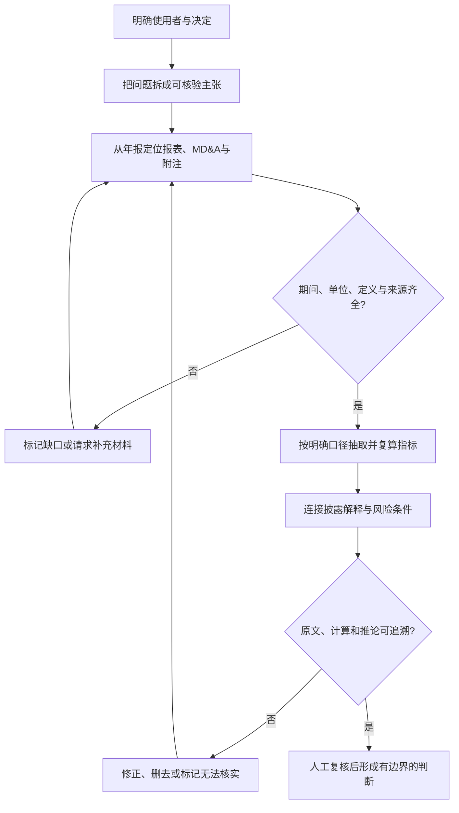

# M09 · AI 财报分析与利益相关者

## 0. 三分钟速览

这讲要回答一个实际问题：同一家公司的一份年报，投资者、贷款人、供应商、审计师和监管者会用 AI 查不同证据，因为他们承担的风险与需要作出的决定不同。

学完你能：

- 把会计工作拆成识别、记录、沟通三个环节，并说明 OCR、RPA、生成式 AI 各自可能处理什么。
- 从投资者、债权人、供应商、审计师、监管者等角度，提出与其决定相连的年报核查问题。
- 对提示词列出的财务指标先定义口径，再定位年报数据并复算；资料缺失时能说明无法下结论。
- 区分生成式 AI 的流畅文字与已经由原始披露证实的事实，并对引用、计算和结论逐项复核。
- 用“业务问题—证据—口径—计算—判断—人工复核”的顺序检查 AI 财报分析。

本讲讲义没有给 Apple 年报数据，也没有提供完整模型回答或准确率对照。因此本笔记不会把提示词里的要求写成 Apple 的实际财务结论。

## 1. 开始之前 · 知识衔接

### 1.1 你已有的

| 概念 | 一句话唤醒 | 回链 |
|---|---|---|
| 外部信息使用者 | 公司外部依赖财务信息作决定的人；本讲还会区分其具体目标。 | [[AC6761_Artificial_Intelligence_Accounting/_meta/知识层级台账\|知识层级台账]] |
| 内部信息使用者 | 管理层、员工、董事会等公司内部使用者，关注经营和工作安排。 | [[AC6761_Artificial_Intelligence_Accounting/_meta/知识层级台账\|知识层级台账]] |
| 年度报告 | 公司按报告期发布的财务与叙述性披露集合；具体组成依适用制度和公司而异。 | [[AC6761_Artificial_Intelligence_Accounting/notes/M03-年报分析\|M03 年报分析]] |
| 利润表、资产负债表、现金流量表 | 分别展示一段期间的经营成果、某一时点的财务状况，以及期间现金流入流出。 | [[AC6761_Artificial_Intelligence_Accounting/notes/M03-年报分析\|M03 年报分析]] |
| 流动性、偿债能力 | 流动性关心近期付款能力；偿债能力关注更长期的负债承受能力。 | [[AC6761_Artificial_Intelligence_Accounting/notes/M03-年报分析\|M03 年报分析]] |
| 毛利率、营业利润率、自由现金流、股东权益回报率（ROE） | 分别观察销售扣直接成本后的比例、经营利润比例、现金生成与股东权益回报；需先确定定义和分母。 | [[AC6761_Artificial_Intelligence_Accounting/notes/M03-年报分析\|M03 年报分析]] |
| AI 幻觉 | 模型可能生成错误或捏造的数字、事实、来源；财报任务必须回到原披露核验。 | [[AC6761_Artificial_Intelligence_Accounting/notes/M01-会计与商业\|M01 会计与商业]] |

### 1.2 本讲全新概念

本讲首次把财报分析组织成“特定使用者的决定 → 需要的证据 → 指标和披露 → 风险判断”。投资者核心经营分析、债权人流动性分析、供应商付款安全、审计治理协作和跨国监管风险都在第 2 节展开。AI 输出验证和反幻觉贯穿全篇。

### 1.3 为什么这一讲放在这里

前几周先讲会计记录和报表，让读者知道数字代表什么；第 8 周介绍 AI。本讲再把 AI 放进年报阅读工作，讨论不同利益相关者怎样提出问题、抽取资料和形成判断。顺序由“谁要作决定”走向“查什么证据”，最后讨论模型输出的限制。页码映射保留课件原顺序，方便回查。

## 2. 正文

### 2.1 会计工作与 AI 可以介入的位置（讲义 p.2–4）

如果一张纸质发票进入会计流程，系统得先读出文字，再把交易记入记录，最后把信息解释给人。讲义把会计概括为 Identifying、Recording、Communicating 三项活动。AI 工具各自作用不同，不能把“用了 AI”当作同一个操作。

**是什么**：识别是把业务凭证变成可处理的信息；记录是按规则形成会计记录；沟通是把结果传达给决策者。OCR（光学字符识别）和 NLP（自然语言处理）可帮助识别单据内容，RPA（机器人流程自动化）可执行重复且规则明确的录入、匹配或对账动作，生成式 AI 可起草比率解释或摘要。

**为什么需要它**：文件可能来自纸张、银行流水或不同格式，人工重复抄录费时；记录完成后，使用者还需要理解数字与问题的关系。把工作拆开，可以判断工具是否真的适合该步骤。

**课件原例**：p.4 给出 OCR/NLP 读取发票、收据和银行对账单；RPA 过账、匹配和调节；生成式 AI 解释比率、起草摘要并回答问题。这里是功能示例，不是对某一产品准确率或审计效果的证明。

**🎙️ 课堂补充**：待转录补充；当前没有可用的 Week 9 转录。

**💡 换个说法（笔记补充）**：可把它想成“读单据—按规则入账—向人解释”。OCR 即使读对了发票金额，也不等于会计分类正确；RPA 即使按规则执行，也可能把错误规则稳定地重复；生成式 AI 即使说得通顺，也可能把没有披露的数据补出来。

**常见误解**：OCR、NLP、RPA 和生成式 AI 不是同义词。前两者帮助识别内容，RPA 执行预设动作，生成式 AI 产生文本或其他内容。某步自动化也不代表整个会计结论已验证。

**与其他概念的关系**：这些工具位于信息处理链的不同位置。[[AC6761_Artificial_Intelligence_Accounting/_meta/知识层级台账|知识层级台账]] 已把“AI 会计的两种视角”登记为 M01 概念：编制者用 AI 协助生产信息，使用者用 AI 分析信息。

**所以呢**：先确定工具处理的是“读取、记录还是解释”，再检查该步输出是否满足下一步所需的证据标准。

### 2.2 审计中的 AI 案例与课件事实边界（讲义 p.5–14）

审计团队面对大量交易和文件，AI 可能帮助筛查、归类、搜索或起草工作材料。理解这组幻灯片的关键，是把“课件列出的产品和主张”与“独立验证过的效果”分开。

**是什么**：审计中的 AI 应用是把算法或自动化工具用于审计流程中的特定任务，例如交易异常筛查、文件检索、披露清单支持或工作底稿草拟。它提供线索或辅助材料，审计判断仍需依据审计证据和专业责任。

**为什么需要它**：审计对象可能包含大量交易、文件和披露要求。自动筛查可以帮助人把注意力放在需要进一步调查的项目上，但筛查结果本身不等同于重大错报结论。

**课件原例**：

- p.5 列出 Deloitte、KPMG、PwC、EY，作为大型审计机构案例框架。
- p.6–7 将 Deloitte Omnia、Risk Clarity、媒体和数据风险扫描、分录测试、自动分析复核及文档生成列为课件介绍的应用。课件称其五年投资为 30 亿美元。
- p.8–9 将 KPMG Clara、Workbench、FRA、Audit Chat、费用凭证检查、未入账负债搜索、准备金分析等列为课件介绍。课件称 Clara 约有 95,000 名审计人员使用。
- p.10–11 将 PwC 平台、Data PRO、Acquisition Hub、异常检测和全量分析等列为课件介绍。课件称其 AI 投资规模约 20 亿美元，并注明 reported。
- p.12–13 将 EY Canvas、EY Helix、EYQ Assurance Knowledge、无人机盘点、总账异常检测等列为课件介绍。课件称 Assurance 技术转型投资超过 10 亿美元、平台覆盖约 130,000–140,000 名专业人员、每年处理超过 1 万亿条分录；课件还把 2028 年写作完整端到端支持的目标时间。
- p.14 展示 Bryan’s Amazing Animals 盘点案例视频入口和 EY 门户地址，但讲义抽取文本没有视频内容、比较数据或独立效果评估。

上述金额、人数、处理量和时间表均是讲义原声称，正文按原单位和数量保留；没有外部核验其当前真实性、统计口径或效果。后续引用时须写“Week 9 课件称”，不能当作实时事实。平台名称和投资规模也不能单独证明工具能力或审计质量。

**🎙️ 课堂补充**：待转录补充；当前没有可用转录核对讲师是否补充了时间点、来源或限制。

**💡 换个说法（笔记补充）**：异常检测像警报器。它指出某笔交易与常见模式不同；调查人员还要判断差异是否来自错误、舞弊、业务季节性或正常的一次性交易。警报数量不是错报数量。

**常见误解**：全量分析不表示每笔交易都已由人逐笔审计；“更快”不必然等于“更准确”；投资额、平台覆盖人数和每年处理行数也不能直接推出审计质量提升。

**与其他概念的关系**：审计证据支持审计师对财务报表是否存在重大错报形成意见。AI 可以改变证据搜集和风险筛查方式，但不能把产品宣传、模型警报或工作底稿草稿直接替代审计证据和审计师判断。相关基础见本课内部控制与审计内容（链接目标待核）。

**所以呢**：遇到平台案例先记录它声称解决的具体步骤，再问有无口径、基准、错误率和独立证据支持“有效”的判断。

### 2.3 利益相关者为什么会读同一份报表（讲义 p.3、p.15–17）

同一家公司既可能盈利，也可能短期现金紧张。投资者可能在意未来回报，供应商在意货款能否按期收回，员工在意工作稳定。利益相关者（stakeholders）是会受组织影响、或能影响组织并因此关注其信息的人；本讲重点是不同角色的关注点不相同。

**是什么**：利益相关者视角，是先识别使用者要作什么决定，再选择能回答该决定的财报指标和披露。不能只给一组通用比率就假定每个人的问题相同。

**为什么需要它**：每个使用者的时间范围、损失来源和可采取行动不同。短期债权人更关心近期偿付，长期投资者还关心盈利能力、增长与风险；因此同一个数字在不同问题里重要性不同。

**课件原例**：p.3 区分 Providers（信息提供者）与 Users（信息使用者）。课件把会计人员、一定程度上的审计师都放在信息提供者一侧，并概括为记录和发布年报。

这里是课件的简化归类：财务报表由管理层负责编报；外部审计师独立检查并发表审计意见，不是报表编制者。Users 阅读数字以决定投资、放贷、供货、监管或就业。p.15–17 列举不同角色的用途。

| 使用者 | 课件列出的关注问题 | 具体目的 |
|---|---|---|
| 投资者 | 业绩、增长潜力、风险、股价和股利 | 判断是否买入、持有或出售，并评估未来回报和下行风险。 |
| 债权人 | 流动性、偿债比率、履约能力 | 判断能否按约支付利息和本金，以及是否应提供或续作信贷。 |
| 供应商 | 财务稳定、按期付款 | 决定是否赊销、采用何种付款条件，并管理应收款风险。 |
| 财务分析师 | 投资与财务规划建议 | 把报表信息转成建议，影响客户或市场决策。 |
| 审计师 | 准确性、合规、资产风险和透明度 | 识别重大错报风险，设计程序并形成有证据支持的审计意见。 |
| 管理层 | 业绩、战略、增长、强弱项 | 选择经营行动、调整资源并制定增长计划。 |

其余五类使用者继续按同一列口径读取。

| 使用者 | 课件列出的关注问题 | 具体目的 |
|---|---|---|
| 员工 | 工作保障、薪酬、福利 | 判断雇主盈利和稳定性对岗位、工资与福利的影响。 |
| 客户 | 长期合同能否履行 | 判断企业能否持续交付产品或服务，尤其是长期合同承诺。 |
| 监管者 | 法律合规、市场秩序、公众利益 | 监督披露和市场行为，发现可能损害公众或市场参与者的风险。 |
| 竞争者 | 同业基准、定价和市场定位 | 比较经营表现，调整定价、产品或市场策略。 |
| 社区 | 企业稳定性与可持续实践 | 判断企业持续经营、提供就业及投入社区项目的能力。 |

表中每行是一种使用者，第二列是课件关注点，第三列是笔记解释的决策用途。来源为讲义 p.15–17；同一角色也可能关心其他事项。

**🎙️ 课堂补充**：待转录补充；目前无法判断讲师是否重新分组或强调某一角色。

**💡 换个说法（笔记补充）**：把年报想成同一张城市地图。贷款人要找近期可通行的路，长期投资者要看未来扩建和风险，监管者要查道路是否符合规则。地图相同，问题决定查看顺序。

**常见误解**：审计师和管理层都接触报表，但角色不同。管理层负责编制并作经营决策；外部审计师独立获取证据并对报表发表意见。审计师不是替投资者保证公司未来盈利。

**与其他概念的关系**：利益相关者分析承接 M01 的内部／外部使用者分类，并为后面的提示词设定任务边界。若没有“谁作决定、决定是什么”，抽取再多信息也可能答非所问。

**所以呢**：先写出使用者、时间范围和决定，再列需要读取的报表项目与叙述披露。

### 2.4 投资者：核心业务健康（讲义 p.18–24）

长期投资者不只问公司今年赚了多少，还要判断利润、现金和回报是否持续。p.18 给出五个分析域：核心业务健康、市场与地域敞口、监管与外部风险、创新与长期战略、治理与可持续性，并以 Risk Assessment 收束。p.19 的任务聚焦第一项。

**是什么**：核心业务健康分析，是从收入、利润率、现金流、资本回报和负债承受力观察主营经营表现，并把趋势与年报解释、风险和可持续性线索一起判断。

**为什么需要它**：单一年度数字可能受一次性事件、会计估计或业务周期影响。3–5 年趋势可以展示方向，但仍需分解驱动因素、检查定义和可比性，不能仅凭曲线推断未来。

**课件原例**：p.18 列出五类投资者分析问题：核心业务健康、市场与地域敞口、监管与外部风险、创新与长期战略、治理与可持续性。p.19 要求使用 Apple 最新年报分析六项指标，并引用具体数字和页码／章节。

题目还要求结合 MD&A 和财务报表解释指标驱动因素及管理层对持续性的评论。最后要提出 3–5 个长期投资者关心的信号，先给量化表，再作简短定性评估。

讲义没有附 Apple 年报，也没有题目答案数据。因此这些要求是作答任务，不是已经观察到的 Apple 业绩结论。

#### 2.4.1 p.19 原题、题意与条件式作答

英文原题全文（讲义 p.19）

> Using Apple’s latest annual report, assess the core business health from an investor’s perspective. Extract and summarize key trends in revenue growth, gross margin, operating margin, free cash flow, return on equity, and net debt/EBITDA over the past 3–5 years (cite specific figures and page/section references). From the MD&A and financial statements, explain the main drivers of these trends and any management commentary on sustainability of the performance. Highlight 3–5 red flags or positive signals that would matter most to a long-term investor. Present the quantitative data in a clear table and follow with a concise qualitative assessment.

**中文题意与限制**：使用题目所说的“最新” Apple 年报，从投资者角度评估核心业务健康。

1. 提取收入增长、毛利率、营业利润率和自由现金流。
2. 再提取股东权益回报率（ROE），以及净债务除以息税折旧摊销前利润（EBITDA）的倍数。
3. 覆盖过去 3–5 年，为每个数字标年报页码或章节。
4. 从管理层讨论与分析（MD&A）及报表解释驱动因素和持续性评论。
5. 提出 3–5 个信号，完成量化表与定性短评。

题面未指定财年、币种、自由现金流或净债务口径，取数前必须说明。本次材料没有年报原文，因此实际数值、红旗和管理层评论仍待证据。

**参考作答（笔记推断；条件式，不是 Apple 实际结论）**：

1. 先在公司投资者关系网站或监管申报库确认报告名称、财年结束日、报告版本和审计状态；记录 PDF 页码及章节标题。
2. 对每个财年分别取净销售额、毛利、营业利润、经营活动现金流、资本开支、净利润、平均普通股权益、现金和债务。逐项记录来源页、单位和原始报表名称。
3. 统一各项指标的定义、期间和分母后再比较。具体公式与数字读法见下方“数字定义与读法”。
4. 把计算结果与年报 MD&A 的收入来源、成本、费用、产品或地域变化逐项连接。若管理层没有对持续性作明确评论，就写“年报未发现明确评论”，不能替管理层补话。
5. 只有当趋势和披露形成可追溯链条时，才把某项列为红旗或正面信号；同时写影响路径和可能的替代解释。

**英文参考答案（笔记自拟；数据待年报核验）**：

> The annual report and fiscal years must be confirmed before any figures are reported. For each year, I would cite the exact page or section and disclose the definitions used for free cash flow, return on equity, and net debt to EBITDA. I cannot assign Apple-specific signals or a liquidity or valuation conclusion without the underlying report and reconciled calculations. Once verified, I would connect each trend to the relevant MD&A discussion and distinguish management’s stated explanation from my own assessment.

这里的英文答案回答的是证据不足时应如何作答，不声称已经完成 Apple 实际分析。

**数字定义与读法**：下列指标须逐项计算，并将结果连到年报原始报表。

- 收入增长率 =（本期收入 − 上期收入）÷ 上期收入。若结果是 0.05，表示本期收入比上期高 5%。
- 毛利率（gross margin）= 毛利 ÷ 收入。它表示每 1 元收入扣除销售成本后剩余多少。
- 营业利润率（operating margin）= 营业利润 ÷ 收入。它表示每 1 元收入在营业费用后形成多少营业利润。
- 自由现金流（free cash flow）没有唯一通用口径。一种常见简化口径是经营活动现金流减资本开支；若公司另有调整，应逐项注明，不能混合口径比较。
- 股东权益回报率（return on equity, ROE）= 净利润 ÷ 股东权益。若采用平均权益，分母为期初与期末权益的平均数。例：净利润 20、平均权益 100（均为笔记补充的假设单位），ROE = 20 ÷ 100 = 20%，表示每 100 单位平均权益对应 20 单位本期净利润。
- 息税折旧摊销前利润（earnings before interest, taxes, depreciation and amortization, EBITDA）常以营业利润加折旧和摊销作近似计算；若报告另用调整后 EBITDA，应列出调整项。例：若营业利润 40、折旧和摊销合计 10（假设单位），简化 EBITDA = 50。
- 净债务 / EBITDA 要分别定义两项。净债务通常是有息借款减可抵减的现金及现金等价物，现金抵减范围须按公司披露说明；若净债务为 −10，含义是净现金 10，负比率不能读作“负杠杆”。

- 若 EBITDA 为 0，比率无定义；若 EBITDA 为负，常规倍数失去通常的偿债负担含义，不宜按正 EBITDA 倍数解释。例：净债务 100、EBITDA 50 时为 2 倍，表示净债务相当于两倍该口径 EBITDA；这不是还款年限预测。

题面未指定上述定义，故示例口径不能冒充 Apple 官方口径。每年数据须保留年报位置、币种与期间。

**🎙️ 课堂补充**：待转录补充。

**💡 换个说法（笔记补充）**：先建立“数字身份证”：每个值都要有公司、财年、单位、公式、报表位置和是否由公司调整。身份证不全的数字不进入趋势表。

**常见误解**：多年收入增长不能单独证明未来仍会增长，因为需求、竞争和成本都可能改变。高 ROE 也不能单独证明经营回报优秀，因为权益较低或杠杆较高也会推高比率。自由现金流口径不一致时，表面上的跨年变化可能来自定义改变。

p.20–22 和 p.24 只列分析小节标题。p.23 明说年报未提供前量化表待填，红旗要等数字确认。幻灯片没有给实际模型输入、年报数据、计算结果或验证标签，所以不能据此比较 Grok、Gemini、DeepSeek、ChatGPT 或 Perplexity 的准确率。

**与其他概念的关系**：本节使用 M03 财报分析基础，再加上投资者的长期回报目标。第 10 周的“多种分析模型”可能补充模型类型；本讲未提前断言模型准确性。

**所以呢**：本题的核心产出不是一张看起来完整的指标表，而是一条可从年报原文复算并追溯到投资判断的证据链。

### 2.5 债权人：短期流动性与偿债缓冲（讲义 p.25–26）

债权人关心借款人能否按期履约。利润为正并不代表手头有足够现金支付近期到期款项，因此题目要求同时看流动资产、现金来源、债务到期和压力情境。

**是什么**：流动性（liquidity）是近期支付到期义务的能力；短期偿债评估把短期资源与近期负债、现金需求和可用融资一起考虑。

**为什么需要它**：公司可能长期有盈利能力，却因收款时间晚于付款时间发生现金缺口。债权人需要看资产能否及时转为现金，以及压力下缓冲是否仍足够。

**课件原例**：p.25 给债权人六个查看方向：近期偿付、债务结构、现金流、资产质量、宏观风险和应急计划。

p.26 的任务分三步：

1. 从 Apple 最新年报提取流动比率、速动比率、现金及现金等价物、短期投资和可用未提取授信，并标准确位置。
2. 从 MD&A 和附注查营运资本管理、现金需求的季节性及近期债务到期。
3. 评估未来 12 个月的压力与缓冲，最后按低／中／高关注给出流动性评级。

讲义没有附 Apple 年报，所以这里没有可核算的数据或评级。

#### 2.5.1 p.26 原题、题意与条件式作答

英文原题全文（讲义 p.26）

> Using APPLE’s latest annual report, assess short-term liquidity and solvency from a creditor’s viewpoint. Extract the current ratio, quick ratio, cash and cash equivalents, short-term investments, and available undrawn credit facilities (cite exact figures and locations). From the MD&A and notes, summarize the company’s working capital management, seasonality of cash needs, and any near-term debt maturities. Identify potential liquidity pressures over the next 12 months and evaluate whether the company has adequate buffers to meet obligations even under moderate stress. Present key metrics in a table and conclude with a creditor risk rating on liquidity (low/medium/high concern).

**中文题意与限制**：从债权人视角判断近期流动性和偿付能力，列指定比率、现金、短期投资、可用未提取授信，并查营运资本、现金季节性和近期债务到期。最后评估未来 12 个月正常和中度压力下的缓冲，并给低／中／高关注等级。题面没有给年报、压力幅度或评级阈值；现阶段不能给 Apple 评级。

**参考作答（笔记推断；逐项答案受年报数据阻塞）**：

1. 以报告期末为同一时点取流动资产与流动负债。流动比率 = 流动资产 ÷ 流动负债；速动比率须先声明速动资产范围。不要把年度流量与期末存量混作同一口径。
2. 从现金流量表、资产负债表、借款附注和授信披露核对现金、短期投资、可动用授信及限制条件。授信总额度不等于报告日可立即提取的金额。
3. 从到期表和现金流披露找未来 12 个月的债务本金、利息和其他重大现金需求；结合营运资本与季节性说明时间错配风险。
4. 只有在明确“中度压力”假设（例如收款延迟、营运资金占用上升或授信不可全部使用）后，才判断缓冲。列出可观察的触发因素及信息缺口。
5. 评级应说明本笔记使用的判断阈值。若公司披露不足或数据口径不能核对，答案应为“无法评级／需补资料”，而不能为了满足题面硬给低、中或高。

**英文参考答案（笔记自拟；数据待核验）**：

> I would calculate the current and quick ratios using balance-sheet amounts from the same reporting date and state the definition of quick assets. I would verify cash, short-term investments, and undrawn facilities against the notes, including restrictions and availability. A low, medium, or high concern rating requires the maturity schedule, cash-flow seasonality, and an explicit moderate-stress assumption. Without those disclosures and reconciled figures, the company-specific rating cannot be determined from the supplied slides.

**比率读法**：若某公司流动资产为 150、流动负债为 100（仅为笔记补充的假设单位），流动比率为 1.5。它表示报告日每 1 单位流动负债对应 1.5 单位账面流动资产；不代表这些资产都能立即按账面价值变成现金。速动比率还需明确是否扣除存货、预付款及其他项目。

**🎙️ 课堂补充**：待转录补充。

**💡 换个说法（笔记补充）**：比率像水箱水位，债务到期像短时间打开的出水阀。水位够不够还取决于阀门何时打开、流入水何时到达、阀门是否受限。

**常见误解**：账面流动资产不一定能即时变现，因为应收款和存货可能需要时间才能转为现金。授信总额也不一定能全部提取，因为契约、用途或其他限制可能影响可用金额。流动比率不存在脱离行业、季节和到期结构的通用评级线，所以不能只看一个比率就判定风险高低。

**与其他概念的关系**：债权人分析把资产负债表时点存量、现金流量表期间流量和债务附注的到期安排连起来。忽略时间会让静态比率掩盖近期现金缺口。

**所以呢**：在给债权人风险等级前，必须把资产口径、到期时点和压力假设放到同一条时间线上。

### 2.6 供应商：付款安全与订单稳定（讲义 p.27–28）

供应商可能先提供货物或服务，之后才收款。它因此关注客户能否持续采购、按时付款以及经营中断的迹象。付款安全与银行贷款偿还相关，但两者不是同一个问题。

**是什么**：供应商视角的付款风险评估，是判断买方的现金、短期负债、应付账款趋势和经营稳定性是否支持按约付款。

**为什么需要它**：供应商赊销后形成应收款。如果客户拖欠，供应商会承担资金占用和坏账风险；若客户订单突然下降，供应商还可能面临产能和库存安排风险。

**课件原例**：p.27 给供应商五个查看方向：付款安全、订单稳定、盈利与成本压力、应急运营风险、战略匹配。

p.28 的任务分三步：

1. 从 Apple 年报提取现金、流动比率、速动比率和可用授信。
2. 查 MD&A、营运资本附注和应付账款披露，整理付款条件、应付账款周转天数趋势及现金管理／流动性压力。
3. 分别评估正常与中度压力下能否按时足额付款，并指出应监测的信号，如应付增长、流动性限制或重组。

讲义没有附年报数据，不能据此得出 Apple 的付款风险结论。

#### 2.6.1 p.28 原题、题意与条件式作答

英文原题全文（讲义 p.28）

> Using APPLE’s latest annual report, assess payment security and short-term liquidity from a supplier’s viewpoint. Extract cash and cash equivalents, current ratio, quick ratio, and any available credit facilities. From the MD&A, notes on working capital, and accounts payable disclosures, summarize the company’s payment terms, days payable outstanding trends, and any comments on cash management or liquidity pressures. Identify whether the company appears able to pay suppliers on time and in full under normal and moderately stressed conditions. Highlight any red flags (e.g., rising payables, liquidity constraints, or restructuring) that a supplier should monitor. Present key metrics in a table and conclude with a payment-risk assessment.

**中文题意与限制**：从供应商视角评估付款安全。提取指定指标，查年报披露的付款条件、应付账款周转天数（DPO）及现金管理情况，再判断正常和中度压力下是否按时足额付款，并列监测红旗。题面没有说明 DPO 公式、平均或期末应付口径、采购额数据、压力定义或年报原件，所以不能算出 Apple 的趋势或结论。

**参考作答（笔记推断；步骤答案，事实待核）**：

1. 先统一 DPO 口径。一个简化估计可用平均应付账款 ÷ 期间赊购额 × 期间天数；若无法取得赊购额，有些分析会用销售成本作近似，但必须标注代理分母和局限，不能称为精确采购付款天数。
2. 对照多期 DPO、应付账款、经营现金流和 MD&A。应付账款增加可能代表采购规模扩大或付款期限变化，也可能提示现金压力；单一上升趋势不能直接证明拖欠。
3. 核实现金和授信是否可用于经营付款，是否受限制或已有用途。把未来现金需求和供应商应付款的期限放在一起。
4. 正常与压力情境下分别说明判断。出现延迟付款披露、重大重组、现金限制或营运资本紧张时列为监测信号；缺披露时说明不能据此判定实际付款表现。

**英文参考答案（笔记自拟；数据待核验）**：

> I would report the payment terms and days payable outstanding only after confirming the company’s disclosed definition and the underlying accounts payable and purchases data. Rising payables alone do not establish late payment; I would compare them with purchasing activity, operating cash flows, liquidity disclosures, and any restructuring or payment-delay disclosures. A supplier-specific risk conclusion requires the annual report and a stated stress scenario. The supplied slides do not provide enough evidence to determine Apple’s actual payment risk.

**🎙️ 课堂补充**：待转录补充。

**💡 换个说法（笔记补充）**：供应商像先把货放进客户的仓库，再等客户付款。客户的期末现金是一个时点快照；还要查合同付款日、历史周转和未来资金需求，才能判断这笔“等待”是否安全。

**常见误解**：应付账款增加不自动等于供应商未获付款；DPO 变长可能由业务结构或采购季节变化导致。需要披露或其他证据区分解释。

**与其他概念的关系**：供应商风险与债权人流动性相交，但供应商更需要知道贸易应付款的条件、采购关系和运营连续性。订单稳定性也影响供应商自己的资源安排。

**所以呢**：用 DPO 时必须同时报告公式与分母来源，再将周转变化放回采购和现金流背景解释。

### 2.7 审计师：重大错报、治理与内部审计协作（讲义 p.29–30）

审计师读年报时，核心不是预测股价，而是评估财务报表是否可能存在会影响使用者决策的重大错报，并获取足以支持结论的证据。治理安排和内部审计信息可以帮助理解监督环境，但不能单凭组织图证明报表可靠。

**是什么**：重大错报（material misstatement）是财务报表中的错误或遗漏，其规模或性质可能影响报表使用者的决定。治理（governance）是董事会、审计委员会和管理层监督与控制企业活动的安排。内部审计是组织内部提供独立或客观保证与咨询的职能，其具体职责、汇报关系和范围需看公司披露及适用制度。

**为什么需要它**：审计资源有限，审计师需要理解业务环境、识别错报风险并设计进一步程序。治理监督与内部审计的工作可能提供有用背景，但外部审计师仍要评估其客观性和工作质量，决定能否以及在何种程度上使用。

**课件原例**：p.29 列出六类关注点：业务环境、账户分析、重大错报风险、治理与内审协作、分析程序、合规与伦理。

p.30 要求根据年报和治理／内控披露，总结董事会与审计委员会结构、独立性、财务专长，以及对财报和内控的监督陈述。它还要求提取披露的内审范围、汇报关系或发现，并评价治理安排、外审协调方式和相关信号。

当前没有 Apple 年报原文，不能确认具体董事、独立性、专长、内审范围或缺陷。

#### 2.7.1 p.30 原题、题意与条件式作答

英文原题全文（讲义 p.30）

> Evaluate governance and potential synergy with internal audit using the annual report (and any referenced governance or internal control disclosures). Summarize the board and audit committee structure, independence, financial expertise, and any statements on oversight of financial reporting or internal controls. Extract information on the internal audit function, if disclosed, including its scope, reporting lines, or findings referenced. Assess whether the governance arrangements appear robust enough to support reliable financial reporting and how an external auditor might leverage or coordinate with internal audit. Note any governance-related red flags or positive indicators.

**中文题意与限制**：从年报和其引用的治理／内控披露评估董事会、审计委员会及内部审计，并分析其对可靠财务报告的支持程度，以及外部审计师可以怎样协调。关键词 “if disclosed” 表示如果年报没有披露内部审计信息，要如实说明未披露，不能推断该职能不存在或存在缺陷。题目没有提供报告，无法评价 Apple 实际治理质量。

**参考作答（笔记推断；条件式）**：

1. 抽取董事会和审计委员会成员、任期、独立性定义、财务专长依据，以及监督财务报告和内控的原文；逐项标注页码。
2. 若披露内部审计，记录职能范围、汇报线、工作对象及年报引用的发现。若未披露，答案写“在已检查的年报范围内未找到相关披露”。
3. 外部审计师可在了解内部审计客观性、能力和工作质量后，考虑与其沟通风险、避免不必要重复并评价可用工作；外部审计师仍须对自己的审计意见负责并获取充分适当证据。
4. “稳健”判断要将委员会监督、内控披露、发现和整改连起来。仅有独立董事比例或“符合要求”陈述不足以证明控制有效。

**英文参考答案（笔记自拟；事实待年报核验）**：

> I would describe the board and audit committee only from the company’s disclosed membership, independence criteria, expertise, and oversight statements, with page references. If internal audit information is not disclosed, I would state that limitation rather than infer that the function is absent. An external auditor may communicate with internal audit and assess whether particular work is usable, but remains responsible for the external audit opinion and for obtaining sufficient appropriate evidence. The supplied slides contain no Apple governance disclosures, so no company-specific conclusion can be reached here.

**🎙️ 课堂补充**：待转录补充。

**💡 换个说法（笔记补充）**：内部审计像组织内部持续巡检，外部审计像独立执行年度财报审计。两者可以交换风险线索；外部审计师必须亲自判断内部工作的质量，不能因为“内部已检查”就跳过自己的责任。

**常见误解**：

- 审计委员会存在不能证明所有内控有效，因为治理结构说明“谁负责监督”，不直接展示每项控制是否实际运行。
- 年报未披露内部审计信息，不能据此判断该职能不存在，因为公开报告可能没有说明其组织范围。
- 外部审计师与内部审计协作不会转移外部审计责任，因为外部审计师仍须评价证据并对自己的审计意见负责。

**与其他概念的关系**：重大错报评估连接业务风险、账户层面分析、内控与审计证据。治理披露为风险判断提供背景；披露信息本身仍需结合审计程序和其他证据。

**所以呢**：先区分“披露了什么”“审计师还要验证什么”和“目前无法知道什么”，再作治理评价。

### 2.8 监管者：跨国合规风险（讲义 p.31–32）

监管者关心企业是否遵守多个司法辖区适用的规则、披露是否充分，以及违规可能对消费者、市场和公共利益造成什么影响。公司跨境经营会带来不同法律义务，但具体义务取决于事实、主体和适用法律。

**是什么**：跨国监管风险分析，是从年报中识别地域经营、跨境活动、风险因素、管理层披露的合规暴露、调查处罚和整改事项，再判断监管者应优先追问哪些证据。

**为什么需要它**：跨国公司可能受到不同地区的隐私、制裁、反贿赂、行业监管或出口管制要求影响。风险暴露改变时，潜在罚款、业务限制、披露义务或运营中断也可能变化。

**课件原例**：p.31 列出反垄断与垄断风险、国际合规、罚款承受能力、披露充分性、消费者与市场稳定风险。p.32 的题面要求从年报总结地域分布、跨境运营和外国法律合规披露，从 Risk Factors 与 MD&A 提取关键司法辖区的监管风险评估和环境变化，指出监管者可能优先关注的风险缺口，并核实罚款、调查和整改。

**勘误**：p.32 标题仍写 “Prompt – Governance & Internal Audit Synergy”，但正文题目实际要求 international regulatory compliance risks，与 p.30 治理／内部审计主题冲突。正文应按实际任务解释，标题错粘记录在第 9.3 节。

#### 2.8.1 p.32 原题、题意与条件式作答

英文原题全文（讲义 p.32；保留原题标题与内容冲突）

标题：Prompt – Governance & Internal Audit Synergy

> Review the annual report for international regulatory compliance risks. Summarize the company’s geographic footprint, cross-border operations, and any disclosures regarding compliance with foreign laws (e.g., data privacy, sanctions, anti-corruption, sector-specific regulations, or export controls). From the Risk Factors and MD&A, extract management’s assessment of regulatory exposures in key jurisdictions and any material changes in the regulatory environment. Identify potential gaps or elevated risks that a multi-jurisdictional regulator or coordinating authority would prioritize. Note any reported fines, investigations, or remediation efforts related to international compliance.

**中文题意与限制**：虽然题面标题误标为治理与内部审计，正文要求审查跨国监管合规风险。需要从年报查地域足迹、跨境运营、外国法律合规披露、关键司法辖区风险评估和环境变化，以及处罚、调查和整改。列举的法律领域是题面示例，不足以证明 Apple 在任何一项存在违规，也不能据此作法律结论。

**参考作答（笔记推断；条件式）**：

1. 从分部、地域和风险因素披露中标记经营地点、销售市场、供应链或跨境数据流；每个事实附页码。
2. 把管理层提到的合规领域、司法辖区、风险变化和潜在业务影响逐条摘录。分清公司明确承认的风险与分析者提出的监管关注点。
3. 搜索年报中的 fines、investigations、proceedings、remediation 等表述，核对金额、期间、状态和影响；没有找到时写“在已检查披露中未找到”，不要扩大成“没有调查”。
4. 监管者优先事项可作为条件式问题提出，例如跨境数据流是否受当地限制、披露是否覆盖重大地区、整改是否有责任人与进度。问题不是已确认违规。

**英文参考答案（笔记自拟；事实待年报核验）**：

> I would map the disclosed geographic footprint and cross-border activities to the jurisdictions and regulatory exposures identified in the Risk Factors and MD&A. I would report fines, investigations, and remediation only when the annual report provides a specific disclosure, including its period and status. Potential regulatory priorities should be framed as questions for further evidence, not findings of non-compliance. The supplied slides do not include Apple’s annual report, so they do not support a company-specific legal or compliance conclusion.

**🎙️ 课堂补充**：待转录补充。

**💡 换个说法（笔记补充）**：监管分析像一张“业务地图叠规则地图”。只有先知道公司在哪些地区做了什么，才能问哪些规则可能适用；没有地点和活动证据，就不能从行业常见风险直接推断个案违规。

**常见误解**：题干列举隐私、制裁或出口管制，不表示公司已违反这些规则。年报未提及某项风险，也不能单独证明完全没有风险。笔记只按课件要求组织分析维度，不提供现实法律意见。

**与其他概念的关系**：本节把财报分析、风险因素披露和治理监督连接起来。它与审计师一节有交叉，但监管者判断公共规则和市场秩序，外部审计师对财报发表审计意见，两者职责不同。

**所以呢**：把“公司披露的事实”和“监管者可进一步核查的问题”分栏写，避免把风险筛查误写成法律结论。

### 2.9 幻觉、核验与人工判断（讲义 p.33–38）

生成式 AI 可以把问题变成易读文字，但当答案里的数字、来源或引语无法回到年报原文时，读者就无法判断它是否可靠。本组幻灯片把这种错误称为 hallucination（幻觉），并说明其影响与缓解方式。

**是什么**：AI 幻觉是模型输出错误、捏造或无根据的信息，包括虚构统计数字、事实、整段叙述或不存在的参考资料。财务分析中的具体表现可能是编造某年比率、误引年报页码、把别家公司数字套到 Apple，或把模型判断说成管理层原话。

**为什么需要它**：年报分析有具体期间、定义和来源要求。一个数字即使看起来合理，只要财年、分母、币种或出处错了，就可能改变比率和最终判断。

**课件原例**：p.33 说明幻觉定义和可能原因。p.34 举出虚构审计异常、虚构数字，以及引用不存在或归属错误的研究。

p.35 说明信任受损、错误计算、错误报告、决策和合规后果。p.36 建议对照权威来源并由人监督，也提到改进训练数据和算法。

p.37 强调用户教育与批判性思维。p.38 将可解释性、不确定性表达和透明度列为未来研究方向。

**核验流程（笔记补充）**：

1. 将输出拆成可核验主张：数值、趋势、定义、页码、引用和因果解释。
2. 对每个数字回到年报表格，核对行名、期间、单位、符号和合并口径。
3. 按注明的公式手工复算；比率结果再与报告原数和其它相关报表交叉检查。
4. 把管理层原话与分析者解释分开标注。找不到来源时删除该事实或标“无法核实”。
5. 由熟悉会计口径的人复核结论，并记录发生分歧或定义不明的位置。

**🎙️ 课堂补充**：待转录补充。

**💡 换个说法（笔记补充）**：AI 像一个很快的研究助理，可以先整理材料，但引用清单要能点回原页、算式要能复算。不能点回原文的“证据”就不能支持最终结论。

**常见误解**：交叉验证不是随便找两个网页看是否重复；复制同一个错误来源不构成独立确认。模型给出解释性语句也不代表它真实展示了内部推理过程。

**与其他概念的关系**：核验要求接上前面的每个角色任务。对投资者，核对趋势和持续性；对债权人，核到期和可用缓冲；对审计师，核证据来源与错报判断；对监管者，核披露事实和适用范围。

**所以呢**：AI 可以加快搜集与初步组织，最终分析仍须由人把数字、口径、来源和决定连成可复核的链条。

## 3. 一图看懂

下面的流程把本讲各类利益相关者共用的检查顺序画出来。使用者和任务改变时，前半段的目标及指标会变化；证据定位、口径核对、复算和人工复核仍需保留。

**怎样走图**：以债权人问题“未来 12 个月能否履约”为例。先确定期末日期和未来一年范围，再从资产负债表取流动项目、从附注取债务到期和授信限制。如果速动比率的分子定义不清，沿“否”返回补充口径；定义清楚后才计算并结合现金需求解释。若授信在某种条件下不能提取，判断中必须保留该条件。

图里的“补材料”回路不能靠重复询问模型消除缺失；需要原年报、附注或经授权的可靠来源。最终输出必须能从每条判断追溯到原文和计算。该流程是笔记补充的分析方法，不是课件声称的某个平台算法。

## 4. 速查表

| 使用者 | 核心决定 | 优先查找 | 不能单凭什么下结论 |
|---|---|---|---|
| 投资者 | 长期回报与风险 | 多年利润率、现金、回报、MD&A | 单年增长或模型生成的红旗 |
| 债权人 | 近期及长期偿付 | 流动性、到期表、现金流、授信条件 | 单一流动比率 |
| 供应商 | 按时足额收款 | 现金、应付账款、DPO、付款披露 | 应付增长本身 |
| 审计师 | 财报是否重大错报 | 业务风险、账户证据、控制与治理 | 平台警报或董事会结构本身 |
| 监管者 | 合规与市场保护 | 地域、风险因素、调查处罚、整改 | 题干列出的法律领域 |

读表：第一列是阅读财报的人，第二列是其决策，第三列列出要核对的证据，第四列提醒单个信号的解释边界。优先查找项目来自 p.18、25、27、29、31–32 的课件主题及本笔记解释。

## 5. 双语术语卡

| 中文 | English | 考试可用的英文定义 | 首现位置 |
|---|---|---|---|
| 利益相关者 | Stakeholder | A party that affects or is affected by an organization and has an interest in its information.（笔记自拟定义） | §2.3；讲义 p.15 |
| 管理层讨论与分析 | Management’s Discussion and Analysis (MD&A) | A narrative section in which management discusses financial results, drivers, risks, and other matters required or presented in the report.（通用解释；具体要求依制度） | §2.4；p.19 |
| 流动性 | Liquidity | The ability to meet obligations as they become due in the near term.（笔记自拟定义） | §2.5；p.25 |
| 流动比率 | Current ratio | Current assets divided by current liabilities at a specified reporting date.（笔记自拟定义） | §2.5.1；p.26 |
| 速动比率 | Quick ratio | A liquidity ratio based on defined quick assets divided by current liabilities.（笔记自拟定义；需说明速动资产口径） | §2.5.1；p.26 |
| 应付账款周转天数 | Days payable outstanding (DPO) | An estimate of the average time taken to pay trade payables, calculated using a stated payable and purchase-cost basis.（笔记自拟定义） | §2.6.1；p.28 |
| 重大错报 | Material misstatement | A misstatement that could reasonably influence users’ decisions, considering its nature or amount.（教学释义；标准定义需按适用准则核对） | §2.7；p.29 |
| 内部审计 | Internal audit | An organizational function that provides assurance and advice within a defined scope and reporting arrangement.（教学释义；不替代专业标准定义） | §2.7.1；p.30 |
| 人工监督 | Human oversight | Human review and judgment applied to evaluate, correct, or reject AI-generated work.（笔记自拟定义） | §2.9；p.36 |
| 幻觉 | Hallucination | An AI output that is incorrect, fabricated, or unsupported by its sources.（据讲义 p.33 改写） | §2.9；p.33 |

## 6. 考点预判与答题框架

本讲没有可用课堂转录，因此没有“教授明示”的考试考点。下列是按课程学习目标和讲义题目作的笔记推断，不代表考试安排。

| 可信度 | 可能考点 | 依据与答题框架 |
|---|---|---|
| 🟡 ILO 反推 | 说明 AI 如何支持财务分析，以及为何需要人工复核 | 课程目标要求解释当代 AI 技术对财务分析自动化的应用；按输入、处理、输出、核验、边界作答。 |
| ⚪ 笔记推断 | 对不同使用者设计不同年报分析问题 | p.15–32 多次按投资者、债权人、供应商、审计师和监管者组织提示词。先讲使用者决定，再列证据与限制。 |
| ⚪ 笔记推断 | 解读模型输出中的幻觉风险 | p.33–38 定义错误、影响和缓解；给出数字回源、复算、区分原话与推断的核验链。 |
| ⚪ 笔记推断 | 分析内部审计与外部审计协作边界 | p.29–30 直接提出治理与协同主题；须说明外部审计师仍负审计责任。 |

**通用英文答题骨架（笔记补充）**：

> First, identify the stakeholder and the decision to be made. Next, specify the relevant financial statements and disclosures, the reporting period, and the definitions of the requested metrics. Extract each figure with a page or section reference and recalculate it using a consistent basis. Then connect the observed trend to disclosed drivers, distinguish management’s statements from my assessment, and state the limitations and evidence that remain unavailable. Finally, explain how a human reviewer would verify the AI output before relying on it.

## 7. 自测

### 7.1 概念题

**题目**：同一家公司流动比率提高，为什么债权人仍需查看债务到期表和授信条件？

答案

流动比率是报告日流动资产除以流动负债的静态比例。它不直接表示资产变现时间、受限情况或债务的具体到期日。债权人还需检查未来现金流入和到期现金流出的时间，以及授信能否在需要时实际提取。

### 7.2 案例分析题

**题目**：某 AI 摘要称“公司未来一年流动性很强”，给出 1.8 的流动比率，但没有提供页码、速动资产定义或未来一年债务到期额。你能否接受该判断？下一步做什么？

答案

不能据此接受结论。先回到同一报告期的资产负债表核对流动资产和流动负债，按原始数字复算 1.8；再明确流动比率不代表即时现金。随后查速动资产口径、现金受限情况、债务到期表、现金流季节性和授信条件。如果资料缺失，应把判断标为未完成并列出所需披露，而不是让模型补齐。

### 7.3 改条件练习

**题目**：如果应付账款增加，但采购额也按相同比例扩大，DPO 是否必然上升？

答案

不必然。若平均应付账款与采购额同比例增加，DPO 的比例可能近似不变。实际计算还取决于应付账款是期末还是平均余额、期间天数和采购额是否可得。判断付款风险时还要结合现金流和付款披露。

## 8. 讲义页码映射

| 笔记小节 | 讲义页码 | 课堂覆盖 |
|---|---|---|
| 标题与导读 | p.1 | 封面／章节标题，未作为独立知识点展开 |
| §2.1 会计活动与工具 | p.2–4 | 页面文字已在正文解释 |
| §2.2 审计平台案例 | p.5–14 | 页面文字与课件声称已按页记录；视频内容与平台当前状态未核 |
| §2.3 利益相关者 | p.3、p.15–17 | 已解释用户视角与角色差异 |
| §2.4 投资者框架 | p.18–19 | 框架已解释；p.19 原题保留并给条件式答案 |
| §2.4 模型输出标题 | p.20–24 | 仅有输出主题标题，正文解释其证据限制 |
| §2.5 债权人 | p.25–26 | 分析维度和原题已解释 |
| §2.6 供应商 | p.27–28 | 分析维度和原题已解释 |
| §2.7 审计师 | p.29–30 | 分析维度和原题已解释 |
| §2.8 监管者 | p.31–32 | 分析维度、原题及标题勘误已解释 |
| §2.9 幻觉与核验 | p.33–38 | 定义、示例、影响、缓解、教育和未来方向均已解释 |

## 9. 延伸与勘误

### 9.1 课件有但课上略过

本讲无可用转录，无法判断课上略过了哪些内容；不得标记 ⏭️。

### 9.2 课上讲了但课件没有

待转录补充；当前无转录可比对。

### 9.3 课件自身错误与口径不一致

- p.32 标题为 “Prompt – Governance & Internal Audit Synergy”，但题干要求跨国监管合规风险。笔记按题干实质处理，并保留标题冲突。
- p.20–24 只有 Grok、Gemini、DeepSeek、ChatGPT、Perplexity 等小标题及输出章节标题。当前文本没有数据、来源、提示上下文、复算记录或准确率比较，不能声称这些模型实际分析正确或错误。
- p.14 的视频链接与入口没有随讲义文本提供视频内容、计数结果或准确性基准；不能把“更快、更准确”写成已核验的实验结果。
- p.6–13 的平台功能、用户规模、投资金额、年度处理量和 2028 计划均按课件声称记录；本笔记没有逐项外部核验，不代表这些信息已是当前事实。

### 9.4 课外补充

- 比率小数据例子、OCR/RPA 的错误传播说明及年报核验流程均为笔记补充，未冒充讲义数字或 Apple 结果。
- 本笔记只按课件主题说明监管分析维度，不对任何现实主体作法律判断。

### 9.5 未完成的来源与验收事项

- Apple 年报原件未提供：五个提示词的真实公司数据、引用位置、MD&A 解释、评级、处罚或整改事实均待补材料后核查。
- Week 9 转录未提供：全部“🎙️ 课堂补充”格待转录。
- M01、M03 回链已核；本批同步新增 M08，材料仍为无转录的预习版。
- p.5–14 平台及视频信息未做外部来源核验；课件声称与当前现实之间的差别待查。
- 图与正文同源浏览器核对见本次发布记录；Obsidian 阅读视图未直接查看。
