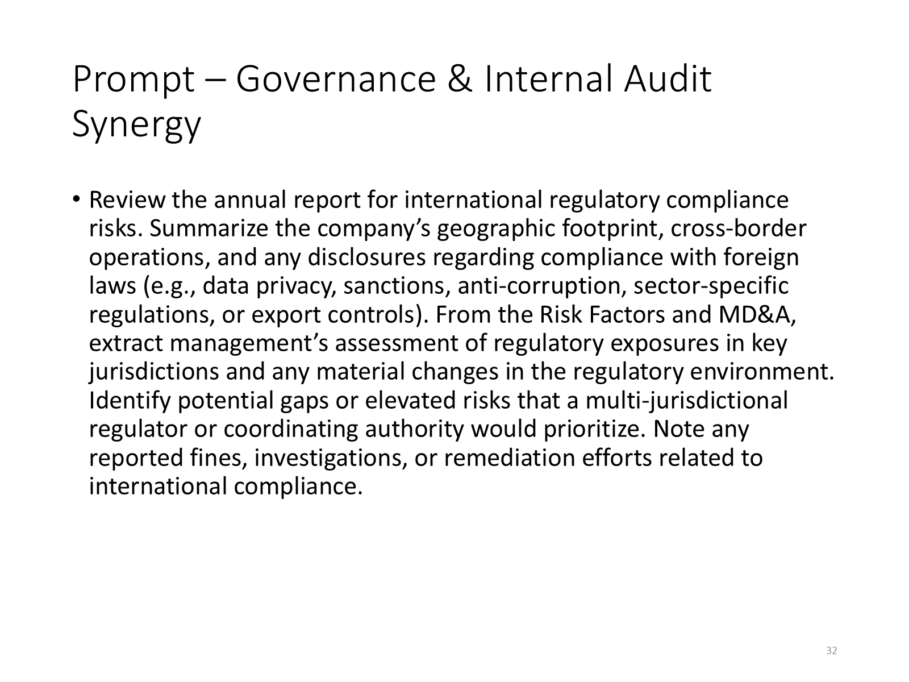
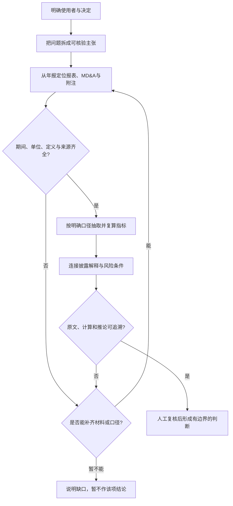

# M09 · AI 财报分析与利益相关者

> **材料 v1.0。** 来源为 S28 [[AC6761_Artificial_Intelligence_Accounting/transcripts/M08-M09-transcript-source28-partial.txt|M08-M09-transcript-source28-partial.txt]]（原文件 `新录音 28.txt`，全源 801 段）。M09 用原时钟 `20:06`–`01:30:34`（580 段）。前段回填 M08。`01:05:22`–`01:10:00` 无转录段，末尾停在课堂练习指令。

## 0. 三分钟速览

这讲要回答一个实际问题：同一家公司的一份年报，投资者、贷款人、供应商、审计师和监管者会用 AI 查不同证据，因为他们承担的风险与需要作出的决定不同。

学完你能：

- 把会计工作拆成识别、记录、沟通三个环节，并说明 OCR、RPA、生成式 AI 各自可能处理什么。
- 从投资者、债权人、供应商、审计师、监管者等角度，提出与其决定相连的年报核查问题。
- 对提示词列出的财务指标先定义口径，再定位年报数据并复算；资料缺失时能说明无法下结论。
- 区分生成式 AI 的流畅文字与已经由原始披露证实的事实，并对引用、计算和结论逐项复核。
- 用“业务问题—证据—口径—计算—判断—人工复核”的顺序检查 AI 财报分析。

本讲讲义没有给 Apple 年报数据，也没有提供完整模型回答或准确率对照。因此本笔记不会把提示词里的要求写成 Apple 的实际财务结论。

**🎙️ 课堂实况**：S28 开头仍在讲 M08，`19:52` 转场，`20:06` 进入 M09。教师先介绍会计与审计工具，再以 EY 盘点影片说明人工核查（`24:48`–`40:33`）。课堂主线是怎样把“分析一份年报”改成能为具体角色作决定的问题（`40:42`–`01:24:00`）；其后讲到幻觉与 Case 6（`01:24:00`–`01:30:34`）。`01:05:22`–`01:10:00` 的练习接缝没有转录段，结束时也未录到练习收束。

## 1. 开始之前 · 知识衔接

### 1.1 你已有的

| 概念 | 一句话唤醒 | 回链 |
|---|---|---|
| 外部信息使用者 | 公司外部依赖财务信息作决定的人；本讲还会区分其具体目标。 | [[AC6761_Artificial_Intelligence_Accounting/_meta/知识层级台账\|知识层级台账]] |
| 内部信息使用者 | 管理层、员工、董事会等公司内部使用者，关注经营和工作安排。 | [[AC6761_Artificial_Intelligence_Accounting/_meta/知识层级台账\|知识层级台账]] |
| 年度报告 | 公司按报告期发布的财务与叙述性披露集合；具体组成依适用制度和公司而异。 | [[AC6761_Artificial_Intelligence_Accounting/notes/M03-年报分析\|M03 年报分析]] |
| 利润表、资产负债表、现金流量表 | 分别展示一段期间的经营成果、某一时点的财务状况，以及期间现金流入流出。 | [[AC6761_Artificial_Intelligence_Accounting/notes/M03-年报分析\|M03 年报分析]] |
| 流动性、偿债能力 | 流动性关心近期付款能力；偿债能力关注更长期的负债承受能力。 | [[AC6761_Artificial_Intelligence_Accounting/notes/M03-年报分析\|M03 年报分析]] |
| 毛利率、营业利润率、自由现金流、股东权益回报率（ROE） | 分别观察销售扣对应销售成本后的比例、经营利润比例、现金生成与股东权益回报；需先确定定义和分母。 | [[AC6761_Artificial_Intelligence_Accounting/notes/M03-年报分析\|M03 年报分析]] |
| AI 幻觉 | 模型可能生成错误或捏造的数字、事实、来源；财报任务必须回到原披露核验。 | [[AC6761_Artificial_Intelligence_Accounting/notes/M01-会计与商业\|M01 会计与商业]] |

### 1.2 本讲全新概念

本讲首次把财报分析组织成“特定使用者的决定 → 需要的证据 → 指标和披露 → 风险判断”。投资者核心经营分析、债权人流动性分析、供应商付款安全、审计治理协作和跨国监管风险都在第 2 节展开。AI 输出验证和反幻觉贯穿全篇。

### 1.3 为什么这一讲放在这里

主源 **Week 9 PPT.pptx**，页号为物理幻灯片编号。

- **预习**先看 [[#p.3 · 同一份年报的两边|p.3]]，分别替供应商和投资者写一个要用报表回答的问题，再对照 p.15–18。
- **课中**在 [[#8. 讲义页码映射|§8]] 找本页。五份英文任务全文在主题深读各原题节，跟读 p.20–24 的五份课件提纲时，先对齐其中有标明的财年。
- **复习**用 p.26、28 区分偿债和付款，用 p.32 分清题名与任务，再按 p.34–37 给每项结论标原表、复算或待核。

前几周先讲会计记录和报表，让读者知道数字代表什么；第 8 周介绍 AI。本讲再把 AI 放进年报阅读工作，讨论不同利益相关者怎样提出问题、抽取资料和形成判断。顺序由“谁要作决定”走向“查什么证据”，最后讨论模型输出的限制。页码映射保留课件原顺序，方便回查。

## 2. 正文

依次读每页问题、原图及下方的做法。已有专题长例和课堂材料集中在后半。

### 逐页 · 会计与审计使用场景（p.1–14）

#### p.1 · 本讲标题

第 9 章转到报表使用者，围绕同一家公司练习怎样按决策角色选指标、找原文和核 AI 输出。

#### p.2 · 会计的三个动作

识别是看单据并判断发生了什么，记录是把事实转成可追溯条目，沟通是将结果整理给需要决策的人。例如供应商发票从识别金额到入账，再汇总给报表读者。

讲义问 **What is accounting?**（会计是什么？）。英文参考答（据本页动作整理）：Accounting identifies, records, and communicates financial information.

#### p.3 · 同一份年报的两边

会计人员负责记录并编制报告，外部审计者核其可靠性；投资者、贷款人、供应商等依各自的决策读取。核公司最近能否付款和核未来盈利是不同问题。

#### p.4 · 把 AI 接到识别、记录和沟通

扫描发票先用光学字符识别（OCR）取文字，再用自然语言处理（NLP）理解字段；通过机器人流程自动化（RPA）按规则匹配、过账或对账；生成式 AI 能草拟解释，金额和结论仍需回查。

#### p.5 · 四大案例用来观察审计环节

课件以 Deloitte、KPMG、PwC、EY 举例。比较时先定环节：取得资料、找风险、做测试还是写底稿；工具能力、使用人数和投资额不可混作同一种指标。

#### p.6 · Deloitte：平台和协作代理

课件把全球审计平台 Omnia、Trustworthy AI 和跨环节的代理协作放在同一页。区分基础平台、治理框架、拟自动化的流程；五年投资额与视频链接属于课件材料口径。

#### p.7 · Deloitte：从线索到复核

课件举媒体风险扫描、分析交易和文件、辅助更快回复客户问询、披露评估、Risk Clarity 控制测试，以及日记账检测和底稿生成。风险提示是待查项目，审计人员再核凭证、记录依据。

#### p.8 · KPMG：审计平台和多代理工作台

课件称 Clara 用于审计流程，Workbench 提供多个专门代理，并列 Trusted AI、ISO 42001 和数据平台合作。平台规模、认证和单项输出正确性须分别证明。

#### p.9 · KPMG：凭证、披露与分录

费用凭证核查、找未记录负债和准备金分析各需不同源表。FRA 帮查披露清单；Audit Chat 辅助合同或研究；课件还把异常评分、流程内建议和风险识别连到审计流程；分数给复核优先级，不能据此断言错报。

#### p.10 · PwC：测试范围与治理

课件把下一代平台、Microsoft 合作、代理架构和全总体分析放在一起。对全部导入记录跑规则，覆盖的是已导入总体；仍需查数据是否完整并核质量、独立性和伦理要求。

#### p.11 · PwC：从数据准备到测试

Data PRO 和 Acquisition Hub 对应资料取得和转换；随后可做异常检测、用 ChatNational 等研究、起草底稿、生成实时仪表板，并支持内部审计现场工作。课件还列全总体测试和实时分析；总体仍限实际导入的数据。先核数据准备，再判断扫描是否漏掉交易。

#### p.12 · EY：接入 Canvas 的分段计划

课件按研究、项目管理、起草和复核列推进顺序；2028 是课件写的目标，Canvas 人数区间和投资数字也是课堂口径，不能据此证明阶段已全部上线。

#### p.13 · EY：无人机、总账与证据

存货盘点示例先识别或计数，再把结果对存货记录并复核遮挡及漏扫。课件还列总账异常、EYQ 资料检索、智能检查清单、报表勾稽、底稿和 EY Helix；发现线索与形成审计结论之间还需验证。

#### p.14 · EY 案例页的两个视频标签与门户

课件列 Bryan’s Amazing Animals 的背景与 AI 应用两个视频标签；只有 EY 门户地址，未见两条视频各自的链接。课件页未给片段数据或对照结果；以下课堂录音只补到影片旁白。

**🎙️ 课堂补充**（`30:45`–`40:33`）：以下分别记录两段 EY 影片旁白与教师收束；现有来源为音频转录，画面未核。

**背景影片（`30:45`–`34:43`）**：牧场人员让羊通过窄门，两人尝试在羊群经过时计数。羊挤成团、风尘遮挡，门口视角比空中俯视更难数。影片说他们每数到 100 就在绳上打一个结（`32:07`–`32:16`）。笔记补充：一个结记整百，最后若还有不足一百的羊，要另记尾数。

影片让观众不停顿、不倒带试数，随后报该片段估计 85 只（`32:29`–`32:35`、`33:46`–`33:59`）。这是影片自己的估计，不是核定真值，也不是下面静态照片的计数结果。
**AI 应用影片（`35:23`–`39:54`）**：演示者在 CountThings 打开待数照片，选家畜分类下的绵羊计数模板（counting template），再圈定该数的区域（`35:42`–`37:08`）。模板告诉软件尝试识别哪类物体；圈选把远处浅色草皮等不该纳入的部分排除。运行 Count 后软件在候选物体上放编号标签（`37:11`–`37:26`）。

在这张示范照片里，计数灵敏度（count sensitivity）调得更严格时，浅色草皮更少被误标，但部分羊也会漏掉。调得更宽松时，可能找到漏标羊，也更容易把草皮算进来（`37:42`–`38:12`）。

最后打开 Edit Tags，放大并对照照片，按演示用右键删错标、左键补漏标；复杂图可用 Count Review 划网格逐格核对。旁白演示从过细网格改为 3×3，以便逐格看清和复查（`38:17`–`39:54`）。
**教师收束（`39:56`–`40:33`）**：教师把无人机取图与用软件分析照片区分开，并举牧场及大量存货的工厂为可能应用场景。此处录音没有同一批存货的可靠基准、照片范围完整性或最终复核计数。

**笔记补充 · 试着复核一张照片**：圈出的范围里有 4 个标签。放大后发现 1 个标在草皮上，另有 1 只羊没有编号：删掉草皮的标记并补标，仍是 4 个，标签指向的对象却变了。数量相同也可能错；走完网格后，结果只表示这张照片中按范围确认的对象，还不能据此认定全部存货、归属或盘点日记录均正确。

### 逐页 · 不同报表使用者（p.15–18）

#### p.15 · 投资、放贷、供货及审计各问什么

投资者比较回报与风险，债权人关心能否偿债，供应商关心赊销能否及时回款；分析师形成有依据的建议，审计师核重大错报和合规线索。一个利润数不能回答全部角色。

#### p.16 · 管理层、员工和客户怎样使用

管理层用同一份报表定位经营强弱；员工担心岗位、工资与福利；客户尤其关心长期合同能否履行。需看现金、承诺和业务风险，不能只凭一期利润作保证。

#### p.17 · 监管者、对手和社区怎样使用

监管者找合规和披露问题；竞争对手做行业对比；社区关注公司责任和持续投入能力。财务实力只能提供能力线索，实际承诺和行动另查披露与证据。

#### p.18 · 投资者的六类追问

先查核心经营健康，再查市场和地区集中、外部监管、创新与长期策略、治理和可持续性，最后把风险接到收入、现金和资本成本。把事实和未来判断分列。

### 逐页 · 投资者原题与五个模型摘要（p.19–24）

#### p.19 · 投资者原题：取指标、解释、列信号

题目要最近一份 Apple 年报、过去 3–5 年六个指标、位置、变动原因及 3–5 条信号。先固定课例的报告期间与口径，再用报表复算并找管理层讨论与分析（MD&A）。完整英文和条件式答案见 [[#2.4.1 p.19 原题、题意与条件式作答|§2.4.1]]。

#### p.20 · Grok 摘要显示五年窗口

原页列 FY2021–FY2025、MD&A Item 7 和长线信号三个框架。这里能比较的是课件列出的范围；先逐年确认年报出处，才可比较数据准确性。

#### p.21 · Gemini 摘要显示三年窗口

原页列 FY2023–FY2025，再列驱动因素、长线信号、定性评估。三年符合题目允许的下限；与五年输出比较时先取同样年份。

#### p.22 · DeepSeek 摘要把可持续性单列

原页列五年指标，另外分列变动来源、管理层可持续性讨论、正负信号和定性评估。章节多不代表每项都找到财报证据。

#### p.23 · ChatGPT 摘要还在等源报表

原页的 quantitative table 标注等年报提供后填，信号也等数据确认。把它当工作计划；没看见实数时先保留空表和待核项。

#### p.24 · Perplexity 摘要集中三项

页面列趋势范围、原因、五条对长线投资者重要的信号。核五条是不是与证据直接相关，不能从摘要短长给模型排准确性名次。

### 逐页 · 债权人、供应商、审计师和监管者（p.25–32）

#### p.25 · 债权人先查未来偿债缺口

在手现金、债务到期与持续经营现金流分别回答能马上付多少、何时付、以后能补多少。抵押物、外部冲击和应急额度影响压力下能否还款。

#### p.26 · 债权人原题：近 12 个月压力

取流动比率、速动比率、现金、短期投资与未提用信用额度；再从 MD&A 和附注找季节性、营运资金和近期债务到期。比较正常与中度压力下的现金缺口后再定风险，题文和条件式答案见 [[#2.5.1 p.26 原题、题意与条件式作答|§2.5.1]]。

#### p.27 · 供应商关心收款与订单延续

即使客户有现金，也要看账期、逾期、订单稳定、压价和重组对合作的影响。供应商的付款安全问题和银行偿债问题有交集，但交易条款和应付记录更直接。

#### p.28 · 供应商原题：按时且足额

先取现金、两类比率和信用额度，再核付款条款与应付账款周转天数（DPO）。DPO 增长还需解释采购、期末波动或改账期，不能单凭增加判违约；题文与条件式答案见 [[#2.6.1 p.28 原题、题意与条件式作答|§2.6.1]]。

#### p.29 · 审计师先找重大错报风险

行业和业务环境提供背景，账户分析提示错报会落在哪里，再问治理与内审是否能帮助取得适当证据。比较分析和职业道德约束贯穿测试过程。

#### p.30 · 审计师原题：治理和内审合作

查董事会、审计委员会、独立性、财务专长，以及内审的汇报线和工作范围。已公开内审信息不足时标缺口；外审能否使用内审工作还需评估并承担自己的责任。原题见 [[#2.7.1 p.30 原题、题意与条件式作答|§2.7.1]]。

#### p.31 · 监管者把证据按地区和规则排开

竞争风险、跨境合规、罚款承受力、披露充分性和市场稳定是不同判断。发现风险因素后先定位管辖区、适用义务、事件和披露位置。

#### p.32 · 监管者原题：标题与题干错位

[[AC6761_Artificial_Intelligence_Accounting/notes/figures/m09-source/w9-s032.png|查看Week 9 课件 p.32 · 监管者原题：标题与题干错位大图]]

原图标题仍是 Governance & Internal Audit Synergy；题干实际要求跨境经营、各地合规义务、风险因素、调查罚款与整改。按题干输出各地事实与缺口，完整英文和条件式答案见 [[#2.8.1 p.32 原题、题意与条件式作答|§2.8.1]]。

### 逐页 · 发现和核验幻觉（p.33–38）

#### p.33 · 什么叫 AI 幻觉

输出可能写出不存在的数据、事实或情节，即使读起来连贯也不保证有来源。例如虚构审计发现，检查时先问原证据在哪里。

讲义问 **What is Hallucination?**（什么是幻觉？）。英文参考答（笔记归纳）：An AI hallucination is generated information that is incorrect, fabricated, or nonsensical.

#### p.34 · 数字和引用分开核

虚构金额要从原报表重算，引用错位要打开所指文件检查是否真包含该句；存在的文件也可能不支持结论。

#### p.35 · 错误怎样传到决策

错误金额会传入比率和报表，错误解释会传进贷款、投资或合规决策。留原值和计算表，才能定位是取值、运算还是解释出错。

#### p.36 · 把核验放在工作交接点

先与权威来源核对，专业人员判断与签发，模型训练改进由系统方做。当前一条结论的可靠性要由本次证据确认。

#### p.37 · 练习标记证据与推断

课件要求识别局限和质疑输出。笔记练习：先写一句判断并标注可证实的原文，再与同学交换核页和复算。仅看答案是否流畅会漏掉事实错误。

#### p.38 · 可解释输出给核验线索

课件把解释理由、不确定性和透明度视为未来改进方向。解释能帮助人找到要查的位置；仍须把结果对回原表和原披露。

### 主题深读与课堂补充

较长原例、课堂补充、推算与原题解析保留在下列主题中。

### 2.1 会计工作与 AI 可以介入的位置（讲义 p.2–4）

如果一张纸质发票进入会计流程，系统得先读出文字，再把交易记入记录，最后把信息解释给人。讲义把会计概括为 Identifying、Recording、Communicating 三项活动。AI 工具各自作用不同，不能把“用了 AI”当作同一个操作。

**是什么**：识别是把业务凭证变成可处理的信息；记录是按规则形成会计记录；沟通是把结果传达给决策者。光学字符识别（Optical Character Recognition, OCR）和自然语言处理（Natural Language Processing, NLP）可帮助识别单据内容，机器人流程自动化（Robotic Process Automation, RPA）可执行重复且规则明确的录入、匹配或对账动作，生成式 AI 可起草比率解释或摘要。

**为什么需要它**：文件可能来自纸张、银行流水或不同格式，人工重复抄录费时；记录完成后，使用者还需要理解数字与问题的关系。把工作拆开，可以判断工具是否真的适合该步骤。

**课件原例**：p.4 给出 OCR/NLP 读取发票、收据和银行对账单；RPA 过账、匹配和调节；生成式 AI 解释比率、起草摘要并回答问题。这里是功能示例，不是对某一产品准确率或审计效果的证明。

**🎙️ 课堂补充**（`20:06`–`24:48`）：教师先问 *"How should you ask a question?"*（`21:03`），再用投资、贷款、继续供货和员工的不同决定说明：收到同一份年报后，先写下自己要作的决定，再请 AI 找与它相关的数字和披露（`22:35`–`23:23`）。

教师以跨语言合同说明 NLP 可协助读取条款，以发票和对账单说明 OCR 的输入，并把 RPA 对应到过账、匹配和调节，把生成式 AI 对应到解释比率与起草摘要（`23:33`–`24:48`）。课堂提到 RPA 可使等式自动平衡（`24:23`）。

笔记补充：金额识别错误后，若借贷两边录入同一错误金额，仍会平衡。复核者还须回凭证检查金额和科目。

**💡 换个说法（笔记补充）**：可把它想成“读单据—按规则入账—向人解释”。OCR 即使读对了发票金额，也不等于会计分类正确；RPA 即使按规则执行，也可能把错误规则稳定地重复；生成式 AI 即使说得通顺，也可能把没有披露的数据补出来。

**常见误解**：OCR、NLP、RPA 和生成式 AI 不是同义词。前两者帮助识别内容，RPA 执行预设动作，生成式 AI 产生文本或其他内容。某步自动化也不代表整个会计结论已验证。

**与其他概念的关系**：这些工具位于信息处理链的不同位置。[[AC6761_Artificial_Intelligence_Accounting/_meta/知识层级台账|知识层级台账]] 已把“AI 会计的两种视角”登记为 M01 概念：编制者用 AI 协助生产信息，使用者用 AI 分析信息。

**所以呢**：先确定工具处理的是“读取、记录还是解释”，再检查该步输出是否满足下一步所需的证据标准。

### 2.2 审计中的 AI 案例与课件事实边界（讲义 p.5–14）

审计团队面对大量交易和文件，AI 可能帮助筛查、归类、搜索或起草工作材料。理解这组幻灯片的关键，是把“课件列出的产品和主张”与“独立验证过的效果”分开。

**是什么**：审计中的 AI 应用是把算法或自动化工具用于审计流程中的特定任务，例如交易异常筛查、文件检索、披露清单支持或工作底稿草拟。它提供线索或辅助材料，审计判断仍需依据审计证据和专业责任。

**为什么需要它**：审计对象可能包含大量交易、文件和披露要求。自动筛查可以帮助人把注意力放在需要进一步调查的项目上，但筛查结果本身不等同于重大错报结论。

**课件原例**：

- p.5 列出 Deloitte、KPMG、PwC、EY，作为大型审计机构案例框架。
- p.6–7 将 Deloitte Omnia、Risk Clarity、媒体和数据风险扫描、分录测试、自动分析复核及文档生成列为课件介绍的应用。课件称其五年投资为 30 亿美元。
- p.8–9 将 KPMG Clara、Workbench、FRA、Audit Chat、费用凭证检查、未入账负债搜索、准备金分析等列为课件介绍。课件称 Clara 约有 95,000 名审计人员使用。
- p.10–11 将 PwC 平台、Data PRO、Acquisition Hub、异常检测和全量分析等列为课件介绍。课件称其 AI 投资规模约 20 亿美元，并注明 reported。
- p.12–13 将 EY Canvas、EY Helix、EYQ Assurance Knowledge、无人机盘点、总账异常检测等列为课件介绍。课件称 Assurance 技术转型投资超过 10 亿美元、平台覆盖约 130,000–140,000 名专业人员、每年处理超过 1 万亿条分录；课件还把 2028 年写作完整端到端支持的目标时间。
- p.14 显示 Bryan’s Amazing Animals 的两条视频标签及一个 EY 门户。没有两条视频的各自地址、片段内容、比较数据或独立效果评估。

上述金额、人数、处理量和时间表均是讲义原声称，正文按原单位和数量保留；没有外部核验其当前真实性、统计口径或效果。后续引用时须写“Week 9 课件称”，不能当作实时事实。平台名称和投资规模也不能单独证明工具能力或审计质量。

#### 2.2.1 从资料到审计线索：同一动作不按品牌重复讲

**以下是对讲义 p.6–13 功能的分组解释。平台对应和框架名称是课件声称，例子是笔记假设；均不证明产品当前效果。**

- **收集、转换和准备资料**：输入客户提供的凭证/明细，先统一列名、期间、币种和格式，再交分析。PwC 的 Data PRO／Acquisition Hub 对应这一步；准备后的表仍要核是否漏行或错误换币，不是输入越多越可靠。
- **凭证、漏记与估计项目检查**：费用凭证检查（expense vouching）从账面项目回查发票/批准；搜索未入账负债（unrecorded liabilities）则从期后付款等线索反查期末可能漏记的义务。KPMG 还列准备金分析，目的是检查估计的资料与假设，不能从模型估计直接确认应计金额。

**异常与比较分析**：交易评分、总账异常和时间序列分析把偏离常态的项目列为调查对象。Deloitte 分录测试、KPMG 交易评分、PwC 异常分析、EY Helix 可在这一组理解；“全量”说的是所分析数据范围，不等于每条警报都是错报或每笔交易均已取到充分证据。

p.9还声称KPMG有自动质量评分（automated quality scoring），但没有给评分对象、标准或标签，分数不能当质量已证。该页另称Audit Chat记录“millions of conversations”、异常分析涉及“billions of journal entries”；这仅保留课件规模声称，不证明准确率或审计质量。
- **控制测试与持续监测**：控制是组织为降低风险设置的动作，例如付款前须批准。测试要查实际批准记录是否存在；持续监测按持续进入的新记录重复找遗漏，区别于只查某一时点样本。Deloitte Risk Clarity 和 PwC 内审编排列这些用途；缺一条记录先形成待核例外，不直接判舞弊或控制整体无效。
- **研究、披露清单与勾稽**：KPMG FRA 为披露检查清单提供辅助。

Audit Chat 支持研究、合同分析、摘要与方法问题，EYQ 提供会计/审计资料的上下文搜索。清单须核适用准则、期间及原条款，搜索摘要须回原文。

EY 的报表勾稽（financial statement tie-out）检查表内合计、附注和报表对应数是否一致；不一致先查范围、单位、版本或列报差异，不能把“对上了”当作业务实质正确。
- **文档和任务编排**：从已有证据草拟备忘、底稿、看板或分派后续核查；输出是供人复核的草稿/任务状态。多代理（multi-agent）是在同一工作流中让不同代理分担搜集、分析、起草等任务，前一步错误可能传到后一步，代理数量不等于独立证据数量。

p.11还单列预测分析（predictive analytics）：它对尚未观察到的结果作预测性估计，与查已有记录异常或核加总是不同输出。原页未给预测目标、模型、输入和评价结果，不能把这个功能名称当作已证实的预测能力。

**一条凭证链怎样走（笔记假设）**：假设某公司在 12 月 29 日已验收服务，次年 1 月 10 日付款 20，期末应付明细却没找到相应记录。

工具可把付款、验收与总账位置列成“可能漏记”的线索。人还要核合同、服务所属期间、是否已记在其他科目，以及凭证是否完整；

这些相符后才考虑是否需要调整。若 1 月付款其实是为 2 月服务预付，便不能据付款本身推出 12 月负债。

反向从某笔已入账费用找发票，是凭证检查；从期后付款找可能漏掉的期末义务，是漏记搜索，方向不同。

**框架、伙伴与计划的来源边界**：p.6 称 Deloitte 使用 Trustworthy AI framework；p.8 称 KPMG Workbench 与 Microsoft 合作，并列 Trusted AI、ISO 42001、Microsoft Azure／Databricks。p.10 称 PwC 与 Microsoft 合作、采用 agentic 架构，并强调质量、独立性和伦理标准。它们是组织/平台层面的治理或技术背景，不是对一笔审计结论的正确性证明，本次不认证其认证或合作的当前状态。

p.12 的 EY 路线是“研究代理 → 项目管理代理 → 底稿起草与复核代理”，以 2028 年端到端支持为目标，并称由 Responsible AI 原则指导。研究先找资料，项目管理追踪任务，起草/复核处理工作成果；路线图不等于各阶段现在都已实现。p.13 的任务分派、文档摘要、标准底稿起草与无人机盘点分别归入这些具体动作，不能用一个警报器类比替代全部功能。

**原件入口（未观看视频）**：[Deloitte p.6](https://www.youtube.com/watch?v=aCgELT_7G1o)、[KPMG p.8](https://www.youtube.com/watch?v=3oDBTY7Qe2Q)、[PwC p.10](https://www.youtube.com/watch?v=AdSkqkuy97I)、[EY p.14 门户](https://eyonline.ey.com/)。p.14 两段影片的旁白在 S28 中，见对应页；影片画面及最终复核计数未核。

**🎙️ 课堂补充**（`24:48`–`30:04`）：教师以 Deloitte 的风险扫描、控制及分录测试（`25:49`–`26:30`）、KPMG 的费用回查、漏记负债和准备金（`26:40`–`27:47`）、PwC 的全量分析和预警用途（`27:57`–`28:33`）及 EY 的无人机盘点、总账异常和底稿支持（`28:41`–`29:55`）说明审计流程如何接入 AI。

p.6、8、10 链接的影片均明确未播放（`25:39`、`27:21`、`28:09`）；p.8 另提到可能稍后展示相关内容，现有录音没有确认另播 KPMG 影片。教师引介的盘点影片实际录到旁白，见 [[#p.14 · EY 案例页的两个视频标签与门户|p.14]]；两段影片均不提供独立的准确性验证。

**💡 换个说法（笔记补充）**：异常检测像警报器。它指出某笔交易与常见模式不同；调查人员还要判断差异是否来自错误、舞弊、业务季节性或正常的一次性交易。警报数量不是错报数量。

**常见误解**：全量分析不表示每笔交易都已由人逐笔审计；“更快”不必然等于“更准确”；投资额、平台覆盖人数和每年处理行数也不能直接推出审计质量提升。

**与其他概念的关系**：审计证据支持审计师对财务报表是否存在重大错报形成意见。AI 可以改变证据搜集和风险筛查方式，但不能把产品宣传、模型警报或工作底稿草稿直接替代审计证据和审计师判断。基础回看 [[AC6761_Artificial_Intelligence_Accounting/notes/M01-会计与商业|M01]] 的内部控制与审计职责；本节已就地说明当前检查动作。

**所以呢**：遇到平台案例先记录它声称解决的具体步骤，再问有无口径、基准、错误率和独立证据支持“有效”的判断。

### 2.3 利益相关者为什么会读同一份报表（讲义 p.3、p.15–17）

同一家公司既可能盈利，也可能短期现金紧张。投资者可能在意未来回报，供应商在意货款能否按期收回，员工在意工作稳定。利益相关者（stakeholders）是会受组织影响、或能影响组织并因此关注其信息的人；本讲重点是不同角色的关注点不相同。

**是什么**：利益相关者视角，是先识别使用者要作什么决定，再选择能回答该决定的财报指标和披露。不能只给一组通用比率就假定每个人的问题相同。

**为什么需要它**：每个使用者的时间范围、损失来源和可采取行动不同。短期债权人更关心近期偿付，长期投资者还关心盈利能力、增长与风险；因此同一个数字在不同问题里重要性不同。

**课件原例**：p.3 区分 Providers（信息提供者）与 Users（信息使用者）。课件把会计人员、一定程度上的审计师都放在信息提供者一侧，并概括为记录和发布年报。

这里是课件的简化归类：财务报表由管理层负责编报；外部审计师独立检查并发表审计意见，不是报表编制者。Users 阅读数字以决定投资、放贷、供货、监管或就业。p.15–17 列举不同角色的用途。

| 使用者 | 课件列出的关注问题 | 具体目的 |
|---|---|---|
| 投资者 | 业绩、增长潜力、风险、股价和股利 | 判断是否买入、持有或出售，并评估未来回报和下行风险。 |
| 债权人 | 流动性、偿债比率、履约能力 | 判断能否按约支付利息和本金，以及是否应提供或续作信贷。 |
| 供应商 | 财务稳定、按期付款 | 决定是否赊销、采用何种付款条件，并管理应收款风险。 |
| 财务分析师 | 投资与财务规划建议 | 把报表信息转成建议，影响客户或市场决策。 |
| 审计师 | 准确性、合规、资产风险和透明度 | 识别重大错报风险，设计程序并形成有证据支持的审计意见。 |
| 管理层 | 业绩、战略、增长、强弱项 | 选择经营行动、调整资源并制定增长计划。 |

其余五类使用者继续按同一列口径读取。

| 使用者 | 课件列出的关注问题 | 具体目的 |
|---|---|---|
| 员工 | 工作保障、薪酬、福利 | 判断雇主盈利和稳定性对岗位、工资与福利的影响。 |
| 客户 | 长期合同能否履行 | 判断企业能否持续交付产品或服务，尤其是长期合同承诺。 |
| 监管者 | 法律合规、市场秩序、公众利益 | 监督披露和市场行为，发现可能损害公众或市场参与者的风险。 |
| 竞争者 | 同业基准、定价和市场定位 | 比较经营表现，调整定价、产品或市场策略。 |
| 社区 | 企业稳定性与可持续实践 | 判断企业持续经营、提供就业及投入社区项目的能力。 |

表中每行是一种使用者，第二列是课件关注点，第三列是笔记解释的决策用途。来源为讲义 p.15–17；同一角色也可能关心其他事项。

**🎙️ 课堂补充**（`40:42`–`45:18`）：教师以借款说明，银行放贷时需要知道借款人何时能还本和付息（`41:41`–`42:24`）。供应商也要看付款，但它可能先为客户投入一条专门产线；若客户资金吃紧而砍单，即使已收回旧款，新产线仍可能闲置（`42:29`–`43:24`）。因此供应商要分别问“现有应收什么时候回来”和“未来订单是否足以支持投入”。

教师接着举分析师、审计师、管理层、员工和客户（`43:28`–`45:06`）。p.17 的竞争对手和社区等角色未获录音逐项确认；保留课件解释。

**💡 换个说法（笔记补充）**：把年报想成同一张城市地图。贷款人要找近期可通行的路，长期投资者要看未来扩建和风险，监管者要查道路是否符合规则。地图相同，问题决定查看顺序。

**常见误解**：审计师和管理层都接触报表，但角色不同。管理层负责编制并作经营决策；外部审计师独立获取证据并对报表发表意见。审计师不是替投资者保证公司未来盈利。

**与其他概念的关系**：利益相关者分析承接 M01 的内部／外部使用者分类，并为后面的提示词设定任务边界。若没有“谁作决定、决定是什么”，抽取再多信息也可能答非所问。

**所以呢**：先写出使用者、时间范围和决定，再列需要读取的报表项目与叙述披露。

### 2.4 投资者：核心业务健康（讲义 p.18–24）

长期投资者不只问公司今年赚了多少，还要判断利润、现金和回报是否持续。p.18 给出五个分析域：核心业务健康、市场与地域敞口、监管与外部风险、创新与长期战略、治理与可持续性，并以 Risk Assessment 收束。p.19 的任务聚焦第一项。

**是什么**：核心业务健康分析，是从收入、利润率、现金流、资本回报和负债承受力观察主营经营表现，并把趋势与年报解释、风险和可持续性线索一起判断。

**为什么需要它**：单一年度数字可能受一次性事件、会计估计或业务周期影响。3–5 年趋势可以展示方向，但仍需分解驱动因素、检查定义和可比性，不能仅凭曲线推断未来。

**课件原例**：p.18 列出五类投资者分析问题：核心业务健康、市场与地域敞口、监管与外部风险、创新与长期战略、治理与可持续性。p.19 要求使用 Apple 最新年报分析六项指标，并引用具体数字和页码／章节。

题目还要求结合管理层讨论与分析（Management’s Discussion and Analysis, MD&A）和财务报表解释指标驱动因素及管理层对持续性的评论。最后要提出 3–5 个长期投资者关心的信号，先给量化表，再作简短定性评估。

讲义没有附 Apple 年报，也没有题目答案数据。因此这些要求是作答任务，不是已经观察到的 Apple 业绩结论。

#### 2.4.1 p.19 原题、题意与条件式作答

英文原题全文（讲义 p.19）

> Using Apple’s latest annual report, assess the core business health from an investor’s perspective. Extract and summarize key trends in revenue growth, gross margin, operating margin, free cash flow, return on equity, and net debt/EBITDA over the past 3–5 years (cite specific figures and page/section references). From the MD&A and financial statements, explain the main drivers of these trends and any management commentary on sustainability of the performance. Highlight 3–5 red flags or positive signals that would matter most to a long-term investor. Present the quantitative data in a clear table and follow with a concise qualitative assessment.

**中文题意与限制**：使用题目所说的“最新” Apple 年报，从投资者角度评估核心业务健康。

1. 提取收入增长、毛利率、营业利润率和自由现金流。
2. 再提取股东权益回报率（ROE），以及净债务除以息税折旧摊销前利润（EBITDA）的倍数。
3. 覆盖过去 3–5 年，为每个数字标年报页码或章节。
4. 从管理层讨论与分析（MD&A）及报表解释驱动因素和持续性评论。
5. 提出 3–5 个信号，完成量化表与定性短评。

题面未指定财年、币种、自由现金流或净债务口径，取数前必须说明。本次材料没有年报原文，因此实际数值、红旗和管理层评论仍待证据。

**参考作答（笔记推断；条件式，不是 Apple 实际结论）**：

1. 先在公司投资者关系网站或监管申报库确认报告名称、财年结束日、报告版本和审计状态；记录 PDF 页码及章节标题。
2. 对每个财年取净销售额、毛利、营业利润、经营活动现金流、资本开支、净利润、期初期末普通股权益、现金和债务。按报告实际列法从现金流量表或附注取折旧和摊销，才可按下文口径估 EBITDA。首个展示年份要算同比，还需前一财年的同口径收入；没有该基期则该格标“缺基期”。逐项记录来源页、单位和报表名称。
3. 统一各项指标的定义、期间和分母后再比较。具体公式与数字读法见下方“数字定义与读法”。
4. 把计算结果与年报 MD&A 的收入来源、成本、费用、产品或地域变化逐项连接。若管理层没有对持续性作明确评论，就写“年报未发现明确评论”，不能替管理层补话。
5. 只有当趋势和披露形成可追溯链条时，才把某项列为红旗或正面信号；同时写影响路径和可能的替代解释。

**量化表先搭六个指标列**（取数模板，不填未核实数值）。同一行对应同一财年，最后一列记录报表位置及口径，不能核实的单元格单独注明原因。

| 财年 | 收入同比 | 毛利率 | 营业利润率 | 自由现金流 | ROE | 净债务/EBITDA | 页／节、单位与口径 |
|---|---|---|---|---|---|---|---|
| 待定 | 缺基期则留空 | 待取数 | 待取数 | 待取数 | 待取数 | 待取数 | 待核 |

**英文参考答案（笔记自拟；数据待年报核验）**：

> The annual report and fiscal years must be confirmed before any figures are reported. For each year, I would cite the exact page or section and disclose the definitions used for free cash flow, return on equity, and net debt to EBITDA. I cannot assign Apple-specific operating signals without the underlying report and reconciled calculations. Once verified, I would connect each trend to the relevant MD&A discussion and distinguish management’s stated explanation from my own assessment.

这里的英文答案回答的是证据不足时应如何作答，不声称已经完成 Apple 实际分析。

**数字定义与读法**：下列指标须逐项计算，并将结果连到年报原始报表。

- 收入增长率为 $g_R=(R_t-R_{t-1})/R_{t-1}$。$R_t$、$R_{t-1}$ 分别是本期和上期收入，单位相同；结果 $0.05$ 表示比上期高 $5\%$，上期收入为零时不能直接套此比率。
- 毛利率（gross margin）为 $m_G=G/R$，$G$ 是毛利、$R$ 是同期间收入；表示每 1 元收入扣除对应销售成本后剩多少。收入为零时比率无定义。
- 营业利润率（operating margin）为 $m_O=O/R$，$O$ 是营业利润、$R$ 是同期间收入；表示扣除营业费用后每 1 元收入形成多少营业利润。
- 自由现金流（free cash flow, FCF）没有唯一通用口径。本节选用 $FCF=CFO-CapEx$：$CFO$ 为经营活动现金流，$CapEx$ 为本题选定的经营性长期资产现金支出额，作为正数相减。具体资产范围及公司调整须另列，不能混合口径比较。
- 股东权益回报率（return on equity, ROE）须匹配利润与权益归属。

本节选 $ROE=NI_c/\overline{E_c}$，$NI_c$ 是可归普通股股东的本期利润，$\overline{E_c}=(E_{c,0}+E_{c,1})/2$ 是同范围普通股权益的期初/期末简化平均。

假设利润 $20$、期初权益 $80$、期末 $120$，则平均 $100$、$ROE=20/100=20\%$。

有优先股或非控股权益时须核利润扣除与权益范围；不能把集团总利润与仅普通股权益直接混用。
- 息税折旧摊销前利润（earnings before interest, taxes, depreciation and amortization, EBITDA）常以营业利润加折旧和摊销作近似计算；若报告另用调整后 EBITDA，应列出调整项。例：若营业利润 40、折旧和摊销合计 10（假设单位），简化 $EBITDA=40+10=50$。
- 净债务 / EBITDA 要分别定义两项。净债务通常是有息借款减可抵减的现金及现金等价物，现金抵减范围须按公司披露说明；若净债务为 −10，含义是净现金 10，负比率不能读作“负杠杆”。

- 若 EBITDA 为 0，比率无定义；若 EBITDA 为负，常规倍数失去通常的偿债负担含义，不宜按正 EBITDA 倍数解释。例：净债务 100、EBITDA 50 时为 2 倍，表示净债务相当于两倍该口径 EBITDA；这不是还款年限预测。

**资本开支取数与符号（笔记假设）**：先到现金流量表投资活动及相关附注找本口径的购建长期经营资产项目，如设备；购买证券不因此成为本口径资本开支。

假设经营现金流 $60$、投资现金净流出 $45$，其中购设备支出 $20$、买证券支出 $25$，

所选简化 $FCF=60-20=40$，不是 $60-45=15$。

若原表设备现金流写为 $-20$，应先把“支出额”记成正数 $20$，不能再算成 $60-(-20)=80$。

实际报告还需核经营资产范围、处置、资本化项目及调整，投资活动净额不是资本开支的同义词。

**从数字走到信号（另一组纯教学两年资料，非 Apple）**

| 项目（假设同一货币单位） | 前年 | 本年 | 当前读法 |
|---|---:|---:|---|
| 收入 | 100 | 120 | 增长 $20\%$ |
| 营业利润 | 20 | 18 | 利润额减少 $2$ |
| 营业利润率 | $20\%$ | $15\%$ | 下降 $5$ 个百分点 |
| 经营现金流 | 50 | 60 | 先核同口径现金来源 |
| 本口径资本开支 | 10 | 20 | 支出增加 |
| 简化自由现金流 | 40 | 40 | $50-10=60-20=40$，未随收入增加 |

读法是先用原数复算，再区分“观察”与“解释”。这里可观察到收入增长、营业利润率下降、简化 FCF 持平。再假设教学材料中的管理层说明是“增加促销及服务团队投入”：它与费用压力方向相容，但还要核费用附注、一次性与持续性、其他成本或产品组合解释。可以提出“利润率承压、投入能否带来持续回报需要追问”的条件性信号，不能直接断定管理层失败或股价会跌。

改条件检验：若本年收入仍 $120$、营业利润改为 $24$，利润率便为 $20\%$，原来的“利润率下降”信号应撤回。管理层没有提供解释时，记录未找到，而不是由模型补一条原因。

题面未指定上述定义，故示例口径不能冒充 Apple 官方口径。每年数据须保留年报位置、币种与期间。

**🎙️ 课堂补充**（`45:18`–`49:51`；`57:21`–`57:34`）：投资者的核心经营健康只是示例，也可针对市场与地域、外部风险等另拟问题。教师念到 *"And cite the specific figures and page or section reference."*（`46:36`），要求输出给数字时也给出位置，读者才有办法复查。

教师随后提到不同工具的结构与侧重点可异（`57:21`–`57:34`）；转录没有足够信息把屏幕回答逐一归到 p.20–24 的五个品牌，也没有验证答案里的数字。比较模型前先锁定同一报告和期间；一个只提供待填表格的回答，仍需取得输入才能与另一个的具体数值比较。

**💡 换个说法（笔记补充）**：先建立“数字身份证”：每个值都要有公司、财年、单位、公式、报表位置和是否由公司调整。身份证不全的数字不进入趋势表。

**常见误解**：多年收入增长不能单独证明未来仍会增长，因为需求、竞争和成本都可能改变。高 ROE 也不能单独证明经营回报优秀，因为权益较低或杠杆较高也会推高比率。自由现金流口径不一致时，表面上的跨年变化可能来自定义改变。

p.20–24实际只有以下提纲，不能当作完整模型输出或准确率对照：

- p.20 Grok：量化趋势指定FY2021–FY2025，另列MD&A Item 7驱动/管理层评论与长期投资信号。
- p.21 Gemini：量化趋势为FY2023–FY2025，另列MD&A、信号与简短定性评价。
- p.22 DeepSeek：FY2021–FY2025、驱动、持续性评论、红旗/正面信号、定性评价。
- p.23 ChatGPT：提取项目与位置、年报到位再填的量化表、MD&A/附注评价、数字确认后再列信号。
- p.24 Perplexity：范围与趋势、驱动、五个长期投资者信号。

这些提纲的期间/栏目并不完全相同；没有实际年报输入、数值和核验标签，不能由标题长短或模型名称排准确率。

**与其他概念的关系**：本节使用 M03 财报分析基础，再加上投资者的长期回报目标。第 10 周的“多种分析模型”可能补充模型类型；本讲未提前断言模型准确性。

**所以呢**：本题的核心产出不是一张看起来完整的指标表，而是一条可从年报原文复算并追溯到投资判断的证据链。

### 2.5 债权人：短期流动性与偿债缓冲（讲义 p.25–26）

债权人关心借款人能否按期履约。利润为正并不代表手头有足够现金支付近期到期款项，因此题目要求同时看流动资产、现金来源、债务到期和压力情境。

**是什么**：流动性（liquidity）是近期支付到期义务的能力；短期偿债评估把短期资源与近期负债、现金需求和可用融资一起考虑。

**为什么需要它**：公司可能长期有盈利能力，却因收款时间晚于付款时间发生现金缺口。债权人需要看资产能否及时转为现金，以及压力下缓冲是否仍足够。

**课件原例**：p.25 给债权人六个查看方向：近期偿付、债务结构、现金流、资产质量与抵押品（collateral）、宏观风险和应急计划。抵押品是债权保障可能涉及的资产，须核权利、价值和处置条件，不把账面价值当可即时回收现金。

p.26 的任务分三步：

1. 从 Apple 最新年报提取流动比率、速动比率、现金及现金等价物、短期投资和可用未提取授信，并标准确位置。
2. 从 MD&A 和附注查营运资本管理、现金需求的季节性及近期债务到期。
3. 评估未来 12 个月的压力与缓冲，最后按低／中／高关注给出流动性评级。

讲义没有附 Apple 年报，所以这里没有可核算的数据或评级。

#### 2.5.1 p.26 原题、题意与条件式作答

英文原题全文（讲义 p.26）

> Using APPLE’s latest annual report, assess short-term liquidity and solvency from a creditor’s viewpoint. Extract the current ratio, quick ratio, cash and cash equivalents, short-term investments, and available undrawn credit facilities (cite exact figures and locations). From the MD&A and notes, summarize the company’s working capital management, seasonality of cash needs, and any near-term debt maturities. Identify potential liquidity pressures over the next 12 months and evaluate whether the company has adequate buffers to meet obligations even under moderate stress. Present key metrics in a table and conclude with a creditor risk rating on liquidity (low/medium/high concern).

**中文题意与限制**：从债权人视角判断近期流动性和偿付能力，列指定比率、现金、短期投资、可用未提取授信，并查营运资本、现金季节性和近期债务到期。最后评估未来 12 个月正常和中度压力下的缓冲，并给低／中／高关注等级。题面没有给年报、压力幅度或评级阈值；现阶段不能给 Apple 评级。

**参考作答（笔记推断；逐项答案受年报数据阻塞）**：

1. 以报告期末为同一时点取流动资产与流动负债。流动比率为 $CR=CA/CL$，$CA$、$CL$ 分别为同日流动资产与流动负债；速动比率须先声明速动资产范围。不要把年度流量与期末存量混作同一口径。
2. 从现金流量表、资产负债表、借款附注和授信披露核对现金、短期投资、可动用授信及限制条件。授信总额度不等于报告日可立即提取的金额。
3. 从到期表和现金流披露找未来 12 个月的债务本金、利息和其他重大现金需求；结合营运资本与季节性说明时间错配风险。
4. 只有在明确“中度压力”假设（例如收款延迟、营运资金占用上升或授信不可全部使用）后，才判断缓冲。列出可观察的触发因素及信息缺口。
5. 评级应说明本笔记使用的判断阈值。若公司披露不足或数据口径不能核对，答案应为“无法评级／需补资料”，而不能为了满足题面硬给低、中或高。

**英文参考答案（笔记自拟；数据待核验）**：

> I would calculate the current and quick ratios using balance-sheet amounts from the same reporting date and state the definition of quick assets. I would verify cash, short-term investments, and undrawn facilities against the notes, including restrictions and availability. A low, medium, or high concern rating requires the maturity schedule, cash-flow seasonality, and an explicit moderate-stress assumption. Without those disclosures and reconciled figures, the company-specific rating cannot be determined from the supplied slides.

#### 2.5.2 速动资产与到期时序：可复做的小例（笔记假设）

假设报告日现金 $30$、短期投资 $10$、可回收应收款 $40$、存货 $60$、预付款 $10$、流动负债 $100$，金额同单位。

$CA=30+10+40+60+10=150$，$CR=CA/CL=150/100=1.5$；$CA$、$CL$ 是同日流动资产、流动负债。

本例速动资产（quick assets, $QA$）只纳现金、可动用短期投资和可收应收款，排除须先出售的存货和主要换取未来服务的预付款。所以 $QA=30+10+40=80$，$QR=QA/CL=80/100=0.8$。每 $1$ 单位流动负债对应 $0.8$ 单位所定义速动账面资产；实际仍核受限、可收性和公司口径。

营运资本（working capital）在此为 $WC=CA-CL=150-100=50$，是账面差额，不是现金 $30$。未提取授信（undrawn credit facility）是尚未借出的额度，提款资格/契约/用途满足前不是现有现金。

**同一现金时间线**：初始可用现金 $30$，以下为两个月教学计划；投资和应收款不再重复加到现金，只有实际回款时计入。

| 期间 | 正常回款 | 压力回款 | 必要现金付款 | 未融资累计余额：正常／压力 |
|---|---:|---:|---:|---|
| 第1月 | 20 | 0 | 35 | $15$ ／ $-5$ |
| 第2月 | 30 | 50 | 35 | $10$ ／ $10$ |

正常为 $30+20-35=15$、$15+30-35=10$。压力只把首月 $20$ 回款延至次月：先 $30+0-35=-5$，再 $-5+50-35=10$。负数是需筹资的缺口，不是实际现金可无限为负；第二月的钱不能消除首月已到期的问题。

另假设名义未用授信 $20$，核契约后首月实际可用 $10$，可考虑借 $5$ 补缺口；若压力触发限制使可用为 $0$，同样的 $CR=1.5$ 不能保证履约。新增借款利息、费用、还款和窗口内具体日期本例未计，实际须补；月度表不能证明每一天都有钱。资料或口径不够时保留待补，不硬给评级。

**只用于本教学例的三档**：以中度压力下能否按期补足为界。若付款前仍有足够可用现金、不依赖新融资，可标低关注；本例的缺口为 5，确认首月可及时提取的额度为 10 时，需依赖额度，可标中关注；若实际可提为 0 且无其他已落实资金，缺口仍为 5，可标高关注。没有完整到期日及现金可用性资料就留待补，不能把这套示例阈值直接用作对 Apple 或其他公司的评级。

**比率读法**：若某公司流动资产为 150、流动负债为 100（仅为笔记补充的假设单位），流动比率为 1.5。它表示报告日每 1 单位流动负债对应 1.5 单位账面流动资产；不代表这些资产都能立即按账面价值变成现金。速动比率还需明确是否扣除存货、预付款及其他项目。

**🎙️ 课堂补充**（`57:51`–`01:03:25`）：教师先从债权人的多个问题里选出短期流动性，再把同一批现金类指标与近端债务到期、营运资金和季节性需求联读（`58:45`–`59:36`、`01:02:41`–`01:03:09`）。现金流有季节性时，要查现金最低的月份能否覆盖那时到期的款项，不能只看年末余额。教师口头转述演示结论称没有偿付担忧（`01:03:19`–`01:03:25`）；没有原输出和年报核证，此结论仅是课堂演示的一项说法。

**💡 换个说法（笔记补充）**：比率像水箱水位，债务到期像短时间打开的出水阀。水位够不够还取决于阀门何时打开、流入水何时到达、阀门是否受限。

**常见误解**：账面流动资产不一定能即时变现，因为应收款和存货可能需要时间才能转为现金。授信总额也不一定能全部提取，因为契约、用途或其他限制可能影响可用金额。流动比率不存在脱离行业、季节和到期结构的通用评级线，所以不能只看一个比率就判定风险高低。

**与其他概念的关系**：债权人分析把资产负债表时点存量、现金流量表期间流量和债务附注的到期安排连起来。忽略时间会让静态比率掩盖近期现金缺口。

**所以呢**：在给债权人风险等级前，必须把资产口径、到期时点和压力假设放到同一条时间线上。

### 2.6 供应商：付款安全与订单稳定（讲义 p.27–28）

供应商可能先提供货物或服务，之后才收款。它因此关注客户能否持续采购、按时付款以及经营中断的迹象。付款安全与银行贷款偿还相关，但两者不是同一个问题。

**是什么**：供应商视角的付款风险评估，是判断买方的现金、短期负债、应付账款趋势和经营稳定性是否支持按约付款。

**为什么需要它**：供应商赊销后形成应收款。如果客户拖欠，供应商会承担资金占用和坏账风险；若客户订单突然下降，供应商还可能面临产能和库存安排风险。

**课件原例**：p.27 给供应商五个查看方向：流动性与付款安全、订单稳定与需求可见性（demand visibility）、盈利与成本压力、应急运营风险、战略匹配与未来可行性（future viability）。它们是查看问题的导航，不表示课件已给出公司结论。

p.28 的任务分三步：

1. 从 Apple 年报提取现金、流动比率、速动比率和可用授信。
2. 查 MD&A、营运资本附注和应付账款披露，整理付款条件、应付账款周转天数趋势及现金管理／流动性压力。
3. 分别评估正常与中度压力下能否按时足额付款，并指出应监测的信号，如应付增长、流动性限制或重组。

讲义没有附年报数据，不能据此得出 Apple 的付款风险结论。

#### 2.6.1 p.28 原题、题意与条件式作答

英文原题全文（讲义 p.28）

> Using APPLE’s latest annual report, assess payment security and short-term liquidity from a supplier’s viewpoint. Extract cash and cash equivalents, current ratio, quick ratio, and any available credit facilities. From the MD&A, notes on working capital, and accounts payable disclosures, summarize the company’s payment terms, days payable outstanding trends, and any comments on cash management or liquidity pressures. Identify whether the company appears able to pay suppliers on time and in full under normal and moderately stressed conditions. Highlight any red flags (e.g., rising payables, liquidity constraints, or restructuring) that a supplier should monitor. Present key metrics in a table and conclude with a payment-risk assessment.

**中文题意与限制**：从供应商视角评估付款安全。提取指定指标，查年报披露的付款条件、应付账款周转天数（DPO）及现金管理情况，再判断正常和中度压力下是否按时足额付款，并列监测红旗。题面没有说明 DPO 公式、平均或期末应付口径、采购额数据、压力定义或年报原件，所以不能算出 Apple 的趋势或结论。

**参考作答（笔记推断；步骤答案，事实待核）**：

1. 先统一 DPO 口径。一个简化估计可用$(\overline{AP}/P)\times D$（平均应付账款除以期间赊购额，再乘期间天数）；若无法取得赊购额，有些分析会用销售成本作近似，但必须标注代理分母和局限，不能称为精确采购付款天数。
2. 对照多期 DPO、应付账款、经营现金流和 MD&A。应付账款增加可能代表采购规模扩大或付款期限变化，也可能提示现金压力；单一上升趋势不能直接证明拖欠。
3. 核实现金和授信是否可用于经营付款，是否受限制或已有用途。把未来现金需求和供应商应付款的期限放在一起。
4. 正常与压力情境下分别说明判断。出现延迟付款披露、重大重组、现金限制或营运资本紧张时列为监测信号；缺披露时说明不能据此判定实际付款表现。

**英文参考答案（笔记自拟；数据待核验）**：

> I would report the payment terms and days payable outstanding only after confirming the company’s disclosed definition and the underlying accounts payable and purchases data. Rising payables alone do not establish late payment; I would compare them with purchasing activity, operating cash flows, liquidity disclosures, and any restructuring or payment-delay disclosures. A supplier-specific risk conclusion requires the annual report and a stated stress scenario. The supplied slides do not provide enough evidence to determine Apple’s actual payment risk.

**把 DPO 算成“天”而不只背公式（笔记假设）**：期初贸易应付 $AP_0=20$、期末 $AP_1=40$、本期赊购 $P=180$、期间 $D=360$ 天，金额同单位。

简化平均应付 $\overline{AP}=(AP_0+AP_1)/2=30$；

每日赊购规模 $P/D=180/360=0.5$，即每天约新增 $0.5$ 单位此口径采购。

因此 $DPO=\overline{AP}/(P/D)=30/0.5=60$ 天：平均欠款相当于多少天的采购规模。误用期末 $40$ 会算成 $80$ 天；两点平均也可能忽略季节性，实际可改用更密集余额并声明口径。这是估计周转天数，不是每张发票合同账期或逾期的证明。

若期初/期末与赊购同时翻倍为 $40/80$ 与 $360$，仍为 $60/(360/360)=60$ 天。若改用销售成本代理采购额，必须标注代理与库存变化、付现采购等局限，不能把分母名称静默换掉。此处DPO为Days Payable Outstanding，和伦理课的数据保护官缩写不同。

**单张到期款怎么判**（笔记假设）：一笔贸易款 35 在第 30 天到期。正常情况下付款前可动用现金 50，可按期足额支付。若一笔 20 回款延后，付款日前现金只剩 30；确认当日可提取并用于该款的额度至少 5 才能补足。若授信不能提用且没有其他资金，当日缺 5，只能说这笔有不按期足额的风险。这是一个约定到期日的演练，不能由期末现金或平均 DPO 推及全部供应商。

**🎙️ 课堂补充**（`49:46`–`57:12`；`01:10:00`–`01:11:04`）：教师先比较通用问题和供应商专用问题。前者容易得到收入、利润和资产概况（`49:46`–`50:49`）；知道利润增加，仍不能据此给客户一个更大的赊销额度，因为没查付款条款、应付变化或付款日前能动用的资金（`50:55`–`51:29`）。专用问题要求返回流动性指标、付款条款、正常和中度压力时的付款判断及警讯（`51:37`–`52:28`）。

通用输入的课堂原句是 *"analyze [Apple's] latest annual report and summarize its financial performance analysis."*（`49:51`）。中文：分析 Apple 最新年报并概括财务表现。对照 [[#2.6.1 p.28 原题、题意与条件式作答|p.28 的供应商专用问题]]，比较新增的角色、证据和交付要求。

课堂用相关性、指标、风险、能否支持决策和 MD&A 的使用对比两种提示词（`55:44`–`57:12`）。练习接缝后，教师又补上订单稳定、需求可见性（demand visibility，即能否提前看出未来订单规模和时点）、成本压力与合作持续性（`01:10:00`–`01:10:54`）；屏幕和提到的对照文档未取得。

**💡 换个说法（笔记补充）**：供应商像先把货放进客户的仓库，再等客户付款。客户的期末现金是一个时点快照；还要查合同付款日、历史周转和未来资金需求，才能判断这笔“等待”是否安全。

**常见误解**：应付账款增加不自动等于供应商未获付款；DPO 变长可能由业务结构或采购季节变化导致。需要披露或其他证据区分解释。

**与其他概念的关系**：供应商风险与债权人流动性相交，但供应商更需要知道贸易应付款的条件、采购关系和运营连续性。订单稳定性也影响供应商自己的资源安排。

**所以呢**：用 DPO 时必须同时报告公式与分母来源，再将周转变化放回采购和现金流背景解释。

### 2.7 审计师：重大错报、治理与内部审计协作（讲义 p.29–30）

审计师读年报时，核心不是预测股价，而是评估财务报表是否可能存在会影响使用者决策的重大错报，并获取足以支持结论的证据。治理安排和内部审计信息可以帮助理解监督环境，但不能单凭组织图证明报表可靠。

**是什么**：重大错报（material misstatement）是财务报表中的错误或遗漏，其规模或性质可能影响报表使用者的决定。治理（governance）是董事会、审计委员会和管理层监督与控制企业活动的安排。内部审计是组织内部提供独立或客观保证与咨询的职能，其具体职责、汇报关系和范围需看公司披露及适用制度。

**为什么需要它**：审计资源有限，审计师需要理解业务环境、识别错报风险并设计进一步程序。治理监督与内部审计的工作可能提供有用背景，但外部审计师仍要评估其客观性和工作质量，决定能否以及在何种程度上使用。

**课件原例**：p.29 列出六类关注点：业务环境、账户分析、重大错报风险、治理与内审协作、分析程序、合规与伦理。

p.30 要求根据年报和治理／内控披露，总结董事会与审计委员会结构、独立性、财务专长，以及对财报和内控的监督陈述。它还要求提取披露的内审范围、汇报关系或发现，并评价治理安排、外审协调方式和相关信号。

p.30本身未点名Apple；若沿用前题以Apple作分析对象，这是本笔记的对象约定。当前没有该公司年报原文，不能确认具体董事、独立性、专长、内审范围或缺陷。

#### 2.7.1 p.30 原题、题意与条件式作答

英文原题全文（讲义 p.30）

> Evaluate governance and potential synergy with internal audit using the annual report (and any referenced governance or internal control disclosures). Summarize the board and audit committee structure, independence, financial expertise, and any statements on oversight of financial reporting or internal controls. Extract information on the internal audit function, if disclosed, including its scope, reporting lines, or findings referenced. Assess whether the governance arrangements appear robust enough to support reliable financial reporting and how an external auditor might leverage or coordinate with internal audit. Note any governance-related red flags or positive indicators.

**中文题意与限制**：从年报和其引用的治理／内控披露评估董事会、审计委员会及内部审计，并分析其对可靠财务报告的支持程度，以及外部审计师可以怎样协调。关键词 “if disclosed” 表示如果年报没有披露内部审计信息，要如实说明未披露，不能推断该职能不存在或存在缺陷。题目没有提供报告，无法评价 Apple 实际治理质量。

**参考作答（笔记推断；条件式）**：

1. 抽取董事会和审计委员会成员、任期、独立性定义、财务专长依据，以及监督财务报告和内控的原文；逐项标注页码。
2. 若披露内部审计，记录职能范围、汇报线、工作对象及年报引用的发现。若未披露，答案写“在已检查的年报范围内未找到相关披露”。
3. 外部审计师可在了解内部审计客观性、能力和工作质量后，考虑与其沟通风险、避免不必要重复并评价可用工作；外部审计师仍须对自己的审计意见负责并获取充分适当证据。
4. “稳健”判断要将委员会监督、内控披露、发现和整改连起来。仅有独立董事比例或“符合要求”陈述不足以证明控制有效。

**英文参考答案（笔记自拟；事实待年报核验）**：

> I would describe the board and audit committee only from the company’s disclosed membership, independence criteria, expertise, and oversight statements, with page references. If internal audit information is not disclosed, I would state that limitation rather than infer that the function is absent. An external auditor may communicate with internal audit and assess whether particular work is usable, but remains responsible for the external audit opinion and for obtaining sufficient appropriate evidence. The supplied slides contain no Apple governance disclosures, so no company-specific conclusion can be reached here.

**从治理安排到条件判断（笔记假设，非某公司事实）**

设公司规定“变更供应商收款银行账户须双人批准”。这项控制要降低误付风险，四类角色分别做不同工作：

| 角色 | 本例动作 | 可追溯资料 | 不由此证明什么 |
|---|---|---|---|
| 管理层/付款团队 | 执行账户变更及批准 | 申请单、批准与系统变更记录 | 制定规则不等于每次执行 |
| 审计委员会 | 追问例外与整改进度 | 会议记录、整改责任与跟进 | 委员会存在不等于控制有效 |
| 内部审计 | 按范围检查并上报例外 | 样本选择、原记录、复核底稿 | 自报结论不等于证据已充分 |
| 外部审计 | 评价相关工作能否用于其审计 | 人员能力、客观性及工作质量依据 | 使用内审工作不转移外审责任 |

再假设内审检查 $10$ 次变更，在 $2$ 次找不到批准记录。先记“当前检查范围内有待核例外”，查是否存在另存记录、系统迁移或其他原因；不能直接说两次都是舞弊。委员会是否收到、是否要求负责人补证与整改，提供监督动作的证据，而不只是名册。

若内审只向被检查付款团队的负责人报告，该负责人又能压下例外，就增加其报告能否客观呈现的疑问；若能向审计委员会报告并有可追溯跟进，可减少这一类担忧，但组织线本身仍不能保证客观。外审还须核人员是否胜任、范围与取样是否相关、原记录是否支持结论、是否有人复核，才考虑使用特定工作或另作程序。

改条件：若只剩一句“内审已通过”而没有范围/原记录/底稿，外审不能凭这句话接受结论；若资料齐全且相关，也不是自动免做自己的判断。未公开披露上述资料时，只能报告年报可见范围及待核问题，不反推公司没有内审或必有缺陷。

**🎙️ 课堂补充**（`01:11:04`–`01:18:04`）：教师说明先了解行业及经营环境，再把重点放到报表完整性、账户和重大错报风险；若未发现的重要问题后来需更正，可能损害外部审计师的声誉（`01:11:27`–`01:12:33`）。

用 p.30 提示词问治理时，回答的第一部分转为董事会和审计委员会结构、独立性、财务专长及监督职责（`01:14:49`–`01:15:16`、`01:16:28`–`01:17:21`）。

教师以沟通效率解释内审与外部审计为何可能协作（`01:12:58`–`01:13:33`）。练习时分别找监督者是谁、内审工作由谁执行、外审能取得什么证据；能沟通不等于外审可直接依赖内审结论。

**💡 换个说法（笔记补充）**：内部审计像组织内部持续巡检，外部审计像独立执行年度财报审计。两者可以交换风险线索；外部审计师必须亲自判断内部工作的质量，不能因为“内部已检查”就跳过自己的责任。

**常见误解**：

- 审计委员会存在不能证明所有内控有效，因为治理结构说明“谁负责监督”，不直接展示每项控制是否实际运行。
- 年报未披露内部审计信息，不能据此判断该职能不存在，因为公开报告可能没有说明其组织范围。
- 外部审计师与内部审计协作不会转移外部审计责任，因为外部审计师仍须评价证据并对自己的审计意见负责。

**与其他概念的关系**：重大错报评估连接业务风险、账户层面分析、内控与审计证据。治理披露为风险判断提供背景；披露信息本身仍需结合审计程序和其他证据。

**所以呢**：先区分“披露了什么”“审计师还要验证什么”和“目前无法知道什么”，再作治理评价。

### 2.8 监管者：跨国合规风险（讲义 p.31–32）

监管者关心企业是否遵守多个司法辖区适用的规则、披露是否充分，以及违规可能对消费者、市场和公共利益造成什么影响。公司跨境经营会带来不同法律义务，但具体义务取决于事实、主体和适用法律。

**是什么**：跨国监管风险分析，是从年报中识别地域经营、跨境活动、风险因素、管理层披露的合规暴露、调查处罚和整改事项，再判断监管者应优先追问哪些证据。

**为什么需要它**：跨国公司可能受到不同地区的隐私、制裁、反贿赂、行业监管或出口管制要求影响。风险暴露改变时，潜在罚款、业务限制、披露义务或运营中断也可能变化。

**课件原例**：p.31 列出反垄断与垄断风险、国际合规、罚款承受能力、披露充分性、消费者与市场稳定风险。p.32 的题面要求从年报总结地域分布、跨境运营和外国法律合规披露，从 Risk Factors 与 MD&A 提取关键司法辖区的监管风险评估和环境变化，指出监管者可能优先关注的风险缺口，并核实罚款、调查和整改。

**勘误**：p.32 标题仍写 “Prompt – Governance & Internal Audit Synergy”，但正文题目实际要求 international regulatory compliance risks，与 p.30 治理／内部审计主题冲突。正文应按实际任务解释，标题错粘记录在第 9.3 节。

#### 2.8.1 p.32 原题、题意与条件式作答

英文原题全文（讲义 p.32；保留原题标题与内容冲突）

标题：Prompt – Governance & Internal Audit Synergy

> Review the annual report for international regulatory compliance risks. Summarize the company’s geographic footprint, cross-border operations, and any disclosures regarding compliance with foreign laws (e.g., data privacy, sanctions, anti-corruption, sector-specific regulations, or export controls). From the Risk Factors and MD&A, extract management’s assessment of regulatory exposures in key jurisdictions and any material changes in the regulatory environment. Identify potential gaps or elevated risks that a multi-jurisdictional regulator or coordinating authority would prioritize. Note any reported fines, investigations, or remediation efforts related to international compliance.

**中文题意与限制**：虽然题面标题误标为治理与内部审计，正文要求审查跨国监管合规风险。需要从年报查地域足迹、跨境运营、外国法律合规披露、关键司法辖区风险评估和环境变化，以及处罚、调查和整改。列举的法律领域是题面示例，p.32未点名公司；若沿用Apple仅是前题对象约定，不足以证明该公司在任何一项存在违规，也不能据此作法律结论。

**参考作答（笔记推断；条件式）**：

1. 从分部、地域和风险因素披露中标记经营地点、销售市场、供应链或跨境数据流；每个事实附页码。
2. 把管理层提到的合规领域、司法辖区、风险变化和潜在业务影响逐条摘录。分清公司明确承认的风险与分析者提出的监管关注点。
3. 搜索年报中的 fines、investigations、proceedings、remediation 等表述，核对金额、期间、状态和影响；没有找到时写“在已检查披露中未找到”，不要扩大成“没有调查”。
4. 监管者优先事项可作为条件式问题提出，例如跨境数据流是否受当地限制、披露是否覆盖重大地区、整改是否有责任人与进度。问题不是已确认违规。

**写成一行（笔记假设，非 Apple）**：某地区业务依赖跨境数据处理；报告提到已收到有关询问，但未说明潜在影响金额或整改完成时间。优先查询问范围和业务替代方案，因为若数据流中断，相关服务可能暂停。结论只写“信息缺口待核”，不写成已认定违规。

**英文参考答案（笔记自拟；事实待年报核验）**：

> I would map the disclosed geographic footprint and cross-border activities to the jurisdictions and regulatory exposures identified in the Risk Factors and MD&A. I would report fines, investigations, and remediation only when the annual report provides a specific disclosure, including its period and status. Potential regulatory priorities should be framed as questions for further evidence, not findings of non-compliance. The supplied slides do not include Apple’s annual report, so they do not support a company-specific legal or compliance conclusion.

**🎙️ 课堂补充**（`01:18:14`–`01:24:00`）：教师指出 *"title, we should change that."*（`01:18:49`），接着念的是跨国合规题（`01:18:53`–`01:19:47`）。他以大型公司不同分部位于不同司法辖区为例：先把某项业务落到地区，再从风险因素和 MD&A 查公司如何描述当地规则与风险，最后查该处有没有披露调查、罚款或整改（`01:21:51`–`01:23:18`）。因此不能把一地风险推给所有分部，亦不能把课堂提到的隐私、反垄断、关税或出口管制当作已查实的违规。

**💡 换个说法（笔记补充）**：监管分析像一张“业务地图叠规则地图”。只有先知道公司在哪些地区做了什么，才能问哪些规则可能适用；没有地点和活动证据，就不能从行业常见风险直接推断个案违规。

**常见误解**：题干列举隐私、制裁或出口管制，不表示公司已违反这些规则。年报未提及某项风险，也不能单独证明完全没有风险。笔记只按课件要求组织分析维度，不提供现实法律意见。

**与其他概念的关系**：本节把财报分析、风险因素披露和治理监督连接起来。它与审计师一节有交叉，但监管者判断公共规则和市场秩序，外部审计师对财报发表审计意见，两者职责不同。

**所以呢**：把“公司披露的事实”和“监管者可进一步核查的问题”分栏写，避免把风险筛查误写成法律结论。

### 2.9 幻觉、核验与人工判断（讲义 p.33–38）

生成式 AI 可以把问题变成易读文字，但当答案里的数字、来源或引语无法回到年报原文时，读者就无法判断它是否可靠。本组幻灯片把这种错误称为 hallucination（幻觉），并说明其影响与缓解方式。

**是什么**：AI 幻觉是模型输出错误、捏造或无根据的信息，包括虚构统计数字、事实、整段叙述或不存在的参考资料。财务分析中的具体表现可能是编造某年比率、误引年报页码、把别家公司数字套到 Apple，或把模型判断说成管理层原话。

**为什么需要它**：年报分析有具体期间、定义和来源要求。一个数字即使看起来合理，只要财年、分母、币种或出处错了，就可能改变比率和最终判断。

**课件原例**：p.33将幻觉解释为不正确、捏造或无现实依据的输出，并给出简化原因：训练资料可能正误混杂，生成回答时又可能混合不同来源的内容。这不是全部成因或模型内部过程的完整证明；在本任务中，混入错误财年、其他公司数字或错归属引用就可能破坏证据链。p.34的虚构审计异常、数值与不存在/错归属研究正是这些表现。

p.35说错误会削弱信任，使用户转回可能效率较低的传统方法；错误数字还会传到计算、报告、决策和合规处理。p.36要求回源与人工监督；开发者精选训练资料、改进模型/算法并评价错误率，是开发侧的缓解研究，不是使用者多问几次就能保证消除幻觉。

p.37要求使用者认识限制并质疑输出。p.38的可解释性、不确定性和透明度，在财报任务中意味着让人看到所用资料位置、财年/口径、判断依赖的条件，以及哪里缺证据。这样才有东西可检查；模型生成的理由仍可能错误，不等于真实内部推理的忠实记录，也不能仅凭它表达了不确定，就信任结果；其可靠程度仍须用可核证据判断。

**核验流程（笔记补充）**：

1. 将输出拆成可核验主张：数值、趋势、定义、页码、引用和因果解释。
2. 对每个数字回到年报表格，核对行名、期间、单位、符号和合并口径。
3. 按注明的公式手工复算；比率结果再与报告原数和其它相关报表交叉检查。
4. 把管理层原话与分析者解释分开标注。找不到来源时删除该事实或标“无法核实”。
5. 由熟悉会计口径的人复核结论，并记录发生分歧或定义不明的位置。

**🎙️ 课堂补充**（`01:24:00`–`01:27:21`）：教师举自己用 AI 找研究文章的例子：模型有时把题名、作者、期刊或文章内容配错（`01:24:39`–`01:25:15`）。他用 *"It refers to instances where a model generates information that is incorrect, fabricated, or non-sensical."*（`01:25:27`）定义幻觉，又举监督学习中标错答案、生成时混合不同来源两种出错途径（`01:26:21`–`01:26:49`）。

把这个例子迁回财报：模型可能引用真的报告，但把别年数字贴到今年。逐项查原页、报表行、期间和币种，才能找出这种错误。可解释性或置信说明能指出该查哪里，不能代替核对（`01:26:59`–`01:27:21`）。

**💡 换个说法（笔记补充）**：AI 像一个很快的研究助理，可以先整理材料，但引用清单要能点回原页、算式要能复算。不能点回原文的“证据”就不能支持最终结论。

**常见误解**：交叉验证不是随便找两个网页看是否重复；复制同一个错误来源不构成独立确认。模型给出解释性语句也不代表它真实展示了内部推理过程。

**与其他概念的关系**：核验要求接上前面的每个角色任务。对投资者，核对趋势和持续性；对债权人，核到期和可用缓冲；对审计师，核证据来源与错报判断；对监管者，核披露事实和适用范围。

**所以呢**：AI 可以加快搜集与初步组织，最终分析仍须由人把数字、口径、来源和决定连成可复核的链条。

### 2.10 两个课堂练习：先改问题，再核回答

**🎙️ 课堂练习 1（`01:03:30`–`01:05:22`）**：教师请各自从投资者或债权人角度拟一个提示词，可以另选切题的角度。说清哪家公司、要读什么信息、替谁回答什么问题；有需要时让模型读 MD&A 或非财务披露。`01:05:22` 后到 `01:10:00` 之间没有转录段，恢复时教师回到供应商例；未录到能确认的学生答案。

**笔记补充 · 试改一遍**：把 “Analyze the latest annual report” 改成 “Using Company A’s latest annual report, assess from a creditor’s viewpoint whether it can cover debt payments over the next 12 months. Cite the debt maturity schedule, unrestricted cash and usable facilities; identify when cash could fall short and mark missing evidence.” 贷款人关心哪天可能付不出，因而要给到期日和那时可动用的资金。若改成供应商，保留期限与现金信息，但把到期对象换成贸易款，再查付款条款、周转天数、逾期线索或订单稳定性；原来的债务到期表只是补充背景。

**🎙️ 课堂练习 2（`01:27:26`–`01:30:34`）**：教师把这项称为 Case 练习（`01:27:26`）。书面 Worksheet 要求选一家上市公司，使用同一份最新年度报告（Form 10-K）。从五类角色中选两个，给每个角色拟一个问题。每题用同样的材料与提示分别问两个工具，保留四份回答（`01:27:51`–`01:29:20`）。

教师说两个工具可比较共同点、差异和侧重点（`01:28:40`–`01:28:55`），最后还要看答案能否解决该角色的问题，有没有幻觉、陈旧信息或表面分析（`01:29:29`–`01:30:12`）。两个工具同报一个值，也要回原年报核。

复盘可分两次看。固定同一角色，比较两种工具的数字、引用和结论。再固定一个工具，看它面对两种角色时是否真的换了问题重点。第二种读法是笔记补充。

完整英文题面、三个讨论问题及中英参考作答见 [[AC6761_Artificial_Intelligence_Accounting/assignment/practice/M09-Case6-利益相关者AI分析|Case 6 学习解析]]。本段未收录实作结果或官方解答。

## 3. 一图看懂

下面的流程把本讲各类利益相关者共用的检查顺序画出来。使用者和任务改变时，前半段的目标及指标会变化；证据定位、口径核对、复算和人工复核仍需保留。

**怎样走图**：以债权人问题“未来 12 个月能否履约”为例。先确定期末日期和未来一年范围，再从资产负债表取流动项目、从附注取债务到期和授信限制。如果速动比率的分子定义不清，沿“否”判断能否补齐；能就回查，暂不能就报告缺口并停止该项结论。定义清楚后才计算并结合现金需求解释。若授信在某种条件下不能提取，判断中必须保留该条件。

图里的“补材料”回路不能靠重复询问模型消除缺失；需要原年报、附注或经授权的可靠来源。最终输出必须能从每条判断追溯到原文和计算。该流程是笔记补充的分析方法，不是课件声称的某个平台算法。

## 4. 速查表

| 使用者 | 核心决定 | 优先查找 | 不能单凭什么下结论 |
|---|---|---|---|
| 投资者 | 长期回报与风险 | 多年利润率、现金、回报、MD&A | 单年增长或模型生成的红旗 |
| 债权人 | 近期及长期偿付 | 流动性、到期表、现金流、授信条件 | 单一流动比率 |
| 供应商 | 按时足额收款 | 现金、应付账款、DPO、付款披露 | 应付增长本身 |
| 审计师 | 财报是否重大错报 | 业务风险、账户证据、控制与治理 | 平台警报或董事会结构本身 |
| 监管者 | 合规与市场保护 | 地域、风险因素、调查处罚、整改 | 题干列出的法律领域 |

读表：第一列是阅读财报的人，第二列是其决策，第三列列出要核对的证据，第四列提醒单个信号的解释边界。优先查找项目来自 p.18、25、27、29、31–32 的课件主题及本笔记解释。

## 5. 双语术语卡

| 中文 | English | 考试可用的英文定义 | 首现位置 |
|---|---|---|---|
| 利益相关者 | Stakeholder | A party that affects or is affected by an organization and has an interest in its information.（笔记自拟定义） | §2.3；讲义 p.15 |
| 管理层讨论与分析 | Management’s Discussion and Analysis (MD&A) | A narrative section in which management discusses financial results, drivers, risks, and other matters required or presented in the report.（通用解释；具体要求依制度） | §2.4；p.19 |
| 流动性 | Liquidity | The ability to meet obligations as they become due in the near term.（笔记自拟定义） | §2.5；p.25 |
| 流动比率 | Current ratio | Current assets divided by current liabilities at a specified reporting date.（笔记自拟定义） | §2.5.1；p.26 |
| 速动比率 | Quick ratio | A liquidity ratio based on defined quick assets divided by current liabilities.（笔记自拟定义；需说明速动资产口径） | §2.5.1；p.26 |
| 应付账款周转天数 | Days payable outstanding (DPO) | An estimate of the average time taken to pay trade payables, calculated using a stated payable and purchase-cost basis.（笔记自拟定义） | §2.6.1；p.28 |
| 重大错报 | Material misstatement | A misstatement that could reasonably influence users’ decisions, considering its nature or amount.（教学释义；标准定义需按适用准则核对） | §2.7；p.29 |
| 内部审计 | Internal audit | An organizational function that provides assurance and advice within a defined scope and reporting arrangement.（教学释义；不替代专业标准定义） | §2.7.1；p.30 |
| 人工监督 | Human oversight | Human review and judgment applied to evaluate, correct, or reject AI-generated work.（笔记自拟定义） | §2.9；p.36 |
| 幻觉 | Hallucination | An AI output that is incorrect, fabricated, or unsupported by its sources.（据讲义 p.33 改写） | §2.9；p.33 |

## 6. 考点预判与答题框架

### 6.1 证据等级

🔴 教授明示共 2 项，均为“若考试要求设计提示词”的作答条件；它们不确认期末必出此题。其余条目来自课程目标或课件。

### 6.2 可能考点与作答

| 可信度 | 可能考点 | 依据与答题框架 |
|---|---|---|
| 🔴 教授明示（条件式） | 提示词应反映题设角色的利益；合理角度可有多个 | *"I concur with you that your concern or your prompt actually reflects the stakeholders' interest."*（`01:00:33`）。 |
| 🔴 教授明示（条件式） | 问题要具体，不要求逐字照抄或记全比率名 | *"provide a prompt please be specific not just a simple question just specific"*（`01:04:01`）。 |
| 🟡 ILO 反推 | 说明 AI 如何支持财务分析，以及为何需要人工复核 | 课程目标要求解释当代 AI 技术对财务分析自动化的应用；按输入、处理、输出、核验、边界作答。 |
| ⚪ 笔记推断 | 解读模型输出中的幻觉风险 | p.33–38 定义错误、影响和缓解；给出数字回源、复算、区分原话与推断的核验链。 |
| ⚪ 笔记推断 | 分析内部审计与外部审计协作边界 | p.29–30 直接提出治理与协同主题；须说明外部审计师仍负审计责任。 |

若题目要求从投资者角度拟问，可以问经营健康，也可问外部风险。教师说 *"So there is no absolutely correct or incorrect answers."*（`01:00:44`）；他的意思是合理角度可以有多个，问题仍须说清怎样服务投资决定（`01:00:05`–`01:00:54`）。

教师也说 *"So you don't have to be exactly the same."*（`01:03:50`）。实际写作时，要给出公司、材料、角色、关注的决定和所需证据。老师用“找与按期还债有关的披露”举例，说明怎样描述所需信息（`01:04:10`–`01:05:22`）。完整英文提示词见 [[#2.10 两个课堂练习：先改问题，再核回答|课堂练习 1 的改写示例]]，其中还说明期间、证据位置及缺失处理。

**通用英文答题骨架（笔记补充）**：

> First, identify the stakeholder and the decision to be made. Next, specify the relevant financial statements and disclosures, the reporting period, and the definitions of the requested metrics. Extract each figure with a page or section reference and recalculate it using a consistent basis. Then connect the observed trend to disclosed drivers, distinguish management’s statements from my assessment, and state the limitations and evidence that remain unavailable. Finally, explain how a human reviewer would verify the AI output before relying on it.

## 7. 自测

### 7.1 概念题

**题目**：同一家公司流动比率提高，为什么债权人仍需查看债务到期表和授信条件？

答案

流动比率是报告日流动资产除以流动负债的静态比例。它不直接表示资产变现时间、受限情况或债务的具体到期日。债权人还需检查未来现金流入和到期现金流出的时间，以及授信能否在需要时实际提取。

### 7.2 案例分析题

**题目**：某 AI 摘要称“公司未来一年流动性很强”，给出 1.8 的流动比率，但没有提供页码、速动资产定义或未来一年债务到期额。你能否接受该判断？下一步做什么？

答案

不能据此接受结论。先回到同一报告期的资产负债表核对流动资产和流动负债，按原始数字复算 1.8；再明确流动比率不代表即时现金。随后查速动资产口径、现金受限情况、债务到期表、现金流季节性和授信条件。如果资料缺失，应把判断标为未完成并列出所需披露，而不是让模型补齐。

### 7.3 改条件练习

**题目**：如果应付账款增加，但采购额也按相同比例扩大，DPO 是否必然上升？

答案

不必然。若平均应付账款与采购额同比例增加，DPO 的比例可能近似不变。按§2.6.1假设，平均应付和赊购同时翻倍，仍为 $60$ 天；只用期末余额会混入时点偏差。实际还要核平均方式、期间天数与采购额是否可得。判断付款风险时还要结合现金流和付款披露。

### 7.4 改写提示词（笔记自测）

**题目**：把“用最新年报判断甲公司经营好不好”改成供应商可以用的提示词。如果两个模型都说“付款无风险”，下一步是什么？

答案

“Using Company A’s latest annual report, assess from a supplier’s perspective whether Company A can pay trade invoices on time and in full under normal and moderately stressed conditions. Cite the payment terms, trade payables, operating cash flows and available liquidity; identify missing disclosures and explain what could cause a payment shortfall.” 改写后的问题说明了谁要决定、哪些款在什么条件下需付，并要求给证据。两份模型答案一致，仍要核原年报的数据、年份、账期和可动用资金，再问付款日前回款延后时资金是否足够；缺披露时保留条件，不给无风险判断。

## 8. 讲义页码映射

按 **Week 9 PPT.pptx** 的物理页序定位。

| 源页 | 课件页标题 | 正文入口 | 原图或页面处置 | 课堂覆盖（S28） |
| --- | --- | --- | --- | --- |
| W9 p.1 | AC6761 Artificial Intelligence Accounting | [[#p.1 · 本讲标题\|p.1]] | 封面 | ⚪ 封面，`20:06` 开章 |
| W9 p.2 | What is accounting? | [[#p.2 · 会计的三个动作\|p.2]] | 文字内容，正文就地说明 | ✅ 回顾三动作 `21:35`–`21:49` |
| W9 p.3 | Two sides of the same report | [[#p.3 · 同一份年报的两边\|p.3]] | 文字内容，正文就地说明 | ✅ 同一报告双方与角色 `21:49`–`23:33` |
| W9 p.4 | Use of AI in Accounting | [[#p.4 · 把 AI 接到识别、记录和沟通\|p.4]] | 文字内容，正文就地说明 | ✅ 三类工具 `23:33`–`24:48` |
| W9 p.5 | Use of AI in Auditing (Big 4 auditors as examples) | [[#p.5 · 四大案例用来观察审计环节\|p.5]] | 文字内容，正文就地说明 | ✅ 引入四所 `24:48`–`25:15` |
| W9 p.6 | Deloitte – AI in auditing | [[#p.6 · Deloitte：平台和协作代理\|p.6]] | 文字内容，正文就地说明 | ✅ 平台框架；视频未播 `25:15`–`26:06` |
| W9 p.7 | Deloitte – Key application of AI | [[#p.7 · Deloitte：从线索到复核\|p.7]] | 文字内容，正文就地说明 | ✅ 风险、控制、分录测试 `26:06`–`26:40` |
| W9 p.8 | KPMG – AI in auditing | [[#p.8 · KPMG：审计平台和多代理工作台\|p.8]] | 文字内容，正文就地说明 | ✅ 平台简讲；本页视频未播 `26:40`–`27:35` |
| W9 p.9 | KPMG – Key application of AI | [[#p.9 · KPMG：凭证、披露与分录\|p.9]] | 文字内容，正文就地说明 | ✅ 凭证、漏记及准备金 `27:35`–`27:57` |
| W9 p.10 | PwC – AI in auditing | [[#p.10 · PwC：测试范围与治理\|p.10]] | 文字内容，正文就地说明 | ✅ 合作与全量方向；视频未播 `27:57`–`28:21` |
| W9 p.11 | PwC – Key application of AI | [[#p.11 · PwC：从数据准备到测试\|p.11]] | 文字内容，正文就地说明 | ✅ 简提预测和内审应用 `28:21`–`28:41` |
| W9 p.12 | EY – AI in auditing | [[#p.12 · EY：接入 Canvas 的分段计划\|p.12]] | 文字内容，正文就地说明 | ✅ Canvas、原则及分段推进 `28:41`–`29:07` |
| W9 p.13 | EY – Key application of AI | [[#p.13 · EY：无人机、总账与证据\|p.13]] | 文字内容，正文就地说明 | ✅ 无人机、总账与底稿 `29:07`–`30:04` |
| W9 p.14 | AI adoption in EY | [[#p.14 · EY 案例页的两个视频标签与门户\|p.14]] | 文字内容，正文就地说明 | ✅ 影片旁白及教师收束 `30:04`–`40:34` |
| W9 p.15 | Use of AI in stakeholders | [[#p.15 · 投资、放贷、供货及审计各问什么\|p.15]] | 文字内容，正文就地说明 | ✅ 角色及利益差异 `40:42`–`44:19` |
| W9 p.16 | Use of AI in stakeholders | [[#p.16 · 管理层、员工和客户怎样使用\|p.16]] | 文字内容，正文就地说明 | ✅ 管理层、员工、客户 `44:19`–`45:13` |
| W9 p.17 | Financial statement analyses - stakeholders | [[#p.17 · 监管者、对手和社区怎样使用\|p.17]] | 文字内容，正文就地说明 | ❓ 未录到本页逐项证据；`45:13` 无法定位教师所指页面 |
| W9 p.18 | The perspective of investors | [[#p.18 · 投资者的六类追问\|p.18]] | 文字内容，正文就地说明 | ✅ 投资者角度 `45:18`–`45:53` |
| W9 p.19 | Prompt – Core Business Health | [[#p.19 · 投资者原题：取指标、解释、列信号\|p.19]] | 文字内容，正文就地说明 | ✅ 读题与课堂试用 `45:53`–`49:46` |
| W9 p.20 | Grok | [[#p.20 · Grok 摘要显示五年窗口\|p.20]] | 文字内容，正文就地说明 | ✅ 合组提及输出结构 `57:21`–`57:34`；❓ 未确认本页品牌或屏幕答案 |
| W9 p.21 | Gemini | [[#p.21 · Gemini 摘要显示三年窗口\|p.21]] | 文字内容，正文就地说明 | ✅ 合组提及输出结构 `57:21`–`57:34`；❓ 未确认本页品牌或屏幕答案 |
| W9 p.22 | DeepSeek | [[#p.22 · DeepSeek 摘要把可持续性单列\|p.22]] | 文字内容，正文就地说明 | ✅ 合组提及输出结构 `57:21`–`57:34`；❓ 未确认本页品牌或屏幕答案 |
| W9 p.23 | ChatGPT | [[#p.23 · ChatGPT 摘要还在等源报表\|p.23]] | 文字内容，正文就地说明 | ✅ 合组提及输出结构 `57:21`–`57:34`；❓ 未确认本页品牌或屏幕答案 |
| W9 p.24 | Perplexity | [[#p.24 · Perplexity 摘要集中三项\|p.24]] | 文字内容，正文就地说明 | ✅ 合组提及输出结构 `57:21`–`57:34`；❓ 未确认本页品牌或屏幕答案 |
| W9 p.25 | The perspective of creditors | [[#p.25 · 债权人先查未来偿债缺口\|p.25]] | 文字内容，正文就地说明 | ✅ 先挑短期流动性示范 `57:51`–`58:51` |
| W9 p.26 | Prompt – Liquidity & Short-Term Solvency​ | [[#p.26 · 债权人原题：近 12 个月压力\|p.26]] | 文字内容，正文就地说明 | ✅ 原题和演示 `58:51`–`59:56`、`01:01:57`–`01:03:30` |
| W9 p.27 | The perspective of supplier | [[#p.27 · 供应商关心收款与订单延续\|p.27]] | 文字内容，正文就地说明 | ✅ 恢复后解释五类关注 `01:10:00`–`01:11:04` |
| W9 p.28 | Prompt – Liquidity & Payment Security​​ | [[#p.28 · 供应商原题：按时且足额\|p.28]] | 文字内容，正文就地说明 | ✅ 提前演示并比较 `49:46`–`57:21`；`01:10:54` 简提 |
| W9 p.29 | The perspective of auditor | [[#p.29 · 审计师先找重大错报风险\|p.29]] | 文字内容，正文就地说明 | ✅ 行业、报表与治理等 `01:11:04`–`01:14:23` |
| W9 p.30 | Prompt – Governance & Internal Audit Synergy | [[#p.30 · 审计师原题：治理和内审合作\|p.30]] | 文字内容，正文就地说明 | ✅ 原题与演示 `01:14:23`–`01:18:14` |
| W9 p.31 | The perspective of regulator | [[#p.31 · 监管者把证据按地区和规则排开\|p.31]] | 文字内容，正文就地说明 | ✅ 监管视角列表 `01:18:14`–`01:18:43` |
| W9 p.32 | Prompt – Governance & Internal Audit Synergy | [[#p.32 · 监管者原题：标题与题干错位\|p.32]] | W9-S032 | ✅ 改题名、跨国合规题及演示 `01:18:43`–`01:24:00` |
| W9 p.33 | AI hallucination - definition | [[#p.33 · 什么叫 AI 幻觉\|p.33]] | 文字内容，正文就地说明 | ✅ 定义与两类成因 `01:25:21`–`01:26:59` |
| W9 p.34 | AI hallucination - examples | [[#p.34 · 数字和引用分开核\|p.34]] | 文字内容，正文就地说明 | ✅ 以搜文章的错引例对应此页 `01:24:00`–`01:25:21` |
| W9 p.35 | AI hallucination - impact | [[#p.35 · 错误怎样传到决策\|p.35]] | 文字内容，正文就地说明 | ❓ 无可确认的独立讲解；不可降权 |
| W9 p.36 | AI hallucination - mitigation | [[#p.36 · 把核验放在工作交接点\|p.36]] | 文字内容，正文就地说明 | ❓ 无可确认的逐页证据；不可降权 |
| W9 p.37 | AI hallucination – user education | [[#p.37 · 练习标记证据与推断\|p.37]] | 文字内容，正文就地说明 | ❓ 无可确认的逐页证据；不可降权 |
| W9 p.38 | AI hallucination – future | [[#p.38 · 可解释输出给核验线索\|p.38]] | 文字内容，正文就地说明 | ✅ 简讲可解释性 `01:26:59`–`01:27:26` |

| — | 条件式考试说明、角色提示词练习（无独立课件页） | [[#2.10 两个课堂练习：先改问题，再核回答\|§2.10]] | S28 | 🎙️ `59:56`–`01:01:57`、`01:03:30`–`01:05:22` |
| — | 课堂练习间缺段（无独立课件页） | [[#9.5 转录完整性、待核事项与反方视角\|§9.5]] | S28 | ❓ `01:05:22` 后至 `01:10:00` 前无转录段 |
| — | Case 6 Worksheet 导读（无独立课件页） | [[#2.10 两个课堂练习：先改问题，再核回答\|§2.10]] | 书面原件另见练习 | 🎙️ `01:27:26`–`01:30:34` |
| — | 上一讲回填（不计 M09 覆盖） | [[AC6761_Artificial_Intelligence_Accounting/notes/M08-AI基础与会计技术\|M08]] | S28 | `00:00`–`19:52`，`19:52` 转场 |

### 课堂时间与跨材料定位

逐页统计：1 页封面，28 页有逐页内容或可对应的口头证据，5 页只确认合组提及，4 页没有可确认的逐页证据。另有 3 段课堂相关内容及接缝独立列出。影片未播放不等于所在课件页未讲。

下表按相邻锚点的时差分配时间；演示等待和短停顿包含在各区段。分母为 M09 录音时钟跨度 70:28，不是实际教室用时；四舍五入。

| 课堂内容 | S28 原时钟 | 用时 | 占 M09 跨度 |
|---|---|---:|---:|
| 会计、四所及 EY 盘点影片 | `20:06`–`40:42` | 20:36 | 29.2% |
| 角色对比、投资者、通用与供应商及债权人提示词、首次练习指令 | `40:42`–`01:05:22` | 24:40 | 35.0% |
| 无转录段 | `01:05:22`–`01:10:00` | 4:38 | 6.6% |
| 供应商补充、审计师、监管者 | `01:10:00`–`01:24:00` | 14:00 | 19.9% |
| 幻觉、Case 6 导读 | `01:24:00`–`01:30:34` | 6:34 | 9.3% |

## 9. 延伸与勘误

### 9.1 明确略过与录音不能确认的部分

| 讲义页 | 内容 | 判定 | 依据 | 建议 |
|---|---|---|---|---|
| p.6、8、10 | 三个品牌平台链接的视频 | ⏭️ 视频未播，页面有讲解 | `25:39`、`27:21`、`28:09` 明说不播放 | 平台功能仍读对应页；不推断影片细节 |
| p.17 | 监管者、竞争者、社区角色列表 | ❓ 未确认此页逐项讲解 | `45:13` 提到页面重复，录音无法确认所指；监管者随后在 p.31–32 另讲 | 不可降权，按课件学习三种目标 |
| p.20–24 | 五品牌输出提纲 | ✅ 合组提及；❓ 逐品牌和全屏未证 | `57:21`–`57:34` 只支持比较结构和侧重点 | 保留五页提纲；不可用来排名准确率 |
| p.35–37 | 影响、缓解、使用者教育 | ❓ 无逐页证据 | `01:26:41`–`01:26:59` 从混合来源转到可解释性；无画面可确认翻页 | 不可降权，保留三页自学内容 |

### 9.2 课上讲了但课件没有

| 内容 | 课堂定位 | 正文入口 | 帮助理解什么 |
|---|---|---|---|
| 🔴 条件式考试提示及自主拟问 | `01:00:05`–`01:00:54`；`01:03:30`–`01:05:22` | §2.10、§6.2 | 题目若要求设计提示词，问题要具体、切合角色，可从不同合理角度切入 |
| EY 两段影片的盘点操作 | `30:45`–`34:43`；`35:23`–`39:54` | p.14 | 从人工计数的困难走到取图、模板、范围、灵敏度和人工复核；不能从演示证明准确性 |
| 通用问题和供应商专用问题对比 | `49:46`–`57:12` | §2.6 | 能答利润概况的输出不一定能支持赊销或收款决定 |
| 客户砍单会怎样影响供应商专用产线 | `42:29`–`43:24` | §2.3 | 付款安全和订单延续分别影响已交货款与未来产能 |
| AI 错引研究文章 | `01:24:39`–`01:25:15` | §2.9 | 证实“文献存在”还要核题名、作者和引用内容是否是同一来源 |
| Case 6 对照四份 AI 回答 | `01:27:26`–`01:30:34` | §2.10 | 同一问题交两个工具，分别检查内容一致、角色适配和事实回源 |

### 9.3 课件自身错误与口径不一致

- p.32 标题为 “Prompt – Governance & Internal Audit Synergy”，但题干要求跨国监管合规风险。教师在 S28 提示改标题（`01:18:49`）；笔记按题干实质处理，并保留标题冲突。
- p.20–24 只有 Grok、Gemini、DeepSeek、ChatGPT、Perplexity 等小标题及输出章节标题。当前文本没有数据、来源、提示上下文、复算记录或准确率比较，不能声称这些模型实际分析正确或错误。
- p.14 只给两个视频标签和 EY 门户地址。S28 旁白提供片段估计与操作步骤，但未提供同一场盘点的对照实验或独立准确性基准。
- p.6–13 的平台功能、用户规模、投资金额、年度处理量和 2028 计划均按课件声称记录；本笔记没有逐项外部核验，不代表这些信息已是当前事实。

### 9.4 课外补充

- 比率小数据例子、OCR/RPA 的错误传播说明及年报核验流程均为笔记补充，未冒充讲义数字或 Apple 结果。
- 本笔记只按课件主题说明监管分析维度，不对任何现实主体作法律判断。

### 9.5 转录完整性、待核事项与反方视角

| 事项 | 来源和判定 |
|---|---|
| 录音登记 | S28，全源 801 段，`00:00`–`01:30:34`，段起点时间跨度 90:34；无时序倒退，≥120 秒空档 1 处。M09 用 `20:06`–`01:30:34` 的 580 段，之前是 M08，不把录音全长当本讲时长。 |
| 开头和结尾 | S28 文件开头已在 M08 内容中；`19:52` 转场，`20:06` 进入 M09，录到本章开场。末尾 `01:30:21`–`01:30:34` 请继续练习，没有下课收束；不能由此推断课后内容。 |
| 课间与中部缺段 | `40:34` 宣布休息，`40:42` 恢复后讲使用者，实际休息长度不明。`01:05:22`–`01:10:00` 无转录段（4:38），前为独立拟问，后回供应商示例；不能确认其中全是静默练习。 |
| 练习和 quiz 行政 | `01:27:26` 明说当前 Case 不是 quiz，并提以后可能有类似格式；ASR 同段出现 “Next class” 和 “Next month”，`01:30:34` 末句也有噪声。Case 6 原件无发送、分值或截止要求；已核 Quiz 3 书面材料另见 [[AC6761_Artificial_Intelligence_Accounting/_meta/作业与DDL\|作业与 DDL]]，不由录音推日期、提交或评分。 |
| ASR 按书面源校正 | `23:33` Optimal → Optical Character Recognition，`23:51` NRP → NLP；`26:40` CLARP → Clara，`28:51` Chemex → EY Canvas，`46:06` April → Apple，`46:41` NBNA → MD&A，`01:28:26` decoders → stakeholders（Case 6 书面题）。`27:13` 的 thousands 与课件 dozens 冲突，只保留课件数量说法。 |
| 未核的屏幕和原件 | EY 两影片只据旁白；没有画面、照片计数终值或比较实验。Apple 原年报、模型完整回复、对照文档及演示平台未核；不能确认其中数值、评级、处罚、整改或产品当前状态。 |
| 视觉与教学边界 | 旧 v0.9 全篇重审结论仅覆盖当时材料。本候选沿用原逐页教学及课件图；本次新增课堂教学、最终阅读显示、独审与发布分别待核。 |

**反方视角**：最薄弱的是 p.20–24，音频和课件提纲不能拼回五份模型回答。若题目要求填 Apple 实际数据或给具体风险评级，须先拿到同版本年报和对应附注并复算。将两个课上听到的供应商段落对齐同一个教学主题，是按内容作的定位；它不能证明缺段内课堂逐页讲了什么。影片估计或模型口述结论一旦出错，也不会改变本文采用“回源、复算、复核”的方法。

### 9.6 变更记录

| 日期 | 材料变更 |
|---|---|
| 2026-11-06 | 合并 S28 转录为 v1.0。保留 38 页定位、5 个英文原题与既有图示。回填 9 个专题课堂补充块、p.14 双影片、2 个练习和 2 项条件式考试说明。 |

## 相关 · 本讲新配套练习（2026-11-05）

[[AC6761_Artificial_Intelligence_Accounting/assignment/practice/M09-Case6-利益相关者AI分析|Case 6：两个利益相关者、两个工具与四份输出的学习解析]]。练习的真实公司、报告和工具输出仍待本人实作；S28 只补课堂导读，未改个人完成状态。
