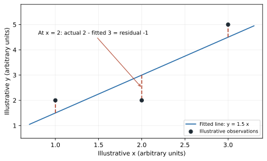

# T01 · 股价 OLS 回归实操：从公司年原表到结果

## 0. 三分钟速览

这项附件任务要求用三个指定输入，拟合表内的 `stockprice`。本篇带你从识别一行数据、检查样本，一直做到运行、读系数、代入一行和判断结果边界。

学完应能完成这些动作：

- 指出 Y 和三个 X，说明截距与残差平方的作用。
- 复跑 36,103 行的模型，核对四个系数并代入一条记录。
- 区分“其他两列保持相同”的系数解释、因果与未来预测。
- 说明同一公司多年的记录为什么影响不确定性的计算。

本次实际计算得到：截距 −40.499759，`bmratio` −10.292999，`roe` 23.834252，`size` 12.601410；样本内 $R^2=0.1000786863$。这些是本篇补充代码对给定文件的结果，不是教师官方答案、投资策略或本人已学会的记录。

## 1. 开始之前 · 任务、材料与三种路线

### 1.1 先分清三个对象

原始数据是一张表；回归模型是一条用表内三个数生成一个拟合值的规则；代码是执行该规则的工具。换软件不应悄悄换数据、变量或样本。

本篇只需要平均数、乘法、减法与平方。平方就是自己乘自己，例如 $(-2)^2=4$。程序里的 `x ** 2` 表示平方，`x * 2` 表示乘以 2，两者不同。

本课一般回归解释可回看 [[AC6761_Artificial_Intelligence_Accounting/notes/M11-财务预测实作与AI伦理#2.5 Python：把十行数据真正跑到误差（讲义 p.19–20）|M11 的销售回归示例]]；那里是另一份数据，不能把其销售系数搬到本题。

### 1.2 原始任务只有这一段

📄 `PredictStockprice.docx` 正文唯一非空任务段，完整原文如下：

> The excel contains stock market and financial data for many firms from 2011 to 2020. Please use stockprice as dependent variable, use bmratio roe size as independent variables to get OLS regression results.

中文题意：用 `stockprice` 作要解释的因变量（dependent variable），用 `bmratio`、`roe`、`size` 作解释变量（independent variables），取得普通最小二乘回归（Ordinary Least Squares，OLS）的结果。

它没有要求把 `mom`、`agratio` 加进来，也没有指定固定效应、缩尾、对数转换或未来测试期。“independent variables”是模型里输入变量的名称，不表示这三列在统计上彼此独立。

实际附件为 [[AC6761_Artificial_Intelligence_Accounting/course_files_export/canvas-20261126-review/data1.csv|data1.csv]]，不是 Excel 工作簿。全表实际年份只有 2012–2020，未见 2011。保留原提示的 2011–2020；本篇报告实际样本，既不补造 2011，也不假定它被删除的原因。

来源是课程附件。没有随附字段字典、原始数据库提取程序、股价币种、复权说明或数据发布时间。看见熟悉的变量名，仍不能把 `size` 擅自定义为“资产自然对数”，或把 `roe` 的存储单位当成已由字典确认。

### 1.3 课前、课中和课后怎样用

| 场景 | 路线 | 完成时应拿得出的证据 |
|---|---|---|
| 课前 | §2.1 → §2.2 → §2.3 | 能解释一行与 Y/X，手算三点例的残差平方和 |
| 课中跟做 | [[#A · 确认环境与路径\|执行A]] → 只阅读 B/C → [[#D · 在 PowerShell 执行完整脚本\|执行 D]] → §2.5–2.7 对输出 | 保留自己的运行命令、四项系数与第一行代入结果 |
| 课后复习 | §4 → §7，卡住再回对应正文 | 能解释系数尺度、$R^2$ 与重复公司，不只背回归表 |

这里有两种不同动作：A/D 是要在 PowerShell 中执行的完整命令；B/C 是完整 Python 脚本的解释摘录，只阅读，不逐段粘贴运行。A 先把当前目录切到vault 根，D 再从该目录执行完整脚本。

本篇按一个附件任务组织，不替代 Week 11 全讲。没有本题专属课堂转录，实际课堂如何操作、用了哪一款 AI、教师给了什么数值答案仍未知。AI 辅助时，先固定本篇的样本、三个 X 和截距，再比较输出。

## 2. 正文 · 完整做一遍原任务

### 2.1 读表：36,103 行不是 36,103 家公司

输入是 36,103 行、8 列；把 `GVKEY` 与 `FYEAR` 合起来作为本次的公司年键。共有 6,406 个不同 `GVKEY`。同一公司出现多行，通常对应不同年份，不能把每行当成一家新公司。

例如文件前两行的 `GVKEY` 都是 `001004`，年份分别是 2012、2013。读取时把公司代码保留为字符串，前面的 `00` 是标识的一部分，不能拿它当连续数值送入回归。

| 列 | 本题怎样用 | 当前能确认与不能确认的事 |
|---|---|---|
| `GVKEY` | 标识公司、检查公司年重复、补充计算公司内相关的不确定性 | 6,406 个原字符串；未核真实公司名称映射 |
| `FYEAR` | 标识原年份、核样本范围 | 整数 2012–2020；具体结算日与公布日未给 |
| `stockprice` | Y：需要拟合的原数值 | 1–4,410；币种、价格日期与复权方式未给 |
| `bmratio` | X1：按原列进入模型 | 0.0207856994–4.6511627907；精确构造、时点未给 |
| `roe` | X2：按原列进入模型 | −1.293–0.381；精确分子分母、存储尺度未给 |
| `size` | X3：按原列进入模型 | 0.991–11.154；精确经济定义、变换和单位未给 |
| `mom`、`agratio` | 本题不使用 | 文件有这些列，不等于原题要求使用；不据缩写补字典 |

本次检查所有 8 列：没有空值、没有非有限数字；公司年键重复数为 0。无空值只说明这些格有值，不证明其来源正确、单位相同或在预测时已经公开。

每家公司出现 1–9 年，只有 2,253 家出现全部 9 年。因此这是一份记录年份不齐的公司年面板（unbalanced panel）：不是一家公司连续 36,103 天，也不是 6,406 家都各有 9 年。模型此次把所有公司年记录放在一起，称混合 OLS（pooled OLS），未额外给每家公司单独的截距。

### 2.2 从“估一个数”到模型里的四个参数

假设要比较两条记录。其他输入一样时，`size` 较大的一行，其拟合股价会怎样变？线性回归把这个问题写成“每增加一单位输入，就给拟合值增加多少”。三个输入各有一个系数，还要有一个共同起点。

对第 $i$ 条公司年记录，本篇使用：

$$
\widehat y_i=b_0+b_1x_{i1}+b_2x_{i2}+b_3x_{i3}.
$$

| 符号 | 当前对象 | 单位读法 |
|---|---|---|
| $y_i$ | 这一行实际 `stockprice` | 文件的价格单位，具体币种未知 |
| $\widehat y_i$ | 模型给这一行的拟合值（fitted value） | 与 $y_i$ 相同 |
| $x_{i1},x_{i2},x_{i3}$ | 原行的 `bmratio`、`roe`、`size` | 各列原编码单位 |
| $b_0$ | 截距（intercept） | 三个输入为 0 时的模型起点 |
| $b_1,b_2,b_3$ | 三个待求的系数（coefficients） | 价格单位／对应 X 的一编码单位 |

截距不是第四个经济解释变量。它让整条拟合关系可以上下移动；不加截距就强迫三个 X 都为 0 时预测价格必须为 0。原题没有要求经过原点，因此本篇采用带截距的常规 OLS，并把这一实现选择明示。

本样本三个 X 的取值下界都不是共同的全零组合。因此截距可以参与拟合，却不宜解释为“真实零规模公司的合理股价”。

### 2.3 为什么求的是残差平方和最小

先用一个自拟小例看懂动作，再处理大表。三条记录的 $(x,y)$ 是 $(1,2)$、$(2,2)$、$(3,5)$。试一条线后，每个 x 都会得到一个拟合 y。

实际值减拟合值叫残差（residual）：$e_i=y_i-\widehat y_i$。正数表示实际值在线上方，负数表示在下方。不能直接把残差相加衡量误差，因为正负可能互相抵消。

下表逐行比较候选线 $\widehat y=x$ 与这个小例的带截距 OLS 线 $\widehat y=1.5x$。小例里 OLS 截距恰为 0，是求出来的结果，不是事先强制。

| $(x,y)$ | 候选线残差及平方 | OLS 线残差及平方 |
|---|---|---|
| $(1,2)$ | $2-1=1$，平方为 1 | $2-1.5=0.5$，平方为 0.25 |
| $(2,2)$ | $2-2=0$，平方为 0 | $2-3=-1$，平方为 1 |
| $(3,5)$ | $5-3=2$，平方为 4 | $5-4.5=0.5$，平方为 0.25 |
| 合计 | $1+0+4=5$ | $0.25+1+0.25=1.5$ |

平方后，每个误差都不为负，大误差也受到更重的惩罚。OLS 就是在所有允许的截距与系数组合中，找使这项合计最小的一组。



读图先找 $x=2$：黑点 $y=2$，蓝线 $\widehat y=3$，棕色虚线连接两者，所以残差为 −1。虚线长度是误差的绝对大小，方向决定正负；进目标函数时再平方。该图是本篇自拟解释，不是教师原图或 data1 的抽样。

对真正大表，计算的目标是残差平方和（Sum of Squared Errors，SSE）：

$$
\operatorname{SSE}=\sum_{i=1}^{36103}(y_i-\widehat y_i)^2.
$$

$\sum$ 是把每行的数加起来。程序同时寻找 $b_0,b_1,b_2,b_3$，不是分别做三次单变量回归再拼系数，也不是保证每行都能完全拟合。数值求解由软件完成，本篇用另一套最小二乘求解器复核同一问题。

### 2.4 实操 A–D：从原件跑到结果文件

以下代码由本篇作者补充，不是教师提供的 student code。输入只读；代码不会写回 `data1.csv`。输出目录由你明确指定，不把结果丢进原材料目录。

操作约定：只在 PowerShell 执行 A 和 D的命令块。B/C 仅解释完整脚本内部在做什么，不是可单独执行的连续步骤；其中的 imports、参数解析和变量初始化已由完整脚本维护。读完 B/C 后仍回到同一 PowerShell 窗口执行 D。

#### A · 确认环境与路径

本次实际环境是 Python 3.12.3、NumPy 1.26.4、pandas 2.3.3、SciPy 1.13.1、statsmodels 0.14.2。在 PowerShell 先执行 `Set-Location`，把当前目录切到vault 根；再执行下一行检查可导入的包，不在不知原因时自动安装或升级：

```powershell
Set-Location 'D:\上课资料\CityU'
D:\anaconda3\python.exe -X utf8 -c "import numpy,pandas,scipy,statsmodels; print(statsmodels.__version__)"
```

如果出现 `ModuleNotFoundError`，停在环境步骤并记录缺哪个包；它不是数据或 OLS 数学错误。`-X utf8` 让中文路径与输出使用 UTF-8。

#### B · 阅读完整脚本的读取片段

本段只阅读，不粘贴进 PowerShell 或另起 Python 窗口逐段运行。完整脚本把表叫作 `df`，下面的方括号表示从表里选列：单层字符串选一列，两层列表选多列。`dtype` 指定公司代码是字符串，避免丢前导零。

```python
df = pd.read_csv(data_path, dtype={"GVKEY": "string"})
y = df["stockprice"]
X = sm.add_constant(df[["bmratio", "roe", "size"]], has_constant="add")
```

`data_path` 是命令给的原文件路径；`pd` 是 pandas 的短名，负责读表。`sm` 是 statsmodels 的短名。`add_constant` 新增一列全为 1 的数，这一列乘以截距后，每行都加同一个 $b_0$；三个原 X 不变。

完整脚本先核列名、空值、非有限数字及公司年重复。任何一项不符就报错退出，避免软件悄悄丢行后仍报告 36,103 行。不能为了运行成功把空值填 0，或随意删除价格高的公司。

#### C · 阅读完整脚本的拟合片段

本段同样只是解释摘录，不单独执行。完整脚本中的 `OLS(y, X)` 规定要解决的模型；`.fit()` 才执行估计，返回的 `fit` 保存系数、拟合值和统计结果。

```python
fit = sm.OLS(y, X, missing="raise").fit()
beta_np, _, rank, singular_values = np.linalg.lstsq(
    X.to_numpy(), y.to_numpy(), rcond=None
)
```

`to_numpy()` 把带列名的表变为纯数字数组，以便交给 NumPy 的另一套数值求解器。`lstsq` 求相同的最小二乘问题，`rcond=None` 使用其默认数值秩判断。`rank=4` 表示本次四列没有完全重复到不能分开估计；不表示所有经济关系都已正确建模。

两套结果接近是算术/实现复核，不是两份独立数据或经济理论认证。实际最大系数差为 $8.53\times10^{-14}$；SSE、$R^2$ 与残差均值也分别交叉核算。

#### D · 在 PowerShell 执行完整脚本

正式归档后，在 A 已经切到vault 根的同一 PowerShell 窗口执行下面这一条完整命令；代码路径和原数据路径都明确。`--output-dir` 指向专门衍生目录；可以另指定自己的库外目录。

```powershell
D:\anaconda3\python.exe -X utf8 AC6761_Artificial_Intelligence_Accounting/code/stockprice-ols/run_ols.py --data AC6761_Artificial_Intelligence_Accounting/course_files_export/canvas-20261126-review/data1.csv --output-dir E:/app-data/codex/outputs/ac6761-stockprice-ols
```

这条命令中的每个长路径各是一个参数。如果改成含空格路径，应给整个路径加引号。缺文件时出现 `FileNotFoundError`，先核路径和本地附件版本，不换用另一份数据凑结果。

脚本输出四个文件：`ols-coefficients.csv` 是系数与不确定性表，`ols-summary.json` 是样本/计算/环境记录，`first-five-fitted.csv` 让你复做前五行，`statsmodels-summary.txt` 是软件完整输出。输入的文件哈希（SHA-256）是按原字节计算的指纹，和命令、结果文件一起帮助确认复现对象；它不证明经济数据正确。这些记录不构成正式作业提交。

本次已经对指定原 CSV 实跑。原件 SHA 保持不变；没有删行、缩尾、改单位、标准化、取对数或加入额外解释变量。

### 2.5 读原任务的回归结果

⚪ 参考作答（本篇实际计算；无官方数值答案）：36,103 条公司年观测、三个指定输入、一个截距，估计方程为：

$$
\widehat{stockprice}=-40.499759-10.292999\,bmratio+23.834252\,roe+12.601410\,size.
$$

系数表每行对应一个模型参数。下面 SE 是常规标准误（standard error），衡量估计系数在其误差假设下的不确定性；不是本列数据的标准差，也不是一个股价预测区间。

| 参数 | 系数 | 常规 SE | 常规 t |
|---|---:|---:|---:|
| 截距 | −40.499759 | 2.163542 | −18.719196 |
| `bmratio` | −10.292999 | 0.842842 | −12.212255 |
| `roe` | 23.834252 | 2.383980 | 9.997673 |
| `size` | 12.601410 | 0.263313 | 47.857167 |

先读系数，再读不确定性，不要先找“星号”。例如 `roe` 一行的 t 是系数除以其 SE：$23.834252/2.383980\approx9.997673$。它表示估计值离“系数为 0”有多少个标准误，不能把 t 当成收益倍数。

完整输出的常规 95% 置信区间（confidence interval）中，`roe` 约为 [19.161580, 28.506924]。它是按规定抽样/误差条件构造区间的方法：若反复取得符合条件的同类数据并照此方法造区间，长期约95%的区间覆盖要估的系数；不能说“这家公司的未来股价有 95% 概率落在该区间”。后者问的是另一对象，还要计入单个观测的误差。

常规 p 值约为截距 $8.08\times10^{-78}$、`bmratio` $3.12\times10^{-34}$、`roe` $1.67\times10^{-23}$；`size` 在软件浮点显示中为 0.0。0.0 是极小尾部概率的数值下溢，不是“出错概率严格为零”。p 值是在零系数及相关模型假设下衡量这种或更极端统计量的相容程度，不是“模型为真”的概率。

本任务的英文参考回答可写：

> Using all 36,103 firm-year observations and an intercept, pooled OLS gives coefficients of −10.292999 for bmratio, 23.834252 for roe and 12.601410 for size, with an intercept of −40.499759. The in-sample R-squared is 0.100079. These estimates describe conditional associations in the supplied sample. The file does not establish the variables’ economic units, publication timing or a causal effect, and it contains 2012–2020 observations rather than the full 2011–2020 period stated in the prompt.

这是笔记自拟英文，不是教师原话。

### 2.6 系数尺度：增加 0.01 和增加 1 不相同

多元回归中的一个系数描述：其余两个 X 保持相同，在拟合规则里只把本 X 改一单位，拟合 Y 改多少。它不是“现实中一定能只改变这一项”的干预保证。

按原编码把 `roe` 增加 0.01，其他 X 不变，拟合价变化是 $23.834252\times0.01=0.238343$ 个原价格单位。若把 `roe` 增加 1，变化才是 23.834252。只有取得字典并确认 `roe` 以比例存储后，才可把 0.01 称为一个百分点；当前先报告原编码变化。

若另造一列 `roe_times100=100*roe`，表示同一数值信息改用大 100 倍的编码。对应系数应除以 100，约为 0.238343；拟合值不变。换编码不是模型突然发现了弱 100 倍的经济作用。

类似地，`size` 的系数 12.601410 是“原 `size` 列增加一编码单位”。未确认 `size` 是否取过对数，不能解释成“资产多 1 元”或“公司规模多 1%”。不同 X 的单位不同，也不能只比较 23.83 与 12.60 就宣布 `roe` 更重要。

用第一行完整走一次：原 `stockprice=20.06`，三个输入为 1.1627805123、0.0250494955、6.6720366417。把这些数代入上述方程，得到 $\widehat y\approx32.205844$；残差为 $20.06-32.205844\approx-12.145844$。负残差表示这一行实际价格低于模型拟合，不是这家公司“价值必然被低估”。这里拟合的是价格本身，不是内在价值。

### 2.7 R平方、误差与不合理拟合值

先设一个非常简单的基准：不看任何 X，给所有行都估为样本股价平均数 39.360886。把各行实际价减这个平均数，再平方加总，得到总平方和（Total Sum of Squares，SST）。模型用三列信息后，剩下的残差平方和叫 SSE。

$$
R^2=1-\frac{SSE}{SST}
=1-\frac{309074240.315684}{343445849.768843}
\approx0.1000786863.
$$

在这份用于拟合的相同样本中，与只猜平均数相比，模型减少约 10.01% 的平方误差。它不是“10.01% 的公司预测正确”，也不是未来解释力或赚钱概率。带截距 OLS 的调整后 $R^2$ 为 0.1000038985，会考虑估计更多参数的代价；它仍是样本内指标。

为了把误差变回价格原单位，先以行数平均残差平方，再开平方，得到均方根误差（Root Mean Squared Error，RMSE）：

$$
RMSE=\sqrt{SSE/36103}\approx92.525142.
$$

软件的 residual standard error 用 $36103-4=36099$ 作分母，约 92.530268。减 4 是因为用同一数据估了截距和三个系数；它和这里按行数定义的 RMSE 接近，却不是完全同一数。


每点是一条公司年记录，横轴是拟合价，纵轴是实际价，均为原文件单位。虚线表示两者相等；点离线很远，表示该行拟合误差很大。图保留全部范围，实际价最大 4,410，而拟合价约 −78.48 至 108.77，所以点集中在左侧；这不是漏画数据。

本次 3,957 行的拟合值小于 0，而原价格最小为 1。线性式没有“股价不得为负”的约束，这揭示其价格水平拟合限制。不能悄悄把负数改成 0 后仍宣称是原 OLS 结果；若另选对数目标或约束模型，须另列任务、条件和比较，不能替换本题答案。

价格中位数为 20.52、99% 分位约 270.79、最大 4,410。大价格误差在平方损失中权重很大；当前没有理由认定它们是错误，更不能为改善 $R^2$ 随意删除。须先取得单位、复权与样本来源说明，再决定额外稳健分析。

### 2.8 同一公司反复出现：系数和“有多确定”分开处理

同一家公司的多年记录可能共同受经营模式、管理质量等因素影响。若一家公司某年有模型没解释的高价，其他年份也可能有类似误差。把这些年份全当作互不相关的新公司，会夸大独立信息量。

本次主模型仍使用原题要求的全部行。作为解释不确定性的补充，代码另外计算两种 SE：HC1 是异方差一致修正（heteroskedasticity-consistent correction），这里允许不同行误差大小不同；公司聚类标准误（firm-clustered standard error）还允许同一 `GVKEY` 内的误差相关。它按 6,406 个公司组估计不确定性，不是把每家公司先平均，也不是重估一套不同系数。

看同一项 `roe`：常规 SE 为 2.383980，公司聚类 SE 为 2.984351。系数仍是 23.834252，但其不确定性变大。聚类规则改变的是“这组系数应有多谨慎”的计算，不是改动原数据或让 `roe` 的作用变强/变弱。

| 参数 | 常规 SE | HC1 SE | 公司聚类 SE |
|---|---:|---:|---:|
| 截距 | 2.163542 | 1.562598 | 3.947179 |
| `bmratio` | 0.842842 | 0.492935 | 1.188896 |
| `roe` | 2.383980 | 1.386961 | 2.984351 |
| `size` | 0.263313 | 0.275508 | 0.697387 |

这是笔记补充的敏感性核验，不是教师额外原题。聚类输出使用有限样本修正，并以公司数减 1，即 6,405，作为相关 t 参考的自由度。学习主线只需先看懂“同公司年份可能相关，因此常规 SE 不是唯一合理读法”；完整参数留在代码与结果文件供复做。

聚类 SE 也有边界：它没有增加公司固定效应，没有控制共同年份冲击，也没有修复遗漏变量、反向关系或选择偏差。若市场共同冲击使不同公司的误差也相关，公司单向聚类未必处理完所有相关性。

### 2.9 能回答原任务，不等于能作因果或未来预测

用这份资料得到 OLS 表，只需要清楚指定样本和计算规则；要把系数解释为经济作用，还需额外假设。

首先，给定关系应能由这个线性加总式恰当地近似。其次，X 之间不能完全重合，否则无法分辨各自的系数。本次数字阵列的秩为 4，只核了后一点的数值可识别性。

若要从样本关联上升到总体条件关系，还要说明样本如何形成、哪些误差条件适用。若想进一步说“提高某指标会造成股价变化”，需要排除与 X 同时变化却遗漏的原因、股价反过来影响指标等问题。本题既无干预设计，也无识别依据，所以本篇只报告条件关联。

若想预测未来，还须先规定预测日期，确认当时已公开哪些财务数，划定训练和未见测试期，并处理公司间及时间上的依赖。本次把 2012–2020 全部样本一起拟合，没有完成这些步骤。题名中的 Predict 不能自动把一次样本内回归变成未来收益测试。

同一 FYEAR 下的股价和财务指标是否在相同时间可得、是否存在事后修订，附件没有说明。不能用“按年份排好”替代信息可得性证明。也不能把 `stockprice` 换成收益率后仍称同一个原题。

## 3. 一图看懂 · 实操检查顺序

| 先问什么 | 做的动作 | 下一步用什么结果 |
|---|---|---|
| 是否同一份原件？ | 核 SHA、列名与实际年份 | 确定本次能复现的样本 |
| 一行是谁？ | 核公司年键、空值与重复 | 防止把公司代码送入模型或悄悄丢行 |
| 要拟合什么？ | 固定 Y、三个 X、截距 | 保证两种软件解决同一模型 |
| 数字是否算对？ | OLS 与 NumPy、SSE/$R^2$ 交叉核 | 取得可追溯结果表 |
| 数字说明什么？ | 系数尺度、拟合误差、公司内相关 | 分开关联、不确定性与外推限制 |

## 4. 速查表

| 要找的内容 | 本次答案 | 回到正文 |
|---|---|---|
| 原样本 | 36,103 行、6,406 公司键、2012–2020 | [[#2.1 读表：36,103 行不是 36,103 家公司\|§2.1]] |
| 原模型 | `stockprice` 对 `bmratio/roe/size`，带截距 | [[#2.2 从“估一个数”到模型里的四个参数\|§2.2]] |
| 系数读法 | 其他两列不变，每一原编码单位的拟合 Y 变化 | [[#2.6 系数尺度：增加 0.01 和增加 1 不相同\|§2.6]] |
| 拟合度 | $R^2\approx0.100079$；RMSE 约 92.5251 | [[#2.7 R平方、误差与不合理拟合值\|§2.7]] |
| 公司重复记录 | 不删行；补充公司聚类 SE 读不确定性 | [[#2.8 同一公司反复出现：系数和“有多确定”分开处理\|§2.8]] |
| 不能直接推出 | 因果作用、未来表现、真实字段单位 | [[#2.9 能回答原任务，不等于能作因果或未来预测\|§2.9]] |

## 5. 双语术语卡

| 中文 | English | 本题可用的英文解释 | 首现 |
|---|---|---|---|
| 因变量 | dependent variable | The outcome fitted by the model. | §1.2 |
| 截距 | intercept | The fitted value when all regressors are zero. | §2.2 |
| 残差 | residual | The observed outcome minus its fitted value. | §2.3 |
| 混合 OLS | pooled OLS | OLS fitted to pooled firm-year observations without firm-specific intercepts here. | §2.1 |
| 标准误 | standard error | A measure of uncertainty in a coefficient estimate under stated error assumptions. | §2.5 |
| 公司聚类标准误 | firm-clustered standard error | A covariance estimate allowing errors to be correlated within a firm. | §2.8 |

## 6. 考点预判与答题框架

🟡 笔记推断：这份附件可用来检查回归输出、数据质量与 AI 数值核验能力。没有本题专属考试明示，不能由附件存在断定它是期末必考；也不能因最后课降低该实操的期末权重，就删掉课后学习任务。

英文结果句按“sample → specified model → coefficients → fit → limits”组织。先报实际样本，再说带截距，接系数与 $R^2$，最后指出编码/时间/重复记录边界。不要只抄软件表底部的 p 值或 warnings。

## 7. 自测 · 自编练习与答案

### 7.1 把 roe 改 0.02

其他输入不变，原编码 `roe` 增加 0.02，拟合价改变多少？能直接称为“净资产收益率提高两个百分点造成股价上涨”吗？

<details><summary>答案与理由</summary>

$23.834252\times0.02=0.47668504$ 个原价格单位。先以原编码回答。字段尺度未核，不能直接把0.02叫两个百分点；即使字典确认尺度，也只是其他 X 固定的模型关联，不是因果。English: The fitted price increases by about 0.476685 file units, holding the other regressors fixed. The coefficient does not establish a causal effect.

</details>

### 7.2 第一行误差

第一行实际价 20.06、拟合价 32.205844，残差的方向与大小是什么？平方约多少？

<details><summary>答案与理由</summary>

残差为 −12.145844；实际值比拟合值低约12.145844个价格单位。平方约147.52153，是平方价格单位，不能直接与股价相加。English: The residual is approximately −12.145844, so the observation lies below its fitted value.

</details>

### 7.3 两家九年，不是十八家公司

假设另一个表只有两家公司，每家公司九年。能否说有十八家独立公司？如果保留所有年，哪里需要谨慎？

<details><summary>答案与理由</summary>

只有两家公司、十八条公司年记录。同一公司的误差可能跨年相关，不能把年数直接当独立公司数。保留行做指定OLS与恰当计算不确定性是两个动作。只有两组时，常见的大量聚类近似也不可靠；本题实际为6,406组，不能把本例的软件输出照搬。English: There are eighteen firm-year observations but only two firms; within-firm dependence affects uncertainty estimates.

</details>

### 7.4 改成 roe_times100

代码仅把该列乘100，其他模型不变。系数应怎样变，拟合值应怎样变？

<details><summary>答案与理由</summary>

系数从23.834252除以100变为约0.238343；该项乘积保持不变，所以拟合值/SSE/$R^2$应在数值精度内一致。反向检验：若系数也乘100，乘积会错误放大10,000倍。English: Rescaling the regressor by 100 divides its coefficient by 100 and leaves fitted values unchanged.

</details>

### 7.5 为什么不填 2011 或删负拟合值

提示说2011–2020，但实际没有2011；模型又出现3,957条负拟合价。应分别怎样处理？

<details><summary>答案与理由</summary>

前者记录来源差异，报告2012–2020并等待补充原件，不能造观测。后者保留原OLS结果并解释线性无非负约束；不能悄悄裁成0后仍称同一模型。若研究其他变换，另列模型和比较。English: Report the observed period and the unconstrained OLS results transparently; neither missing years nor modified predictions should be silently fabricated.

</details>

## 8. 附件／代码到正文精确映射

| 来源单元 | 任务或动作 | 正文入口 |
|---|---|---|
| PredictStockprice 唯一任务段 | 完整英文任务、Y/X和来源差异 | [[#1.2 原始任务只有这一段\|§1.2]] |
| data1 表头与全部行 | 字段、样本/空值/公司年检查 | [[#2.1 读表：36,103 行不是 36,103 家公司\|§2.1]] |
| 作者代码：`pd.read_csv`与检查 | 输入与失败路径 | [[#B · 阅读完整脚本的读取片段\|§2.4 B]] |
| 作者代码：OLS/lstsq | 估计与独立数值复核 | [[#C · 阅读完整脚本的拟合片段\|§2.4 C]] |
| `ols-coefficients.csv` | 四系数、SE/CI、尺度 | [[#2.5 读原任务的回归结果\|§2.5]]、[[#2.6 系数尺度：增加 0.01 和增加 1 不相同\|§2.6]]、[[#2.8 同一公司反复出现：系数和“有多确定”分开处理\|§2.8]] |
| `first-five-fitted.csv` | 第一行拟合与残差 | [[#2.6 系数尺度：增加 0.01 和增加 1 不相同\|§2.6]] |
| `ols-summary.json` | SSE/SST、R²/RMSE、样本范围 | [[#2.7 R平方、误差与不合理拟合值\|§2.7]] |

运行源码：[[AC6761_Artificial_Intelligence_Accounting/code/stockprice-ols/run_ols.py|本篇补充代码]]。数据卡：[[AC6761_Artificial_Intelligence_Accounting/_meta/数据集#data1.csv · 公司年股价OLS附件|data1 六项卡]]。这些入口均按本批正式归档路径维护；原始数据、作者补充代码、计算结果与审查记录分别保留，不代表本人已运行。

## 9. 延伸、勘误与完成边界

### 9.1 来源矛盾与未知

原题2011–2020/Excel与实际2012–2020/CSV并列保存。来源未给具体字段构造、币种、复权、公布日、清洗/筛样本历史，也没有官方数值答案。原记录没有重复键和空值不能证明这些问题已经解决。

### 9.2 已实际做什么

对指定SHA的全部36,103行拟合带截距OLS，另一求解器核四系数，手动公式核SSE/$R^2$/第一行；补充常规、HC1和公司聚类协方差。没有改原数据，没有进行训练/测试预测、因果识别或正式答卷提交。图1为明确自拟三点例，图2为本文件全部观测；保留编辑源码、矢量SVG/PDF及720DPI位图。

### 9.3 制作、审查与本人学习分开

本篇已完成作者核对、一次独立风险抽检及 R1 操作入口的定向关闭；抽检不冒称全篇独立认证。具体来源、计算、显示载体与正式写回证据分列于本批发布回执。本人实际作答/掌握和作业提交/评分独立记录。不得把本篇代码称为教师官方程序或已经由本人执行。
