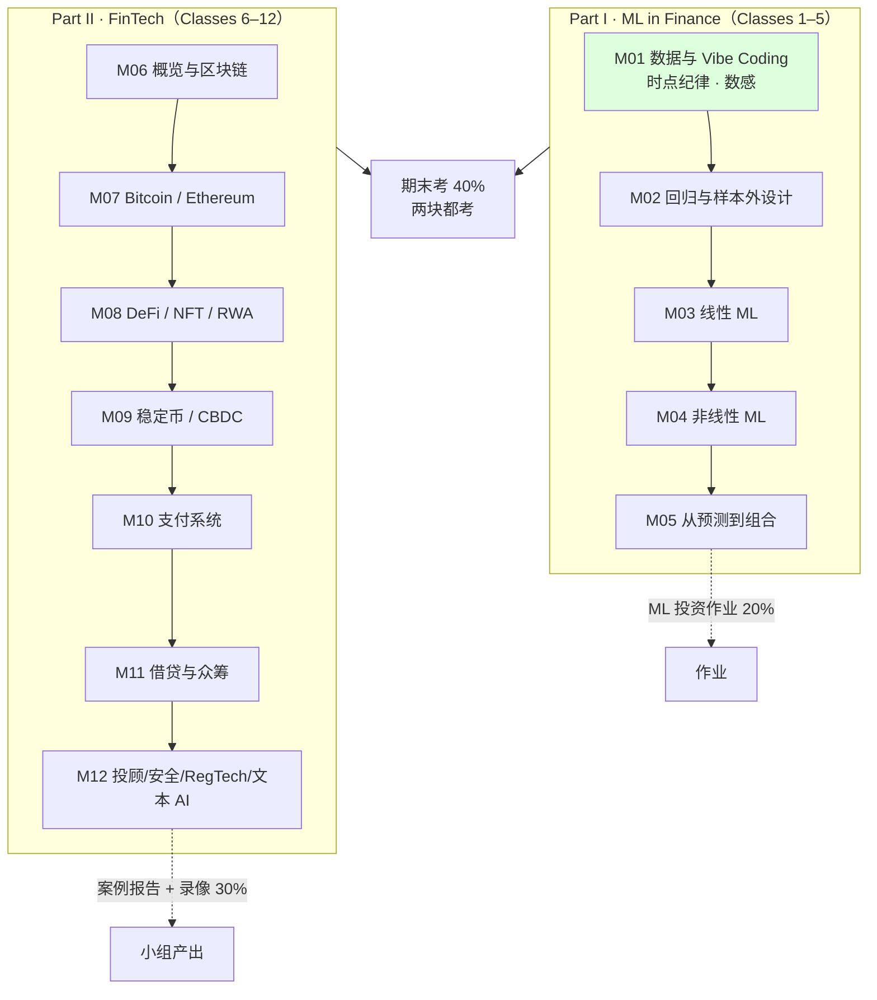

# EF5560 · FinTech and AI in Finance · 课程总览

> 本课入口。找什么都从这里点。

> 作业、项目及练习索引另有本地私有 `assignment/00-overview/作业总览.md`；A01 已有教程与标 `DRAFT` 的三件套，公开仓库不包含完整答案。

**一句话**：MScAIB（P85）的 **商业核心课**（3 学分，9 学分组内选一），12 次三小时研讨，**Prof. FENG Guanhao Gavin（冯冠豪）** 主讲。两个半程拼成一门课：**Classes 1–5 用 AI 辅助编码做投资预测**，**Classes 6–12 拆 FinTech 公司的商业模式**。教授的核心主张只有一句——**"数据比模型重要，而数据里最要命的是时点"**。

---

## 🔴 现在最要紧的事

**组队状态请在 Canvas 核对（≤3 人）**。M01 `02:15:07` 曾要求下次上课前组队；M04 晚场 B `01:53:16`–`01:53:39` 又说次日上午会给未组队者随机分配，且两人一组也可以。原先的“本周内”是当时的历史要求，**不当作新的未来截止**。
⚠️ **同一个组要一起做 ML 投资作业（20%）和 FinTech 案例 + 录像（30%），合计 50% 的成绩**，选人要慎重。
👉 完整规则见 [[EF5560_Fintech_and_AI_in_Finance/_meta/作业与DDL|作业与DDL]] §2.1。

**历史已确认截止：2026-10-15（周四）14:00 HKT ML 投资作业；9/27 tutorial 已为历史场次。当前其他截止以本课作业与 DDL 的已核事实为准，不据 M07 课件推算。**

**ML Investment Project 正式截止：2026-10-15（周四）14:00 香港时间（Canvas 作业页及教授公告）；包内 PDF 写 12:00，内部按较早时刻完成检查。** 官方 ZIP 12 项已与本地解压件逐文件核对；私有 `assignment/graded/A01-ml-investment/` 已有 Obsidian 导览、Jupyter 逐步教学与可复现分析和带 `DRAFT` 的三件套，待组员信息与团队复核。交付细节见 [[EF5560_Fintech_and_AI_in_Finance/_meta/作业与DDL|作业与DDL]] §2.2。

---

## 笔记

| Class | 主题 | 笔记 | 状态 |
|---|---|---|---|
| 1 | Financial data and vibe coding in R and Python | [[M01-金融数据与Vibe-Coding]] | ✅ **v1.0**；2026-10-23 全篇重审闭合并正式写回。58 页、9 组原题、计算与图文已核；转录为 671 条记录/670 个唯一时间戳，开头可能缺失且未逐字核音；依赖/Notion/Git 另记 |
| 2 | Regression, return predictability, and out-of-sample design | [[M02-回归与样本外设计]] | ✅ **v1.0**；2026-10-25 本次全篇重审闭合并正式写回。旧 54 页／新 56 页均回源，新版新增 p.26–27 两道 MCQ；旧 p.26→新 p.54、旧 p.53–54→新 p.55–56。新版 p.25 日期轴已修、旧版仍错。P1/P2 为两个独立时钟，P1 缺首长度未知；Class 2 无 validation，144/36/60 仅为讲义规范。恒生／CSI 三变量完整特征与预测、候选／选择日志、实际策略契约仍缺，不称整讲全部复现 |
| 3 | Linear machine learning for return prediction | [[M03-线性机器学习与收益预测]] | ✅ **v1.0**（2026-09-17，转录已合并，`quality_spec: v1` strict PASS）· 讲义 56 页全覆盖 + `class03/` 5 个 CSV 全部重算 · 35 个 🎙️ 格全部回填，7 条 🔴；2026-10-20 新旧版增量已核（旧56/新54页，PCR讲法与12项保存预测评价） |
| 4 | Nonlinear machine learning for return prediction | [[M04-非线性机器学习与收益预测]] | ✅ **v1.0**（2026-09-26）：54 页讲义全覆盖，A/B 同课双录音互补，37 个 🎙️ 格回填；课堂实际到 p.39，p.40–54 ↪️ 下讲顺延；2026-10-20 新旧版增量已核（旧54/新56页，基学习器/树图/12项评价与当前表） |
| 5 | Interpretable machine learning and portfolio decisions | [[M05-可解释机器学习与投资组合决策]] | ✅ **v1.0**（2026-10-10）：54页，37个🎙️格，5条🔴；录音 00:00:00–02:26:53.632 已融合。M04 p.40–54 仍❓不可降权；M05 p.53–54 行政未确认 |
| 6 | FinTech overview and blockchain | [[M06-FinTech概览与区块链]] | ⚠️ **v1.0**（2026-10-18）：54页、26正文单元、26作答/演示单元、22自测；四源 381/140/117/51 段按内容为 P1→P2→P3→P4，新增 2 条 🔴。独立时钟与三处接缝缺口保留；教学／视觉集中核对：**本次教学、来源、R 疑点与同源图文核对已完成；原生 Obsidian 未直接查看，声轨未逐声听校，材料缺口保留** |
| 7 | Bitcoin and Ethereum | [[EF5560_Fintech_and_AI_in_Finance/notes/M07-比特币以太坊与加密金融商业模式\|M07]] | **v0.9**（2026-10-22）：54页/50内容页、27正文单元、17源页20演示/作答单元、12选项、27自测、9Mermaid+2SVG；无M07转录，日期/周次待核；同源显示已核，Obsidian未直接看 |
| 8 | DeFi, NFTs, and real-world assets | | 待课件 |
| 9 | Stablecoins and CBDCs | | 待课件 |
| 10 | Payment systems | | 待课件 |
| 11 | Lending and crowdfunding | | 待课件 |
| 12 | Robo-advising, cybersecurity, RegTech, AI applications to financial text + 课程总结 | | 待课件 |

> **编号约定**：讲义与 syllabus 用 `Class N`，本库统一用 `M0N`（[[转录处理规则]] §5 的全库规定）。两者一一对应，无偏移。
> **转录**：M06 四源已按内容顺序 P1/source9 → P2/source10 → P3/source11 → P4/source12；每源独立从 `00:00` 起表时，三处接缝缺口长度未知，不能把时长直接相加称完整课堂。M05 已融合；M01–M03 已合并；M04 的 A/B 双录音边界见其 §8–9。

---

## 元数据

| 文件 | 用途 |
|---|---|
| [[EF5560_Fintech_and_AI_in_Finance/_meta/知识层级台账\|知识层级台账]] | ★ **写笔记前必读**。含本课写死的两条口径判断（金融概念不在 L0；Python 语法在 L0、库 API 不在） |
| [[EF5560_Fintech_and_AI_in_Finance/_meta/术语表\|术语表]] | 中英对照 + 统一译名 + 三处已裁定的译名分歧 |
| [[EF5560_Fintech_and_AI_in_Finance/_meta/考点库\|考点库]] | 三档可信度；含 **🔴 教授亲口说的考试形式** |
| [[EF5560_Fintech_and_AI_in_Finance/_meta/作业与DDL\|作业与DDL]] | 全部截止日 + 提交规则 + 一处必须核对的时间冲突 |
| [[EF5560_Fintech_and_AI_in_Finance/_meta/数据集卡片\|数据集卡片]] | 8 个 CSV 的实跑统计（六项固定格式） |
| [[EF5560_Fintech_and_AI_in_Finance/_meta/待并入术语总表\|待并入术语总表]] | 51 条跨课术语，✅ **2026-09-10 已并入**根 [[术语总表]]（R² 量级、Vibe Coding 双别名、Benchmark 三义都在总表 §2.2） |

## 前置资料

| 文件 | 用途 |
|---|---|
| [[EF5560_Fintech_and_AI_in_Finance/_prep/课程前置资料\|课程前置资料]] | **官方目录 × syllabus 逐项对校**。及格线、GenAI 政策、CILO 差异、教师背景都在这里 |

---

## 代码库 `code/`

> 对 8 个 CSV 的**可复现分析**。笔记里每一个由数据算出来的数字，都能在某个脚本的 stdout / `output/*.csv` 里找到；笔记里的 `📁 代码：` 行直接点到脚本。

| 入口 | 用途 |
|---|---|
| [`code/README.md`](code/README.md) | ★ **设计说明**：怎么跑、目录约定、三条硬规则（单一数据入口 / 不改原始数据 / 固定 docstring）、**脚本 ↔ 笔记映射表** |
| [`code/run_all.py`](code/run_all.py) | 按编号跑全部 9 个脚本，2026-09-10 实跑 9/9 ✅ |
| [`code/common/load.py`](code/common/load.py) | 唯一的数据入口，8 个 loader 各写死收益率口径（周频简单收益 / 月频对数收益） |
| `code/output/` | 9 张图 + 12 张表，笔记用 `![[L01_03_drawdown.png]]` 嵌入 |

**脚本一览**（详表见 README §4）：`L01_01` 两种收益口径差 21.8% · `L01_02` 四指数 20 年 · `L01_03` PDD-JD 回撤 · `L01_04` 特征表逐列泄漏审计（15 列误差 ≤ 2e-15）· `L01_05` 预测时钟 · `L02_01` 复现讲义 54 个数字 · `L02_02` 滚动 vs 扩展窗口 OOS R² · `L02_03` R² = 1% 长什么样 · `L02_04` 命中率 vs 多数类基线

**跑之前**：`cd code` → `PYTHONIOENCODING=utf-8 /d/python/python run_all.py`。规则出处：[[材料处理规则]] §8b。

---

## 一分钟必知

**考核构成**

| 项 | 权重 | 关键约束 |
|---|---|---|
| FinTech 公司案例报告 | 10% | ≤10 页（含图表附录），Week 12 |
| 录像展示 | 20% | ≤10 分钟，一个 MP4 ≤80 MB，**每人至少讲 2 分钟**，Week 12 |
| ML 投资作业 | 20% | 报告 + 权重 CSV + **可复现代码包**；**Canvas 截止 2026-10-15 14:00**（截图未显示时区），Canvas 作业页满分 100 pts |
| 参与与课堂表现 | 10% | 起始 5/10；**点名不在 −1**；答对 +1；答错不扣 |
| **期末考** | **40%** | **2 小时，线下手写闭卷**，禁 AI / 手机 / 电脑 |
| 持续评估合计 | **60%** | |

**及格线**：⚠️ **本课不存在** IS5113 那种"持续评估 ≥25% 且笔试 ≥25%"的双门槛——官方目录同一版式文件在该位置为空。已核实，不是没查。详见 [[EF5560_Fintech_and_AI_in_Finance/_prep/课程前置资料|课程前置资料]] §3.1。

**GenAI 政策**（官方目录原文，syllabus 没写全）
- ✅ 作业与小组项目**可以用** GenAI 帮助理解概念、分析数据
- ❌ **但最终版必须是自己的作品，不能复制粘贴 AI 的答案**
- ❌ 期中考 / 小测 / **期末考一律禁用**
- ⚠️ syllabus 另加一条：**实质性使用必须披露（disclosed）**

**🔴 期末考形式（只有课堂上说过，三份书面文件都没有）**
- **完全没有编码题**
- **选择题占比最高 60%**（学校规定的上限）
- ML 板块出**简单计算题**；FinTech 板块出**简答题，问公司的商业模式**
- **期末小抄现行口径：允许一张 A4 双面手写**，内容不限；不许打印或用 iPad（M03 转录 `02:53`–`03:17`）。M01 `10:20` 的“一页、待定”保留为较早课堂历史，不再代表当前状态；小抄最终执行仍以 Canvas/正式考试通知为准。
- 🎙️ **第 2 讲补充**：**题型就是每讲讲义里那道"四选一 + Discuss"**（「These are the questions you will see」）；期末前给 practice exam；**做完全部作业 + 出席考试就很难挂**（三年挂 3 人，都是缺考或没做展示）
👉 全部原话见 [[EF5560_Fintech_and_AI_in_Finance/_meta/考点库|考点库]] §0。

---

## 课程的骨架

**两半的性质完全不同（这决定了怎么复习）**

| | Part I（1–5） | Part II（6–12） |
|---|---|---|
| 结构 | **层层叠加**——syllabus 明说「Classes 1–5 build on each other, so regular attendance is important」 | **公司案例串讲**，彼此独立 |
| 缺一节的代价 | 大 | 小 |
| 考法 | 简单计算 + 概念判断 | 简答：这家公司的商业模式 |
| 产出 | ML 投资作业（20%） | 案例报告 + 录像（30%） |

**🎙️ 今年与去年的三处不同**（转录 `00:03`–`14:31`，讲义与 syllabus 都没写）
1. **两半的顺序调换了**——去年先讲 FinTech，今年先讲投资。官方课程目录里的课程简介**仍然是去年的顺序**
2. **只有 12 讲**——⚪ 因为 **2026-10-01（周四）国庆停课**
3. **取消现场展示**，改成交录像

---

## 跨课链接

| 链接 | 内容 | 怎么用 |
|---|---|---|
| ★★★ **[[M02-回归与样本外设计]] ↔ IS6400 W02（线性回归）** | **同周、同主题，且两门课都在教"用 AI 写代码"**——本课叫 **Vibe Coding**，IS6400 叫 **GenAI for BDA**。这是全库最强的交叉点 | 见下方专段 |
| ★★ **EF5560 ↔ [[M01-导论-AI与伦理\|IS5113]] W8「AI in Finance & Risk Management」** | 同一批技术的**伦理与监管视角**：算法交易的问责、信贷模型的公平性、模型风险治理 | 本课教"怎么做"，IS5113 教"该不该这么做"。案例报告的"风险与监管"一节（占评分七项之一）可以直接搬 IS5113 的框架 |
| ★★ **EF5560 M12（RegTech）↔ IS5113 W9（全球 AI 治理与监管）** | RegTech 是监管科技的产品化，IS5113 讲的是监管本身 | M12 写到时建双链 |
| ★ **EF5560 M01（财报归档日、财务比率）↔ AC6761（AI in Accounting）** | 10-Q/10-K、利润率、账面杠杆、资产增长、经营现金流——**是同一批科目，两门课看的角度不同** | EF5560 把它们当**预测变量**（关心什么时候可知）；AC6761 把它们当**会计信息**（关心怎么算出来的） |
| ★ **EF5560 M01（Vibe Coding 工具与权限）↔ IS5542（GenAI in Business）** | 桌面编码工具、开源 vs 闭源、AI 幻觉 | 术语已登记进 [[EF5560_Fintech_and_AI_in_Finance/_meta/待并入术语总表\|待并入术语总表]] §B |

### ★★★ EF5560 Lec02 ↔ IS6400 W02：全库最强的交叉点

**同一周（2026-09-09 / 09-10），同一个主题（线性回归），同一种教学取向（让 AI 写代码）。**

| | **EF5560 Class 2** | **IS6400 Week 2** |
|---|---|---|
| **笔记** | [[M02-回归与样本外设计]] | **[[M02-预测分析-线性回归]]**（已产出，v0.9） |
| 讲义 | `Lec02_Regression_Vibe_Coding.pdf`（旧 54 页）＋ `canvas-20261020/Lec02_Regression_Vibe_Coding.pdf`（新 56 页；新增 p.26–27） | `L2-Linear_Regression.pdf`（53 页）＋ `Week 2 Regression Analysis_With Prompt.ipynb` ＋ 指定阅读 HM Ch.4 |
| **侧重** | **数据时点纪律 + 样本外评价**——回归只讲到 OLS 与标准误，篇幅全在"这个结果算不算数" | **系数解读 + MLE 推导 + 正则化**——正规方程、梯度下降、Lasso/Ridge、虚拟变量陷阱 |
| AI 编码的叫法 | **Vibe Coding** | **GenAI for BDA**（notebook 里的 `🤖 AI Prompt (Copy this to AI)` 单元格） |
| 数据 | 金融时间序列（SPY 240 个月、CSI 300 宏观面板） | 商业截面数据（Airbnb） |
| **切分方式** | **必须按时间切**（讲义 p.37「Keep financial time series in **date order**」） | 通常随机切 |
| **R² 的期望量级** | **1% 就算好**（🎙️ 教授：营销能到 50→60%，收益预测只能 1→1.2%） | 商业分析里 R² 0.5 才算好 |
| 关注的偏差 | **前视偏差、生存者偏差**（时点问题） | 多重共线性、异常值、选择偏差 |
| 基准 | **滞后 12 个月移动平均**（数据集 `csi300_macro_panel.benchmark_ma12`） | 通常与均值模型比 |
| 评价 | **样本外 R² + 方向准确率 + 与基准的对比**（三条跨 Classes 2–4 固定不变） | R²、RMSE、系数显著性 |

**⚠️ 三处口径冲突，做笔记时必须显式指出（否则两门课连读会打架）**
1. **R² 的好坏标准完全相反**——见 [[EF5560_Fintech_and_AI_in_Finance/_meta/待并入术语总表|待并入术语总表]] §E①
2. **标准化的时机**：EF5560 Lec02 p.31 明确要求「Standardize using **training data only**」，这在金融时间序列里是硬约束；IS6400 若用全样本标准化，在本课语境下就是泄漏路径 ①
3. **benchmark ≠ baseline**——见 [[EF5560_Fintech_and_AI_in_Finance/_meta/待并入术语总表|待并入术语总表]] §E③

**💡 两讲是互补的，不是重复的**：**IS6400 把回归的数学讲透**（最小二乘闭式解、极大似然、梯度下降、正则化），**EF5560 几乎不碰数学，全部篇幅用在"这个结果算不算数"上**（按时间切分、只用训练集标准化、冻结规格、样本外 R² 与基准命中率）。**而 IS6400 的 Lasso / Ridge 正好是 EF5560 Class 3 的内容**——本课讲义 L2 p.28 / p.30 两次预告「Class 3 keeps the sink and adds a penalty」「shrink the slopes, or replace them with a few combinations」。**先读 IS6400 的正则化，EF5560 M03 会省一半力气。**

👉 IS6400 的课程口径见 [[IS6400_Business_Data_Analytics/_prep/课程前置资料|IS6400 课程前置资料]]；对应笔记 [[M02-预测分析-线性回归]]。

---

## 材料清单

`course_files_export/`

| 文件 | 页/数量 | 状态 |
|---|---|---|
| `syllabus_EF5560_2026.pdf` | 3 页 | ✅ 已读 → [[EF5560_Fintech_and_AI_in_Finance/_prep/课程前置资料\|课程前置资料]] |
| `EF5560_FinTech_Company_Case_Requirements.pdf` | 1 页 | ✅ 已读 → [[EF5560_Fintech_and_AI_in_Finance/_meta/作业与DDL\|作业与DDL]] §2.3 |
| `Lec01_Data_and_Vibe_Coding.pdf` | 58 页 | ✅ **全部 58 页已视觉复核** → [[M01-金融数据与Vibe-Coding]] |
| `Lec02_Regression_Vibe_Coding.pdf`＋`canvas-20261020/Lec02_Regression_Vibe_Coding.pdf` | 旧 54 页＋新 56 页 | ✅ 两版均逐页回源 → [[M02-回归与样本外设计]]（**v1.0**）；新版新增 p.26–27，移动关系见笔记 §8；当前新版 p.25 为 2008／2012／2016／2020，旧版仍为日期序数百分比轴 |
| `Lec03_Linear_Machine_Learning.pdf` | 56 页 | ✅ **56 页全覆盖、9 页图视觉复核** → [[M03-线性机器学习与收益预测]]（**v1.0**） |
| `class03/class03/`（2026-09-22 重下的更新版：5 个结果表 + 5 个共享面板 + 系数 / 验证 / 五分组表 5 个 + `manifest.json` + `README.md`） | 15 个 CSV | ✅ sha256 全部一致 + 市场表与个股表数字重算 → [[EF5560_Fintech_and_AI_in_Finance/_meta/数据集卡片\|数据集卡片]] §11；五个面板与 class04 逐字节相同；`stock_linear_test_predictions.csv` 曾被同步截断，已恢复 |
| `Lec04_Nonlinear_Machine_Learning.pdf` | 54 页 | ✅ **54 页全覆盖、9 页图视觉复核** → [[M04-非线性机器学习与收益预测]]（**v1.0**；本次课堂至 p.39，p.40–54 顺延） |
| `class04/class04/` 5 个共享面板 + 11 个结果表 + `manifest.json` + `README.md` | 16 个文件 | ✅ sha256 全部一致 + 结果表逐格重算 + 三棵树重训一致 → [[EF5560_Fintech_and_AI_in_Finance/_meta/数据集卡片\|数据集卡片]] §13；`code/L04_nonlinear/` 3 个脚本 |
| `class01/class01/`（6 文件）· `class02/class02/`（12 文件）| 2026-09-21 补发 | ✅ 输入表与 `data/` sha256 逐字节相同；class02 的 8 张官方结果表与 M02 笔记 22 个数字全部一致（`code/L02_regression/05_official_scorecards.py`）→ [[EF5560_Fintech_and_AI_in_Finance/_meta/数据集卡片\|数据集卡片]] §12 |
| `syllabus_EF5560_2026.pdf`（2026-09-09 更新版） | 3 页 | ✅ 已对照：只改 Class 5 主题与 ILO 2 措辞 → [[EF5560_Fintech_and_AI_in_Finance/_prep/课程前置资料\|课程前置资料]] §8 |
| `data/*.csv` | 8 个 | ✅ 全部实跑统计 → [[EF5560_Fintech_and_AI_in_Finance/_meta/数据集卡片\|数据集卡片]]；✅ 可复现分析 → `code/`（见上文「代码库」） |
| `course_image/canvas_course_card_2026.png` | 1 | 杂项，忽略 |

`transcripts/`

| 文件 | 覆盖 | 状态 |
|---|---|---|
| `M01-transcript.txt` | `00:01`→`02:15:21`；671 条带时间戳记录、670 个唯一时间戳，`42:28` 有两段 | ✅ 已合并进 M01 v1.0；无 ≥120 秒时间戳空档，首句像讲课中段残句，开头可能缺失；文本连续不认证音频完整 |
| `M03-transcript.txt` | `00:56`→`02:24:04`，587 段 | ✅ 2026-09-17 已合并进 M03 v1.0；缺开头约 1 分钟、缺结尾（p.56 总结未完） |
| `M04-transcript-A-partial.txt` + `M04-transcript-B-partial.txt` | A `00:00`→`02:07:31`（1011 段）；B `00:00`→`01:53:39`（837 段），**同堂重叠，不可加总** | ✅ 2026-09-26 合并进 M04 v1.0；B 补 A 约 11 分钟 bagging，A 补 B 约 22 分钟 boosting／课堂题；课堂实际到 p.39，p.40–54 明确顺延 |
| `M02-transcript-part1.txt` + `-part2.txt` | P1 `00:01`→`01:22:15`（379 段）；P2 `00:01`→`01:04:47`（260 段），两个独立时钟 | ✅ 2026-09-11 已合并进 M02 v1.0；P1 首句为半句，缺首长度未知；P2 有收尾。两段各自无倒退或 ≥120 秒空档，不把时长相加证明课堂完整；正文另有两条 M01 转录跨源证据 |

---

## 规则

- 全库方法论：[[CLAUDE]]（根） · [[笔记模板]] · [[材料处理规则]] · [[转录处理规则]]
- 本课特有规则：`EF5560_Fintech_and_AI_in_Finance/CLAUDE.md` / `AGENTS.md`

---

## 进度追踪

| 项 | 状态 |
|---|---|
| 官方目录对校 | ✅ 完成（2026-09-09） |
| 知识层级台账 | ✅ 建表，M01 的 60 个概念已登记 |
| M01 笔记 | ✅ **v1.0**，58 页全覆盖，双源比对完成 |
| M02 笔记 | ✅ **v1.0**；2026-10-25 本次全篇重审闭合并正式写回。旧 54／新 56 页、P1/P2 双时钟、两条 M01 跨源证据及当前 p.25 版本差异已绑定；现存材料只支持登记的回归复算，不认证完整三市场预测或真实策略执行 |
| 数据集卡片 | ✅ 8/8 完成，数字全部实跑 |
| 术语表 / 考点库 / 作业与DDL | ✅ 完成（覆盖 M01） |
| 待并入术语总表 | ✅ 51 条，✅ 2026-09-10 已并入根术语总表 |
| M03 笔记 | ✅ **v1.0**（2026-09-17）：56 页全覆盖、35 个 🎙️ 格，strict PASS；2026-09-22 `class03` 截断文件已恢复复核；2026-09-26 从 M04 开头部分回补 p.56 的后续线索，M03 当堂结尾仍缺 |
| M04 笔记 | ✅ **v1.0**（2026-09-26）：54 页全覆盖、37 个 🎙️ 格，双录音互补并逐源核引文，strict PASS；p.40–54 在课堂明确留到下讲，笔记保留课件自学解释 |
| 代码库 `code/` | ✅ **15 个脚本（2026-09-21 加 `L04_nonlinear/` 三个 + `L02_regression/05`），`run_all.py` 15/15 通过（2026-09-22 class03 恢复后）**；`common/load.py` 加 c02_* / c04_* 共 23 个 loader；`requirements.txt` 加 scikit-learn；笔记 M01 / M02 / 数据集卡片共 25 处 `📁 代码` 链接；脚本发现并改正了 M01 §2.3.4（年化 7.95% → 9.26%）和 M02 §2.8.3（"不如永远猜涨 56.7%" → 打平 48.3%，56.7% 是 MA(12)）两处笔记错误 |
| Notion 同步 | ✅ 2026-09-26：EF5560 M04 状态 v1.0、录音／转录／融合三个客观字段已写入并回读；M03 卡片的 shared 文件恢复与部分后续补证也已更新。ML Investment Project 的原占位日期已改为 2026-10-15 14:00 并回读；`已通读`／`自测通过` 仍由本人记录 |

**下一步该做的三件事**
1. ~~用户导出 M02 转录 → 把 M02 升到 v1.0~~ ✅ 2026-09-11 完成
2. ~~确认 ML 投资作业发布日期、题面、附件和截止~~ ✅ 2026-09-27 已核 Canvas 作业页／9/25 公告及 ZIP 12 项；Canvas **2026-10-15 14:00 香港时间**，包内 PDF 12:00 冲突见 [[EF5560_Fintech_and_AI_in_Finance/_meta/作业与DDL|作业与DDL]] §2.2。提交前还需复查 Canvas 更新、团队信息和 `DRAFT` 三件套。
3. 与 IS6400 W02 笔记互建双链，并在两边显式写出上表的三处口径冲突
4. ~~Lec03 讲义到手后，在 `code/L03_.../` 加脚本、README §4 加行、笔记加 `📁 代码` 链接~~ ✅ 2026-09-17 完成（`L03_linear_ml/01_reproduce_lecture.py`、`02_forecast_sort.py`）
5. ~~`shared/` 四个面板文件 Canvas 上也没有~~ ✅ 2026-09-21 随 class04 数据包到位
7. ~~从 Canvas 重新下载 `class03.zip`~~ ✅ 2026-09-22 已恢复并复核；`Lec03_Linear_Machine_Learning.pdf`、`syllabus_EF5560_2026.pdf` 也已于同日重下覆盖（56 页 / 3 页）
8. ~~9/24 录完 → 双录音互补融合 M04~~ ✅ 2026-09-26 已升 v1.0；下讲检索 p.40–54 的实际顺延讲解。
6. ~~M03 转录到手后合并~~ ✅ 2026-09-17 完成（v1.0，audit/note_quality/link_check 全 PASS）

## 2026-10-08 材料增量

[[EF5560_Fintech_and_AI_in_Finance/notes/M05-可解释机器学习与投资组合决策\|M05]]已生成讲义版；本堂转录未取得。报告8/15页与附录版本冲突已登记，当前Canvas登录受阻，见本课作业与DDL的10/8条目。本人已通读/已自测不代勾。

**M05 可读性修订（2026-10-08）**：用户指出难懂后，已重写正文并补t和表格逐列读法；前轮结构/数值检查不代表语言已通过。详[[EF5560_Fintech_and_AI_in_Finance/notes/M05-可解释机器学习与投资组合决策\|M05]] §2.10和§9.7；转录状态未改变。

## M06 英文应试对照修复（2026-10-15）

2026-10-15：M06补齐14个源页原题／演示、3道选择题12个选项、中文读题及逐项解析、英文参考答案；正文英文术语就地补配，§5现45条双语卡，§6.4新增英文作答框架。26作答／演示单元、22原创自测、12Mermaid＋4数值图、v0.9／转录待补不变。旧“完整”未覆盖英文应试的判断已更正，见[[EF5560_Fintech_and_AI_in_Finance/_meta/M06-英文原题与术语修复-2026-10-15|英文原题与术语修复记录]]。

## M06 四源转录融合（2026-10-18）

- 课堂日期：2026-10-16（按用户在 2026-10-17 本会话直接指认“昨天的 5560”）。
- 四源：P1 381 段 `00:00`–`01:09:34`；P2 140 段 `00:00`–`20:23`；P3 117 段 `00:00`–`19:22`；P4 51 段 `00:00`–`10:01`。P4 有正式下课语；P1→P2、P2→P3、P3→P4 均有长度未知的接缝缺口。
- 正式文件映射：P1=`transcripts/M06-transcript-part1.txt`；P2=`transcripts/M06-transcript-part2-partial.txt`；P3=`transcripts/M06-transcript-part3-partial.txt`；P4=`transcripts/M06-transcript-part4-partial.txt`。四份均保留原始独立时钟，不重置时间戳。
- 新增两条教授明示：授权／访问控制选择题是期末题型；期末有短答且期望不超过三行。p.29 的 B 获课堂确认；p.32／p.33 仍按讲义逻辑作参考，p.46 讲评不完整。
- 行政增量：课堂建议案例项目先分析需求、功能、未来财务预测与投资价值，并倾向选择课件未讲过的新公司；正式要求稍后发布，**没有新增截止**。
- 数字纠正：P2 `00:47` 的存款保障上限口述含旧值与不确定。2026-10-18 定向核对为香港每名存款人在每个计划成员 HK\$800,000、中国内地同一存款人在同一家投保机构本息合计 RMB500,000、美国 FDIC 每名存款人在每家受保银行每种账户所有权类别 USD250,000；FDIC 本次只核到官方搜索摘要，正文返回 403。三者均不自动覆盖 crypto 钱包／交易所余额。
- M05 p.53–54 没有在本批四源中补讲，不生成 M05 顺延元数据；p.25–26、p.46 后半、p.47–49 是未知缺口，不标略过。P2 `19:19` 起 Tallo 视频旁白不登记为教授明示或真实成效。
- 教学／视觉集中核对：**本次教学、来源、R 疑点与同源图文核对已完成；原生 Obsidian 未直接查看，声轨未逐声听校，材料缺口保留**。

本次写回与适用同步证据见 [[_meta/制作与融合回执-2026-10-18|制作与融合回执]]。

## 2026-10-20 Canvas 材料增量

M02–M04本次只验新增及受影响单元；24项保存预测评价已复算，无新增课堂转录，不宣称原模型重新训练。材料v1.0保留；整篇历史质量标签不因增量升级。见 [[Canvas材料增量更新回执-2026-10-20]]。

## 2026-10-21 G/E实质审修

M02–M04补实际首用数学/应试术语和旧题完整英文、原数据表/选项、中文逐项及英文参考；树特征取值与eigenvalue分义。旧版/新版及课堂确认/笔记答案分开；新M04 p29/30/55仍是给定演示。没有新模型训练、课堂转录或本人学习/提交事实。

8篇本次范围的教学、来源、R疑点和同源显示已集中核对并正式写回；L/R硬项0，旧G/E配额FAIL及局限如实保留。[[G-E诊断与实质修复回执-2026-10-21|本次G/E回执]]。

## 2026-10-21 · 23 条待核线索闭环

M02 的 H11/H13 补残差形成时点、训练 R² 的均值基准与完整读数；M02/M04 的 source 补旧 54／新 56 页。M03 四项及其余父节提示已有子节机制证据，无需复写。两版 M02 p.25 的日期序号百分比轴仍有错，保留勘误。 [[待核线索核实与修复回执-2026-10-21|23 条线索回执]]

## 2026-10-22 · M07 讲义版入口

[[EF5560_Fintech_and_AI_in_Finance/notes/M07-比特币以太坊与加密金融商业模式|M07]] 已生成，课堂转录待补。重要计算已复算、原题契约17条通过、L/C/R硬项0；历史G/E strict FAIL保留。作业/DDL无讲义新增事实，Notion和Git状态见 [[EF5560_Fintech_and_AI_in_Finance/_meta/M07-制作与同步回执-2026-10-22|本次回执]]。

## 2026-10-22 · M07 用户反馈后的说明修订

用户实读§2.20后指出难懂，前次“已核可读”的结论偏宽；原报告作为历史记录保留，不能据其passed否定反馈。本次实际重写§2.19–2.21并补8个同类单元，共11个正文主单元；先对象/交易/余额，再规则/付款/三价格/公式/套利，英文原题保真折叠。当前42双语卡、9Mermaid、2SVG，原54页/27主单元/27自测/v0.9/pending不变。未声称本人已理解。

本次核对范围和同步见 [[EF5560_Fintech_and_AI_in_Finance/_meta/M07-可读性修订回执-2026-10-22|可读性修订回执]]；前次整体验收不自动扩展到本次新稿，未改存量不冒称重新全验。

## 2026-10-25 · M02 全篇重审与当前版本纠正

M02 本次以旧 54 页、新 56 页、P1/P2 两个独立课堂时钟及两条 M01 跨源引用完成全篇重审并正式写回；材料 v1.0 不代表本人已通读或自测。2026-10-21 “两版 p.25 都错”保留为历史判断；当前按两份现存 PDF 重渲染，旧版仍显示日期序数百分比轴，新版已显示 2008／2012／2016／2020，且新版 SHA 与原独审登记相同，不能推断何时替换文件。Class 2 课堂明确无需 validation；144／36／60 是讲义规范，缺候选／选择日志。SPY 成绩单 OOS 为 6.556296%，三市场汇总为 6.739573%，两表差异保留；恒生／CSI 三变量完整特征和预测、实际策略阈值／成交／成本仍缺，不能称整讲全部复现。教学、正式写回、本地同步、Notion 与 Git 仍按各自回读证据分别记录。
