# Practice Examination B · 完整题面与中英学习解析

## 0. 三分钟速览

<!-- cityu-nav:opening -->
> [!abstract] 学习解析导航
> **预习**：[[#1. 阅读入口与状态|卷面／前置]] → [[#2. 按原页对照 · 原题与学习解析|按原题复做]]。
> **按题定位**：[[#8. 原页与正文精确映射|原件／原页索引]]。
> **复习**：[[#4. 速查与答案索引|答案速查]] → [[#5. 双语术语速查|术语]] → [[#7. 改条件自测（笔记自拟，非原卷题）|改条件自测]]。
> 关键题旁可回速查／术语；[[#9. 核对范围与待补|来源与限制]] · [[EF5560_Fintech_and_AI_in_Finance/00-课程总览|课程入口]]。
<!-- cityu-nav:opening:end -->

这是一份按原题条件推理的参考学习稿，不是官方答案或学生提交稿。

- A区16题：每题保留A–D并逐项解释。
- B区4题、C区2题：每题各两小问，分别给中文过程与英文参考作答。
- 共22大题、28作答单元；原卷14页全部保留，13–14为草稿纸。
- 预习看§1及§2当地解释；课中/复做按§8定位；复习用§3–§7，不替本人勾选已学会或已交。

## 1. 阅读入口与状态

这份卷子给出预测、风险、支付与代币化的情境，要你辨别证据、解释业务流程并复算数字。全卷22题：A区16道选择题（每题2.5分，共40分）；B区4道简答、各含(a)(b)（共40分）；C区2道计算、各含(a)(b)（共20分）。实际作答单元为16+8+4=28。以下逐页保留英文题面及全部选项，再给中文题意、各选项/各小问解析与英文参考作答。

**这是学习解析，不是官方答案、正式提交稿或本人已完成考试的记录。** 所有答案均为题面推理的参考作答；尚未逐项核到官方解答或当前Canvas考试安排。源封面为Semester A 2026/27、两小时、闭卷但允许一张双面A4手写笔记；要求答全部题、A区填字母、C区展示步骤、交整卷及写有座位号/学号的手写参考纸。这是该练习卷的原文要求，不自动推定实际考试日期、当次允许材料或提交入口。不得把本电子解析当作封面所准许的手写参考纸。

来源：`EF5560_Fintech_and_AI_in_Finance/course_files_export/canvas-20261118/practice_exam_B.pdf`，14物理页；1为封面，2–6为A，7–10为B，11–12为C，13–14为草稿纸。全部14页已实际看图，题面用同版本文本排版保留，原图在对应页可核。源PDF SHA-256：2e748c176ac2632536b00818e6b2a898aa0ffad28e4d689b7598533b63ac1dd5。

读法：首次顺读各页；练习时先关解析自己做；复习先用末尾答案索引定位，再重做改条件题。未假定你懂金融或大学统计，必要定义在题旁补足。以下金融讨论只针对假设题面与学习概念，不认证任何产品现行条款、储备或个人投资建议。

## 2. 按原页对照 · 原题与学习解析


### 2.1 p.1 · 封面与卷面规则


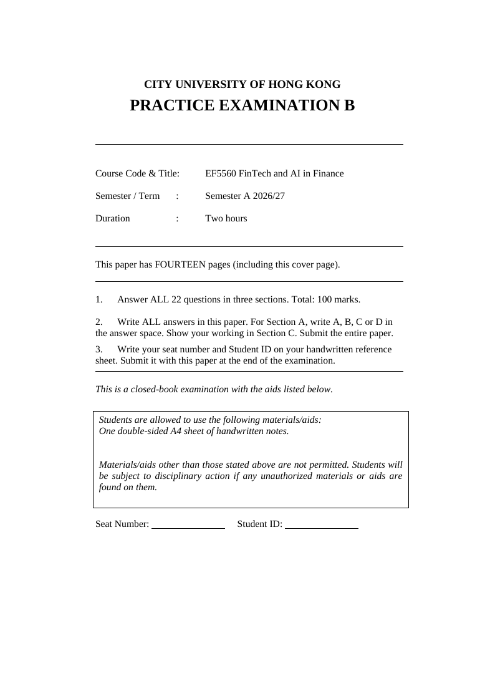

[打开原页大图](figures/practice-exam-b/page-01.png)


<details><summary>英文原题全文（按原页；仅统一换行展示）</summary>

```text
            CITY UNIVERSITY OF HONG KONG
        PRACTICE EXAMINATION B


Course Code & Title:        EF5560 FinTech and AI in Finance

Semester / Term     :       Semester A 2026/27

Duration            :       Two hours


This paper has FOURTEEN pages (including this cover page).


1.   Answer ALL 22 questions in three sections. Total: 100 marks.

2.    Write ALL answers in this paper. For Section A, write A, B, C or D in
the answer space. Show your working in Section C. Submit the entire paper.
3.    Write your seat number and Student ID on your handwritten reference
sheet. Submit it with this paper at the end of the examination.

This is a closed-book examination with the aids listed below.


Students are allowed to use the following materials/aids:
One double-sided A4 sheet of handwritten notes.


Materials/aids other than those stated above are not permitted. Students will
be subject to disciplinary action if any unauthorized materials or aids are
found on them.


Seat Number:                        Student ID:
```

</details>


本页行政要求已在阅读入口逐项解释；座位号/Student ID字段保持空白，不填写或提交。


### 2.2 p.2 · 题面与解析


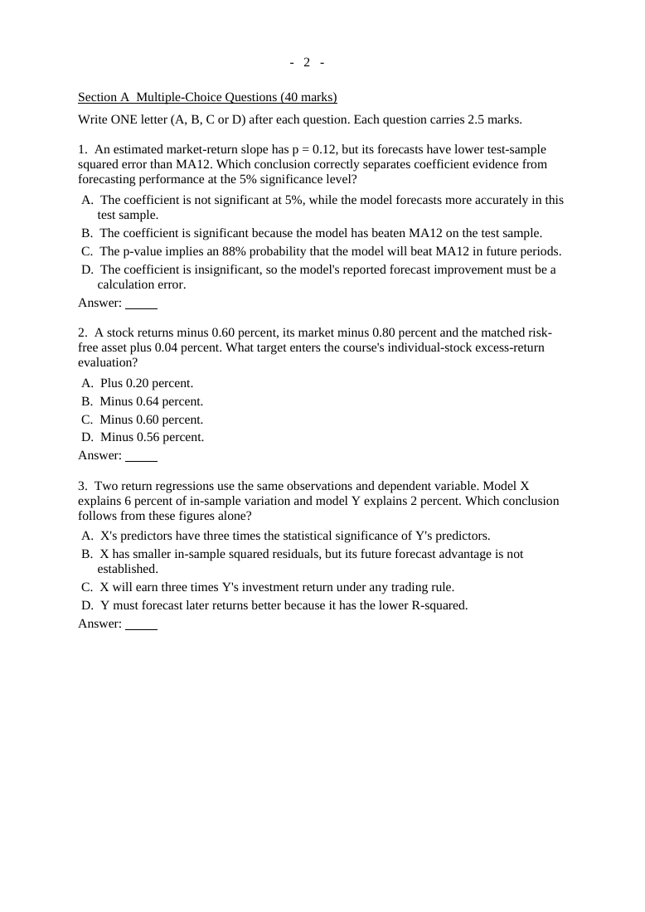

[打开原页大图](figures/practice-exam-b/page-02.png)


<details><summary>英文原题全文（按原页；仅统一换行展示）</summary>

```text
                                         - 2 -

Section A Multiple-Choice Questions (40 marks)
Write ONE letter (A, B, C or D) after each question. Each question carries 2.5 marks.

1. An estimated market-return slope has p = 0.12, but its forecasts have lower test-sample
squared error than MA12. Which conclusion correctly separates coefficient evidence from
forecasting performance at the 5% significance level?
A. The coefficient is not significant at 5%, while the model forecasts more accurately in this
   test sample.
B. The coefficient is significant because the model has beaten MA12 on the test sample.
C. The p-value implies an 88% probability that the model will beat MA12 in future periods.
D. The coefficient is insignificant, so the model's reported forecast improvement must be a
   calculation error.
Answer:

2. A stock returns minus 0.60 percent, its market minus 0.80 percent and the matched risk-
free asset plus 0.04 percent. What target enters the course's individual-stock excess-return
evaluation?
A. Plus 0.20 percent.
B. Minus 0.64 percent.
C. Minus 0.60 percent.
D. Minus 0.56 percent.
Answer:

3. Two return regressions use the same observations and dependent variable. Model X
explains 6 percent of in-sample variation and model Y explains 2 percent. Which conclusion
follows from these figures alone?
A. X's predictors have three times the statistical significance of Y's predictors.
B. X has smaller in-sample squared residuals, but its future forecast advantage is not
   established.
C. X will earn three times Y's investment return under any trading rule.
D. Y must forecast later returns better because it has the lower R-squared.
Answer:
```

</details>


#### 2.2.1 A1 · 显著性不等于预测比赛

**参考答案 A。** 市场收益的斜率（slope）描述市场收益变动与目标收益的拟合关系。p 值（p-value）是在零斜率假设和检验条件下，观察到当前或更极端统计量的概率，不是模型获胜的概率。因为 0.12 大于 0.05，不能在 5% 水平拒绝零斜率；这也不证明斜率恰好为零。测试样本（test sample）的平方误差是实际收益减预测收益后平方，再在相同样本汇总，越小代表这批预测越准。MA12 是题给比较基准；本题不需也不能猜其具体构造。

逐项中文与判定：A 说系数未显著、这批预测较准，分别回答两个问题，成立。B 因预测胜出就认系数显著，混淆两种证据。C 把 1−p=88% 当未来获胜概率，p 值没有这个含义。D 由未显著推断误差比较必算错，也没有依据。后续时期能否胜出仍需新数据。

English reference: **A. The slope is not significant at the 5% level, but the model has lower squared forecast error than MA12 in this test sample. Neither result guarantees future performance.**

#### 2.2.2 A2 · 超额收益减谁？

**参考答案 B，−0.64%。** 超额收益（excess return）是股票收益减同期匹配的无风险收益，不是减市场收益。两种“减法”回答不同问题。

$$r_i-r_f=-0.60\%-0.04\%=-0.64\%.$$

A 的 +0.20% 是股票减市场：−0.60%−(−0.80%)，不是本题目标。B 正确。C 的 −0.60% 是原始股票收益，漏减无风险收益。D 的 −0.56% 是把正无风险收益加回去，方向相反。−0.64% 表示本期股票比无风险资产少赚 0.64 个百分点；不是亏损金额。

English reference: **B. The target is the stock's excess return, −0.60% − 0.04% = −0.64%, rather than its return relative to the market.**

#### 2.2.3 A3 · 样本内解释度

**参考答案 B。** 决定系数（R-squared，$R^2$）把残差平方和 SSE 与同一目标的总变动 SST 比较：

$$R^2=1-\frac{SSE}{SST}.$$

SSE 是每条“实际减拟合”的误差平方相加；SST 是每条“实际减样本平均”的偏离平方相加。题目明确同一批观测、同一目标，所以 SST 相同。X 的 SSE=0.94 SST，Y 的 SSE=0.98 SST，X 样本内误差更小。未来数据未给，不能推出未来优势。

A 把 6%/2%=3 当显著性的倍数，显著性还涉及不确定性与检验，错。B 正确。C 把解释度当交易收益倍数，交易规则和成本均未给，错。D 由低解释度保证未来更好，同样越界。

English reference: **B. With the same dependent variable and observations, X has the lower in-sample residual sum of squares. These figures alone do not establish superior future forecasts.**


### 2.3 p.3 · 题面与解析


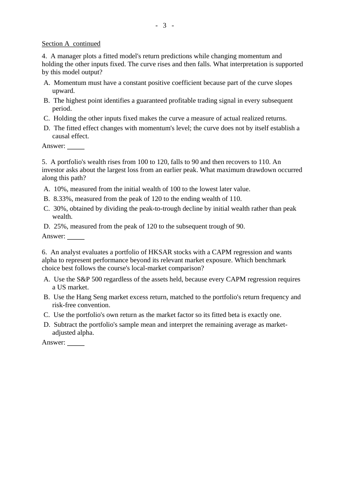

[打开原页大图](figures/practice-exam-b/page-03.png)


<details><summary>英文原题全文（按原页；仅统一换行展示）</summary>

```text
                                         - 3 -

Section A continued
4. A manager plots a fitted model's return predictions while changing momentum and
holding the other inputs fixed. The curve rises and then falls. What interpretation is supported
by this model output?
A. Momentum must have a constant positive coefficient because part of the curve slopes
   upward.
B. The highest point identifies a guaranteed profitable trading signal in every subsequent
   period.
C. Holding the other inputs fixed makes the curve a measure of actual realized returns.
D. The fitted effect changes with momentum's level; the curve does not by itself establish a
   causal effect.
Answer:

5. A portfolio's wealth rises from 100 to 120, falls to 90 and then recovers to 110. An
investor asks about the largest loss from an earlier peak. What maximum drawdown occurred
along this path?
A. 10%, measured from the initial wealth of 100 to the lowest later value.
B. 8.33%, measured from the peak of 120 to the ending wealth of 110.
C. 30%, obtained by dividing the peak-to-trough decline by initial wealth rather than peak
   wealth.
D. 25%, measured from the peak of 120 to the subsequent trough of 90.
Answer:

6. An analyst evaluates a portfolio of HKSAR stocks with a CAPM regression and wants
alpha to represent performance beyond its relevant market exposure. Which benchmark
choice best follows the course's local-market comparison?
A. Use the S&P 500 regardless of the assets held, because every CAPM regression requires
   a US market.
B. Use the Hang Seng market excess return, matched to the portfolio's return frequency and
   risk-free convention.
C. Use the portfolio's own return as the market factor so its fitted beta is exactly one.
D. Subtract the portfolio's sample mean and interpret the remaining average as market-
   adjusted alpha.
Answer:
```

</details>


#### 2.3.1 A4 · 弯曲的是模型预测，不是因果

**参考答案 D。** 动量（momentum）在此是模型的一个输入，可理解为过去价格走势的强弱指标。保持其他输入固定，只改变动量，输出先升后降，说明模型预测对动量的反应随动量水平改变。这是非线性拟合（nonlinear fit）的线索。

A 说有一段上升就一定是恒定正系数，忽略下降段，错。B 说最高点保证之后每期赚钱，拟合输出没有这种保证。C 说固定输入就变成实际收益，模型计算与现实实现仍是两件事。D 表述变化关系且不声称因果，正确。即使没有其他输入变化，也没有随机干预或其他识别证据。

English reference: **D. The fitted response depends on momentum's level. This prediction curve alone establishes neither causality nor a guaranteed trading profit.**

#### 2.3.2 A5 · 最大回撤要从此前最高点算

<!-- cityu-nav:ancillary-landing-1 -->
[[#0. 三分钟速览|↑ 阅读导航]] · [[#4. 速查与答案索引|↩ 回速查]] · [[#5. 双语术语速查|回术语]]
<!-- cityu-nav:ancillary-landing:end -->

**参考答案 D，25%。** 最大回撤（maximum drawdown）找的是历史高点到其后低点的最大比例下跌，不是从期初到期末。对每个时点，先记“到这里为止最高有多少钱”，再比较当前财富。

| 当前财富 | 此前及当前最高财富 | 从该高点跌了多少 |
|---|---|---|
| 100 | 100 | 0% |
| 120 | 120 | 0% |
| 90 | 120 | (120−90)/120=25% |
| 110 | 120 | (120−110)/120≈8.33% |

最大值是 25%。A 用期初 100 当高点，得到 10%，漏了中途 120。B 只看最后一段恢复后的 8.33%，不是最大跌幅。C 的 30% 用对跌额 30、却除错分母 100。D 的高点、低点、分母都对。

English reference: **D. Maximum drawdown is (120−90)/120 = 25%. The later recovery to 110 does not erase the earlier peak-to-trough loss.**

#### 2.3.3 A6 · CAPM 的市场要与持仓相配

**参考答案 B。** 资本资产定价模型（Capital Asset Pricing Model，CAPM）的评估回归可写成 $r_p-r_f=\alpha+\beta(r_m-r_f)+\epsilon$。

$r_p$ 是组合收益，$r_f$ 是同期无风险收益，$r_m$ 是市场收益。

$\beta$ 描述市场暴露，$\alpha$ 是控制这项暴露后剩余的平均表现；不是保证未来额外赚钱。

A 说所有 CAPM 必须用美国标普500，不成立。B 用恒生市场超额收益并匹配频率、无风险口径，符合题目香港股票与本地比较。C 用组合自己作市场，会把待评对象当基准，不能回答超越相关市场暴露的问题。D 先减自己样本均值使平均机械归零，不是估计市场调整 alpha。

English reference: **B. Use the Hang Seng market excess return with matching return frequency and risk-free conventions so that alpha is assessed relative to the portfolio's relevant local market exposure.**


### 2.4 p.4 · 题面与解析


[打开原页大图](figures/practice-exam-b/page-04.png)


<details><summary>英文原题全文（按原页；仅统一换行展示）</summary>

```text
                                         - 4 -

Section A continued
7. A verified RMB1 million export receivable has RMB600,000 financing recorded by Bank
A. Bank B applies an aggregate 80 percent advance cap. What can Bank B conclude,
assuming all existing financing is recorded?
A. RMB800,000 is available to Bank B because the cap applies separately to each lender.
B. RMB400,000 is available because the unpaid portion of the receivable sets the limit.
C. At most RMB200,000 remains under the cap; repayment still requires credit assessment.
D. RMB200,000 should be advanced because verification establishes recoverability.
Answer:

8. A bank checks a shared ledger and confirms that an invoice file has not changed since
submission. Before lending against the receivable, what additional information most directly
helps the bank identify duplicate financing?
A. A longer history of hashes for that same file.
B. A higher count of institutions able to view the file.
C. A common record of outstanding financing against its receivable, updated by
   participating lenders.
D. A second digital signature on the unchanged invoice.
Answer:

9. A shared-ledger pilot reduces handling time from 40 to 25 minutes and reconciliation
cases from 12 to 4 percent. Defaults change from 2.0 to 2.1 percent. There is no control
group. Which conclusion is supported?
A. Observed processing measures improved; lower credit risk and causal effects are not
   established.
B. The ledger caused a 0.1-percentage-point increase in default risk.
C. The default increase offsets all processing savings regardless of loan sizes and costs.
D. The fall in reconciliation cases establishes an equal fall in expected credit losses.
Answer:
```

</details>


#### 2.4.1 A7 · 总融资上限不是每家银行各一份

**参考答案 C，最多人民币20万元。** 应收账款（receivable）是客户欠出口商但还未支付的钱。预付融资比例上限（advance cap）限制各银行合计可借出多少，不代表债务人一定还得起。

$$\text{合计上限}=1{,}000{,}000\times80\%=800{,}000\text{元};\qquad \text{剩余额度}=800{,}000-600{,}000=200{,}000\text{元}.$$

A 给 B 单独80万元，忽略 aggregate（合计）。B 给40万元，是票面减已有融资，不是80%上限剩额。C 正确且保留信用评估。D 数字虽对，却说应该放款、核验等于可回收，混淆额度与风险。题目“已有融资全部记录”关键：漏记时20万元也未必是真实剩额。

English reference: **C. The aggregate cap is RMB800,000, leaving at most RMB200,000 after Bank A's financing. Verification and headroom do not establish repayment capacity.**

#### 2.4.2 A8 · 文件没变，不等于没重复借钱

**参考答案 C。** 哈希（hash）可用于比对文件内容是否改变；同一张未改的发票仍可能被拿到两家银行融资。要发现重复融资（duplicate financing），必须把这笔应收款的身份与尚未清偿融资余额联系起来，并由放款银行持续更新。

A 增加哈希历史，只强化文件变化证据。B 更多机构看得到，不保证融资数据完整。C 共用且更新未清偿融资记录，直接回答“已借多少、还能借多少”，正确。D 再加签名也不自动提供余额。系统还要正确匹配同一应收款、及时录入；题目没有证明所有链外融资都已覆盖。

English reference: **C. The bank needs an up-to-date shared record of outstanding financing against the same receivable. File integrity or extra signatures alone do not reveal duplicate borrowing.**

#### 2.4.3 A9 · 流程改善、信用风险与因果分开

**参考答案 A。** 处理时间从40到25分钟，少15分钟，即15/40=37.5%。对账案例比例从12%到4%，下降8个百分点。违约率从2.0%到2.1%，增加0.1个百分点，不是下降。没有对照组（control group），不能排除客户组成、经济环境等其他变化。

A 仅说观察到流程改善、不证明信用风险下降或因果，成立。B 说区块链导致违约上升，没有识别依据。C 说无论金额成本都抵消流程节省，缺少足以算总收益的数据。D 把对账比例变化等同预期信用损失变化，两个分母和经济含义不同。

English reference: **A. Handling time and reconciliation rates improved in the observed pilot. The data do not establish lower credit risk or a causal ledger effect without a suitable comparison.**


### 2.5 p.5 · 题面与解析


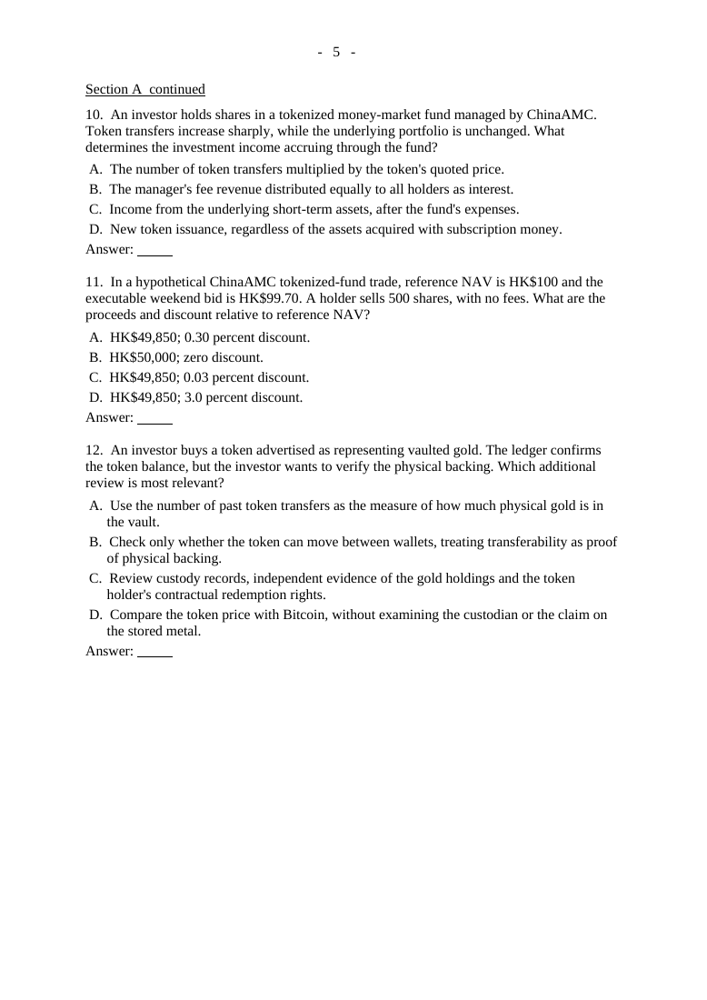

[打开原页大图](figures/practice-exam-b/page-05.png)


<details><summary>英文原题全文（按原页；仅统一换行展示）</summary>

```text
                                        - 5 -

Section A continued
10. An investor holds shares in a tokenized money-market fund managed by ChinaAMC.
Token transfers increase sharply, while the underlying portfolio is unchanged. What
determines the investment income accruing through the fund?
A. The number of token transfers multiplied by the token's quoted price.
B. The manager's fee revenue distributed equally to all holders as interest.
C. Income from the underlying short-term assets, after the fund's expenses.
D. New token issuance, regardless of the assets acquired with subscription money.
Answer:

11. In a hypothetical ChinaAMC tokenized-fund trade, reference NAV is HK$100 and the
executable weekend bid is HK$99.70. A holder sells 500 shares, with no fees. What are the
proceeds and discount relative to reference NAV?
A. HK$49,850; 0.30 percent discount.
B. HK$50,000; zero discount.
C. HK$49,850; 0.03 percent discount.
D. HK$49,850; 3.0 percent discount.
Answer:

12. An investor buys a token advertised as representing vaulted gold. The ledger confirms
the token balance, but the investor wants to verify the physical backing. Which additional
review is most relevant?
A. Use the number of past token transfers as the measure of how much physical gold is in
   the vault.
B. Check only whether the token can move between wallets, treating transferability as proof
   of physical backing.
C. Review custody records, independent evidence of the gold holdings and the token
   holder's contractual redemption rights.
D. Compare the token price with Bitcoin, without examining the custodian or the claim on
   the stored metal.
Answer:
```

</details>


#### 2.5.1 A10 · 收益来自底层资产，不来自转账次数

**参考答案 C。** 代币化（tokenization）改变基金份额的记录或转移方式，不自动改变底层资产赚什么钱。货币市场基金（money-market fund）在本题持有短期资产，其净投资收入来自底层资产收益扣基金费用。

A 转账次数乘代币价格是人为拼的量，不是投资收入。B 管理费是投资者承担的费用，不会自动变成持有人利息。C 正确。D 新发行带来认购资金与份额变化，不是无论资产如何都凭空产生收益。本题不涉及 ChinaAMC 现行产品条款，不据此保证收益率。

English reference: **C. Income comes from the underlying short-term assets after fund expenses. More token transfers do not themselves generate portfolio income.**

#### 2.5.2 A11 · 可成交价格才决定卖出所得

**参考答案 A。** 净资产值（Net Asset Value，NAV）是每份对应的净资产参考值；买价（bid）是买方实际愿意接货的价。题给周末可执行买价99.70港元，卖500份、零费用：

$$\text{所得}=500\times99.70=49{,}850\text{港元}.$$
$$\text{相对NAV折价}=\frac{100-99.70}{100}\times100\%=0.30\%.$$

A 两个数都对。B 按NAV卖出得到50,000，但题给可成交价不是NAV。C 的0.03%少一位；D 的3.0%多一位。每份差0.30港元，总差150港元，150/50,000也是0.30%。

English reference: **A. Proceeds are HKD49,850 and the discount to reference NAV is 0.30%, with no fees.**

#### 2.5.3 A12 · 链上持有凭证与实物储备是两层

**参考答案 C。** 账本能显示某地址有多少代币，但不能单凭余额证明金库里真的有相应黄金。托管（custody）说明谁保管实物；独立证据核数量与存在；赎回权（redemption rights）说明持有人依约究竟能请求什么。

A 用转账次数衡量金量，错。B 可转移只证明功能，不证明黄金存在。C 三类审查直接针对实物支持与权利，正确。D 只和比特币比价，未查金库和债权。这里不替任何现有产品作储备认证或法律结论。

English reference: **C. Review custody records, independent evidence of gold holdings and contractual redemption rights. A valid token balance is not by itself proof of physical backing.**


### 2.6 p.6 · 题面与解析


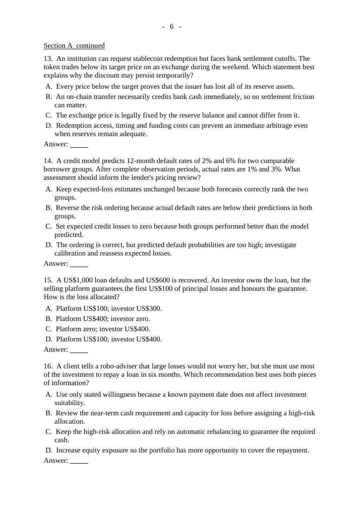

[打开原页大图](figures/practice-exam-b/page-06.png)


<details><summary>英文原题全文（按原页；仅统一换行展示）</summary>

```text
                                         - 6 -

Section A continued
13. An institution can request stablecoin redemption but faces bank settlement cutoffs. The
token trades below its target price on an exchange during the weekend. Which statement best
explains why the discount may persist temporarily?
A. Every price below the target proves that the issuer has lost all of its reserve assets.
B. An on-chain transfer necessarily credits bank cash immediately, so no settlement friction
   can matter.
C. The exchange price is legally fixed by the reserve balance and cannot differ from it.
D. Redemption access, timing and funding costs can prevent an immediate arbitrage even
   when reserves remain adequate.
Answer:

14. A credit model predicts 12-month default rates of 2% and 6% for two comparable
borrower groups. After complete observation periods, actual rates are 1% and 3%. What
assessment should inform the lender's pricing review?
A. Keep expected-loss estimates unchanged because both forecasts correctly rank the two
   groups.
B. Reverse the risk ordering because actual default rates are below their predictions in both
   groups.
C. Set expected credit losses to zero because both groups performed better than the model
   predicted.
D. The ordering is correct, but predicted default probabilities are too high; investigate
   calibration and reassess expected losses.
Answer:

15. A US$1,000 loan defaults and US$600 is recovered. An investor owns the loan, but the
selling platform guarantees the first US$100 of principal losses and honours the guarantee.
How is the loss allocated?
A. Platform US$100; investor US$300.
B. Platform US$400; investor zero.
C. Platform zero; investor US$400.
D. Platform US$100; investor US$400.
Answer:

16. A client tells a robo-adviser that large losses would not worry her, but she must use most
of the investment to repay a loan in six months. Which recommendation best uses both pieces
of information?
A. Use only stated willingness because a known payment date does not affect investment
   suitability.
B. Review the near-term cash requirement and capacity for loss before assigning a high-risk
   allocation.
C. Keep the high-risk allocation and rely on automatic rebalancing to guarantee the required
   cash.
D. Increase equity exposure so the portfolio has more opportunity to cover the repayment.
Answer:
```

</details>


#### 2.6.1 A13 · 价格折价可能来自时间与资金摩擦

**参考答案 D。** 套利（arbitrage）在此指低价买入代币、按目标价赎回，想赚价差。但“可以申请赎回”不等于“立刻拿到银行现金”：截止时间、周末、资格和垫资成本都可能让价差暂时存在。

A 任何折价都证明全部储备丢失，过度结论。B 链上转账不必然立即到账银行。C 储备余额不会机械锁死交易所成交价。D 正确保留储备充足情况下仍可能有暂时折价。反过来，也不能因此认定所有折价都没有储备风险。

English reference: **D. Redemption eligibility, settlement timing and funding costs may delay arbitrage, allowing a temporary discount even with adequate reserves.**

#### 2.6.2 A14 · 排得对不代表概率报得准

<!-- cityu-nav:ancillary-landing-2 -->
[[#0. 三分钟速览|↑ 阅读导航]] · [[#4. 速查与答案索引|↩ 回速查]] · [[#5. 双语术语速查|回术语]]
<!-- cityu-nav:ancillary-landing:end -->

**参考答案 D。** 排序（ranking）问谁风险更高：预测6%高于2%，实际3%也高于1%，顺序一致。校准（calibration）问“报2%的人群，长期是否约2%违约”；本题完整观察期中，两组实际率都只有预测的一半，提示预测偏高。仍需查样本量、估计不确定性、群体与时期变化，不凭两个比例证明永久偏差。

预期损失（expected loss）常按违约概率 PD×违约后损失比例 LGD×风险暴露 EAD 组织。即使排序不变，PD变化也会改变损失估计。A 只因排序对就不调损失，错。B 颠倒顺序与实际数据相反。C 实际仍有违约，损失不应机械归零。D 要查校准并重估，正确。

English reference: **D. Risk ordering is correct, but default probabilities are overstated in the observed groups. Investigate calibration and reassess expected losses rather than treating ranking accuracy as sufficient.**

#### 2.6.3 A15 · 先算总损失，再分首损

**参考答案 A。** 贷款本金1,000美元、回收600美元，损失400美元。平台保证首笔100美元损失且题目明确履约，平台承担100，投资者承担剩余300。首损保证（first-loss guarantee）不是保证全部本金。

$$\text{总损失}=1000-600=400;\quad \text{平台}=\min(100,400)=100;\quad \text{投资者}=400-100=300\text{美元}.$$

A 正确，100+300=400。B 让平台承担400，超保证范围。C 忽略已经履行的保证。D 两者共500，超过真实损失，重复计损。

English reference: **A. The total loss is USD400. The platform absorbs the guaranteed first USD100 and the investor bears the remaining USD300.**

#### 2.6.4 A16 · 愿意亏与能承受亏不是一回事

**参考答案 B。** 风险意愿（willingness）是心理上能否接受损失；承受损失能力（capacity for loss）还受必须付款的时间、现金储备等约束。六个月后要偿债，意味着这部分资金有很近的用途。

A 只看心理意愿，忽略偿债。B 先查短期用款与承受能力，正确。C 自动再平衡（rebalancing）只是调整持仓比例，不保证六个月时有足够现金。D 增加股票并不能保证赚够还债钱，反而可能加大不足风险。题面不足以计算具体最优配置。

English reference: **B. Review the six-month repayment need, liquidity and capacity for loss before assigning a high-risk allocation. Stated tolerance and automatic rebalancing do not guarantee the required cash.**


### 2.7 p.7 · 题面与解析

<!-- cityu-nav:ancillary-landing-3 -->
[[#0. 三分钟速览|↑ 阅读导航]] · [[#4. 速查与答案索引|↩ 回速查]] · [[#5. 双语术语速查|回术语]]
<!-- cityu-nav:ancillary-landing:end -->


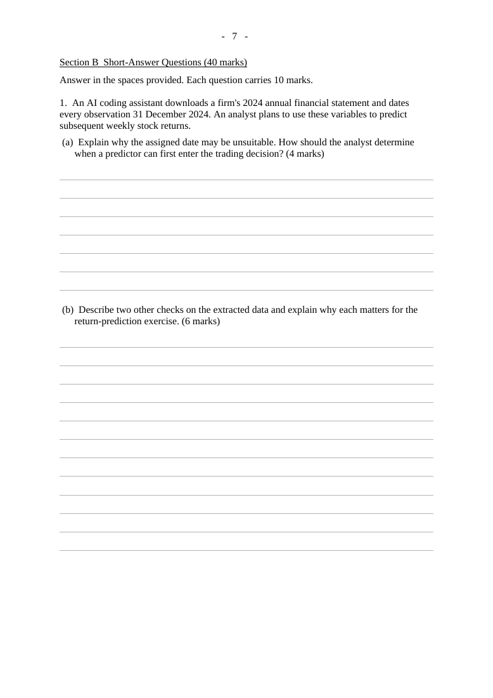

[打开原页大图](figures/practice-exam-b/page-07.png)


<details><summary>英文原题全文（按原页；仅统一换行展示）</summary>

```text
                                       - 7 -

Section B Short-Answer Questions (40 marks)
Answer in the spaces provided. Each question carries 10 marks.

1. An AI coding assistant downloads a firm's 2024 annual financial statement and dates
every observation 31 December 2024. An analyst plans to use these variables to predict
subsequent weekly stock returns.
(a) Explain why the assigned date may be unsuitable. How should the analyst determine
   when a predictor can first enter the trading decision? (4 marks)


(b) Describe two other checks on the extracted data and explain why each matters for the
   return-prediction exercise. (6 marks)
```

</details>


#### 2.7.1 B1(a) · 财年截止不是信息公开日（4分）

**参考作答：12月31日只是报表覆盖期间的结束日，不保证当天已知报表数值。** 年报通常在期间结束后才公布；若把后来才公布的数据倒放到12月31日，会让模型使用未来信息，称为前视偏差（look-ahead bias）。题目未给实际发布日期，不能编出某个月某天。

先查原始公告的首次可公开时间与版本，再结合交易决策时间、市场时区和可取得数据的合理延迟。只有在决策前已发布并可取得的版本才可入模。若收市后公布，就不能当成当天收市前已知；具体最早交易时点依交易规则判断。重述报表要保留当时可得版本，不能用今天修订版冒充当年已知。

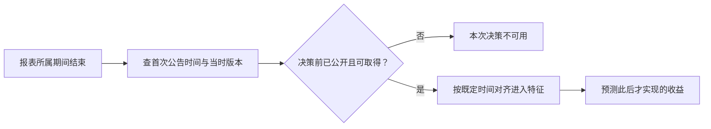

English reference: **31 December is the accounting period end, not necessarily the information release date. Verify the original publication timestamp and point-in-time version, allow for availability and trading timing, and use the predictor only in a decision made after it became available. Otherwise the exercise contains look-ahead bias.**

#### 2.7.2 B1(b) · 两项额外检查（6分）

这里问 two other checks，不能把(a)“检查公告日”重复算一项。以下明确给两项，各带为什么。

1. **核原表数值、含义与单位。** 抽查AI提取结果与报告页；确认币种、元/千元/百万元、正负号、合并/单体口径与会计期间。缺失值不能当零。

例如报告写收入500百万元，误录为500元，绝对金额输入会缩小一百万倍。比率要另核分子、分母的单位：如果两边同样按一百万倍缩小，比率不变；如果只有分子缩小、分母保持原单位，比率才会缩小一百万倍。不能把单位错误对所有比率的影响一概而论。

错误数据会使预测关系失真，不是换模型能补救。
2. **核股票身份与目标收益对齐。** 检查公司/证券代码、周度日期、重复行、缺失行；确认特征接的是同一股票、决策后的那周收益，价格的分红拆股处理与收益定义一致。错接另一公司或用同期已实现收益，会让训练与评估回答错误问题。原始价格不应因拆股被误读为经济亏损。

English reference: **First, reconcile extracted values with the statements, including units, currency, sign, accounting scope and missing values; errors would distort predictors. Second, validate security identifiers, duplicate/missing rows and the alignment of each predictor with the correct subsequent weekly return, using a consistent corporate-action and return convention. This prevents false relationships caused by mismatched observations.**


### 2.8 p.8 · 题面与解析


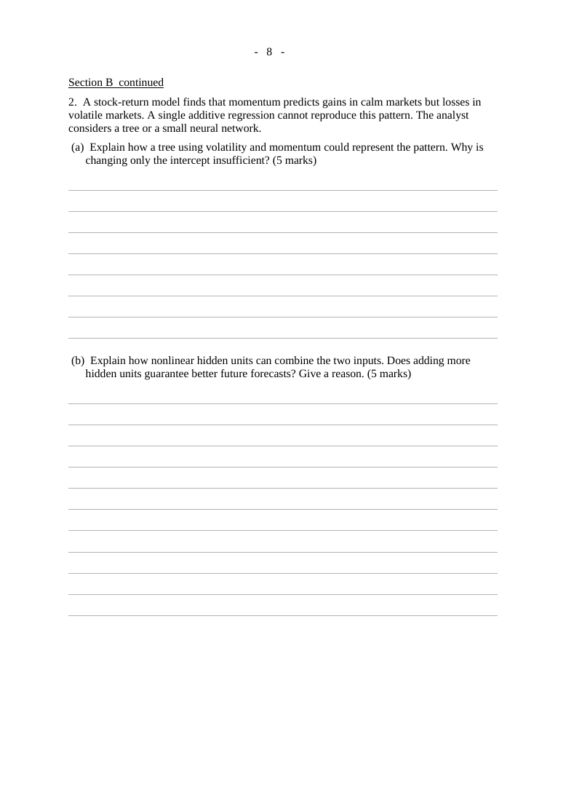

[打开原页大图](figures/practice-exam-b/page-08.png)


<details><summary>英文原题全文（按原页；仅统一换行展示）</summary>

```text
                                        - 8 -

Section B continued
2. A stock-return model finds that momentum predicts gains in calm markets but losses in
volatile markets. A single additive regression cannot reproduce this pattern. The analyst
considers a tree or a small neural network.
(a) Explain how a tree using volatility and momentum could represent the pattern. Why is
   changing only the intercept insufficient? (5 marks)


(b) Explain how nonlinear hidden units can combine the two inputs. Does adding more
   hidden units guarantee better future forecasts? Give a reason. (5 marks)
```

</details>


#### 2.8.1 B2(a) · 树先分市场状态，再分动量（5分）

**参考作答：用波动率作分支，在每个分支内再按动量分组，叶节点可产生相反的收益模式。** 波动率（volatility）描述收益变动幅度；树（tree）的叶节点是满足一连串条件后给出的预测。分组门槛和预测值以下均为教学示意，不是题给估计。

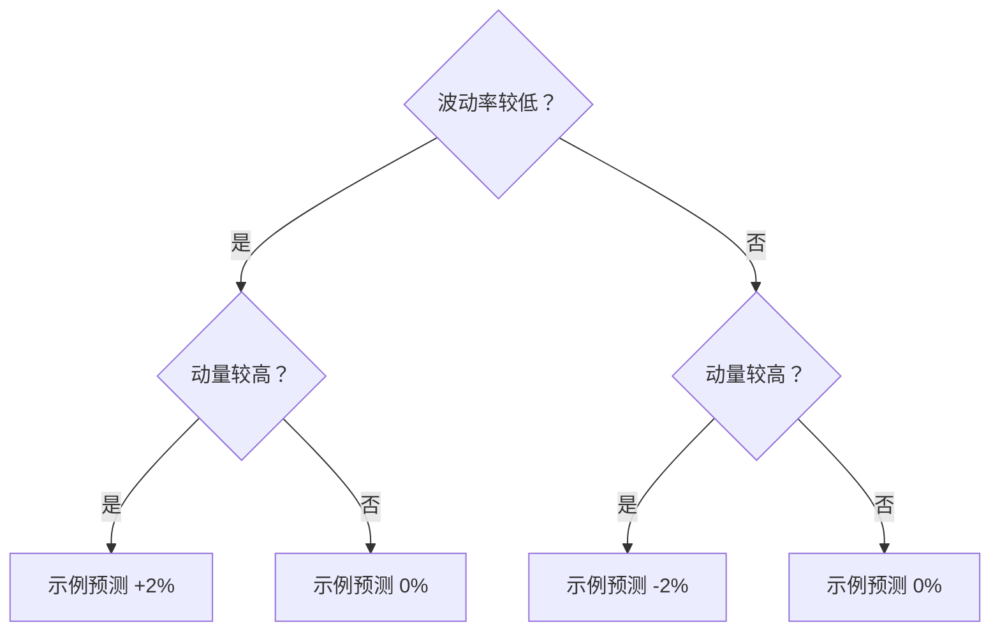

沿路径看：低波动+高动量到+2%；高波动+高动量到−2%。改变波动率状态后，动量与预测收益的关系改变，叫交互作用（interaction）。普通加法回归若写成截距+动量系数×动量+波动率系数×波动率，动量系数处处相同。只改截距只会把整条线往上/下平移，不会让动量的反应由正转负。树的分段常数可近似这种模式，不需把树误说成每叶都有斜率。

English reference: **A tree can split first on volatility and then on momentum within each regime. Its leaves can predict gains for high momentum in calm markets and losses for high momentum in volatile markets. An intercept change only shifts prediction levels; it cannot reverse a common momentum slope or create this interaction.**

#### 2.8.2 B2(b) · 非线性隐藏单元（5分）

先把两个输入按权重相加，再经过弯曲或截断的规则，最后把多个单元输出组合。例如一个隐藏单元（hidden unit）为 $h_j=\max(0,a_jm+b_jv+c_j)$，$m$ 是动量、$v$ 是波动率，$a_j,b_j,c_j$ 是训练时估计的参数；max取括号内两数的较大者，负数变0，正数保留。输出为 $\hat r=d+\sum_j w_jh_j$，即把各单元输出乘权重再相加。

同一单元能否开启同时取决于两个输入，因此动量变化在不同波动率下可以经过不同开启组合，形成交互。多个这样的单元可近似分段关系。例：令一个示意单元为 max(0,m−v)，m=2、v=1时输出1；保持m=2但v=3时输出0；同一动量在不同波动率下不再贡献同一数值。这个单元例只解释机制，不声称单个单元已经复制题目全部模式。

更多单元不保证未来预测更好：模型更灵活，也更可能拟合样本噪声，叫过拟合（overfitting）。应按时间分开发/验证与最终测试，用开发期选择复杂度与正则化（限制模型过度复杂），保留后续未参与选择的测试。不能挑了测试最好模型还称测试未见。

English reference: **Nonlinear hidden units transform weighted combinations of momentum and volatility; their outputs can be combined to approximate regime-dependent interactions. More units increase flexibility but can overfit noise, so they do not guarantee better future forecasts. Select complexity using appropriate time-ordered development/validation evidence and keep a later test sample separate.**


### 2.9 p.9 · 题面与解析


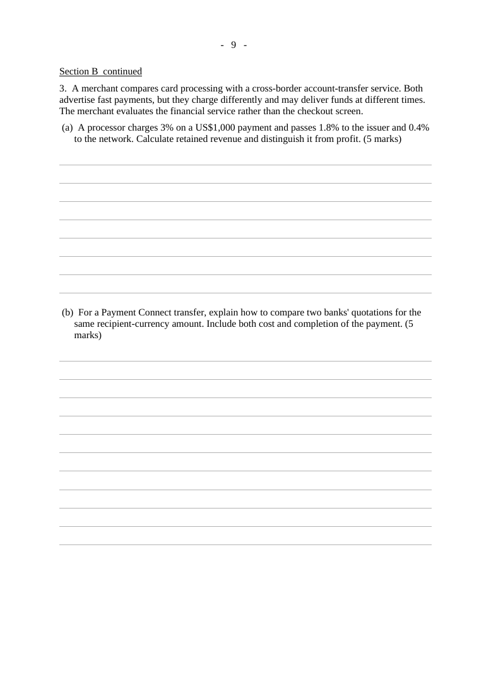

[打开原页大图](figures/practice-exam-b/page-09.png)


<details><summary>英文原题全文（按原页；仅统一换行展示）</summary>

```text
                                         - 9 -

Section B continued
3. A merchant compares card processing with a cross-border account-transfer service. Both
advertise fast payments, but they charge differently and may deliver funds at different times.
The merchant evaluates the financial service rather than the checkout screen.
(a) A processor charges 3% on a US$1,000 payment and passes 1.8% to the issuer and 0.4%
   to the network. Calculate retained revenue and distinguish it from profit. (5 marks)


(b) For a Payment Connect transfer, explain how to compare two banks' quotations for the
   same recipient-currency amount. Include both cost and completion of the payment. (5
   marks)
```

</details>


#### 2.9.1 B3(a) · 留存收入不是净利润（5分）

处理商先收商户支付额的3%，再向发卡行（issuer，发卡给消费者的银行）和网络（network，连接支付参与方的网络）分付。所有比例同以1,000美元支付额为基数：

| 步骤 | 计算 | 金额（美元） |
|---|---|---|
| 向商户收处理费 | 1000×3% | 30 |
| 转付发卡行 | 1000×1.8% | 18 |
| 转付网络 | 1000×0.4% | 4 |
| 处理商留存收入 | 30−18−4 | 8 |

**留存8美元，等于支付额的0.8%。** 不是30美元的0.8%，也不是净利润（profit）。还须减题目没给的运营、人力、技术、欺诈损失等成本，不能算出精确利润。这里留存收入是题目指定的“手续费扣两笔转付”口径，不扩张为会计准则结论。

English reference: **The processor collects USD30 and passes on USD18 to the issuer and USD4 to the network, retaining USD8, or 0.8% of the payment. This is not profit because operating, risk and other costs still need to be deducted.**

#### 2.9.2 B3(b) · 固定收款金额，比较总付出与真正到账（5分）

题目固定 same recipient-currency amount，即两家银行都要让同一收款人收到同样多的收款币种金额。不能拿一笔收1000元、另一笔收980元的“低费率”直接比。

1. 在同一报价时点、相同币种和金额下，记下为达到目标净到账额需要扣多少付款币种；包含银行手续费、汇率差价、可适用的中间/收款费用。若费用另扣，纳入总付出；若从汇款中扣，倒算足额到账所需付款。也查限额、资格、报价有效时间。题面没有给具体费率或现行服务条件，不补造。
2. 分开“指令发出”“付款方扣款”“收款账户可用资金”。比较是否收款银行支持、截止时间/营业日、处理/结算时间、到账确认、退回与失败处理。屏幕显示成功或快转账不等于收款人已拿到可用资金。
3. 选在满足所需到账时间与完成条件下总成本合适的方案，不只看宣传手续费或checkout页面。

教学变式：收款目标相同，一家总扣1100港元、另一家总扣1090港元，但后者晚于必须到账的期限，不能仅因便宜10元就认定更合适。此例不是实际银行报价。

English reference: **For the same net recipient-currency amount, compare the total sender-currency debit at a common quotation time, including fees and the effective exchange rate. Check eligibility, limits, cutoffs, settlement timing and any recipient deductions. Confirm when funds become available to the recipient and how failure or return is handled; a fast instruction or checkout confirmation is not necessarily completed payment.**


### 2.10 p.10 · 题面与解析


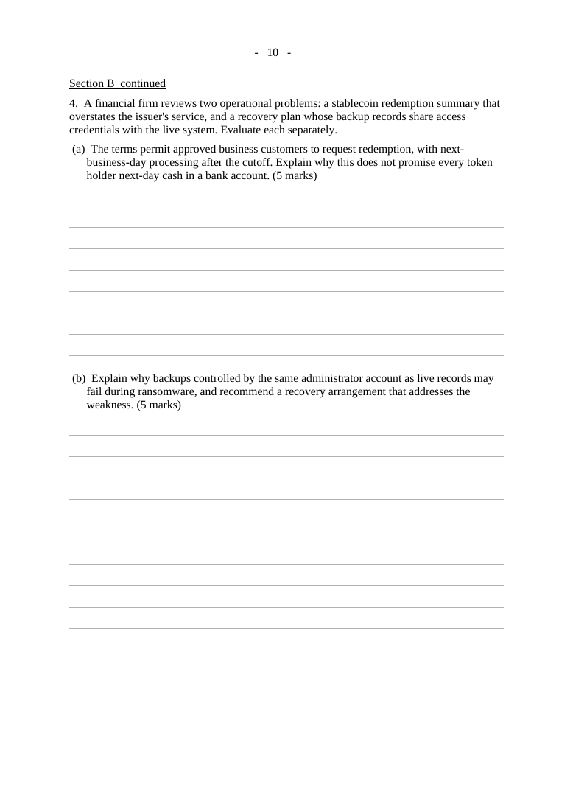

[打开原页大图](figures/practice-exam-b/page-10.png)


<details><summary>英文原题全文（按原页；仅统一换行展示）</summary>

```text
                                       - 10 -

Section B continued
4. A financial firm reviews two operational problems: a stablecoin redemption summary that
overstates the issuer's service, and a recovery plan whose backup records share access
credentials with the live system. Evaluate each separately.
(a) The terms permit approved business customers to request redemption, with next-
   business-day processing after the cutoff. Explain why this does not promise every token
   holder next-day cash in a bank account. (5 marks)


(b) Explain why backups controlled by the same administrator account as live records may
   fail during ransomware, and recommend a recovery arrangement that addresses the
   weakness. (5 marks)
```

</details>


#### 2.10.1 B4(a) · 谁有资格、何时处理、何时到账分别读（5分）

**参考作答：原条款只允许获批商业客户申请赎回；不等于每位代币持有人都有直接权利。** 三处限定都改变答案：

- approved business customers：身份和审批限定。二级市场持有人可能需要经合资格机构卖出/赎回，题目没有保证其直接渠道。
- next-business-day：下一个营业日，不是下一个自然日；周末/假期可不同。实际日历未给，不能断言具体星期几。
- processing after the cutoff：截止后按约处理申请，处理不等于银行资金已完成结算并可用；银行流程、合规核对及资金通道仍可能影响时间。

所以不能把“发行人处理某类客户的申请”扩写成“所有持有人次日银行到账”。要判断个案还需资格、申请时点、营业日及支付完成条款。

English reference: **The terms cover approved business customers, not every token holder. Next-business-day processing depends on the cutoff and business calendar, and processing a redemption is not the same as completed bank settlement. Eligibility, intermediary access and payment timing must be checked before promising cash availability.**

#### 2.10.2 B4(b) · 备份不能和主系统一起被一把钥匙打开（5分）

勒索软件（ransomware）可能加密或删除资料。若攻击者夺取管理员账户，就既能动实时资料，也能动由同一账户控制的备份。多复制一份、但仍用同一套高权限凭据，不构成故障独立的恢复来源。

可建议离线或不可变备份（offline/immutable backup），并以与生产系统分离的身份、权限和管理域保护；限制删除/改写权限，重要操作双人控制，分离备份与日常登录凭据，启用适当多因素验证。不可变是约定保留期内不能随意改删，不是防止所有事故的魔法。

恢复安排还要定期验证备份可读且完整，在隔离环境做恢复演练；保留足够历史版本，以免只剩已受损版本。约定恢复点目标 RPO（最多可接受丢多久的数据）和恢复时间目标 RTO（多久须恢复服务），再核备份频率/演练结果是否满足。不能承诺零停机或仅凭有备份就一定可恢复。


English reference: **A compromised administrator account could let ransomware alter or delete both live data and accessible backups. Keep offline or immutable copies under separated identities and restricted administration, retain clean historical versions, and test restoration in an isolated environment against stated recovery-point and recovery-time objectives. Shared credentials or untested copies do not establish recoverability.**


### 2.11 p.11 · 题面与解析

<!-- cityu-nav:ancillary-landing-4 -->
[[#0. 三分钟速览|↑ 阅读导航]] · [[#4. 速查与答案索引|↩ 回速查]] · [[#5. 双语术语速查|回术语]]
<!-- cityu-nav:ancillary-landing:end -->


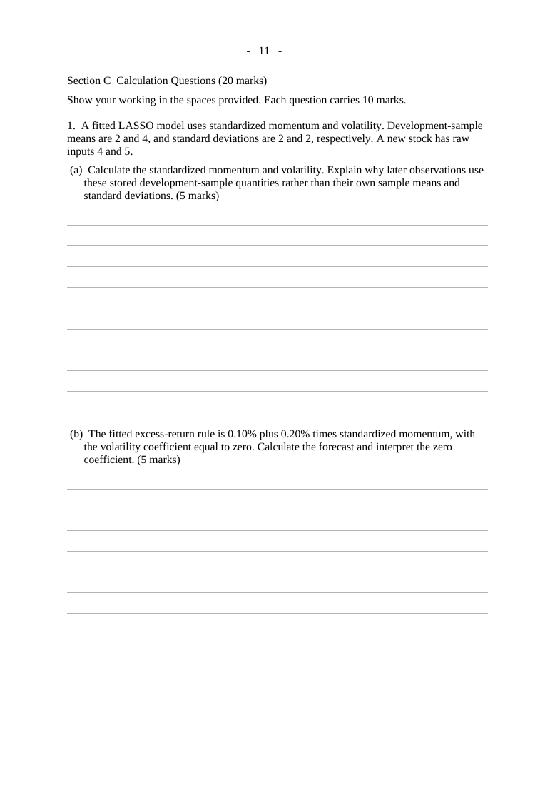

[打开原页大图](figures/practice-exam-b/page-11.png)


<details><summary>英文原题全文（按原页；仅统一换行展示）</summary>

```text
                                       - 11 -

Section C Calculation Questions (20 marks)
Show your working in the spaces provided. Each question carries 10 marks.

1. A fitted LASSO model uses standardized momentum and volatility. Development-sample
means are 2 and 4, and standard deviations are 2 and 2, respectively. A new stock has raw
inputs 4 and 5.
(a) Calculate the standardized momentum and volatility. Explain why later observations use
   these stored development-sample quantities rather than their own sample means and
   standard deviations. (5 marks)


(b) The fitted excess-return rule is 0.10% plus 0.20% times standardized momentum, with
   the volatility coefficient equal to zero. Calculate the forecast and interpret the zero
   coefficient. (5 marks)
```

</details>


#### 2.11.1 C1(a) · 用建模时那把尺量新数据（5分）

标准化（standardization）先减均值，再除标准差，让数值表示“比开发样本平均高几个标准差”。动量与波动率的均值分别2和4；标准差均为2；新值分别4和5。下面数值是特征自己的原单位，题面没说是百分数，不能添加%。标准化后的 z 没有原单位。

$$z_m=\frac{m-\mu_m}{s_m}=\frac{4-2}{2}=1,\qquad z_v=\frac{v-\mu_v}{s_v}=\frac{5-4}{2}=0.5.$$

$m,v$ 是预测时取得的新输入；$\mu_m=2,\mu_v=4,s_m=s_v=2$ 是开发样本估计并储存的量；开发/拟合时已知，后来不应偷偷用未来测试分布改写。模型系数是在这把尺下学的。新样本若重算自身均值/标准差，输入尺度会换，若还用了未来观测就泄漏信息。单个新观测自身也不能给有意义的样本标准差。若明确重新训练/滚动更新，必须在当时可得数据内重新拟合整条流程，不能只换尺不换模型。

English reference: **Standardized momentum is (4−2)/2 = 1 and standardized volatility is (5−4)/2 = 0.5. Stored development-sample scaling preserves the coordinate system used to fit the model and avoids using later information. Any legitimate re-estimation must use only information available at that time and refit the relevant pipeline.**

#### 2.11.2 C1(b) · 零系数的边界（5分）

超额收益规则的截距为0.10%，标准化动量系数0.20%，波动率系数0。代入(a)：

$$\widehat{r_i-r_f}=0.10\%+0.20\%\times1+0\times0.5=0.30\%.$$

结果是预测超额收益0.30%，等价小数0.003，不是30%，也不是股票原始收益；若要原始收益还需加该预测期间匹配无风险收益，题目未给。LASSO 是在拟合误差外惩罚系数大小的估计方法，能把某些系数压到恰好0。此处波动率在这个拟合线性规则中没有直接贡献；不证明其在现实世界永远无影响、在其他样本或非线性模型中无用，也不是显著性检验结论。

English reference: **The forecast excess return is 0.10% + 0.20%×1 = 0.30%. A zero volatility coefficient means no direct volatility contribution in this fitted penalized linear rule; it does not prove that volatility is universally irrelevant or has no nonlinear effect.**


### 2.12 p.12 · 题面与解析

<!-- cityu-nav:ancillary-landing-5 -->
[[#0. 三分钟速览|↑ 阅读导航]] · [[#4. 速查与答案索引|↩ 回速查]] · [[#5. 双语术语速查|回术语]]
<!-- cityu-nav:ancillary-landing:end -->


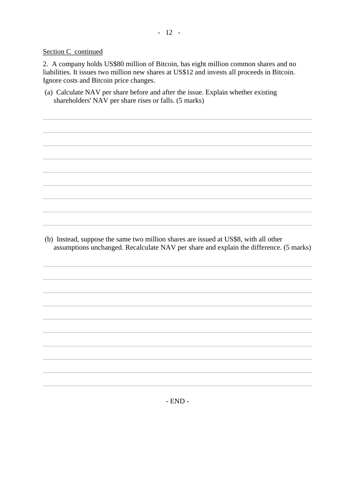

[打开原页大图](figures/practice-exam-b/page-12.png)


<details><summary>英文原题全文（按原页；仅统一换行展示）</summary>

```text
                                         - 12 -

Section C continued
2. A company holds US$80 million of Bitcoin, has eight million common shares and no
liabilities. It issues two million new shares at US$12 and invests all proceeds in Bitcoin.
Ignore costs and Bitcoin price changes.
(a) Calculate NAV per share before and after the issue. Explain whether existing
   shareholders' NAV per share rises or falls. (5 marks)


(b) Instead, suppose the same two million shares are issued at US$8, with all other
   assumptions unchanged. Recalculate NAV per share and explain the difference. (5 marks)


                                            - END -
```

</details>


#### 2.12.1 C2(a) · 溢价增发如何改变每股资产（5分）

净资产值（NAV）是资产减负债；每股NAV再除流通普通股数。此题无负债，忽略费用和比特币价格变化，因此只跟踪融资进来多少钱、股份增加多少。金额与股数统一用“百万美元”和“百万股”，相除得到美元/股。不是把现金新买的比特币再加一次资产，否则重复计数。

| 时点/方案 | 资产（百万美元） | 股数（百万股） | 每股NAV（美元/股） |
|---|---|---|---|
| 增发前 | 80 | 8 | 80/8=10.00 |
| 按12美元增发后 | 80+2×12=104 | 8+2=10 | 104/10=10.40 |
| (b)替代：按8美元增发后 | 80+2×8=96 | 8+2=10 | 96/10=9.60 |

(a) **原股东每股NAV由10升至10.40美元，上升0.40美元，即4%。** 新股以高于原每股NAV的12美元买入，每新股带来12美元资产，却与原10美元资产共同平均，拉高每份平均资产。原股东总持股比例从100%降至8/10=80%，但“持股比例下降”不等于“每股NAV必降”。题面不保证市场股价或投资收益也上涨。

English reference: **Before issuance NAV per share is USD80m/8m = USD10. Issuing 2m shares at USD12 raises USD24m, so post-issue NAV per share is USD104m/10m = USD10.40. Existing shareholders' NAV per share rises by USD0.40, or 4%, because issuance is above the pre-issue NAV.**

#### 2.12.2 C2(b) · 折价增发是另一方案，不再叠加(a)（5分）

Instead 表示回到同一初始状态，改为每股8美元发行同样200万股；不是在(a)后再发。所得资金16百万美元，资产96百万、股数10百万，**每股NAV为9.60美元，比原10美元低0.40美元，即−4%。**

新投资者每股只带8美元，却参与原来每股10美元的资产池，平均值被拉低，称每股NAV摊薄（NAV dilution）。两方案股份数相同但募集资金不同，所以不能只数新股、不算价格。一般核对：增发价恰为原每股NAV10美元时，(80+2×10)/10=10美元/股，既不增厚也不摊薄（仅限本题无费用、无价格变化等假设）。

English reference: **In the alternative USD8 issue, proceeds are USD16m and NAV per share is USD96m/10m = USD9.60. Issuing below the original USD10 NAV dilutes existing shareholders' NAV per share; it is an alternative to, not a second issue after, part (a).**


### 2.13 p.13 · 草稿纸


[打开原页大图](figures/practice-exam-b/page-13.png)


<details><summary>英文原题全文（按原页；仅统一换行展示）</summary>

```text
 - 13 -

SCRAP PAPER
```

</details>


本页只写 SCRAP PAPER，无新增题目、选项或答案；保留页身份，不虚构额外两题。


### 2.14 p.14 · 草稿纸


[打开原页大图](figures/practice-exam-b/page-14.png)


<details><summary>英文原题全文（按原页；仅统一换行展示）</summary>

```text
 - 14 -

SCRAP PAPER
```

</details>


本页只写 SCRAP PAPER，无新增题目、选项或答案；保留页身份，不虚构额外两题。


## 3. 一图看懂 · 四层证据

| 从题面走向结论 | 先确定的对象 | 不能直接跳到什么 |
|---|---|---|
| 统计/预测 | 系数检验、样本内误差、未见测试误差 | 因果、未来必赚 |
| 金融计算 | 收益目标、分母、总量与每股量 | 数字近似就认为口径相同 |
| 账本/代币 | 记录、底层资产、权利与完成时点 | 储备必足、现金必到账 |
| 运营保障 | 可用信息、权限隔离、实际恢复验证 | 有文件/有备份即安全 |

三个当地流程图分别在B1(a)的信息时点、B2(a)的条件树和B4(b)的恢复链，不能互相代替。

## 4. 速查与答案索引

A区参考字母依次：**A、B、B、D、D、B、C、C、A、C、A、C、D、D、A、B**。字母只是索引，不代替题旁理由。

- [[#2.2.1 A1 · 显著性不等于预测比赛|A1]]/[[#2.2.3 A3 · 样本内解释度|A3]]/[[#2.3.1 A4 · 弯曲的是模型预测，不是因果|A4]]：显著、样本内拟合、测试预测、因果与利润是不同问题，不能互相充当证明。
- [[#2.2.2 A2 · 超额收益减谁？|A2]]/[[#2.3.2 A5 · 最大回撤要从此前最高点算|A5]]/[[#2.4.1 A7 · 总融资上限不是每家银行各一份|A7]]/[[#2.5.2 A11 · 可成交价格才决定卖出所得|A11]]/[[#2.6.3 A15 · 先算总损失，再分首损|A15]]：先确定减谁、除谁、总上限还是单机构、总损失还是分配；数字算对但对象错仍会选错。
- [[#2.4.2 A8 · 文件没变，不等于没重复借钱|A8]]/[[#2.5.1 A10 · 收益来自底层资产，不来自转账次数|A10]]/[[#2.5.3 A12 · 链上持有凭证与实物储备是两层|A12]]/[[#2.6.1 A13 · 价格折价可能来自时间与资金摩擦|A13]]、[[#2.10 p.10 · 题面与解析|B4]]：账本记录、底层资产、契约权利、银行资金完成分别核验。
- [[#2.7 p.7 · 题面与解析|B1]]/[[#2.11 p.11 · 题面与解析|C1]]：只能用决策时已经可得的信息；开发样本定义的尺度不能由未来数据偷偷重写。
- [[#2.8 p.8 · 题面与解析|B2]]：改变截距只平移，条件关系翻转需要交互/非线性；灵活不保证泛化。
- [[#2.9 p.9 · 题面与解析|B3]]/[[#2.12 p.12 · 题面与解析|C2]]：收入不等于利润；总资产增加不等于每股增加，必须同时跟踪分母。

## 5. 双语术语速查

定义只作回忆，具体对象和分母仍以§2各题为准。

| 中文 | English | 当前意思 |
|---|---|---|
| 超额收益 | excess return | 股票/组合收益减匹配无风险收益 |
| 最大回撤 | maximum drawdown | 先前峰值到后续低点的最大比例跌幅 |
| 校准 | calibration | 报出的概率与实际发生比例是否匹配 |
| 前视偏差 | look-ahead bias | 决策使用当时还不可得的信息 |
| 留存收入 | retained revenue | 本题手续费减指定转付款，尚未扣其他成本 |
| 净资产值 | net asset value (NAV) | 资产减负债；每股值还要除股数 |
| 首损保证 | first-loss guarantee | 先承担约定额度内损失，不是包赔全部 |
| 标准化 | standardization | 以开发样本均值与标准差定义输入尺度 |

## 6. 英文作答框架与边界

选择题先给字母，再说题面哪条条件决定它；不能只有字母而不懂理由。计算题按“量与单位→公式→代入→结果→解释”写。简答题若问two checks，就明确分两项并分别解释为什么；若问guarantee，就说明条件为何不足以保证。

英文框架（笔记自拟）：The relevant quantity is … . Using the stated inputs and assumptions, … . This supports … but does not establish … . 正文28个单元各有具体英文答案，框架不替代逐题作答。任何合理参考答案都不自动等于官方评分要点。

## 7. 改条件自测（笔记自拟，非原卷题）

1. A5的路径改为100→120→114→130，最大回撤是多少？
2. A7已有融资变为85万元、合计上限仍80万元，B还能新借多少？
3. C1新动量改为0、其余条件不变，预测超额收益是多少？
4. C2按每股10美元增发200万股，NAV每股怎样变？
5. B1年报在周五收市后公布，可否把数据用于当天收市前的预测？

<details><summary>自测参考答案与理由</summary>

1. (120−114)/120=5%；最后130创高不抹掉此前回撤。
2. 新增空间为0；已有融资还超过上限5万元，不能把负5万元当可放款金额。须查记录/风险并处理超限，不代表自动获准继续放贷。
3. 新动量z=(0−2)/2=−1，所以0.10%+0.20%×(−1)=−0.10%。标准化波动率仍0.5，零系数贡献仍0。预测负超额不等于已实现亏损。
4. (80+2×10)/(8+2)=10美元/股。不计成本/价格变化时按原NAV发行不改变平均每股资产。
5. 不可。收市后才公开不满足决策前已知；应按实际可用时点和交易规则对齐下一次合资格决策。

</details>

## 8. 原页与正文精确映射

| 物理页 | 题目/身份 | 正文入口 |
|---|---|---|
| p.1 | 封面与原始卷面规则 | [[#2.1 p.1 · 封面与卷面规则\|p.1 正文]] |
| p.2 | A1–A3 | [[#2.2 p.2 · 题面与解析\|p.2 正文]] |
| p.3 | A4–A6 | [[#2.3 p.3 · 题面与解析\|p.3 正文]] |
| p.4 | A7–A9 | [[#2.4 p.4 · 题面与解析\|p.4 正文]] |
| p.5 | A10–A12 | [[#2.5 p.5 · 题面与解析\|p.5 正文]] |
| p.6 | A13–A16 | [[#2.6 p.6 · 题面与解析\|p.6 正文]] |
| p.7 | B1(a)(b) | [[#2.7 p.7 · 题面与解析\|p.7 正文]] |
| p.8 | B2(a)(b) | [[#2.8 p.8 · 题面与解析\|p.8 正文]] |
| p.9 | B3(a)(b) | [[#2.9 p.9 · 题面与解析\|p.9 正文]] |
| p.10 | B4(a)(b) | [[#2.10 p.10 · 题面与解析\|p.10 正文]] |
| p.11 | C1(a)(b) | [[#2.11 p.11 · 题面与解析\|p.11 正文]] |
| p.12 | C2(a)(b) | [[#2.12 p.12 · 题面与解析\|p.12 正文]] |
| p.13 | 草稿纸，无新增题 | [[#2.13 p.13 · 草稿纸\|p.13 正文]] |
| p.14 | 草稿纸，无新增题 | [[#2.14 p.14 · 草稿纸\|p.14 正文]] |

## 9. 核对范围与待补

题面全部22题、28作答单元、64选择项均保留；无另外的题面数据表或需重画的试题曲线。原题p.13/14为空白草稿纸。表格、决策树、时间流程、备份流程均为解析补充，不是官方图或给定数字。尤其B2树叶+2%/−2%/0%是演示，不能当原卷数据。

作者已复算算术并检查题面/页图；独立教学审查、最终Markdown/公式/Mermaid实际显示尚待完成。官方答案、Canvas当前考试/提交安排未核，不称未发布；未修改个人出席、学习、自测、提交或评分状态。没有执行交易、提交答案、修改备份权限或操作金融账户。
