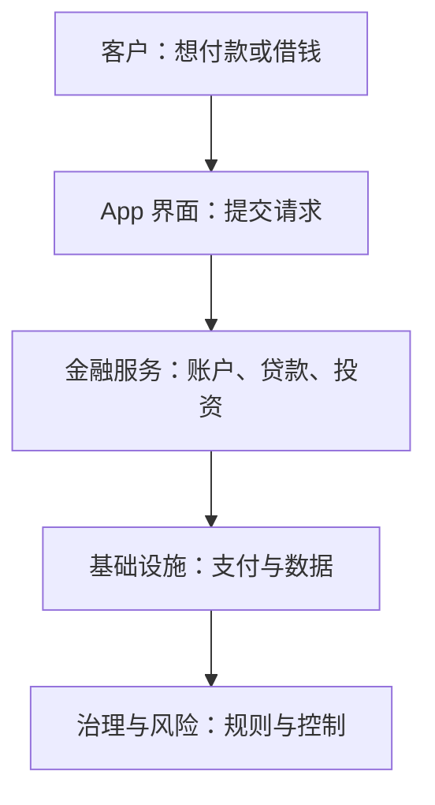
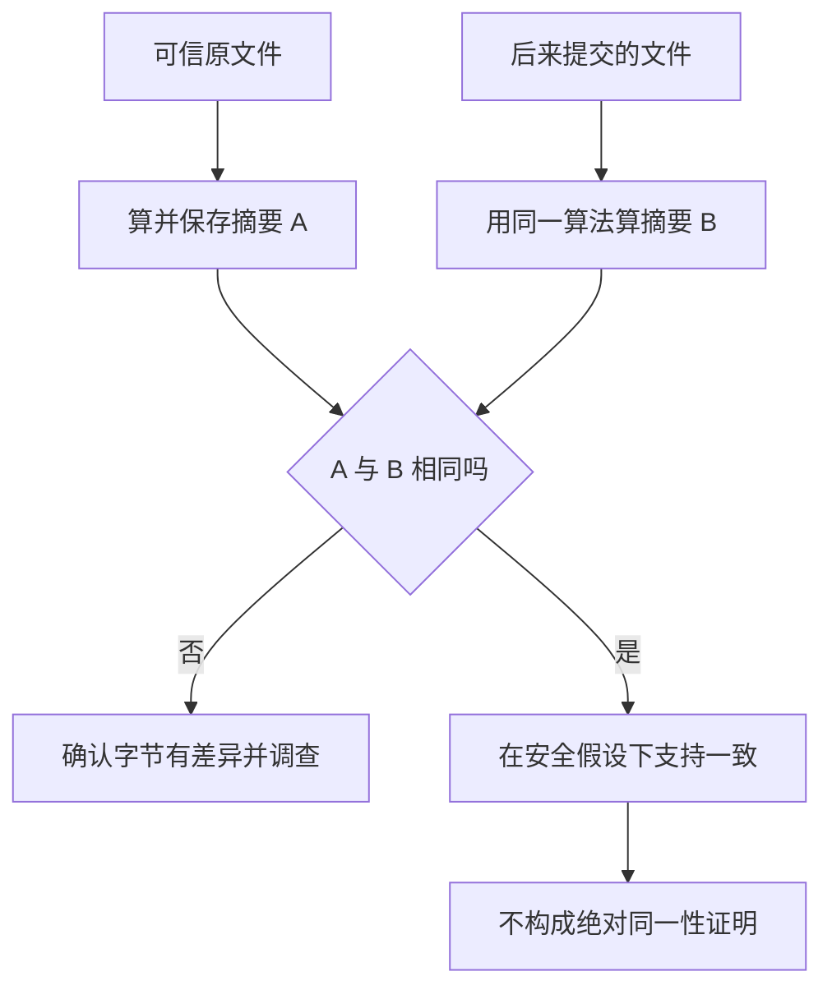
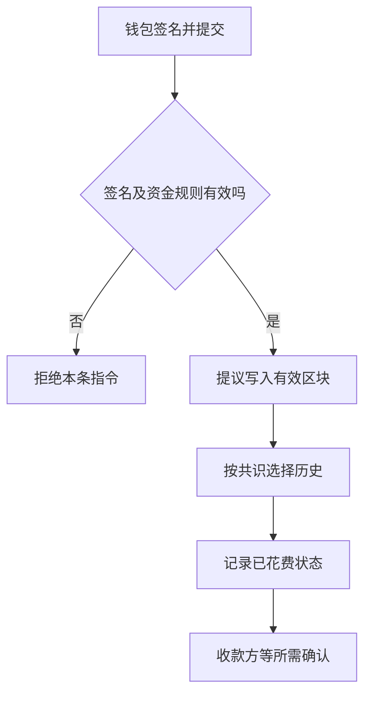
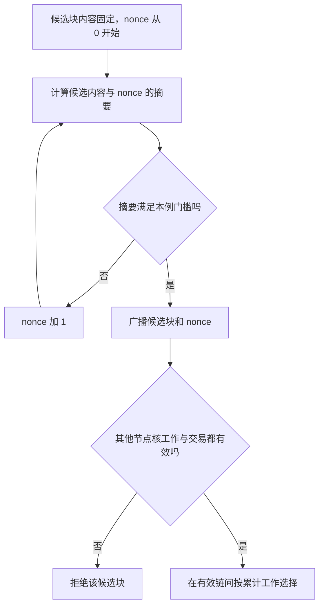
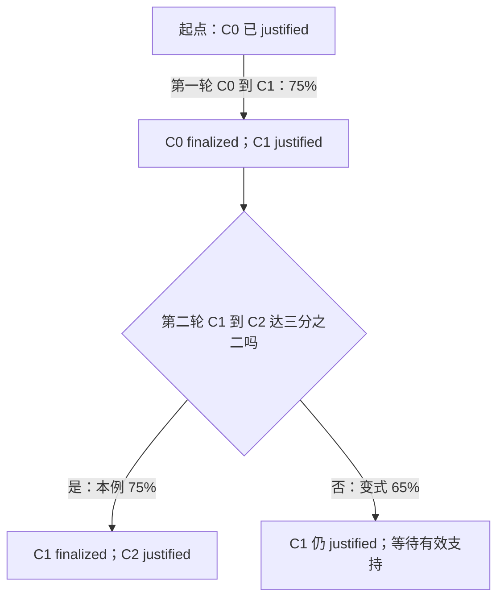
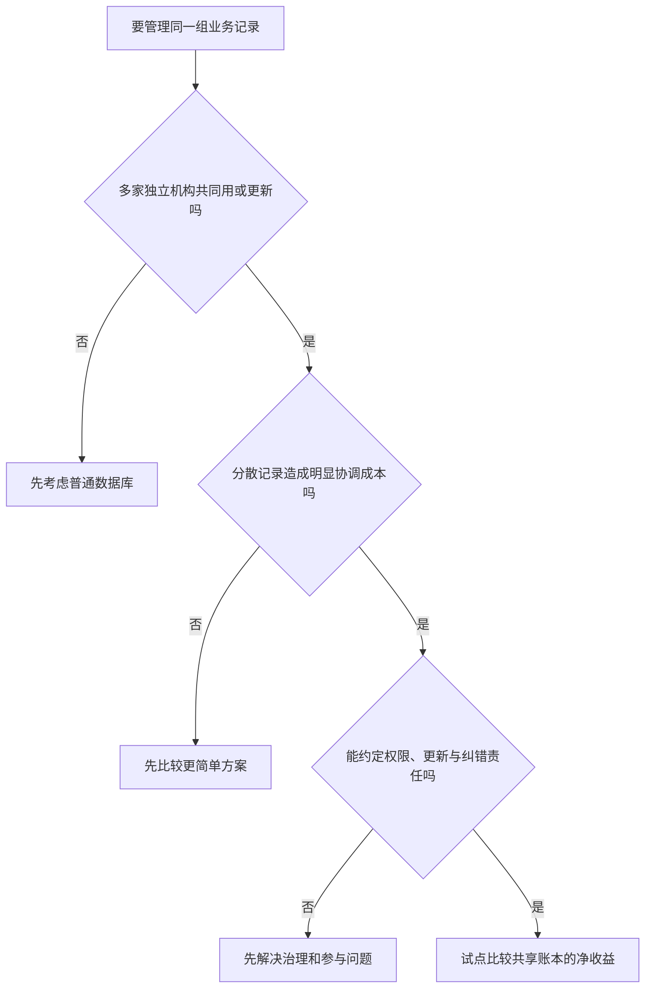
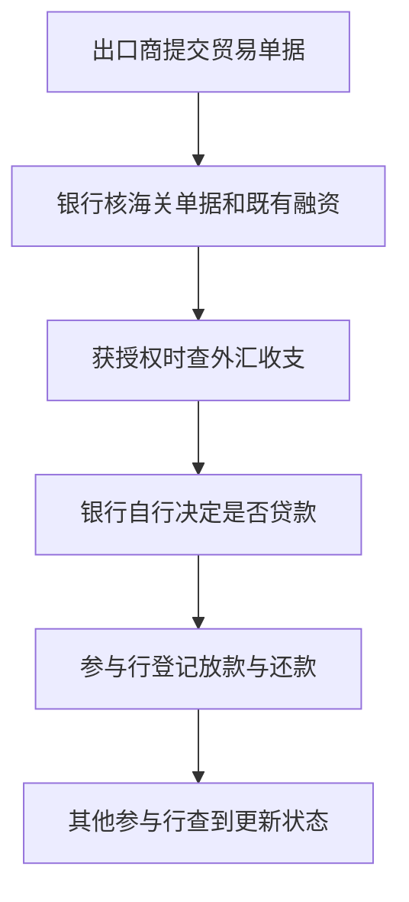
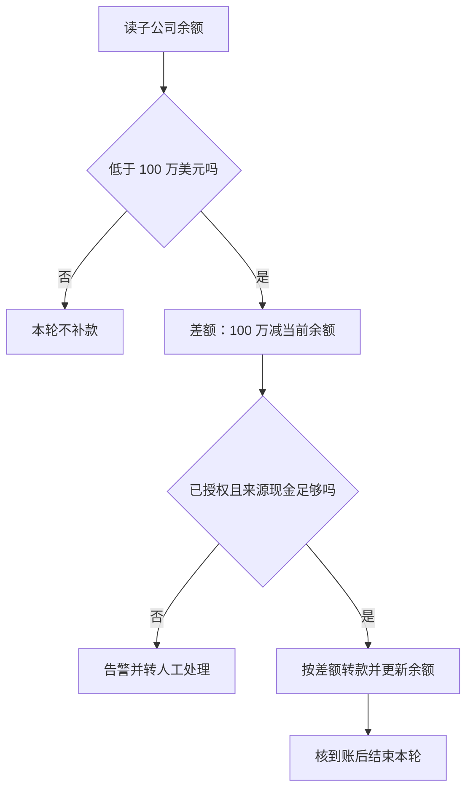
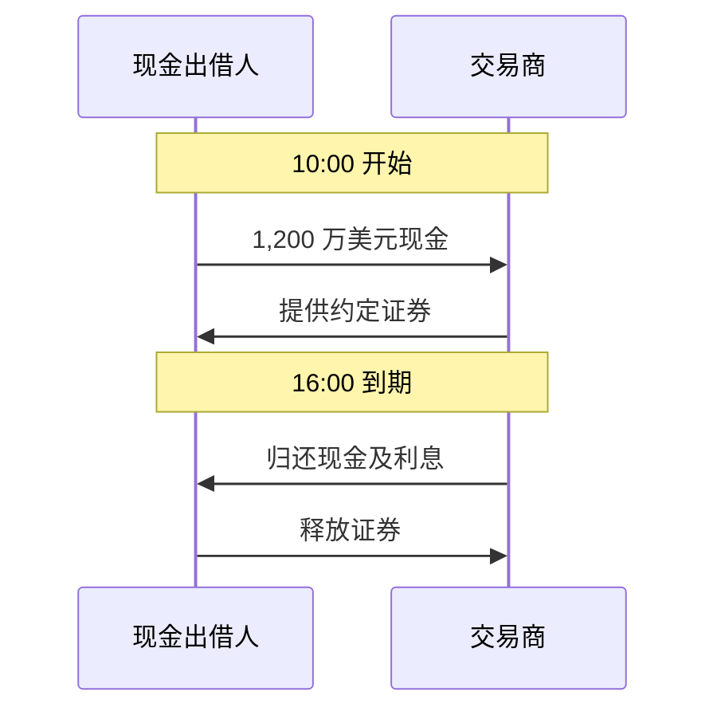
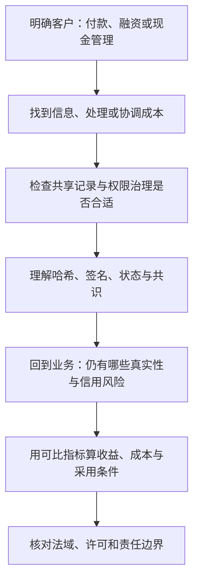

# M06 · FinTech 概览与区块链

> 本讲一句话：先找金融业务哪里费钱，再判断共享账本能改哪一步，最后用收益、成本和风险决定是否采用。
> 原始材料：Class 6，54 页。暂无本讲转录。案例数字中，“教学假设”和公司公布的规模必须分开读。

## 0. 三分钟速览

银行做的事包括收付款、借钱、管理现金。成本来自查信息、处理文件和跨机构对账。区块链可能降低其中一部分成本，但贷款坏账、错误授权和参与者不足仍会让业务失败。

学完你能：

1. 区分支付流水、平台收入和扣成本后的利润。
2. 跟踪一笔转账的签名、验资、入块和确认。
3. 说明哈希、签名与共识各自解决什么问题。
4. 复算融资额度、利息、机会成本和简单回收期。
5. 用业务证据判断共享账本是否值得采用。

如果只记三件事：文件没变不代表交易真实。技术有效不代表客户愿付钱。处理更快不代表信用风险下降。

## 1. 开始之前 · 知识衔接

### 1.1 你已经有的

前五讲关注“预测怎么变成投资决策”。本讲改问“技术怎么变成金融服务”。下表是一项旧知识及其在本讲的用途。

| 概念 | 一句话唤醒 | 回看 |
|---|---|---|
| 数据时点 | 决策只能用当时已知信息 | [[M01-金融数据与Vibe-Coding]] |
| 成本与表现 | 毛结果须扣成本才有商业意义 | [[M05-可解释机器学习与投资组合决策]] |
| LLM | 模型能提取文字，但输出还须核对 | [[M01-金融数据与Vibe-Coding]] |

“回看”给原笔记入口，读当前正文不必先跳回去。这里没有假定读者懂区块链或银行融资。

### 1.2 本讲全新概念

下面按学习问题分组。每行是同一问题的一组词，不是相互等价的词。

| 要解决的问题 | 新概念 | 展开位置 |
|---|---|---|
| 谁付钱、赚多少 | 金融科技、规模经济 | §2.1–2.5 |
| 比特币是不是钱 | 货币三职能 | §2.6 |
| 大家记哪一本账 | 账本、区块链、代币、许可网络 | §2.7–2.9 |
| 文件与指令怎样检查 | 哈希、私钥、公钥、签名 | §2.10–2.11 |
| 同一笔钱怎样只花一次 | 双花、共识、PoW、PoS、确认 | §2.12–2.14 |
| 技术能改变哪种业务 | 应收融资、回购、网络采用 | §2.17–2.25 |

位置列指本篇正文编号。“新概念”列是本讲需解释的对象，不是考试范围承诺。

### 1.3 为什么现在学 · 重排说明

前五讲解决金融预测。本讲进入后半程的公司案例分析：即使预测模型或区块链机制能运行，也要说明客户为何使用、提供方如何收钱，以及风险由谁承担。

正文大体沿讲义的“业务→机制→应用”顺序。把 p.18 的融资提问与 p.37 的完整计算互相连接，先懂业务，再学技术，最后回到额度决策。p.46 简答留在贸易融资案例旁，便于就地作答。

p.1 是课程封面。p.2、p.15、p.34 只有章节标题，分别提示商业、机制和应用三个阶段。正文相应阶段解释其用途。这四页没有额外知识或题目，§8 单独标明。其余 50 页均在 §2 实质讲解。

## 2. 正文

### 2.1 小商店为什么需要金融（讲义 p.3–5）

一家网店今天买货，过几天才卖出去。它一方面要向供应商付款，另一方面要让顾客顺利把钱付进来。技术的价值，要从这些具体动作开始找。

**是什么**

讲义定义："FinTech uses technology to improve how financial services are provided." 意思是用技术改善金融服务的提供方式。

金融服务把不同人、不同时点的钱连接起来。收款让交易完成。融资让商店先取得现金。现金管理让工资到期时有钱可付，也安排暂时不用的资金。

**为什么需要它**

银行先查商店是谁、销售能否支持还款，这花信息核查成本。处理文件、解决支付异常花操作成本。商店、支付机构和银行记录不同，还要花协调成本。（讲义 p.4）

小额业务也可能需要相近的核查步骤。因此，金额小不等于服务便宜。

**课件原例**

讲义 p.5 用同一家商店说明三种改进：经商店许可，数字销售记录辅助贷款判断。软件把到账与订单匹配。系统互传交易状态，减少重复检查。这种用技术改进金融服务的做法叫金融科技（FinTech）。

**🎙️ 课堂补充**

待转录补充。课件没有证明这些改进已在某家商店实现。

**💡 换个说法（笔记补充）**

一笔收款找不到订单，旧流程是三方打电话查账。自动匹配先把金额、订单号和到账时间对上，只把对不上的项目交给人。这改变的是处理工作量，商店是否赚钱仍须另外判断。

**⚠️ 常见误解**

- “用了软件就一定降费。”软件建设和维护也要钱。节省须大于新增成本。
- “有销售数据就能贷款。”销售收入只是还款能力的证据之一，支出和债务也会影响偿还。

**与其他概念的关系**

[[M01-金融数据与Vibe-Coding]] 强调数据能否支持判断。本讲继续追问：数据改善了哪个业务步骤，收益归客户还是服务商？

**所以呢**

先说明原流程为什么贵，才能判断下一节的公司提供了什么价值。

### 2.2 支付与融资怎么收钱（讲义 p.6）

顾客付钱和商店借钱，都涉及资金，但提供方赚收入的方式不同。分析前先确认客户买的服务是什么。

**是什么**

数字支付帮助收付和处理交易。贷款则让借款人先拿钱、以后偿还。众筹把项目与出资者连接起来。出资者收到什么，要看该项目规则。

**为什么需要它**

收费对象决定服务是否有市场。商家愿为更高的支付成功率付费。借款人可能为更快获得资金付利息。只有功能名称，无法解释这些付费动机。

**课件原例**

讲义把 Alipay 作为支付和其他服务的 App，把 Stripe 作为商家支付处理。WeBank 是面向小企业贷款的数字银行。Kickstarter 的例子是以奖励回馈创意项目出资者。这是课程案例定位，不是这些公司的完整业务清单。

课程安排：数字支付对应 Class 10；贷款与众筹对应 Class 11。

**原题：两组 Case focus**

⚪ 参考作答（笔记推断，依据讲义 p.6）。

1. 支付服务谁付费、怎样比较？先查合同中的收费对象、费率和固定费，再比较同类支付的到账速度、成功率及异常处理。不能只比 App 界面。本页未给实际费率，不能断言哪家最便宜。
2. 出资者拿什么、谁承担风险？贷款方通常获得约定本息并承担借款人不还款的信用风险。奖励型众筹支持者获得约定奖励，项目失败可能导致奖励无法兑现。具体追索与退款权利要看合同。

**🎙️ 课堂补充**

待转录补充。

**💡 换个说法（笔记补充）**

借给商店 100 元与花 100 元支持一个新产品，经济关系可能不同。前者问谁承诺还款。后者先问是否只是买一个未来奖励。换成股权众筹，出资者权利就要重新分析。

**⚠️ 常见误解**

“众筹都是贷款”会把奖励义务误当还本付息义务，进而错判收入与风险。

**与其他概念的关系**

公司案例的共同框架是客户、流程、收费、成本与风险。相关项目要求见 [[EF5560_Fintech_and_AI_in_Finance/_meta/作业与DDL|作业与 DDL]]，本节不是个人项目答案。

**所以呢**

比较商业模式时，先看付费者和承诺，再看技术。

### 2.3 投顾、风控与数字资产（讲义 p.7–8）

同样叫 FinTech，一项服务可能管理投资，也可能保护密钥。要判断风险，就得先问服务到底控制了什么。

**是什么**

机器人投顾（Robo-advice）用规则或模型辅助配置投资。网络安全检测异常活动。监管科技（RegTech）把技术用于客户核查、金融文本审阅等合规工作。

钱包管理交易所需的密钥。加密借贷以加密资产等作为抵押。稳定币是试图把价格联系到某种参照物的代币，本页举与美元挂钩的例子。

**为什么需要它**

小账户也需要服务，逐户人工咨询可能很贵。异常检测可以扩大审阅范围，但误报会增加人员工作。数字资产的所有权记录和可支配权，还依赖谁持有授权密钥。

**课件原例与逐问参考作答**

以下均为 ⚪ 参考作答（笔记推断，依据讲义 p.7–8）。公司名称仅按讲义定位，不推断其未提供的实际收费或安全结果。

1. Betterment、AQUMON：顾问费能否覆盖小账户？比较每户收费与开户、服务、合规及技术分摊成本。若每户年费 20 元而成本 30 元，即使用户增加也须找到降成本或增收入的路径。
2. Darktrace、客户核查和文本审阅：何证据支持降低损失或审阅成本？比较相似业务的人工工时、实际损失与误报处理成本。告警数增多本身不证明净收益改善。
3. Ledger、Aave：谁控制资产、谁承担损失？硬件钱包重点保护私钥，持有者仍须安全签署指令。抵押借贷还须考察抵押物跌价、清算与协议风险。本页不足以确定某次损失由谁赔付。
4. Circle 的 USDC、Tether 的 USDT：发行方怎样收入、储备能否兑付？需查储备资产收益、服务收费与负债，以及储备的价值、流动性和赎回条款。本页未给财报，无法据此确认任何发行人的偿付能力。

**🎙️ 课堂补充**

待转录补充。Classes 7–12 的标注是后续课程安排，不是本讲已完整教过所有产品机制。

课件安排：机器人投顾、网络安全与 RegTech 对应 Class 12；钱包和加密借贷对应 Classes 7–8；稳定币对应 Class 9。

**💡 换个说法（笔记补充）**

检测系统发现 100 个警报，其中 90 个误报。如果每个都要人工半小时，误报就消耗 45 小时。判断是否省钱，要把这部分算回成本。

**⚠️ 常见误解**

- “硬件钱包放着币。”账本记录资产状态，设备主要保护密钥。恢复词泄露仍可能失去控制。
- “挂钩美元就等于现金。”稳定目标和实际兑付能力是两件要分别验证的事。

**与其他概念的关系**

本讲 §2.11–2.15 解释授权与托管，§2.26 解释业务的法域边界。

**所以呢**

同一产品要同时看用户得到什么、提供方赚什么，以及故障时谁承担损失。

### 2.4 产品五层怎样一起工作（讲义 p.9）

用户只看到手机上的付款按钮，但点下去之后，还有账户、支付记录和权限规则。p.9 的图正是让人从界面往下看。

**是什么**

讲义图从上到下是客户、App 界面、金融服务、基础设施、治理与风险。金融服务层列账户、贷款和投资。基础设施层列支付与数据。底层列规则与控制。

**为什么需要它**

界面可以改善体验，却无法独自完成转账或核准贷款。基础设施负责记录和传递，规则负责谁可操作、发生错误怎么办。

**课件原例**

本页只有插图，以下按实际图中文字重画其层次。箭头表示阅读时向下追问支撑条件，不表示资金依次转给五个角色。

💡 笔记补充走图：商店在 App 申请贷款。贷款服务接收申请。数据系统提供销售与既有债务记录。权限和审核规则决定谁能访问、谁能批准。底层不满足条件，上层按钮做得再快也无法保证贷款可靠。

图的文字替代是：用户请求必须有金融服务承接，服务依赖数据和支付设施，整个过程受治理规则约束。实际产品可能双向反馈，图仅保留讲义层次。

**🎙️ 课堂补充**

待转录补充。

**💡 换个说法（笔记补充）**

把“审批成功”的界面当成钱已到账，会漏掉后台账户和实际结算状态。应追踪请求最终改变了哪条记录。

**⚠️ 常见误解**

“区块链产品”仍可能由银行、App 和人工权限共同支撑。名称没有取消任何一层。

**与其他概念的关系**

§2.15 的授权失败发生在治理与操作层，而非只在账本算法层。

**所以呢**

产品价值必须跨层判断，接着才有资格计算收入和成本。

### 2.5 流水、收入与规模经济（讲义 p.10–11）

平台每月处理 400 万美元，是否等于平台赚了 400 万美元？要先把经过平台的钱与平台能留下的收费分开。

**是什么**

支付流水是被处理的交易金额。收入是平台赚取的服务费。利润还要从收入中扣去为提供服务承担的各项成本。

**为什么需要它**

大流水可能只产生很薄的收费。固定成本若能分给更多交易，平均处理成本会下降，这叫规模经济。但新增欺诈、支持或合规费用可能抵消节省。

**课件原例：收入**

下表给 p.10 的月度教学输入。美元符号按讲义使用，本节金额为美元。

| 输入 | 数值 | 单位 |
|---|---:|---|
| 交易笔数 | 100,000 | 笔/月 |
| 每笔平均金额 | 40 | 美元/笔 |
| 按流水收费率 | 0.5% | 无量纲 |

读第一行：每月有 100,000 笔交易。输入列说明所算对象，数值列来自讲义，单位列决定相乘之后得到月度金额。

1. 流水：$100{,}000\times40=4{,}000{,}000$ 美元/月。
2. 收入：$4{,}000{,}000\times0.005=20{,}000$ 美元/月。
3. 平台每笔平均收入是 0.20 美元。处理、客服、欺诈损失和合规仍要支付。

**课件原例：平均成本**

p.11 另给每月固定成本 10,000 美元，每笔可变成本 0.05 美元。固定成本不随本例笔数变化。可变成本每增加一笔就多 0.05 美元。

要算一笔平均分摊多少成本：

$$AC=\frac{F}{N}+v$$

公式里的量按本例读，事前成本是假设值。

| 符号 | 是什么 | 单位 | 何时已知 | 本例取值 |
|---|---|---|---|---|
| $AC$ | 每笔平均成本 | 美元/笔 | 计算后 | 待算 |
| $F$ | 每月固定成本 | 美元/月 | 月初假设 | 10,000 |
| $N$ | 每月交易笔数 | 笔/月 | 月末实际 | 三种规模 |
| $v$ | 单笔可变成本 | 美元/笔 | 事前假设 | 0.05 |

先把固定成本除以笔数，再加单笔可变成本。三根柱子的数值可复算为：

| 月笔数 | 固定成本/笔 | 可变成本/笔 | 平均成本/笔 |
|---:|---:|---:|---:|
| 10,000 | 1.00 | 0.05 | 1.05 |
| 50,000 | 0.20 | 0.05 | 0.25 |
| 100,000 | 0.10 | 0.05 | 0.15 |

后三列均为美元/笔。读第一行：1 万笔分摊每笔 1 美元固定成本，再加 0.05 美元，合计 1.05 美元。

![[EF5560_Fintech_and_AI_in_Finance/notes/figures/m06/average-cost.svg]]

图源：`figures/m06/calculate.py`，根据讲义 p.11 假设重算。

在 p.11 图上，横轴是月笔数，纵轴是美元/笔。10k 到 100k 的柱高从 1.05 降至 0.15。减少的是固定成本分摊。笔数为零时不能除，固定支出仍可能发生。

💡 笔记补充：若把两页假设合在一起，10 万笔收入 20,000 美元，所列处理成本 15,000 美元，差额 5,000 美元。它只是扣这两类成本后的差额，不能当完整净利润。

**🎙️ 课堂补充**

待转录补充。

**💡 换个说法（笔记补充）**

若每笔收入 0.20 美元而可变成本升至 0.22 美元，每多一笔都亏 0.02 美元。扩大规模无法补救这条边际亏损，必须调整价格或成本。

**⚠️ 常见误解**

- “流水是收入。”400 万是客户支付金额。平台收费仅为 2 万。
- “平均成本下降就一定盈利。”仍须比较单笔收入，并计入未列费用。

**与其他概念的关系**

§2.24 的分布式账本回购（DLR）采用决策也要比较投入与节省，而非只看成交量。

**所以呢**

商业分析从可复算的单位经济开始，下一步才讨论被支付的东西算不算货币。

### 2.6 比特币的货币功能（讲义 p.12–14）

商店愿意收比特币，是否就足以证明它与日常货币一样好用？要分开检查付款、标价和保存购买力三个问题。

**是什么**

交易媒介（Medium of exchange）是人们愿意接受它来付款。记账单位（Unit of account）是价格与债务用它表示。价值储藏（Store of value）是把购买力带到将来。

**为什么需要它**

三种功能可能表现不同。一个东西能被少数商家收取，不代表工资、债务和商品价格都以它报价。稀缺也不保证短期购买力稳定。

**课件原例与 p.12 原题**

问题是“Bitcoin 哪些货币功能表现较好？”✅ 讲义 p.14 给判断方向：支付功能部分成立。价值储藏有争议。记账单位尚不普遍。这里概括的是本课材料，不是对所有地区逐户调查。

1. 交易媒介：一些线上与跨境场景接受，但日常普及有限。
2. 价值储藏：支持者强调 2,100 万枚上限带来的稀缺。反方强调价格大幅波动。稀缺是供应规则，购买力还受需求影响。
3. 记账单位：多数价格仍用美元等法币表达。若商店先标 100 美元，再临时换成 BTC 收款，美元仍承担标价功能。

**课件历史例**

BTC 是 Bitcoin 的交易代码。p.13 写 Satoshi Nakamoto 发布设计和开源软件，并向 Hal Finney 发送 10 BTC 测试转账。Finney 于 2009-01-12 接收，独立运行软件、报错并协助改进。意义是规则可被另一人独立核验，不再只听发布者口头承诺。

本页人物画像注明为 AI 编辑插图。Satoshi 的形象是匿名表示，不能当作真实肖像或身份材料。

**🎙️ 课堂补充**

待转录补充。

**💡 换个说法（笔记补充）**

今天一枚代币能买两袋米，明天只能买一袋。即使总量固定，持有者短期保存购买力的需求仍未必满足。

**⚠️ 常见误解**

经济学上的“能执行某种货币功能”与法律上的法偿地位不同。两地政策另见 §2.26。

**与其他概念的关系**

后文讨论的银行存款账本也可以用区块链。采用技术与使用哪种货币必须分开。

**所以呢**

比特币提供了共享验证的案例，但区块链的适用对象远不止公开交易的币。

### 2.7 账本、区块链与代币（讲义 p.16）

两家银行都要知道同一张发票是否已融资。关键任务是共享可靠记录，并不必然要发行一种可炒卖的币。

**是什么**

讲义原句："A ledger records balances, ownership, or obligations." 即账本记录余额、所有权或债务。

账本（Ledger）记录余额、所有权或债务。区块链（Blockchain）把一批批记录链接起来，按共同规则维护共享历史。代币（Token）是账本上记录的数字单位。

**为什么需要它**

传统银行也有账本。区块链特别关心多方如何更新同一历史、如何检查修改、出现冲突时承认哪份记录。代币只是可能记录的对象之一。

**课件原例**

讲义明确举共享发票账本：银行可以共同登记融资状态，而无须有公开交易的代币。

💡 笔记补充：借用 p.42 的编号 EX-204 和 p.37 的 60 万元，组合成“该发票已借出 60 万元”的示例。这是跨页组合，非 p.16 原例。

**🎙️ 课堂补充**

待转录补充。

**💡 换个说法（笔记补充）**

一家公司的内部数据库与多家银行共享账本都能存 EX-204。区别不能只看能否存记录，而要看谁维护、谁能改、其他参与者怎样核验。

**⚠️ 常见误解**

“有区块链就要买币”把记录技术与记录对象混在一起。账本保存的也可能是单据摘要和状态。

**与其他概念的关系**

§2.10 的哈希检查内容变化，§2.13 的共识处理共享历史选择。两者是不同功能。

**所以呢**

先看账本要记录什么，再问哪些人需要共同使用它。

### 2.8 出口商为什么先借钱（讲义 p.17–18）

出口商今天发货，买家 60 天后才付款。供应商和工人却可能现在就要钱。销售已经形成，但现金尚未到账。

**是什么**

应收账款（Receivable）是买家尚欠卖家的货款。营运资金缺口是日常经营需要付款时，现金回收尚未跟上的缺口。应收账款融资让银行依据这笔待收款先提供现金。

**为什么需要它**

出口商可先付经营支出，银行以后依靠买家付款等偿还来源收回贷款。银行仍要核实货物、单据、融资记录和还款风险。

**课件原例与 p.18 原题**

同一笔 100 万元人民币应收款，银行 A 已贷 60 万元。出口商又向 B 申请 60 万元。题面假定合计融资不能超过应收款的 80%。

⚪ 参考作答（笔记推断）：B 需要知道它是不是同一笔应收款、A 及其他银行已有多少未偿融资，以及记录是否完整及时。还要核单据真实性和能否还款。按题面上限只剩 20 万元，计算在 §2.17 展开。

即使查到 A 的记录，也须确认其他融资是否均有报送。共享账本只能展示已可靠写入的范围。

下面追踪讲义 p.17 的三个时点。箭头表示业务时间顺序。资金来自银行，不是账本自己产生。

走图用讲义的 60 天：发货后形成未来收款权。银行提前给现金。买家付款才提供回收资金。若交货争议使买家拖欠，流程会停在收款前，不能把最后一步视为必然发生。

文字替代：贷款桥接了“现在付钱”和“以后收钱”，没有消除未来不付款的可能。

**🎙️ 课堂补充**

待转录补充。

**💡 换个说法（笔记补充）**

你已赚到一笔工资但下月才到账，今天仍可能缺钱交租。拥有未来收款权和现在持有现金是两种状态。

**⚠️ 常见误解**

“有发票就能收钱”忽略了虚假交易、交付争议和买家偿付能力。

**与其他概念的关系**

§2.17 回到 SAFE 平台怎样让银行看见既有融资。§2.16 先解释技术记录与业务事实的差别。

**所以呢**

银行需要共享的是核验与融资状态，而不是一张永不变化却不完整的图片。

### 2.9 谁可以读写（讲义 p.19）

公开比特币网络与银行间贸易账本的参与要求不同。银行未必愿把客户贸易记录公开给所有人。

**是什么**

公有网络（Public network）按协议规则开放参与。许可网络（Permissioned network）由获批机构参与，可以限制记录访问，由明确运营者与成员治理。

**为什么需要它**

不同场景对开放核验、隐私和纠错责任的要求不同。选择网络时，读权限、写权限和治理权限都要分别问。

**课件原例**

讲义以 Bitcoin 对照银行联盟。下表每行是一项权限问题，文字来自 p.19 的分类。

| 问题 | 公有网络 | 许可网络 |
|---|---|---|
| 谁参与 | 按协议开放 | 经批准的机构 |
| 谁看记录 | 通常公开可查 | 可限制访问 |
| 谁定治理 | 协议社群 | 指定运营者与成员 |

读第一行：开放参与仍须满足协议规则。三列分别给判断维度及两类典型安排，没有数量单位。具体网络须另查实际权限。

**🎙️ 课堂补充**

待转录补充。

**💡 换个说法（笔记补充）**

银行 A 可以被允许登记放贷，但普通查看者只能看匿名汇总。“获准加入”和“能看全部数据”不必是同一权限。

**⚠️ 常见误解**

“许可”不自动代表安全或高效。成员仍可能误录，管理员仍可能配置错误，责任仍须约定。

**与其他概念的关系**

§2.15 将把“批准人数多”与“权限真正独立”分开。

**所以呢**

网络类型决定谁可操作。接下来还要检查操作的内容有没有变。

### 2.10 哈希怎样发现改动（讲义 p.20）

原发票是 10,000 美元，后来有人拿来一张写着 90,000 美元的文件。银行怎样判断它与原来保存的版本不同？

**是什么**

哈希（Hash）把输入字节按固定算法变成固定长度的摘要，像文件指纹。相同字节用同一算法得到相同摘要。内容改变通常会产生不同摘要。

不同输入也可能得到同一摘要，这叫碰撞（Collision）。因此，“相同输入必得相同摘要”不能倒过来写成“摘要相同就绝对是同一文件”。

**为什么需要它**

比较摘要能帮助发现文件与可信基线不一致。摘要不同就能判定输入字节不同；摘要相同则是在算法安全性等条件下，支持内容一致的证据。它也不验证最初的发票是真是假。

**先用一个玩具规则看碰撞（笔记补充）**

假设输入只能是整数，规则是“除以 4 后，留下余数”。再把余数写成两位二进制，输出就只有 00、01、10、11 四种。

下表一行是一次映射。输入列是原整数；余数列是除以 4 后未整除的部分；摘要列是余数的两位二进制写法，均无金额单位。

| 输入整数 | 除以 4 的余数 | 玩具摘要 |
|---:|---:|---|
| 0 | 0 | 00 |
| 1 | 1 | 01 |
| 2 | 2 | 10 |
| 3 | 3 | 11 |
| 4 | 0 | 00 |

读最后一行：4 除以 4 没有余数，所以摘要为 00。输入 0 和输入 4 明明不同，却共用摘要 00，这就是一次碰撞。

1. 先数可能输出：只有四种两位摘要。
2. 再放入五个不同输入：0、1、2、3、4。
3. 五个输入分到四种输出，至少两个输入会共用一个输出。
4. 本例能直接找到 0 和 4，说明这条玩具规则很容易碰撞，不适合保护文件。

真实 SHA-256 的输出有 256 个二进制位，可能摘要数量为 $2^{256}$，仍然有限。可输入的文件种类远多于这个有限集合，所以碰撞在数学上存在。

密码学要求的抗碰撞性是：主动找出一对不同输入，使摘要相同，在计算上应当不可行。它要求“难以找出”，并没有把理论上存在的碰撞消除。上述余数例只是解释多对一映射，绝不是找到了 SHA-256 碰撞。

🔗 定义依据：[NIST 碰撞词条](https://csrc.nist.gov/glossary/term/collision)、[NIST 抗碰撞性词条](https://csrc.nist.gov/glossary/term/collision_resistance)（获取日期：2026-10-15）。

**课件原例**

p.20 是四格图：供应商交原票 10,000 美元。银行保存原版本 Hash A。有人改成 90,000 美元得到 Hash B。A 与 B 不同，系统触发不匹配。

下面沿用原图的核验过程，并明确相同出口的证据边界。箭头表示检查步骤，A、B 是摘要标签。

按原图走：10,000 的版本先登记，90,000 的版本后核验，进入“不相同”出口。如果最初登记的就是伪造 90,000 发票，即使后来摘要相同，也没有证明贸易真实。

图的文字替代是：先有可信摘要，再重算比较。不同能发现字节变化；相同提供有条件的一致性证据。基线不可信、算法不一致或比较对象错误，都会影响结果。

**可复做的完整小例（笔记补充）**

上轮复算脚本用 SHA-256 分别处理 `Invoice amount USD 10000` 和 `Invoice amount USD 90000`，输出摘要不同。USD 表示美元；UTF-8 是把文字编码为字节的规则。

再次对第一串相同字节计算，摘要相同，验证的是确定性。本轮 `clarity-calculate.py` 另核上表的玩具映射与碰撞；两类实验没有混用。空格或编码也会改变字节，实际业务须明确比较对象。

**🎙️ 课堂补充**

待转录补充。碰撞映射和证据边界是笔记补充，不冒充讲义上的计算或课堂原话。

**💡 换个说法（笔记补充）**

四个抽屉装五件东西，至少两件会在同一格。抽屉号相同不代表物品相同。但密码学还要求不能轻易主动找到两份文件共用一个摘要，这比普通分抽屉困难得多。

**⚠️ 常见误解**

- “抗碰撞就是完全没有碰撞。”固定长度输出无法为所有可能文件都分配唯一编号；安全要求关注寻找碰撞的计算难度。
- “哈希相同绝对证明文件相同。”碰撞可能存在；实际核验还依赖可信基线、算法和正确实现。
- “哈希就是加密文件。”摘要通常不可逆，不能靠摘要恢复整张发票。
- “攻击者改不了哈希。”任何人都能对新内容重算摘要；让其他人接受重写历史还须满足共识规则。

**与其他概念的关系**

签名增加授权检查，哈希链接增加历史关联，共识决定承认哪条有效历史。三步各有职责。

**所以呢**

哈希提供有条件的完整性证据，还须继续核授权与业务事实。

### 2.11 私钥、公钥与签名（讲义 p.21–22）

Alice 同意付 Bob 1 枚代币。别人把指令改成 10 枚后，Bob 应怎样发现授权内容已经不同？

**是什么**

私钥（Private key）是签署授权的秘密材料，应由持有者保护。公钥（Public key）让别人验证对应签名，而无须知道私钥。数字签名（Digital signature）把特定指令与一把密钥联系起来。

**为什么需要它**

付款系统需要同时检查：这条指令得到相应密钥授权吗？传来的内容还是签署时那份吗？实际签名算法完成这些检查，而不要求把私钥交给收款方。

**课件原例：无代码签名练习**

讲义 p.22 的全过程如下，数字 1 和 10 是不同的付款金额。

1. 原消息 A 是 Alice 支付 Bob 1 token。Alice 用私钥签署这份消息的摘要。
2. Bob 用 Alice 对应公钥、消息 A 和签名验证，原授权可以通过。
3. 若改成消息 B：支付 10 tokens，摘要改变。把旧签名配给新消息，验证失败。
4. 即使原消息签名有效，网络仍要另外检查 Alice 是否有可花的资金。

这里只追踪签名的输入输出，没有伪造课件未提供的签名字节。签署输入是具体消息与私钥。验证输入是消息、公钥和签名，输出是通过或失败。

**🎙️ 课堂补充**

待转录补充。

**💡 换个说法（笔记补充）**

一份真实签过名的支票，账户也可能没钱。签名检查解决授权与消息完整性，余额检查解决能否支付。

**⚠️ 常见误解**

- “签名有效就证明是 Alice 本人在合法操作。”密钥可能被盗，法律身份和公司内部授权须另核。
- “公钥能签出交易。”验证功能不等于掌握私钥。安全性依赖算法和密钥管理。

**与其他概念的关系**

§2.15 的授权事故说明：系统可以正确执行一个被诱骗签出的危险指令。

**所以呢**

授权检查通过后，还必须解决余额与先后顺序。

### 2.12 转账与双花（讲义 p.23、p.25）

Alice 只有同一笔 1 BTC，却分别给 Bob 和 Carol 各发一条付款指令。两条指令都可能带有效签名。

**是什么**

双花（Double spending）是试图把同一份可用资金花两次。共享账本必须承认至多一次有效花费，而不能让不同收款人各自看到一份都算成功的账。

**为什么需要它**

数字消息能复制。签名能证明每条消息得到同一密钥授权，却不能让这把密钥只签一次。因此要检查账本状态并决定有效顺序。

**课件原例**

p.23 的主线是提交、检查和纳入、确认。p.25 把“可用资金”具体化为同一笔 1 BTC，而非账户里还有别的币。下面用教学简化的“未花费资金”状态走完整流程。

箭头表示控制与状态推进。签名或资金无效就结束本条检查。进入候选区块仍未等于商家已经按自己的政策接受结算。

1. 初始状态：资金 X 价值 1 BTC，尚未花费。
2. 候选记录先纳入 X→Bob。节点检查 X 可用，更新为已花费。
3. 再检查 X→Carol 时，X 已使用，拒绝这条冲突花费。
4. 若两条指令先在不同候选分支出现，须由共识选择有效历史。不把两分支合起来让 X 花两次。
5. Bob 按业务政策等确认，才把订单视为已付。

文字替代：先核权限与资金，再对历史达成一致，最后按接受的历史更新可花状态。具体比特币还包含找零和手续费，本例为隔离“双花”难点而省略。

**🎙️ 课堂补充**

待转录补充。

**💡 换个说法（笔记补充）**

若 Alice 实际有两笔独立的 1 BTC，分别支付两人可以都成立。关键是花的是否为同一笔资金，而不是“同一天付了两次”。

**⚠️ 常见误解**

“先收到消息的人一定获胜”不成立。消息到达时间在不同节点不一致，须按协议认可的历史判断。

**与其他概念的关系**

下一节解释区块怎样关联，以及共识怎样把候选历史变成可共同承认的记录。

**所以呢**

数字货币需要共同状态与排序，只有签名并不足够。

### 2.13 区块链接、共识与激励（讲义 p.24、p.26）

改一笔旧记录并重新计算哈希并不难。真正的问题是：怎样让其他节点接受这份新历史？

**是什么**

讲义原句："Consensus is how a network selects one valid transaction history." 即网络选择一条有效交易历史的方式。

区块把多笔记录打包，并保存前一区块哈希的引用。共识（Consensus）规定网络怎样选择一条有效交易历史。工作量证明（PoW）与权益证明（PoS）是不同的共识机制安排。

**为什么需要它**

哈希链接让前后记录关联，但本地攻击者可以重算自己的链接。系统抵抗历史重写，还依赖有效性核验、历史选择规则及制造替代历史的经济成本。

**课件原例：先读清箭头**

p.24 展示 Block 100、101、102。101 引用 100，102 引用 101。因此图的引用方向指向旧区块，不能误读为新记录存在旧区块里。

下面箭头明确标“引用”，从新块指向旧块。内容是结构关系，不是付款流向。

💡 笔记补充走图：改变 100 的交易，100 的哈希改变，101 留下的旧引用不再匹配。重建 101 又改变其哈希，102 也须处理。重新连接只是构造候选版本，还要符合下列共识要求。

**两种资源与规则**

讲义 p.26 将 Bitcoin 的 PoW 与 Ethereum 的 PoS 对照。下表每行是一项机制区别，没有可直接相加的数值。

| 维度 | Bitcoin：PoW | Ethereum：PoS |
|---|---|---|
| 投入资源 | 计算设备与电力 | 质押的 ETH |
| 产块参与者 | 矿工提议区块 | 验证者提议和检查 |
| 经济约束 | 奖励与挖矿成本 | 奖励与质押处罚 |

读第一行：PoW 消耗计算资源，PoS 使承诺资本承担协议处罚风险。其余节点仍核规则。产块权不会把无效签名变有效。

💡 原理补充：在 Bitcoin 中，节点先排除违反规则的区块，再比较有效候选链的累计工作量。重写者须重做受影响的工作，并追赶仍在扩展的诚实历史。后续块越多，通常须替代的工作越多。这不是数学上的绝对不可改。

#### 2.13.1 PoW 怎样尝试并停止（讲义 p.26）

💡 笔记补充：把“做计算”展开成可复做的玩具例。固定文本包含候选区块标识、前块引用和 Alice 支付 Bob 1 的消息。另附一个可变整数 nonce，即每次尝试会改的数。

本例用一次 SHA-256，要求完整十六进制摘要以 `0` 开头。每个十六进制数字表示 4 个比特，因而这里仅要求前 4 位为零。真实 Bitcoin 使用实际区块头、双 SHA-256 与数值目标，本例不是挖矿实现。

箭头表示控制，nonce 失败就增加并重算；命中后还要由其他节点核完整交易规则。

实际脚本输出如下。行是一轮尝试；摘要只展示前 12 个字符，但判断用完整摘要。最后一列由首字符是否为 0 决定。

| nonce | 摘要开头 | 满足教学门槛 |
|---:|---|---|
| 0 | 80e4b147bf20 | 否 |
| 1 | 3b8442d76667 | 否 |
| 2 | 93c43a0f0062 | 否 |
| 3 | 0424bc2414f5 | 是 |

走图：前三轮重试；第 4 次尝试 nonce 为 3，命中并停止搜索。其他节点重算即可检查这一门槛，还须核签名、资金和前块引用。无效交易不会因哈希合格而被承认。

文字替代：改 nonce 试摘要，直到满足工作要求，再让别人核验候选块。若候选交易变化，哈希输入变化，须重新搜索。脚本最多试 10,000 次，没找到就报告本轮失败，不宣称网络已停止。

#### 2.13.2 PoS 怎样由角色推进（讲义 p.26）

一个新块刚被提议时，网络先要判断它能否接在当前历史后面。以后还要判断较早历史是否已获得足够后续支持；这两件事不能用同一个“确认”含糊带过。

PoS 不用上节的电力搜索决定产块。协议选出提议者，提议者广播候选块，其他节点执行交易与状态检查，再由验证者提交投票。无效交易先拒绝，不能用票数补救。

**先把投票中的两个位置说清楚**

Ethereum 把时间分为一段段 epoch，即协议规定的阶段。每个阶段的边界对应链上一个检查点（Checkpoint）；这里把连续三个标为 C0、C1、C2。它们是历史中的阶段位置，绝不是三个人。

验证者的最终性投票连接两个检查点。旧位置叫 source，新位置叫 target。投 C0→C1，意思是支持“从已获认可的 C0，接到其后这个 C1”的历史关系，并非把钱从 C0 转给 C1。

本例中，source 在该轮开始前已是 justified。target 是正在争取足够支持的较新检查点。不同轮次的 source、target 会换：下一轮可以投 C1→C2。

**两个状态分别表示什么**

- justified：目标检查点已通过从合适 source 出发的足够票权支持。中文在这里读作“已获证明”，尚不等于已最终确定。
- finalized：较早、已获证明的检查点，又被满足要求的后续检查点关系巩固。中文读作“已最终确定”，是协议更强的历史承诺。

两种状态都以区块和交易有效为前提。最终性也不等于价格稳定、贸易真实或在任何攻击条件下绝对无法改变。

**用同一批票权走两轮（笔记补充）**

假设总有效质押权重为 100 单位。A、B、C 是权重为 40、35、25 的三组验证者，不是实际只有三名验证者。每轮都对当轮同一对检查点计算支持权重，不能跨不同关系凑票。

本例只画无缺失、相邻 epoch 检查点连续推进的正常路径，所有块、签名和投票均有效。开始时 C0 已 justified；C1、C2 还没获证明。更早使 C0 获证明的历史不在本例范围。

1. 第一轮投 C0→C1。仅 A 支持时是 40%，不足总票权三分之二，C1 还不能变 justified。
2. B 也支持同一关系后，合计 75%。按本例相邻检查点路径，C1 变 justified，C0 变 finalized。
3. 注意刚得到 75% 支持的是“以 C1 为 target 的关系”。C1 此时只完成第一阶段，仍未 finalized。
4. 第二轮改投 C1→C2。此时 C1 已 justified，才可作为本例新的 source。
5. A、B 再对 C1→C2 给出有效支持，合计 75%。C2 变 justified，较早的 C1 才变 finalized。

下面每行记录一轮正常路径完成后的状态。支持比例是同意该行 source→target 关系的权重除以总权重 100。

| 轮次 | 投票关系 | 支持比例 | 较旧检查点 | 较新检查点 |
|---|---|---:|---|---|
| 第一轮后 | C0→C1 | 75% | C0 finalized | C1 justified |
| 第二轮后 | C1→C2 | 75% | C1 finalized | C2 justified |

读第一行：A 和 B 合计 75 单位，同意从 C0 接到 C1。较新 C1 获证明，较旧 C0 最终确定。第二行把对象往后移动一格；不是把第一轮的票再用一次。

图要回答“C1 何时才最终确定”。箭头代表时间和投票完成后的状态变化，不是资金流；第一条边已假定第一轮满足条件，第二轮再画达标分支。

沿正常路径走：C0 已获证明，第一轮让 C1 获证明，第二轮才让 C1 最终确定。若第二轮只有 A 与 C 支持，40 加 25 得 65%，走等待分支；C1 不能仅靠第一轮就变 finalized。

文字替代：新 target 先获证明；在本例后续相邻关系达标后，它作为较旧 source 获最终确定。一个阶段有足够票权，不意味着所有新块都立即完成这两步。

**为什么还要区分当前链头**

链头是节点当前用来接新块的末端。分支选择（Fork choice）决定当前沿哪条有效分支继续；最终性则给较早检查点更强的承诺。网络可能仍在出块、选择当前链头，但新检查点因票权不足而暂未最终确定。

🔗 [Ethereum 官方 PoS：Finality 与 Fork choice](https://ethereum.org/en/developers/docs/consensus-mechanisms/pos/)、[官方 Gasper：What is finality](https://ethereum.org/en/developers/docs/consensus-mechanisms/pos/gasper/)（获取日期：2026-10-15）。上述两轮是官方相邻检查点正常路径的教学化，不是覆盖缺失 epoch、冲突投票及所有实现条件的完整状态机。

PoW 算力集中会削弱抵抗历史重写的能力；PoS 有效票权不足可能阻止最终性推进。等待本身不能保证解决这些结构问题。

🔗 机制补充依据：[Bitcoin 白皮书 §4–6](https://bitcoin.org/bitcoin.pdf)、[Ethereum 官方 PoS 与 PoW 对照](https://ethereum.org/en/developers/docs/consensus-mechanisms/pos/pos-vs-pow/)（获取日期：2026-10-15）。

**🎙️ 课堂补充**

待转录补充。

**💡 换个说法（笔记补充）**

把一本账的每页编号重新编排很容易。让所有独立核验者接受你重写的账，还得满足他们的共同规则并承担资源成本。

**⚠️ 常见误解**

- “区块链无法改动。”应说有效历史重写受规则和成本约束，安全性依赖参与结构与攻击条件。
- “多数人说有钱就能绕过签名。”历史选择仍以交易有效为前提。

**与其他概念的关系**

哈希解决链接的可检查性，共识解决共同选择。§2.14 解释收款人为何还要等后续确认。

**所以呢**

防重写来自密码学、共同核验和经济约束的组合，不能只归功于哈希。

### 2.14 为什么还要等待确认（讲义 p.27）

付款刚进一个区块，商家为什么不立刻发出很贵的货？因为短时的候选历史可能发生替换。

**是什么**

确认（Confirmation）表示付款已被纳入接受的区块，并有后续有效块接续。重组风险是网络改为接受另一条有效历史，导致原来那笔付款的位置或状态改变。

**为什么需要它**

在 Bitcoin 的工作量规则下，后续块增加替换旧历史所需的工作。商家可按金额与可承受损失决定等待策略。本页没规定通用的固定确认数。

**课件原例**

p.27 从“付款入块”到“另一个有效块”再到“更多块”。箭头是历史推进，不是每个块都在重新付款。大额交易可能等待更久。

💡 笔记补充走例：Bob 看见付款在块 100，随后接受 101、102，则付款获得更多后续支撑。若 100 被包含冲突交易的替代历史取代，Bob 必须重查付款。等待的目的就是降低此类风险。

**🎙️ 课堂补充**

待转录补充。

**💡 换个说法（笔记补充）**

等待更多确认期间，BTC 对美元价格仍可能下跌。历史更难替换与资产价格稳定是两个不同结果。

**⚠️ 常见误解**

更多确认不解决托管方失窃、币价变化或错误收款地址。不存在本讲证实的“等够次数就完全无风险”。

**与其他概念的关系**

§2.12 的流程在此进入业务接受阶段。§2.15 接着看即使链规则正常，授权环节怎样失败。

**所以呢**

技术确认需要配合业务风险政策，接下来检查人和权限。

### 2.15 授权为何仍会失败（讲义 p.28–29）

系统要求两个人批准转账，能否阻止一个人盗走资产？如果两人的账户都被同一个管理员密码控制，批准人数就掩盖了共同故障点。

**是什么**

托管（Custody）关注谁掌握资产的实际支配能力，以及怎样保管和使用密钥。访问控制规定谁可审批、谁可变更权限。两项权限都影响资产安全。

**为什么需要它**

签名验证程序可以完全正常，却执行被盗密钥签出的付款，或员工被骗批准的危险变更。技术上有效的授权不代表业务上应当批准。

**课件原例**

p.28 列 Bybit 2025-02 事件，估算损失 14.6 亿美元：欺骗界面诱使员工批准改变钱包控制的操作。控制教训是独立核查本次批准究竟授权了什么。

同页列 Ronin Bridge 2022-03 事件，约 6.2 亿美元：攻击者控制九把授权密钥中的五把，达到批准提现门槛。控制教训是批准凭据及控制权要有实质独立性。

这些是讲义所引历史事件的当日估值，不是本次重新计算的币价损失，也不表示区块链所有机制被攻破。未在本讲复原完整攻击取证链。

**原题 p.29：选哪项改善控制？**

⚪ 参考作答（笔记推断）：选 B，分离批准凭据，并限制谁可改变访问权限。

1. 先找危险路径：一个管理员密码可影响两人的批准账户。
2. 再找直接切断路径的措施：分别保护凭据，同时约束权限变更，减少单点控制。
3. 检查其他选项：A 增加共享管理员的批准人仍保留同一故障点。C 降手续费不阻断盗用。D 月报只能事后发现，无法直接预防本次转账。

若改条件为“两把独立密钥已安全，但批准界面被篡改”，仅分离密钥还不够，须独立确认收款地址、金额和授权操作内容。这对应 Bybit 的教训。

**🎙️ 课堂补充**

待转录补充。没有课堂或官方答案确认，B 的地位是有讲义依据的参考作答。

**💡 换个说法（笔记补充）**

两把锁若共用一把万能钥匙，增加锁的数量不能消除万能钥匙失窃的风险。对应到业务，独立性还包括管理员、恢复路径和权限变更控制。

**⚠️ 常见误解**

“多签一定安全”忽略共同管理员或共同恢复凭据。诊断时要找一人能否改变多个批准者，而不仅数签名个数。

**与其他概念的关系**

§2.11 讲的是密钥层授权，本节再加公司内部授权与操作内容核查。

**所以呢**

资产安全既依赖链上规则，也依赖人如何保管密钥和理解批准内容。

### 2.16 何时该用共享账本（讲义 p.30–33）

银行看到一张“未被修改”的发票，仍可能面对从未发过货的公司。如何避免把记录的可靠性误当作业务真实？

**是什么**

共享记录能支持“某文件未变”“某密钥签过”“某贷款已登记”。货物是否真的发出、员工是否有公司授权、借款人是否能还钱，都需要链外业务证据。

**为什么需要它**

多家独立机构各自维护同一事实，记录不一致会导致反复核对。若它们能约定访问、更新和纠错责任，共享账本才可能节省协调工作。

**课件原例与判断顺序**

p.31 的适用条件可按下列顺序使用。此图是笔记对讲义条件的操作化整理，箭头表示选择，非官方技术采购规则。

走图用银行间付款：多家银行使用同一组记录。旧记录不一致导致员工查差异。若大家能约定写入与纠错，就进入试点。若只有一家可信机构掌握全流程，第一处分支就转向普通数据库。

文字替代：多方、有真实协调成本且能共同治理，才是值得比较的候选。进入试点还不等于采用成功。

**原题 p.32：出口融资检查**

⚪ 参考作答（笔记推断）：选 D，验证贸易单据，并检查应收款已关联的融资。

- A 只核文件未变，不能证明交易存在，也会漏掉重复融资。
- B 平台用户数表示规模，不能代表某个出口商的信用。
- C 同一软件提供一致处理方式，无法保证输入事实真实。
- D 同时覆盖业务真实性与既有融资，最切合放贷前的风险。

改条件：若单据真实但买家濒临破产，D 仍不是足够的完整放贷审查，还要评估偿付能力。

**原题 p.33：美国银行共享付款账本**

⚪ 参考作答（笔记推断）：选 C，减少比较不一致记录及解决差异的人工时间。题面明确合同与资金安排不变，因此预期改善发生在协调成本。

- A 付款义务仍在，不会因记账一致而自动减少资金需求。
- B 没有新风险转移合同，不能推断平台承担违约损失。
- D 记录方式不自动改变客户资金的法律属性或保险资格。

换成“新增了融资净额结算安排”的题面，资金需求可能另受影响。本题没有这个条件，不能自行补上。

**🎙️ 课堂补充**

待转录补充。

**💡 换个说法（笔记补充）**

大家看同一份快递记录，可以少争论“现在送到哪”。但如果快递员误扫签收，记录一致仍无法保证货物真的在收件人手中。

**⚠️ 常见误解**

“链上真实”必须拆成版本、授权、事实三个问题。把它们缩为一个形容词，会把应做的核查省掉。

**与其他概念的关系**

以下中国与国际案例都沿这条判断链：改了什么记录，降低哪项成本，保留哪项风险。

**所以呢**

区块链的商业作用要落到具体流程，接下来用出口融资完整走一遍。

### 2.17 SAFE 与重复融资（讲义 p.35–37）

银行 B 担心同一笔应收款已被其他银行贷过。共享记录能让它在放款前看见既有融资，但须由参与行及时写入。

**是什么**

国家外汇管理局（SAFE）的跨境金融服务平台支持出口单据核验与既有融资查询。授信是银行决定愿意承担多少贷款风险。平台提供证据，银行仍决定是否放贷。

**为什么需要它**

若 A 与 B 只能看到自己的账，同一应收款可能被重复使用。共同记录把“已借多少、还剩多少”带进 B 的审查，提高信息可见性。

**课件原例：流程与角色**

p.35 概览的三类中国应用是贸易融资、税务发票和司法记录，本节展开第一类，后两类见 §2.19–2.20。

p.36 给出的流程如下。箭头是业务处理顺序，任何一步有疑点都应停下来核查。

💡 跨页组合走图：借 p.42 的编号 EX-204，配 p.37 的 60 万元。出口商提交单据，B 查到 A 尚有 60 万元贷款。B 检查可贷空间与还款能力，再决定是否放款。放款和以后还款都要更新。若 A 漏报，第 B 步查不到并不证明不存在。

文字替代：平台汇集核验和融资状态，授信判断留在银行。🔗 [SAFE 天津 2025 年便民手册](https://www.safe.gov.cn/tianjin/file/file/20250930/95d330ecc47043c590d4ad4b55eae1a4.pdf)与讲义所引业务方向一致（获取日期：2026-10-15）。

**课件原例：p.37 完整计算**

已知应收款 100 万元、A 已贷 60 万元。80% 是本题假设的合计上限，绝不是 SAFE 通用监管比例。

1. 合计上限：$1{,}000{,}000\times0.8=800{,}000$ 元。
2. 若 B 再贷 60 万元，合计 120 万元，超过 80 万元上限 40 万元。
3. B 剩余额度：$800{,}000-600{,}000=200{,}000$ 元。
4. B 仍可因信用风险决定不贷。20 万元只是额度约束允许的最大剩余空间。

![[EF5560_Fintech_and_AI_in_Finance/notes/figures/m06/financing-capacity.svg]]

图源：`figures/m06/calculate.py`，根据讲义 p.37 假设重算。

原图横轴比较 B 贷 60 万与贷 20 万，纵轴为人民币百万元。堆叠柱底部是 A 的 0.6，上部是 B 的新增量。虚线是 0.8。第二根柱刚好碰上限，第一根超过。

**🎙️ 课堂补充**

待转录补充。

**💡 换个说法（笔记补充）**

若 A 已还清其中 10 万元，且记录及时更新，既有贷款变 50 万元，同样假设下 B 的剩余额度变成 30 万元。共享“当前未偿状态”比只知道“曾贷过”更有用。

**⚠️ 常见误解**

- “没有查到贷款等于没有贷款。”先查报送范围和更新时点。
- “剩余空间负数可以继续借。”若已贷 90 万元，按本例上限新增空间为零，并须调查超限。

**与其他概念的关系**

§2.8 说明为什么需要借款，本节说明怎样避免重复占用。§2.18 再算借钱的价格。

**所以呢**

平台改善可见性，贷款额度与信用决定仍各有条件。

### 2.18 融资利息怎样算（讲义 p.38）

单据查得更快，并不直接改变已约定的利率。若本金、期限和利率不变，按同一规则算出的利息也不变。

**是什么**

利息是借用资金的价格。本例用单利：本金乘年利率，再乘占一年的时间比例。360 天是题面指定计息基础。

**为什么需要它**

要区分“更早拿到贷款”的时间价值与“这笔贷款利息减少”。两种改善的证据不同。

**课件原例**

本例金额为人民币。本金 600,000 元，期限 60 天，年利率 6%，无其他费用。以下公式算这 60 天的利息。

$$I=P\times r\times\frac{d}{B}$$

符号按合同输入和到期输出读：

| 符号 | 是什么 | 单位 | 何时已知 | 本例取值 |
|---|---|---|---|---|
| $I$ | 本期利息 | 元 | 计算后 | 待算 |
| $P$ | 本金 | 元 | 放款时 | 600,000 |
| $r$ | 年利率 | 年比例 | 合同约定 | 0.06 |
| $d$ | 计息天数 | 天 | 合同约定 | 60 |
| $B$ | 年计息基础 | 天/年 | 合同约定 | 360 |

读本金行：借入 60 万元。天数比例把全年利息换成 60 天。本表来源均为 p.38 的教学条款。

1. 满一年的单利是 $600{,}000\times0.06=36{,}000$ 元。
2. 60 天占 360 天的六分之一。
3. 利息为 $36{,}000\times60/360=6{,}000$ 元。
4. 若到期一次还本付息，应付 606,000 元。本金归还不算借款费用。

**🎙️ 课堂补充**

待转录补充。

**💡 换个说法（笔记补充）**

期限缩到 30 天，其余不变，利息变 3,000 元。若只把核查时间缩短但合同仍借 60 天，不能据此把利息减半。

**⚠️ 常见误解**

“6% 是 60 天费率”会多算六倍。年利率须先按规定天数基础换算。365 天基础会得到不同结果。

**与其他概念的关系**

§2.25 的贷款利润还要从利息收入中扣资金、损失与服务成本。

**所以呢**

处理速度和融资定价要分别测量，接下来看看共享状态怎样减少重复付款。

### 2.19 发票报销为什么要更新状态（讲义 p.39–40）

两名员工交来同一个发票编号，发票文件都是真的且未变。公司仍可能因为不知道它已经报销，而付两遍钱。

**是什么**

发票编号连接开票和报销记录。报销状态记录该编号是否提交、审核或已付，而不只是保存原文件。

**为什么需要它**

哈希检查不能单独回答“是否已经付过”。识别重复报销依赖共同编号和最新状态，同时须保证两次审批不会并发地都通过。

**课件原例**

p.39 是深圳区块链发票的历史应用：商户开票→顾客提交→雇主查状态。p.35 将其来源定位为 2018 年试点、2021 年政府材料。本节不宣称其今天的全部运行规模。

p.40 的 SZ-1048 金额人民币 800 元。Employee A 已报销，Employee B 再次提交。同一编号命中旧付款状态，第二笔进入审核。阻止重复可避免本例额外 800 元支付。

1. 输入：B 交 SZ-1048，金额 800 元。
2. 查同编号历史：A 的记录为 Reimbursed，即已报销付款。
3. 标记第二笔重复，不自动再次付款。
4. 由审核者查原因，并保持后续状态一致。

**🎙️ 课堂补充**

待转录补充。

**💡 换个说法（笔记补充）**

若 A 只是提交但没付，不能直接说已重复损失 800 元。系统应识别两个申请争用同一发票，核清后让至多一个合法申请付款。

**⚠️ 常见误解**

“永久保存原票就够了”漏掉动态状态。两个审批同时读取“未报销”，还需要一致的更新或锁定规则，防止都付。

**与其他概念的关系**

与 §2.12 双花相似，关键是同一对象不能被重复使用。公司仍须证明发票与员工费用合法相关。

**所以呢**

业务收益来自状态共享和更新，不能全部归于文件不变。

### 2.20 司法存证能证明什么（讲义 p.41）

当事人交一份聊天记录，存证能支持它自某时刻以后没变，但不能直接证明聊天内容全部真实。

**是什么**

电子存证把文件或其可核摘要与时间记录关联，后来重新核验。p.41 展示原文件→带日期记录→后续核验。

**为什么需要它**

争议双方可能对版本不同意。可核记录帮助法院检查版本一致性。内容来源、取得过程、与争议是否有关仍需审查。

**课件原例**

讲义所引最高人民法院 2022-05 文件支持法院区块链场景建设。🔗 [最高人民法院发布意见](https://www.court.gov.cn/zixun/xiangqing/360281.html)（获取日期：2026-10-15）能核对该历史应用方向。

最小必要法律边界来自 🔗 [最高人民法院对《人民法院在线诉讼规则》的解释](https://www.court.gov.cn/zixun/xiangqing/309561.html)（获取日期：2026-10-15）。技术核验一致可支持上链后未篡改的认定，存在足够相反证据时可推翻。这不直接确认上链前的内容真实。

**🎙️ 课堂补充**

待转录补充。

**💡 换个说法（笔记补充）**

先伪造聊天截图，再把截图摘要存证。后来摘要一致，只说明这张截图没变。法院仍要查截图来源及对方争议，不能跳过真实性审查。

**⚠️ 常见误解**

“有区块链记录就一定胜诉”跨过了来源、关联性与其他证据判断，本页没有这样的承诺。

**与其他概念的关系**

这正是 §2.10 的可信基线问题在司法场景的体现。

**所以呢**

存证辅助核验，不替代事实判断。模型读文件也应守同样边界。

### 2.21 LLM 读取贸易单据（讲义 p.42）

一张出口发票上有编号、金额和付款期限。模型能把文字提成字段，但银行仍须确认字段与原单据一致。

**是什么**

LLM 信息提取把非结构化文本变成可检查字段。共享账本随后记录通过审核的融资状态。模型提取与银行批准是不同步骤。

**为什么需要它**

字段化让人员与系统更容易匹配单据。若模型把货币单位或到期日读错，错误也可能被高效地传入下游，因此核查不能省。

**课件原例**

下面每行是发票的一项字段，示例与检查要求来自 p.42。

| 字段 | 提取示例 | 银行核对什么 |
|---|---|---|
| Invoice ID | EX-204 | 与原文件编号一致 |
| Amount | RMB 1 million | 金额及人民币币种 |
| Payment due | 60 days | 与销售合同条款一致 |

读金额行：模型读出人民币 100 万元，审核者核数字与币种，不能只查“1 million”。字段列是要提取的属性，示例列是候选输出，检查列是放贷前验证动作。

完整输入输出链是：原发票→提取三字段→逐项对原件与合同→银行决定→账本记融资。若期限无法唯一解释，先退回人工，不把缺字段当作零天。

**🎙️ 课堂补充**

待转录补充。此页为示意应用，没有本课真实部署、准确率或节约工时结果。

**💡 换个说法（笔记补充）**

模型把 RMB 看成 USD，即使金额数字都是 1,000,000，也会改变贷款价值判断。上链只会保存这次输入，不能自动把币种纠正。

**⚠️ 常见误解**

“结构化输出合格就可信”混淆格式与事实。字段齐全还要回源，并核准其业务意义。

**与其他概念的关系**

[[M01-金融数据与Vibe-Coding]] 的“挑战输出”在此变成单据级核对。

**所以呢**

模型、人工与账本应分工，不能把任何一个当作全流程真实性保证。

### 2.22 贸易融资短答逐问（讲义 p.46）

银行用共享平台核出口单据和既有融资，但贷款人员仍作放贷决定。题目要你分别说清流程、剩余风险和效果指标。

**是什么**

这道题把“信息改善”与“风险承担”分开考。以下三问均为 ⚪ 参考作答（笔记推断），依据 p.30–38、p.46，未有官方解答或转录确认。

**为什么需要它**

若只答“区块链提高透明度”，无法说明究竟看到了什么，也无法检查效果。

**课件原题逐问作答**

1. 怎样减少重复融资？平台把同一应收款的单据标识与已发生、未偿还融资连接起来。银行在新贷前查这些记录，避免把已使用额度再次当作可贷空间。前提是参与行及时完整报送。
2. 为什么核验过的应收款还可能不付？海外买家可能因交货争议拒付或拖付。文件核验并不保证履约。买家破产也是可成立的另一个原因。
3. 比较哪一项采用前后指标？可比较每份同类申请的人工处理分钟数。统计总人工处理时间并除以同类申请数，保持样本、流程范围与计时规则一致。它衡量处理效率，不直接衡量坏账风险。

**考试可用英文（笔记参考表述）**

1. Shared records let the bank identify prior financing against the same receivable, provided participating banks report it promptly.
2. A buyer may dispute delivery and delay payment even when the documents have been verified.
3. Compare manual handling minutes per comparable application before and after adoption, using the same measurement rules.

**🎙️ 课堂补充**

待转录补充。英文为笔记自拟答题表述，不是教授原话。

**💡 换个说法（笔记补充）**

若处理从 40 分钟降到 25 分钟，应答“平均少 15 分钟”，再问是否扣除了新增审核任务。若采用后只剩简单申请，差异也可能来自样本变化。

**⚠️ 常见误解**

“平台自动决定借不借”直接违背题面的贷款人员仍决策。“区块链降低违约率”也缺少本题支持。

**与其他概念的关系**

§2.25 用 p.52 的示例把处理效率与违约指标并排检验。

**所以呢**

答题要落实到记录、业务风险和可测指标，国际案例也沿同样顺序分析。

### 2.23 Kinexys：现金何时可用（讲义 p.43–45）

一家跨国集团的钱在甲地账户，乙地子公司今天却要付款。账上有现金，不等于它已在正确的公司、币种和时点可用。

**是什么**

企业资金管理（Treasury）安排各账户的现金、支付与流动性。Kinexys Digital Payments 使用区块链存款账户，在其支持网络内做接近实时的转账。这里转移的是银行货币，不是凭空创造现金。

**为什么需要它**

银行截止时间、时区和人工操作会使一部分现金闲置，同时另一处缺钱。更快调动现金可能减少为防付款延误而预留的闲置金额。

**课件原例：真实采用与教学假设分开**

p.43 写 Siemens 在 2025-10 扩展到链上外汇。🔗 [J.P. Morgan 2025-10-22 公告](https://www.jpmorgan.com/payments/newsroom/kinexys-siemens-b2c2-blockchain-fx-mandates)确认其完成美元至欧元链上跨境支付，并保留支持币种范围限制（获取日期：2026-10-15）。

p.44 的余额规则是假设，不是 Siemens 实际余额。目标最低余额 100 万美元，当前余额 70 万，需补 30 万。客户设授权并提供钱，银行提供支付服务。

下面图是讲义规则的教学展开。箭头是检查与执行顺序。资金不足出口是笔记补充的必要失败分支。

走图：70 万低于 100 万。差额 30 万。假定权限与来源现金满足，转入 30 万，到账后恢复 100 万。若余额 110 万则不补。若来源账户没钱，自动化不能完成转入。

文字替代：先检查余额，再计算缺口，满足授权与资金条件才支付，并核对到账。规则依赖新鲜余额和一致执行，不能让并发触发重复补款。

**课件原例：p.45 价值计算**

闲置现金从平均 200 万降到 120 万美元，减少 80 万。4% 是假定替代年回报，意思是释放的现金若用于其他用途可获得的回报率。

1. 释放金额：$2{,}000{,}000-1{,}200{,}000=800{,}000$ 美元。
2. 年机会成本节省：$800{,}000\times0.04=32{,}000$ 美元/年。
3. 年费和实施成本按同一期间口径比较，应低于这项收益才可能值得采用。

![[EF5560_Fintech_and_AI_in_Finance/notes/figures/m06/idle-cash.svg]]

图源：`figures/m06/calculate.py`，根据讲义 p.45 假设重算。

p.45 图横轴是采用前后，纵轴是闲置美元百万元，两柱为 2 与 1.2。0.8 是释放资金量，32,000 是按年计算的收益，不能把两者相加当利润。

**🎙️ 课堂补充**

待转录补充。节省是假设决策，不是公司报告的客户成效。

**💡 换个说法（笔记补充）**

若替代年回报降到 2%，同样释放 80 万美元只带来 16,000 美元年收益。技术相同，经济环境改变也会改变采用判断。

**⚠️ 常见误解**

- “可编程支付自动生成资金。”规则只在已有可用资金和权限下执行。
- “接近实时等于任意银行与币种都支持。”服务范围仍受账户、网络、币种和接入限制。

**与其他概念的关系**

与 §2.5 一样，先说清金额存量和按期收入，再比较总成本。

**所以呢**

更快的价值来自释放可用资金，下一案例则把使用资金的期限缩至一天内。

### 2.24 DLR：日内回购与回收期（讲义 p.47–49）

交易商上午需要现金、下午就能还，借一整晚可能不合需要。短时间借贷仍须协调现金与抵押证券的交付和返还。

**是什么**

回购（Repo）是以证券支持的短期融资安排，并约定稍后反向交易。借款方取得现金，同时提供证券。到期归还现金及约定利息，证券返回。日内回购在同一天完成这条往返。

**为什么需要它**

若现金与证券分属不同记录，越短的融资越容易受协调成本限制。Broadridge Distributed Ledger Repo（DLR）把两类状态放在共享记录上协调，支持日内偿还。

**课件原例：p.48 两个时点**

教学借款金额是 1,200 万美元，10:00 至 16:00。箭头表示资产交付，时间自上而下推进，左右为两方角色。图不声称课件已给利率。

走图：10 点交易商拿到现金，证券处于约定安排中。16 点归还现金和利息，证券释放。若交易商不还款，就不能沿正常路径自动当作结清，需要违约处置。本图省略具体合同处置细节。

文字替代：借现金与交证券是一组相配动作，归还现金与释放证券是反向的一组。共享记录协调状态，信用与抵押品风险仍须管理。

**真实规模**

🔗 [Broadridge 2026-05-04 公告](https://www.broadridge.com/press-release/2026/broadridges-distributed-ledger-repo-achieves-268-percent-year-over-year-growth-in-april)确认 2026-04 日均回购交易量为 3,680 亿美元（获取日期：2026-10-15）。这是处理规模，不是公司收入，也不是 1,200 万教学交易的实际观测。

**课件原例：p.49 是否愿付钱**

初始搭建成本 300,000 美元。每年节省 180,000 美元，每年运行费用 60,000 美元。都为教学假设，不是 DLR 报价。

1. 净年节省：$180{,}000-60{,}000=120{,}000$ 美元/年。
2. 简单回收期：$300{,}000/120{,}000=2.5$ 年。
3. 第 2 年累计净节省 240,000 美元，尚未覆盖投入。再积累半年 60,000 美元，才达到 300,000 美元。

简单回收期（Simple payback）把初始投入除以稳定的净年收益。这里假设节省匀速发生，忽略折现与税。若净年收益为零或负数，就没有按这条式子得到的正回收期。

![[EF5560_Fintech_and_AI_in_Finance/notes/figures/m06/adoption-cost.svg]]

图源：`figures/m06/calculate.py`，根据讲义 p.49 假设重算。

p.49 图横轴为年节省与年运行费，纵轴为美元千元。180 与 60 的差为 120，先转成一致单位，再计算回收期。

**🎙️ 课堂补充**

待转录补充。

**💡 换个说法（笔记补充）**

运行费升至 120,000 美元时，净年节省仅 60,000，简单回收期变 5 年。若有些交易对手不接入，原本的节省假设也可能不成立。

**⚠️ 常见误解**

- “交易规模大就能推出收入。”还缺收费基础和实际费率。
- “回收期短就保证值得采用。”仍须检查节省能否持续、参与方覆盖及实施成本遗漏。

**与其他概念的关系**

§2.25 的 TradeLens 说明参与方不足怎样让网络价值难以兑现。

**所以呢**

成本收益能算清，还要有足够的交易对手愿意加入。

### 2.25 网络采用与效果评估（讲义 p.50–53）

一家企业装好系统，若交易伙伴仍不提供数据，系统价值可能很小。采用前后看到改善，也要分清是流程变化还是客户构成变化。

**是什么**

网络采用关心参与者如何相互创造价值。共享系统的价值往往依赖别人也接入。每家却要自己承担接入成本。效果评估再检查采用后究竟改善了哪一种结果。

**为什么需要它**

技术可用、商业可持续、因果效果是三个不同判断。用户数、成交量和采用前后差异都提供证据，但各有范围。

**课件原例：TradeLens 与原题 p.50**

Maersk 与 IBM 于 2018 年推出 TradeLens，共享航运信息。题目要求选择一种参与者并提出加入条件。

⚪ 参考作答（笔记推断）：选择货主。加入条件是自己主要使用的承运人和港口持续提供相关运输数据，且可获得的数据价值覆盖接入费用。若关键节点缺失，货主仍须去别处追踪，收益下降。

为完整理解题面另外两类角色：承运人要明确竞争敏感信息可被谁看。港口或货代要确认少做重复文书的节省是否覆盖集成费用。这是业务分析，不是公司公布的逐项关闭原因。

**课件原例：p.51 关闭事实与分析边界**

🔗 [Maersk 2022-11-29 公告](https://www.maersk.com/news/articles/2022/11/29/maersk-and-ibm-to-discontinue-tradelens)确认决定停止 TradeLens，说明未达到所需全球行业协作与商业可行性（获取日期：2026-10-15）。

“每个参与者自行承担集成成本”“价值依赖他人参与”“普通数据库在某些治理下更简单”，是讲义的商业模式分析。它们可帮助理解障碍，但不是一项已识别所有因果关系的停运研究。

**课件原例：p.52 试点评估**

以下为可比申请的假设结果。一行是一种指标，前后数值来自讲义，单位与分母写在指标名中。

| 指标 | 采用前 | 采用后 |
|---|---:|---:|
| 每份申请人工处理（分钟） | 40 | 25 |
| 需对账申请数/全部申请数 | 12% | 4% |
| 一年违约率 | 2.0% | 2.1% |

读第一行：一份申请平均处理时间少 15 分钟，按原来 40 分钟为分母，降幅 37.5%。第二行少 8 个百分点。第三行升 0.1 个百分点。

第一列是测量问题，后两列是两个时期结果。一年违约率须保持同样观察期和纳入定义。讲义未给样本数，不能算统计显著性。统计显著性检验判断观察差异是否足以反驳指定假设，需要样本量、波动与检验设定。它也没有提供可比对照组，不能断言技术造成了全部变化。

这一表支持本例处理指标改善，不能证明信用风险下降。申请难易程度、同期人员变化或其他政策都可能影响前后差异，实际评估应控制这些变化。

**课件原例：p.53 贷款利润**

贷款本金人民币 100,000 元，为期一年，年利率 8%。融资成本是银行取得资金的费用。预期信用损失是事前预计收不回的金额，并非本次已发生坏账。

下表均为同一笔一年期贷款的预期金额，单位为人民币元。

| 项目 | 采用前 | 采用后 |
|---|---:|---:|
| 利息收入 | 8,000 | 8,000 |
| 资金成本与预期信用损失 | 6,000 | 6,000 |
| 核查与服务成本 | 1,500 | 1,000 |
| 预期利润 | 500 | 1,000 |

读第一行：$100{,}000\times0.08=8{,}000$ 元利息。第二行由 4,000 元资金成本加 2,000 元预期损失组成。前后列对应同一假设的两种成本安排。

1. 原利润：$8{,}000-4{,}000-2{,}000-1{,}500=500$ 元。
2. 新利润：$8{,}000-4{,}000-2{,}000-1{,}000=1{,}000$ 元。
3. 利润增加 500 元，完全来自核查与服务成本少 500 元。信用损失假设未变。

本例没有加入新的平台建设摊销，不能把 1,000 元直接推广成所有采用项目的净收益。

**🎙️ 课堂补充**

待转录补充。

**💡 换个说法（笔记补充）**

若新系统每笔还需摊销 700 元，原本少掉的 500 元就不足以覆盖新增成本。流程确实更快，商业利润却可能下降。

**⚠️ 常见误解**

- “少对账就少坏账。”前者是记录协调，后者是客户不还款，机制和指标不同。
- “前后均值不同就证明技术有效。”缺对照和样本信息时，只能报告示例差值。

**与其他概念的关系**

这是 §2.1 的成本问题、§2.16 的采用条件与 §2.22 的效果指标在同一判断链上的汇合。

**所以呢**

技术、采用和经济结果必须分别举证，最后还要确认业务在哪个法域允许开展。

### 2.26 内地与香港的政策边界（讲义 p.54）

同样使用共享账本，贸易单据核验与经营虚拟货币交易平台并不是同一种业务。法域不同，也可能受到不同规则约束。

**是什么**

本页对比中国内地与香港特别行政区。法偿性是法律赋予货币的清偿地位，不能仅凭某人愿意接受 BTC 付款就推断存在。

**为什么需要它**

商业案例必须先辨业务性质和客户所在地，再分析技术。把“支持区块链应用”推广成“所有代币业务获准”，会越过适用范围。

**课件原例与一手来源核对**

讲义将中国内地支持区块链业务应用、单独的 e-CNY 计划，与禁止境内虚拟货币兑换和 ICO 等服务并列。ICO 指首次代币发行融资。e-CNY 是中央银行数字货币方向，不能与 Bitcoin 或 Ether 混称。

🔗 [银发〔2026〕42 号联合通知原文](https://www.csrc.gov.cn/csrc/c100028/c7614318/content.shtml)于 2026-02-06 发布并施行（获取日期：2026-10-15）。第（一）项明确虚拟货币不具法偿性，并禁止所列境内兑换、代币发行融资等相关业务活动。本文仅提炼本课需要的规则，不把技术分类当作法律结论。

该通知第（二）项还涉及境内 RWA（现实世界资产）代币化的禁止及获业务主管部门同意、依托特定金融基础设施的例外。所以上述“支持应用”不能扩张成任意资产代币化均可经营。通知末尾明确银发〔2021〕237 号同时废止，本讲不把旧文作为现行入口。

香港部分：SFC 是香港证券及期货事务监察委员会，HKEX 是香港交易所。

🔗 [SFC 2023-05-31 通函](https://apps.sfc.hk/edistributionWeb/api/circular/list-content/circular/doc?lang=EN&refNo=23EC28)说明虚拟资产交易平台牌照制度于 2023-06-01 生效。🔗 [HKEX 2024-04-30 公告](https://www.hkex.com.hk/News/News-Release/2024/240430news?sc_lang=en)确认现货虚拟资产 ETF 上市（均获取于 2026-10-15）。

ETF 是交易所买卖基金。此处的“现货虚拟资产 ETF”是受规定安排约束的投资产品。允许受监管渠道不等于所有平台、客户或跨境销售都允许。本页还提香港发展代币化存款与债券，具体产品规则本讲未展开。

**🎙️ 课堂补充**

待转录补充。实际业务须查对应当时规则与许可范围，本笔记不代作具体项目合规认定。

**💡 换个说法（笔记补充）**

用共享账本防重复报销，和开一家让客户买卖代币的平台，虽然都能用到区块链，提供的服务与承担的责任不同，不能套用同一许可结论。

**⚠️ 常见误解**

“香港有 ETF，所以内地居民可任意参与所有境外代币业务”超出了该上市事实的证据范围。必须分别检查主体、服务、销售对象与跨境规则。

**与其他概念的关系**

§2.6 是经济功能判断，本节是法域与业务边界。两种问题要分别回答。

**所以呢**

判断 FinTech 产品时，技术机制、商业价值、风险控制与政策边界四项都要落实。

## 3. 一图看懂

本图回答“从一个金融问题到是否采用区块链，要经过什么判断”。箭头是分析顺序，不表示任何一步保证下一步成功。

用出口融资走图：客户要提前拿现金。银行查单据和既有融资成本较高。参与行若共同报送，可共享信息。系统须检查记录与权限，但借款人仍可能违约。最后比较每份申请工时和总成本，并查相应业务规则。

看不到图时按一句话读：先找业务摩擦，再解释技术改哪一步，最后用数据、治理和法律范围判断是否采用。§2 的局部图给实际步骤，这张总图不能替代它们。

## 4. 速查表

下表一行是一种易混判断，最后一列指出完整机制位置。这里给复习提示，具体条件保留在正文。

| 问题 | 应检查的对象 | 位置 |
|---|---|---|
| 平台赚多少 | 流水乘费率，再扣成本 | §2.5 |
| Bitcoin 算不算钱 | 付款、标价、购买力分开 | §2.6 |
| 文件有没有改 | 不同即有差异，相同仅支持一致 | §2.10 |
| 指令谁授权 | 签名与对应公钥 | §2.11 |
| 同一资金能否再花 | 可用状态与有效历史 | §2.12–2.14 |
| 记录是否等于事实 | 查业务证据和权限 | §2.15–2.16 |

再看业务计算和采用，一行对应一项决策。

| 问题 | 关键结果或边界 | 位置 |
|---|---|---|
| B 还能贷多少 | 本例最多剩 20 万元 | §2.17 |
| 60 天利息 | 本例 6,000 元 | §2.18 |
| 防重复报销 | 共同编号加最新状态 | §2.19 |
| 闲置现金释放价值 | 本例 32,000 美元/年 | §2.23 |
| 简单回收期 | 本例 2.5 年 | §2.24 |
| 试点是否降风险 | 处理效率与违约率分开 | §2.25 |
| 能否开展业务 | 法域、主体与服务类型 | §2.26 |

两表的“位置”是本篇章节索引。数字均沿正文教学假设。不是统一收费、监管比例或真实客户收益。

## 5. 双语术语卡

以下英文均为笔记自拟的考试表述，不冒称讲义逐字定义。“首现位置”指本篇完整展开处。

| 中文 | English | 考试可用英文定义 | 首现位置 |
|---|---|---|---|
| 金融科技 | FinTech | Technology used to improve financial services. | §2.1 |
| 支付流水 | Payment volume | The value of payments processed in a period. | §2.5 |
| 收入 | Revenue | Fees or other income earned by the provider. | §2.5 |
| 规模经济 | Economies of scale | Average cost falls as fixed costs are spread over more transactions. | §2.5 |
| 交易媒介 | Medium of exchange | An item accepted as payment. | §2.6 |
| 记账单位 | Unit of account | The unit used to state prices and debts. | §2.6 |
| 价值储藏 | Store of value | A means of carrying purchasing power into the future. | §2.6 |

下一组区分记录对象与密码学功能，一行只有一个定义对象。

| 中文 | English | 考试可用英文定义 | 首现位置 |
|---|---|---|---|
| 账本 | Ledger | A record of balances, ownership or obligations. | §2.7 |
| 区块链 | Blockchain | Linked batches of records maintained under shared rules. | §2.7 |
| 代币 | Token | A digital unit recorded on a ledger. | §2.7 |
| 应收账款 | Receivable | Money owed by a buyer for an existing sale. | §2.8 |
| 许可网络 | Permissioned network | A network whose participants require approval. | §2.9 |
| 哈希 | Hash | A fixed-length digest computed from input data. | §2.10 |
| 私钥 | Private key | Secret key material used to authorize signed instructions. | §2.11 |
| 数字签名 | Digital signature | A cryptographic check linking a message to a key. | §2.11 |

最后一组连接历史选择、资金与采用决策。英文定义是短答入口，不能替代正文条件。

| 中文 | English | 考试可用英文定义 | 首现位置 |
|---|---|---|---|
| 双花 | Double spending | Attempting to spend the same funds more than once. | §2.12 |
| 共识 | Consensus | Rules for selecting one valid shared transaction history. | §2.13 |
| 工作量证明 | Proof of work | A mechanism requiring computational work to propose accepted blocks. | §2.13 |
| 权益证明 | Proof of stake | A mechanism using pledged stake, rewards and penalties. | §2.13 |
| 托管 | Custody | Arrangements controlling access to and authorization over assets. | §2.15 |
| 机会成本 | Opportunity cost | The value of the best alternative use forgone. | §2.23 |
| 回购 | Repo | Short-term financing backed by securities with an agreed reversal. | §2.24 |
| 简单回收期 | Simple payback | Initial investment divided by stable net annual savings. | §2.24 |

本轮补清的四个词按正文具体例读，以下仍为笔记自拟英文定义。

| 中文 | English | 考试可用英文定义 | 首现位置 |
|---|---|---|---|
| 哈希碰撞 | Hash collision | Different inputs produce the same digest. | §2.10 |
| 检查点 | Checkpoint | An epoch-boundary marker in the chain. | §2.13.2 |
| 已获证明 | Justified | A checkpoint has sufficient support from an appropriate justified source. | §2.13.2 |
| 最终确定 | Finalized | A stronger commitment established through a subsequent qualifying checkpoint link. | §2.13.2 |

## 6. 考点预判与答题框架

### 6.1 可信度与范围

本讲无转录，没有任何“教授明示会考”条目。🟡 表示课程目标反推，⚪ 表示笔记根据讲义题目与主线判断。它们不是分数预测。

### 6.2 本讲考点

一行是一个可练习判断，依据列说明为何收录。

| 可信度 | 考点 | 依据 | 位置 |
|---|---|---|---|
| 🟡 | 从客户问题分析 FinTech 价值 | 课程前置资料的应用目标 | §2.1–2.5 |
| ⚪ | 哈希、签名与共识分工 | p.20–27 机制主线 | §2.10–2.14 |
| ⚪ | 授权凭据独立性 | p.29 选择题 | §2.15 |
| ⚪ | 核单据与既有融资 | p.32、p.46 原题 | §2.16、§2.22 |
| ⚪ | 共享记录降低协调成本 | p.33 选择题 | §2.16 |
| ⚪ | 复算额度、利息与采用成本 | p.37–38、p.45、p.49 | §2.17–2.24 |
| ⚪ | 效率与信用风险分开评价 | p.52–53 | §2.25 |

读第一行：课程应用目标支持训练商业分析，但不能由此推断具体考试一定出现。位置列是正文回看入口。

### 6.3 三种短答结构

机制题按“输入→核验动作→状态更新→仍未解决的问题”回答。例：签名核验收到的消息、公钥和签名。输出通过或失败。之后仍要查可用资金。

案例题按“谁有问题→哪项记录不一致→共享怎样减少工作→保留什么风险→用什么指标测量”回答。原题 p.46 的三问答案见 §2.22。

计算题先标币种、期间和假设，再逐步代入，最后解释数值地位。20 万元是本例剩余融资上限。2.5 年是无折现的简单回收期，二者都不是保证。

## 7. 自测

以下为原创建议练习。答案与推理已给出，不代表本人已做或已掌握。数字变式均为笔记补充。

1. 商店数字销售记录帮助银行判断什么？为什么还要查成本和债务？

答案

销售记录提供现金流入证据。但流入要支付经营成本和既有债务，剩余可还新贷款的现金才相关。销售高不等于一定能还款。

2. 读 §2.4 五层图：漂亮 App 下单成功，是否证明账户已付款？应继续追哪两层？

答案

不能。先查金融服务层的账户和付款状态，再查基础设施是否实际记账与传递。权限规则也须满足。界面只是请求入口。

3. 支付笔数仍为 10 万，每笔 40 美元，费率改 0.25%，收入多少？与每笔成本 0.15 美元比较如何？

答案

流水仍为 400 万美元，收入 10,000 美元。所列成本为 $100{,}000\times0.15=15{,}000$ 美元，差额为 −5,000 美元。未加其他费用已为负。笔数增加是否有帮助仍看可变成本及收入条件。

4. 某商品标价 100 美元，付款时换算成 BTC。哪一种承担记账单位功能？为什么稀缺不自动保证价值储藏？

答案

美元承担该商品的记账单位功能。BTC 可以是付款手段。即使供应有限，市场需求改变仍可使其购买力大幅波动。

5. 银行联盟的共享发票记录是否必须发行代币？公开查看权是否必然允许修改？

答案

不必。账本可只记融资状态。读、写和治理权限不同，能查看记录不自动代表能批准放贷或改变历史。

6. 读 §2.8 融资图：买家因交货争议到期不付款，哪一步不能按正常路径完成？

答案

“60 天后买家付款”不能正常完成，依赖这笔回款的还贷来源受影响。银行之前核过文件，也没有替买家保证履约。

7. 读 §2.10 图：伪造发票在首次登记后没有修改，摘要一致，能否认定交易真实？

答案

只能支持与登记字节一致。首次基线本身已伪造，后续比较没有核实货物与合同。仍须查贸易事实。

8. Alice 把 1 token 的消息签名后，改成 10 tokens。旧签名怎样？若消息没改但资金不足呢？

答案

消息改变后旧签名对新消息验证失败。若消息未改，签名可能有效，但资金规则检查仍会拒绝不足的支出。

9. 读 §2.12 图：Alice 同一笔资金先被接受支付给 Bob，再尝试给 Carol。在哪一步停止？

答案

Carol 指令在可用资金检查失败，因为同一笔资金已花费。即使签名有效，也不能再次进入有效历史。若有两笔独立资金，答案会改变。

10. 读 §2.13 引用图：改区块 100 后能否只保留原 101、102 的引用？重新算完链接是否足够？

答案

原 101 引用旧 100 哈希，因此不匹配。重算 101 还会影响 102。链接重算仍须满足工作量等协议要求，并使其他节点按规则接受替代历史。

11. 更多 Bitcoin 确认能否防止管理员密码泄露？为什么“两名批准者、一个管理员”危险？

答案

确认降低历史替换风险，不能补救错误授权。共同管理员能影响两名批准者，因此两项批准没有实质独立性。要隔离凭据并约束权限变更。

12. 读 §2.16 选择图：一家可信运营者控制全部流程，为什么先考虑普通数据库？

答案

缺少多方共同维护同一历史的关键需求。普通数据库可能以较低成本实现记录功能，仍应据权限、安全和实际流程比较。这不是普通数据库永远更好的结论。

13. 读 §2.17 图：A 实际贷出 60 万但未报送，B 能否把“查不到”当作零融资？若 A 已还 10 万且已更新，B 额度多少？

答案

不能，查不到受报送完整性限制。后一变式中 A 未偿 50 万，合计上限 80 万，B 最大剩余空间 30 万，仍须信用审批。

14. 60 万元借 30 天、年利率 6%、360 天基础、无其他费，利息多少？重复报销例为何只存摘要不够？

答案

利息为 $600{,}000\times0.06\times30/360=3{,}000$ 元。发票重复报销需要查是否已付的动态状态。摘要仅核文件版本。

15. LLM 把 EX-204 金额正确抽出，却把 RMB 写成 USD，下一步应做什么？存证能自动纠正吗？

答案

银行在对原件核币种时应纠正或退回，未经核实不录入贷款。存证会固定输入，不自动确认或纠正原始事实。

16. 读 §2.23 图：余额 70 万，来源账户只有 20 万，能否自动补到 100 万？4% 降为 2% 时闲置资金收益怎样？

答案

缺口 30 万，来源仅 20 万，应走资金不足的告警或人工路径，不能假装已到账。释放 80 万美元不变，但机会成本节省降至每年 16,000 美元。

17. 读 §2.24 回购图：16:00 的两项反向动作是什么？运行费变 12 万美元时，回收期怎样？

答案

交易商还现金与利息，出借方按安排释放证券。年节省 18 万减运行费 12 万为 6 万美元，初始 30 万除以 6 万，简单回收期为 5 年。

18. 处理时间下降 37.5%，一年违约率由 2.0% 变 2.1%，能否宣称信用风险下降？TradeLens 的关闭是否证明哈希计算错误？

答案

不能，违约率在示例中上升 0.1 个百分点，且没有检验与对照组。TradeLens 官方说明涉及行业协作和商业可行性，不能由此推断密码学计算错误。

19. 读 §3 总图：支持区块链技术是否足以证明某代币交易服务合法？为什么？

答案

不足。必须继续到法域与业务边界：查主体、所做服务、客户与许可范围。内地记录核验用途不能推广为所有虚拟货币或 RWA 代币化业务获准。

20. 读 §2.13.1 PoW 图：nonce 为 2 时走哪里？若首位为 0，但块含双花，其他节点怎样处理？

答案

nonce 为 2 的摘要以 9 开头，不满足门槛，增加到 3 后重算。nonce 为 3 命中后可广播，但双花违反交易有效性规则，其他节点拒绝该候选块。工作合格无法补救无效交易。

21. 读 §2.13.2 图：C0→C1 已有 75% 支持，C1 当前是什么状态？第二轮 C1→C2 只有 A 与 C 支持时，会发生什么？

答案

C1 是 justified，即已获证明，尚未 finalized。第二轮 A 与 C 的票权合计 $40 + 25 = 65$ 单位，占总权重 $65/100 = 65\%$，低于三分之二。C2 尚未因该关系获证明，C1 仍停在 justified，不能凭第一轮投票就宣称它最终确定。

若第二轮 A 与 B 给同一关系有效支持，票权 $75\%$ 达标。正常相邻路径下 C2 变 justified，C1 才变 finalized。投票仍不能把无效交易变有效。

22. 玩具摘要取整数除以 4 的余数。输入 1 和 5 都输出 01，是否说明两个输入相同？这是 SHA-256 的真实碰撞吗？

答案

输入 1 与 5 不同，但余数同为 1，得到同一玩具摘要 01，是碰撞。它说明固定短输出可以多对一，并未运行或攻破 SHA-256。密码学的抗碰撞性要求主动寻找碰撞很难，不等于不存在碰撞。

## 8. 讲义页码映射

每行给一个连续页段与对应正文。课堂覆盖全部写“—”，因为没有本讲转录。它不表示没讲或略过。

| 讲义页 | 内容 | 笔记小节 | 课堂覆盖 |
|---|---|---|---|
| p.1 | 封面 | §1.3 | — |
| p.2 | 章节标题页：FinTech Businesses | §1.3、§2.1 | — |
| p.3–5 | 商店需求、三项成本、技术改进 | §2.1 | — |
| p.6 | 支付、融资及两组讨论 | §2.2 | — |
| p.7–8 | 投顾、风控、数字资产讨论 | §2.3 | — |
| p.9 | 产品五层图 | §2.4 | — |
| p.10–11 | 流水收入、平均成本 | §2.5 | — |
| p.12–14 | 货币职能、历史与判断 | §2.6 | — |

第二段映射进入共享账本机制。以下页段仍按原 PDF 页码。

| 讲义页 | 内容 | 笔记小节 | 课堂覆盖 |
|---|---|---|---|
| p.15 | 章节标题页：How a Blockchain Works | §1.3、§2.7 | — |
| p.16 | 账本、区块链、代币 | §2.7 | — |
| p.17–18 | 资金缺口与融资提问 | §2.8、§2.17 | — |
| p.19 | 公开与许可网络 | §2.9 | — |
| p.20 | 发票哈希四格图 | §2.10 | — |
| p.21–22 | 密钥与签名练习 | §2.11 | — |
| p.23 | 从提交到确认 | §2.12 | — |
| p.24 | 区块引用 | §2.13 | — |

第三段对上共识、控制与中国应用。

| 讲义页 | 内容 | 笔记小节 | 课堂覆盖 |
|---|---|---|---|
| p.25 | 双花 | §2.12 | — |
| p.26 | 共识和激励 | §2.13 | — |
| p.27 | 确认 | §2.14 | — |
| p.28–29 | 授权失败与选择题 | §2.15 | — |
| p.30–33 | 事实边界、适用条件、两选择题 | §2.16 | — |
| p.34 | 章节标题页：Blockchain in Financial Services | §1.3、§2.17 | — |
| p.35–37 | 中国应用、SAFE、额度计算 | §2.17 | — |
| p.38 | 利息 | §2.18 | — |

最后一段为业务例与效果判断。

| 讲义页 | 内容 | 笔记小节 | 课堂覆盖 |
|---|---|---|---|
| p.39–40 | 发票与重复报销 | §2.19 | — |
| p.41 | 电子存证 | §2.20 | — |
| p.42 | LLM 提取单据 | §2.21 | — |
| p.43–45 | Kinexys 与现金价值 | §2.23 | — |
| p.46 | 贸易融资短答三问 | §2.22 | — |
| p.47–49 | 日内回购、规模与回收期 | §2.24 | — |
| p.50–53 | TradeLens、试点、贷款利润 | §2.25 | — |
| p.54 | 两地政策边界 | §2.26 | — |

## 9. 延伸与勘误

### 9.1 课件有但课上略过

暂无本讲转录，无法判断。p.1、p.2、p.15、p.34 只有课程或章节标题，不含未讲解的实质内容。其余 50 页均在正文展开。不能把未知课堂覆盖写为略过。

### 9.2 课上讲了但课件没有

待转录补充。全篇 26 个正文单元的课堂格均保持 pending，不把笔记例子冒充课堂故事。

### 9.3 课件口径与防误读

- p.9、p.20 为低文本图，已从实际页图读取五层产品与发票四步核验，未依赖空白文本跳过。
- p.13 人像是 AI 编辑图，Satoshi 是匿名表示，不作身份凭据。
- p.18、p.37 的 80% 合计融资上限为教学假设，不是 SAFE 通用贷款规则。
- p.38 使用 360 天基础。替换成 365 天须重新算，不把差异归为错误。
- p.45、p.49、p.52、p.53 是假设结果，不当作已观测客户成效。
- p.48 的 3,680 亿美元是 2026-04 日均回购交易量。公司收入未由该量推出。
- p.51 官方关闭理由与商业分析已分开。p.54 的现行通知为银发〔2026〕42 号，旧 237 号同时废止。

### 9.4 外部来源与补充范围

外部来源已就近链接，获取日期为 2026-10-15：Bitcoin 白皮书、Ethereum 官方机制说明、SAFE 天津手册、最高人民法院文件、J.P. Morgan、Broadridge、Maersk、联合通知、SFC、HKEX。

外部补充只用于解释共识和核实课件引用的历史、法律事实。本文没有核验每家公司完整财报、当前费率、所有钱包实现或具体贷款合同，不据此作投资或合规个案判断。

### 9.5 待核对

- 本讲实际日期、教学周与转录尚待确认。
- 原题答案为参考推断，未有官方解答或课堂确认。
- p.28 两起安全事件沿讲义历史摘要与金额估值，未在本次独立复原攻击取证。
- p.39 深圳发票作为讲义所引历史应用，不宣称现时运行规模。
- p.52 未给申请数、违约率详细分母或对照组，不能计算显著性或识别因果。
- 正式 Obsidian 阅读视图是否已查看，按本次验收回执据实记录。同源浏览器预览不能冒称 Obsidian 已核。

### 9.6 复算与图源

复算和可编辑图源

正文 Mermaid 是流程图维护入口。课件数值图的重绘脚本、SVG、计算输入和结果集中在 `notes/figures/m06/`。图旁引用保留原页码。`calculate.py` 覆盖流水、平均成本、哈希比较、额度、利息、现金、回收期、利润与 PoW 玩具例。教学假设与公司规模数分开储存。

重做时先选 vault 外的新输出目录，再运行 `calculate.py --output <scratch输出目录>`。必须显式提供输出目录，避免默认生成嵌套目录或覆盖正式图。核对输出后才原子发布。

本轮新增 `clarity-calculate.py` 与 `clarity-results.json`，位于 `notes/figures/m06/`，核玩具碰撞和检查点票权/状态，运行同样须显式指定 `--output`。

本任务临时提取、预览和详细机器输出位于 `E:/app-data/codex/scratchpad/ef5560-new-notes-20261015/`。长期图源在正式发布时复制到持久课程目录，避免只留临时链接。

### 9.7 本次制作记录

- 来源：54 页 PDF，正文实质内容 50 页。4 页课程或章节封面均有映射说明。
- 正文：26 个单元。26 个课堂格待转录。不新增“教授明示”考点。
- 原题登记：详见 [[EF5560_Fintech_and_AI_in_Finance/_meta/M06-制作验收记录-2026-10-15|本次逐题覆盖清单]]。教学推断与题面给定结果分别标注。
- 自测：22 道原创练习，含局部图与总图的路径判断、变式结果和失败原因。
- 本轮回执见 [[EF5560_Fintech_and_AI_in_Finance/_meta/M06-解释修补验收-2026-10-15|解释修补验收]]。
- 本轮定向修补 §2.10 碰撞与同摘要边界、§2.13.2 检查点两阶段，并更新受影响图与自测。上一轮对这两处讲解的验收判断偏宽，本轮不沿用其已讲清结论；本轮已按 changed 范围集中核对通过，未重复验收未改全文。
- 按 2026-10-02 简化流程完成全篇集中理解、来源与计算、R 疑点及同源浏览器图文验收。未做独立 Q/R 或真人试读，Obsidian 未直接查看。
- L 硬项 0、R 机械硬项 0，旧 strict 的 E 诊断仍为 FAIL，不用标签或篇幅补造 PASS。材料仍为讲义版 v0.9，转录待补。
- 正式写回、本地同步、Notion 回读与 Git 状态分别见制作验收记录。笔记生成不代替本人通读或自测。
