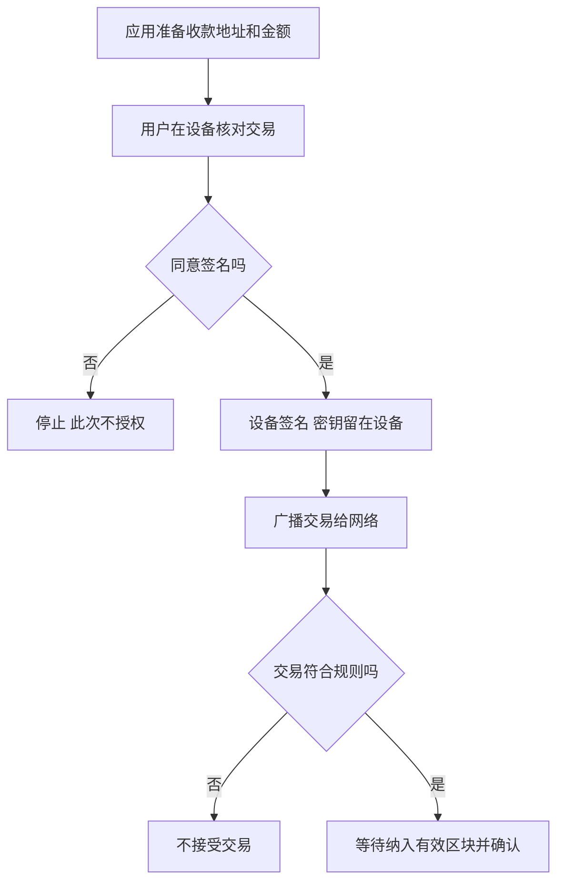
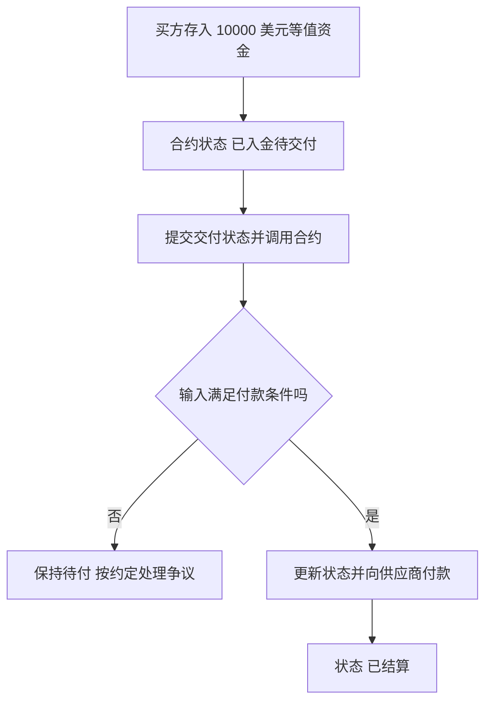
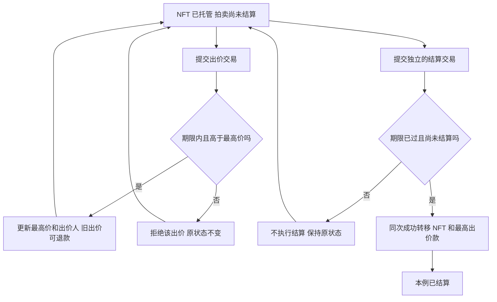
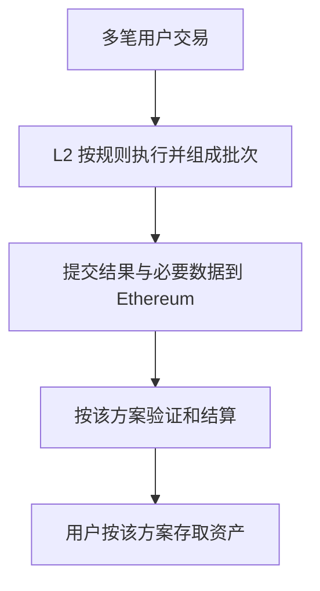
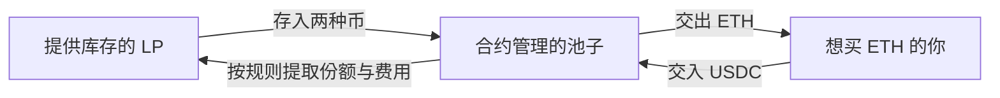
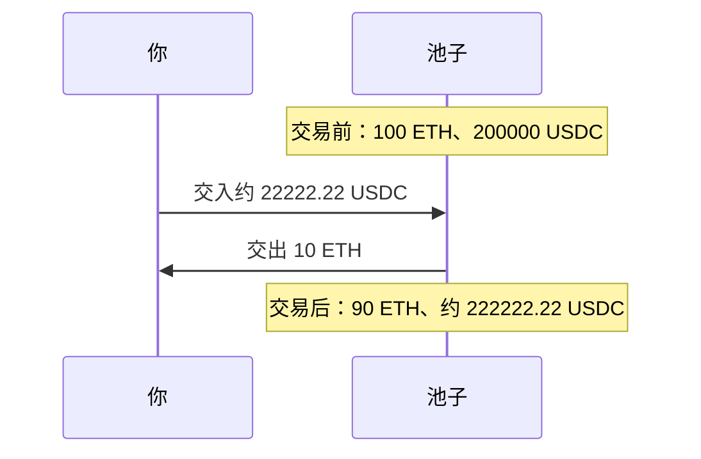
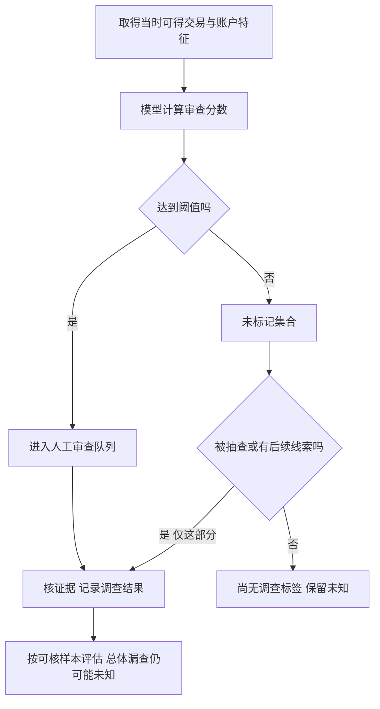
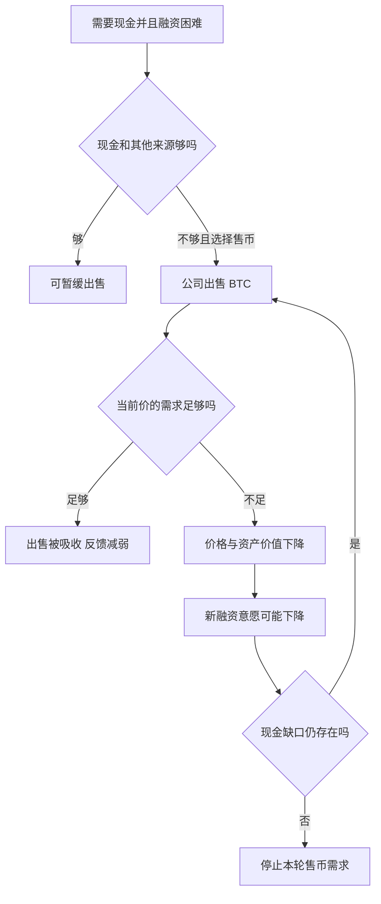
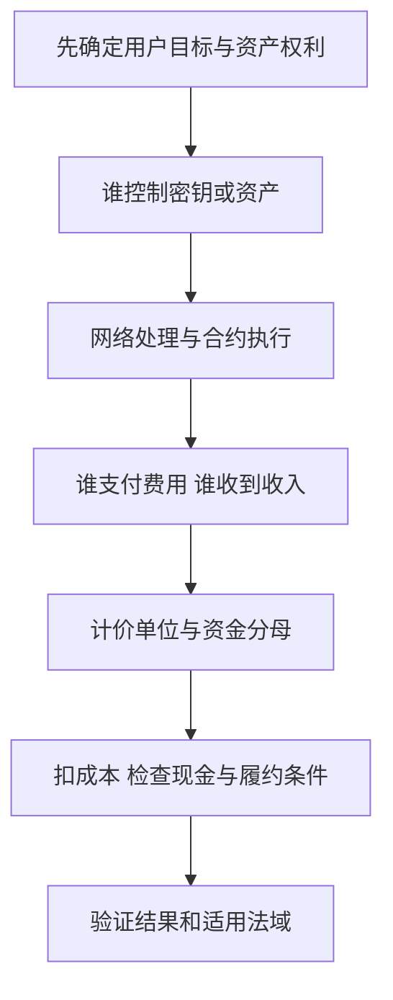

# M07 · 比特币、以太坊与加密金融商业模式

> **本讲一句话**：沿着“谁控制资产、谁付钱、谁赚收入、谁承担损失”，理解比特币和以太坊上的金融业务。
>
> **材料边界**：54 页讲义，加本人确认属于 2026-10-22 的两份 Windows 录音。R2 为第一份（原名“录音 (2).m4a”，770 段，媒体 01:05:45），R3 为第二份（原名“录音 (3).m4a”，原始 921 段，媒体 01:17:11）。各自从零计时；R2 尾宣布休息，R3 继续 Ethereum，精确休息/接缝长度未知，不把媒体长度相加称整堂课完整。课件与现场行情均为历史观察，不是今天报价。
>
> ✅ **本篇材料 v1.0**：已将两源课堂内容与 27 个学习单元对齐。视频、教师讲解、学生回答和笔记推断分开；公开 R3 副本遮蔽点名信息但不移动其他时间戳，原件本机保留。独立审查、视觉、写回及各端同步另以本批回执记录，材料版本不代表本人已通读。

## 0. 三分钟速览

比特币（Bitcoin，资产单位 BTC）提供按共同规则维护的数字资产与转账网络。以太坊（Ethereum，原生资产 Ether，单位 ETH）还可以执行程序。技术决定哪些操作能完成，权利、费用与现金需求决定参与者如何赚钱和亏钱。

学完你应能：

1. 说明钱包保管什么，并追踪一笔签名交易。
2. 分开计算持币公司的资产溢价、股东回报和增发效果。
3. 解释为何奖励增加 ETH 数量，美元账户仍可能亏损。
4. 复算 AMM 买入 10 ETH 的付款，并判断套利方向。
5. 区分交易量、费用、收入、利润与模型误报。

先记三条：代码按输入执行。资产数量与计价货币回报分开。网络、公司、代币和基金份额的权利分开。

> 🎙️ **课堂实况**：R2 先讲动机、发行/费用、钱包，再用 Strategy 与 IREN 解释融资和经营现金。`01:05:37` 宣布休息；R3 从 Ethereum 对比继续，先质押/费用及三题，再讲 NFT、预言机、池子和平台，最后回到监管、ML与融资反馈，`01:17:02` 结束。精确接缝/休息长度未知；p.44短答因时间略过，学习解析仍保留。视频与点名不当教师新增结论或本人参与记录。

## 1. 开始之前 · 知识衔接

### 1.1 你已经有的

下面一行是一项需要唤醒的旧知识。“作用”说明本讲为什么要用它。

| 概念 | 一句话唤醒 | 本讲作用 |
|---|---|---|
| 简单收益（Simple return） | 期末价值除以期初价值再减一 | 计算股价和美元回报 |
| 数字签名（Digital signature） | 用密钥授权一条特定消息 | 区分钱包与网络 |
| 共识（Consensus） | 参与者按规则接受有效历史 | 理解矿工与验证者 |
| 流动性（Liquidity） | 需要付款时能拿到现金 | 分析持币公司压力 |

读第一行：价值从 100 变成 75，简单收益是负 25%。前两项在 [[EF5560_Fintech_and_AI_in_Finance/notes/M01-金融数据与Vibe-Coding|M01]] 与 [[EF5560_Fintech_and_AI_in_Finance/notes/M06-FinTech概览与区块链|M06]] 已展开；本讲会在实际计算处再次说明。

### 1.2 本讲全新概念

每行是一组理解问题；“位置”是本篇正文编号。

| 问题 | 新概念（English） | 位置 |
|---|---|---|
| 新币怎样产生 | 区块补贴（Block subsidy）、减半（Halving） | §2.2 |
| 持币股票为何额外波动 | 净资产价值（Net asset value，NAV）、溢价（Premium） | §2.6–2.8 |
| 程序怎样管钱 | 智能合约（Smart contract）、预言机（Oracle） | §2.12–2.14 |
| 为什么增加币仍亏美元 | 质押（Staking）、Gas、销毁（Burning） | §2.15–2.16 |
| 没有订单簿怎样交易 | 自动做市商（Automated market maker，AMM） | §2.19–2.21 |

读第三行：智能合约负责执行规则，预言机负责把外部事实送入规则。其他新词随正文逐项解释，汇总见 §5。

### 1.3 为什么这样安排 · 重排说明

M06 解释了共享账本的技术部件。本讲追问：这些部件组成什么业务，客户购买什么，业务收入又如何产生？这也为后续 DeFi、稳定币和支付主题提供基础。

课件把三道选择题集中在 p.27–29。本篇将它们移到溢价、矿工收入、质押回报的对应小节。p.32 的预言机与 p.44 的三问紧接付款流程；p.51 的法域比较紧接市场准入。这样可以在刚学会机制时直接解题。

p.1 是总封面；p.2、p.19、p.35 是只有章节名称的分隔页，其路线作用在 §2.0 交代。其余 50 页全部在 §2 解释。日期已由本人确认是2026-10-22，教学周次未核仍留空，不从文件生成时间推定。双向索引见 [[#8. 讲义页码映射|§8]]。

## 2. 正文

### 2.0 先看全讲的三个问题（讲义 p.1–2、p.19、p.35）

p.1 标出课程、本讲主题与作者，是总封面。三张章节分隔页把本讲分成三个业务问题，并非额外例题：

- p.2“Bitcoin, Wallets, and Mining”：先问 BTC 为什么有人用、谁控制转账、矿工怎样收钱，对应 §2.1–2.10。
- p.19“Ethereum and Smart Contracts”：接着问程序如何处理付款、外部数据和验证奖励，对应 §2.11–2.18。
- p.35“Trading Platforms and Market Access”：最后问交易库存、手续费、投资权利和准入，对应 §2.19–2.27。

章节之间沿同一条线推进：先识别资产与控制权，再追踪执行和资金变化，最后判断收入、风险及适用条件。下面的 27 个学习单元按这条依赖组织；选择题移到所需机制旁，但保留原编号和页码。

### 2.1 为什么持有或使用 BTC（讲义 p.3）

同一个人买 BTC，可能想投资，也可能想自己控制转账。先确定用户要完成什么，才能评价服务。

**是什么**

BTC 是比特币网络记录和转移的资产单位。持有人可能接受价格波动，换取对稀缺数字资产的投资敞口（Exposure，即资产涨跌影响自身财富的程度）。也可能重视自托管（Self-custody）：由自己控制授权转账的密钥。

**为什么需要它**

投资者关心价格与风险，付款者关心到账时间和费用。把两人的目标混在一起，就容易把“能转账”误当成“适合支付任何商品”。

**课件原例**

讲义列投资、控制、转账三种动机，并要求与银行付款和受监管投资账户比较。网络允许不用银行账户发送 BTC，但收款人是否接受、兑换成本和价格变化仍会影响可用性。（讲义 p.3）

**🎙️ 课堂补充**（10 月 22 日；R2 `05:24`–`12:48`；A · 课上展开）

老师用资产分散、自行控制授权和转账三个动机解释需求。先问使用者要做什么，再比较银行账户和加密网络的服务；有供应上限不推出买入后必涨。

*"they want to diversify their portfolio"*（R2 `06:27`）

中文：有人持有它是为了分散投资。课堂把自托管概括为“无人知道交易”过强；公开链记录仍可能被关联分析，自己掌握私钥与交易不可追踪是两个问题。

**💡 换个说法（笔记补充）**

买一件资产与用它付房租，是两个任务。若租金按港元约定，付款前 BTC 下跌，买入更多 BTC 的成本可能抵消转账便利。比较时应固定同一笔付款的金额与时限。

**⚠️ 常见误解**

- 有供应上限只约束供给，买方需求仍可能下降。
- 自己控制密钥带来控制权，也把备份责任交给持有人。

**与其他概念的关系**

承接 [[EF5560_Fintech_and_AI_in_Finance/notes/M06-FinTech概览与区块链|M06]] 的货币三职能；价格稳定性、使用便利性和法律地位要分别评价。

**所以呢**

下一步先看供应规则，再看网络为什么收手续费。

### 2.2 补贴与减半怎样控制发行（讲义 p.4–5）

没有发行银行，新的 BTC 从哪里来？答案是协议允许有效区块的生产者获得规定数量的新币。

**是什么**

区块补贴（Block subsidy）是每个区块可新发行的 BTC。

减半（Halving）指每经过 210,000 个区块，补贴降为上一阶段的一半。区块高度（Block height）是从创世区块开始的顺序编号。

**为什么需要它**

节点要检查发行数量是否符合规则，否则矿工可自行多发币。工作量证明（Proof of work，PoW）要求矿工寻找满足门槛的哈希结果；节点验证工作和交易，再按共同规则维护历史。算力竞争不授予随意发行权。

**课件原例**

下面每行是一个发行阶段。“每日”按平均 10 分钟一个区块估算，实际每天的区块数会变。

| 起点 | 区块高度 | 补贴（BTC/块） | 约发行量（BTC/日） |
|---|---:|---:|---:|
| 2009-01-03 | 0 | 50 | 7,200 |
| 2012-11-28 | 210,000 | 25 | 3,600 |
| 2016-07-09 | 420,000 | 12.5 | 1,800 |
| 2020-05-11 | 630,000 | 6.25 | 900 |
| 2024-04-20 | 840,000 | 3.125 | 450 |
| 约 2028 年（预测） | 1,050,000 | 1.5625 | 225 |

日期来自课件；高度是触发条件，补贴是每块上限，每日量是估计。读 2024 行：从高度 840,000 起，每块补贴 3.125 BTC；按每日约 144 块估计为 450 BTC。（讲义 p.4–5）

**💡 换个说法（笔记补充）**

先把每阶段看作同样长的 210,000 个格子。每格奖励从 50 依次减半，新增量越来越小。

1. 首阶段理论发行量：210,000 块乘 50 BTC，为 10,500,000 BTC。
2. 第二阶段每块奖励减半，而块数相同，所以该阶段新增 5,250,000 BTC。
3. 第三阶段再减半，新增 2,625,000 BTC；以后每个阶段都只有上一阶段的一半。

把各阶段新增量加起来：第一阶段 10,500,000，前两阶段合计 15,750,000，前三阶段合计 18,375,000。每加一个阶段，离 21,000,000 的距离又缩短一半。

这种“后一个数总是前一个数的一半”的相加过程，数学上叫等比级数。本例的理论极限是 21,000,000 BTC；它解释上限从哪里来，并不表示某天所有这些币都可实际花用。

这是忽略最小单位取整等细节的上界推导；实际可花供应还受不可花输出、丢失密钥等影响。课件预计最终碎额约在 2140 年产生，不表示日期由日历锁定。

**🎙️ 课堂补充**（10 月 22 日；R2 `12:49`–`19:00`；A · 课上展开）

丢失私钥可能使部分已有币无法使用；协议新增发行则按区块补贴规则逐步减半。实际可用币量、已经发行量与协议上限须分开，不能用活跃地址数量代替任一币量。

*"this scarcity limits the supply"*（R2 `17:34`）

中文：稀缺规则约束供给，老师随后仍说不保证需求或价格上升。ASR 两次把 million 识成 billion，正式上限及减半序列依讲义 p.4–5，不把识别数字写成新事实。

**⚠️ 常见误解**

- 减半按区块高度发生，四年只是目标出块时间下的近似。
- 矿工收入还包括交易费，补贴减半不推出总收入减半。

**与其他概念的关系**

PoW 的哈希搜索、失败后更换候选及节点验证见 [[EF5560_Fintech_and_AI_in_Finance/notes/M06-FinTech概览与区块链|M06]]；本讲把它连接到矿工现金收支。

**所以呢**

补贴越来越少后，区块空间需求和交易费更值得单独分析。

### 2.3 区块空间、费用与分叉（讲义 p.6–7）

很多人同时转账，但一块能装的数据有限。用户因此要在支付费用与等待之间取舍。

**是什么**

区块空间（Block space）是区块能容纳的交易数据容量。

交易费（Transaction fee）是用户为处理交易付出的资产。分叉（Fork）指参与者采用不同规则，历史可能从共同起点分成不同网络。

**为什么需要它**

若需求超过容量，未纳入区块的交易须等待。矿工通常有动力选择更有利的费用组合，但用户付费并不购买网络股权，也不获得确定的处理时刻。

**课件原例**

2017-08-01 的容量争议产生 BTC 与 Bitcoin Cash（BCH）。两者继承分叉以前的记录，之后采用不同规则，分别形成市场价格。BTC 的基础层容量选择更保守，BCH 增大容量以容纳更多链上交易。（讲义 p.6–7）

下表一行是一种状态，展示同一条历史如何分开；箭头表示历史延续。

| 时点 | 网络记录 | 后续规则 |
|---|---|---|
| 分叉前 | 共同历史 | 共同起点 |
| 分叉后 BTC | 共同历史 → BTC 新块 | BTC 的有效性规则 |
| 分叉后 BCH | 共同历史 → BCH 新块 | BCH 的有效性规则 |

读第二行：BTC 节点延续共同历史，但只接受符合自身规则的新块。这里的两条分支是持续的规则分歧，区别于短暂出现两个候选块。

**🎙️ 课堂补充**（10 月 22 日；R2 `19:11`–`26:45`；A · 课上展开）

区块容量有限，拥堵时费用和等待形成取舍。BTC/BCH 是共同历史后采用不同规则的例子，两币后来价格不同；历史相同不保证此后同价或持有人一定获利。

*"they share the earlier transaction"*（R2 `26:38`）

中文：分叉前的交易历史共享。课堂以低奖励提出矿工退出风险，这是条件场景，不能从奖励变低直接推出网络立刻停摆；也不把交易费当网络股权。

**💡 换个说法（笔记补充）**

共同拥有旧账本，像两组人复制同一本旧账后采用不同的新记账规则。未来的一组记录不会自动成为另一组认可的记录。容量提高还会改变传播、存储和验证负担。

**⚠️ 常见误解**

- 付费后仍须等交易有效且被纳入，费用不能让无效交易变有效。
- 同源历史不表示两种币以后同价，也不表示新币总价值必然增加。

**与其他概念的关系**

费用市场连接 §2.9 矿工收入；容量约束也为 §2.17 的第二层批处理提供动机。

**所以呢**

了解网络处理什么后，再看用户拿什么来授权交易。

### 2.4 钱包保护的是密钥（讲义 p.8–10）

电脑里有一个钱包应用，BTC 是否就装在电脑里？资产记录留在链上，钱包管理访问和授权工具。

**是什么**

钱包（Wallet）准备交易并协助签名。

私钥（Private key）控制签名权限，地址（Address）用于识别收款位置。恢复短语（Recovery phrase）可恢复相关密钥，泄露它也可能泄露资产控制权。

**为什么需要它**

硬件钱包（Hardware wallet）把签名密钥放在独立设备内，减少在线电脑直接取得密钥的机会。隔离密钥只能减少一类风险，用户仍须核对收款方、金额及授权内容。

**课件原例**

Coinbase.com 托管账户由服务商控制密钥和账户访问；Ledger 自托管设备由用户控制密钥。讲义列 Nano、Flex、Stax 及配套应用的第三方买卖、交换和质押服务。设备收入、连接服务收入与链上费用是不同收费。（讲义 p.8–10，产品范围为课件 2026-10-13 快照）

下面追踪一笔笔记补充的转账，箭头表示交易信息传递。硬件设备只负责授权，网络负责检查与更新。

**💡 换个说法（笔记补充）**

付款 0.01 BTC 时，应用准备消息，设备显示待核内容，用户批准后设备签名。签名送往网络，网络再验证并记录。若用户批准了骗子地址，设备可以正确完成一个错误的商业决定。

读图自测：在“同意签名”之前发现地址不对，应走哪条路？

答案

走“否 → 停止”。已经签名并广播后，是否还能取消取决于实际交易状态，硬件本身不能撤销已确认交易。

**英文参考答案（笔记自拟，F01）**

> Choose the no branch and stop before signing. After signing and broadcasting, cancellation depends on the transaction state; the device cannot reverse an already confirmed transfer.

**🎙️ 课堂补充**（10 月 22 日；R2 `26:59`–`35:27`；R3 `01:02:29`–`01:02:59`；A · 课上展开）

钱包保护的是授权密钥，资产状态在链上。硬件自托管与平台控制密钥的账户责任不同；老师所谓 semi-self-custody 是自造口语标签，正式判断仍看谁能签名、谁有恢复权限。

*"The assets, they only stay on the blockchain."*（R2 `28:37`）

中文：资产记录留在链上。课堂提及警方取得某案密钥，但取得方式只是教师猜测，不能当案件事实或证明硬件绝不可能被取得；设备也不能撤回用户批准的骗局交易。

**⚠️ 常见误解**

- 托管账户能重设密码，依赖的是提供商的恢复流程；自托管密钥丢失没有同样的银行式兜底。
- 网络手续费付给网络处理环节，不能把它全记为钱包公司的收入。

**与其他概念的关系**

接续 M06 的数字签名与私钥托管；§2.23 会比较自托管、平台账户和 ETF 的不同权利。

**所以呢**

控制权搞清楚后，才能判断价格图描述的是哪一项资产。

### 2.5 价格与总市值的读法（讲义 p.11）

看到“季度上涨 39.6%”，先问上涨的是 BTC 价格，还是所有加密资产的总市值。

**是什么**

价格（Price）是一个单位资产的报价。市值（Market capitalization）通常由价格乘供应数量得到；全市场市值还会受资产集合与供应变化影响。两者的涨跌口径不同。

**为什么需要它**

把全市场柱状图当成 BTC 收益，会错认投资对象。连续收益还要相乘，三个跌幅与一个涨幅不能直接相加当累计回报。

**课件原例**

课件写 2026-10-20 观察到 BTC 约 US\$82,000、ETH 约 US\$2,410；这不是日收盘价，本次没有独立重建该历史报价。图的四柱则是全市场市值季度变化。（讲义 p.11）

下表每行是一个季度，变化率的分母为前一季末总市值。

| 季度 | 总市值变化（%） |
|---|---:|
| 2025 Q4 | −23.7 |
| 2026 Q1 | −20.4 |
| 2026 Q2 | −12.6 |
| 2026 Q3 | +39.6 |

读第一行：2025 Q4 末总市值比上一季末低 23.7%。这些是课件快照，不能直接当某只币的可投资组合收益。

**💡 换个说法（笔记补充）**

把前三季前的市值设为 100，依次乘每季保留比例。复算后路径为 100 → 76.3 → 60.73 → 53.08 → 74.10。反弹以后仍低约 25.90%；这一重画只核算课件四个给定比例。

![[EF5560_Fintech_and_AI_in_Finance/notes/figures/m07/market-path.svg]]

图的横轴是季度末，纵轴是起点等于 100 的市值指数。连线表示同一口径的复合路径。Q3 从约 53 回升到 74，仍未到 100。读图问题：最后一个点高于前一季，为什么仍是累计损失？因为累计比较的基线是 100。

**🎙️ 课堂补充**（10 月 22 日；R2 `01:03`–`05:24`、`35:43`–`41:16`；A · 现场图表与补充观点）

现场用 BTC/USD、ETH/USD 和 ETF 图比较价格，之后讨论市值季度路径。价格、总市值和成交量不是同一指标；课件 p.11 柱形图的分母是总加密市值，不是 BTC 本身回报。

*"this is the price what we see for this week"*（R2 `38:07`）

中文：这是当时课堂观察的价格。现场将 BTC 的金额成交量与 SPY 股数成交量直接并列，不可由 billion/million 判断规模倍数，须先统一单位。Clarity Act、货币发行与政治/欺诈评论仅作课堂观点登记，未据此认证现行法律、因果或指控。

**⚠️ 常见误解**

- 市值增减还可能包含供应和样本变化，不能把指数路径称为真实持仓回测。
- 一季大涨不自动抵消前几季下跌，因为每期的分母改变了。

**与其他概念的关系**

承接 M01 的复合收益；§2.27 会用 50% 的对称涨跌解释回本门槛。

**所以呢**

持有资产的公司还多了一层证券定价，接着把这层拆开。

### 2.6 持币公司与证券权利（讲义 p.12–13）

买入持币公司的股票，是否等于把公司的 BTC 提到自己的钱包？首先要看你买到哪一种权利。

**是什么**

普通股（Common shares）代表公司剩余权益。

优先股（Preferred shares）的分红和赎回权利按系列条款确定，通常排在普通股前。债务（Debt）带来按约偿还义务，利息和转股条款依发行条件而定。

**为什么需要它**

公司可发行上述证券筹资，再买 BTC。公司资产增加的同时，普通股数量或更优先的请求权也可能增加。只数 BTC 总量，就遗漏每股分母和偿债顺序。

**课件原例**

Strategy 的普通股代码为 MSTR，业务包括软件与比特币储备策略。普通股持有人没有直接提取公司 BTC 的权利。讲义还引 2026-07-06 披露：出售 3,588 BTC 支付优先股股息，剩余 843,775 BTC。（讲义 p.12–13）

这组出售数字本次未取得对应一手披露复核，作为“课件引用、外部待核”保留。后面的假设计算不把它当已核实公司账户。

**💡 换个说法（笔记补充）**

先算普通股可对应的资产，再除以普通股股数，这叫普通股每股净资产价值（NAV per share）。简化关系为：

$$
\text{普通股 NAV}=\text{资产价值}-\text{负债}-\text{优先股请求权}
$$

先用一个笔记补充例子理解“剩余”。假设公司资产按同一时点估值为 100 百万美元，先要扣除负债 20，再扣简化设定的优先股请求权 10。

1. 资产 100 扣负债 20，剩 80 百万美元。
2. 再扣排在普通股前面的 10，剩 70 百万美元。
3. 这 70 才是本例归于普通股的 NAV；还要除以普通股股数，才得到每股 NAV。

这里比较各类权利对应的价值，没有假设公司今天正在卖币或清算。优先股该扣多少要看实际条款；不能把所有优先股都按同一个面值处理。

未实现收益（Unrealized gain）是尚未通过出售等方式变成现金的账面增值。BTC 涨价能提高资产估值，但支付股息仍需现金来源：现金储备、经营现金流、新融资或出售资产。

**🎙️ 课堂补充**（10 月 22 日；R2 `41:23`–`48:35`、`51:53`–`53:04`；A · 课上展开；视频另归因）

老师播放 Strategy 评论视频，再解释普通股、优先股、债务与现金融资。买股票得到公司证券请求权，不是提走公司 BTC 的权利；币价上涨形成账面增值，也不直接提供付息所需现金。

*"it does not mean that you have that Bitcoin"*（R2 `47:36`）

中文：持有股票不等于直接持有那份比特币。R2 `42:09`–`43:43` 是第三方视频，其收益/庞氏质疑不归为教师或笔记的审计结论；“公司只买币”是课堂简化，讲义 p.12 仍写软件业务。出售数量与剩余币量在 ASR/讲义不同，讲义特定披露仍未取得一手复核。

**⚠️ 常见误解**

- 普通股、优先股、债务的先后顺序与现金条件不同，不能只比较名义收益率。
- 纯持有 BTC 不自动产生利息；公司新增融资也会新增成本或权利分母。

**与其他概念的关系**

§2.7 比较市值与 NAV；§2.26 再把融资困难与被迫卖资产的条件接起来。

**所以呢**

资产价值确定后，才有合理分母计算股价溢价。

### 2.7 溢价与股东回报（讲义 p.14、p.27）

公司 BTC 价值不变，股票仍可能下跌。因为股票市值还包含投资者愿意付出的额外价格。

**是什么**

溢价（Premium）是市值超过 NAV 的比例，分母为 NAV。股东收益（Shareholder return）比较前后股票价值，分母为原买价。

**为什么需要它**

相同的 50 百万美元差额，除以资产价值 100 与买价 150，会得到不同百分数。题目问哪一个，决定分母。

**课件原例：p.14 给定演示**

> Hypothetical holding company: Bitcoin holdings stay at \$100m, with no other assets or liabilities.
> Initial equity value: 150; after premium disappears: 100. US dollars, millions.
> Shareholder return = 100/150 − 1 = −33.3%.
> The initial 50% premium disappears even though Bitcoin’s price is unchanged.

中文题意：假设只有 BTC 资产，没有其他资产负债。BTC 始终值 1 亿美元，股票总市值从 1.5 亿降到 1 亿。这里明确“币价不变”，变化来自溢价消失。

1. 先算原溢价：市值比 NAV 多 50 百万美元，除以 NAV 100，等于 50%。
2. 再算市值变动：从 150 降到 100，减少 50 百万美元。
3. 股东以原投入 150 为分母，亏损率为 50 除以 150，约 33.3%。

✅ 讲义给定结果为负 33.3%；上述中文步骤为笔记译解。英文参考答案（笔记自拟）：The shareholder loses 33.3% when equity value falls from US\$150 million to US\$100 million, despite unchanged Bitcoin holdings.

**p.27 英文原题**

> A US-listed company holds Bitcoin worth \$100 million. Its shares have a total market value of \$150 million. Assume it has no other assets or liabilities.
>
> What premium do shareholders pay relative to the value of its Bitcoin holdings?
>
> A) 33.3%
>
> B) 50%
>
> C) 150%
>
> D) 0%

**中文题意与逐项解析**

“relative to”指定以 BTC 价值为基准；“no other assets or liabilities”让 BTC 价值等于 NAV。⚪ 参考作答（笔记推断）：选 B，溢价为 50%。

- A（33.3%）：差额除以市值 150，分母不符合本题。
- B（50%）：差额 50 除以资产值 100，正确。
- C（150%）：市值是资产值的 150%，其中 100% 是资产本身。
- D（0%）：只有市值等于资产值时才成立。

英文参考答案（笔记自拟；非官方）：B. Shareholders pay a 50% premium because the US\$50 million excess is measured against US\$100 million of Bitcoin holdings.

**🎙️ 课堂补充**（10 月 22 日；R2 `48:41`–`54:19`；R3 `18:27`–`20:06`；A · 课上算例与提问）

市值高于资产价值时有溢价；只有之后溢价收窄，才形成这部分价格损失。老师让学生解释 p.27 的分母，不能把“现在溢价 50%”说成买入瞬间已实际亏 33.3%。

*"per share divides this value by the common shares outstanding"*（R2 `49:19`）

中文：每股 NAV 用归属普通股的价值除以普通股数。p.27 的 50% 参考答案保留；本源录到提问与感谢，没有录清学生算式，不把它升级成教师逐项公布 B。

**💡 换个说法（笔记补充）**

改为市值 120、NAV 100 百万美元：溢价为 20%；若溢价消失，原股东亏约 16.67%。一个比的是“多付多少”，另一个比的是“买入以后亏多少”。

**⚠️ 常见误解**

- 把 50% 溢价消失说成股价跌 50%，会混淆两个分母。
- 上述结论假定股数和资产条件不变，真实公司还有融资、经营与条款变化。

**与其他概念的关系**

下一节增发会同时改变资产与股数，不能沿用固定分母。

**所以呢**

溢价有时帮助公司筹资，但帮助资产增厚不等于保证股价上涨。

### 2.8 高于 NAV 增发的算例（讲义 p.15）

增发增加股数，为什么每股资产有时仍增加？要同时计算新增资金与新增份额。

**是什么**

增发（Share issuance）是发行新股取得资金。每股净资产增厚（NAV accretion）表示增发后的每股 NAV 高于原值，成立与否取决于发行价、成本及资产变化。

**为什么需要它**

旧股东的持股比例可能下降，但分到的资产价值不一定下降。“比例稀释”与“每股 NAV 降低”是不同问题。

**课件原例：英文给定演示**

> Illustrative company: \$100m of Bitcoin, 10m shares, and no liabilities. Net asset value (NAV) is \$10 per share.
> Issue 1m shares at \$15 each. Buy \$15m of Bitcoin. Assets: \$115m. Shares: 11m.
> New NAV per share = \$115m / 11m = \$10.45.
> Issuing above NAV increases assets per share in this example; issuing below NAV would reduce them.
> Assumes no issue costs and no change in Bitcoin’s price.

中文条件：金额以百万美元计，股数以百万股计；发行成本为零，BTC 价格不变。原来 NAV 每股 10 美元。

1. 新投资者买 1 百万股，每股付 15 美元，公司收到 15 百万美元。
2. 公司用资金买 BTC，资产由 100 增至 115 百万美元。
3. 股数由 10 增至 11 百万股，每股 NAV 为 115 除以 11，约 10.45 美元。
4. 原持有 1 百万股的人，比例由 10% 降到约 9.09%；对应 NAV 从 10 增至约 10.45 百万美元。

为什么占比变小，还能对应更多资产？新股东为每股付 15 美元，比原来每股对应的资产 10 美元多带入 5 美元。新带入的资产较多，足以弥补多分给新股东一部分份额的影响。

因此要同时看两个问题：你在公司里占几分之几，以及公司全部资产有多大。不能只盯占比下降，就跳到“你每股的资产必然减少”。

✅ 讲义给定每股 US\$10.45，比例解释为笔记补充。英文参考答案（笔记自拟）：NAV per share rises to approximately US\$10.45 because the new shares are issued above the original US\$10 NAV, assuming no costs or Bitcoin price change.

**💡 换个说法（笔记补充）**

每张旧票原对应价值 10，新票却带进 15，平均后每张票的资产增加。若新票只带进 8，资产变 108，股数变 11，每股约 9.82 美元，方向反过来。

**🎙️ 课堂补充**（10 月 22 日；R2 `54:22`–`59:08`；A · 课上展开）

高于原每股 NAV 增发，会同时改变总资产和股数。老师再以不同市场的同公司价格说明投资者受可投范围限制，不能只由表面便宜判断未来收益。

*"this new shareholders makes the original shareholders richer"*（R2 `55:25`）

中文：本例新增投资者带入的较高资产值使原股东每股 NAV 增厚，不是保证股价上涨。ASR 有“150 million”片段，讲义 p.15 实为 $100+15=115$ 百万美元、11 百万股，复算约 10.45；现场 A/H 股报价与收益不作实时已核数据。

**⚠️ 常见误解**

- 每股 NAV 增厚是资产算式，不承诺二级市场股价上涨。
- 若发行成本大、BTC 价格变化或优先请求权增加，要重新算净额。

**与其他概念的关系**

§2.26 的融资压力会影响公司能否持续以有利价格发行证券。

**所以呢**

对持币公司看资产与融资；对矿工则要看算力份额与经营成本。

### 2.9 矿工收入与竞争（讲义 p.16–17、p.28）

一家矿场机器更多，为什么可能赚得更少？它分的是全网奖励，收入取决于相对算力，而支出由自身成本决定。

**是什么**

算力（Hash rate）衡量每秒进行哈希尝试的能力。矿工算力份额是自身算力除以全网算力。在其他条件简化后，它约等于取得奖励的长期预期份额。

**为什么需要它**

PoW 搜索中，矿机不断尝试候选哈希。一次尝试能否达标取决于规则；在简化的同等有效尝试假设下，你贡献更多次尝试，就获得更多找到合格结果的机会。

所以“占全网算力 1%”可近似理解为“贡献全部有效尝试的 1%”。长期预期奖励份额也约为 1%，但本月实际找到了几个块仍有随机波动。

全网扩容时，自己的机器不变，尝试次数占比可能下降；电费、设备和维护成本却仍须支付。这就是要比较相对份额与绝对成本的原因。

**课件原例：p.16 英文给定演示**

> Illustrative month: A miner maintains 1% of the network’s computing power. Total network rewards and transaction fees are worth US\$10 million. The miner’s monthly operating costs are US\$120,000.
> Expected revenue = 1% × US\$10 million = US\$100,000.
> Expected operating profit = 100,000 − 120,000 = −US\$20,000.
> A 1% share of computing power gives roughly a 1% expected share of rewards. Actual rewards fluctuate.
> Miners compete on costs as well as computing power. Electricity and hardware expenses can exceed mining revenue.

中文设定：以一个月为期，奖励池已经按美元计价。算力份额保持 1%，本例经营成本为 US\$120,000。

1. 用全网奖励池乘份额，预期分得 US\$100,000。
2. 减去本月成本 US\$120,000，得到经营亏损 US\$20,000。
3. 若真实出块偏少，实际收入还可能低于预期；这里没有额外假定矿池结算方式。

✅ 讲义给定收入与亏损。英文参考答案（笔记自拟）：Expected monthly revenue is US\$100,000, leaving a US\$20,000 operating loss under the stated cost assumption.

**p.17 图怎样读**

左图是全历史七日平均算力，纵轴为 EH/s，使用对数刻度（Logarithmic scale），即相同竖直距离表示相同倍数。右图是近五年线性刻度，显示近期水平及波动。EH/s 表示每秒百亿亿次哈希尝试。

课件右端标 2026-07-27 的 874 EH/s，属于图中快照，非本次实时观测。底注明确短期观测仍有噪声。减半竖线表示事件日期，不能仅凭相邻上升就认定减半导致算力上升。

不从曲线目测生成精确全序列。用笔记补充的两个状态理解竞争：自身算力 1、全网 100，份额 1%；自身仍为 1、全网变 200，份额降至 0.5%。如果奖励池总额固定，预期奖励减半。

**p.28 英文原题**

> Before a hypothetical halving, block subsidies provide 80% of a miner’s revenue and transaction fees provide 20%. The subsidy halves. The coin price, fee revenue, and number of blocks mined stay unchanged.
>
> By what percentage does total revenue fall?
>
> A) 20%
>
> B) 40%
>
> C) 50%
>
> D) 80%

**中文题意与逐项解析**

题目固定币价、费用收入和挖到的块数，只让补贴减半。✅ 课堂确认（R3 `22:29`–`22:43`）：选 B，总收入下降 40%；老师口述80→40、手续费仍20。以下完整步骤/逐项排除仍是笔记译解。

1. 以减半前收入 100 为基准，其中补贴 80、费用 20。
2. 补贴减半变为 40，费用仍为 20，总收入为 60。
3. 收入减少 40，除以原收入 100，降幅为 40%。

- A（20%）：这是原手续费占比，并非损失比例。
- B（40%）：补贴占比 80% 乘以减半幅度 50%，正确。
- C（50%）：把所有收入都当作补贴。
- D（80%）：相当于补贴全部消失，不符合题意。

英文参考答案（笔记自拟；非官方）：B. Total revenue falls by 40% because subsidy revenue drops from 80 to 40 while fee revenue remains 20.

**🎙️ 课堂补充**（10 月 22 日；R2 `59:21`–`01:01:24`；R3 `20:06`–`22:43`；A · 课上算例与确认）

矿工获得的是相对算力对应的预期奖池份额，成本仍要支付。p.28 固定币价、费用收入与块数，只把占收入 80% 的补贴减半，所以总收入由 100 变 60。

*"40%. So can you explain?"*（R3 `22:29`）

中文：老师明确给出下降 40% 并解释 80→40、费用仍 20。这里可以把本题结果标为课堂确认；收入变化仍不等于利润同比变化，完整英文题面/全部选项和解释保留。

**💡 换个说法（笔记补充）**

收入像分一个持续变化的奖池。多买机器要先判断能增加多少份额，再看新增电费能否被新增收入覆盖。若原补贴占收入 60%，其他条件同题，总收入只降 30%。

**⚠️ 常见误解**

- 奖励份额是预期值，不能保证每月按比例出块。
- 收入下降 40% 不等于利润下降 40%，因为成本未必同比变化。

**与其他概念的关系**

§2.2 说明补贴来源，§2.3 说明费用来源；二者相加才进入收入池。

**所以呢**

矿场也可能出售计算服务，但转型要重新投入设备和承担交付责任。

### 2.10 矿场转向 AI 服务（讲义 p.18）

有电力和机房，为什么不能把挖矿机器直接当作完整 AI 云？相似的是基础设施，实际运算设备和客户要求仍有差异。

**是什么**

AI 云服务（AI cloud service）向客户提供训练或推理所需的计算资源。矿场的电力、土地与机房可以复用，但图形处理器（Graphics processing unit，GPU）、散热和高速网络需要资本支出（Capital expenditure，即购买可长期使用资产的投入）。

**为什么需要它**

挖矿收入受奖励和币价影响，服务合同把部分收入来源转成客户采购。风险随之转向设备采购、按期交付、使用率和客户集中度。

**课件原例**

IREN 在 2025 年 11 月公布与 Microsoft 的五年约 US\$9.7bn AI 基础设施协议。bn 是十亿，所以为约 97 亿美元合同总额，不能当作单年已实现收入。（讲义 p.18）

🔗 [IREN 官方公告](https://iren.gcs-web.com/news-releases/news-release-details/iren-secures-97bn-ai-cloud-contract-microsoft)（核对 2026-10-22）：公告为 2025-11-03，确认五年期与约 97 亿美元，并提到另需 GPU 和配套设备投入。此次核对的是合同公告，没有据此确认后续实际交付或利润。

**🎙️ 课堂补充**（10 月 22 日；R2 `01:01:26`–`01:05:37`；A · 课上展开）

IREN 的转型例把收入来源从挖矿奖励转向 AI 服务合同，老师同时提醒新设备、交付和大客户取消风险。可复用电力与机房，不代表把比特币 ASIC 矿机直接拿来做 AI。

*"they need to buy a lot of GPU from Nvidia"*（R2 `01:04:51`）

中文：转型仍需购买大量 GPU。97 亿美元是跨五年的合同总额，不是已实现单年收入或利润；课堂称赞转型，也没有给出未来履约保证。

**💡 换个说法（笔记补充）**

拥有厂房不等于拥有客户要求的生产线。评估转型要追踪“可用电力 → 新设备到货 → 服务交付 → 达到收款条件”，其中任一步延迟都会影响现金。

**⚠️ 常见误解**

- 合同总额覆盖多个未来期间，不能直接除以员工数当已实现人均利润。
- 单一大客户减少获客难度，也增加客户集中和履约风险。

**与其他概念的关系**

接续 M06 的收入、成本与现金流分析；§2.22 将再次区分业务规模和利润。

**所以呢**

接着从比特币的资产网络，转到以太坊的可编程业务。

### 2.11 网络协议与经营公司（讲义 p.20、p.31）

以太坊与 Coinbase 都涉及加密资产，是否属于同一种对象？前者是一套可共享运行的网络协议，后者是经营服务的公司。

**是什么**

以太坊允许把程序和资产状态放在同一网络执行。ETH 用于支付计算费用和支持网络安全。当前共识采用权益证明（Proof of stake，PoS），验证者以质押资本承担责任。

**为什么需要它**

区分协议与公司，才能确定谁收服务费、谁保管客户资产、谁对账户访问负责。网络的使用量不自动等于某家公司的利润。

**课件原例**

讲义将 Bitcoin 定位为稀缺数字资产和付款网络，将 Ethereum 定位为资产与金融应用的可编程网络。BTC 采用 PoW，ETH 采用 PoS。（讲义 p.20）

p.31 介绍 Vitalik Buterin 于 2013 年提出 Ethereum，以及 Brian Armstrong 于 2012 年共同创办 Coinbase。前者的例子强调共享基础设施上的开发，后者强调交易接入、托管与经营。人物图注明为编辑性插图，不能当真实照片证据。

**🎙️ 课堂补充**（10 月 22 日；R3 `00:00`–`02:26`、`30:39`–`32:23`；A · 课上展开）

先区分网络协议和经营公司：Bitcoin/ Ethereum 的规则并不等于 Coinbase 的账户服务和收费。BTC 的 PoW 与 ETH 的 PoS 分工不同，验证者质押资本不等于任意控制账户或协议发行。

*"programmable network for assets and financial applications"*（R3 `00:22`）

中文：以太坊强调可编程的资产和金融应用。ASR 把 Ethereum 识成 EVM，二者不能作为同义词；“ETH 可无限挖”是课堂过度简述，当前验证/发行依协议规则，不能自行任意铸币。

**💡 换个说法（笔记补充）**

道路的共同通行规则与经营收费停车场的公司有联系，但收入与责任边界不同。这个类比只帮助区分层次，不能据此推断链的治理方式等同交通管理。

**⚠️ 常见误解**

- 买 ETH 不自动获得 Coinbase 股权或 Ethereum 应用公司的分红。
- BTC 与 ETH 的用途对比是课堂抽象，不能据此断言任何其他功能绝不可能存在。

**与其他概念的关系**

§2.18 分析代币权利；§2.23 比较通过中介取得的资产敞口。

**所以呢**

可编程具体意味着什么，要看一笔交易怎样改变合约状态。

### 2.12 智能合约与条件付款（讲义 p.21–22）

买方想先锁定货款，等满足交货条件后付款。要让程序执行，就必须先把金额、权限和条件写成可判断的规则。

**是什么**

智能合约（Smart contract）是在链上保存并按交易输入执行的程序。托管付款（Escrow）先持有资金，再按约定条件释放。这里的“托管”指条件性持款，不等于交易平台控制用户私钥。

**为什么需要它**

多方可按同一代码检查状态变化，减少对某人事后手动付款的依赖。程序只认识收到的输入，外部是否真实交货还需要信息来源。

**课件原例**

p.21 的流程为交易调用程序 → 检查指定条件 → 更新余额或记录。部署后程序不会自己持续运行，动作须由交易触发。

p.22 四格图：买方预存 US\$10,000 → 供应商交货 → 确认交付 → 供应商收到 US\$10,000。买方先付款到托管位置，收款人后来才是供应商。（讲义 p.21–22）

下面重画资金状态，图中的条件按课件简化，不是可部署合约代码。

**💡 换个说法（笔记补充）**

输入为一笔已入金交易与一条交付记录。若记录符合合约条件，本例从“待付”变“已结算”，供应商增加 10,000，托管余额减少同额。再次调用时应检查已结算状态，防止重复付款；这是补充的设计要求，课件未提供实现。

读图自测：没有新的调用交易，时间到了就一定付款吗？

答案

不能这样推断。时间可以成为判断条件，但本例还需要交易触发执行。谁发交易、支付 Gas、失败后如何重试，需要应用另行安排。

**英文参考答案（笔记自拟，F02）**

> No. Time can be a condition, but this example still needs a transaction to trigger execution. The application must arrange the sender, Gas payment and failure handling.

**🎙️ 课堂补充**（10 月 22 日；R3 `02:33`–`06:14`；A · 课上展开）

以明天下雨付款和供应商交货两个例子说明代码按输入条件执行。京东/滴滴的自动结算只用来类比条件式付款，不能据此断言这些服务就是同样的链上智能合约。

*"it does not independently verify a delivery or legal claim."*（R3 `03:34`）

中文：程序并不独立核实真实交货或法律权利。代码写成付 100 而非 1 仍可能按错规则执行；自动化是遵守输入/代码，不是替业务作真实性保证。

**⚠️ 常见误解**

- 自动执行只表示按程序规则处理，不证明现实条件真实。
- 代码名称含 contract，不自动证明它已满足某法域法律合同的全部要件。

**与其他概念的关系**

§2.13 把外部事实接入付款链，§2.14 则看资产已在链上托管时的原子交付。

**所以呢**

合约的关键问题常在输入边界，而非最后一条转账指令。

### 2.13 预言机与错误交货记录（讲义 p.32、p.44）

程序看见“已交货”就付款，可货还没到。应检查谁把这个状态告诉程序，以及依据是什么。

**是什么**

预言机（Oracle）负责获取、处理并向智能合约传递链外信息。它是信息接入机制，本身不会把错误数据库自动变成真实世界。

**为什么需要它**

普通合约执行不能独立去仓库验货。若依赖外部记录，商业可信度也取决于记录生成、核验和纠错流程。

**课件原例**

p.32 四格图显示：交货延迟 → 数据库误记已送达 → 预言机把该状态交给合约 → US\$10,000 提前释放。真实货物状态与链上输入分离，是损失的传递路径。（讲义 p.32）

🔗 [Ethereum 预言机说明](https://ethereum.org/developers/docs/oracles/)（核对 2026-10-22）支持链外信息须经外部来源接入的边界。多个节点传送同一个错误来源，仍可能一致地传错。

**p.44 英文原题**

> A US importer uses an app that pays a supplier automatically when a delivery database reports that goods have arrived. An incorrect entry triggers payment before delivery.
>
> 1. Explain why correct software execution did not protect the importer.
>
> 2. Identify one check that could reduce incorrect payments.
>
> 3. State one recovery or dispute procedure the business still needs.

**中文读题**

进口商是买方，供应商是收款方。题目明确软件执行正确，却收到错误数据库记录。第二问要求一项减少错付的检查，第三问要求事后恢复或争议程序，不能三问都答“检查代码”。

**第 1 问：为什么正确执行仍没保护买方**

⚪ 参考作答（笔记推断）：付款条件依赖错误的交货记录。程序把错误输入正确地执行成付款，因此流程一致性没有保证事实真实性。

英文参考答案（笔记自拟）：The app correctly followed an incorrect delivery record. Correct execution did not establish that the goods had actually arrived.

**第 2 问：增加一项检查**

⚪ 参考作答：付款前要求买方确认收货，并核对该确认属于同一订单。若仅由原数据库再传一次相同状态，就没有引入独立证据。

英文参考答案（笔记自拟）：Require the buyer’s receipt confirmation for the matching order before releasing payment, rather than relying solely on the delivery database.

**第 3 问：保留一项事后程序**

⚪ 参考作答：约定错付后的退款和争议处理程序，保存订单、交付记录及付款证据。若资金已转给供应商，追偿通常需要对方配合或约定救济，不能假设合约可任意追回。

英文参考答案（笔记自拟）：The business still needs a documented refund and dispute process, with retained evidence and an agreed route for recovering an incorrect payment.

**🎙️ 课堂补充**（10 月 22 日；R3 `32:23`–`33:09`；p.44 在 `01:00:25` 后略过；A · 解释错误输入；短答未展开）

错误数据库把未交货写成已交货，合约可正确执行一笔错误付款。老师讲输入错误的后果；后来因时间跳过 p.44 三问，现有逐问中英答案仍是参考作答，没有变成教师标准答案。

*"incorrect data, incorrect payment."*（R3 `33:06`）

中文：错误输入导致错误付款。“无中心化客服”不等于世界上没有任何合同争议救济；应分别设计暂停、核验与退款/争议程序，是否存在要看具体业务约定。

**💡 换个说法（笔记补充）**

把第二问改成“双人审批是否足够”：若两人只读同一个错误状态，仍可能错付。应看两人依据是否独立、订单是否一致、异常是否能暂停付款。

**⚠️ 常见误解**

- 链上记录难以改动，有时会把错误输入固定下来，不能代替源头核实。
- 预言机可信度、代码正确性、法律救济分别对应不同环节。

**与其他概念的关系**

M06 的数据真实性边界在这里形成完整损失链；§2.25 的反洗钱模型也需要区分评分与事实认定。

**所以呢**

若被交换的两种资产都已由合约控制，交付条件可以换一种方式约束。

### 2.14 NFT 拍卖的状态变化（讲义 p.30）

拍卖中卖方收了钱却不交资产，是一种履约风险。先把资产存入按规则运行的合约，可以减少对卖方最后一次配合的依赖。

**是什么**

非同质化代币（Non-fungible token，NFT）是具有独立标识的链上代币。这里代表数字收藏品。USDC 是以追踪美元价值为目标的稳定币；例子按其单位出价，不另假设赎回保证。

**为什么需要它**

先托管 NFT，再让付款和代币交付在结算交易中共同完成，称为原子结算（Atomic settlement）：相关动作全部成功，或依规则整体回退。

**课件原例：完整英文题面**

> The seller deposits a unique digital collectible (an NFT) into a contract. Assume no administrator can bypass the auction rules.
>
> Bid sequence / USDC offered / Contract response:
> Alice / 100 / Holds her bid.
> Bob / 120 / Leads. Alice may withdraw 100.
> Charlie / 110 / Rejects the lower bid.
>
> After the deadline, a settlement transaction transfers the NFT to Bob and 120 USDC to the seller.
>
> Could the seller collect Bob’s payment but refuse to deliver the token?
>
> Hypothetical contract, ignoring fees. NFT ownership alone grants no copyright.

中文限定：“已存入”说明卖方已交出本例代币控制。“无管理员绕过”排除特权提币。“结算交易”说明仍须有人触发。题目讨论链上代币交付，不是作品版权。

按出价顺序追踪状态。每行是一笔动作后的结果，金额单位为 USDC。

| 动作 | 最高出价人 | 最高价 | 其他状态 |
|---|---|---:|---|
| 卖方存入 NFT | 无 | 0 | NFT 由合约持有 |
| Alice 出 100 | Alice | 100 | 保管 Alice 出价 |
| Bob 出 120 | Bob | 120 | Alice 可提回 100 |
| Charlie 出 110 | Bob | 120 | 低价拒绝 |
| 到期后结算 | Bob | 120 | Bob 获 NFT，卖方获 120 |

“其他状态”记录不属于最高价的变化。读第三行：Bob 领先，Alice 的退款可提取，但“可提”不表示已经提走。Charlie 的 110 被拒，不能再计入卖方结算收入。

图是课件路径的教学重画，只沿题面已经形成最高出价的状态；无人出价等未给规则不在图中。Bob 的 120 更新最高价后，即使没有新出价，到期后仍由独立的结算交易进入另一条分支。迟到出价会被拒，不会自动充当结算交易。

谁有权发结算交易、谁付费用要看实际合约与应用约定，本题没有指定任何人都可调用。实际实现还须防止付款期间被再次调用而重复支出，并处理转账失败；本题不提供代码，不能声称已审计合约安全。

**直接答案与英文参考**

⚪ 参考作答（笔记推断）：在题面规则及正确实现假设下，卖方不能成功收走 Bob 的付款却拒交已托管 NFT。转移受同一次结算约束；这不保证链外版权或实物履约。

英文参考答案（笔记自拟；非官方）：Under the stated rules, settlement delivers the escrowed NFT to Bob and 120 USDC to the seller together. The seller cannot separately withhold the token, but NFT ownership does not itself grant copyright.

**🎙️ 课堂补充**（10 月 22 日；R3 `25:38`–`30:28`；A · 课上展开与题面回答）

先播放 NFT 访谈片段，再按 100、120、110 的出价顺序说明领先、退款权与拒低价。拍卖题面排除了管理员绕过规则，并预先托管 NFT；结算交易须同时交付代币与钱。

*"This ownership is only valid on the blockchain."*（R3 `29:11`）

中文：这里讨论链上的代币归属，不自动授予图片版权。老师对“卖家能收钱却不交代币”回答不能，仍以题面假设/正确实现为限；也不能从“不自带版权”推出任何人可随意侵权使用作品。

**💡 换个说法（笔记补充）**

读图变式：若管理员能在结算前拿走 NFT，本题排除的特权风险重新出现，原结论失去前提。若商品是现实货物，合约拿到的只是记录，还需 §2.13 的外部核验。

**⚠️ 常见误解**

- 到期不等于代码自己醒来，题面仍指定结算交易。
- 资产交付机制与收藏品版权、代码漏洞、网络不可用风险要分开。

**与其他概念的关系**

对比 §2.12 的交货付款：NFT 状态在链上，实物交付在链外，约束能力不同。

**所以呢**

ETH 除了支付程序费用，还可用于质押，但两种用途的收益来源不同。

### 2.15 质押收益与美元回报（讲义 p.23、p.25、p.29）

一年后钱包里 ETH 更多，是否就赚钱？先选计价单位，再比较期初与期末财富。

**是什么**

质押（Staking）让验证者（Validator）投入 ETH 并参与区块提议和验证。奖励以 ETH 支付；离线等情况可能受罚，特定违规可触发更重处罚。使用服务还引入提供商费用与运营风险。

**为什么需要它**

奖励是承担网络职责和资本风险的回报，不能自动补偿币价下降。验证者退出与提取还受协议、队列和服务条件影响。

**课件原例：p.25 英文给定演示**

> Illustrative year: An investor stakes 10 ETH worth US\$2,000 each. Net staking rewards add 4% to the ETH balance, while the ETH price falls 20% to US\$1,600.
> Ending value = 10 × 1.04 × 1,600 = US\$16,640.
> Dollar return = 16,640/20,000 − 1 = −16.8%.
> Staking rewards compensate validators for helping verify transactions. A positive reward in ETH can accompany a loss in dollars.
> Validator penalties and withdrawal delays add separate risks.

中文设定：持有一年，初始 10 ETH，每枚 US\$2,000；净币量奖励 4%，币价下跌 20%。这里的净奖励沿用题面，不再次扣同一费用。

1. 期初美元价值：10 乘 2,000，为 US\$20,000。
2. 期末数量：10 乘 1.04，为 10.4 ETH。
3. 期末价值：10.4 乘 1,600，为 US\$16,640。
4. 用期末价值除以期初再减一，美元回报为负 16.8%。

一般关系来自“数量乘价格”的守恒读法：

$$
1+\text{美元回报}=(1+\text{净币量增长率})(1+\text{币价变化率})
$$

式子里的“1 加增长率”表示最后剩原来的几倍：币量增长 4% 后是原来的 1.04 倍；价格跌 20% 后是原来的 0.8 倍。用两倍数相乘，才把数量和价格共同换成期末价值。

换一种现金读法：原有 10 ETH 跌价后值 16,000 美元；多获得的 0.4 ETH 按期末价只值 640 美元。两部分相加为 16,640，与前面完整计算相同。

不能简单把 4% 与负 20% 相加，因为新增的 ETH 也按下跌后的价格估值。若有额外转入转出或奖励中途出售，需按现金流另算，不能直接套这条静态持有期公式。

✅ 讲义给定负 16.8%。英文参考答案（笔记自拟）：The ending balance is 10.4 ETH worth US\$16,640, so the one-year dollar return is −16.8% despite a 4% increase in ETH holdings.

**p.29 英文原题**

> An investor receives staking rewards in Ether but measures investment performance in US dollars. The number of Ether held increases during the year.
>
> Which statement about the investment is correct?
>
> A) More Ether guarantees a positive dollar return.
>
> B) Staking rewards compensate the investor for any fall in Ether’s price.
>
> C) Reinvesting rewards removes exposure to the token’s market price.
>
> D) The dollar value can fall even though the investor holds more Ether.

**中文题意与逐项解析**

题目只确认币数增加，没有保证价格或美元财富。⚪ 参考作答（笔记推断）：选 D。

- A：更多币保证正美元收益，错误，因为每枚价格可能跌得更多。
- B：奖励补偿任何价格下跌，错误，奖励不是价格保险。
- C：再投资消除价格风险，错误，再投资后的 ETH 仍按市价计值。
- D：币数增加但美元值下降，正确，p.25 就是反例证明。

英文参考答案（笔记自拟；非官方）：D. The dollar value can fall because a decline in Ether’s price can outweigh the increase in Ether holdings.

**🎙️ 课堂补充**（10 月 22 日；R3 `06:14`–`08:06`、`11:14`–`14:09`、`23:24`–`24:52`；A · 课上算例与学生解释）

奖励按 ETH 数量计算，财富按所选货币计价；两项相乘后才是美元期末价值。老师类比人民币与港元/美元的汇率变动，说明质押没有移除价格风险。

*"the dollar value still depends on a market price"*（R3 `08:01`）

中文：美元价值仍取决于市价。$10\times1.04\times1{,}600=16{,}640$，美元回报是 -16.8%，不是把4%与-20%直接相加；口述近似/ASR需与书面数字分开。p.29 学生反驳再投资消除价格暴露，老师随后赞同；参考选 D，不冒称逐字读出了选项字母。

**💡 换个说法（笔记补充）**

若奖励仍为 4%，回本要求期末价格至少为 2,000 除以 1.04，约 US\$1,923.08。可承受跌幅约 3.85%，不是 4%，因为两项按乘法合成。

**⚠️ 常见误解**

- 4% 加负 20% 得负 16% 会遗漏数量与价格的交叉作用。
- 使用质押服务与自己运行验证者的费用、密钥和退出风险不同。

**与其他概念的关系**

§2.16 将区分验证奖励、销毁和费用；增加个人余额不等于全网供应必然同比增加。

**所以呢**

接着看用户付的 ETH 最终去了哪里。

### 2.16 Gas、费用与供应变化（讲义 p.24、p.26）

用户付了一笔网络费，是否全部成为验证者收入？以太坊的费用还包含销毁环节。

**是什么**

Gas 是计量网络计算和相关操作资源的单位。基础费（Base fee）按协议机制确定并销毁。

优先费（Priority fee，tip）用于激励处理。销毁（Burning）指使相应 ETH 退出可用供应。

**为什么需要它**

网络资源有限，计费约束计算消耗。新发行增加供应，销毁减少供应，两边比较才知道净变化。用户费、验证者收入和新发行不能混作一个数。

**课件原例**

p.24 的存量关系可写为：

$$
\text{期末 ETH 供应}=\text{期初供应}+\text{期间新发行}-\text{期间销毁}
$$

所有项以同一期间的 ETH 数量计算。笔记补充：期初 100、新发 3、烧掉 2，期末为 101；若烧掉 4，才降至 99。活动增加可能提高销毁，但不能保证每期通缩。（讲义 p.24）

🔗 [Ethereum Gas 与费用说明](https://ethereum.org/developers/docs/gas/)（核对 2026-10-22）用于核对基础费销毁与优先费的区别。本节只解释普通执行费用，不把所有交易类别概括为相同费率。

**p.26 英文给定演示**

> Illustrative transfer: the quoted network fee is 0.001 ETH and ETH trades at \$2,000.
> Dollar fee = 0.001 × \$2,000 = \$2.
> The same \$2 fee is 10% of a \$20 payment, but only 0.4% of a \$500 payment.

中文设定：同一时点报价，手续费固定为 0.001 ETH，每枚 US\$2,000。这里是给定总费的换算，没有提供 Gas 用量与每单位费率，不能倒称已重算实际网络报价。

1. ETH 费用乘美元价格，得到 US\$2。
2. 若付 US\$20，费率占转账本金 2 除以 20，为 10%。
3. 若付 US\$500，费率占转账本金 2 除以 500，为 0.4%。

✅ 讲义给定结果。英文参考答案（笔记自拟）：The fee is US\$2, equal to 10% of a US\$20 transfer or 0.4% of a US\$500 transfer at the stated ETH price.

**🎙️ 课堂补充**（10 月 22 日；R3 `08:10`–`11:14`、`14:18`–`18:15`；A · 课上展开与现场查图）

新发 ETH 增加供应，基础费销毁减少供应，优先费等不能一并当作被烧掉。给定 0.001 ETH 费用换成 2 美元后，再按不同转账本金算比例，分母改变会改变费用负担。

*"a fee paid by a user is not all validator income"*（R3 `11:08`）

中文：用户付的费用不全是验证者收入。现场来回查看 ETH 数量、价格与活跃地址，未取得对应屏幕和指标定义，不用口述数量推断总供应下降或用户人数；低费/24小时是比较维度，不保证任何路线总成本都更低。

同一段跨境付款讨论还提出第三种需求动机：某些受制裁情境可能限制传统银行或支付网络的接入，因而有人寻找其他付款工具（R3 `17:28`–`18:15`；`56:10` 重提）。这是教师对需求来源的课堂解释，不能由此确认某项付款合法、可行，或只能通过一种渠道完成；原录未给足可核的具体个案。

*"some countries are under sanction by US"*（R3 `17:28`）

中文：老师以部分受制裁地区的接入限制补充跨境需求。这里保留课堂观点与比较维度，不把其概括升级为已核法律结论或实际支付安排。

**💡 换个说法（笔记补充）**

固定上车费摊到小额订单上比例更大。但真实网络费可能随需求和操作复杂度改变，不能把本例 US\$2 当成长期固定价格。

**⚠️ 常见误解**

- 验证者奖励、新币发行与用户支付的全部费用是不同口径。
- ETH 数量下降不保证美元价格上涨，需求仍会变。

**与其他概念的关系**

接续 §2.15 的币量；下一节解释如何把结算成本摊给更多笔交易。

**所以呢**

降低单笔成本需要改变处理组织方式，不能只把手续费数字调小。

### 2.17 Rollup 如何分摊成本（讲义 p.33）

一笔一笔直接到主链结算可能昂贵。把多笔业务先集中处理，再提交结果和必要数据，可以分摊部分成本。

**是什么**

第二层（Layer 2，L2）在主链外增加处理能力。Rollup 是把多笔交易批量处理、利用 Ethereum 进行结算与安全约束的一类扩容方式，具体证明和提现机制依实现而异。

**为什么需要它**

多笔交易共用提交与结算开销，可降低平均费用。但还有 L2 计算、数据和服务成本，平均下降不等于总成本消失。

**课件原例**

许多客户交易 → L2 批处理 → 结果与数据提交 Ethereum。讲义同时提醒，存取、网络可用性取决于所用服务。（讲义 p.33）

箭头是处理顺序，不表示每条 L2 都用同样时长提现。拿 100 笔教学交易走图：L2 先分别算出各笔交易改变了哪些账户余额，再把这些结果按方案组成一个批次，提交给主链。

这里的“合成一批”仍保留各笔交易的归属，不是把 100 笔钱混成一笔不知是谁的钱。主链按该方案的数据与验证规则接受结算；它不是因为批次上写了“正确”就直接相信。

如果这批交易共同的提交成本是 100 元，平摊到 100 笔，该项为每笔 1 元。L2 自身计算和其他费用还须另加。这些金额为笔记补充，不是真实链报价。

**🎙️ 课堂补充**（10 月 22 日；R3 `33:12`–`35:12`；B · 讲了同讲义）

把多笔交易按规则处理成批次，用主链提交与结算分摊部分开销。省下共同成本仍需支付 L2 处理和数据费用；安全、可用性与退出安排不能仅凭 L2 名称判断相同。

*"process them in a batch so this is called layer 2"*（R3 `34:13`）

中文：多笔一起处理，是这里介绍的第二层组织方式。此处是机制概览，没有逐项证明每种 Rollup 的安全方案。

**💡 换个说法（笔记补充）**

拼车可分摊一段共同路费，但乘客仍要付各自接送的成本。类比仅说明分摊；安全性应检查数据、证明、排序器和退出安排，不能凭“L2”名称认定完全相同。

**⚠️ 常见误解**

- 低费率不说明提现没有等待或服务没有故障风险。
- 仅把记录打包不自动成为完整 Rollup，仍需要具体结算和安全机制。

**与其他概念的关系**

与 §2.3 的容量约束对应；§2.19 的交易服务可能部署于不同网络，费用需分别核。

**所以呢**

运行位置与处理成本明确后，还要检查用户购买的代币究竟授予什么。

### 2.18 代币销售不自动等于股权（讲义 p.34）

项目卖给你一枚 token，你因此能分红吗？必须看条款，而不是从“代币”名称推断。

**是什么**

首次代币发行（Initial coin offering，ICO）通过销售代币筹资。

服务代币（Service token）可能用来购买某种服务；治理代币（Governance token）可能赋予参与部分决策的权利，均需检查实际规则。

**为什么需要它**

权益、服务使用和决策权限是不同权利。若代币没有现金流请求权，项目收入增加也不自动成为持币者应收款。

**课件原例**

下面一行是一类出售对象，右列是买方须核实的依据。（讲义 p.34）

| 对象 | 应检查的权利 |
|---|---|
| 股权（Equity） | 公司所有权及合同权利 |
| 服务代币 | 什么服务、谁提供、条款是什么 |
| 治理代币 | 可影响哪些决定、有无现金流权利 |

读治理代币一行：有投票权还须另查有无分红或其他支付权。ICO 名称也不自动建立监管许可。

**🎙️ 课堂补充**（10 月 22 日；R3 `35:12`–`40:23`；A · 课上电影服务券例；视频另归因）

老师假设发行未来电影首排座位券：它可能给看电影/签名服务权，不因此给电影公司股权或全部票房权。先核卖的具体承诺，再分析若电影未完成买方如何求偿。

*"you don't have any income rights for that"*（R3 `40:03`）

中文：这个类比的服务券没有自动收入权。R3 `37:02`–`38:13` 混有影视/讲评视频，80%/90%骗局比例及刑责概括未独立核实，不当所有 ICO 的已核统计或法律结论。

**💡 换个说法（笔记补充）**

预付服务券可换服务，却不因此成为店铺股东。治理投票也可能只决定参数，未必能处置公司全部资产。现实法律定性须结合具体条款和法域，不能仅套类比。

**⚠️ 常见误解**

- 能交易不证明有收入权；协议销毁代币也不等于公司派现金股息。
- 说明技术用途不等于取得发行或面向某地客户销售的许可。

**与其他概念的关系**

§2.6 的公司证券与这里的链上代币要分开；§2.22 会追踪手续费被用于回购销毁的路径。

**所以呢**

下一部分看交易者付出的代币去了哪里，以及池子如何报价。

### 2.19 流动性池的参与者（讲义 p.36–37）

你手里有 USDC，想换成 ETH。这里先不找另一个卖家，而是向一个已经放有两种币的合约交换。

**是什么：先把“池子”想成两种币的库存**

USDC 是以追踪美元价值为目标的代币。ETH 是以太坊的原生资产。本例是在两种代币之间交换，不是把银行账户里的美元直接交给以太坊。

假设一个合约已经持有 100 ETH 和 200,000 USDC。“池子”就是这个合约管理的两种币；池子里的数量也叫储备（Reserves）。先有这些币，合约才有 ETH 能交给你。

这些币由愿意参与的人存入。这些人叫流动性提供者（Liquidity provider，LP）；他们提供可供交换的库存，按规则取得相应份额和费用权益。把大家提供的币集中起来的合约，叫流动性池（Liquidity pool）。

**为什么需要它：你来时，卖方库存已经在这里**

如果每笔交易都要等另一人恰好来卖，买方可能等不到合适订单。池子先把库存备好，让交易者直接按规则交换。

具体到你买 ETH：你交入 USDC，池子交出 ETH。因此池子里的 USDC 增加、ETH 减少。你不是直接从某一个 LP 的个人钱包取币，而是与共同库存交换。

**课件原例：先认清三个角色**

讲义 p.36 画出交易者送入 Token A、从合约池获得 Token B。p.37 再区分 LP、池子与交易者。下面把 A、B 具体换成 USDC、ETH，金额留到下一节算。

箭头只表示币的去向。沿你的交易走一遍：你 → 池子的 USDC 箭头是付款，池子 → 你的 ETH 箭头是收到的资产。左边的 LP 没有在这一刻逐人与你谈价格。

用程序定价的机制叫自动做市商（Automated market maker，AMM）。“自动”指程序按规则算交换数量；“做市”指持续给出可交易的交换条件。下一节才介绍本例选用的具体规则。

**🎙️ 课堂补充**（10 月 22 日；R3 `40:28`–`45:38`；A · 课上展开）

先比较订单簿买卖报价，再看提前存好两种币的池。交易者交一种、取一种，LP 事先提供库存并按规则分费；开发/界面收费另算，交易本金不变成所有人的费用收入。

*"the liquidity pool they host asset supply by investors"*（R3 `43:28`）

中文：池子管理投资者提供的资产。程序按定价规则交换，不需要每次等待对手临时发单；仍可能受流动性、价格限制、合约或网络条件影响，不是任何订单都必然成功。

**💡 换个说法（笔记补充）**

把池子看作一个事先备货的兑换柜台：有人先把两种币放进去，后来的人拿一种换另一种。这个类比只帮你认资金去向；柜台如何报价、资产归谁、能否提款仍由合约规则决定。

读图自测：你拿 USDC 买 ETH 后，哪一种币在池子里减少？

答案

ETH 减少，因为池子把 ETH 交给了你；USDC 增加，因为你的付款留在池子里。判断数量方向时，始终固定观察“池子”，不要与自己的钱包混在一起。

**英文参考答案（笔记自拟，F03）**

> The pool’s ETH reserve falls because it delivers ETH to the trader, while its USDC reserve rises because it receives payment. The trader’s wallet changes in the opposite direction.

**⚠️ 常见误解**

- LP 是提供库存的人，你是本次来换币的人；这两种身份承担的资金变化不同。
- 你交入的 USDC 大部分是换币本金，不能全算成 LP 的手续费或开发公司的收入。

**与其他概念的关系**

讲义的开发者、协议与界面服务可能另有收费，取决于版本和服务。先把换币本金与手续费分开，§2.21 再算 LP 分到的费用。

**所以呢**

现在知道币从哪里来、到哪里去，接着只解决一个问题：拿走 10 ETH 要交入多少 USDC？

### 2.20 AMM 价格与套利（讲义 p.38–39）

池子原有 100 ETH 和 200,000 USDC。你想拿走 10 ETH，本节一步一步算出你要付多少，再区分三个容易混淆的价格。

**是什么：先走完一笔交换，再给它命名**

沿用上一节，USDC 是你付出的币，ETH 是你买到的币。“储备”只表示池子当前持有多少，不表示你个人有多少。

本节先按课件忽略交易手续费与网络费；交易期间也没有 LP 另行存入或取出资产。这些条件让我们只看这次买卖怎样改变两种库存。

#### 2.20.1 池子自己选用什么报价规则

只有库存数量，还不能唯一算出价格；必须再指定一条交易规则。课件采用下面这条：

> **一次交换前后，池子里“ETH 数量 × USDC 数量”的乘积保持不变。**

这叫恒定乘积（Constant product）规则。它是本例选用的定价办法，不是自然界的守恒定律，也不是所有交易平台通用的规则。

先用交易前的两个数量，算出这次必须保持的乘积：

$$
100\times200{,}000=20{,}000{,}000
$$

这里的 20,000,000 不是池子有 2,000 万美元。它是两种数量相乘的结果，单位为 ETH × USDC。真正分别持有的仍是 100 ETH 和 200,000 USDC。

**为什么需要它：程序用它决定你须补入多少币**

你取走 ETH 后，池子里的 ETH 变少。如果不补入更多 USDC，两种数量的乘积就会变小，违反本例规则。

所以，程序要求买方用足够的 USDC 换出 ETH。取走的 ETH 越接近全部库存，为恢复同一个乘积，须补入的 USDC 就增长得越快。它不会允许你按一个固定低价把库存买光。

这条规则让程序可以连续算出交换数量，却不保证算出的价格等于外部市场价。外部价格比较留到 §2.20.6。

#### 2.20.2 买走 10 ETH，池子和你的钱包各变多少

**课件原例：p.38 的买入任务**

题面给定初始池子 100 ETH、200,000 USDC，要求买走 10 ETH。下面先算池子的余额，再算你的付款。

**第 1 步：ETH 被你拿走，池子里剩 90 ETH。**

$$
100-10=90
$$

“剩 90”观察的是池子；你这边收到的是 10 ETH。

**第 2 步：反问池子要有多少 USDC，才能继续满足原规则。**

现在左边的数量是 90，两个数量相乘仍须为 20,000,000。因此，90 乘以所求余额应得到这个乘积。

$$
\text{池子交易后 USDC 余额}=\frac{20{,}000{,}000}{90}\approx222{,}222.22
$$

这一步的 222,222.22 是池子交易后的 USDC 总余额，还不是你的付款。

**第 3 步：池子原来已有 200,000 USDC，只让你补差额。**

$$
\text{你的付款}=222{,}222.22-200{,}000=22{,}222.22\ \text{USDC}
$$

计算使用未舍入余额，最后才显示两位小数。你支付约 22,222.22 USDC，池子给你 10 ETH。

下面一行是一种币的数量变化。“你钱包的变化”只记录这一笔买卖带来的增减，不假定你原来有多少币。

| 币种 | 池子原来有 | 池子交易后有 | 你钱包的变化 |
|---|---:|---:|---|
| ETH | 100 ETH | 90 ETH | 收到 10 ETH |
| USDC | 200,000 USDC | 约 222,222.22 USDC | 付出约 22,222.22 USDC |

读 USDC 一行：池子增加的 22,222.22，正是你减少的 22,222.22。再读 ETH 一行：池子少掉 10，你增加 10。这是同一笔交换的两面。

这张图只呈现两边的数量变化；一次交换须按交易规则共同完成，不表示你先付款后只能等待卖方自愿交币。看不到图时，记住：池子 ETH 减少、USDC 增加，你的钱包方向相反。

#### 2.20.3 用一句话分清 2,000、2,222.22、2,469.14

三个数都用 USDC/ETH 表示，即“每 1 ETH 对应多少 USDC”。但它们回答三个不同的问题。

**整笔平均价：你这次买 10 ETH，平均每枚花多少？**

把整笔付款除以买到的 10 ETH：

$$
\text{整笔平均价}=\frac{22{,}222.22}{10}\approx2{,}222.22\ \text{USDC/ETH}
$$

这叫平均成交价（Average execution price）。它直接回答“这 10 枚平均买得多贵”。

**交易前的 2,000：刚开始时，只买一丁点 ETH，大约是什么价格？**

在原来 100 ETH 的池子里，独立算几笔越来越小的买量，会得到下面结果。每行都重新从同一个原始池子开始，不是把几笔依次累加。

| 假设只买多少 ETH | 需付 USDC（约） | 平均每 ETH 价格（约） |
|---|---:|---:|
| 1 ETH | 2,020.20 | 2,020.20 USDC/ETH |
| 0.1 ETH | 200.20 | 2,002.00 USDC/ETH |
| 0.01 ETH | 20.002 | 2,000.20 USDC/ETH |

第一列是这次假设买量，第二列仍按乘积规则求付款，第三列用付款除以买量。读最后一行：约付 20.002 USDC 买 0.01 ETH，换算成每枚约 2,000.20 USDC。

买量越小，交易本身改变库存越少，平均单价就越靠近 2,000。这种“当前状态下，极小交易所接近的单价”叫边际价格（Marginal price）。2,000 是起点的边际价，不是买整整 10 ETH 都能享受的固定价。

**交易后的 2,469.14：10 ETH 买完后，再买一丁点，大约是什么价格？**

此时池子已经变为 90 ETH 和约 222,222.22 USDC。若再独立从这个新状态买 0.01 ETH，须付约 24.6941 USDC，换算成每枚约 2,469.41 USDC。

再把买量缩小，换算单价会更接近 2,469.14。这就是第一笔交易结束后的边际价。它描述“接下来的一丁点”，没有拿它回头给刚才整笔 10 ETH 重新收费。

把三个读法并排看，每行对应一个问题。

| 你问什么 | 对应价格（约，USDC/ETH） | 读法 |
|---|---:|---|
| 开始时买一丁点 | 2,000 | 起点边际价 |
| 刚才 10 ETH 平均花多少 | 2,222.22 | 整笔平均价 |
| 结束后再买一丁点 | 2,469.14 | 终点边际价 |

读中间一行：这次实际付款只需用平均价乘 10，约为 22,222.22 USDC。用起点价乘 10 会少算；用终点价乘 10 会多算。

取走 ETH 本身让池内报价上升，这种由交易造成的价格变化叫价格冲击（Price impact）。这里是在解释同一条定价曲线，不要求程序真的拆成许多小订单执行。

#### 2.20.4 看懂数值以后，再把过程写成公式

现在引入字母，只是为了下次换库存和买量时，不用重新描述同一个步骤。下面一行对应刚才计算中的一个数量。

| 符号 | 用人话读 | 单位 | 何时已知 | 本例取值 |
|---|---|---|---|---:|
| $x$ | 池子原有多少 ETH | ETH | 交易前 | 100 |
| $y$ | 池子原有多少 USDC | USDC | 交易前 | 200,000 |
| $k$ | 原来两种数量的乘积 | ETH × USDC | 交易前算出 | 20,000,000 |
| $q$ | 你要买走多少 ETH | ETH | 你下单时 | 10 |
| $y_{\mathrm{after}}$ | 交易后池子的 USDC 总余额 | USDC | 待求 | 约 222,222.22 |

读 $q$ 一行：你想买走 10 ETH，所以在池子的 ETH 数量里减去 10。$k$ 是本例要保持的乘积，不是一笔单独存放的资产。

先把交易前的规则写成：

$$
xy=k
$$

交易后，ETH 剩余量与新 USDC 余额仍须相乘得到同一个数：

$$
(x-q)y_{\mathrm{after}}=k
$$

两边除以剩余的 ETH 数量，就得到刚才第 2 步：

$$
y_{\mathrm{after}}=\frac{k}{x-q}
$$

最后，用新 USDC 总余额减去旧余额，才是你的付款。不要把上式的输出直接当付款。

**为什么边际价可用“USDC 储备 ÷ ETH 储备”算？**

先算任何一笔买量的平均价。把新旧余额之差除以买量，可整理成：

$$
\frac{\text{付款}}{q}=\frac{y}{x-q}
$$

这一步的整理过程是：先将 $xy/(x-q)-y$ 通分，再约去分子分母共同的买量。保留关键代数，供你逐行核对：

$$
\text{付款}=\frac{xy-y(x-q)}{x-q}=\frac{yq}{x-q}
$$

当只买一丁点，$x-q$ 就非常接近原来的 $x$，所以平均价接近 $y/x$。这就是上节小买量表的规律，无须先学导数也能理解。

于是，原状态的边际价为 200,000 除以 100，即 2,000；新状态则用 222,222.22 除以 90，约 2,469.14。它们来自同一条规则、两个不同的库存状态。

**适用边界**

- 买量须大于零且小于池内 ETH 数量。若想买光 100 ETH，剩余量为零，上式无法给有限付款。
- 本例没有收费。真实含手续费交易须另处理有效输入和余额，不能把这个零费算式原样照搬。
- 保持不变的是乘积，不是两币数量的比例，也不是按美元计价的总资产价值。

**讲义 p.38 英文原题与给定演示**

展开完整英文原文；上文是中文讲解与笔记补充

> Let x be ETH reserves and y USDC reserves. Initially, x = 100 and y = 200,000, so the marginal price is 2,000 USDC per ETH.
> xy = k = 100 × 200,000 = 20,000,000.
> Buying 10 ETH leaves 90 ETH in the pool:
> y_after = 20,000,000/90 = 222,222.22.
> USDC paid = 222,222.22 − 200,000 = 22,222.22.
> Average execution price is 2,222.22 USDC per ETH. The final marginal price is 222,222.22/90 = 2,469.14.
> Hypothetical Uniswap v2-style full-range pool. No trading fees, gas, or LP deposits/withdrawals during the trade.

✅ 讲义给定数值经复算。英文参考答案（笔记自拟）：Buying 10 ETH requires approximately 22,222.22 USDC. The average price is 2,222.22 USDC per ETH, while the final marginal price is 2,469.14.

#### 2.20.5 库存大十倍，同一笔交易为什么便宜些

现在把原始库存改成 1,000 ETH 和 2,000,000 USDC。两种库存同时放大十倍，所以起点的每 ETH 报价仍为 2,000 USDC。

**p.39 完整英文比较与问句**

展开课件原文与套利问题

> Average execution price for buying 10 ETH. Initial price: 2,000 USDC/ETH.
> 100 ETH pool: 2,222.22 USDC/ETH. 1000 ETH pool: 2,020.20 USDC/ETH.
> Deep pool: 1,000 ETH and 2m USDC. Payment: 20,202.02 USDC.
> Outside price: 2,000. Would arbitrageurs buy ETH from or sell ETH to the shallow pool?

中文读题：同样买 10 ETH，只改变池子的初始库存。最后一问要求判断套利者应该向浅池买入还是卖出 ETH。

沿用已经会做的三步，不增加新规则：

1. 买走 10 后，池子还剩 990 ETH。
2. 原乘积为 1,000 乘 2,000,000；用它除以 990，新余额约为 2,020,202.02 USDC。
3. 减去原有 2,000,000，你只需补入约 20,202.02 USDC，平均每 ETH 约 2,020.20。

浅池取走 10 ETH，会拿走原 ETH 库存的 10%；深池同样只拿走原库存的 1%。后者的库存比例改变更小，因此报价变化更小。“深度更大”在这里就是这个具体意思。

![[EF5560_Fintech_and_AI_in_Finance/notes/figures/m07/pool-prices.svg]]

图的横轴区分两种库存规模，纵轴是每 ETH 的 USDC 平均成交价。虚线为共同起点价 2,000。读深池那根柱子：约 2,020.20，离虚线较近，所以同一买量对报价的影响较小。

读图自测：两池起点价相同，为什么你买 10 ETH 的付款不同？

答案

起点价只描述一丁点交易。买 10 ETH 时，两池库存被取走的比例不同；按乘积规则，浅池需要补入更多 USDC。因此不能只拿共同起点价 2,000 乘 10。

**英文参考答案（笔记自拟，F04）**

> The same 10 ETH trade removes a larger fraction of the shallow pool’s inventory. Under the constant-product rule it requires more USDC, even though both pools start with the same marginal price. Multiplying that initial price by ten ignores price impact.

#### 2.20.6 套利先看“在哪买便宜，在哪卖贵”

回到浅池刚卖出 10 ETH 的状态：池子目前愿意为一丁点 ETH 给出约 2,469.14 USDC 的交换比价。题目另给外部市场价 2,000 USDC/ETH。

⚪ 套利方向参考作答（笔记推断）：向浅池卖 ETH。因为浅池末端价约 2,469.14，高于外部 2,000。

套利（Arbitrage）在这里指利用两个地点的价格差，尝试在便宜处买入、贵处卖出。先固定 ETH，再看你在哪一边买、哪一边卖：

1. 在外部市场付 USDC，买到较便宜的 ETH。
2. 把买到的 ETH 卖入浅池，取出较多的 USDC。
3. 池子因而 ETH 增加、USDC 减少，池内 ETH 报价往下走，价差逐渐收窄。

注意方向：套利者向池子“卖 ETH”，所以池子是 ETH 的买方。若反过来从池子买 ETH，就会在较贵处买入，不能利用题面这条价差获利。

用一个完成到结尾的零费例子核对：若外部价始终为 2,000，套利者在外部买 10 ETH，花 20,000 USDC。再将 10 ETH 卖入浅池，池内 ETH 从 90 回到 100。

按原乘积规则，浅池 USDC 余额须从约 222,222.22 回到 200,000。因此池子给套利者约 22,222.22 USDC；扣外部购币款后，差额约 2,222.22 USDC。池内报价也回到 2,000。

这是忽略费用、延迟、外部价格变动和竞争的教学例。真实交易必须比较两边整笔成交与成本，不能只用一个起点差价乘任意数量。

英文参考答案（笔记自拟；非官方）：Arbitrageurs would sell ETH to the shallow pool because its post-trade marginal price exceeds the outside price. A deeper pool produces less price impact for the same trade size.

**🎙️ 课堂补充**（10 月 22 日；R3 `45:38`–`51:12`；A · 课上逐步算例与套利方向）

老师沿乘积规则算池子剩 90 ETH、USDC 新余额，再减旧余额得到买方付款。报价前后和整笔均价是三个问题；更深池只被取走较小库存比例，同笔交易价格冲击较小。

*"The pricing rule is to multiply them by product."*（R3 `46:31`）

中文：本例用两币储备乘积保持不变的规则。ASR 的大余额与付款数字有漏位，按 p.38 书面条件复算，不把222222.22当买方付款；R3 `50:32` 明确向浅池卖 ETH 的套利方向，零费往返算例仍是笔记补充。

**💡 换个说法（笔记补充）**

若浅池只买 1 ETH，付款约 2,020.20 USDC。若买 50 ETH，池子剩 50，USDC 总余额须到 400,000，你需补入 200,000 USDC，平均价变成 4,000。大买单更贵来自规则与库存变化，并非程序额外加了一笔未说明的手续费。

**⚠️ 常见误解**

- 222,222.22 是交易后池子总余额；22,222.22 才是这次新增的付款。
- 2,000 是起点小额价，2,222.22 是这笔平均价，2,469.14 是终点小额价；三个数不能互换。
- 本例无手续费，仍有价格冲击。收费与交易本身改变库存，是两种不同的成本来源。

**与其他概念的关系**

🔗 [Uniswap v2 官方定价说明](https://developers.uniswap.org/docs/protocols/v2/concepts/pricing)（核对 2026-10-22）用于核对库存与乘积规则的关系。本节补充了具体余额和小额极限读法；§2.21 再单独加入手续费分配。

**所以呢**

先认清池子余额与个人付款，再区分起点价、整笔平均价和终点价，才能判断成交成本和套利方向。

### 2.21 LP 的费用收入（讲义 p.40）

上一节是你向池子买币。现在换一个身份：你先向池子提供库存，成为 LP，看看一天结束能分到多少交易费。

**是什么：把交易者的本金与手续费分开**

换币本金用于交换资产；手续费是交易者另按规则承担的收费。讲义把其中可分给 LP 的部分叫手续费收入（Fee income）。§2.20 为解释定价暂时忽略了这笔收费，本节才把它加入。

**为什么需要它**

LP 提供可交易的库存，并承担库存价值变化，所以可能按份额分费。但“今天分到多少费”只回答一项收入，不能回答整个投资赚亏。

**课件原例：先固定这一天的三个数**

下面每行是题面给的一项条件，金额均按美元计，期间为一天。

| 项目 | 取值 | 用人话读 |
|---|---|---|
| 全池成交额 | 2,000,000 美元 | 一天所有交易的成交规模 |
| 手续费率 | 0.3% | 每成交 100 美元，收 0.30 美元费用 |
| 你的 LP 份额 | 5% | 在本例费用分配中，你占全池的 5% |

读最后一行：5% 决定你分多少费用，不是承诺你的资产一天增值 5%。题目还假定份额全天不变、费用全部分给 LP。

**第 1 步：先算整个池子一天收了多少费。**

$$
\text{全池费用}=2{,}000{,}000\times0.003=6{,}000\ \text{美元}
$$

0.3% 写成小数是 0.003，因此每 100 美元收 0.30 美元。200 万美元成交对应 6,000 美元费用。

**第 2 步：再从全池费用里取出你的 5%。**

$$
\text{你的分费}=6{,}000\times0.05=300\ \text{美元}
$$

✅ 讲义给定结果是 300 美元手续费收入。本例没有给你的初始投入金额，所以连“这 300 占你本金多少”也暂时不能算。

**第 3 步：算总赚亏，还要补资产价值变化。**

沿用笔记补充：若同一天你对应的库存按期末价格计值，比期初少 500 美元，而费用另得 300 美元，合起来是亏 200 美元。

这里将“库存价值变化”和“分费收入”分别记账；如果已有期末估值把费用算在里面，就不能再加一次 300。其他成本和资金转入转出也须单独处理。

讲义 p.40 完整英文演示

> Illustrative day: trading volume is \$2m, the fee is 0.3%, and an investor provides 5% of the pool.
> Total fees = \$2m × 0.3% = \$6,000.
> Investor’s fee share = 5% × \$6,000 = \$300.
> This is fee income, not total investment profit. The pool’s assets can gain or lose value.
> Assume the fee is fully allocated to liquidity providers and the investor’s share stays constant.

✅ 讲义给定费用结果。英文参考答案（笔记自拟）：The investor earns US\$300 in fee income under the stated allocation assumptions, but total investment profit cannot be determined without asset-value changes and other costs.

**🎙️ 课堂补充**（10 月 22 日；R3 `51:19`–`52:12`；A · 课上分费算例）

先用成交额乘费率得到全池费用，再按 LP 份额分配。老师补充若有其他平台分成，当前“全额分给LP”的300只是给定假设下的费用结果，不是投资净利润。

*"this is a fee income"*（R3 `51:43`）

中文：这是费用收入。要算整个 LP 投资表现，还要加库存估值变化并扣其他成本；不能把5%份额当5%收益率。

**💡 换个说法（笔记补充）**

为便于分费，假设把本例 LP 权益看成 100 份，你持其中 5 份。全池每收到 100 美元可分费用，你分 5 美元；全天可分 6,000，你分 300。这只解释比例，真实合约的头寸和记账方式要按版本核实。

改条件自测：若成交额不变、你的份额降到 2%，其他条件不变，你分多少？

答案

全池仍收 6,000 美元，你取其中 2%，分到 120 美元。只有分配比例变了，没有把全池成交额或手续费率一起改掉。

**英文参考答案（笔记自拟，F05）**

> The pool still collects US\$6,000, and a 2% allocation gives the investor US\$120. Only the investor’s share changes; volume and the fee rate remain fixed.

**⚠️ 常见误解**

- 5% 是分配份额，0.3% 是对成交额的收费率；它们各有自己的分母。
- 费用收入为正，库存损失仍可更大；300 美元不能单独称作净利润。
- 若要比较“存入池子”与“原币一直不动”，还须另算持币不动的期末价值。那是相对基准比较，不等于本节绝对盈亏。

**与其他概念的关系**

讲义 p.37 提醒协议或界面可能另收费。因此真实分费要先确认可分给 LP 的金额，再乘你的份额。§2.22 对平台也按“规模 → 收费 → 留下金额 → 扣成本”的顺序分析。

**所以呢**

先算全池收费，再算个人分费，最后才讨论总赚亏；每一步都要认清分母和是否已经包含费用。

### 2.22 永续交易与费用去向（讲义 p.41–43）

少量员工服务大量交易，能证明公司净利润很高吗？先确认交易产品、收入定义和费用归属。

**是什么**

永续合约（Perpetual futures）让交易者按标的价格变化结算损益，没有固定到期日。持有这类头寸，不等于已经把同额现货币放进自己的钱包。

先用一个笔记补充例子理解杠杆（Leverage）。你放入 100 美元作担保资金，按平台规则控制相当于 1,000 美元的上涨方向头寸。忽略费用，标的上涨 1% 带来约 10 美元收益，相当于你投入 100 的 10%。

反过来下跌 1%，也会损失约 10 美元。这里 1,000 是用于计算损益的持仓金额，100 是支持头寸的保证金（Margin）。这就是小价格变化也可能大幅影响投入资金的原因。

当保证金不再满足平台要求，平台可能强制减少或关闭头寸，称为清算（Liquidation）。实际触发线依条款而定，本例没有给具体清算价。

**为什么需要它**

软件服务可扩展交易处理量，但验证者、LP、外部开发者等也提供资源。核心团队人数不代表服务系统只消耗这些人的成本。

**课件原例**

p.41 引 Jeff Yan 在 2025-10-22 的科技访谈节目 TBPN 采访中自述核心团队 11 人、年收入规模超过 US\$1bn。讲义明确这是创始人描述，不是已审计公司净利润；本次未取得完整原采访复核。

p.42 的费用去向包括 HLP 流动性金库（Liquidity vault，集中资金参与相关交易）、Assistance fund（援助基金）和市场创建者。HYPE 是 Hyperliquid 的原生代币。基金把费用转换成 HYPE 并销毁，不能将这笔协议流量直接称为公司股东可分配收入。（讲义 p.41–42）

🔗 [Hyperliquid 官方费用文档](https://hyperliquid.gitbook.io/hyperliquid-docs/trading/fees)（核对 2026-10-22）确认上述去向和 HYPE 销毁机制。这里不把文档中的当前分配参数反写成课件固定比例。

**p.43 英文给定演示**

> Illustrative exchange, not Hyperliquid accounts:
> \$1bn traded in one day. Average fee 0.03%. \$300,000 gross fees.
> Contribution after rebates = \$300,000 − \$60,000 = \$240,000.
> Technology, staff, compliance, and other operating costs must still be paid.
> To compare businesses, distinguish trading volume, gross fees, retained revenue, and profit.

中文设定：这是独立假设交易所，不是 Hyperliquid 财报。一天成交额 10 亿美元，平均费率 0.03%，返佣（Rebates，即返给交易参与方的费用）US\$60,000。

1. 将 0.03% 化为小数 0.0003，乘成交额，得毛费用 US\$300,000。
2. 减去返佣 US\$60,000，得返佣后贡献 US\$240,000。
3. 技术、员工、合规等成本未给，不能继续得出净利润。

✅ 讲义给定结果。英文参考答案（笔记自拟）：Gross fees are US\$300,000 and contribution after rebates is US\$240,000. Net profit remains unknown because operating costs have not been deducted.

**🎙️ 课堂补充**（10 月 22 日；R3 `52:21`–`01:00:25`；A · 课上商业模式与费用链；推广视频另归因）

Hyperliquid 例说明小核心团队之外仍有验证者、LP与开发者。创始人采访的收入规模、成交量、毛费用、返佣后留存、净利润须逐层区分，协议买入并销毁 HYPE 也不是给公司普通股分现金。

*"trading volume of course it's not profit"*（R3 `59:23`）

中文：成交额当然不是利润。52:42附近广告和53:33–54:19荐币视频非教师建议；老师随后明确说不要相信该价格宣传。p.43用0.03%得到300000、扣60000剩240000，口述提到0.02%等不能与这套给定结果混算；11人/10亿美元仍非审计利润。

**💡 换个说法（笔记补充）**

门店一天经手大量商品，不等于所有货款都是门店收入。交易所同样先分“经手多少”，再分“收多少、留下多少、最后赚多少”。若成交额减半且费率不变，本例毛费用也减半；成本如何变化还需数据。

**⚠️ 常见误解**

- 销毁减少代币数量，不直接向持有人发现金，也不保证价格上涨。
- 永续合约头寸不等于现货持币，保证金、资金费用和清算机制另有风险。

**与其他概念的关系**

§2.18 说明代币权利；§2.23 说明业务准入，两者不能由高收入数字替代。

**所以呢**

理解商业模式以后，还必须检查在哪个市场、通过什么权利形式接入。

### 2.23 准入、托管账户与 ETF（讲义 p.45–47、p.51）

同样想取得 ETH 涨跌的影响，自己拿币、放平台、买基金，实际责任有什么区别？

**是什么**

现货 ETF（Spot exchange-traded fund，现货交易所买卖基金）让投资者通过基金份额取得相应资产敞口。份额持有人通过经纪服务买卖证券，持有结构与自己管理链上 ETH 不同。

**为什么需要它**

用一个简化情境区分：你在证券账户买入一份持有 ETH 的基金，你持有的是“基金份额”这项证券；基金的底层资产由基金安排保管。你不能仅凭这份证券，就用个人钱包把基金的 ETH 转给别人。

ETH 涨跌会影响基金资产价值，再影响份额价值，所以你仍受币价影响。这种“价格变化怎样影响自己财富”的关系就是敞口（Exposure）。专业机构代管密钥减少了你的直接操作，却没有替你消除价格风险。

**课件原例与权利比较**

每行是一条接入路线。“直接管理”描述投资者本人操作，并非判断路线优劣。（讲义 p.45–46）

| 路线 | 持有／请求权 | 本人直接管理 | 应核成本 |
|---|---|---|---|
| 自托管 ETH | 链上 ETH | 密钥与交易授权 | 网络费、设备等 |
| 平台账户 | 对托管安排的账户权利 | 登录与提款申请 | 交易、托管、提款费 |
| 现货 ETF | 基金份额 | 证券账户买卖 | 基金费、佣金、价差 |

读第三行：投资者持有基金份额，不能简单视为可在个人钱包任意调用的 ETH。申赎及能否取得底层资产要看基金条款和参与资格。

**两地规则的适用边界**

香港证券及期货事务监察委员会（Securities and Futures Commission，SFC）要求在香港经营或积极向香港投资者营销的集中式虚拟资产平台取得相应牌照。

香港交易所（Hong Kong Exchanges and Clearing，HKEX）确认首批相关现货 ETF 于 2024-04-30 上市。牌照改变托管和行为要求，不能消除价格下跌风险。（讲义 p.45；🔗 [SFC 平台框架](https://www.sfc.hk/en/Welcome-to-the-Fintech-Contact-Point/Virtual-assets/Virtual-asset-trading-platforms-operators)、[HKEX 上市公告](https://www.hkex.com.hk/News/News-Release/2024/240430news?sc_lang=en)，核对 2026-10-22）

p.51 区分中国内地与香港。中国人民银行（People’s Bank of China，PBoC）是内地中央银行；2026 年八部门通知继续禁止境内虚拟货币兑换、代币融资等相关业务，并限制非法向境内主体提供相关服务。香港牌照不能自动授权服务内地客户。共享账本技术也不自动赋予加密交易许可。

🔗 [银发〔2026〕42 号政府转载全文](https://www.szns.gov.cn/ztzl/ffjzxsjb/zcfg/content/post_12958317.html)（核对 2026-10-22）。这里说明课程的准入边界，不推断某个人或产品是否满足全部跨境条件。

**p.47 英文给定演示**

> Illustrative investment: \$10,000 in a spot crypto ETF. Assume a constant asset value, a 0.5% annual fund fee, and \$10 brokerage at purchase and sale.
> One-year fees = 10,000 × 0.5% + 10 + 10 = \$70.
> Fees as a share of investment = 70/10,000 = 0.7%.
> The investor avoids managing private keys but pays for the fund and brokerage services.
> Bid–ask spreads and any premium or discount can add to the cost.

中文条件：一年，资产价值固定，每年基金费率 0.5%，买和卖各一次佣金 US\$10。

1. 年基金费为 10,000 乘 0.005，即 US\$50。
2. 加买入 10 与卖出 10，合计 US\$70。
3. 合计除以本金 10,000，为 0.7%；这是题面列出的成本，未含买卖价差（Bid–ask spread，即可成交买价与卖价之差）等成本。

✅ 讲义给定结果。英文参考答案（笔记自拟）：The stated one-year costs total US\$70, or 0.7% of the US\$10,000 investment, excluding spreads and any premium or discount.

**🎙️ 课堂补充**（10 月 22 日；R3 `01:00:55`–`01:04:53`、`01:10:20`–`01:11:32`；A · 课上监管路线与ETF费用）

自托管、平台托管账户和 ETF 份额提供不同的权利、费用和责任。牌照约束托管和经营行为，不能消除价格波动；ETF 避开个人密钥管理，仍有基金费、佣金、价差和折溢价。

*"they do not remove the price risk for crypto"*（R3 `01:02:02`）

中文：监管不消除加密资产价格风险。课堂按护照概括投资资格及平台接纳范围，未逐项核现行服务条款/居住地等条件，不能当任何个人的资格结论；内地/香港法规引用保留既有核对日期，未冒称今天重核。

**💡 换个说法（笔记补充）**

若本金改为 US\$1,000，基金费 US\$5，加两次固定佣金共 US\$25，占 2.5%。小额持仓更容易被固定收费提高成本比例。

想算自己实际赚亏时，先查期末基金价值是否已扣基金费。如果已经扣过，就不能再把同一笔基金费重复减一次；本页 70 美元只汇总题面给定的费用项目。

**⚠️ 常见误解**

- 受监管是经营与行为约束，不是政府担保价格或投资回报。
- 技术可访问、平台有牌照、投资者有资格，是三个分别核实的问题。

**与其他概念的关系**

回到 §2.4 的密钥责任与 §2.6 的请求权层次；平台还承担下一节的中介控制职责。

**所以呢**

交易平台不只是技术入口，还要审查客户、记录和市场行为。

### 2.24 非法流量比例与中介责任（讲义 p.48–49）

“非法交易里 84% 用稳定币”能推出“稳定币交易 84% 非法”吗？两句话的分母完全不同。

**是什么**

被识别非法交易量（Identified illicit volume）是分析机构按其识别方法归类的交易流量。它受标签、覆盖面和后续发现影响，不能当作已观测所有链上活动的完整真相。

**为什么需要它**

评估风险必须知道比例在什么集合内计算。稳定币可以是正常付款工具，也可能被用于非法活动；某类非法流量的构成不能直接推断所有用户违法概率。

**课件原例**

Chainalysis 对 2025 年估计：非法地址至少收到 US\$154bn，即 1,540 亿美元。识别出的非法交易量中，稳定币占 84%，其他加密资产占 16%。（讲义 p.48；🔗 [报告原发布方](https://www.chainalysis.com/blog/2026-crypto-crime-report-introduction/)，核对 2026-10-22）

用集合说清：在“已识别非法交易”这个篮子里，按金额每 100 份有约 84 份稳定币。要算“稳定币活动里非法比例”，还缺所有稳定币交易总量及一致统计口径。

p.49 列三类中介职责：托管（保管客户资产、控制提款、对账）、市场行为（监控操纵、冲突、准入标准）、金融犯罪控制（识别客户并调查可疑交易）。只会撮合或调用合约，无法替代这些工作。（讲义 p.49）

**🎙️ 课堂补充**（10 月 22 日；R3 `01:04:53`–`01:07:26`；A · 课上平台责任；比例口径校核）

稳定币追踪美元的目标可以降低某类报价波动，但不等于脱锚、赎回和提供商风险为零。p.48 的84%是在已识别非法流量内部的构成，现场口述若概括成全部交易占比，必须按原图纠正。

*"those trading platform they are still financial intermediaries"*（R3 `01:06:08`）

中文：交易平台仍是金融中介。要管理客户资产、账户/提款、市场行为和可疑交易；自称去中心化不能替代这些职责，公开链记录也能参与调查分析。

**💡 换个说法（笔记补充）**

医院病人里 84% 有某项特征，不代表有该特征的人 84% 都住院。条件集合反转需要另一组分母。这里以金额计，不能又换成人数。

**⚠️ 常见误解**

- “至少”是报告的识别下限口径，不能称已查全。
- 可疑行为需要调查，不自动等于刑事犯罪认定。

**与其他概念的关系**

§2.25 用 ML 帮助安排调查优先级，但模型不能替代证据和判断程序。

**所以呢**

将业务目标定义为“优先审查”，才能选择有意义的模型指标。

### 2.25 用 ML 排调查队列（讲义 p.50、p.52）

分析员一天只能查有限交易，模型要帮他先看哪些，而不是仅输出一个看似精确的犯罪标签。

**是什么**

模型以交易金额、频率、对手方、近期账户变化等当时可得特征，给出需审查程度的分数。阈值（Threshold）把分数转成是否入队，分析员再核查。

**为什么需要它**

阈值低会增加队列和误报，阈值高可能漏掉真实异常。需用后来的数据评估，并核查特征影响及调查成本；不能用事后调查结果回填事前特征。

**课件原例**

p.50 是假设工作流，不是某平台已取得的模型成绩。（讲义 p.50）

“抽查与反馈”是笔记补充的评估路径，原页只画交易特征 → 模型 → 分析员。100 条警报可以全部调查，但未标记集合只让被抽查或后来获得线索的部分进入核查，不能把全部交易都画成最终已有人工标签。

尚未核查的交易仍未知。部分回查可增加证据，却不能自动给出全体未标记交易中的漏查总数；若只调查已标记交易，就更无法直接知道漏了多少。

**p.52 英文给定演示**

> Illustrative review results: of 100 flagged transfers, investigators confirm 20 as suspicious; 80 are false alarms.
> Precision = 20/100 = 20%.
> Review workload is high. To measure missed cases, we also need information about transfers the model did not flag.

中文设定：100 笔都是模型标记的，不是全部交易。20 笔经调查确认为可疑，80 笔是误报；“可疑”不升级成法院确认犯罪。

1. 精确率（Precision）问“标出来的有多少是真的”，分母为已标记的 100。
2. 用确认可疑 20 除以已标记 100，精确率为 20%。
3. 80% 表示已标记队列中的误报占比，不是误报率（False positive rate）。后者分母为全部真实正常交易。
4. 召回率（Recall）需要所有真实可疑交易数，题面没提供，所以无法唯一计算。

✅ 讲义给定精确率 20%。英文参考答案（笔记自拟）：Precision is 20% because 20 of the 100 flagged transfers are confirmed suspicious. Recall cannot be calculated without information about suspicious transfers that were not flagged.

**🎙️ 课堂补充**（10 月 22 日；R3 `01:07:38`–`01:10:20`；A · 课上应用与人工复核）

模型先从交易与账户特征筛出待查队列，再由分析员核证据。将大量交易缩成100条警报仍会有80条误报；20条确认可疑不等于20条法院确认犯罪。

*"In machine learning, they call precision."*（R3 `01:09:52`）

中文：这里对应精确率。ASR的分子出现10却给出20%，与p.52分子20、分母100不一致，按原题复算20%；没有未标记集合的真伪信息，仍不能算召回率或总体准确率。

**💡 换个说法（笔记补充）**

读图变式：额外假定已经确认未标记集合中的全部漏查一共为 30 笔可疑，则真实可疑共 50，召回率为 20 除以 50，即 40%。这比“抽查中发现 30 笔”给的信息更多。已标记队列仍是原来的 100，精确率仍为 20%。

如果提高阈值只保留 30 笔，不能仅凭队列变短声称更好；需重新计算真正保留多少可疑以及新增漏查。

**⚠️ 常见误解**

- 只看到 20 和 80，不能算总体准确率，因为缺未标记集合的真伪构成。
- 高分只帮助排队；自动判罪或自动永久冻结需要另行依据与程序。

**与其他概念的关系**

连接 M02 的时间切分和样本外评估，样本外（Out-of-sample）指在拟合时未用的后续数据上评价。也连接 [[IS6400_Business_Data_Analytics/notes/M06-分类-决策树集成SVM与不平衡学习|IS6400 分类机制]] 的不平衡指标。

**所以呢**

最后回到资产负债与现金需求，判断市场下跌如何沿业务链传递。

### 2.26 持币公司的融资反馈（讲义 p.53）

股价跌了，持币公司一定马上卖 BTC 吗？只有把现金义务、现有现金和可得融资放进来，才能判断卖出压力。

**是什么**

融资反馈（Financing feedback）是资产价值、融资条件与资产出售相互影响的过程。流动性薄（Thin market）表示在当前价格附近可承接交易的需求有限，大额卖出更容易影响成交价格。

**为什么需要它**

资产账面值很高，仍可能无法及时支付现金义务。同时卖出与低流动性会把个别公司问题放大成价格压力，但反馈并非无条件启动。

**课件原例**

条件场景：多家储备公司需要现金，新融资困难，市场承接力弱。放大因素包括集中到期、低现金、同时出售与杠杆清算。缓冲包括现金储备、更长到期日、替代融资与愿意接盘的买方。（讲义 p.53）

箭头表示条件性影响，不是确定预测。分支为笔记补充，忠实展开原页的放大与缓冲条件。若公司用现金储备填平缺口，路径在“够”处停止，不能再画必然抛售。

**🎙️ 课堂补充**（10 月 22 日；R3 `01:11:41`–`01:13:55`；A · 课上条件反馈）

老师把资产价值下降、融资困难、现金需求和可能售币连成反馈，并明确没有自动触发。只有现金义务、其他资金来源与市场承接条件一起变化，才可能沿图传递，不能从股价跌直接跳到必卖币。

*"there's no automatic trigger"*（R3 `01:13:49`）

中文：没有统一的自动触发。原页放大器与缓冲仍保留，历史场景评论没有提供完整负债/抵押条款，不能据此估计真实抛售概率。

**💡 换个说法（笔记补充）**

一家公司明天需付 US\$10m，现金有 US\$12m，可以先付款，股价下跌本身不构成本例卖币要求。若现金只有 US\$2m，融资又不可得，才需寻找剩余 US\$8m 来源。卖币是可能方案，是否必须由具体义务决定。

**⚠️ 常见误解**

- 股票下跌不是统一的自动卖币触发器，抵押条款、到期义务和管理选择才决定操作。
- 压力图表述可能机制，未提供参与者完整资产负债，无法估计实际抛售概率和规模。

**与其他概念的关系**

连接 §2.6 的现金与优先请求权、§2.7 的溢价及 §2.8 的融资价格。

**所以呢**

同一场下跌作用于不同业务的方式不同，最后按现金流来源比较。

### 2.27 下跌后的业务与回本（讲义 p.54）

“跌 50% 后涨 50%”为什么回不到原点？第二个百分比乘在已经变小的本金上。

**是什么**

回本涨幅（Recovery gain）是从下跌后的价值回到原本金所需的上涨比例。它的分母为下跌后价值，因此通常大于原跌幅。

**为什么需要它**

只看币数、手续费或一次反弹，容易忽略财富基线。企业还要看收入依赖价格、交易量还是固定合同。

**课件原例：完整英文演示与讨论**

> What Does a Crypto Downturn Reveal?
>
> Bitcoin miner: Dollar rewards fall if BTC earned is unchanged; power costs remain.
> Bitcoin holding company: Asset value falls; financing obligations remain and the share premium may shrink.
> ETH staker: More ETH can still be worth fewer dollars; staking is not price insurance.
> Trading platform: Revenue depends on volume and fee rates. A sell-off can briefly increase trading.
>
> Illustrative investment: start with \$100, lose 50%, then gain 50%.
> 100 × (1 − 0.50) × (1 + 0.50) = 75.
> Still a 25% loss. Recovering from a 50% loss requires a 100% gain.
> Discuss: which participants depend on token prices, and which depend on customer activity?

中文读题：先按同一投入计算财富，再按四个参与者的收入与资产来源讨论。卖盘增加交易量与长期盈利恶化可以同时发生。

1. US\$100 下跌 50% 后剩 US\$50。
2. 在 50 上上涨 50%，增加 25，最终为 US\$75。
3. 最终仍较原本金少 25%，要从 50 回到 100 需增加 50，涨幅为 100%。

✅ 给定演示结果。英文参考答案（笔记自拟）：The investment ends at US\$75, a 25% loss. A 100% gain from US\$50 is needed to recover the original US\$100.

**讨论的直接答案**

⚪ 参考作答（笔记推断），每行对应题目的一个参与者。价格依赖与活动依赖可以并存。

| 参与者 | 主要直接影响 | 关键条件 |
|---|---|---|
| 矿工 | BTC 奖励的美元价值 | 币量与成本不变时 |
| 持币公司 | BTC 资产值与融资溢价 | 负债和现金义务仍存在 |
| ETH 质押者 | ETH 数量乘币价 | 奖励不提供价格保险 |
| 交易平台 | 成交量乘费率 | 暴跌可能短时提高交易量 |

读平台一行：客户活动决定经手量，但币价、用户信心、保证金和监管也可能间接影响活动。不能把平台说成完全不受价格影响。

英文讨论参考答案（笔记自拟；非官方）：Miners, treasury companies and ETH stakers have direct token-price exposure. Trading-platform fees depend more directly on customer volume and fee rates, although token prices can also affect activity and risk.

**🎙️ 课堂补充**（10 月 22 日；R3 `01:14:05`–`01:17:04`；A · 课上综合与结束）

矿工、持币公司、质押者和平台各受不同现金流与价格条件影响。跌50%后涨50%只剩原本金75%，因为后一个增长乘在变小的50上；回到100须从50翻倍。

*"50% increase you still lose 25%"*（R3 `01:16:06`）

中文：随后上涨50%，累计仍亏25%。平台收入看成交金额与费率，但暴跌也可能短期激发交易，不能由价格下降直接断言笔数同比下降；现场YTD数字不当今日行情或重新核实的业绩。R3 `01:17:02` 有明确下课语。

**💡 换个说法（笔记补充）**

若先跌 20%，从 100 剩 80，回本需涨 25%。先找“现在剩多少”，再算“还差多少除以现在本金”，不要直接交换涨跌百分比。

**⚠️ 常见误解**

- 交易量增长只能支持费用规模分析，未扣成本无法推出利润。
- 币价不变时，股价溢价变化、费用或融资条件仍能改变投资结果。

**与其他概念的关系**

本节把全讲的数量、价格、权利、费用与现金条件汇成同一分析顺序。

**所以呢**

考试先辨对象与分母，再说明机制和条件，最后写结果与限制。

## 3. 一图看懂

这张图回答“同样接触加密资产，为什么收益与风险不同”。箭头表示需要继续核查的业务环节，不表示保证盈利。

用质押走图：先确定持有 ETH，再核自营或服务托管；参与验证取得 ETH 奖励。把数量换成美元价值，扣已知成本，再查退出条件。10 ETH 增至 10.4 ETH 仍可能因币价跌而亏损。

文字替代：资产权利 → 控制与执行 → 收费 → 计价 → 成本与风险。读图自测：只说“平台每天经手 10 亿美元”停在哪一步？

答案

只到业务活动规模，尚未算付费、收入归属和成本。还缺费率、返佣、费用分配与经营成本，无法直接跳到盈利结论。

**英文参考答案（笔记自拟，F06）**

> That statement establishes only activity volume. Fee rates, rebates, fee ownership and operating costs are still needed before drawing a profit conclusion.

## 4. 速查表

每行是一个易错判断，右列给最短处理动作；完整推理按编号回正文。

| 场景 | 先查什么 | 结果／动作 | 正文 |
|---|---|---|---|
| BTC 减半 | 补贴占收入多少 | 只让补贴部分减半 | §2.9 |
| 100 资产、150 市值 | 分母是资产还是买价 | 溢价 50%，回落亏 33.3% | §2.7 |
| 高于 NAV 增发 | 同时改资产与股数 | 115/11 ≈ 每股 10.45 美元 | §2.8 |
| ETH 数量增 4%、价格跌 20% | 同一期间按乘法合成 | 美元回报 −16.8% | §2.15 |
| 固定 2 美元网络费 | 付款本金 | 20 美元付费占 10% | §2.16 |
| 合约提前付款 | 外部输入是否真实 | 核交付、留争议程序 | §2.13 |

读第一行：若补贴占原收入 80%，其减半让总收入下降 40%，条件是币价、费用收入与块数不变。

下面继续比较交易与统计口径，数值均对应正文给定条件。

| 场景 | 已知结果 | 不能越过的边界 | 正文 |
|---|---|---|---|
| 浅池买 10 ETH | 付款 22,222.22 USDC | 平均价与末端价分开 | §2.20 |
| LP 分费 | 300 美元 | 未知总损益 | §2.21 |
| 平台返佣后贡献 | 240,000 美元 | 未扣经营成本 | §2.22 |
| ETF 一年费用 | 70 美元，占 0.7% | 未含价差与折溢价 | §2.23 |
| 标记 100、确认 20 | 精确率 20% | 召回率缺未标记信息 | §2.25 |
| 跌 50% 后涨 50% | 原 100 变 75 | 回本须涨 100% | §2.27 |

“已知结果”是相应算例输出，“边界”列说明缺什么才能再推一步。读 LP 行：300 是分费收入，资产价格与其他成本没有包含。

## 5. 双语术语卡

每行是一项可用于英文答题的表达。定义均为笔记自拟，不冒充讲义逐字引文；首现位置指本篇解释位置。

| 中文 | English | 英文定义 | 首现位置 |
|---|---|---|---|
| 投资敞口 | Exposure | The extent to which an asset affects wealth. | §2.1 |
| 自托管 | Self-custody | The user controls the keys authorizing transfers. | §2.1 |
| 区块补贴 | Block subsidy | New BTC allowed for a valid block. | §2.2 |
| 减半 | Halving | A scheduled reduction of the block subsidy by half. | §2.2 |
| 区块高度 | Block height | A block’s sequential position in the chain. | §2.2 |
| 区块空间 | Block space | Capacity available for transaction data. | §2.3 |
| 分叉 | Fork | A divergence in rules or chain history. | §2.3 |
| 硬件钱包 | Hardware wallet | A device that protects keys and signs transactions. | §2.4 |

下面是公司与现金流词汇。NAV 的估值时点和优先请求权须按实际条款核对。

| 中文 | English | 英文定义 | 首现位置 |
|---|---|---|---|
| 普通股 | Common shares | Residual ownership claims on a company. | §2.6 |
| 优先股 | Preferred shares | Securities with priority terms over common equity. | §2.6 |
| 净资产价值 | Net asset value | Asset value less the relevant prior claims. | §2.6 |
| 未实现收益 | Unrealized gain | An increase in value not yet realized in cash. | §2.6 |
| 溢价 | Premium | Market value above NAV, measured relative to NAV. | §2.7 |
| 增发 | Share issuance | Selling new shares to raise capital. | §2.8 |
| 每股净资产增厚 | NAV accretion | An increase in NAV per share. | §2.8 |
| 算力 | Hash rate | The rate of hash attempts used in mining. | §2.9 |

下面是以太坊执行与资产权利词汇，各定义只概括已讲的机制。

| 中文 | English | 英文定义 | 首现位置 |
|---|---|---|---|
| 智能合约 | Smart contract | A program executed on the ledger through transactions. | §2.12 |
| 托管付款 | Escrow | Funds held until specified conditions are met. | §2.12 |
| 预言机 | Oracle | A mechanism supplying external information to contracts. | §2.13 |
| 非同质化代币 | Non-fungible token | A uniquely identified on-chain token. | §2.14 |
| 原子结算 | Atomic settlement | Linked transfers complete together or revert. | §2.14 |
| 质押 | Staking | Committing ETH to support validation and face penalties. | §2.15 |
| 基础费 | Base fee | A protocol-determined transaction fee that is burned. | §2.16 |
| 优先费 | Priority fee | A transaction tip paid for processing incentives. | §2.16 |

接着是扩容与交易机制，避免把代币治理权写成公司股权。

| 中文 | English | 英文定义 | 首现位置 |
|---|---|---|---|
| 第二层 | Layer 2 | Additional processing using Ethereum for settlement. | §2.17 |
| 批处理扩容 | Rollup | Batch processing with settlement constraints on Ethereum. | §2.17 |
| 首次代币发行 | Initial coin offering | Raising funds by selling tokens. | §2.18 |
| 治理代币 | Governance token | A token granting specified decision rights. | §2.18 |
| 流动性池 | Liquidity pool | Contract-held reserves used for exchanges. | §2.19 |
| 流动性提供者 | Liquidity provider | An investor supplying assets to a pool. | §2.19 |
| 自动做市商 | Automated market maker | A trading mechanism using a pricing rule. | §2.19 |
| 恒定乘积 | Constant product | A simplified rule keeping reserve products fixed. | §2.20 |

最后一组用于解读业务结果与模型输出。

| 中文 | English | 英文定义 | 首现位置 |
|---|---|---|---|
| 边际价格 | Marginal price | The price for an infinitesimal trade at the current state. | §2.20 |
| 价格冲击 | Price impact | A price change caused by the trade itself. | §2.20 |
| 永续合约 | Perpetual futures | Derivative contracts without a fixed expiry date. | §2.22 |
| 返佣 | Rebates | Fees returned to trading participants. | §2.22 |
| 现货 ETF | Spot ETF | Fund shares providing exposure to underlying spot assets. | §2.23 |
| 精确率 | Precision | Confirmed positives divided by flagged cases. | §2.25 |
| 召回率 | Recall | Detected positives divided by all actual positives. | §2.25 |
| 回本涨幅 | Recovery gain | The gain needed to restore the pre-loss value. | §2.27 |

下面补充这次重写中展开的两个术语；定义为笔记自拟。

| 中文 | English | 英文定义 | 首现位置 |
|---|---|---|---|
| 套利 | Arbitrage | Buying cheaper and selling dearer across markets, subject to costs and execution risk. | §2.20 |
| 杠杆 | Leverage | A position larger than the capital committed to support it. | §2.22 |

例如精确率一行：先把分母锁为“被标记集合”，才能填入 20/100。表中数字单位和条件回到正文读取，短定义不承担全部推导。

## 6. 考点预判与答题框架

### 6.1 可信度

本次有实际课堂考试口径；讲义给定结果、课堂确认、参考推断继续分开。教师强调金融业务应用，未取消理解关键机制和简单手算。“no calculators”保留为口述信号，是否属于正式禁带规定仍须核正式考试要求，不把“无需复杂运算”擅改成行政禁令。

| 级别 | 用法 |
|---|---|
| 🔴 | 本次3类范围索引：业务应用、设备名降权、简单计算/计算器口径 |
| ✅ 课堂确认 | p.28的40%有教师口述，p.29风险解释获赞同，另有拍卖交付与套利方向的口述回应 |
| ⚪ 参考作答 | 口头未录清的选项字母、p.44三问、综合讨论等保留推断地位 |

### 6.2 应准备什么

每行是一个可检查的答题动作，证据列说明判断来源。

| 可信度 | 答题动作 | 证据 | 对应正文 |
|---|---|---|---|
| 🔴（反向） | 区块链技术细节不作本课期末重心，金融业务应用优先 | *"for this course, everything is about business application."*（R2 `00:00`） | §2全讲；也回指M06业务问题 |
| 🔴（反向） | Ledger设备型号不要求记 | *"for all these things you don't need to remember them"*（R2 `33:33`） | §2.4 |
| 🔴 | 考试采用简单数，计算器口述待与正式规则核对 | *"okay so no calculators there"*（R3 `20:20`） | §2.7–2.9、§2.15、§2.20 |
| 🟡 ILO 反推 | 比较 BTC 与 ETH 的用途与安全投入 | ILO 3，p.20 | §2.2、§2.11 |
| 🟡 ILO 反推 | 解释公司或平台怎样收费和承担风险 | ILO 3–4 | §2.6、§2.22 |
| ⚪ 笔记推断 | 三道选择题逐项排除 | p.27–29 | §2.7、§2.9、§2.15 |
| ⚪ 笔记推断 | 计算 AMM 付款并判套利方向 | p.38–39 | §2.20 |
| ⚪ 笔记推断 | 三行短答区分输入、检查与救济 | p.44 | §2.13 |
| ⚪ 笔记推断 | 从队列推精确率，指出缺失分母 | p.52 | §2.25 |

读“三道选择题逐项排除”一行：参考答案为 B、B、D，但记住字母无法应对分母或条件改变。

### 6.3 英文作答骨架

先 Identify the claim and denominator：说明分析的是资产、公司股票、费用还是模型队列。

再 Trace the mechanism：写谁输入什么、状态怎样改变，计算题代入同一期间的单位。

最后 State the condition and limit：说明假设、缺失信息与不能推出的结论。短答优先用 §2 的完整参考句，根据题目删减；未核本讲考试是否另有字数限制。

## 7. 自测

以下均为笔记自拟，未替本人勾选完成。每题对应一个正文主题；先答再展开。

1. 同时评价“投资 BTC”与“用 BTC 付固定港元租金”，为什么不能只用一项性能比较？（§2.1）

答案

投资看财富回报与风险，支付还看收款接受、时效、费用和换汇。港元租金固定时，BTC 波动影响所需数量。

**英文参考答案（笔记自拟，S01）**

> Investment and payment serve different goals. Investing concerns wealth and risk, while paying fixed Hong Kong dollar rent also requires acceptance, timely settlement, fees and conversion. BTC price changes affect how much BTC is needed for the fixed rent.

2. 下次减半日期提前一个月，协议一定被改了吗？（§2.2）

答案

未必。高度是触发条件，实际出块时间有变化。检查是否达到指定高度以及补贴是否按规则减半。

**英文参考答案（笔记自拟，S02）**

> Not necessarily. The halving is triggered by block height, and actual block times vary. Check whether the specified height was reached and whether the subsidy changed according to the rule.

3. BTC 与 BCH 有共同历史，能否将一边新交易自动当另一边有效？（§2.3）

答案

不能。分叉后分别按各自规则检查和延续历史。共同旧记录不保证未来记录或价格一致。

**英文参考答案（笔记自拟，S03）**

> No. After the fork, each network checks new transactions and extends history under its own rules. Shared earlier history does not make later records or market prices identical.

4. 密钥从未离开硬件，用户仍被盗走资产，可能怎样发生？（§2.4）

答案

用户可能批准恶意收款地址或授权。密钥隔离减少密钥泄露，但无法保证用户批准的交易符合其真实意图。

**英文参考答案（笔记自拟，S04）**

> The user may have approved a malicious destination or authorization. Keeping the key inside the device reduces key exposure but does not establish that an approved transaction matches the user’s intention.

5. 总市值从 100 跌至 50，再涨 40%，最终是多少？（§2.5）

答案

50 乘 1.4 得 70，仍比起点低 30%。每期变化基于当期起点，不能相加抵消。

**英文参考答案（笔记自拟，S05）**

> The value ends at 70, because 50 multiplied by 1.4 is 70. It remains 30% below the starting value of 100; successive percentage changes use different starting amounts.

6. 资产 100、负债 20、优先请求权 10 百万美元，普通股 NAV 为多少？（§2.6）

答案

简化 NAV 为 70 百万美元。还须除以普通股股数才得到每股 NAV；公司持币数量不能直接替代普通股剩余权益。

**英文参考答案（笔记自拟，S06）**

> Under the simplified claims assumption, common-equity NAV is US\$70 million: assets of 100 less debt of 20 and prior preferred claims of 10. NAV per share also requires the common-share count.

7. NAV 100、市值 120，溢价消失但 NAV 不变，股东亏多少？（§2.7）

答案

原溢价 20%，股东回报为 100/120 再减一，约负 16.67%。分母一个为 NAV，另一个为原市值。

**英文参考答案（笔记自拟，S07）**

> The initial premium is 20%, measured against NAV of 100. If market value falls from 120 to unchanged NAV of 100, the shareholder return is approximately −16.67%, measured against the purchase value of 120.

8. 原资产 100 百万美元、10 百万股，以每股 8 美元增发 1 百万股，NAV 如何变？（§2.8）

答案

资产变 108，股数 11，每股约 US\$9.82，低于原 US\$10。未计发行成本和资产价格变化。

**英文参考答案（笔记自拟，S08）**

> With no issue costs or asset-price change, assets become US\$108 million and shares become 11 million. NAV per share is approximately US\$9.82, below the original US\$10, because the shares were issued below NAV.

9. 补贴占收入 60%、手续费占 40%，其余不变，减半令总收入下降多少？（§2.9）

答案

原收入按 100，补贴从 60 变 30，加费用 40 得 70，总收入下降 30%。利润还需扣成本。

**英文参考答案（笔记自拟，S09）**

> Taking original revenue as 100, subsidy revenue falls from 60 to 30 while fees remain 40. Total revenue becomes 70, a 30% fall. Profit still depends on costs.

10. 五年合同 US\$9.7bn 能否全记为签约当年收入？（§2.10）

答案

不能。合同价值覆盖未来服务，收入取决于实际履约及确认条件。还需核设备投入、交付与成本。

**英文参考答案（笔记自拟，S10）**

> No. US\$9.7 billion is the value of a five-year service contract, not realized revenue entirely earned at signing. Revenue recognition depends on performance and the applicable terms; equipment investment and costs remain separate.

11. Ethereum 使用量上升，是否直接证明 Coinbase 股东利润增长？（§2.11）

答案

不能。协议与公司是不同对象，要追踪该公司实际服务、收费、份额和成本。

**英文参考答案（笔记自拟，S11）**

> No. Ethereum is a network protocol and Coinbase is a service company. A profit claim requires evidence about Coinbase’s own services, fee rates, market share and costs.

12. 合约有付款日期但无人发交易，是否一定按时执行？（§2.12）

答案

不能。日期可作为条件，但仍要有调用交易与执行资源。应明确谁触发、谁付费以及失败如何处理。

**英文参考答案（笔记自拟，S12）**

> No. A date can be a condition, but execution still requires a triggering transaction and resources. The application must specify who triggers it, pays the fee and handles failure.

13. 两个预言机都抄同一条错误交货记录，能保证数据真实吗？（§2.13）

答案

不能。来源相同可能共同出错，需独立收货依据、订单核对和争议程序。节点数不等于事实独立性。

**英文参考答案（笔记自拟，S13）**

> No. Two oracles copying the same incorrect record can make the same mistake. Independent receipt evidence, matching order identities and a dispute process are needed; node count alone is not source independence.

14. Bob 120 后，Charlie 出 130，期限未到，正确状态怎样变？（§2.14）

答案

若按同一高价规则，Charlie 成为最高出价人，最高价 130，Bob 的 120 可退款。到期后仍须触发结算；这是改条件练习，不改原题 Charlie 110。

**英文参考答案（笔记自拟，S14）**

> Under the same auction rules and before the deadline, Charlie becomes the highest bidder at 130 USDC and Bob may withdraw 120 USDC. Settlement still needs a triggering transaction. This is a changed-condition exercise; the original bid was 110.

15. 4% 净币量奖励遇到价格跌 10%，美元回报是多少？（§2.15）

答案

1.04 乘 0.9 再减一，得到负 6.4%。数量与价格按乘法合成，不能直接相加。

**英文参考答案（笔记自拟，S15）**

> The dollar return is −6.4%, because 1.04 multiplied by 0.9 equals 0.936. ETH quantity and price changes combine multiplicatively, rather than by adding their percentages.

16. 新发行 3 ETH、销毁 4 ETH，供应怎样变？（§2.16）

答案

该期间净减少 1 ETH。个人质押余额增长可与全网净供应减少并存，两者对象不同。

**英文参考答案（笔记自拟，S16）**

> Supply falls by 1 ETH over the stated period because issuance of 3 is less than burning of 4. An individual staker’s balance can grow while total network supply declines.

17. 100 元共同提交成本分给 100 笔，是否证明每笔总成本只有 1 元？（§2.17）

答案

只能证明该项平均成本为 1 元，还缺单笔处理、数据和其他服务成本，以及退出安排。

**英文参考答案（笔记自拟，S17）**

> It establishes only that the shared submission component averages 1 yuan per transaction. Processing, data and other service costs, as well as exit arrangements, still need to be assessed.

18. 有治理投票权，能否据此要求公司分红？（§2.18）

答案

不能。要看投票范围与现金流权利条款。代币销售不自动等于发行公司股权。

**英文参考答案（笔记自拟，S18）**

> No. Governance voting and income rights are different claims. The holder must check the actual decision scope and cash-flow terms; selling a token does not automatically issue company equity.

19. 买方用 USDC 买 ETH 后，池子两种储备怎样变？（§2.19）

答案

池子 USDC 增加、ETH 减少，LP 对应资产组成改变。这里没有把交易者的全部输入都当 LP 费用。

**英文参考答案（笔记自拟，S19）**

> The pool receives USDC and pays out ETH, so its USDC reserve rises and its ETH reserve falls. The trader’s principal is not all fee income for liquidity providers.

20. 100 ETH、200,000 USDC 的无费池买走 50 ETH，付款和平均价为多少？（§2.20）

答案

乘积为 20,000,000，剩 50 ETH 所需 USDC 为 400,000。付款 200,000 USDC，平均价 4,000 USDC/ETH。买量若达到 100，分母为零，不能成交于有限价格。

**英文参考答案（笔记自拟，S20）**

> The constant product is 20,000,000. After buying 50 ETH, the pool must hold 400,000 USDC, so the trader pays 200,000 USDC at an average price of 4,000 USDC per ETH. Buying the entire 100 ETH would require a zero denominator and cannot have a finite payment under this model.

21. 分费 300、资产损失 500、无其他流量，净变化为多少？（§2.21）

答案

负 200。费用收入和资产损益均按同一期间与计价口径计入；不是相对“持币不动”基准的额外损益。

**英文参考答案（笔记自拟，S21）**

> The net change is a loss of 200 in the same monetary units: fee income of 300 less the separate asset-value loss of 500. This assumes the valuation does not already include that fee and is not a comparison with simply holding the original tokens.

22. 成交额 10 亿、费率 0.03%、返佣 6 万，能算净利润吗？（§2.22）

答案

毛费用 30 万、返佣后贡献 24 万美元。没有经营成本，无法算净利润。

**英文参考答案（笔记自拟，S22）**

> Gross fees are US\$300,000 and contribution after US\$60,000 of rebates is US\$240,000. Net profit cannot be calculated without operating costs.

23. US\$1,000 ETF 持一年，费率 0.5%，买卖各 US\$10，题面费用占比是多少？（§2.23）

答案

基金费 5 加佣金 20，合计 25 美元，占 2.5%。仍未含价差与折溢价。

**英文参考答案（笔记自拟，S23）**

> The stated fees are US\$25: a US\$5 annual fund fee plus US\$20 brokerage, equal to 2.5% of the US\$1,000 investment. Spreads and premiums or discounts remain excluded.

24. 非法交易中稳定币占 84%，要推全体稳定币非法比例还缺什么？（§2.24）

答案

缺同一期间、同一口径的全体稳定币交易量，以及一致的非法识别范围。不能直接反转条件集合。

**英文参考答案（笔记自拟，S24）**

> We need total stablecoin transaction volume for the same period and measurement basis, together with consistent identification of illicit activity. The composition of identified illicit flows cannot be reversed into an illicit share of all stablecoin activity.

25. 标记 100 中确认 20，额外确认全部漏查共 30，精确率与召回率各多少？（§2.25）

答案

精确率 20/100 为 20%；在已确认全部漏查共 30 的条件下，真实可疑 20 加 30 为 50，召回率 20/50 为 40%。只有补上总体漏查信息，才能按此例算总体召回。

**英文参考答案（笔记自拟，S25）**

> Precision is 20%, because 20 of 100 flagged transfers are confirmed suspicious. With a confirmed total of 30 missed suspicious transfers, recall is 40%, because 20 of the total 50 suspicious transfers were detected.

26. 明日付 10 百万美元、现有现金 12，股价跌就必须卖 BTC 吗？（§2.26）

答案

仅按此例无需为该付款卖币，因为现金足够。若另有抵押追缴、其他义务或管理决定，应加入新条件重算。

**英文参考答案（笔记自拟，S26）**

> Under these facts, cash of US\$12 million can meet the US\$10 million payment, so a share-price decline alone does not require a BTC sale. Additional collateral calls, obligations or management choices would require a new assessment.

27. 先跌 20% 再涨 20%，以及真正回本所需涨幅各是多少？（§2.27）

答案

100 变 80 再变 96，总损失 4%。从 80 回到 100 需涨 25%，分母为下跌后的 80。

**英文参考答案（笔记自拟，S27）**

> Starting at 100, a 20% loss leaves 80 and a subsequent 20% gain ends at 96, a cumulative 4% loss. Recovering from 80 to 100 requires a 25% gain, using the post-loss value as the denominator.

## 8. 讲义页码映射

每行是一个源页或连续页组，第三列只记课堂覆盖证据。现按R2/R3独立原时钟登记；视频、简讲和明确略过单列。

| 笔记位置／内容 | 讲义页 | 课堂覆盖 |
|---|---|---|
| —（封面） | p.1 | ⚪ 封面 |
| §2.0（章节导航：Bitcoin） | p.2 | ⚪ 分隔页 |
| §2.1 使用动机 | p.3 | ✅ R2 `05:24`–`12:48` |
| §2.2 发行与高度时间线 | p.4–5 | ✅ R2 `12:49`–`19:00` |
| §2.3 费用与 BTC/BCH 分叉 | p.6–7 | ✅ R2 `19:11`–`26:45` |
| §2.4 钱包与商业模式 | p.8–10 | ✅ R2 `26:59`–`35:27` |
| §2.5 快照与复合市值 | p.11 | ✅ R2 `35:43`–`41:16`；现场行情与原图分开 |
| §2.6 公司证券与现金 | p.12–13 | ✅ R2 `41:23`–`53:04`；42:09–43:43视频 |
| §2.7 溢价消失演示 | p.14 | ✅ R2 `53:04`–`54:19` |
| §2.8 增发演示 | p.15 | ✅ R2 `54:22`–`59:08` |
| §2.9 收入、算力图 | p.16–17 | ✅ R2 `59:21`–`01:01:24` |
| §2.10 IREN | p.18 | ✅ R2 `01:01:26`–`01:05:37` |
| §2.0（章节导航：Ethereum） | p.19 | ⚪ 分隔页 |
| §2.11 网络对比 | p.20 | ✅ R3 `00:00`–`02:26` |
| §2.12 程序与四格付款图 | p.21–22 | ✅ R3 `02:33`–`06:14` |
| §2.15 验证与奖罚 | p.23 | ✅ R3 `06:14`–`08:06` |
| §2.16 发行与销毁 | p.24 | ✅ R3 `08:10`–`11:14`；现场曲线指标未取得 |
| §2.15 质押美元回报 | p.25 | ✅ R3 `11:14`–`14:09` |
| §2.16 网络费换算 | p.26 | ✅ R3 `14:18`–`18:15` |
| §2.7 选择题 B | p.27 | ✅ R3 `18:27`–`20:06`；答案仍参考 |
| §2.9 选择题 B | p.28 | ✅ R3 `22:12`–`22:43`；教师确认40% |
| §2.15 选择题 D | p.29 | ✅ R3 `23:24`–`24:52`；赞同风险解释 |
| §2.14 拍卖与交付问句 | p.30 | ✅ R3 `25:38`–`30:28`；视频另归因 |
| §2.11 协议与公司人物例 | p.31 | ✅ R3 `30:39`–`32:23` |
| §2.13 预言机错误输入图 | p.32 | ✅ R3 `32:23`–`33:09` |
| §2.17 Rollup | p.33 | ✅ R3 `33:12`–`35:12` |
| §2.18 ICO 与权利 | p.34 | ✅ R3 `35:12`–`40:23`；视频另归因 |
| §2.0（章节导航：Trading） | p.35 | ⚪ 分隔页 |
| §2.19 池子资金流 | p.36–37 | ✅ R3 `40:28`–`45:38` |
| §2.20 报价、深度与套利问句 | p.38–39 | ✅ R3 `45:38`–`51:12` |
| §2.21 LP 分费 | p.40 | ✅ R3 `51:19`–`52:12` |
| §2.22 永续平台、费用与利润 | p.41–43 | ✅ R3 `52:21`–`01:00:25`；推广视频非教师建议 |
| §2.13 三问逐答 | p.44 | ⏭️ R3 `01:00:25` 明说时间不足而略过 |
| §2.23 准入、权利与 ETF 成本 | p.45–47 | ✅ R3 `01:00:55`–`01:04:53` |
| §2.24 比例与中介职责 | p.48–49 | ✅ R3 `01:04:53`–`01:07:26`；84%分母依原图 |
| §2.25 ML 工作流 | p.50 | ✅ R3 `01:07:38`–`01:10:20` |
| §2.23 内地与香港 | p.51 | ✅ R3 `01:10:20`–`01:11:32` |
| §2.25 精确率演示 | p.52 | ✅ R3 `01:09:11`–`01:10:20` |
| §2.26 条件性反馈图 | p.53 | ✅ R3 `01:11:41`–`01:13:55` |
| §2.27 回本与参与者讨论 | p.54 | ✅ R3 `01:14:05`–`01:17:04` |

读 p.44 行：原题三问及参考答案在 §2.13，课堂解释过预言机错误输入，但这道短答被明确略过。反向从正文标题的页码也可定位原件。

**课堂时间分配**（按脚本本源区间求差，含互动/视频/停顿，不合并为整堂长度）：

| 来源 | 内容 | 区间 | 区间长度 |
|---|---|---|---:|
| R2 | 动机与发行/费用 | R2 `00:00`–`26:45` | 1605 秒 |
| R2 | 钱包与市场/视频 | R2 `26:59`–`43:43` | 1004 秒 |
| R2 | 公司融资、算例与IREN | R2 `43:43`–`01:05:37` | 1314 秒 |
| R3 | Ethereum/合约/质押/费率 | R3 `00:00`–`18:15` | 1095 秒 |
| R3 | 三题与行政互动 | R3 `18:27`–`24:52` | 385 秒 |
| R3 | NFT/预言机/扩容/权利 | R3 `25:38`–`40:23` | 885 秒 |
| R3 | 池子/AMM/LP/平台 | R3 `40:28`–`01:00:25` | 1197 秒 |
| R3 | 监管/中介/ML/融资反馈 | R3 `01:00:55`–`01:17:04` | 969 秒 |

## 9. 延伸与勘误

### 9.1 课件有但课上略过

p.44 的三问因课堂时间不足明确略过（R3 `01:00:25`–`01:00:49`），不删除完整题面、中文逐问与英文参考。老师说短答没有唯一固定答案，不表示可以没有理由。p.1/2/19/35仍是封面/分隔；其余内容有本次主题对应，但没有据此宣称逐字逐线都讲完。

| 讲义页／位置 | 内容 | 判定 | 依据 | 建议 |
|---|---|---|---|---|
| p.44 | 自动付款与错误数据三问 | ⏭️ 明确略过 | R3 `01:00:25` 时间不足 | 保留全部参考解析，不推断期末永久免考 |
| p.8–10 | Ledger设备型号 | 🔴（反向）记忆降权 | R2 `33:33` 说不需记型号 | 仍学密钥/托管/签名责任 |
| p.1/2/19/35 | 总/章节封面 | ⚪ 无实质题目 | 原PDF逐页分类 | 用于导航，不当漏讲 |
| p.18→20源间接缝 | 休息与第二段导入 | ❓ 连续性未知 | R2 `01:05:37` 休息，R3开头已在对比句中 | 不编漏时长，不将两媒体相加称完整 |

### 9.2 课上讲了但课件没有

| # | 内容 | 时间/时长口径 | 时间戳 | 小节 | 价值 |
|---|---|---|---|---|---|
| 1 | 金融业务应用的考试定位 | 导入片段，未单算纯讲话时长 | R2 `00:00`–`00:51` | §6 | 不把技术细节免考扩成不理解机制 |
| 2 | 交易量单位、现场行情与政策观点 | 现场查网页 | R2 `22:15`–`24:16`、`35:43`–`41:16` | §2.5 | 金额/股数、价格/市值的分母分开 |
| 3 | Strategy评论视频与教师融资分析 | 视频42:09–43:43，之后讲解另算 | R2 `42:09`–`48:35` | §2.6 | 视频观点不当公司审计或教师结论 |
| 4 | NFT访谈与电影首排服务券例 | 多处，不合并时钟 | R3 `25:58`–`26:24`、`38:43`–`40:23` | §2.14、§2.18 | 代币、服务权、收入权和版权分开 |
| 5 | 不认可荐币视频、费用不等利润 | 含推广片段，另归因 | R3 `53:33`–`01:00:25` | §2.22 | 不把18美元宣传当建议，亦不把规模当净利 |
| 6 | 考试简单数/计算器与日期待核 | 口头行政片段 | R3 `20:06`–`22:03` | §9.5 | 只提17日但月/完整日期未核，不改已确认安排 |
| 7 | 传统支付接入受限时的跨境需求动机 | 教师观点；未核合法性或实际可行性 | R3 `17:28`–`18:15`、`56:10` | §2.16、§2.22 | 不把课堂概括当唯一支付通道或已核法律结论 |

### 9.3 课件口径与需注意之处

- p.11 的季度图为总市值变化，左边为两币的近似报价；本篇分开说明。历史报价未重建。
- p.13 的出售 3,588 BTC、剩余 843,775 BTC 仅已核课件有此引用，未取得 7 月 6 日一手披露。本篇不把搜索到的其他日期框架公告当该数字证据。
- p.17 为七日均值估算，短期有噪声；874 EH/s 来自原图标注。原始完整时序未取得，不从图片描造数列。
- p.24 图的“存量＋流量”须读成同一期间的供应变动，基础费销毁与全部用户费分开。
- p.31 人物画像注明编辑插图；本篇没有按照片作身份鉴别。
- p.41 的规模是创始人采访自述，非审计净利润；完整采访未独立复核。
- p.51 所引规则日期与政府网页转载日期不同。后者页面为 2026-08-28 转载，不能反写成通知出台日期。
- p.53 工作论文仅有作者与年份线索，未取得全文，不把压力情境称作实证概率预测。

### 9.4 外部核对与补充

外部来源的直接链接、2026-10-22 获取日期及适用范围已放在对应正文。已核内容为：Ethereum 预言机和费用边界、Uniswap 版本与池角色、IREN 合同公告、Hyperliquid 费用去向、SFC 平台框架、HKEX 2024 年上市公告、政府转载通知及 Chainalysis 发布数据。

币价、Ledger 产品范围、Strategy 特定出售与 Hyperliquid 完整采访不冒称本次独立核实。新增计算和流程分支均标笔记补充，官方解答没有因此产生。

### 9.5 原题、答案与未核事项

17 个源页保留原题／给定演示，分成 20 个作答或演示单元。其中 3 道选择题共 12 个完整选项，p.44 三问分别作答；p.54 分开记录演示和讨论。逐源清单与中文、英文答案定位见配套制作记录及机器原题契约。

选择题参考 B、B、D。p.28 的40%结果有教师口述确认；p.29风险解释获赞同但未录清字母；拍卖交付与套利方向有口述回应，正文仍保留题面假设和自拟英文。p.44三问与参与者讨论仍是参考解析，给定算例和笔记补例不一并升级为教师官答。Canvas 的 Assignments／Announcements／Files／Modules 本次未逐入口核查，因此不宣称没有另发计分要求或官方解答。

M07实课日期由本人确认是2026-10-22；教学周未据文件生成日推算。R2开头有课程导入，R3有明确下课语，但源间接缝/休息长度仍未知。口述期末日期只提17日与日历位置，没有足够完整日期信息，保留待核而不改现有确认安排；本人学习、报名和提交状态不变。

**反方视角**

1. 最薄弱处是未取得现场曲线指标、完整视频/采访与特定披露，不能用课堂评论认证实时行情、案情或现行法规。
2. 若要求给出真实公司的精确偿债表、任一个人的平台资格或短答唯一官解，现有材料仍答不上；机制算例可做，但不能补造缺失事实。
3. 本次将 p.27 的 B、p.29 的 D 保留参考地位，学生风险解释获赞同不等于录到字母；推断若改变，须回原题/官方解答调整。视频归因按明确播放边界，未逐轨鉴定说话人。

### 9.6 可复现图源与计算

两张数值 SVG 的输入与计算保存在 [[EF5560_Fintech_and_AI_in_Finance/notes/figures/m07/calculate.py|calculate.py]] 和 [[EF5560_Fintech_and_AI_in_Finance/notes/figures/m07/results.json|results.json]]。原始 PDF 只读；市场图只复合给定季度比例，池深图由假设储备规则生成，不是实盘数据。

另有 9 个正文内 Mermaid，分别表示钱包、条件付款、拍卖、Rollup、池资金流、买币前后数量、审查队列、融资压力和全讲分析顺序。显示核对与原生 Obsidian 是否直接查看以制作记录为准，不把语法解析成功当视觉验收。

### 9.7 本篇交付范围

讲义 54 页，其中 50 个实质内容页、1 个总封面及 3 个章节分隔页；§2 有 27 个学习单元，另有 §2.0 来源导航，27 个课堂格均已按本次来源落态，§5 共 42 条双语卡，§7 共 27 道原创自测。题目／演示为 17 个源页、20 个单元；3 题 12 选项。9 个 Mermaid、2 张数值 SVG 均保留可编辑源。

材料状态现为v1.0、transcript merged。此前10月22日讲义制作的教学、来源、机器诊断、视觉与写回证据分别见 [[EF5560_Fintech_and_AI_in_Finance/_meta/M07-制作与同步回执-2026-10-22|M07 制作与同步回执]]。这是此前讲义制作按2026-10-02简化流程的历史记录，当时未做独立Q/R盲读，也未填本人通读、自测、复习或提交；本次转录融合的现行独立审查另以本批真实报告记录。

### 9.8 2026-10-22 用户实读反馈后的修订

用户指出 §2.20 难懂，前次“已核可读”未充分揭示解释跳步。本次重写 §2.19–2.21，先追踪双方资产，再讲乘积规则、付款与池余额、小额边际价及套利完整往返。补强 §2.2、§2.6、§2.8、§2.9、§2.15、§2.17、§2.22、§2.23 的同类跳步。其余单元本次只作同类写法定位，不冒称重新全篇验收。

本次是一次说明方式修订，不表示本人已经看懂。前次报告作为历史记录保留；当前受影响范围的来源、计算、R 疑点、图文与同步记录见 [[EF5560_Fintech_and_AI_in_Finance/_meta/M07-可读性修订回执-2026-10-22|本次可读性修订回执]]。这句记录10月22日说明方式修订时的状态：当时为v0.9、转录待补。10月25日已制作两源融合，当前材料v1.0；原题、给定答案、课堂确认和英文参考地位按本次来源分别说明，不追改旧回执。

### 9.9 2026-10-25 两源转录登记与变更记录

R2原始770段（00:00–01:05:37），R3原始921段（00:00–01:17:04），0时序倒退、0个≥120秒内部段首空档；零长空档不证明源间连续。R2宣布休息，R3从新部分继续，未做声轨接缝配准。三处点名从公开R3文本和音频派生副本去除/静音，原时钟保留，完整原件只在本机；没有逐字人工听校，也不把ASR隐私扫描写成保证。

ASR高风险：Ethereum/EVM、proof of stake/state、burn/ban、USDC/USTC、Neo-cloud、公司/人名、million/billion及大数漏位。文字和课堂若不一致，以讲义给定题数/条件复算并保留差异；现场行情、案情、法律评论、来源不明的视频统计和公司数据未因此完成一手验证。视频发言与老师发言没有逐轨分离，归因按明确播放/恢复课堂边界，边界内不擅作说话人身份确认。

最弱处是未取得现场图与完整视频链接/采访、部分数字和法规版本；源间缺口及实际平台准入不能由口述补造。能算机制与条件，不代表已经知道真实公司未来利润或任何人的投资资格。

| 日期 | 变更 |
|---|---|
| 2026-10-25 | 合并R2/R3两份10月22日课堂转录，回填27个课堂格，补考试口径、逐页覆盖/时间分配、讲义原题与课堂回答地位、视频/学生点名及ASR差异；材料v0.9→v1.0。独立审查/实际图文/写回与各端同步分别见本批回执，未代填本人学习或提交。 |
