# M08 · DeFi、NFT 与现实世界资产：钱从哪里来，权利由谁兑现

## 0. 三分钟速览

本讲把区块链上的余额拆成三个问题：你持有什么权利，收益由谁支付，退出时谁提供钱。

学完后，你应能：

- 追踪一次 USDC 换 ETH 的资产流，并说明总锁仓价值为什么不能当作新增资金。
- 区分 NFT 的链上代币、元数据和法律／平台权利，识别一份 RWA 的实际偿付人。
- 算出基金折价出售、债券利息、协议收益和抵押贷款的回收缺口。
- 用同一笔 Aave 风格贷款区分借款上限、健康因子和清算后的资产负债。
- 解释有足额抵押为何仍可能无法立即提款，以及跨链余额为什么需要桥的支持。

S24、S25 与 S30 各保留原时钟。S25 在 p.46 后下课，S30 `18:59` 起复讲 p.45–46，`25:43`–`45:22` 接着讲完 p.47–54。S30 `45:32` 转场，随后进入 [[M09-稳定币与中央银行数字货币|M09]]。实际授课日和各文件接缝长度待核。公开文本已去除第三方身份和个别交流。

> 🎙️ **课堂实况**：S24 从 DeFi 导入，S25 讲到 Aave 的清算门槛。S30 从 ETH 降价继续算清算后的抵押与债务，再解释为什么借息 5% 时供应年利率为 2.7%。提款题的课堂讲评见 [[#Lec08 p.49 借贷池提现选择题|p.49]]。

## 1. 开始之前 · 知识衔接

### 1.1 这次要唤醒的知识

下面每行是一项工具；右列说明本讲为什么需要它。登记过不代表你已经会，本讲核心操作仍会重新解释。

| 前置 | 一句话唤醒 | 本讲用途 |
|---|---|---|
| 区块链（Blockchain） | 多方按规则更新和核对交易记录 | 追踪代币转给谁 |
| 智能合约（Smart contract） | 满足条件时按程序更新链上状态 | 交换、借款及清算 |
| 私钥（Private key） | 用来签署转账指令的秘密信息 | 区分授权交易与保证安全 |
| 流动性池（Liquidity pool） | 合约控制的一组可供交易或借贷的资产 | 分清池子余额与用户资产 |
| 预言机（Oracle） | 向合约提供外部价格等信息的机制 | 判断抵押是否足够 |
| 净资产价值（Net asset value，NAV） | 资产减负债后的价值；基金常按每份额表示 | 比较份额净值与交易价格 |

区块链基础回看 [[EF5560_Fintech_and_AI_in_Finance/notes/M06-FinTech概览与区块链|M06]]；合约、预言机和池子交易回看 [[EF5560_Fintech_and_AI_in_Finance/notes/M07-比特币以太坊与加密金融商业模式|M07]]。本讲不用重新推导 M07 的恒定乘积定价，但会说明它如何影响一次换币。

### 1.2 新概念放在哪里

DeFi 和总锁仓价值在 §2.1–2.2；NFT 的权利分层在 §2.3；资产代币化、托管、赎回和券款对付在 §2.4–2.8；协议储蓄收益、抵押率、治理投票在 §2.9–2.10；贷款损失、LTV、健康因子、清算奖励、资金利用率和跨链桥在 §2.11–2.14。

### 1.3 怎样预习、跟读和复习

- 预习。先从 p.03–06 区分换币动作与资产统计，接着用 p.10、16、23 比较票、债券、基金份额各自给持有人什么权利。
- 课中。用 §8.1 跳当前物理页，沿原图箭头追踪资金和记录。S24、S25、S30 各用独立时钟。p.47–54 的 S30 续讲时间已在 §8.1 逐页登记。
- 课后。遮住 p.25、30、39、41、46–48 的结果后复算，再用 p.20、26、27、31、44、49、53 检查能否解释托管、流动性、赔付责任和跨链支持。

## 2. 正文

### Lec08 p.01 封面

DeFi、NFT 与现实世界资产。

### Lec08 p.02 分隔 · DeFi

进入代币交换、共享流动性与链上治理。

### Lec08 p.03 一次 DeFi 换币怎样完成

本图从 USDC 换入 ETH。USDC 是追踪美元价值的代币，ETH 是以太坊网络的原生资产。执行交易所需的网络费与池可能收取的交易费要分开查看。

四格为连接钱包、看报价、签交易、合约换币；签名授权调用，结果取决于执行价格和合约，网络费与池费另辨。

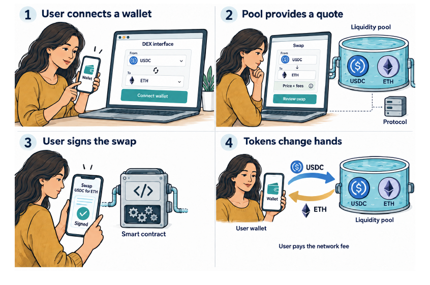

[打开原图](figures/m08/lec08-p03.png)

按左上、右上、左下、右下的编号读。连接钱包让应用看到可用账户；第二格给报价，第三格由用户签署实际指令，第四格 USDC 进池、ETH 出池。签名后仍要满足余额、花费授权与执行条件，网络费用也单计。

深读见 [[#2.1 从钱包换币开始理解 DeFi（讲义 p.2–5）|§2.1]]。

### Lec08 p.04 已有链上资产的人为何用 DeFi

链上钱包可直接换币、以现有币抵押借款、在兼容应用用同一资产。手续费、流动性与风险决定是否划算。

深读见 [[#2.1 从钱包换币开始理解 DeFi（讲义 p.2–5）|§2.1]]。

### Lec08 p.05 顺着 USDC 换 ETH 的一步步

先查报价与费用，签指令后合约查授权和交易条件。成功后 USDC 进池，ETH 到用户，账本更新双方余额。

深读见 [[#2.1 从钱包换币开始理解 DeFi（讲义 p.2–5）|§2.1]]。

### Lec08 p.06 TVL 的走势和口径

曲线读 2021 峰、随后下跌及 2026-07-29 的日期。TVL 是特定时点的资产估值，币价和计入范围会改变它，不能当利润。

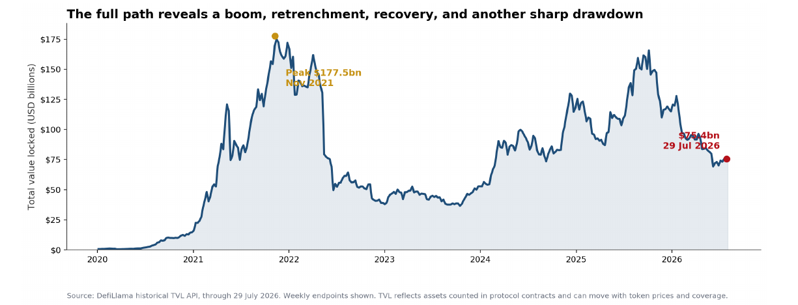

[打开原图](figures/m08/lec08-p06.png)

横轴从 2020 到 2026，纵轴为十亿美元。读标出的 2021 年 11 月峰值约 177.5 和 2026-07-29 约 75.4，只用两处标注的四舍五入数算，末点约比峰值低 57.5%。完整走势来自课件原图，附件没有全序列；不能由这条线分出多少是净赎回。

深读见 [[#2.2 TVL：合约里的资产不等于新投入的钱（讲义 p.6–8、26）|§2.2]]。

### Lec08 p.07 共享流动性、公开记录、可编程

第一栏供应者投入 ETH 和 USDC，交易者共享池。中栏用浏览器查转账记录，右栏按合约的抵押规则借款。

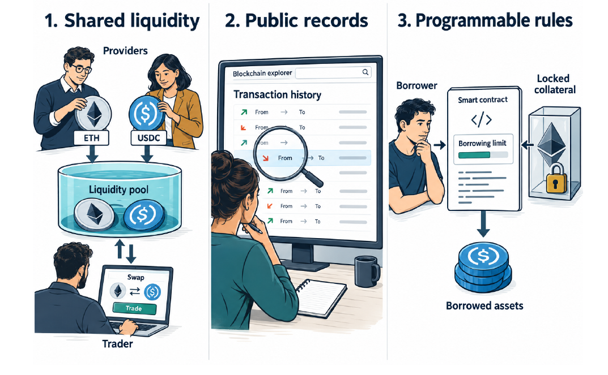

[打开原图](figures/m08/lec08-p07.png)

左边看供应者把 ETH／USDC 放入同一池，下面交易者可使用共有库存。中栏区分可见的链上动作和界面显示，右栏再看贷款条件由合约检查。链外凭证和受限地址仍须另核。

深读见 [[#2.2 TVL：合约里的资产不等于新投入的钱（讲义 p.6–8、26）|§2.2]]。

### Lec08 p.08 安全、清算与治理

先核合约权限、拥堵费用及恢复，再核价格数据、可出售抵押物的市场与收益补贴，最后查谁投票、谁能紧急更改规则。

深读见 [[#2.2 TVL：合约里的资产不等于新投入的钱（讲义 p.6–8、26）|§2.2]]。

### Lec08 p.09 分隔 · NFT

从可互换代币转到有身份区别的凭证。

### Lec08 p.10 NFT 票的两个编号

票 101 的座位 A1、票 102 的座位 B4；左栏区分标识，右栏由 Mei 转给 Sam。座位及入场仍依赖发行方条款。

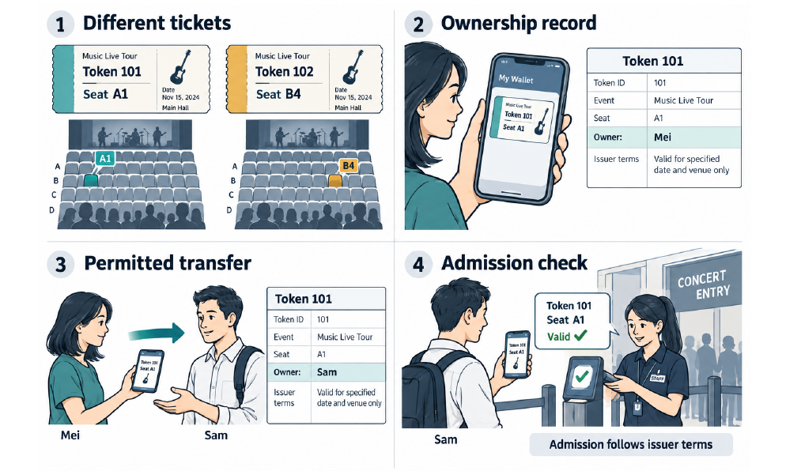

[打开原图](figures/m08/lec08-p10.png)

原图先显示两个座位和不同编号，再看 101 的持有人从 Mei 更新为 Sam。最后 Sam 能否入场仍由发行人查当前持有人和票券条款。转让不自动带来该场音乐作品版权。

图注按讲义，属示意票券设计；入场与转让遵循发行人条款。

深读见 [[#2.3 NFT：唯一编号、媒体内容和持有人权利分开（讲义 p.9–14）|§2.3]]。

### Lec08 p.11 五种应用的经济来源

藏品靠作者及市场，游戏靠继续可玩，票务靠发行人认票，资格靠可信签发及撤销，质押贷款靠估值、托管和清算。

深读见 [[#2.3 NFT：唯一编号、媒体内容和持有人权利分开（讲义 p.9–14）|§2.3]]。

### Lec08 p.12 代币、元数据、权利三层

持有人与转移历史是链上记录，图片或凭证内容依赖链接和存储；版权、入场和赎回条款由合同或平台决定，故障可以只出在其中一层。

深读见 [[#2.3 NFT：唯一编号、媒体内容和持有人权利分开（讲义 p.9–14）|§2.3]]。

### Lec08 p.13 NFT 的出售、转移与履约

有报价还需买家，可转移还需密钥、权限和可用存储；请求服务或取得版权要确认发行者和条款能否执行。

出售前先查实际成交、买盘和持有集中度。访问风险还包括钓鱼和被盗密钥，市场平台停摆或媒体链接失效也会影响使用。

深读见 [[#2.3 NFT：唯一编号、媒体内容和持有人权利分开（讲义 p.9–14）|§2.3]]。

### Lec08 p.14 NFT 周期与应用

2021 收藏品扩张，2022–23 回调，2024–26 课件列会员、票务、游戏、身份及资产请求权。价值看具体权益与发行方履约。

深读见 [[#2.3 NFT：唯一编号、媒体内容和持有人权利分开（讲义 p.9–14）|§2.3]]。

### Lec08 p.15 分隔 · 现实世界资产

进入资产的法律请求权、托管、结算与退出。

### Lec08 p.16 现实资产如何连到链

四格从债券条款、保管、链上记录到现金流；链上余额和真实付款分别追溯。

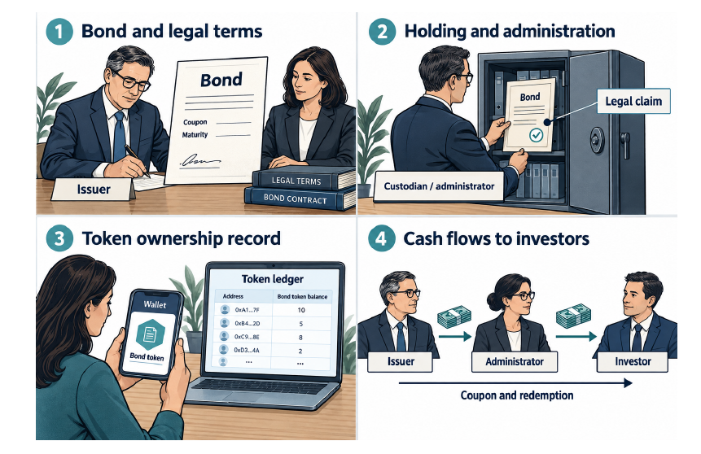

[打开原图](figures/m08/lec08-p16.png)

从第一格的票息、到期和债权人开始。第二格保管或管理文件，第三格的链上记录指认持有人。第四格依合同付息及到期清偿。记录层能协调付款，不能替代债务人履约。

图注为示意托管结构，课件引用 BIS Bulletin 72（2023）。

深读见 [[#2.4 RWA 先识别债权，再看记录技术（讲义 p.15–17）|§2.4]]。

### Lec08 p.17 同一债券在代币化前后

1,000 美元一年 5% 息票，承诺利息 50，到期还本金 1,000。代币化改善记录和交割指令，欠款人和执行条件仍按合同。

给定 1,000 美元本金和 5% 息票，全年利息为 50 美元。交易载体换成代币后，这个合同例仍是同一笔本金和承诺现金流；若发行人违约，代币不会代为补款。

深读见 [[#2.4 RWA 先识别债权，再看记录技术（讲义 p.15–17）|§2.4]]。

### Lec08 p.18 PAXG 怎样让小额持有黄金

按课件每枚代表一金衡盎司已分配黄金，可持小数份。金条仍在金库，实物兑换另有资格和流程。

深读见 [[#2.5 代币化黄金与仓库题：链上历史不能盘点金库（讲义 p.18–22）|§2.5]]。

### Lec08 p.19 PAXG 的链和金库

顺读发行、金库、链上记录及钱包；核谁保管实物、产品条款能否兑换以及赎回渠道。

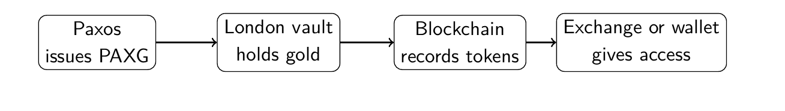

[打开原图](figures/m08/lec08-p19.png)

从 Paxos 发行到伦敦金库，再到链上余额与钱包访问。图的箭头是角色衔接，并不表示每次转币时真的搬金条。实物提取另查资格、最小规模和交付手续。

课件记载合资格链上钱包可查黄金分配，Paxos 按月公布鉴证报告。查询和鉴证帮助核对持有安排，实物交付仍有单独条件。

深读见 [[#2.5 代币化黄金与仓库题：链上历史不能盘点金库（讲义 p.18–22）|§2.5]]。

### Lec08 p.20 仓储代币选择题

C。先看可执行的仓单、仓储和赎回条款；记录持有人不能替代实际提货条件，保留四个原选项。

#### p.20 · 仓库题原文与作答

中文入口：有一枚记录不可随意改写的仓库代币，但没人独立检查同一批货有没有被重复抵押；这能保证所有权吗？

> **Multiple-Choice Question: Can a Token Verify the Warehouse?**
>
> An immutable token represents warehouse inventory, but no independent audit prevents the same goods from being pledged twice. Which statement is best?
>
> A) Tokenization removes custody risk.
>
> B) The blockchain verifies physical inventory automatically.
>
> C) Off-chain verification and legal-claim risk remain.
>
> D) Token uniqueness guarantees ownership title.
>
> **Discuss**
>
> Separate the token’s on-chain history from custody and enforceable rights over the physical asset.
>
> （讲义 p.20）

⚪ 参考作答（笔记推断）：选 C。immutable 指记录难以被事后修改，不表示当初输入的链外事实一定真实。pledged twice 指同一批货被拿去向不同债权人重复担保，不能靠代币编号独一无二排除。

- A 错：保管人能否妥善保存和交付货物仍有风险。
- B 错：账本不会自动走进仓库检查数量、真伪和是否重复担保。
- C 对：要独立核链外事实，并确认你能依法向谁主张什么权利。
- D 错：唯一的链上编号不能单独证明现实法律承认的所有权（Ownership title）。

Discuss 的答案也要完整：分别核代币历史、货物保管与盘点、担保登记／权利顺位、违约时的执行渠道。即使代币历史正确，货物不足或第三方有优先权，持有人仍可能拿不到预期资产。

权利顺位（Priority of claims）是同一资产处置后，谁先获得偿付的顺序。💡 笔记补充：货物卖得 100 元，若另一债权人依法可先拿走这 100 元，排在其后的人即使手持有效代币，也不一定能从这笔处置款收到钱。仓库有货与自己具有可执行、足额的权利仍需分别核对。

英文参考答案（笔记自拟）：**C. The blockchain records the token’s history, but does not independently verify the goods or prevent double pledging. Custody checks and enforceable legal rights remain necessary. A unique token does not by itself establish title to the physical inventory. Check token history, verify the custodian and inventory independently, and determine whether the claim is enforceable and what priority it has.**

💡 改条件练习：增加一次可靠盘点可以改善“货物是否存在”的证据，但若不核重复担保及权利顺位，不能据此断言代币持有人拥有唯一、优先的请求权。

深读见 [[#2.5.1 仓库原题：编号唯一仍需链外核验（讲义 p.20）|§2.5.1]]。

### Lec08 p.21 代币黄金的费用与退出

按课件查验日，Paxos 有创建与赎回费，未收客户黄金保管费。小额转移便利，实物交付是另项服务；比较总成本与真实可成交性。

费用按课件所列 2026-10-13 核验口径读。将创建、赎回、实体交付和二级市场成交的费用分开，是否比黄金 ETF 或金商便宜取决于各自条款与报价。

深读见 [[#2.5.2 费表和实收费用要分开（讲义 p.21）|§2.5.2]]。

### Lec08 p.22 三种连接真实资产的权利

一是直接所有权须与法定登记一致，二是由公司或信托持有资产而投资者向该主体主张，三是价格挂钩合约只承诺按价格结算。

如果代币只是金价联动合同，手上有的是向交易对手索取约定现金的权利；直接黄金所有权则需登记、托管和转移一致。遇到公司或信托结构时，还需追该主体持有什么以及投资者排在何种顺位。

讲义 p.22 原情境与问题

> Direct ownership. The official register or recognised custodian records ownership of the asset. Token transfers must agree with that record. Custody and transfer restrictions still matter.
>
> A company or trust owns the asset. The investor holds a claim on that entity. Legal documents determine cash flows and asset protection. Governance, valuation, and servicing affect the claim.
>
> A price-linked contract. A counterparty promises a payoff linked to the asset’s price. No ownership of the reference asset transfers. Payment depends on the contract, collateral, and counterparty.
>
> For each structure, identify the investor’s claim and who must honour it.

**参考作答（笔记推断）**。直接所有权结构下，持有人主张标的所有权，由适用登记制度确认，受认可的托管人按托管与转移规则执行。公司或信托持有资产时，持有人向该主体按法律文件主张分配或赎回。价格挂钩合同下，交易对手按合同与抵押安排支付约定金额。

**English reference answer (study notes).** With direct ownership, the investor claims title to the asset, recognised through the official register or recognised custodian. For an entity-held asset, the investor has a claim against the company or trust under its legal documents. In a price-linked contract, the counterparty owes the agreed payoff.

深读见 [[#2.5.3 三种资产关联结构（讲义 p.22）|§2.5.3]]。

### Lec08 p.23 ChinaAMC 的双向资金流

左到右是投资者认购、基金投资短存款和货币工具；右到左是资产收益、扣费后归持有人，可累积在净值中。

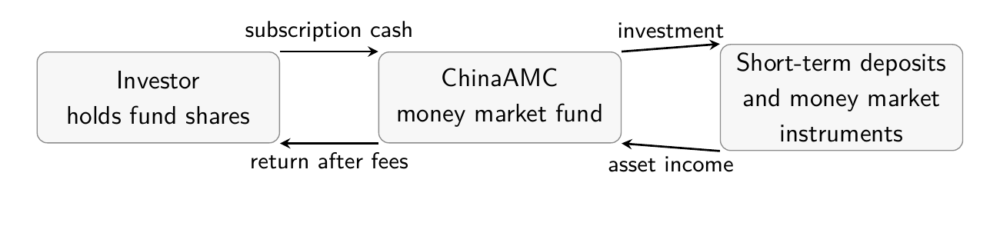

[打开原图](figures/m08/lec08-p23.png)

上方箭头是投资者的认购资金进基金，再投向短存款及货币工具。下方箭头是底层资产收入，经费用后归基金持有人，可反映在净值中。链上记录登记份额，不将短期存款直接转给个人。

深读见 [[#2.6 货币市场基金：份额回报来自资产，交易价来自买方（讲义 p.23、25）|§2.6]]。

### Lec08 p.24 发行人与投资者为何用 Orion

传统债券多处记录须核对，平台可协调数字发行与结算；还息还本由政府或公司发行人承担。

投资者要确认券何时到账、付款是否同一步完成，以及谁在之后付息。发行人也要分发债券并登记所有权；若原流程有多个记录维护方，平台可协助协调交割和核对差异。

深读见 [[#2.7 香港数字绿色债券：平台、债务人与绿色用途（讲义 p.24、28–30、34）|§2.7]]。

### Lec08 p.25 Class F 的市场与净值

区分课件的二级交易安排与按净值认购赎回的一级渠道，市场成交价可偏离净值。

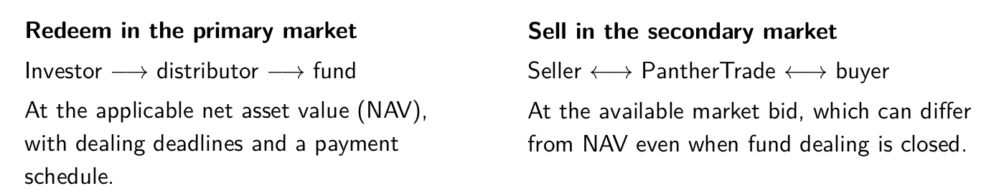

[打开原图](figures/m08/lec08-p25.png)

净值（net asset value，NAV）在这里指基金每份的净资产价值。左栏由投资者经分销商向基金赎回，按适用净值和处理时段。右栏买卖双方通过 PantherTrade 按当时可成交的报价交易。

例题每份参考净值为 100 港元，周末买方出价每份 99.80 港元。卖 1,000 份收入 99,800 港元，比参考价值少 200 港元（扣费前）。每份差 0.20 港元，除以 100 港元得折价 0.20%，即 20 个基点（bp）。份额持续可交易与基金可按 NAV 实时赎回是两个安排。

深读见 [[#2.6 货币市场基金：份额回报来自资产，交易价来自买方（讲义 p.23、25）|§2.6]]。

### Lec08 p.26 TVL 与外来本金选择题

A。A 锁 100 美元，B 存从 A 借出的 60，两个协议报告合计 TVL 160，原外来资本仍是 100。

下面这道原题更直接揭示重复计入。中文入口：同一位用户最初只带来 100 美元，但把抵押借出的币又存进另一个协议；两处 TVL 该怎样加？

> **Multiple-Choice Question: TVL and New Capital**
>
> A user locks \$100 of collateral in Protocol A and borrows \$60 of newly issued stablecoins against it. The user deposits those coins in Protocol B. Both the collateral in A and the deposit in B count as TVL. What are the combined reported TVL and the user’s original outside capital?
>
> A) TVL of \$160 and original outside capital of \$100.
>
> B) TVL of \$160 and original outside capital of \$160.
>
> C) TVL of \$100 and original outside capital of \$160.
>
> D) TVL of \$60 and original outside capital of \$100.
>
> （讲义 p.26；原题无额外小问。）

⚪ 参考作答（笔记推断）：选 A。outside capital 指用户最初从这套借贷循环外带来的资本，不是每个合约分别显示的金额。

这一表每行代表一个观察对象，金额单位都是美元；“负债”列保留用户借币的义务，不能只数资产。

| 对象 | 题设计入 TVL | 用户新增借债 |
|---|---:|---:|
| 协议 A 的抵押物 | 100 | 60 |
| 协议 B 的存入代币 | 60 | 0 |
| 合并报告值／借债 | 160 | 60 |

所以两个协议报告的 TVL 是 $100+60=160$ 美元。用户原始外部资本仍为 100 美元；借来的 60 美元在形成存款资产的同时，也形成负债。

- A 两个量都正确。
- B 把借款形成的资产也当作新增外部资本。
- C 把两个量倒置，漏掉 B 中题设明确计入的 60 美元。
- D 只算 B 的存款，漏掉 A 的抵押物。

英文参考答案（笔记自拟）：**A. Combined reported TVL is \$160, while the user’s original outside capital is \$100. The borrowed \$60 creates both an additional deposit and a debt; it is not new outside capital.**

💡 改条件练习：若 B 不把这笔存款计入 TVL，合并报告值会变成 100 美元；若仍计入但借款改为 40 美元，则合并值为 140 美元。先按口径逐项计入，再讨论经济含义，不能固定背 160。

深读见 [[#2.2 TVL：合约里的资产不等于新投入的钱（讲义 p.6–8、26）|§2.2]]。

### Lec08 p.27 退出流动性选择题

若平台技术上允许随时转移，但找不到愿按接近报价出钱的买家，哪个选项能直接改善退出？

> **Multiple-Choice Question: Transferability and Market Liquidity**
>
> A platform allows transfers of tokenized private assets at any time, but investors cannot find buyers near the quoted price. Which change most directly addresses the exit-liquidity problem?
>
> A) Divide each token into more units while leaving demand unchanged.
>
> B) Record the same ownership information on an additional blockchain.
>
> C) Attract funded buyers and market makers willing to quote executable prices.
>
> D) Replace the trading interface without changing the available counterparties.
>
> （讲义 p.27）

⚪ 参考作答（笔记推断）：选 C。most directly 要你找直接补上“谁肯出钱买”的措施。可执行价格（Executable price）指对手方确实愿意按相应条件成交的价格。做市商（Market maker）会提供买卖报价并承担一定存货风险，不只是展示参考数字。

- A：切成更多单位可能降低单笔门槛，但题目明确需求不变，不能据此补上买方资金。
- B：多记一份所有权并不自动增加愿意成交的对手方。
- C：有资金的买方和愿意承担成交的报价，直接改善退出条件。
- D：换界面可能更方便，但题设保留相同对手方，未直接解决没人接盘。

英文参考答案（笔记自拟）：**C. Funded buyers and market makers quoting executable prices directly address exit liquidity. Divisibility, another ledger, or a new interface does not by itself create demand near the quoted price.**

💡 迁移：如果新增做市商只愿意买 1 份，而你要卖 10,000 份，仍须检查报价深度。不能把“有一个买价”扩大为“任意数量都能按此价退出”。

深读见 [[#2.8 可转让、可成交与合法请求权（讲义 p.27、31–33）|§2.8]]。

### Lec08 p.28 香港数字绿色债券的发行

从图读 2023／2024／2025 年三期 0.8／6／10 十亿港元（按课件口径）；规模不是平台营收。

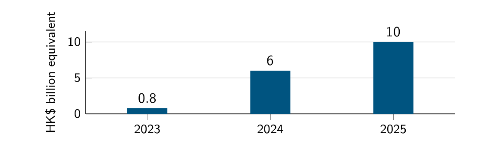

[打开原图](figures/m08/lec08-p28.png)

纵轴为十亿港元等值。比较 2023 到 2025 三柱时看单位，同一发行包含多币种；柱高是政府筹资规模，平台收费及实际二级交易深度须看其他证据。

深读见 [[#2.7 香港数字绿色债券：平台、债务人与绿色用途（讲义 p.24、28–30、34）|§2.7]]。

### Lec08 p.29 HSBC Orion 与券款对付

交割与付款相连；2025 债券 HKD、RMB 部分另有 e-HKD、e-CNY 选项。2023 GS DAP 的 T+1 是另一次试点。

券款对付（delivery versus payment，DvP）要求交券与付款互为条件。例如买方付款条件未满足，卖方的债券就不应完成交付。这个安排减少交券却收不到钱的风险；发行人之后是否按期付息和还本仍是另一项风险。

2025 年课件所述 e-HKD 与 e-CNY 是相应港元、人民币部分与传统安排并存的可选结算资产，与债券面值、息票和债务人分开。

深读见 [[#2.7 香港数字绿色债券：平台、债务人与绿色用途（讲义 p.24、28–30、34）|§2.7]]。

### Lec08 p.30 政府债利息与本金

用 2023 年条款示例 100 万港元 × 4.05%=40,500，全年清偿合计 1,040,500。绿色指资金用途，政府承担偿付。

先将 4.05% 写成 0.0405，乘面值 1,000,000 港元得一年息 40,500。到期同时收回面值，合计 1,040,500。课件使用 2023 年条款作演示，前提为全部如期支付。

深读见 [[#2.7 香港数字绿色债券：平台、债务人与绿色用途（讲义 p.24、28–30、34）|§2.7]]。

### Lec08 p.31 代币化绿债短答

先给一项潜在节省并说怎样用时间、差错或成本比较；再答利息、本金由政府承担，债权不等于持有绿色项目。

**数字绿色债券短答题**把同一判断用于业务效果。中文入口：金融条款不变，技术究竟省了哪一步；谁仍负责付钱？

> **Short-Answer Question: Evaluating a Tokenized Green Bond**
>
> Consider a tokenized HKSAR government green bond with the same coupon and maturity as a conventional bond. The platform links delivery to payment and shares transaction records.
>
> 1. Explain one potential saving in settlement or reconciliation. How could a bank measure the saving?
> 2. Who owes the interest and principal? Explain whether bondholders own the green projects financed by the bond.
>
> （讲义 p.31）

⚪ 参考作答（笔记推断）：

1. 可选的一个节省是减少对账人工：共同使用可核的交易记录，可能减少多机构手工比对与异常追查。银行可比较相近规模、复杂度和业务量下，每笔结算所用工时及需人工处理的差异笔数。

   也可测交付时间或结算失败率，但必须说明控制哪些差异。不能只比较新旧两笔金额不同的交易，就断言技术造成全部节省。题目问 one potential saving，给一个讲透即可，不把指标冒充已观察成果。
2. 香港特区政府按债券约定承担本息。债券持有人持有政府债权；“绿色”规定资金用途，不使持有人直接拥有相应绿色项目。平台连接交券付款，并不转移政府的偿付义务。

英文参考答案（笔记自拟）：

1. **Shared transaction records may reduce manual reconciliation. A bank could compare staff time and exception counts per comparable transaction before and after adoption, while controlling for transaction scale and complexity. These are potential savings, not measured results supplied by the question.**
2. **The HKSAR Government owes the coupon and principal under the bond terms. Bondholders hold government debt, not ownership of the green projects financed with the proceeds.**

💡 改条件练习：若银行必须同时维护旧系统，短期总成本可能上升。正确评估应把新增系统维护与减少的处理工作都计入，而不是把“少了一个手工步骤”直接等同净节省。

深读见 [[#2.8 可转让、可成交与合法请求权（讲义 p.27、31–33）|§2.8]]。

### Lec08 p.32 从沙盒到真实价值试点

2024 年 8 月 Ensemble Sandbox 与 2025 年 11 月 EnsembleTX 按课件历史节点区分；真实价值试点仍需法律权利、参与许可、结算和故障恢复。

沙盒用来测试代币化存款和数字资产怎样连接。后续受控的 EnsembleTX 试点用代币化港元存款和数字资产进行真实价值交易，仍须看许可、付款最终性与异常处理。

深读见 [[#2.8 可转让、可成交与合法请求权（讲义 p.27、31–33）|§2.8]]。

### Lec08 p.33 境内资产与境外代币案例

按课件 2026 年 2 月历史引用，境内租金应收的假设例要核申报主体、权利、资产及适用授权。后续适用性单独判断。

此处按讲义历史个案读。具体条款与既有官方附件查验日期见 §2.8，备案义务与足额担保、收益保障或准入资格是不同问题。

深读见 [[#2.8 可转让、可成交与合法请求权（讲义 p.27、31–33）|§2.8]]。

### Lec08 p.34 Orion 试点授权及商业化

课件 2026 年 2 月 DIGIT 平台授权不是完成发行。发行规模、平台收费、二级流动性是不同指标。

委任平台做试点只说明获得该项目角色。要知道是否已经完成发行，需另有发行记录；要估平台收入，还需知道服务收费和实际使用规模。

采用还取决于参与者能否接入、结算系统是否兼容、是否真能减少运营成本。若希望二级市场流动，还要有愿按可成交价格买入的人。

深读见 [[#2.7 香港数字绿色债券：平台、债务人与绿色用途（讲义 p.24、28–30、34）|§2.7]]。

### Lec08 p.35 分隔 · Sky 和 Aave

进入储蓄收益、池化借款和清算。

### Lec08 p.36 Sky 的两种入口

USDS 用于交易转移，sUSDS 对应浮动储蓄；贷款与获批策略创造协议收入，治理定利率、代理与限额。

钱包与交易所可作为接入服务。提款时要看可用流动性和运行记录；策略对手方出问题可能同时影响收益和赎回。

深读见 [[#2.9 Sky：储蓄回报需要收入和分配规则（讲义 p.35–39）|§2.9]]。

### Lec08 p.37 Sky 产品栈原图

用户投入 USDS 取得 sUSDS 储蓄凭证。协议经代理配置资本，链上与链外策略收益经治理决定的储蓄率回流。原图回流线压住文字，解释箭头方向。

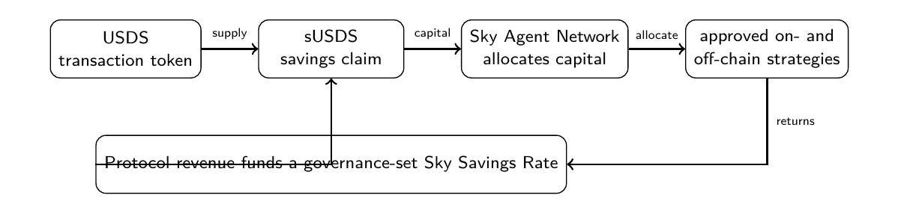

[打开原图](figures/m08/lec08-p37.png)

先看用户从交易用 USDS 获得 sUSDS 储蓄请求权。再看协议如何通过代理把资金分给获批策略。被配置的是协议资本，sUSDS 记录储蓄者的请求权。下方回流箭头表示策略收入经协议与治理决定的储蓄率回到储蓄端；源图连线盖住部分字，实际分配仍按治理条款。

深读见 [[#2.9 Sky：储蓄回报需要收入和分配规则（讲义 p.35–39）|§2.9]]。

### Lec08 p.38 Sky 的收益、损失与决策

检查贷款与策略收入、补贴、抵押和赎回；确定谁选代理、设限、负责在手抵押和损失传递。

若策略亏损，协议收入或支持资产可能减少，兑换能力也可能受影响。USDS 和 sUSDS 具体由谁先承担损失，要按产品规则核对。

深读见 [[#2.9 Sky：储蓄回报需要收入和分配规则（讲义 p.35–39）|§2.9]]。

### Lec08 p.39 储蓄收益率算例

6+4−2=800 万美元可分配，除以 2 亿得 4%；付 5% 要 1,000 万，多出的 200 万须另有来源。

把百万美元作共同单位，6 加 4 减 2 得 8，再用 8 除以全年固定储蓄余额 200 得 4%。若按 5% 付，需要 10，额外 2 必须有资金来源。

深读见 [[#2.9 Sky：储蓄回报需要收入和分配规则（讲义 p.35–39）|§2.9]]。

### Lec08 p.40 旧 Maker 抵押仓的清算分支

左向右锁定抵押、铸出 DAI、用户收到；跌破门槛则由向下支路进入清算。依赖价格、预言机和市场。

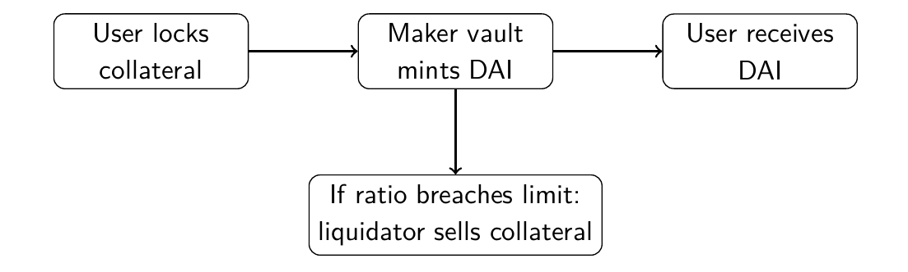

[打开原图](figures/m08/lec08-p40.png)

横向三格是锁抵押、金库铸币和用户收 DAI。向下的分支是在抵押比跌破门槛后，清算者出售抵押。若价格输入、预言机或清算市场有问题，抵押安排仍可能无法足额回收。

若加入现实世界资产作抵押，流程还须追踪链外托管人和可执行的权利。实际清算时要确认谁有权出售、怎样取得抵押资产，而不只看链上登记。

深读见 [[#2.10 Maker 旧机制与 DAO 投票：足额和决策权都要量化（讲义 p.40–42）|§2.10]]。

### Lec08 p.41 跌到哪一步可清算

抵押 150 跌 20% 为 120，债务 100，抵押比 120% 小于 125%；抵押仍高于债务但已可清算。

债务不变，先让抵押值乘 0.8 得 120，再除以 100 得 120%。门槛 125% 高于 100%，所以还没资不抵债也可能允许清算。

深读见 [[#2.10 Maker 旧机制与 DAO 投票：足额和决策权都要量化（讲义 p.40–42）|§2.10]]。

### Lec08 p.42 DAO 的票权如何算

40 人每人 1 票，另一人有 60 票；满足法定数和提案门槛时，一人可凭票权获简单多数。持储蓄份额不自动得治理权。

先加票而非数人。反对一侧为 40 票，支持一侧为 60 票；若规定为简单多数且法定人数等条件均满足，支持可过。治理权仍由具体规则授予。

提案例如调整可抵押额度或分配协议金库资金。先读提案和法定门槛，再按票权计算。

深读见 [[#2.10 Maker 旧机制与 DAO 投票：足额和决策权都要量化（讲义 p.40–42）|§2.10]]。

### Lec08 p.43 Aave 抵押借款四格

供应者投入 USDC、借款者抵押、池转 USDC、跌价由清算者偿债换抵押。即使执行清算也可能留缺口。

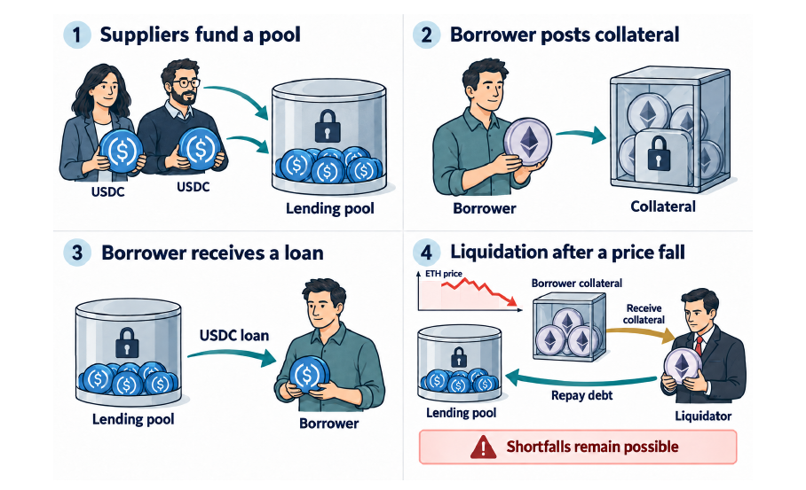

[打开原图](figures/m08/lec08-p43.png)

读四格时分清出资人、借款人和清算者。第 3 格是池把已有 USDC 借给用户；第 4 格跌价后由清算者付债并得到部分抵押。若出售净额低于贷款，仍会有缺口。

课件图注来源为 Aave 的 Health Factor & Liquidations 与 Aave App Disclosures。

深读见 [[#2.11 抵押贷款：担保资产能卖多少才决定回收（讲义 p.43–44）|§2.11]]。

### Lec08 p.44 抵押借款损失三问

贷款 100 美元，抵押品原值 150，出售前跌 40%，出售成本 5。题目忽略利息且没有其他回收。先逐问算净回收与损失，再解释链上记录的边界。

> **Short-Answer Question: Collateral Value and Loan Losses**
>
> A lending platform makes a \$100 loan against collateral worth \$150. Before the collateral can be sold, its price falls by 40%. Selling costs are \$5. Ignore interest.
>
> 1. Calculate the net cash recovered by selling the collateral.
> 2. Calculate the loan shortfall if there is no further recovery.
> 3. Explain why recording the collateral on a blockchain does not prevent this loss.
>
> （讲义 p.44）

⚪ 参考作答（笔记推断）：

1. 抵押物出售前价值为 $150\times60\%=90$ 美元。出售成本要从卖得的钱里扣，所以净回收为 $90-5=85$ 美元。题目先跌价、后出售，不能把 40% 用在贷款本金上。
2. 原贷款 100 美元，没有其他回收，缺口为 $100-85=15$ 美元。这里的贷款损失（Loan loss）按题设的最终无额外回收口径计算，不只是短期没现金。
3. 区块链可以记录抵押及转移，但不能阻止价格下跌、保证买方报价或免除出售成本。即使记录没有错误，净回收也只有 85 美元。

英文参考答案（笔记自拟）：

1. **The collateral is worth \$150 × 60% = \$90 after the fall. Net cash recovered is \$90 − \$5 = \$85.**
2. **With no further recovery, the loan shortfall is \$100 − \$85 = \$15.**
3. **A blockchain record does not prevent a fall in collateral prices or remove selling costs. Accurate recording cannot guarantee full recovery of the loan.**

💡 改条件练习：若价格只跌 20%，卖价为 120 美元，扣 5 美元后有 115 美元，足以覆盖 100 美元贷款；剩余资产如何返还或分配依合同。不能把全部 115 美元直接记作贷款人利润。

深读见 [[#2.11 抵押贷款：担保资产能卖多少才决定回收（讲义 p.43–44）|§2.11]]。

### Lec08 p.45 卖 ETH 与借 USDC

同拿 15,000 USDC，卖后留 5 ETH 且无债；借后抵押 10 ETH 并欠 15,000，两者起初净资产均 30,000，风险暴露不同。

比较当下余额和债务。卖出方案留下 5 ETH 和 15,000 USDC；借入方案持有 10 ETH 和 15,000 USDC，同时欠 15,000，起点净资产一样。价格下跌时两者承担的资产跌幅和清算条件不同。

深读见 [[#2.12 Aave 同一笔贷款：卖出、借入与清算（讲义 p.45–47）|§2.12]]。

### Lec08 p.46 LTV 与清算门槛

60% 是本例新增借款上限，80% 用来判断已有贷款是否可清算。同一笔贷款在 ETH 跌价后，可能先不能增借，过一段才可清算。

贷款价值比（loan-to-value，LTV）用债务除抵押价值，先检查还能否再借；健康因子（Health factor，HF）用抵押乘清算阈值再除债务。ETH 跌到 2,000 时，15,000 除 20,000 是 75%，已超过借款上限。按 60%，20,000 美元抵押最多支持 12,000 美元债务。当前欠 15,000，故不能增借。

但 20,000 乘 80% 除 15,000 约 1.067，仍未到清算点。ETH 跌到 1,800 时，HF 为 0.96，已经低于 1，满足题设的可清算条件。本例 HF 等于 1 时的 ETH 价格为 1,875 美元。

深读见 [[#2.12.1 借款上限与健康因子回答不同问题（讲义 p.46）|§2.12.1]]。

### Lec08 p.47 清算者怎样获得 ETH

还 6,000 USDC，5% 奖励，按 1,800 收 3.5 ETH；剩 6.5 ETH 和 9,000 债，HF 1.04。给定规则及价格下的演示。

清算人付 6,000 USDC 的债并按题设加 5% 补偿，共换出价值 6,300 的 ETH。除以每枚 1,800 得 3.5 ETH，Alice 没有收到新的 USDC。把剩余抵押和剩余债重新代入，HF 约 1.04。

深读见 [[#2.12.2 清算人替谁还债，又拿走谁的 ETH（讲义 p.47）|§2.12.2]]。

### Lec08 p.48 借款 5% 如何给出供应 2.7%

100 万池借出 60 万，借息 3 万，储备抽 3 千；其余 27,000 对全部供应 100 万是 2.7%，未出借 40 万。

供应者用全部供应资金作分母，借款利息只由借出的资金产生。先从借款人一年付的 30,000 扣 3,000 到储备，余额 27,000 除以 100 万，得 2.7%。这是固定余额与费率的演示。

深读见 [[#2.13 供应利率、提款现金与治理生态（讲义 p.48–50）|§2.13]]。

### Lec08 p.49 借贷池提现选择题

存款 1 亿美元，已贷 9000 万，申请立即提现 3000 万。没有新存入也没有还款；先找这一刻池中能直接拿来支付的金额。

> **Multiple-Choice Question: Withdrawals from a Lending Pool**
>
> A pool has \$100m of deposits, of which \$90m is lent out and \$10m remains available. Suppliers request \$30m immediately. There are no new deposits or loan repayments. Which conclusion follows?
>
> A) Adequate borrower collateral makes all \$30m immediately available.
>
> B) Only \$10m is available, even if the loans remain fully recoverable.
>
> C) The withdrawal request proves the pool has a \$20m credit loss.
>
> D) Raising borrowing rates instantly supplies the missing \$20m.
>
> （讲义 p.49）

🎙️ 课堂讲评支持 B（S30 `35:09`–`35:42`）。immediately 和 no new deposits or loan repayments 排除了等待新钱或还款。m 表示百万美元。逐项解释与英文句为笔记整理。

- A 错：抵押物是担保，并不是池中已经可支付的同币种现金。
- B 对：眼下只有 1,000 万可用。贷款以后全部能收回，也不意味着现在能立即付出 3,000 万。
- C 错：请求与现金之间有 2,000 万的即时缺口，但题目未说贷款最终少收回 2,000 万。
- D 错：加息可能改变后续供求行为，不会瞬间生成缺少的现金，且题目排除了新存入和还款。

英文参考答案（笔记自拟）：**B. Only \$10m is immediately available. The \$20m gap is a current liquidity shortfall, not proof of a credit loss. Collateral and a higher borrowing rate do not instantly provide the missing cash.**

💡 改条件练习：若此时借款人另还款 2,000 万，现金可增到 3,000 万，才可能满足该批提款；但已改变原题的“无还款”条件。若贷款最终只收回 7,000 万，还须另外计算资产损失，不能和即时缺口混算。

深读见 [[#2.13.1 提款原题：抵押物不是即时现金（讲义 p.49）|§2.13.1]]。

### Lec08 p.50 Aave 入口与治理

钱包或比价服务连接，GHO 扩产品；治理定抵押、资产限额和升级。跨链要核价格、桥和清算安排。

按课件，GHO 是 Aave 治理的稳定币，属于产品扩展。跨多个网络增加入口，也增加要分别监控的价格源、桥和清算安排。故障可能使借款难以及时偿付，也可能影响供应者提款。

深读见 [[#2.13.2 产品、治理与多网络服务（讲义 p.50）|§2.13.2]]。

### Lec08 p.51 两位创始人改变的机制

MakerDAO 从超额抵押 DAI 到 Sky 的储蓄、代理及更多链外资产；ETHLend 由点对点变为 Aave 池化。肖像为编辑插图。

深读见 [[#2.14 改设计、跨链与三种持有人权利（讲义 p.51–54）|§2.14]]。

### Lec08 p.52 Aave 和 Sky 的收益来源

Aave 供应收益主要看借款人付息，Sky 储蓄率由协议收入与治理决定；两边都要追溯风险向谁传递。

Aave 供应端收入随借款利息变化；Sky 的 Agents 为在贷款和其他策略中配置的资本付费，形成协议收入，再按治理规则提供储蓄率。ETH 抵押急跌时即使清算已执行，Aave 的净回收仍可能不足偿还贷款。 [[#Lec08 p.44 抵押借款损失三问|p.44 的 85 美元净回收]]给出一个缺口例。不能由任一利率推出本金有保证。

深读见 [[#2.14 改设计、跨链与三种持有人权利（讲义 p.51–54）|§2.14]]。

### Lec08 p.53 跨链的 5 ETH 请求权

源链锁 5 ETH，验证后目标链铸 5 份凭证；返回先销毁、验证后再放原币。桥的验证与托管出问题会失去支撑。

先在源链确认为锁定，再在目的链铸造；回程先销毁，再核验并放回源链资产。这两次验证不必由同一方执行，题面没有指定验证者。若底层资产被盗，记录仍可显示而实际支持已不足。

讲义 p.53 完整英文情境与提问

**A Cross-Chain Claim on 5 ETH**

Suppose a bridge uses a lock-and-mint design to move ETH exposure to another blockchain.

1. Lock 5 ETH in a contract on Ethereum.
2. After verification, mint 5 claim tokens on the destination chain. The original ETH remains locked.
3. To return, burn those claim tokens. After verification, release the original 5 ETH.

Who verifies each step? If the locked ETH is stolen, the claim token may lose its backing even if the wallet still shows a balance.

One illustrative bridge design, ignoring fees. A bridged claim depends on the bridge’s backing and verification.

⚪ 参考作答（笔记推断）：原题没有指定桥的验证者。应查谁核实锁定／销毁、按什么规则允许铸造／释放；不能擅自写成所有桥都由以太坊原生共识完成验证。

英文参考答案（笔记自拟）：*The question does not specify the verifier. The bridge’s verification rules and responsible parties must be identified. A recorded claim may lose its backing if the locked ETH is stolen.*

深读见 [[#2.14 改设计、跨链与三种持有人权利（讲义 p.51–54）|§2.14]]。

### Lec08 p.54 并列比较三种代币权利

Aave 是供应本金与利息并受流动性限制，LAND 是平台用途权且创作者版权单列，数字绿债的付息还本责任由政府承担。

按原比较先说持有人的请求权，再说履约对象。Aave 供应头寸靠借贷池，LAND 的使用和版权受平台及创作条款约束，香港数字绿债本金和票息由政府承担。

> **What Do These Tokens Give Their Holders?**
>
> • Aave supply position: supplied tokens plus accrued interest. Withdrawals depend on available pool liquidity.
>
> • The Sandbox LAND NFT: a virtual plot for publishing or renting space for games. A tenant’s game copyright remains with its creator.
>
> • HKSAR digital green bond on HSBC Orion: the government owes coupon and principal. HSBC provides the digital assets platform.
>
> （讲义 p.54；以下为中文解析，原页已给比较结果。）

- Aave 供应头寸：相应供应资产及累计利息的请求权；提款受池中可用流动性限制。
- The Sandbox LAND NFT：虚拟地块的发布／出租等用途；租用者创作的游戏版权仍属于创作者，地块权利与游戏版权分开。
- Orion 上的香港政府数字绿色债券：政府按约定支付票息和本金；汇丰提供数字资产平台，不把政府债务变成平台股权。

三项英文参考归纳（笔记自拟）：*The Aave supplier has a claim on supplied assets and accrued interest, subject to available pool liquidity. LAND grants specified virtual-land uses, not a tenant’s game copyright. The digital bond gives a contractual claim on the HKSAR Government for coupon and principal; Orion is the platform.*

回答一个代币案例时，按“持有人→具体权利→兑现者→收入／支持资产→退出路线→失败点”走完，才不会把链上技术和经济权利混在一起。

深读见 [[#2.14 改设计、跨链与三种持有人权利（讲义 p.51–54）|§2.14]]。

### 按主题深读与课堂时间戳

保留完整推导、现有课堂补充和材料边界。可从上方逐页正文进入相应深读。

### 2.1 从钱包换币开始理解 DeFi（讲义 p.2–5）

你已经持有 USDC，现在想得到 ETH。USDC 是以接近美元价值为目标的稳定币（Stablecoin）；ETH 是以太坊的原生资产。这里先把二者当作两种资产，不把 USDC 的价格稳定目标当作无条件保证。

传统途径可以先把资产放进交易平台，再按平台规则成交。本讲的去中心化金融（Decentralized finance，DeFi）让用户通过公开区块链上的合约使用交换、借贷等服务。关键是合约执行了哪些动作，而不是网页上有没有写“去中心化”。（讲义 p.3–4）

讲义 p.3 的英文定义原句为：*“Decentralized finance (DeFi) runs financial services on public blockchains.”* 中文即“DeFi 在公开区块链上运行金融服务”，后面的步骤解释这句话中的“运行”具体改变什么。

一次换币按三个动作走：

先连接钱包，应用才能读取相应地址并向钱包请求签名；连接不等于已经交出私钥。p.3 的四格图依次是连接钱包、池子报价、用户签署交换、代币换手，最后还标明用户支付网络费用。（讲义 p.3；已视觉回源）

1. 查看报价。前端应用显示，交出指定 USDC 后预计得到多少 ETH，以及费用。前端是帮助你查看和发出指令的界面；资产变化由相应合约处理。
2. 授权并签名。用户允许指定合约按限定范围动用代币，并签署本次交易。支出许可和交易指令需要区分；不要把“签了名”理解为“程序已经证明安全”。
3. 执行交换。条件满足时，USDC 进入池子，ETH 从池子转给用户，账本记录新余额。条件不满足时，不能把预计到账数当作已得到的资产。（讲义 p.5）

沿图从上往下读，箭头注明移动的是指令还是资产。图只解释交易成功的资产流，不展开共识和全部交易失败规则。

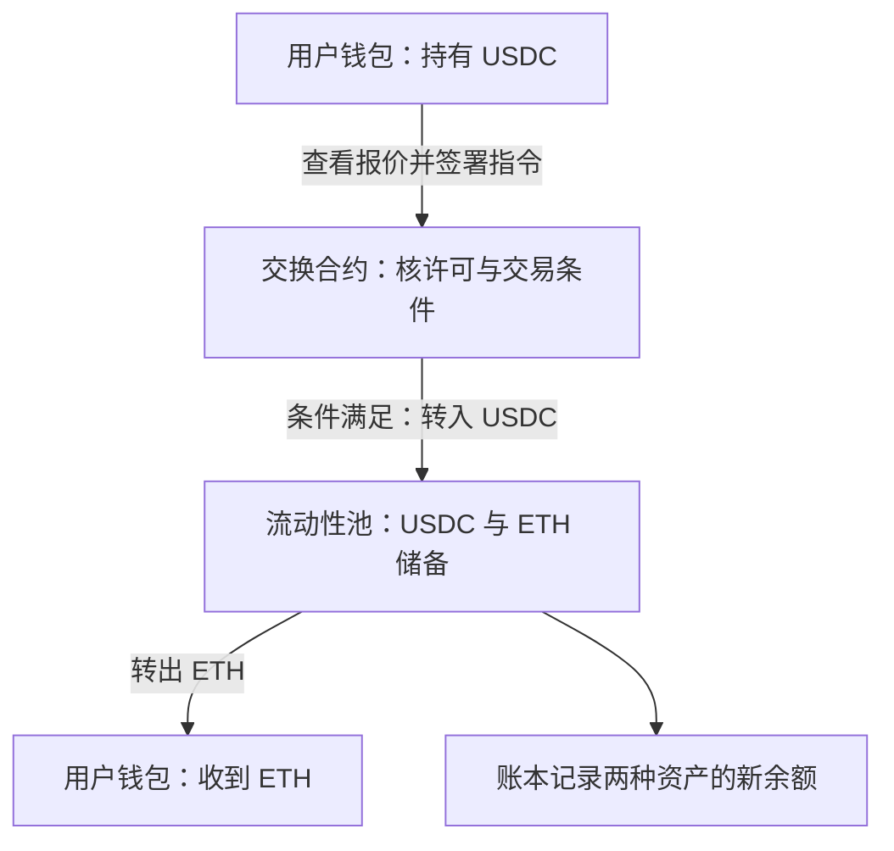

💡 换个说法（笔记补充）：假设用户支付 100 USDC，合约按当时条件交付一定数量 ETH。用户付款额和池子付款后的 USDC 总余额是两回事。池子原先已有资产；本次只增加 100 USDC，并减少交给用户的 ETH。

池内储备比例会影响报价。某笔交易消耗较多 ETH 后，下一笔交易面对的是新的池子状态。M07 的恒定乘积算例说明了这种价格冲击（Price impact）；本讲 p.5 没给这次交换的储备和费用，因此不能从这页算出唯一的 ETH 到账量。

讲义给出三种使用动机：从钱包直接交换资产；以已有加密资产借到可支用代币，暂不出售抵押物；让兼容应用使用同一资产和公开记录。这些动机是否值得，要比较费用、可成交资产量和承担的风险，不能只看是否绕过某个中介。（讲义 p.4）

**🎙️ 课堂补充**（S24 `16:30`–`29:05`）

课堂按钱包、两种代币的池、签署指令、资产换手的顺序读图。*"The pool will hold both tokens there."*（S24 `27:59`）中文：池中同时有两种资产，用户交入 USDC、拿走 ETH；不是平台凭空给出财富。`28:45`–`28:55` 再说明账本余额更新。

S24 `28:55`–`29:05` 的“一笔交易加一个区块”是过简口语，不能按一笔交易必定对应一个新区块记忆；区块可以打包多笔交易。课堂网页提及的平台名称也不自动等于 DeFi 或证明免身份核查；本节只按讲义的钱包—合约—池路径解释。

### 2.2 TVL：合约里的资产不等于新投入的钱（讲义 p.6–8、26）

你想知道一个协议承载多少资产，可以查看总锁仓价值（Total value locked，TVL）。它按特定统计口径，把计入合约的资产换算成价值并加总。先问“统计计入了什么”，再读数值。（讲义 p.6）

TVL 可以观察规模变化或资产价值下降，但不能直接当作协议股东权益、营业收入、活跃用户数或可立即成交的市场深度。币价上涨，即使没有新存入资产，按市价计算的 TVL 也可能上涨。后一句是笔记补充，用来解释“数量”和“计价价值”的差别。

原图横轴是 2020–2026 年，纵轴为十亿美元（USD billions）。线显示 2021 年快速扩张、2022 年显著下降、其后复苏，以及 2026 年再次大幅下降。图中特别标出 2021 年 11 月峰值 177.5 十亿美元，及 2026-07-29 的 75.4 十亿美元；它们是课件图示读数，不是当前实时 TVL。（讲义 p.6）

只使用这两个已标数字，可以计算从峰值到末点约下降 $1-75.4/177.5\approx57.52\%$。这不是用户投资组合回报，也不能单靠曲线分解资金流出与价格下跌的贡献。

图注明确来源为 DefiLlama 历史 TVL API、展示每周末端观测值，资产价格和覆盖口径都可能改变数值。课件未附完整序列，本稿只重画两个明确标注点，不从截图编造整条曲线。

![[EF5560_Fintech_and_AI_in_Finance/notes/figures/m08-defi-rwa/tvl-anchors.svg]]

图读法：纵向位置比较两个日期的 TVL；两点不连线，不暗示中间路径。可编辑数据与图源见 [[EF5560_Fintech_and_AI_in_Finance/notes/figures/m08-defi-rwa/chart-data.json|数据]]、[[EF5560_Fintech_and_AI_in_Finance/notes/figures/m08-defi-rwa/charts.py|生成脚本]]。

下面这道原题更直接揭示重复计入。中文入口：同一位用户最初只带来 100 美元，但把抵押借出的币又存进另一个协议；两处 TVL 该怎样加？

> **Multiple-Choice Question: TVL and New Capital**
>
> A user locks \$100 of collateral in Protocol A and borrows \$60 of newly issued stablecoins against it. The user deposits those coins in Protocol B. Both the collateral in A and the deposit in B count as TVL. What are the combined reported TVL and the user’s original outside capital?
>
> A) TVL of \$160 and original outside capital of \$100.
>
> B) TVL of \$160 and original outside capital of \$160.
>
> C) TVL of \$100 and original outside capital of \$160.
>
> D) TVL of \$60 and original outside capital of \$100.
>
> （讲义 p.26；原题无额外小问。）

⚪ 参考作答（笔记推断）：选 A。outside capital 指用户最初从这套借贷循环外带来的资本，不是每个合约分别显示的金额。

这一表每行代表一个观察对象，金额单位都是美元；“负债”列保留用户借币的义务，不能只数资产。

| 对象 | 题设计入 TVL | 用户新增借债 |
|---|---:|---:|
| 协议 A 的抵押物 | 100 | 60 |
| 协议 B 的存入代币 | 60 | 0 |
| 合并报告值／借债 | 160 | 60 |

所以两个协议报告的 TVL 是 $100+60=160$ 美元。用户原始外部资本仍为 100 美元；借来的 60 美元在形成存款资产的同时，也形成负债。

- A 两个量都正确。
- B 把借款形成的资产也当作新增外部资本。
- C 把两个量倒置，漏掉 B 中题设明确计入的 60 美元。
- D 只算 B 的存款，漏掉 A 的抵押物。

英文参考答案（笔记自拟）：**A. Combined reported TVL is \$160, while the user’s original outside capital is \$100. The borrowed \$60 creates both an additional deposit and a debt; it is not new outside capital.**

💡 改条件练习：若 B 不把这笔存款计入 TVL，合并报告值会变成 100 美元；若仍计入但借款改为 40 美元，则合并值为 140 美元。先按口径逐项计入，再讨论经济含义，不能固定背 160。

#### 2.2.1 三类价值与三类风险（讲义 p.7–8）

p.7 的三栏图分别是共享流动性（Shared liquidity）、公开记录（Public records）和可编程规则（Programmable rules）。第一栏的供应者把 ETH／USDC 放入池子，交易者使用共同池子；第二栏显示可查询的交易历史；第三栏让借款额度规则连接已锁抵押物和借出资产。

共享池减少逐一匹配的需要；公开记录方便核查已发生的动作；程序规则让满足条件的处理按同一逻辑执行。它们分别改善匹配、信息和执行，不能互相替代。把这三种价值和 p.8 的三个风险问题一起读，才能判断实际服务有没有改善。

- 执行风险：合约漏洞、权限设置或网络拥堵可能使交易失败、延迟或资产受损。审计和权限检查提供信息，不能被理解为消除风险。
- 抵押风险：资产价格下跌、预言机信息失真或买方不足，会影响清算收回多少钱。
- 治理风险：谁能投票、紧急修改参数或动用资金，需要核权限、延迟和问责。

这些是三个不同问题。某协议交易记录公开，不能据此直接推出抵押物随时有买家或治理权分布均匀。

**🎙️ 课堂补充**（S24 `29:10`–`36:57`；S25 `48:41`–`52:49`）

课堂用交易活跃度的变化类比 TVL 图，但 TVL 是按口径计价的资产存量，不是一定期间的成交量，也不能从它直接算活跃人数。币价下降本身就可能降低 TVL；课堂对市场近期跌幅和年份的口述，不替代 p.6 原图有日期的读数。

p.26 题的讲评给出原外部资本100、报告TVL160。*"So this guy, the outside capital he has is just \$100."*（S25 `51:12`）这对应选项 A。随后 `52:04`–`52:40` 加上借36再存的延伸，说明重复报告可继续扩大；借贷同时形成负债，不能因此认定用户净财富变成160或196。

共享池、公开记录、可编程规则仍各有边界。S24 `35:25`–`35:59` 强调抵押物未必来得及出售；`36:07`–`36:57` 指出票权可能集中，记录公开不等于风险或权力自动均匀。

### 2.3 NFT：唯一编号、媒体内容和持有人权利分开（讲义 p.9–14）

假设你买到一张用代币表示的演出票。钱包显示你持有该代币，是否就能进入会场？还要看发行方是否认可、票是否有效、转让后谁能使用。非同质化代币（Non-fungible token，NFT）提供可区分的链上标识，不独自决定现实中的权利。（讲义 p.10–12）

“非同质化”的意思是两个代币不能仅因数量都是 1 就视作同一份权利。一张指定座位的票和另一张票可能有不同权益。讲义 p.10 为示意票券，入场和转让要依发行条款，不是所有 NFT 的统一规则。

p.10 的具体图例把 Token 101 对应座位 A1，Token 102 对应座位 B4。101 的持有人先是 Mei；允许转让后记录变成 Sam，入场时检查 101／A1 是否有效。座位没因换持有人变成另一张票；该示意强调“唯一标识、持有记录、获准转让、入场核验”四个环节。

先把三层放在同一张表中。每行是一个需要分别核对的对象，右列说明那层怎样出问题。

| 层 | 记录或约定什么 | 失败例 |
|---|---|---|
| 代币（Token） | 持有人地址及转移历史 | 私钥被盗、合约出错或转移受限 |
| 元数据／媒体（Metadata and media） | 指向图片、视频、票券或物品的信息 | 储存链接失效或内容可被更改 |
| 法律／平台权利 | 使用许可、入场、服务或赎回条款 | 约定不清或发行方拒绝履行 |

例如，代币转给你，只说明链上持有记录改变。是否拿到图片版权（Copyright），要另查版权许可；能看到一幅画、持有指向画的代币和拥有版权是不同权利。（讲义 p.12）

应用也要按“标识什么、谁兑现用途”判断。（讲义 p.11）

- 数字艺术／收藏：标识某版作品或收藏项目；价值还受创作者、稀缺性、社群、交易市场和许可影响。
- 游戏：标识角色、道具、地块或访问权；持续可用取决于游戏运营和规则。
- 票务／会员：标识入场或持续权益；发行方认可、转让政策与实际服务决定能否用。
- 身份／资历：标识关于某人的声明；可信发行者、隐私、撤销与接收方认可仍须处理。
- NFT 抵押融资：借款人把 NFT 作为担保；估价、买方、托管和出售程序决定能回收多少。

挑战可按三问检查：真要卖时有没有可执行买价；能否安全控制和转移；发行方究竟承诺交付什么。挂出的价格不是愿意成交的买家出价，媒体仍能显示也不证明使用权可以执行。（讲义 p.13）

讲义 p.14 把 2021 年收藏热潮和 2022–23 年调整，与 2024–26 年在会员、票务、游戏、身份及资产关联权利上的尝试分开。这里是讲义的历史概括，不据此推断当前每个 NFT 项目都有需求。分析终点应回到持有人权利及发行方的交付能力。

💡 反例练习（笔记补充）：NFT 的图片链接一直有效，但活动取消且条款没有退款承诺。媒体层仍可用，不代表入场服务或退款权也已得到保障。要查的是服务与合同层，不能只核代币编号。

**🎙️ 课堂补充**（S24 `37:10`–`42:24`；S25 `00:00`–`14:04`）

课堂用不记名票容易转卖、实名票难改持有人作对照，再读 Mei 转给 Sam 的票券示意。关键不是“放了二维码就不能转让”，而是发行规则、唯一标识、持有人更新和入场核验能否接起来；NFT 本身不能代替主办方履约。

*"We buy a token."*（S25 `00:52`）中文：买入时直接获得的是代币，媒体和实际权利另查。`02:25`–`02:43` 又明确持币不自动拥有版权或链外资产。讲者随后用“能否让你进场”追问发行方承诺（`10:11`–`10:56`）。课堂的“链外无法保障”不能推广成任何合同或版权都无法执行；本稿保留逐项查权利与执行方的判断。

S24 末句仍在应用第二项，S25 开头已在游戏地块；内容支持先后，但接缝没有共同声轨锚点，未知漏了多少，不把两源拼成统一时钟。课堂现场 NFT 价格与活动口号不作实时价格、完整产品条款或投资建议。

### 2.4 RWA 先识别债权，再看记录技术（讲义 p.15–17）

现实世界资产（Real-world assets，RWAs）可以是债券、黄金或其他链外资产。资产代币化（Tokenization）用代币表示相关权利，并把持有、转移或支付流程接到数字系统上。你首先要问：代币到底代表对谁的什么请求权（Claim）。（讲义 p.16）

债券（Bond）是一个合适起点：投资者把钱借给发行人，发行人依约支付利息并偿还本金。讲义 p.17 的示意债券为本金 1,000 美元、期限一年、票息率 5%。假设全部如约支付：

1. 一年利息按本金乘票息率计算，为 $1{,}000\times5\%=50$ 美元。
2. 到期偿还本金 1,000 美元。
3. 到期共收到 $1{,}000+50=1{,}050$ 美元。

票息（Coupon）是约定的利息，不是交易市场上的债券涨价收益。这一算例没有另给买入价、出售时点或违约损失，不能把 5% 当作所有购买条件下的实际回报。

代币化以后，持有和转移记录可以改变，也可以和支付指令连接；同一示例中的承诺现金流仍是 50 美元利息加 1,000 美元本金。发行人仍可能违约（Default），即未按约支付。登记更方便不会自动改变债务人的支付能力。（讲义 p.17）

下面从上往下读；左边追踪资产／承诺，右边追踪记录。图为讲义 p.16–17 的笔记重画，托管与法律结构按具体产品另核。

p.16 原图还把角色分开：发行人与法律团队确定条款；托管人／管理人处理持有与管理；代币账本记录归属；票息及赎回资金从发行人经管理人付给投资者。这是示意服务链，不表示每个产品必有同一个管理人，也不把管理人变成实际债务人。

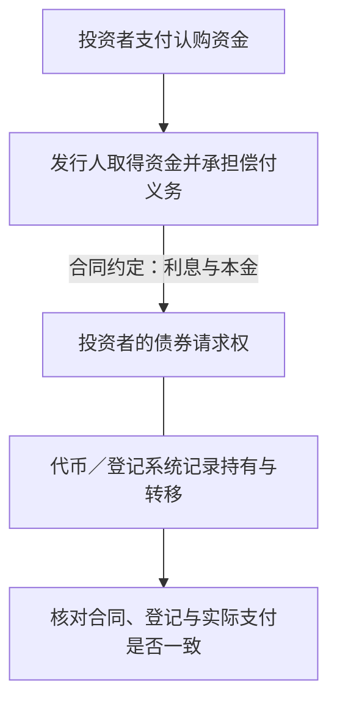

💡 改条件练习（笔记补充）：若记录完全正确但发行人无法付息，出问题的是偿付能力。若发行人有钱但登记把权益给错地址，则是登记、控制或权利对应问题。先分清失败环节，才能判断区块链改善了哪一步。

**🎙️ 课堂补充**（S25 `14:04`–`22:07`）

课堂用小额份额说明代币化可能改变进入渠道，但托管、发行与偿付关系仍要检查。*"But still, for all those platforms, they cannot guarantee that the issuer will not default."*（S25 `20:54`）中文：换个平台不保证发行人不违约。

1000本金、5%票息、50利息的示意也被口头复述（`19:34`–`20:07`）。课堂“没有增加价值”的说法针对本例没有凭空增加承诺现金流；便利、费用或协调效率可以改变，不能扩为所有技术改进完全没有经济价值。可分割也不保证每个平台实际允许任意小额持有人进入。

### 2.5 代币化黄金与仓库题：链上历史不能盘点金库（讲义 p.18–22）

购买和转交实物金条不方便，较小投资额也未必适合直接提取一整根金条。讲义以 Paxos 的 PAX Gold（PAXG）说明：代币可以让较小份额的黄金权益更方便记录和转移，但金条仍放在金库里。（讲义 p.18）

讲义的产品口径是：每个 PAXG 对应一金衡盎司纯金，可持有分数份额。金衡盎司（Troy ounce）是贵金属重量单位；这里不是“一个代币对应随意大小的一根金条”。实物由托管人（Custodian）保管。链上转移、黄金分配查询、月度鉴证报告和实物提取，各自提供不同信息。（讲义 p.18–19）

先沿这条关系读：发行方安排代币和黄金对应，金库保管黄金，区块链记录代币，交易所或钱包提供访问入口。钱包显示余额不等于钱包替你保管金条；鉴证报告也不能替代阅读你自己的赎回条件。

赎回（Redemption）是按约定交回代币或份额，换取资金或实物。讲义 p.19、21 强调，提取实物黄金还有资格、最低规模、交付程序与费用。代币转得动，不等于任意小额持有人都可立即领到金条。

#### 2.5.1 仓库原题：编号唯一仍需链外核验（讲义 p.20）

中文入口：有一枚记录不可随意改写的仓库代币，但没人独立检查同一批货有没有被重复抵押；这能保证所有权吗？

> **Multiple-Choice Question: Can a Token Verify the Warehouse?**
>
> An immutable token represents warehouse inventory, but no independent audit prevents the same goods from being pledged twice. Which statement is best?
>
> A) Tokenization removes custody risk.
>
> B) The blockchain verifies physical inventory automatically.
>
> C) Off-chain verification and legal-claim risk remain.
>
> D) Token uniqueness guarantees ownership title.
>
> **Discuss**
>
> Separate the token’s on-chain history from custody and enforceable rights over the physical asset.
>
> （讲义 p.20）

⚪ 参考作答（笔记推断）：选 C。immutable 指记录难以被事后修改，不表示当初输入的链外事实一定真实。pledged twice 指同一批货被拿去向不同债权人重复担保，不能靠代币编号独一无二排除。

- A 错：保管人能否妥善保存和交付货物仍有风险。
- B 错：账本不会自动走进仓库检查数量、真伪和是否重复担保。
- C 对：要独立核链外事实，并确认你能依法向谁主张什么权利。
- D 错：唯一的链上编号不能单独证明现实法律承认的所有权（Ownership title）。

Discuss 的答案也要完整：分别核代币历史、货物保管与盘点、担保登记／权利顺位、违约时的执行渠道。即使代币历史正确，货物不足或第三方有优先权，持有人仍可能拿不到预期资产。

权利顺位（Priority of claims）是同一资产处置后，谁先获得偿付的顺序。💡 笔记补充：货物卖得 100 元，若另一债权人依法可先拿走这 100 元，排在其后的人即使手持有效代币，也不一定能从这笔处置款收到钱。仓库有货与自己具有可执行、足额的权利仍需分别核对。

英文参考答案（笔记自拟）：**C. The blockchain records the token’s history, but does not independently verify the goods or prevent double pledging. Custody checks and enforceable legal rights remain necessary. A unique token does not by itself establish title to the physical inventory. Check token history, verify the custodian and inventory independently, and determine whether the claim is enforceable and what priority it has.**

💡 改条件练习：增加一次可靠盘点可以改善“货物是否存在”的证据，但若不核重复担保及权利顺位，不能据此断言代币持有人拥有唯一、优先的请求权。

#### 2.5.2 费表和实收费用要分开（讲义 p.21）

讲义 p.21 记载 Paxos 的创建／赎回收费和无客户黄金保管费口径，并注明 2026-10-13 查阅的产品资料及 2026-08-19 费表。这里先保留其日期和来源地位；具体实时费率与可适用条款须看发行方最新文件。比较时要把创建、交易、退出与实物交付成本一起看，并比较黄金 ETF 或金商的成本与可成交价格。转移次数多不能单独证明退出更容易。

🔗 时效核对（2026-10-29）：[Paxos 官方费表](https://support.paxos.com/articles/2899561282-PAX-Gold-Fees)当页显示创建费暂时豁免至 2027-01-01，另列赎回费。标准费表与促销期间实收不同，因此不能把 p.21 的概括理解为目前每笔创建都收费；也不能据创建豁免推断赎回或市场交易免费。此处只是费表版本澄清，不核具体账户适用费率。

这里黄金交易所买卖基金（Gold exchange-traded fund，Gold ETF）是另一类以基金份额获得黄金相关权益的安排，不能与直接持有实物黄金混称。对手方（Counterparty）则是交易或合同另一方；价格挂钩合同里尤其要问最终谁付钱。

#### 2.5.3 三种资产关联结构（讲义 p.22）

最后，p.22 给出三种“代币连着资产”的结构。每行是不同的请求权，不能混成“买币就是直接买实物”。

| 结构 | 投资者具体持有什么 | 必须追踪的对象 |
|---|---|---|
| 直接所有权 | 被正式登记或认可托管安排承认的资产权益 | 代币与正式记录是否一致 |
| 公司／信托持有资产 | 对该实体或安排的权益／请求权 | 现金流、治理、资产保护和服务 |
| 价格挂钩合约 | 按参考资产价格计算的合同支付权 | 对手方、担保和实际支付能力 |

价格挂钩合约（Price-linked contract）可以给出类似黄金涨跌的支付，但不必把黄金所有权交给投资者。区分这三种结构后，再谈托管与赎回，才能知道该核谁。

信托（Trust）在这里可先理解为：指定主体按约定为受益人持有和管理资产。代币持有人可能取得该安排中的受益请求权，而不是直接登记为房产或金条所有人；具体由哪种法律结构成立、有哪些权利，要看对应文件，不能从“信托”名称直接推断资产隔离效果。

**🎙️ 课堂补充**（S25 `22:10`–`32:49`、`32:49`–`40:06`）

课堂把黄金代币、ETF和实物持有作成本／小额门槛／退出对照，且保留发行方未来可能不再存续的风险。*"the risk that is, you don't know whether you can sell the gold immediately"*（S25 `32:19`）这里的“黄金”指正在讨论的代币退出；24/7可发出交易，不等于随时有足额买方。

p.20选择题后，S25 `30:28` 的ASR回应含“C”，但句尾未完整记录；它与正文C的逻辑一致，不把残句当作完整逐项官方解答。黄金仍在金库，链上记录不能代替盘点、托管和权利检查。

课堂ETF费用例需要校正：S25 `26:34` 同时提到10,000、0.4%和400，三者不一致。按给定费率计算，$10{,}000\times0.4\%=40$；400相当于4%。此处只纠正算术，不认证任何产品现行费率或推荐。课堂把代币称为“股东”的口语也不能覆盖三类结构：价格挂钩合同不自动赋予标的股权、投票或分红权。未取得实际代币条款时保留未知。

### 2.6 货币市场基金：份额回报来自资产，交易价来自买方（讲义 p.23、25）

货币市场基金（Money market fund）把投资者资金投入短期存款和货币市场工具，按产品约定形成收益。基金份额（Fund shares）代表对基金的权益；它不同于基金经理对个人作出的固定本金／利息保证。（讲义 p.23）

讲义以华夏基金（香港）的港元和美元数字货币市场基金说明：投资者认购份额，基金投资短期工具，资产收入扣费用后进入份额回报。净值可能变化，管理人收取管理费。代币化改变份额的登记、转移方式，利息仍来自资产组合。

下图的箭头按经济流向读；不是说所有回报都逐笔以现金派发，部分回报可以体现在净值中。（讲义 p.23；笔记重画）

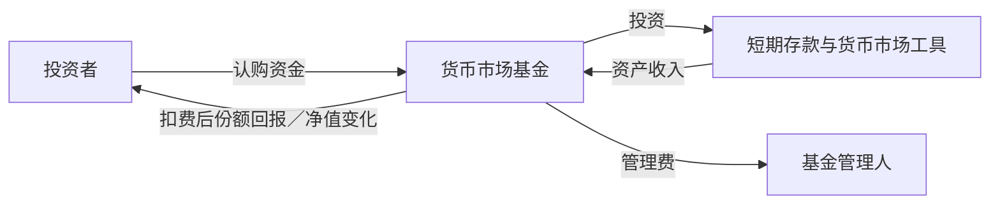

想退出有两条路，p.25 特别要求分清：

1. 一级市场赎回（Primary-market redemption）：投资者经分销商向基金提出，按适用 NAV、交易截止和付款安排办理。
2. 二级市场出售（Secondary-market sale）：投资者把份额卖给市场买方，按可执行买价成交，价格可能高于或低于 NAV。

讲义记载 2026-10-26 两只基金 Class F 代币化份额开始在 PantherTrade 全天候二级交易。“24/7”说的是交易渠道开放，不是基金在周末也随时以 NAV 赎回。

原给定算例：周末参考 NAV 每份 HK\$100，可执行买价每份 HK\$99.80，卖出 1,000 份，忽略费用。（讲义 p.25）

1. 参考净值金额：$1{,}000\times100=100{,}000$ 港元。
2. 出售收入：$1{,}000\times99.80=99{,}800$ 港元。
3. 比净值少：$100{,}000-99{,}800=200$ 港元。
4. 相对净值折价：$200/100{,}000=0.2\%=20$ 个基点。

基点（Basis point，bp）是百分比差异的单位，1 bp = 0.01 个百分点。这里 20 bp 是成交价相对参考 NAV 的折价，不是已实现年化收益率。

💡 改条件练习（笔记补充）：若买价是 HK\$100.10，则卖出收入 HK\$100,100，比参考 NAV 多 HK\$100，即溢价 10 bp。仍要扣实际费用，并确认该买价能承接 1,000 份，不能把屏幕上的小额报价无限外推。

🔗 外部核对：2026-10-29 的外核记录取得香港证监会 2026-10-26 公告的官方搜索片段；当时直开正文失败。片段与课件同指两只既有认可基金当天开始在持牌平台全天候二级交易。赎回条件另以基金文件为准。[SFC 官方公告](https://apps.sfc.hk/edistributionWeb/gateway/EN/news-and-announcements/news/corporate-news/doc?refNo=26PR174)（获取 2026-10-29）。

**🎙️ 课堂补充**（S25 `40:08`–`43:39`、`45:11`–`48:39`）

课堂把新闻关键词停在二级交易：*"The key word is secondary trading."*（S25 `45:30`）中文：卖给另一个买方，与向基金赎回是两条路线。基金投资短期工具赚取收入，再扣费形成份额回报；代币化不把回报变成无条件保证。

课堂按100参考NAV、99.80买价、1000份读出200港元差额（`47:21`–`48:39`）。买价并非永远低于NAV，正文100.10的改条件例仍可成立；这200也不是已给定的赎回费。`48:12`–`48:39`强调不同时间买价／流动性会变，不能把24/7和固定成交价混同。

### 2.7 香港数字绿色债券：平台、债务人与绿色用途（讲义 p.24、28–30、34）

发行债券需要把认购、持有登记、付款与后续付息接起来。传统体系可能有多份记录，需要不同机构核对是否一致，这种对账叫记录核对（Reconciliation）。结算（Settlement）则是实际完成资产与款项交付。共享记录可以减少重复核对；把券与款关联可以减少一方先交付后等另一方的风险。（讲义 p.24、29）

汇丰 Orion 是数字发行和结算的平台，不因提供记录系统就成为所有平台上债券的债务人。谁发行并承诺偿还，要看债券合同。香港特区政府发行的数字绿色债券，由政府承担约定的本金与利息；汇丰在相应安排中提供平台等服务。（讲义 p.24、30、54）

券款对付（Delivery versus payment，DvP）把交券与付款关联。你要检查两项转移怎样衔接、用什么结算资产、由谁处理失败，而不是只看“上链”二字。它针对交付过程，不替发行人创造未来偿债资金。（讲义 p.29）

下面每行是一次发行，金额单位为“十亿港元等值”，不是收益率。按讲义 p.28 的四舍五入口径，2023 年 0.8 对应约 8 亿港元，2024 年 6 对应约 60 亿，2025 年 10 对应约 100 亿。

| 年份 | 发行金额：十亿港元等值 | 读数含义 |
|---|---:|---|
| 2023 | 0.8 | 首次示范发行 |
| 2024 | 6 | 多币种发行扩大 |
| 2025 | 10 | 又一次规模扩大 |

后两次都涵盖港元、人民币、美元和欧元。不同币种先换成港元等值才可比较；这些金额是发行人筹集的资金，不能当作 Orion 平台收入。（讲义 p.28、34）

![[EF5560_Fintech_and_AI_in_Finance/notes/figures/m08-defi-rwa/green-bonds.svg]]

图从左向右读三次发行，纵轴为十亿港元等值，柱顶数字是讲义已四舍五入的 0.8、6、10。它比较融资规模，不表示发行次数、利息或投资回报；与 §2.2 的 TVL 图也不是同一统计量。图源复用本讲的 [[EF5560_Fintech_and_AI_in_Finance/notes/figures/m08-defi-rwa/charts.py|charts.py]]。

平台也不是一直相同：2023 年试点采用 Goldman Sachs 的 GS DAP，一级结算为 T+1，即交易日后的一个营业日；2025 年发行使用 Orion，港元及人民币部分提供 e-HKD／e-CNY 结算选项，并保留传统安排。不同平台可以支持相同类型的金融偿付义务。（讲义 p.29）

**给定利息算例**：按 2023 年条款示意持有面值 HK\$1,000,000 的一年期债券，票息率 4.05%，假设本息全额如约支付。（讲义 p.30）

面值（Face value）是合同计算偿付的本金基数。先计算一年利息：

$$
I=F\times c=1{,}000{,}000\times4.05\%=40{,}500\text{ 港元}。
$$

这里 $F$ 为面值，单位港元；$c$ 为一年票息率；$I$ 为一年利息。三者均是这一持有假设及合同条款给定或算得的量，实际支付仍依假设。到期本息共为 HK\$1,040,500。讲义中的 HK\$1 million 持有量只是示意，不意味着实际最小认购额就是这一数。

“绿色”（Green）指募集资金用于合资格绿色项目融资或再融资。债券持有人拿的是政府债权，不因资金投向某项目就拥有那座设施或该项目股权。（讲义 p.28、30）

讲义 p.34 另记汇丰在 2026 年 2 月取得英国政府 DIGIT 平台试点委任。获委任、实际发行完成和平台赚取收入，是三个阶段。商业分析可以追问机构发行与证券服务的收费、投资者接入和运营成本，但不能由发行总额倒算未披露的服务收入。

🔗 外部核对：[香港政府 2025-11-11 公告](https://www.info.gov.hk/gia/general/202511/11/P2025111100724p.htm)列出约 HK\$100 亿、多币种、CMU 清算结算及 Orion 平台等安排，并说明 e-HKD／e-CNY 为新增可选结算方式（获取 2026-10-29）。公告支持具体发行事实，不代替每份债券的全部法律条款。

**🎙️ 课堂补充**（S25 `43:42`–`45:06`、`55:31`–`56:59`、`59:06`–`01:00:21`、`01:09:12`–`01:10:36`）

讲者把汇丰平台归为传统机构采用区块链技术，而不因用了链就自动成为无中心金融。*"This is centralized finance plus blockchain-based technology."*（S25 `01:09:56`）中文：集中机构与新记录／结算技术可以同时存在。

政府债务人的角色也再次说明：S25 `59:27`–`01:00:21` 强调政府负责约定支付，债券持有人不拥有绿色项目股权。4.05%在这里是给定2023条款示意，不是当前所有绿色债券收益；平台委任不等于已完成发行或已赚到特定收入。

### 2.8 可转让、可成交与合法请求权（讲义 p.27、31–33）

你能把代币发出去，不表示有人愿意按接近报价的价格买。可转让性（Transferability）是记录／规则是否允许转移；市场流动性（Market liquidity）是你能否在合理时间、价格和数量条件下成交。二者相联系，但不相同。

中文入口：平台全天都能转移私募资产代币，但找不到接近报价的买家；哪种变化最直接改善退出？

> **Multiple-Choice Question: Transferability and Market Liquidity**
>
> A platform allows transfers of tokenized private assets at any time, but investors cannot find buyers near the quoted price. Which change most directly addresses the exit-liquidity problem?
>
> A) Divide each token into more units while leaving demand unchanged.
>
> B) Record the same ownership information on an additional blockchain.
>
> C) Attract funded buyers and market makers willing to quote executable prices.
>
> D) Replace the trading interface without changing the available counterparties.
>
> （讲义 p.27）

⚪ 参考作答（笔记推断）：选 C。most directly 要你找直接补上“谁肯出钱买”的措施。可执行价格（Executable price）指对手方确实愿意按相应条件成交的价格。做市商（Market maker）会提供买卖报价并承担一定存货风险，不只是展示参考数字。

- A：切成更多单位可能降低单笔门槛，但题目明确需求不变，不能据此补上买方资金。
- B：多记一份所有权并不自动增加愿意成交的对手方。
- C：有资金的买方和愿意承担成交的报价，直接改善退出条件。
- D：换界面可能更方便，但题设保留相同对手方，未直接解决没人接盘。

英文参考答案（笔记自拟）：**C. Funded buyers and market makers quoting executable prices directly address exit liquidity. Divisibility, another ledger, or a new interface does not by itself create demand near the quoted price.**

💡 迁移：如果新增做市商只愿意买 1 份，而你要卖 10,000 份，仍须检查报价深度。不能把“有一个买价”扩大为“任意数量都能按此价退出”。

**数字绿色债券短答题**把同一判断用于业务效果。中文入口：金融条款不变，技术究竟省了哪一步；谁仍负责付钱？

> **Short-Answer Question: Evaluating a Tokenized Green Bond**
>
> Consider a tokenized HKSAR government green bond with the same coupon and maturity as a conventional bond. The platform links delivery to payment and shares transaction records.
>
> 1. Explain one potential saving in settlement or reconciliation. How could a bank measure the saving?
> 2. Who owes the interest and principal? Explain whether bondholders own the green projects financed by the bond.
>
> （讲义 p.31）

⚪ 参考作答（笔记推断）：

1. 可选的一个节省是减少对账人工：共同使用可核的交易记录，可能减少多机构手工比对与异常追查。银行可比较相近规模、复杂度和业务量下，每笔结算所用工时及需人工处理的差异笔数。

   也可测交付时间或结算失败率，但必须说明控制哪些差异。不能只比较新旧两笔金额不同的交易，就断言技术造成全部节省。题目问 one potential saving，给一个讲透即可，不把指标冒充已观察成果。
2. 香港特区政府按债券约定承担本息。债券持有人持有政府债权；“绿色”规定资金用途，不使持有人直接拥有相应绿色项目。平台连接交券付款，并不转移政府的偿付义务。

英文参考答案（笔记自拟）：

1. **Shared transaction records may reduce manual reconciliation. A bank could compare staff time and exception counts per comparable transaction before and after adoption, while controlling for transaction scale and complexity. These are potential savings, not measured results supplied by the question.**
2. **The HKSAR Government owes the coupon and principal under the bond terms. Bondholders hold government debt, not ownership of the green projects financed with the proceeds.**

💡 改条件练习：若银行必须同时维护旧系统，短期总成本可能上升。正确评估应把新增系统维护与减少的处理工作都计入，而不是把“少了一个手工步骤”直接等同净节省。

**从试点到实际结算**：讲义 p.32 记载 Project Ensemble Sandbox 于 2024 年 8 月启动，EnsembleTX 于 2025 年 11 月开始受控的真实价值交易试点。互操作（Interoperability）是不同系统能按约定相接，不代表每种代币都能自由互换、面向零售或随时有市场。仍要核参与资格、付款资产、权利、控制与失败恢复。

**内地资产在境外发行的监管边界**：讲义 p.33 以假设租金应收款池为例，说明境内资产支持境外证券代币时不能省略监管程序。租金应收款是收取租金的权利，不是把整栋楼实体搬到链上。要识别谁收租、谁向持有人付款，以及实际控制境内资产的主体承担什么程序。

🔗 中国证券监督管理委员会（China Securities Regulatory Commission，CSRC）2026-02-06 发布的[第 1 号公告及指引](https://www.csrc.gov.cn/csrc/c101954/c7614288/content.shtml)是本页所引来源。已读附件 3 页：第 2 条要求遵守相关跨境、外汇、网络与数据规则；第 4 条要求实际控制基础资产的境内主体在开展相关业务前向中国证监会备案。备案（Filing）是依规定报送材料并履行程序，不是只把合同放到链上。（获取 2026-10-29）

该指引还有禁止情形、材料与后续报告要求。本节只解释讲义假设和相应条文，不认定某个实际项目已合规，也不把上述备案当作全部监管手续或信用担保；未穷尽后续修废与其他适用法。

**🎙️ 课堂补充**（S25 `52:53`–`55:23`、`01:00:27`–`01:10:10`）

p.27讲评强调真正能成交的买方：*"You need to attract funding buyers and market makers willing to quote"*（S25 `54:56`），下一段 `55:03`接 executable price，含义对应选项C；具体英文解析仍由笔记整理，不补造未录清的学生原回答。

绿色债券短答的回答重点是短而有逻辑。*"I don't care about this part, but the logic should be correct"*（S25 `01:03:16`）此前M06已说明三行为答题期望，本次关于“超过三行扣分”是转述学生的理解，没有展示正式扣分规则；不扩成所有题一律三行。原题第1问的工时／异常笔数是参考方案，课堂没有给真实节省数据；第2问的政府偿付责任有课堂支持。

S25 `01:05:18`–`01:06:59`以境内租金应收款举例解释境外代币发行，备案与其他适用规则仍按正文正式来源分开。课堂的“像IPO”“只要缴税即可”等类比不能代替全部法律／监管条件；税率、税务截止及信托市场猜测未核，不作为本稿现行办事要求。

### 2.9 Sky：储蓄回报需要收入和分配规则（讲义 p.35–39）

设想用户持有一种用于转账的代币，又想把部分余额投入有收益的安排。必须区分“可用于转账的余额”和“有条件获得收益的请求权”。讲义用 Sky 解释这一点：MakerDAO 的生态在 2024 年改名为 Sky；USDS 是交易型入口，sUSDS 对应储蓄安排。（讲义 p.36–37）

这里的协议（Protocol）指一套由合约和治理规则支撑的安排。USDS、sUSDS、前端服务、负责配置资金的 Sky Agent Network，以及链外对手方是不同角色。持有代币的用户不会因此自动变成所有这些公司的股东。

**用户进入与退出储蓄的动作**：先持有 USDS，再按储蓄模块规则交入 USDS，取得 sUSDS 这项链上储蓄记录。持有期间，回报可体现为同一数量 sUSDS 能兑换更多 USDS；退出时交回对应的 sUSDS，按当时规则兑换 USDS。不能把 1 sUSDS 永久当作 1 USDS，也不能把这一步兑换等同把美元汇入银行账户。

💡 完整小例（笔记补充，比例均为教学假设）：假定进入时 1 sUSDS 可兑换 1.25 USDS，交入 100 USDS 得到 $100/1.25=80$ sUSDS。之后假定兑换比率变为 1.30，同一 80 sUSDS 可兑换 $80\times1.30=104$ USDS。交回这 80 sUSDS 后退出，获得 104 USDS；多出的 4 USDS 是本假设期间的回报，不是承诺的年利率。

🔗 上述进入、回报体现和退出方向依据 [Sky 官方 sUSDS 说明](https://sky.money/susds)核对（2026-10-29）。该页将回报解释为协议总盈余支持、治理设定的可变回报，不是对某个指定 Agent、借款人或资产池的专属请求权。合约、资产和治理风险仍保留；示例未假设市场美元价格永远稳定。

沿图先追踪资金，再追踪回报。箭头不表示收益保证；图为讲义 p.37–38 的笔记重画。

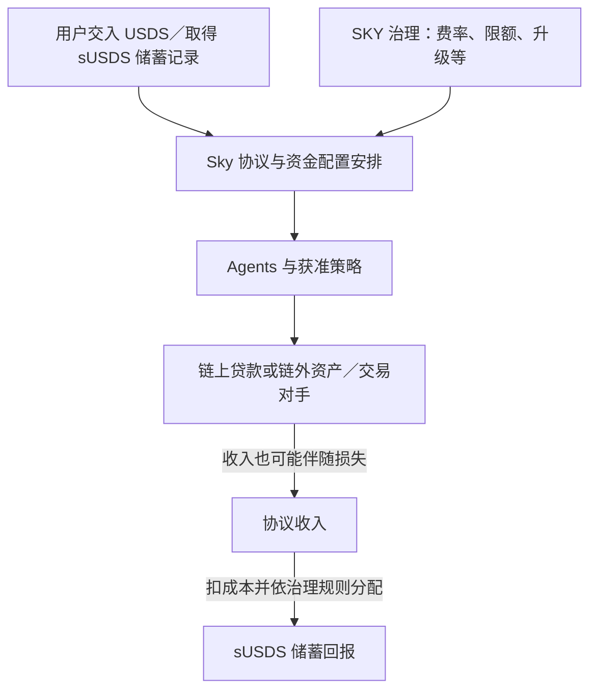

讲义把 Sky Savings Rate 描述为治理设定的储蓄回报率。治理可以决定把多少协议收入分给储蓄者，但“设定一个比率”和“资产赚到足够的钱”是两个动作。分析时要先追踪收入，分清经营收益与为吸引用户支付的奖励／补贴。（讲义 p.36–38）

**给定收益算例**：一年储备资产收入 600 万美元，借款人费用 400 万，费用支出 200 万；全年储蓄余额固定为 2 亿。全部净收入给储蓄者，没有补贴。（讲义 p.39）

1. 收入相加为 $600+400=1{,}000$ 万美元。
2. 扣支出后可分配收入为 $1{,}000-200=800$ 万美元。
3. 用可分配收入除以整个年度对应的储蓄本金，得到 $800/20{,}000=4\%$。
4. 若要支付 5%，需要 $20{,}000\times5\%=1{,}000$ 万美元，比现有净收入多 200 万。

分母是全部储蓄余额，不是“被借出去的那部分”。题目说明余额全年不变，才可这样计算简单年收益；若中途有大量进出，须按相应期间和产品规则另算。

多出的 200 万必须由新增收益、动用储备或补贴支持，不能由数字界面自动产生。储备被拿来补贴也有代价；它不等同未来每年均能产生同样收入。

损失由谁承担，取决于抵押、超额资产、清算、法律请求权和治理应对。不能在缺条款时编出所有持有人固定的损失顺序，也不能把储蓄利率写成银行保证存款利率。（讲义 p.38）

💡 改条件练习：收入仍为 1,000 万，但成本升到 400 万，净收入只有 600 万，同一 2 亿分母下最多支持 3% 的全额分配。治理若仍报 5%，先查另外的 400 万由谁出。

**🎙️ 课堂补充**（S25 `01:11:04`–`01:20:38`）

课堂先借商业银行息差说明资金从哪来、投到哪、收益怎样分配，再回到USDS／sUSDS。*"So first of all, we need to trace the income."*（S25 `01:16:03`）中文：先追收入来源，再看治理分配的回报；链上运行仍有策略、运营与违约损失。

6m加4m减2m得8m，除200m为4%的例子已口头展开（`01:18:31`–`01:20:38`）。课堂“像银行”只是现金流类比，不赋予银行牌照、存款保障或固定利率；Agents也不是因此等同本课另一门课的AI智能体。普通储蓄请求权和治理代币投票权继续分开。

### 2.10 Maker 旧机制与 DAO 投票：足额和决策权都要量化（讲义 p.40–42）

讲义保留 Maker 的一个旧机制，用于解释为什么抵押率跌破阈值就可能处置资产，不能把所有 Sky 产品都等同这个金库。

用户锁入抵押资产，在金库（Vault）规则允许的范围内生成 DAI 负债。这里的 DAI 是协议按规则发行的代币，和后面 Aave 从供应者池子转出既有 USDC 的动作不同。（讲义 p.40、45）

这张图的判断箭头从监测状态出发。价格、预言机和出售市场能否工作，都会影响保护效果。加入现实资产作抵押时，流程还需接上链外托管人与可执行的处置权。

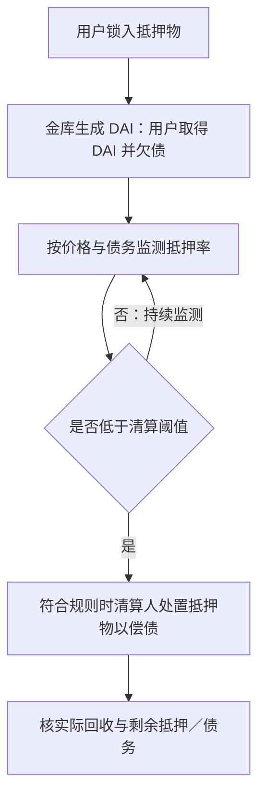

**给定算例**：初始抵押物值 150 美元、债务 100；当抵押／债务比低于 125% 时可清算。抵押资产价格跌 20%，债务不变。（讲义 p.41）

1. 新抵押价值是原值的 80%，所以 $150\times(1-20\%)=120$ 美元。
2. 新抵押率用抵押价值除债务：$120/100=120\%$。
3. 120% 低于 125%，达到“可开始清算”的条件。

抵押物仍比债务多 20 美元，不表示清算必须等到资不抵债。提前触发为价格继续下跌、出售成本和执行时间留下缓冲。超额抵押（Over-collateralization）只是初始保障，不能保证最终总能收回全部款项。

💡 边界练习（笔记补充）：恰好 125% 时，根据本题 below 的措辞尚未低于；不能把题设改成小于等于。若债务因利息增到 105 美元，同样的 120 美元抵押值对应约 114.29%，需要重算分母。

**谁可以改参数？** 去中心化自治组织（Decentralized autonomous organization，DAO）通过治理规则协调决定，常见投票按代币权重分配，而不是每人一票。（讲义 p.42）

原假设：40 位反对者各持 1 个投票单位，共 40 票；1 位支持者持 60 个单位，共 60 票。假设提案、法定人数等条件都满足，简单多数按投票权计算，支持占 $60/(60+40)=60\%$，所以支持方胜出。

这个结果只说明人数多不保证投票权多。借贷请求权或储蓄余额本身不自动授予治理票，也不自动形成法律股权；具体代币权利要分别查。若规则改成每人一票，这组人会产生相反结果，那已是另一套制度。

**🎙️ 课堂补充**（S25 `01:20:43`–`01:26:09`）

旧金库锁抵押物生成DAI，课堂150抵押／100债务的例子在跌20%后成为120%，低于125%而可清算（`01:22:50`–`01:23:48`）。抵押仍大于债务不代表无需触发；能否及时卖出仍影响保护效果。

*"DAO coordinates the decision through governance rules there, token-weighted rules."*（S25 `01:24:36`）中文：按代币票权协调决定。40个单位对60个单位的例子说明人数与票数不同；`01:25:35`转录中的six与p.42及此前sixty不一致，按书面60核。`01:25:42`又明确贷款／储蓄本身不自动带治理票或法律股权，不把早前“像股东”的类比当权利等同。

### 2.11 抵押贷款：担保资产能卖多少才决定回收（讲义 p.43–44）

把资产交作担保以后，资产价格仍会变化。抵押借款（Collateralized borrowing）给贷款人额外的回收来源，不会锁定未来出售价格。借款人付利息，资金供应者按规则获得可变利息。（讲义 p.43）

p.43 四格图依次为：供应者把 USDC 放入池子；借款人锁入抵押物；池子向借款人交出 USDC 贷款；价格下跌后，清算人代还债务并取得抵押物。最后仍标明可能出现回收不足。它是后续 §2.12 计算的角色地图，而不是“足额抵押就绝无损失”的保证。

中文入口：一笔借出 100 美元的贷款，原有 150 美元抵押；出售前价格大跌，还要付出售成本，能收回多少？

> **Short-Answer Question: Collateral Value and Loan Losses**
>
> A lending platform makes a \$100 loan against collateral worth \$150. Before the collateral can be sold, its price falls by 40%. Selling costs are \$5. Ignore interest.
>
> 1. Calculate the net cash recovered by selling the collateral.
> 2. Calculate the loan shortfall if there is no further recovery.
> 3. Explain why recording the collateral on a blockchain does not prevent this loss.
>
> （讲义 p.44）

⚪ 参考作答（笔记推断）：

1. 抵押物出售前价值为 $150\times60\%=90$ 美元。出售成本要从卖得的钱里扣，所以净回收为 $90-5=85$ 美元。题目先跌价、后出售，不能把 40% 用在贷款本金上。
2. 原贷款 100 美元，没有其他回收，缺口为 $100-85=15$ 美元。这里的贷款损失（Loan loss）按题设的最终无额外回收口径计算，不只是短期没现金。
3. 区块链可以记录抵押及转移，但不能阻止价格下跌、保证买方报价或免除出售成本。即使记录没有错误，净回收也只有 85 美元。

英文参考答案（笔记自拟）：

1. **The collateral is worth \$150 × 60% = \$90 after the fall. Net cash recovered is \$90 − \$5 = \$85.**
2. **With no further recovery, the loan shortfall is \$100 − \$85 = \$15.**
3. **A blockchain record does not prevent a fall in collateral prices or remove selling costs. Accurate recording cannot guarantee full recovery of the loan.**

💡 改条件练习：若价格只跌 20%，卖价为 120 美元，扣 5 美元后有 115 美元，足以覆盖 100 美元贷款；剩余资产如何返还或分配依合同。不能把全部 115 美元直接记作贷款人利润。

**🎙️ 课堂补充**（S25 `01:26:10`–`01:28:08`）

课堂按供应者、借款人、抵押物、清算人追一次借贷，随后读p.44的贷款100、抵押150、跌40%、出售成本5。*"as long as you understand what is collateral"*（S25 `01:27:57`）中文：先认清抵押物这个对象，才能把跌幅用在正确金额上。

此段没有完整口头报出85回收／15缺口，正文仍为笔记参考计算。`01:27:40`的per year与原题一次出售成本不符，不能据此把5改成年费。

### 2.12 Aave 同一笔贷款：卖出、借入与清算（讲义 p.45–47）

Alice 有 10 ETH，每个 3,000 美元，总值 30,000 美元。她想取得 15,000 USDC。讲义比较卖掉 5 ETH 与抵押全部 10 ETH 借到 15,000 USDC。（讲义 p.45）

先固定假设：1 USDC = 1 美元，现金在两种方案中都尚未花掉；忽略利息、gas 和其他头寸。gas 是链上执行交易所需的网络费用。这里是教学参数，不是当前实际报价。

表中金额按起始价格计，一行代表一种资产或负债。负债要从资产总值中扣除，不能把借款收入当作新增财富。

| 交易刚完成 | 卖出 5 ETH | 抵押借款 |
|---|---:|---:|
| 保留 ETH 数量 | 5 | 10（作为抵押） |
| ETH 价值：美元 | 15,000 | 30,000 |
| 手持 USDC | 15,000 | 15,000 |
| USDC 债务 | 0 | 15,000 |
| 净财富：美元 | 30,000 | 30,000 |

卖币把一半 ETH 换成现金；借款保留全部 ETH 涨跌敞口（Exposure），同时增加债务、利息和清算风险。Aave 风格池子交给 Alice 的 USDC 来自供应者已经存入的资产，不是像旧 Maker 金库那样在这一步生成 DAI。（讲义 p.45）

💡 用降价检验差异（笔记补充）：ETH 跌到 2,000 美元、其余条件不变时，卖币方案的净财富为 $5\times2{,}000+15{,}000=25{,}000$ 美元；借款方案为 $10\times2{,}000+15{,}000-15{,}000=20{,}000$ 美元。借款保留更多 ETH，损失也更大；不能把“没卖币”理解为没承担价格风险。

**🎙️ 课堂补充**（S25 `01:28:08`–`01:29:32`）

卖5 ETH和抵押全部10 ETH借款的资产负债表已口头比较，两者起始净财富同为30,000。*"borrowing retains exposure to 10 ETH, but borrowing adds interest and liquidation"*（S25 `01:29:02`）；下一段 `01:29:08`的weeks按讲义理解为risks。保留更多ETH敞口，同时承担利息和清算风险，不是借来15,000就多出15,000净财富。

#### 2.12.1 借款上限与健康因子回答不同问题（讲义 p.46）

抵押贷款价值比（Loan-to-value，LTV）把债务价值除以抵押价值。最大 LTV 限定新增借款能力；清算阈值（Liquidation threshold，LT）参与判断已有债务何时可以清算。讲义分别假设最大 LTV 为 60%、LT 为 80%，不能混成同一个百分数。

起始抵押价值 30,000 美元，最大可借 $30{,}000\times60\%=18{,}000$ USDC，Alice 实际只借 15,000。健康因子（Health factor，HF）则把折扣后的担保价值同债务比较：

$$
HF=\frac{C\times\theta}{D}。
$$

这一表说明公式中的三个量；这里都按同一时点的美元价值计，1 USDC = 1 美元。抵押价值取该时点价格，阈值为事先给定的规则，债务取该时点尚未偿还金额，不能混用起始和跌价后的量。

| 符号 | 对象与单位 | 本例起始值 |
|---|---|---:|
| $C$ | 抵押资产总价值，美元 | 30,000 |
| $\theta$ | 清算阈值，无量纲比例 | 80% |
| $D$ | 全部债务价值，美元 | 15,000 |

分子不是“可另外借的现金”，而是按清算阈值折算的抵押支持额。除以债务得到无量纲倍数；HF 低于 1 时，按本例条件可清算。若债务为零，该分式不能直接除，本题的借款状态不包含零债务。

逐行跟着同一 10 ETH、同一 15,000 USDC 债务重算：

| ETH 单价：美元 | 抵押总值：美元 | 实际 LTV | HF |
|---|---:|---:|---:|
| 3,000 | 30,000 | 50% | 1.60 |
| 2,000 | 20,000 | 75% | 约 1.067 |
| 1,800 | 18,000 | 约 83.33% | 0.96 |

例如单价 2,000 时，HF 为 $20{,}000\times80\%/15{,}000\approx1.067$。LTV 已高于 60%，不能继续增借；HF 仍高于 1，尚未触发本题的清算条件。“不能再借”不等于“已经可以清算”。

💡 推出边界价格（笔记补充）：令 HF 为 1，则 $10P\times80\%=15{,}000$，所以 $P=1{,}875$ 美元／ETH。本题是低于该价使 HF 低于 1；恰好等于时不符合 below 的条件。现实中价格来源、计息、资产组合和协议版本还会改变边界。

🔗 [Aave 官方 FAQ](https://aave.com/faq)提供同结构的 HF 说明，并将 HF < 1 描述为有资格清算。该页也显示 V3／V4 入口并存，故本笔记只按讲义假设复算，不把单组 LTV、奖励或可偿比例当作所有版本现行规则。（获取 2026-10-29）

**🎙️ 课堂补充**（S25 `01:29:38`–`01:31:22`）

课堂读最大LTV60%、清算阈值80%，并随ETH降价重看HF。*"then the health factor drops below one."*（S25 `01:30:33`）中文：HF跌破1而满足本例可清算条件；这不等于已经确认最终坏账损失，也不保证HF略高于1就永远安全。

S25 `01:31:13`–`01:31:22` 在本页后停课。S30 `18:59`–`25:28` 先回顾 p.45–46，再在 `25:43` 进入 p.47。S30 `20:53`–`21:08` 用抵押不足覆盖债务说明风险。精确门槛见其后 `22:03`–`23:51`：本例按抵押额的 80% 计算 HF，因此抵押总值仍高于债务时也可能触发清算。

#### 2.12.2 清算人替谁还债，又拿走谁的 ETH（讲义 p.47）

ETH 已跌到 1,800 美元，Alice 的 HF 为 0.96。讲义再假设规则允许清算人代还 6,000 USDC，并获得 5% 奖励。清算人（Liquidator）用自己的 USDC 清偿部分债务，换取从 Alice 抵押物中划出的 ETH；不是 Alice 又收到一笔新借款。

本次清算按固定 1,800 美元价格执行，忽略已计利息、gas、价格冲击和协议分取奖励，原借款现金仍未改变。先算交换金额，再更新两个余额：

1. 清算人支付 6,000 USDC；允许取得的 ETH 计价值为 $6{,}000\times1.05=6{,}300$ 美元。
2. 清算人取得 $6{,}300/1{,}800=3.5$ ETH。
3. Alice 剩余抵押物 $10-3.5=6.5$ ETH，剩余债务 $15{,}000-6{,}000=9{,}000$ USDC。
4. 新 HF 为 $6.5\times1{,}800\times80\%/9{,}000=1.04$，高于 1。

沿图看“谁给出什么”。本图不规定现实的最大清算比例，只画讲义允许的这笔交易。

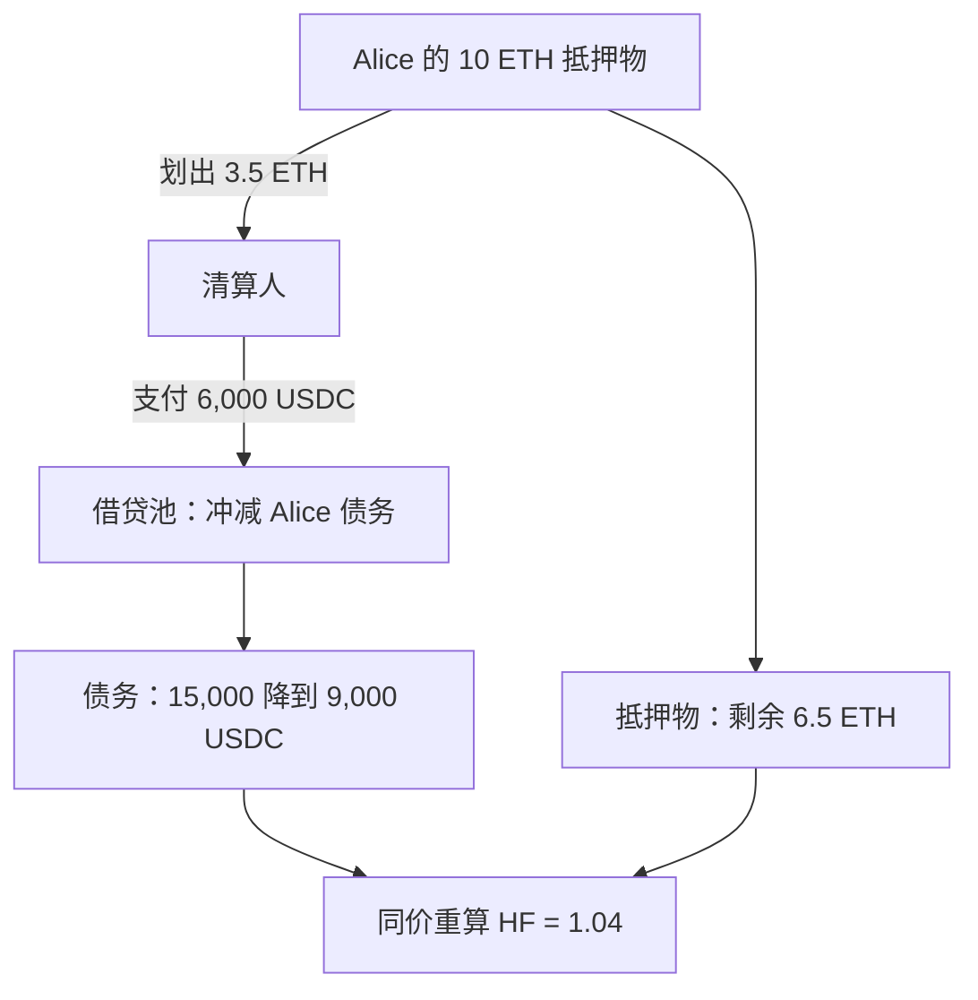

抵押净权益（Collateral equity）仅指抵押物价值减对应债务，本例清算前为 $18{,}000-15{,}000=3{,}000$ 美元，清算后为 $11{,}700-9{,}000=2{,}700$ 美元。少掉的 300 美元就是本次 5% 奖励的价值。

这不把 Alice 未花的 15,000 USDC 现金漏算：若讨论整份资产负债表，两时点都另加该现金。抵押净权益与总净财富是不同观察范围，但本次清算造成的差额同为 300 美元。

💡 改条件练习：若奖励为零、其他条件及允许偿还额不变，清算人取得 $6{,}000/1{,}800=10/3$ ETH；Alice 抵押净权益在这一固定价模型中仍为 3,000 美元。实际为何需要奖励，要考虑执行成本和风险；零奖励并不保证有人愿意执行。

**🎙️ 课堂补充**（S30 `25:43`–`29:20`）

S25 在 p.46 收束，本段接着算 p.47。课堂先用 6,000 乘 1.05，再除以 ETH 单价，得到 3.5 ETH（S30 `25:59`–`26:40`）。清算后债务变成 9,000，抵押只剩 6.5 ETH。老师重算得 *"1.04 so the value is above one now"*（S30 `27:31`）。中文：清算后 HF 变为 1.04，回到 1 以上。

S30 `26:48` 把奖励口语称为 5% 折扣。题面按 6,000 USDC 的代还额加 5%，清算人拿到价值 6,300 美元的 ETH（S30 `28:00`–`28:16`）。若把 6,300 当作原价，300 的折扣率约 4.76%，分母不同。现价和债务变动仍会影响下一次 HF。

### 2.13 供应利率、提款现金与治理生态（讲义 p.48–50）

借款利率 5%，为什么供应者只得到 2.7%？因为不是所有供应资产都借出，而且部分利息进入协议金库。资金利用率（Utilization rate）是被借金额占供应金额的比例。（讲义 p.48）

原例假设一年中，供应 100 万 USDC、借出 60 万，借款年利率 5%，储备因子（Reserve factor）10%；余额及利率恒定，按简单利息算，没有损失、奖励或其他收入。储备因子在这里指借款利息中划给协议金库的比例，不是用户本金中直接扣走 10%。

1. 利用率为 $600{,}000/1{,}000{,}000=60\%$。
2. 只有借出的 600,000 产生本例借款利息，全年为 $600{,}000\times5\%=30{,}000$ USDC。
3. 金库分得 $30{,}000\times10\%=3{,}000$ USDC。
4. 供应者合计分得 $30{,}000-3{,}000=27{,}000$ USDC。
5. 用所有供应者投入的 1,000,000 作分母，供应年利率为 2.7%。

可把同一组步骤概括为 $r_s=u\times r_b\times(1-f)$。这里 $r_s$ 是供应年利率，$u$ 是利用率，$r_b$ 是借款年利率，$f$ 是储备因子；此式只在上述简化条件下适用，不能拿它覆盖各种奖励、损失或利率变化。

未借出的 400,000 USDC 是此刻可用的池子流动性（Pool liquidity）。账面有可回收的贷款资产，与此刻有现金供提款，是不同问题。流动性不足（Liquidity shortage）不自动等于最终贷款信用损失（Credit loss）。

**🎙️ 课堂补充**（S30 `29:29`–`33:16`）

课堂从借出 60 万、未借出 40 万开始算。借款人一年共付 30,000 USDC，先拨 3,000 到金库，其余 27,000 由投入 100 万的供应者分（S30 `30:23`–`31:24`）。老师提醒 *"this number here is before incentive, before operating cost"*（S30 `31:35`）。中文：金库收入还未扣激励与运营成本。ASR 在 `30:59` 一度多报一位，紧接着说 27,000，原页公式也得到 27,000。

老师用银行存贷做类比（S30 `31:59`–`33:16`）。存款人与供应者都提供资金，借款人都付息。现实银行还承担合规、网点和资产负债管理等成本，不能由两者角色相似推导固定分成或实际收益高低。

#### 2.13.1 提款原题：抵押物不是即时现金（讲义 p.49）

中文入口：1 亿存款中 9,000 万已借出，只有 1,000 万在池；立刻要求提走 3,000 万，抵押充足能否变出现金？

> **Multiple-Choice Question: Withdrawals from a Lending Pool**
>
> A pool has \$100m of deposits, of which \$90m is lent out and \$10m remains available. Suppliers request \$30m immediately. There are no new deposits or loan repayments. Which conclusion follows?
>
> A) Adequate borrower collateral makes all \$30m immediately available.
>
> B) Only \$10m is available, even if the loans remain fully recoverable.
>
> C) The withdrawal request proves the pool has a \$20m credit loss.
>
> D) Raising borrowing rates instantly supplies the missing \$20m.
>
> （讲义 p.49）

🎙️ 课堂讲评支持 B（S30 `35:09`–`35:42`）。immediately 和 no new deposits or loan repayments 排除了等待新钱或还款。m 表示百万美元。逐项解释与英文句为笔记整理。

- A 错：抵押物是担保，并不是池中已经可支付的同币种现金。
- B 对：眼下只有 1,000 万可用。贷款以后全部能收回，也不意味着现在能立即付出 3,000 万。
- C 错：请求与现金之间有 2,000 万的即时缺口，但题目未说贷款最终少收回 2,000 万。
- D 错：加息可能改变后续供求行为，不会瞬间生成缺少的现金，且题目排除了新存入和还款。

英文参考答案（笔记自拟）：**B. Only \$10m is immediately available. The \$20m gap is a current liquidity shortfall, not proof of a credit loss. Collateral and a higher borrowing rate do not instantly provide the missing cash.**

💡 改条件练习：若此时借款人另还款 2,000 万，现金可增到 3,000 万，才可能满足该批提款；但已改变原题的“无还款”条件。若贷款最终只收回 7,000 万，还须另外计算资产损失，不能和即时缺口混算。

**🎙️ 课堂补充**（S30 `33:28`–`35:42`）

老师先读题，再用银行网点现金不足类比。即使最终能收回全部贷款，当下池里也只有 1,000 万可付。老师说 *"even if all the loans remain fully recoverable"*（S30 `35:42`）。中文：即使全部贷款可收回。这句支持区分流动性不足与已发生信用损失。该处 ASR 将 10 million 写成 10 minutes，金额按 p.49 题面。

#### 2.13.2 产品、治理与多网络服务（讲义 p.50）

讲义 p.50 的生态分析分三层：钱包和比较服务帮助接入；GHO 是 Aave 治理的稳定币产品；代币治理选择抵押资产、风险参数、激励和升级。多网络服务又增加价格信息、桥和清算系统等需监测的依赖。

协议金库利息收入是收入项，不是扣完所有激励和运营成本的利润。供应者、借款人、治理者和前端经营方的利益及风险也不能合成一个“Aave 账户”。

**🎙️ 课堂补充**（S30 `35:58`–`38:17`）

老师以 60% 借款上限、80% 清算阈值追问谁定规则，然后讨论治理投票。*"who has the biggest voice?"*（S30 `37:02`）。中文：谁有最大话语权？持票集中可能让少数人影响参数。若其他参与者因此退出，治理者也可能承受代币价值下跌。不同协议的规则、委托和法定票数仍需分别核对。

S30 `36:27`–`36:37` 转写把治理代币与 GHO 混在一起。p.50 将 GHO 写成受 Aave 治理的稳定币产品。它与用于投票的治理权是两件事。

### 2.14 改设计、跨链与三种持有人权利（讲义 p.51–54）

讲义 p.51 对比两位创始人，教学重点在业务机制如何改，而不只在创办故事。Rune Christensen 的 MakerDAO 从超额抵押金库创造 DAI，发展到 Sky 的 USDS、储蓄、Agents 与更多链外资产；这增加了资产配置及治理的要求。Stani Kulechov 的 ETHLend 原先匹配单个借贷双方，后来 Aave 采用池子，减少逐一找对手方的难题。

**🎙️ 课堂补充**（S30 `38:24`–`40:05`）

老师比较两种改设计。MakerDAO 扩到 Sky 后，治理要继续核哪些资产提供收益、承担哪些风险。ETHLend 的问题是找一对借贷方时，金额、期限和意愿未必匹配。Aave 改用池，供应者先把资产放到一起，符合规则的借款人从池借。课堂原话 *"a new market needs a scalable matching design."*（S30 `39:52`）。中文：新市场需要能够服务更多参与者的匹配机制。

双边匹配（Peer-to-peer matching）要求找到条件相合的贷款双方；池化流动性（Pooled liquidity）把供应资产汇到共同池中，按规则向借款人提供资金。池子改善匹配，不消除提款和抵押风险。课件注明人物肖像为 AI 生成的编辑插图，不能当作真人照片证据。（讲义 p.51）

**收益比较**也要追到最终付款方。（讲义 p.52）

| 安排 | 收益首先从哪里来 | 要继续检查什么 |
|---|---|---|
| Aave USDC 供应 | USDC 借款人支付的利息 | 借款需求、储备分成和贷款损失 |
| Sky 储蓄 | 获准贷款／策略形成的协议收入 | 资产风险、治理分配和赎回 |

借款需求下降可能压低供应回报；把收益渠道画到链上不会消除抵押下跌或链外对手方风险。这是商业模式问题，不是看到一个年化百分数就结束。

**🎙️ 课堂补充**（S30 `40:18`–`42:06`）

*"The USDC suppliers, they earn interest paid by the USDC borrowers."*（S30 `40:28`）。中文：Aave 供应者赚的是 USDC 借款人付的利息。老师问借款利率从 5% 降到 4% 会怎样（S30 `40:59`）。沿 p.48 其他假设重算，60 万产生 24,000，金库分 2,400，供应者剩 21,600。除以 100 万，供应年利率变为 2.16%。这是一项条件变式，需求变化时实际利用率也可能变。

Sky 一侧的储蓄资金来自协议贷款或其他策略收入，再由治理设定储蓄率（S30 `41:14`–`41:42`）。转录里的 SUSDC 按 p.52 校为 sUSDS。资产收益下降时，不能沿用旧的付息来源和回报估计。

**跨链不是把同一枚 ETH 复制两份。** 跨链桥（Cross-chain bridge）连接不同链上的资产或信息。p.53 只示范一种“锁定并铸造”（Lock-and-mint）设计，不代表所有桥都这样工作：

1. 在以太坊锁住原有的 5 ETH。
2. 验证锁定后，在目的链生成 5 个请求权代币；原 ETH 仍被锁住。
3. 返回时，先在目的链销毁请求权代币，再经验证释放原来的 5 ETH。

讲义 p.53 完整英文情境与提问

**A Cross-Chain Claim on 5 ETH**

Suppose a bridge uses a lock-and-mint design to move ETH exposure to another blockchain.

1. Lock 5 ETH in a contract on Ethereum.
2. After verification, mint 5 claim tokens on the destination chain. The original ETH remains locked.
3. To return, burn those claim tokens. After verification, release the original 5 ETH.

Who verifies each step? If the locked ETH is stolen, the claim token may lose its backing even if the wallet still shows a balance.

One illustrative bridge design, ignoring fees. A bridged claim depends on the bridge’s backing and verification.

⚪ 参考作答（笔记推断）：原题没有指定桥的验证者。应查谁核实锁定／销毁、按什么规则允许铸造／释放；不能擅自写成所有桥都由以太坊原生共识完成验证。

英文参考答案（笔记自拟）：*The question does not specify the verifier. The bridge’s verification rules and responsible parties must be identified. A recorded claim may lose its backing if the locked ETH is stolen.*

图中两条链没有各自产生可独立提取的 5 ETH。中间的验证是关键依赖，箭头表示取得与注销请求权的条件顺序。（讲义 p.53；笔记重画）

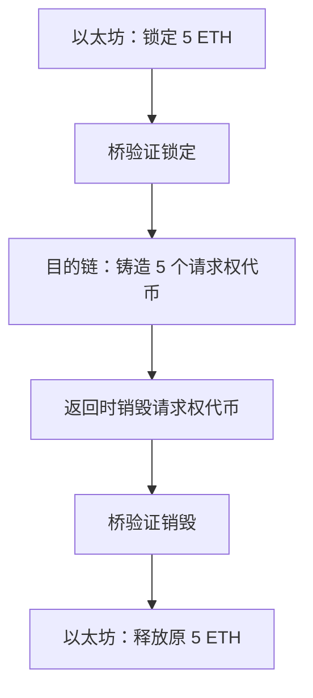

若锁定的 ETH 被盗，目的链钱包仍可能显示 5 个代币，但支持赎回的资产已受损。账面数量和有支持的请求权必须分开；验证错误，也可能在没有足额锁定的情况下形成不受支持的请求权。

💡 变式（笔记补充）：若只是网页暂时打不开，不能直接断言支持资产已丢失；先核是界面、验证流程还是托管资产出问题。不同故障影响不同，不能一见“跨链失败”就归成同一种损失。

**🎙️ 课堂补充**（S30 `42:10`–`44:13`）

老师把两条链类比成两地，先在一处锁住资产，再到另一处拿可以使用的凭证，最后销毁凭证并核验后解锁（S30 `42:51`–`44:03`）。*"Mean just mean by produce, or make, or create"*（S30 `42:21`，自动转写的 Mean 对照原页为 mint）。中文：铸造是产生代币。按上图读，锁住的是原来的 ETH，拿到的是目的链的请求权代币。类比只帮助理解两处的验证与释放，不提供真实跨境贷款的流程或许可。

最后用讲义 p.54 的三个例子收束“持有人究竟得到什么”：

> **What Do These Tokens Give Their Holders?**
>
> • Aave supply position: supplied tokens plus accrued interest. Withdrawals depend on available pool liquidity.
>
> • The Sandbox LAND NFT: a virtual plot for publishing or renting space for games. A tenant’s game copyright remains with its creator.
>
> • HKSAR digital green bond on HSBC Orion: the government owes coupon and principal. HSBC provides the digital assets platform.
>
> （讲义 p.54；以下为中文解析，原页已给比较结果。）

- Aave 供应头寸：相应供应资产及累计利息的请求权；提款受池中可用流动性限制。
- The Sandbox LAND NFT：虚拟地块的发布／出租等用途；租用者创作的游戏版权仍属于创作者，地块权利与游戏版权分开。
- Orion 上的香港政府数字绿色债券：政府按约定支付票息和本金；汇丰提供数字资产平台，不把政府债务变成平台股权。

三项英文参考归纳（笔记自拟）：*The Aave supplier has a claim on supplied assets and accrued interest, subject to available pool liquidity. LAND grants specified virtual-land uses, not a tenant’s game copyright. The digital bond gives a contractual claim on the HKSAR Government for coupon and principal; Orion is the platform.*

回答一个代币案例时，按“持有人→具体权利→兑现者→收入／支持资产→退出路线→失败点”走完，才不会把链上技术和经济权利混在一起。

S25 `01:31:19` 预告下次继续，`01:31:22` 下课。p.51–54 的课堂证据已分别补在本节对应内容旁。

**🎙️ 课堂补充**（S30 `44:18`–`45:22`）

老师依次复述供应本金及利息、LAND 的游戏空间用途与租用者保有的版权，再区分数字绿债的偿付者和服务平台。*"HSBC only provides the platform here"*（S30 `45:13`）。中文：这里汇丰提供平台。读题先找谁承诺付本息，再找谁记录和交付。按课件，偿付责任仍在政府。

随后老师说很多同学熟悉刚提到的案例，建议不要选它研究（S30 `45:22`）。语境是公司案例选题建议，课堂没有明确给出整页或数字绿债主题的考试排除。S30 `45:32` 转入 M09。

## 3. 一图看懂

从“我持有一项链上记录”往下走，先确定它指向哪种权利，再检查兑现与退出；不是每个代币都同时属于这三类。图为本讲机制的笔记概括。

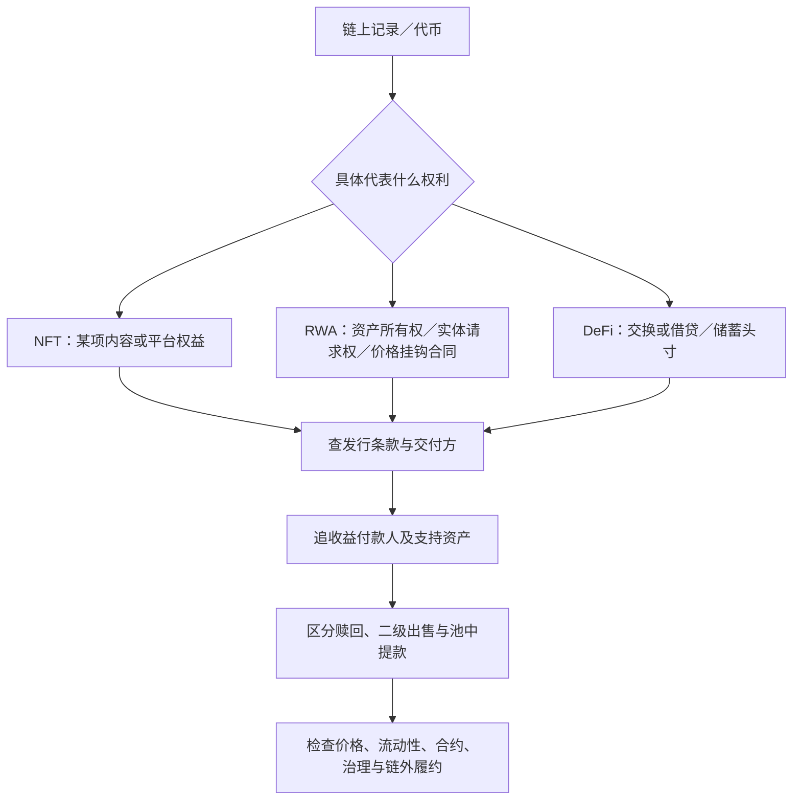

例如，拿这张图走基金份额：它代表基金权益；资产组合产生收益；退出可以赎回或二级出售；后者由市场买价决定。走到“代币可以转移”还没有完成后面的经济判断。

## 4. 速查表

每行是一组最容易混淆的量；这里只压缩正文已解释的区别，复做时回到相应小节。

| 别混在一起 | 判断方法 | 回看 |
|---|---|---|
| TVL／外部资本 | 合约口径相加；借债不算新增外部资本 | §2.2 |
| NFT／媒体／版权 | 查三层及发行条款 | §2.3 |
| 代币记录／实际资产权利 | 追正式登记、托管与合同 | §2.4–2.5 |
| 全天交易／按 NAV 赎回 | 二级成交价与一级赎回规则分开 | §2.6 |
| 债券本金／平台收入 | 融资归发行人，平台收费另核 | §2.7 |
| 可转让／易成交 | 后者需要有资金的实际买方 | §2.8 |
| 报价收益／可分配收入 | 先扣成本，再除对应本金 | §2.9 |
| 借款上限／清算阈值 | 最大 LTV 与 HF 分别判断 | §2.12 |
| 抵押净权益／总净财富 | 前者不含未花的借款现金 | §2.12 |
| 即时现金缺口／信用损失 | 前者看现在能付多少，后者看最终少收多少 | §2.11、2.13 |
| 跨链余额／支持资产 | 查锁定资产与验证、注销条件 | §2.14 |

## 5. 双语术语卡

每行对应正文首次实际使用位置；英文定义为笔记自拟的应试表达，非教授引文。已有概念在此登记本次应用，不改历史首现。

| 中文 | English | 考试可用的英文定义 | 本文位置 |
|---|---|---|---|
| 去中心化金融 | Decentralized finance | Financial services implemented through protocols on public blockchains. | §2.1 |
| 总锁仓价值 | Total value locked | The reported value of assets counted in protocol contracts under a stated methodology. | §2.2 |
| 非同质化代币 | Non-fungible token | A uniquely identified token whose associated rights require separate examination. | §2.3 |
| 元数据 | Metadata | Information describing or linking to the item associated with a token. | §2.3 |
| 资产代币化 | Tokenization | Representing specified asset-related rights with tokens and digital records. | §2.4 |
| 请求权 | Claim | A specified right to payment, an asset, or performance by an identified party. | §2.4 |
| 托管人 | Custodian | A party responsible for holding assets under specified arrangements. | §2.5 |
| 赎回 | Redemption | Returning a token or share for assets or money under the product terms. | §2.5 |
| 二级市场出售 | Secondary-market sale | Selling an existing holding to a market buyer at an available price. | §2.6 |
| 净资产价值 | Net asset value | The relevant assets less liabilities, often expressed per fund share. | §2.6 |
| 基点 | Basis point | One hundredth of one percentage point. | §2.6 |
| 券款对付 | Delivery versus payment | An arrangement linking securities delivery with payment. | §2.7 |
| 可转让性 | Transferability | The ability to transfer a holding under the applicable rules. | §2.8 |
| 市场流动性 | Market liquidity | The ability to trade a given amount within acceptable time and price conditions. | §2.8 |
| 储蓄回报率 | Savings rate | The return allocated to savers under the relevant protocol rules. | §2.9 |
| 超额抵押 | Over-collateralization | Providing collateral initially worth more than the debt it supports. | §2.10 |
| 去中心化自治组织 | Decentralized autonomous organization | An organization coordinating decisions through specified governance rules. | §2.10 |
| 贷款回收缺口 | Loan shortfall | The debt amount not covered by net recoveries under stated assumptions. | §2.11 |
| 抵押贷款价值比 | Loan-to-value | Debt value divided by collateral value. | §2.12 |
| 清算阈值 | Liquidation threshold | A parameter used to determine when collateral support permits liquidation. | §2.12 |
| 健康因子 | Health factor | Threshold-adjusted collateral value divided by debt value in the stated model. | §2.12 |
| 清算人 | Liquidator | A participant repaying eligible debt in exchange for collateral under protocol rules. | §2.12 |
| 清算奖励 | Liquidation bonus | Additional collateral value awarded relative to the debt repaid. | §2.12 |
| 资金利用率 | Utilization rate | Borrowed funds divided by supplied funds in the simplified pool. | §2.13 |
| 储备因子 | Reserve factor | The share of borrower interest allocated to the protocol treasury. | §2.13 |
| 跨链桥 | Cross-chain bridge | A system connecting assets or information across blockchains. | §2.14 |

## 6. 考点预判与答题框架

### 6.1 置信度与材料边界

S24／S25 的两组明确考试／答题信号：题型和逻辑来自课堂slides，短答期望简短且逻辑清楚。它们不等于承诺某一道原题必考；p.47–54 已由 S30 续讲，按 §8 的时间回看。S30 `45:22` 为选题建议，课内比较仍保留。🟡／⚪保留原有反推层级，课堂讲过不自动升红。

### 6.2 按任务准备英文作答

下表只记录明确口头信号，不把安慰性及格描述当正式评分规则。

| 可信度 | 口头要求 | 来源 | 边界 |
|---|---|---|---|
| 🔴 题型／逻辑范围 | 选择、短答以slides的问题模板和逻辑为依据 | S24 `00:50`–`00:56`；S25 `01:01:44`，引文见表后 | 不等于只背原题选项或免除理解 |
| 🔴 答题期望 | 短答简短，重点是逻辑 | S25 `01:03:16`：*"I don't care about this part, but the logic should be correct"*；M06既有三行期望承接 | 不把学生担心的扣分转成已知硬性规则 |

题型信号原话：S24 `00:50`：*"So those are the question"*，`00:56`接template；S25 `01:01:44`：*"at least the logic is from this slide from this"*。

S24 `01:03`表示拟于11月下旬发1–2份mock exam，是计划而非本批已取得文件。

- 🟡 **商业模式与持有人权利**：identify the holder, the claim, the party that must perform, the source of income, and the exit route。可按 §2.14 三例各做一次完整说明。
- 🟡 **技术改变哪一步**：说明更改了记录、协调或结算；不要因此改写本金、票息、债务人或版权归属。英文句式：*Tokenization changes how the claim is recorded and transferred; the underlying payment obligation remains governed by the contract.*
- ⚪ **统计量与资金流**：TVL 原题答 A；说明 160 美元是两处报告合计，100 美元是最初外部资本，60 美元同时形成资产与债务。
- ⚪ **抵押与清算**：先固定价格、债务和参数，算 LTV／HF；触发后追清算人偿还额、抵押转出、两项剩余余额及新 HF。
- ⚪ **退出与损失**：先问缺的是即时现金、买方还是最终可回收资产；分别用 pool liquidity、market liquidity、credit loss 作答。

讲义原题答案定位：p.20→§2.5，p.26→§2.2，p.27→§2.8，p.31→§2.8，p.44→§2.11，p.49→§2.13。完整原题和英文参考答案都在对应 §2，就近复习。

## 7. 自测

以下为笔记补充题。先写对象、时点、单位和判断条件，再对答案；不因答案已生成就记录本人自测通过。

### 7.1 记录准确是否足够

某 NFT 的转移记录正确、图片也能打开，发行方却不允许转让后的票入场。问题出在哪层？

答案

需要查票券／平台权利与条款。链上持有和媒体访问都不自动带来入场权。若条款原本限制转让，持有人必须考虑该限制；若发行方违反其承诺，则应另看合同请求权与执行。

English reference: *The problem concerns the admission right and issuer terms, rather than the accuracy of the token record or media access.*

### 7.2 再做一次 TVL

用户把 200 美元抵押在 A，借 80 美元存到 B；两边都计入 TVL。合计多少，原始外部资本多少？

答案

合计 TVL 为 280 美元，原始外部资本为 200 美元。借来的 80 美元对应用户负债；不能又当成外部新钱。

English reference: *Reported TVL is \$280, while original outside capital is \$200. The \$80 borrowing also creates debt.*

### 7.3 二级折价不是赎回费

参考 NAV 每份 HK\$50，买价 HK\$49.50，卖 200 份，忽略费用。比 NAV 少多少，折价多少 bp？

答案

参考净值总额 HK\$10,000，成交 HK\$9,900，差 HK\$100。相对 NAV 的折价为 1%，即 100 bp。这是交易价格差，不是题目已经给出的基金赎回费。

English reference: *Sale proceeds are HK\$9,900, which is HK\$100 below reference NAV, a discount of 100 basis points before fees.*

### 7.4 一个收益率缺口

全年本金 5,000 万美元，净收入 150 万，全部分给储蓄者。能支持多少收益率？若支付 4%，还缺多少？

答案

支持 3%。4% 需要 200 万美元，比净收入多 50 万；需要新增收入、储备或补贴，不能只修改页面百分数。

English reference: *Net income supports 3%. A 4% payout requires another \$0.5m from additional income, reserves, or subsidies.*

### 7.5 可以再借吗，会清算吗

抵押价值 20,000 美元，债务 15,000，最大 LTV 60%，清算阈值 80%。判断新增借款和清算。

答案

LTV 为 75%，已高于最大新增借款比例，不能增加借款。HF 约 1.067，仍高于 1，按本题条件尚不可清算。两种参数回答不同问题。

English reference: *The position has no additional borrowing capacity at 75% LTV, but its health factor is approximately 1.067, above the liquidation boundary of 1.*

### 7.6 清算图读数

沿 §2.12 图，谁支付 6,000 USDC？Alice 收到多少新现金？抵押净权益为什么少 300 美元？

答案

清算人支付给协议以冲减 Alice 债务，Alice 没有收到这 6,000 USDC 新现金。清算人取得价值 6,300 美元的 3.5 ETH，超过代还债务的 300 美元形成奖励，并减少 Alice 抵押净权益。

English reference: *The liquidator pays the debt. Alice receives no new cash in this liquidation; the extra \$300 of collateral value funds the liquidation bonus.*

### 7.7 流动性与偿付能力

池子只有 10 美元现金、90 美元贷款，贷款最终都能收回。现在要求提 30 美元，能否立即全付？是否已证明亏 20 美元？

答案

没有新钱或还款时只能立即用 10 美元，20 美元为当前现金缺口；最终贷款仍全回收，就不能据请求本身确认 20 美元信用损失。

English reference: *Only \$10 is immediately available. The \$20 gap indicates current illiquidity, not a demonstrated credit loss.*

### 7.8 跨链余额还在，支持资产没了

桥原来锁住 5 ETH，目的链发行 5 个请求权代币。锁定资产被盗以后，为什么目的链余额仍可能显示 5，却不代表可赎回 5 ETH？

答案

余额是账本记录，赎回还需要原链上有可释放的支持资产。被盗损害后者，不要求账面数字必须同步归零。

English reference: *The token balance may remain recorded, but redemption depends on the bridge retaining the locked ETH and correctly verifying the return process.*

## 8. 讲义页码映射

### 8.1 课件 54 页

| 页 | 原标题 | §2 精确入口 | 原图或页处置 | 课堂覆盖 |
|---:|---|---|---|---|
| 01 | FinTech and AI in Finance | [[#Lec08 p.01 封面\|进入该页]] | 封面 | ⚪ 封面 |
| 02 | Decentralized Finance | [[#Lec08 p.02 分隔 · DeFi\|进入该页]] | 纯分隔 | S24 `16:30`–`19:16`，章节导入 |
| 03 | DeFi: A Token Swap | [[#Lec08 p.03 一次 DeFi 换币怎样完成\|进入该页]] | 原图及逐图读法 | S24 `19:16`–`24:07`；换币示意 |
| 04 | Why Use DeFi When Banks and Exchanges Exist? | [[#Lec08 p.04 已有链上资产的人为何用 DeFi\|进入该页]] | 题面、公式、表格或文字解释 | S24 `24:07`–`27:40`；动机与边界 |
| 05 | Follow One Token Swap | [[#Lec08 p.05 顺着 USDC 换 ETH 的一步步\|进入该页]] | 题面、公式、表格或文字解释 | S24 `27:54`–`29:05`；三步换币 |
| 06 | What TVL Measures | [[#Lec08 p.06 TVL 的走势和口径\|进入该页]] | 原图及逐图读法 | S24 `29:10`–`30:59`；TVL不等于成交量 |
| 07 | Where DeFi Can Create Value | [[#Lec08 p.07 共享流动性、公开记录、可编程\|进入该页]] | 原图及逐图读法 | S24 `31:03`–`34:46`；价值及类比 |
| 08 | Disadvantages of DeFi | [[#Lec08 p.08 安全、清算与治理\|进入该页]] | 题面、公式、表格或文字解释 | S24 `34:58`–`36:57`；三类风险 |
| 09 | NFTs and Holder Rights | [[#Lec08 p.09 分隔 · NFT\|进入该页]] | 纯分隔 | S24 `37:10`，NFT章节导入 |
| 10 | Non-Fungible Tokens (NFTs) | [[#Lec08 p.10 NFT 票的两个编号\|进入该页]] | 原图及逐图读法 | S24 `37:10`–`42:02`；票券示意 |
| 11 | Applications of NFTs | [[#Lec08 p.11 五种应用的经济来源\|进入该页]] | 题面、公式、表格或文字解释 | S24 `42:02`–`42:24`；S25 `00:00`–`00:30`，接缝未知 |
| 12 | An NFT Connects a Token, Metadata, and a Claim | [[#Lec08 p.12 代币、元数据、权利三层\|进入该页]] | 题面、公式、表格或文字解释 | S25 `00:34`–`02:43`；三层权利 |
| 13 | Challenges of NFTs | [[#Lec08 p.13 NFT 的出售、转移与履约\|进入该页]] | 题面、公式、表格或文字解释 | S25 `02:56`–`11:20`，含现场检索及旁支 |
| 14 | NFT Uses and Holder Rights | [[#Lec08 p.14 NFT 周期与应用\|进入该页]] | 题面、公式、表格或文字解释 | S25 `11:20`–`14:04`；用途/市场口述非实时核验 |
| 15 | Tokenized Real-World Assets | [[#Lec08 p.15 分隔 · 现实世界资产\|进入该页]] | 纯分隔 | S25 `14:04`，RWA导入 |
| 16 | Real-World Assets (RWAs): Tokenized Bonds | [[#Lec08 p.16 现实资产如何连到链\|进入该页]] | 原图及逐图读法 | S25 `14:19`–`19:25`；托管与份额动机 |
| 17 | A Bond before and after Tokenization | [[#Lec08 p.17 同一债券在代币化前后\|进入该页]] | 题面、公式、表格或文字解释 | S25 `19:34`–`22:07`；债券现金流 |
| 18 | Paxos: Small Investments in Physical Gold | [[#Lec08 p.18 PAXG 怎样让小额持有黄金\|进入该页]] | 题面、公式、表格或文字解释 | S25 `22:10`–`28:11`；黄金与费用比较 |
| 19 | Paxos: Gold Custody and Token Transfer | [[#Lec08 p.19 PAXG 的链和金库\|进入该页]] | 原图及逐图读法 | S25 `28:11`–`29:21`；托管/转移 |
| 20 | Multiple-Choice Question: Can a Token Verify the Warehouse? | [[#Lec08 p.20 仓储代币选择题\|进入该页]] | 题面、公式、表格或文字解释 | S25 `29:26`–`30:28`；回应含C但句尾残缺 |
| 21 | Paxos: Fees and the Limits of Tokenized Gold | [[#Lec08 p.21 代币黄金的费用与退出\|进入该页]] | 题面、公式、表格或文字解释 | S25 `31:07`–`32:49`；费用/小额/退出边界 |
| 22 | Three Ways to Attach a Token to a Real Asset | [[#Lec08 p.22 三种连接真实资产的权利\|进入该页]] | 题面、公式、表格或文字解释 | S25 `32:49`–`40:06`；三类结构与现场例 |
| 23 | ChinaAMC: What Does a Tokenized Fund Hold? | [[#Lec08 p.23 ChinaAMC 的双向资金流\|进入该页]] | 原图及逐图读法 | S25 `40:08`–`43:39`；基金资产收入 |
| 24 | HSBC Orion: The Issuer and Investor Need | [[#Lec08 p.24 发行人与投资者为何用 Orion\|进入该页]] | 题面、公式、表格或文字解释 | S25 `43:42`–`45:06`；集中机构采用区块链 |
| 25 | ChinaAMC: Redeem the Fund or Sell the Token? | [[#Lec08 p.25 Class F 的市场与净值\|进入该页]] | 原图及逐图读法 | S25 `45:11`–`48:39`；赎回/二级成交 |
| 26 | Multiple-Choice Question: TVL and New Capital | [[#Lec08 p.26 TVL 与外来本金选择题\|进入该页]] | 题面、公式、表格或文字解释 | S25 `48:41`–`52:49`；结果160/100对应A |
| 27 | Multiple-Choice Question: Transferability and Market Liquidity | [[#Lec08 p.27 退出流动性选择题\|进入该页]] | 题面、公式、表格或文字解释 | S25 `52:53`–`55:23`；可执行买方对应C |
| 28 | HKSAR Digital Green Bonds: Three Issuances | [[#Lec08 p.28 香港数字绿色债券的发行\|进入该页]] | 原图及逐图读法 | S25 `55:31`–`56:20`；发行概述 |
| 29 | HSBC Orion: Bond Delivery against Payment | [[#Lec08 p.29 HSBC Orion 与券款对付\|进入该页]] | 题面、公式、表格或文字解释 | S25 `56:20`–`56:59`；平台思路，未逐项核2023结算 |
| 30 | HKSAR Digital Green Bonds: Interest and Principal | [[#Lec08 p.30 政府债利息与本金\|进入该页]] | 题面、公式、表格或文字解释 | S25 `59:06`–`01:00:21`；政府债权 |
| 31 | Short-Answer Question: Evaluating a Tokenized Green Bond | [[#Lec08 p.31 代币化绿债短答\|进入该页]] | 题面、公式、表格或文字解释 | S25 `01:00:27`–`01:03:26`；无真实节省测量值 |
| 32 | HKSAR Is Moving from Pilots to Real-Value Transactions | [[#Lec08 p.32 从沙盒到真实价值试点\|进入该页]] | 题面、公式、表格或文字解释 | S25 `01:03:33`–`01:05:09`；试点 |
| 33 | China’s Securities Regulator and Tokenized Assets | [[#Lec08 p.33 境内资产与境外代币案例\|进入该页]] | 题面、公式、表格或文字解释 | S25 `01:05:18`–`01:09:02`；备案/税务旁支分开 |
| 34 | HSBC Orion: Commercial Progress and Adoption | [[#Lec08 p.34 Orion 试点授权及商业化\|进入该页]] | 题面、公式、表格或文字解释 | S25 `01:09:12`–`01:10:36`；商业机会与边界 |
| 35 | DeFi Lending: Sky and Aave | [[#Lec08 p.35 分隔 · Sky 和 Aave\|进入该页]] | 纯分隔 | S25 `01:11:04`；借贷章节导入 |
| 36 | Case 1: Sky — the System Formerly Called MakerDAO | [[#Lec08 p.36 Sky 的两种入口\|进入该页]] | 题面、公式、表格或文字解释 | S25 `01:11:24`–`01:14:33`；银行类比/非权利等同 |
| 37 | Sky’s 2026 Product Stack | [[#Lec08 p.37 Sky 产品栈原图\|进入该页]] | 原图及逐图读法 | S25 `01:14:49`–`01:15:53`；USDS/sUSDS流向 |
| 38 | Where Sky’s Yield Comes From, and Who Bears the Risk | [[#Lec08 p.38 Sky 的收益、损失与决策\|进入该页]] | 题面、公式、表格或文字解释 | S25 `01:16:00`–`01:18:26`；收入/风险/治理 |
| 39 | Worked Example: Funding a Savings Yield | [[#Lec08 p.39 储蓄收益率算例\|进入该页]] | 题面、公式、表格或文字解释 | S25 `01:18:31`–`01:20:38`；4%算例 |
| 40 | One Legacy Mechanism Still Matters: Vault Liquidation | [[#Lec08 p.40 旧 Maker 抵押仓的清算分支\|进入该页]] | 原图及逐图读法 | S25 `01:20:43`–`01:22:44`；旧DAI金库 |
| 41 | Worked Example: A Liquidation Threshold | [[#Lec08 p.41 跌到哪一步可清算\|进入该页]] | 题面、公式、表格或文字解释 | S25 `01:22:50`–`01:24:06`；120%/125% |
| 42 | DAO Voting: Who Can Change the Rules? | [[#Lec08 p.42 DAO 的票权如何算\|进入该页]] | 题面、公式、表格或文字解释 | S25 `01:24:18`–`01:26:00`；40/60票权 |
| 43 | Aave: Collateralized Borrowing | [[#Lec08 p.43 Aave 抵押借款四格\|进入该页]] | 原图及逐图读法 | S25 `01:26:10`–`01:27:09`；借贷角色 |
| 44 | Short-Answer Question: Collateral Value and Loan Losses | [[#Lec08 p.44 抵押借款损失三问\|进入该页]] | 题面、公式、表格或文字解释 | S25 `01:27:21`–`01:28:08`；题面已读，85/15仍参考计算 |
| 45 | Aave Example: Selling ETH or Borrowing USDC | [[#Lec08 p.45 卖 ETH 与借 USDC\|进入该页]] | 题面、公式、表格或文字解释 | S25 `01:28:08`–`01:29:32`；两方案比较 、S30 `18:59`–`21:11` 复讲 |
| 46 | Borrowing Limit and Liquidation Threshold | [[#Lec08 p.46 LTV 与清算门槛\|进入该页]] | 题面、公式、表格或文字解释 | S25 `01:29:38`–`01:31:22`；HF与收束 、S30 `21:16`–`25:28` 复讲 |
| 47 | Liquidation: Who Pays and Who Receives ETH? | [[#Lec08 p.47 清算者怎样获得 ETH\|进入该页]] | 题面、公式、表格或文字解释 | ✅ S30 `25:43`–`29:20`，代还与新 HF |
| 48 | Why a 5% Borrowing Rate Can Pay Suppliers 2.7% | [[#Lec08 p.48 借款 5% 如何给出供应 2.7%\|进入该页]] | 题面、公式、表格或文字解释 | ✅ S30 `29:29`–`33:16`，供应年利率 |
| 49 | Multiple-Choice Question: Withdrawals from a Lending Pool | [[#Lec08 p.49 借贷池提现选择题\|进入该页]] | 题面、公式、表格或文字解释 | ✅ S30 `33:28`–`35:42`，原题与 B 的讲评 |
| 50 | Case 2: Aave Ecosystem and Governance | [[#Lec08 p.50 Aave 入口与治理\|进入该页]] | 标识或编辑肖像按装饰处理 | ✅ S30 `35:58`–`38:17`，治理规则与集中投票 |
| 51 | Two DeFi Founders Who Changed Their Original Designs | [[#Lec08 p.51 两位创始人改变的机制\|进入该页]] | 标识或编辑肖像按装饰处理 | ✅ S30 `38:24`–`40:05`，两种设计变化 |
| 52 | Yield and Risk: Aave and Sky | [[#Lec08 p.52 Aave 和 Sky 的收益来源\|进入该页]] | 题面、公式、表格或文字解释 | ✅ S30 `40:18`–`42:06`，利息、协议收入与抵押风险 |
| 53 | A Cross-Chain Claim on 5 ETH | [[#Lec08 p.53 跨链的 5 ETH 请求权\|进入该页]] | 题面、公式、表格或文字解释 | ✅ S30 `42:10`–`44:13`，锁定、铸造、销毁与释放 |
| 54 | What Do These Tokens Give Their Holders? | [[#Lec08 p.54 并列比较三种代币权利\|进入该页]] | 题面、公式、表格或文字解释 | ✅ S30 `44:18`–`45:22`，三种持有人权利 |

### 8.2 课堂时间与来源对照

下表覆盖 54 个物理页。S24、S25 和 S30 各自计时。p.47–54 在 S25 下课时顺延，现有 S30 回填讲解。课堂概述的范围见右列。

| 讲义页 | 独有主题／页型 | 正文对应 | 课堂覆盖 |
|---|---|---|---|
| p.1（封面） | 课程与 Class 8 封面 | §0–§1，封面豁免 | ⚪ 封面 |
| 2 | DeFi 分区标题 | §2.1 入口 | S24 `16:30`–`19:16`，章节导入 |
| 3 | DeFi token swap 图与定义 | §2.1 | S24 `19:16`–`24:07`；换币示意 |
| 4 | 交换、借款、兼容访问的需要 | §2.1 | S24 `24:07`–`27:40`；动机与边界 |
| 5 | 报价、授权、交换动作 | §2.1 | S24 `27:54`–`29:05`；三步换币 |
| 6 | TVL 图及不能推出的量 | §2.2 | S24 `29:10`–`30:59`；TVL不等于成交量 |
| 7 | DeFi 创造价值图 | §2.2 | S24 `31:03`–`34:46`；价值及类比 |
| 8 | 执行、抵押、治理风险 | §2.2 | S24 `34:58`–`36:57`；三类风险 |
| 9 | NFT 与持有人权利分区 | §2.3 入口 | S24 `37:10`，NFT章节导入 |
| 10 | NFT 票券示意 | §2.3 | S24 `37:10`–`42:02`；票券示意 |
| 11 | 五类应用与经济价值来源 | §2.3 | S24 `42:02`–`42:24`；S25 `00:00`–`00:30`，接缝未知 |
| 12 | 代币／元数据／权利三层 | §2.3 | S25 `00:34`–`02:43`；三层权利 |
| 13 | 出售、安全访问、发行方履约 | §2.3 | S25 `02:56`–`11:20`，含现场检索及旁支 |
| 14 | NFT 周期与持有人权益 | §2.3 | S25 `11:20`–`14:04`；用途/市场口述非实时核验 |
| 15 | RWA 分区 | §2.4 入口 | S25 `14:04`，RWA导入 |
| 16 | 代币化债券与托管结构图 | §2.4 | S25 `14:19`–`19:25`；托管与份额动机 |
| 17 | 1,000 美元债券的记录与现金流 | §2.4 | S25 `19:34`–`22:07`；债券现金流 |
| 18 | PAXG 小额黄金权益 | §2.5 | S25 `22:10`–`28:11`；黄金与费用比较 |
| 19 | 黄金托管、查询与提取 | §2.5 | S25 `28:11`–`29:21`；托管/转移 |
| 20 | 仓库选择题及 Discuss | §2.5，4 选项完整 | S25 `29:26`–`30:28`；回应含C但句尾残缺 |
| 21 | 创建／赎回费用与比较边界 | §2.5 | S25 `31:07`–`32:49`；费用/小额/退出边界 |
| 22 | 三类资产关联结构 | §2.5 | S25 `32:49`–`40:06`；三类结构与现场例 |
| 23 | 基金资产、管理费与回报 | §2.6 | S25 `40:08`–`43:39`；基金资产收入 |
| 24 | Orion 发行及记录需要 | §2.7 | S25 `43:42`–`45:06`；集中机构采用区块链 |
| 25 | 一级赎回／二级交易与 20 bp 例 | §2.6 | S25 `45:11`–`48:39`；赎回/二级成交 |
| 26 | TVL 选择题 | §2.2，4 选项完整 | S25 `48:41`–`52:49`；结果160/100对应A |
| 27 | 市场流动性选择题 | §2.8，4 选项完整 | S25 `52:53`–`55:23`；可执行买方对应C |
| 28 | 三次香港绿色债券发行图 | §2.7 | S25 `55:31`–`56:20`；发行概述 |
| 29 | DvP、Orion 与 2023 试点区别 | §2.7 | S25 `56:20`–`56:59`；平台思路，未逐项核2023结算 |
| 30 | 本息 1,040,500 港元算例 | §2.7 | S25 `59:06`–`01:00:21`；政府债权 |
| 31 | 绿色债券短答 2 小问 | §2.8 | S25 `01:00:27`–`01:03:26`；无真实节省测量值 |
| 32 | Ensemble 与实际价值交易试点 | §2.8 | S25 `01:03:33`–`01:05:09`；试点 |
| 33 | 境内资产境外发行与监管 | §2.8 | S25 `01:05:18`–`01:09:02`；备案/税务旁支分开 |
| 34 | DIGIT 委任与平台商业分析 | §2.7 | S25 `01:09:12`–`01:10:36`；商业机会与边界 |
| 35 | Sky／Aave 分区 | §2.9 入口 | S25 `01:11:04`；借贷章节导入 |
| 36 | MakerDAO→Sky 与角色 | §2.9 | S25 `01:11:24`–`01:14:33`；银行类比/非权利等同 |
| 37 | Sky 产品与资本配置图 | §2.9 | S25 `01:14:49`–`01:15:53`；USDS/sUSDS流向 |
| 38 | 收益来源、损失与决策权 | §2.9 | S25 `01:16:00`–`01:18:26`；收入/风险/治理 |
| 39 | 净收入 800 万、4% 算例 | §2.9 | S25 `01:18:31`–`01:20:38`；4%算例 |
| 40 | 旧金库抵押与清算图 | §2.10 | S25 `01:20:43`–`01:22:44`；旧DAI金库 |
| 41 | 抵押率 120%、125% 阈值 | §2.10 | S25 `01:22:50`–`01:24:06`；120%/125% |
| 42 | DAO 40 人／1 人的权重投票 | §2.10 | S25 `01:24:18`–`01:26:00`；40/60票权 |
| 43 | Aave 抵押借款图 | §2.11–2.12 | S25 `01:26:10`–`01:27:09`；借贷角色 |
| 44 | 回收与损失短答 3 小问 | §2.11 | S25 `01:27:21`–`01:28:08`；题面已读，85/15仍参考计算 |
| 45 | 卖 ETH／借 USDC 资产负债表 | §2.12 | S25 `01:28:08`–`01:29:32`；两方案比较 、S30 `18:59`–`21:11` 复讲 |
| 46 | LTV、HF 与价格三行 | §2.12.1 | S25 `01:29:38`–`01:31:22`；HF与收束 、S30 `21:16`–`25:28` 复讲 |
| 47 | 清算 3.5 ETH、新 HF 1.04 | §2.12.2 | ✅ S30 `25:43`–`29:20`，代还与新 HF |
| 48 | 利息分配、2.7%、现金余额 | §2.13 | ✅ S30 `29:29`–`33:16`，供应年利率 |
| 49 | 提款选择题 | §2.13，4 选项完整 | ✅ S30 `33:28`–`35:42`，原题与 B 的讲评 |
| 50 | 产品／治理／多网络依赖 | §2.13 | ✅ S30 `35:58`–`38:17`，治理规则与集中投票 |
| 51 | 两位创始人的机制重设计 | §2.14 | ✅ S30 `38:24`–`40:05`，两种设计变化 |
| 52 | Aave／Sky 收益来源与抵押损失 | §2.14 | ✅ S30 `40:18`–`42:06`，利息、协议收入与抵押风险 |
| 53 | 锁定、铸造、销毁与释放 | §2.14 | ✅ S30 `42:10`–`44:13`，锁定、铸造、销毁与释放 |
| 54 | Aave／LAND／政府债权对比 | §2.14 | ✅ S30 `44:18`–`45:22`，三种持有人权利 |

反向查找：§2.1 对应 p.2–5；§2.2 对应 p.6–8、26；§2.3 对应 p.9–14；§2.4 对应 p.15–17；§2.5 对应 p.18–22；§2.6 对应 p.23、25；§2.7 对应 p.24、28–30、34；§2.8 对应 p.27、31–33；§2.9 对应 p.35–39；§2.10 对应 p.40–42；§2.11 对应 p.43–44；§2.12 对应 p.45–47；§2.13 对应 p.48–50；§2.14 对应 p.51–54。

**课堂时间分配**（只列各源定位跨度，绝不相加为完整堂长）：

| 来源 | 原时钟范围 | 本源作用 |
|---|---|---|
| S24 | `00:00`–`42:24` | 开场／回顾与p.2–11前部；公开去点名及成绩交流 |
| S25 | `00:00`–`01:31:22` | p.11 续至 p.46，后八页当时顺延 |
| S30 | `13:51`–`45:32` | 回顾 DeFi 与 RWA，复讲 p.45–46，接着讲 p.47–54 |

三份录音未做声轨接缝确认。S25 收束和 S30 提问上节讲到哪里支持先后，不能量化间隔。S25 `31:01`提到返课时间，但录音钟短间隔后继续，墙钟课间长度未核；时间戳连续不证明没有暂停。

## 9. 延伸与勘误

### 9.1 课件有但课上略过／顺延

| 页码 | S25 当日 | S30 回填 |
|---|---|---|
| p.47 | `01:31:19` 明说下次继续 | `25:43`–`29:20`，部分清算与重算 |
| p.48–50 | p.46 后下课 | `29:29`–`38:17`，利息、提款讲评与治理 |
| p.51–54 | 未进入，保留自学材料 | `38:24`–`45:22`，改设计、收益、跨链及权利 |

S30 `13:51`–`18:56` 先问上节停在哪里，并回顾 DeFi 和 RWA。M07 开场复问数字黄金与智能合约仍保留为旧回顾记录。

### 9.2 课上增量与来源地位

以下用于回到正文，不把所有旁支时事都提升成已核事实。

| 增量 | 原时钟 | 去向 |
|---|---|---|
| 钱包换币与池规模／价格冲击 | S24 `19:16`–`29:05` | §2.1；网页渠道不一概当DeFi |
| NFT实名票转让、持币与入场分层 | S24 `37:10`–`42:02`；S25 `00:34`–`02:43` | §2.3 |
| TVL循环借存不增加外部资本 | S25 `48:41`–`52:49` | §2.2；对应A |
| 二级出售不等同按NAV赎回 | S25 `45:11`–`48:39` | §2.6；买价可变 |
| 短答逻辑与真实本人视频要求 | S25 `57:17`–`59:01`、`01:03:02`–`01:03:16` | §6／§9.5及课程DDL |

S30 续讲可优先回看三处。先在 p.47 追踪清算后抵押、债务和 HF（S30 `25:43`–`29:20`）。再在 p.49 用题设区别眼下能付多少与未来能收回多少（S30 `33:28`–`35:42`）。最后在 p.53 对照跨链桥来回两次验证（S30 `42:10`–`44:13`）。

### 9.3 口径容易混淆的位置

- p.25 的 24/7 是二级市场交易，不是持续按 NAV 赎回。
- p.21 的标准创建费概括须与当期豁免分开：2026-10-29 官方当页显示创建费豁免至 2027-01-01，不扩大为其他费用全部豁免。
- p.28 的十亿港元等值不是亿美元，也不是平台营业收入。
- p.40 的旧 Maker DAI 生成与 p.45 Aave 借出既有 USDC 不是同一动作。
- p.46 的最大 LTV 和清算阈值分别为教学假设，不是所有实际资产的固定参数。
- p.47 的 6,000 USDC 代还额与 5% 奖励已经由题设允许，不推断实际版本普遍适用；300 美元是抵押净权益变化，未花现金另列。
- p.51 人物肖像为 AI 编辑插图；不当作实拍照片。
- 暂未据全文查明必须改写原题的算术错误。源页、给定演示与笔记补充在对应位置分开，不静默修订课件。

### 9.4 课外核对与范围

**本批课堂口径的必要澄清**：TVL资产存量不等于成交量；成交折价不等于基金赎回费；10000的0.4%为40；价格挂钩代币不自动给标的股权；HF<1是本例清算条件而非最终坏账已确定。原讲义／已核正式来源优先于ASR的过简类比。

外部核对用来检查易变的机构事实和机制边界，正文已有近旁链接及获取日期：香港政府 2025 年数字绿色债券公告、香港证监会 2026-10-26 公告的官方搜索片段、中国证监会 2026 年第 1 号公告及其 3 页指引、Aave 官方 FAQ、Sky 的 sUSDS 说明及 Paxos 费表。产品文件、监管后续或试点后续未核之处保留在 §9.5，不把课件出处清单当作已读全部原文。

### 9.5 待核对与材料限制

- 实际授课日／周次未知；S24以开场式TA／考试话题起，不能仅凭首句证明录全开场。S24在NFT中段止，S25开头仍是NFT续句；内容支持先后，接缝长度未知。S25 在 p.46 后停课，S30 接着讲 p.47–54，顺延已回填。
- 原过滤后主段S24为439、S25为1000；2条／1条含中文课堂段已按原文恢复。规范公开文本有441／1001个段位，分别10／20段为第三方身份或个别成绩交流的脱敏占位；完整机器原文和原音仅本机。没有逐字核听，不认证完整音轨隐私或ASR准确。
- 教师把金融科技与科技金融作用途对照；监管、战争、税务期限、个别公司利润、价格与投资偏好的旁支言论未全外核，不当现行法律、真实产品收益或市场全貌。原词不清处不猜机构名。
- 课堂p.20回应含C但尾句残缺；p.26结果160/100、p.27可执行买方与原选项对应A/C。p.31第1问没有真实节省数据，p.44只读题未完整报算术答案，仍保留参考作答地位。
- 原PDF54页与原题全文保留；TVL底层全序列、产品完整条款和各版本实际参数仍未穷尽。公开课堂答案、参考英文表达、给定算例和真实业务不混同。
- 口头考试信号包括slides题型／逻辑与简短答题期望；1–2份mock为拟于11月下旬提供，未称已经取得。课堂安慰“应会及格”不覆盖正式评分要求。
- 第二项FinTech公司／部门案例：S25 `57:17`–`59:01`允许选大机构内的FinTech部门，要求约10分钟呈现真实本人讲解；明确不接受AI虚拟呈现或中文演讲再由AI转英文。当前采用 11 月 5 日核实的 A02 书面要求。S30 `00:58`–`02:06` 也确认改为 Zoom，首页放无需密码的录像链接。按课程作业台账查现行 PDF、时长与截止要求。

- S30 原转录 1,513 段，公开稿恢复两条课堂段，共 1,515 段位。段首均为 `00:04`–`02:26:47`，无时序倒退或至少 120 秒的空档。录音从 A02 说明开始，最后有告别。具体授课日、课间墙钟及与 S25 的接缝不明。
- S30 `10:06` 提到拟提供两份与期末同格式的练习卷，录音中没有卷面。A02、练习卷和 TA 信息见课程作业台账。点名段保留时间占位，完整音频和转写原件保存在本机。

**反方视角**：最弱处是未知接缝和未逐字核听。没有底层序列不能复算TVL全路径、真实项目效益或产品安全。本篇能解释机制和给定算例，不证明某个代币／基金适合谁，也不证明本人已学会或已交作业。

### 9.6 变更记录

| 日期 | 变化 |
|---|---|
| 2026-10-31 | 融合S24／S25公开脱敏转录，保留独立时钟、中文恢复及p.47–54明确顺延；教学、显示、写回与各端同步证据分列回执。 |
| 2026-11-06 | S30 保留原时钟，回填 p.47–54 及 p.45–46 的复讲证据。提款题 B 获课堂支持，保留题面和逐项解释。材料维持 v1.0。 |
