# M09 · 稳定币与中央银行数字货币：一美元由谁兑现

## 0. 三分钟速览

本讲用同一个问题串起数字美元与 CBDC：谁承担货币请求权，用户怎样得到可用的钱，发行或运营者靠什么覆盖成本与风险。

学完后，你应能：

- 沿一次铸币、转币、赎回追踪代币与银行美元，区分市场出售和发行量减少。
- 算出渠道分成、端到端付款成本和赎回套利的净结果，并解释利率变化为何影响发行人。
- 用 UST/LUNA 的同一条反馈链解释挤兑，用期限、储备和托管区分不同损失。
- 对标准 CBDC 与双层运营分别指出发行人、客户访问者，以及银行转换时的资产负债变化。
- 用持续支付而非注册总数评价采用，并分清 e-CNY 一般定义与 2026 年银行钱包新框架。

## 1. 开始之前 · 知识衔接

### 1.1 本讲用到的旧知识

下面每行是一项当前工具，登记过不代表你已掌握；核心操作在对应源页仍会展开。

| 前置 | 当地唤醒与本讲用途 | 回看 |
|---|---|---|
| 区块链（Blockchain） | 多方按规则更新交易记录；记录成功与银行到账分开 | [[EF5560_Fintech_and_AI_in_Finance/notes/M06-FinTech概览与区块链\|M06]] |
| 钱包/私钥（Wallet/private key） | 钱包管理访问和签名，托管方可能替客户控制转移 | [[EF5560_Fintech_and_AI_in_Finance/notes/M07-比特币以太坊与加密金融商业模式\|M07]] |
| 赎回/二级出售（Redemption/secondary sale） | 交回发行方与卖给其他买家是两种退出 | [[EF5560_Fintech_and_AI_in_Finance/notes/M08-DeFi-NFT与现实世界资产\|M08]] |
| 资产/负债（Assets/liabilities） | 持有可用资源与欠别人款项分开，差额是净权益 | 本讲 p.42 就地重建 |

### 1.2 新概念怎样加入

稳定币承诺与四职能见 p.3–8；链外储备/加密抵押/算法型比较见 p.8/13–16；收入、渠道与套利见 p.17/27–31/52–53；CBDC 与双层分工见 p.38–42；采用及银行钱包版本见 p.45–50。读到这些页时先看具体任务，再看术语。

### 1.3 预习、课中和复习三条路线

来源 L09 指 `course_files_export/Lec09_Stablecoins_and_CBDCs.pdf` 的 54 个物理页；内容页印刷号与物理号一致，封面/分隔页没有页内号。实际日期/周次未确认，尚无 M09 转录。

- 预习：顺读 §2，每页先想清谁给谁什么；p.23/27/28/31/42/43/47/49 的答案先遮住复做。
- 课中：用 §8 每页精确链接到对应页及原图；不必在大主题里反复搜索。没有转录不能判断教师讲过或跳过哪些页。
- 复习：用 §3–§6 重建比较，再做 §7 的条件变式；不以背公司名代替机制。

全文明确区分课件的日期快照、讲义假设、笔记补充与外部核对。现实产品条款会变化，已核的具体日期和未核金额在当地说明；这不是投资或交易建议。

## 2. 正文 · 按课件页序跟读

### 2.1 p.01 · 课程封面与材料边界

本讲是 Class 9，主题是稳定币（Stablecoins）和中央银行数字货币（Central bank digital currencies，CBDCs）。书面学期为 Semester A 2026/27；封面没有实际授课日期。本稿依据 54 页讲义，尚无对应 M09 转录，不据文件日期判断上课日。

### 2.2 p.02 · 从数字货币的用途开始

这是第一部分分隔页，没有另给定义或例题。接下来先追踪用户为什么持有美元代币，再比较三种维持币价的设计。先问谁欠持有人什么钱，才能判断“数字美元”到底是哪种权利。

### 2.3 p.03 · 卖出比特币后，为什么暂留 USDC

交易者卖出比特币，收到 1,000 USDC，准备稍后买另一项资产。USDC 是以 1 美元为目标价的代币；计价单位是美元，不等于已收到银行账户中的美元。（讲义 p.3）

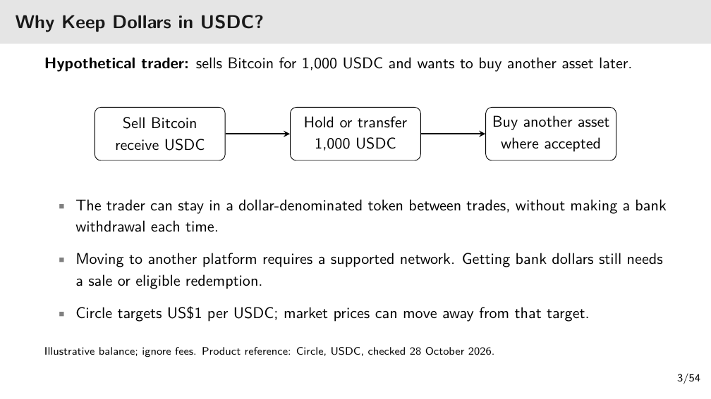

[打开清晰原图](figures/m09/lec09-p03.png)

从左向右读三格：卖比特币换入 USDC → 持有或转移这 1,000 枚 → 在接受 USDC 的地方买下一项资产。中间一格省去每次交易都提现到银行、再充值的动作。跨平台仍须双方支持同一网络；不同链上的同名代币不能凭名字直接互转。

最后要付银行账单时，还得卖币或通过合资格赎回取得银行钱。图中忽略费用，也没有保证市场始终按 1 美元成交；若币价是 0.99 美元，1,000 枚在该报价下只值 990 美元。这是笔记补充算例。

### 2.4 p.04 · 银行里的美元与钱包里的美元

企业要给供应商付款。银行存款（Bank deposit）是企业对商业银行的请求权：银行欠企业这笔钱，付款由银行体系办理。储备支持型稳定币（Reserve-backed stablecoin）则是可在兼容钱包之间转移的代币，其赎回权由发行条款决定。（讲义 p.4）

对比的共同任务是让供应商收到可用资金。银行路径要查账户、银行处理和费用；代币路径还要查网络、接收钱包和退出渠道。价格目标同为 1 美元，不会自动把代币变成银行存款或赋予存款保险。供应商只接受银行美元时，必须把换回银行钱的时间和费用也算进去。

### 2.5 p.05 · 铸币与赎回是一项承诺的正反方向

铸币（Mint）指收到合资格资金后发行代币；赎回（Redemption）指合资格持有人交回代币，按条款换回钱。发行人承诺币可按目标价值退出，反向通道能否实际工作决定了承诺可信度。（讲义 p.5）

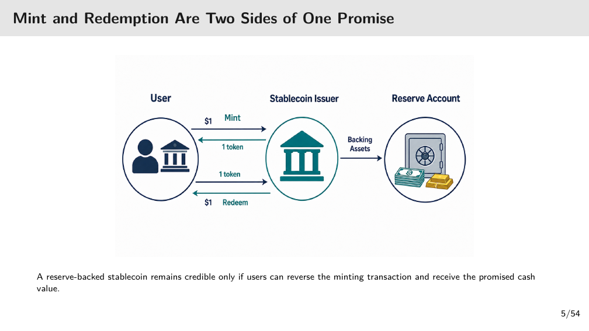

[打开清晰原图](figures/m09/lec09-p05.png)

先读左上箭头：用户交 1 美元给发行人，反向收到 1 枚币。右边的 Backing Assets 指支持币的储备资产；这不是用户钱包里又多了同一笔钱。再读左下箭头：用户交回 1 枚，发行人返还 1 美元。图简化了银行转账、资产买卖、资格与费用；不能据图认定任何持有人都能即时直接赎回。

💡 笔记补充：若发行了 100 枚、每枚承诺兑 1 美元，发行人须支持 100 美元的兑付责任。合资格用户赎回 20 枚后，币退出流通，责任降为 80 美元；把 20 枚卖给另一人则只是换了持有人，责任仍是 100 美元。

### 2.6 p.06 · 稳定币承诺要拆成三个问题

稳定币（Stablecoin）是一类以接近某参考价值为目标的代币；本讲大部分例子以 1 美元为参考。目标不是市场成交价的恒等式。（讲义 p.6）

先看价格目标（Price target）：买卖双方在市场实际愿意付多少，可能高于或低于 1 美元。再看支撑（Backing/support）：靠储备、加密资产抵押或交易激励，三者承担的风险不同。最后看现金入口（Access to cash）：谁有权直接换钱、费用多少、多久到账。只知道“锚定美元”还不能回答付款能否按时完成。

### 2.7 p.07 · 沿四项职能追踪一枚币

讲义要求从头到尾核四项职能。不要把“在链上”当成全部答案：链记录交易，只覆盖整条链的一部分。（讲义 p.7）

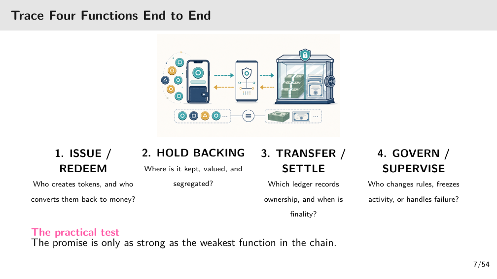

[打开清晰原图](figures/m09/lec09-p07.png)

图上手机表示客户接口，右侧金库表示支持资产，中间表示转换/记录环节；这些是职能示意，不能按金库图标推断真实储备含金量。下方从左到右读四项：发行/赎回（Issue/redeem），储备保管（Hold backing），转移/结算（Transfer/settle），治理/监督（Govern/supervise）。

用一笔付款逐项问：谁发币且让合资格用户退币？储备放在哪里、怎样估值和隔离？哪本账记录所有权，何时达到不会按普通流程撤回的结算终局性（Finality）？谁能改规则、冻结或处理故障？即使转账已最终确认，储备不能及时兑付，整条支付仍可能失败。“最弱环节”指一项职能失灵即可破坏端到端可用性。

### 2.8 p.08 · 三种稳定币设计，CBDC 另作比较

同样追求 1 美元，支撑方法可以不同。左边天平表示目标关系，不是保证两边永远相等的物理定律。（讲义 p.8）

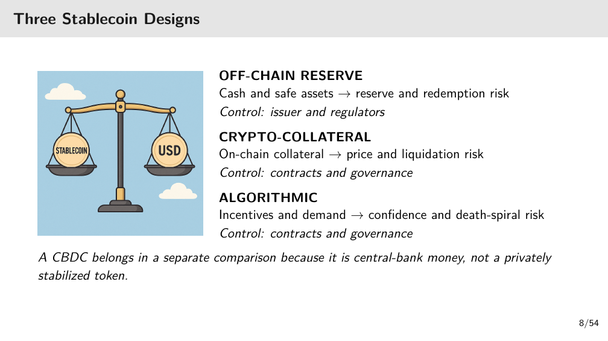

[打开清晰原图](figures/m09/lec09-p08.png)

链外储备型（Off-chain reserve）依靠现金和传统安全资产，由发行人与监管承担控制职责；主要查储备损失和兑付。加密抵押型（Crypto-collateral）依靠链上抵押物，由合约与治理控制；价格下跌和清算迟延会破坏支持。算法型（Algorithmic）主要依赖供给调整、激励与需求；信心同时下滑可形成死亡螺旋（Death spiral）。

CBDC 属于央行货币的比较，不是第四种私人稳定币。本讲 p.38 的标准 CBDC 是央行负债；p.45 的 2026 年银行 e-CNY 钱包又有专门存款化安排，必须分版本看。

### 2.9 p.09 · 支付终点是供应商能用钱

企业已经持有 100 USDC，忽略费用，假定每枚可按 1 美元换钱。企业发送 100 枚到供应商的兼容钱包后，链上转账完成，但供应商的工资银行账户还未因此增加 100 美元。（讲义 p.9）

如果供应商下一笔支出也接受 USDC，可以继续持币支付。如果工资只能从银行账户发，供应商还须卖出或赎回，并等银行入账。于是要分开记录“代币到账时刻”和“银行资金可支用时刻”；前者快不能证明整条路线快。改变条件为赎回收 2 美元费用时，净到账是 98 美元，必须另补费用才满足 100 美元银行付款。

### 2.10 p.10 · 规模扩大不等于风险分散

左图是美元挂钩稳定币的流通供应存量，纵轴 USD billions 表示十亿美元，不是成交量或发行人收入。右图是同一口径的供应占比。（讲义 p.10）

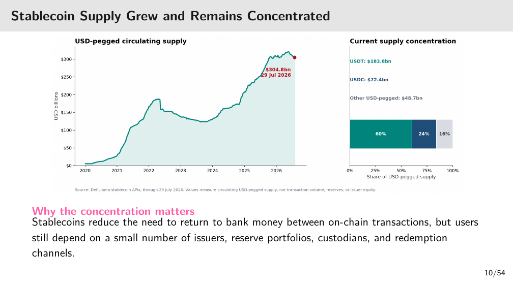

[打开清晰原图](figures/m09/lec09-p10.png)

沿左图横轴 2020–2026 看：供应曾增长、收缩、再增长；标注终点为 2026-07-29 约 304.8 十亿美元。右侧列 USDT 183.8、USDC 72.4、其他 48.7 十亿美元，约 60%/24%/16%。分项四舍五入后合计与总数可能差 0.1，不据此捏造精确误差。

图的来源是课件所引 DefiLlama 数据快照，未取得底层序列，不能宣称逐点重算或当前实时规模。集中度说明很多用户共同依赖少数发行人、储备托管和赎回渠道；供应大不自动消除这些依赖，也不证明真实支付采用。

### 2.11 p.11 · 两家发行企业的分发方式

讲义以 Jeremy Allaire/Circle 与 Paolo Ardoino/Tether 对比商业模式；人物肖像只作识别，不承担机制，不复制装饰画像。（讲义 p.11）

Circle Mint 面向合资格机构，银行及支付企业连接银行美元与 USDC；分发伙伴（Distribution partner）带来可用场景，也分享经济收入。Tether/USDT 经交易所和钱包广泛分发，小额持有人通常通过市场卖出退出。两家共同需要流动储备和回到银行钱的可靠通道；“小额可在交易所买到”与“可直接找发行人赎回”是不同资格。

人物职位及产品范围属于课件截至 2026-10-28 的陈述，本讲研究核心是渠道和兑付责任，不凭肖像或公司名推定安全保证。

### 2.12 p.12 · 代币化基金与稳定币持有人取得不同权利

同样能在数字平台持有，基金份额（Fund share）与支付代币回答的问题不同。基金投资者对一个资产组合享有份额权益，费用后的收益归投资者，净值及二级成交价都可能变化；稳定币持有人主要寻求可转移且接近目标币价的支付资产。（讲义 p.12）

稳定币储备赚了利息，不表示利息自动归持币者。是否能赎回、谁可赎回要看发行条款。稳定币也可以用于购买平台支持的代币化基金：一项是付款工具，一项是买到的投资权利。ChinaAMC 是课件所引 2026-10-23 产品例，不把接受某种结算币推广到所有基金。

### 2.13 p.13 · 有抵押，还要问抵押在哪里

链外储备型如 USDC/USDT，发行人持有现金或传统资产，承担赎回办理。风险包括储备亏损，以及有资产却来不及卖出变现金。加密抵押型如课件列示的 DAI/LUSD，由协议锁定高于所发币值的抵押物。（讲义 p.13）

超额抵押（Over-collateralization）是在起点多留价值缓冲，不是抵押物不跌的保证。💡 笔记补充：借出 100 美元代币、锁入当时值 150 美元的币，若抵押物跌到 90 美元且清算未完成，就可能不足偿还 100。清算（Liquidation）是条件触发后的资产处置；能否及时成交还取决于市场。回顾 [[EF5560_Fintech_and_AI_in_Finance/notes/M08-DeFi-NFT与现实世界资产|M08]] 的 LTV/HF，但本页只需理解支持价值会变。

### 2.14 p.14 · 算法激励为什么可能反过来加速挤兑

算法型设计尝试通过供给调整和买卖激励把价格拉回 1 美元。TerraUSD/UST 使用另一种代币 LUNA 支持转换，而非准备一整池法币现金。（讲义 p.14）

当 UST 折价，交易者只有预期换得的 LUNA 还能卖出，才愿意买 UST 来赎回。若市场同时不信任两者，更多赎回制造更多 LUNA，卖压又削弱 LUNA 价格。这是反馈机制，不能用“算法会自动恢复”替代对退出资产需求的检查。下一组 p.16/20 具体走这条链。

### 2.15 p.15 · 从设计转到发行人与失败案例

这是第二部分分隔页。接下来把设计落实到发行人的收入、渠道成本、挤兑、托管与政策。它没有新增计算或题面，不把分隔标题当成独立理论。

### 2.16 p.16 · Terra 的挂钩依赖另一项可出售资产

按讲义三行表读“承诺 → 做法 → 隐藏前提”。第一行承诺 1 UST 接近 1 美元，做法是销毁 UST、铸出当时价值 1 美元的 LUNA；前提是 LUNA 仍有价值与流动性。第二行说折价时买 UST 赎回产生套利（Arbitrage），但套利者必须能卖出 LUNA。第三行说用增发 LUNA 承接退出，恰好在信心下降时扩张供给。（讲义 p.16）

“套利”是利用两条交易路径的价差，不是无条件保证盈利。若卖出 LUNA 前价格大跌，或市场买盘不足，纸面 1 美元换兑不等于现金 1 美元。课件末句是对该反身性（Reflexive）失败的案例教训，不能推广成所有资产支持承诺都不可能成立。

### 2.17 p.17 · Circle 收入与分发成本要分层读

课件图采用 Circle 2025 年全年数值：储备收入 2.637 十亿美元，分发与交易成本 1.662 十亿美元，其他收入 0.110 十亿美元。三项是不同报表项目，不是三个可相加的利润来源。（讲义 p.17）

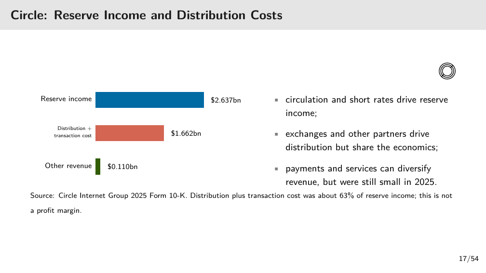

[打开清晰原图](figures/m09/lec09-p17.png)

从蓝条看收入，再看红条花给渠道与交易的成本，绿条是其他收入。成本除储备收入约为 63%；剩余约 37% 还没有扣其他成本、人员、技术、折旧与税，不能叫净利润率。

🔗 2026-11-05 核 [Circle 2025 Form 10-K](https://www.sec.gov/Archives/edgar/data/1876042/000187604226000062/crcl-20251231.htm) 对应表：原值以千美元计，储备收入 2,636,822、分发与交易成本 1,661,549、其他收入 109,820，与图的舍入值相符。流通币规模和储备收益率共同推动收入，分发伙伴也拥有议价权。

### 2.18 p.18 · Tether 与 Circle 的共同目标和不同经济性

两种币均追踪美元，但企业不能只用“币价都约 1”比较。原表每行比较一种业务维度：分发、收入、披露规模、披露方式、战略风险。（讲义 p.18）

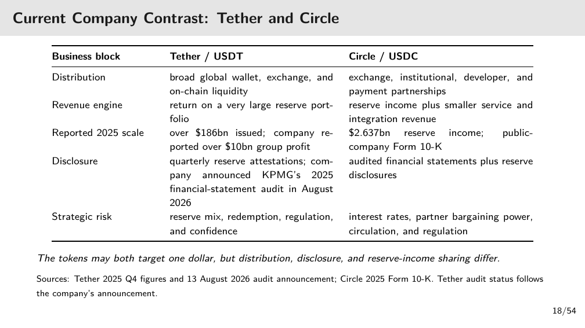

[打开清晰原图](figures/m09/lec09-p18.png)

Tether 的渠道强调全球交易所/钱包流动性；Circle 强调机构、开发者及支付伙伴。课件列 Tether 2025 年末发行超 186 十亿美元、集团利润超 10 十亿美元，Circle 列 2.637 十亿美元储备收入；集团利润与收入不能直接排大小判断效率。

收入引擎这一行：Tether 靠大型储备组合的投资收益；Circle 也以储备收入为主，另有规模较小的服务和系统集成收入。p.17 的其他收入约 0.110 十亿美元，比其储备收入小得多；渠道覆盖扩大不等于这些服务已成为主要收入。

战略风险这一行：Tether 要查储备资产组合、兑付通道、监管与市场信心。Circle 还特别受利率、流通量和伙伴议价影响：收益率下降会压收入，强势分发伙伴可能要求更多分成。两家都受监管约束；这组比较说明要查哪些依赖，不构成安全排名。

披露也要分储备鉴证（Attestation）与财务报表审计（Audit）：前者核特定时点/口径，后者审整套报表，不能互相替代。Tether/KPMG 2026-08 公告及 2025 数值本稿保留为课件所引公司口径，未重新穷尽核实；不因表中“审计”一词断言无储备风险。

### 2.19 p.19 · 全天转币与银行现金出口的边界

跨时区交易所和支付企业希望银行非营业时段也能转移美元计价价值。Circle 以储备支持 USDC，合资格企业经 Circle Mint 在银行美元与币之间转换；支持网络可全天记录转币。（讲义 p.19）

要完整解释这项业务价值，得说出省掉哪段等待：已有 USDC 时，平台之间的代币腿可继续运行。需要银行现金时，赎回资格、银行处理和费用仍存在。因此“24/7 token transfer”不能写成“24/7 guaranteed bank-dollar settlement”。如果付款对象只接受银行钱，应以银行实际可用时刻评估承诺。

### 2.20 p.20 · 四格走完 UST/LUNA 赎回螺旋

原图是历史机制示意，图中价格为教学用数值；不能当作某分钟真实行情。（讲义 p.20）

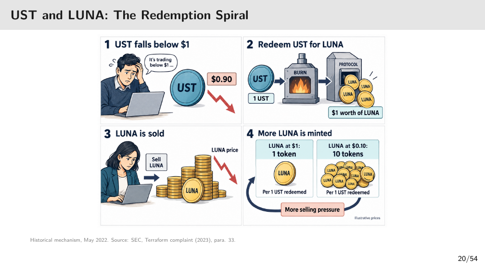

[打开清晰原图](figures/m09/lec09-p20.png)

按原图 1→2→3→4 读：

1. UST 市价跌到 0.90 美元。
2. 持有人交回/销毁 1 UST，协议按规则发出当时值 1 美元的 LUNA。
3. 收币者卖 LUNA，新增卖压使它更便宜。
4. LUNA 若从每枚 1 美元跌到 0.10 美元，同样 1 美元的转换就须发 10 枚，而不是原来的 1 枚。

数量增加又进入第 3 步的卖压，形成循环。用公式概括本例的铸出数量：承诺美元值除以当时 LUNA 单价；$1\div0.10=10$。该规则依据价格取值有效及市场可卖的前提，并不创造外部美元储备。若 LUNA 无人接盘，铸更多枚也未解决兑付。

### 2.21 p.21 · 损失沿共同抵押、杠杆与融资传递

讲义的箭头链是：挂钩破裂 → 被迫赎回 → 波动代币增发 → 抵押损失 → 清算和提款。它描述传染（Contagion）的渠道，不是所有区块链资产都会同幅下跌的定律。（讲义 p.21）

先区分四类主体：稳定币持有人失去承诺美元值；LUNA 持有人面对供给增加与需求下降；接受这些币作抵押的协议面临支持价值缩水；集中持有风险的基金/贷款人又被追缴保证金或提款。杠杆（Leverage）指用负债支持较大资产头寸，价格损失会更快耗尽自有缓冲。

💡 笔记补充：贷款人借出 100，原抵押物值 150，跌到 80 后即使卖完也可能缺 20。贷款人再欠其他人 90 时，其自身偿付也受冲击。要判断传染就查谁欠谁、共用什么抵押物，而不是只查币是否在同一条链。

### 2.22 p.22 · 直接赎回与市场出售不是同一笔交易

对 Circle 直接赎回，合资格客户把 USDC 交回发行人换美元，币退出流通；市场出售是买家向卖家付款，USDC 转给买家，币仍流通。（讲义 p.22）

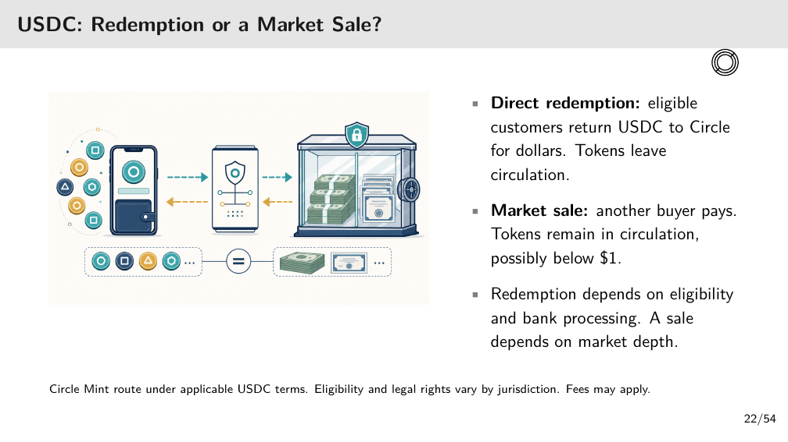

[打开清晰原图](figures/m09/lec09-p22.png)

图中手机到转换/储备的两方向箭头表示代币与资金联系；右文补足了简图没有画出的“另一市场买家”。不要看金库图标就认定所有买家均可直接提款。赎回依赖身份资格及银行到账；市场出售依赖买盘深度（Market depth），即给定价格附近愿意承接多少数量。

例如持 100 枚，以 0.98 卖给另一人，卖家得 98 美元、买家持 100 枚，发行量不变。只有买家随后合资格赎回，才发生发行量减少。手续费和法域权利另看条款。

### 2.23 p.23 · SVB 压力下，财务主管如何按时付款

硅谷银行（Silicon Valley Bank，SVB）是本页历史事件中的储备存款银行。

本题把“有多少币”和“周一有多少银行美元可用”拆开。CFO 即财务主管；题中 0.90 是可执行报价（Executable price），并明确能在付款期限前给到美元，不是屏幕上无法成交的参考价。

英文原题／原页给定情境（L09 p.23）

<blockquote class="source-original">

USDC and SVB: A Treasury Decision

  During the March 2023 SVB crisis, uncertainty over access to Circle’s bank deposits put 
  USDC’s redemption promise under pressure.

  Hypothetical CFO: holds 1m USDC and must pay &#36;800,000 on Monday. A dealer offers an 
  executable price of &#36;0.90 per USDC, with dollars available by the payment deadline.

    • How many USDC must the company sell to fund the payment?

    • What must be true for waiting for redemption to be feasible?

    • Could a short-term credit line be cheaper than selling at a discount?

  Company, quote, and payment terms are teaching assumptions, not historical market data. Ignore fees. Historical sources 
  appear on the next page.

</blockquote>

中文题意：公司持 100 万 USDC，周一须付 80 万美元。问卖几枚、能否等赎回、短期授信是否可能更便宜。假定忽略费用，事件背景与公司的具体余额/报价是两层来源。

⚪ 参考作答（笔记推断，依据讲义 p.23–24）。第 1 问：要卖的枚数等于所需银行美元除以每枚成交美元：

$$
q=800{,}000/0.90=888{,}888.888\ldots\ \mathrm{USDC}.
$$

这里 $q$ 是待卖枚数，0.90 的单位是美元/枚；若交易单位只允许整枚须向上取整到 888,889 枚，本题未给最小单位，按可分割代币计算。剩余约 111,111.11 枚。卖掉这些币若本可按 1 美元兑现，折价损失约 88,888.89 美元；不是只卖 800,000 枚，因为那只能收 720,000 美元。

English reference answer (self-written): The company must sell approximately 888,888.89 USDC to receive USD 800,000 at USD 0.90 per coin, ignoring fees.

第 2 问：等赎回须同时具备直接/间接资格、可用银行通道和明确能赶上周一的处理时间，且储备可兑、净到账至少 80 万美元。未来可能恢复面值不等于期限前有钱；不满足时必须另筹过桥资金。

English reference answer (self-written): Waiting is feasible only if the company has an eligible redemption route and can receive sufficient bank dollars before the payment deadline, or has reliable bridge funding.

第 3 问：短期信用额度（Credit line）可以便宜，但题目没有利率、期限和费用，不能唯一判定。若借 80 万直到赎回恢复，比较利息、手续费、抵押/信用条件与约 88,888.89 美元折价损失，也要计赎回迟延风险。示例条件为总借款成本 5,000 且确能按时提款、还款来源可靠，则低于该折价损失；这 5,000 是笔记补充假设。

English reference answer (self-written): A short-term credit line could be cheaper if its total cost and associated risk are lower than the discount loss and it provides usable funds on time; the quoted terms are needed to decide.

### 2.24 p.24 · 2023 年存款可用性改变了什么

讲义记载 Circle 有 33 亿美元储备在 SVB，约占当时总储备 8%；美国当局 2023-03-12 宣布保护 SVB 存款人、3 月 13 日可动用资金。Circle 随后表示这部分储备可全额取得。（讲义 p.24）

因果链是“发行人的银行存款可取回 → 储备换现金的预期改善 → USDC 赎回承诺更可信”。政策保护对象是 SVB 存款人，不能改写为 USDC 持有人直接拥有政府存款保险。该历史金额保留课件来源地位；本题核心不要求用后来的结果假装 CFO 在事前已知救助。

### 2.25 p.25 · 储备支持不能代替交易所托管安全

热钱包（Hot wallet）连接互联网，便于日常转币，也形成受攻击入口。客户在交易所看到的账户余额，与交易所实际控制的链上钱包资产须分开。（讲义 p.25）

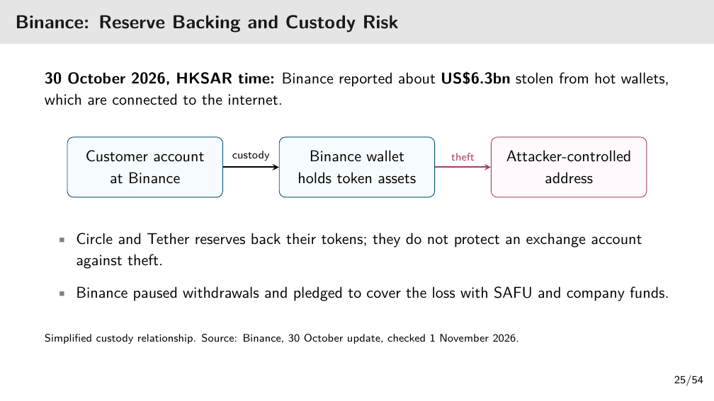

[打开清晰原图](figures/m09/lec09-p25.png)

左格是客户对交易所的账户记录，中格是 Binance 托管的钱包资产，右格是攻击者地址。箭头先表示托管关系，再表示失窃转移。Circle/Tether 的储备支持发行代币的兑付，不自动补偿客户在交易所被盗的余额。

🔗 [Binance 2026-10-30 Update #2](https://www.binance.bh/en-AE/support/announcement/detail/d3306d9dca5243548c813b605e1d1751)（2026-11-05 核）报告约 63 亿美元代币资产受损，并承诺用 用户安全资产基金（Secure Asset Fund for Users，SAFU）及公司资金承担。协调世界时（UTC）10/29 晚间对应香港 10/30。此为发行平台自述与承诺，不等于每位用户赔付已完成；本稿不推定攻击细节已终局调查。

### 2.26 p.26 · 冻结资产与归还资产之间还有步骤

稳定币发行人可能按合约控制权冻结特定地址，使相关代币不能继续转出；调查者追踪到地址并不代表已把币交还原主。（讲义 p.26）

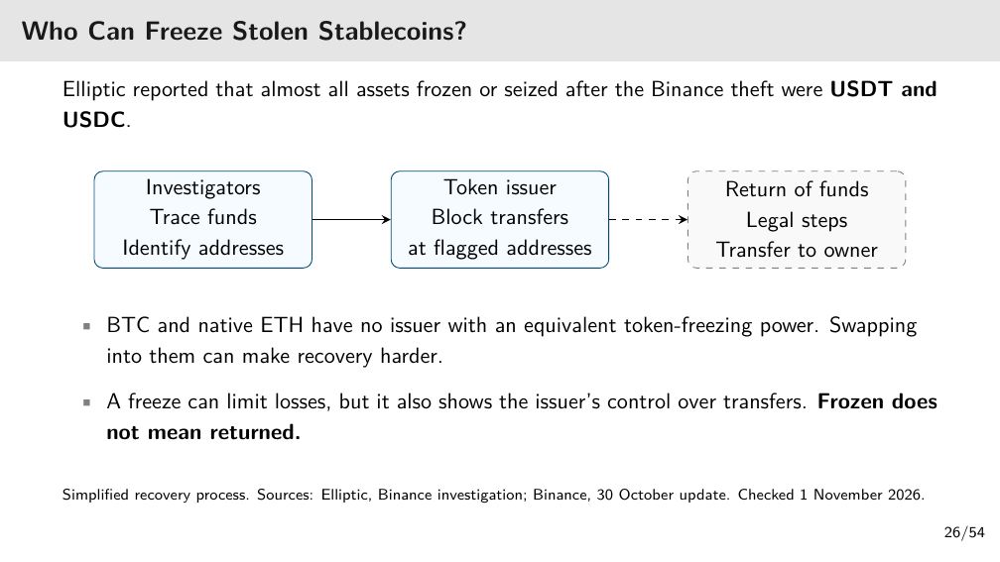

[打开清晰原图](figures/m09/lec09-p26.png)

左→中是调查定位地址、发行人阻止转移；中→右用了虚线，表示法律程序与资金返还仍须另做。BTC 和原生 ETH 没有同等的单一代币发行人冻结入口，所以换成它们可增加追回难度；不是说所有追踪/司法追索都不可能。

🔗 [Elliptic 调查页](https://www.elliptic.co/insights/binance-largest-hack-in-history/)（2026-11-05 核）报告已验证冻结/扣押资金约 28.5 亿美元，并列 USDT/USDC 冻结；这些是该调查范围的快照。冻结能力也意味着转移受发行人控制，不能把“链上”直接等同抗审查。

### 2.27 p.27 · 储备收入扣分发分成后还剩多少

题目问发行人其他费用之前的剩余收入，分母先是储备本金，再是这笔收入；不能把 60% 当作本金费用率。

英文原题／原页给定情境（L09 p.27）

<blockquote class="source-original">

Multiple-Choice Question: Reserve Income after Distribution Costs

   Suppose a stablecoin issuer holds &#36;1 billion of reserves earning 3% annually. It pays distribution 
   partners 60% of that reserve income.

   How much annual reserve income remains before the issuer’s other expenses?

    A) &#36;18 million

    B) &#36;30 million

    C) &#36;12 million

   D) &#36;60 million

</blockquote>

中文题意：10 亿美元储备年赚 3%，其中 60% 给分发伙伴。A=1,800 万、B=3,000 万、C=1,200 万、D=6,000 万美元，问发行人还剩多少。

⚪ 参考作答（笔记推断）：选 C。先算一年储备收入：$10\text{ 亿}\times3\%=3{,}000\text{ 万美元}$。分发支出为 $3{,}000\text{ 万}\times60\%=1{,}800\text{ 万美元}$。剩余 $3{,}000\text{ 万}-1{,}800\text{ 万}=1{,}200\text{ 万美元}$。A 是付给伙伴的部分；B 尚未扣分成；D 无法由题设得到。

English reference answer (self-written): C. Annual reserve income is USD 30 million, and 40% remains after distribution payments, leaving USD 12 million before other expenses.

改条件：伙伴分成变 70%，本金与收益率不变时，收入仍为 3,000 万，但剩余比例变 30%，即 900 万美元。剩余收入还需扣其他费用，不能称净利润。

### 2.28 p.28 · 付款要比较相同收款结果的全部成本

只看链上转账 1 美元会漏掉换汇和赎回。题中银行 all-in 指已包含所有费用；same amount received 把最终实收金额固定，才能公平比较。

英文原题／原页给定情境（L09 p.28）

<blockquote class="source-original">

Multiple-Choice Question: The Full Cost of a Stablecoin Payment

   A US company pays an overseas supplier. A stablecoin route costs &#36;1 for transfer, &#36;8 for 
   currency conversion, and &#36;4 for redemption. A bank quotes an all-in cost of &#36;10 for the same 
   amount received.

   Which route is cheaper, and by how much?

    A) The bank route, by &#36;3.

    B) The stablecoin route, by &#36;9.

    C) The stablecoin route, by &#36;1.

   D) Both routes cost &#36;10.

</blockquote>

中文题意：稳定币路线三项费用是转账 1、换汇 8、赎回 4 美元，银行总费 10。A=银行便宜 3，B=稳定币便宜 9，C=稳定币便宜 1，D=两者都 10。

⚪ 参考作答（笔记推断）：选 A。稳定币全程成本为 $1+8+4=13$ 美元；银行为 10 美元，差 $13-10=3$ 美元。B 只拿银行 10 与链费 1 比；C 未完整加总；D 忽略了稳定币额外费用。若换汇费降到 2，稳定币总费变 7，才会比银行便宜 3。

English reference answer (self-written): A. The stablecoin route costs USD 13 in total, so the bank route is cheaper by USD 3 for the same amount received.

### 2.29 p.29 · 储备规范怎样连接美国短债需求

美国 GENIUS Act 是支付稳定币发行框架，不是所有国家、所有代币一律适用的规则。课件概括两项：流通币至少有 1:1 合资格流动储备，月度披露储备并由注册会计师事务所核查。（讲义 p.29）

🔗 2026-11-05 核 [Public Law 119-27 §4(a)](https://www.govinfo.gov/content/pkg/PLAW-119publ27/html/PLAW-119publ27.htm)：规定至少 1:1 的可辨认储备、合资格资产及月度披露/核查。美国国债作为直接储备的条款限定剩余期限不超过 93 天，不能把“政府债”概括成任意期限。签署日为 2025-07-18；生效/过渡与后续实施细则另受条款影响，本页不把签署等于所有主体已经即时全部适用。

课件另引 Tether 2026-03-31 约 1,410 亿美元直接/间接短债敞口，以及 Circle 主要持政府货币市场基金。其经济链是储备需求增加可能增加短期国债需求，不是国债价格或持币收益必然上升。敞口（Exposure）在此指直接/间接配置到该类资产的金额，不是当季利润。Tether 精确金额本次未重核，保留为课件快照；Circle 具体组成见其披露。

### 2.30 p.30 · 用户数不变，降息也会减少发行人利润

原例每年保持 1 亿美元储备、分发及运营成本合计 200 万美元，持币者不收利息，储备利息是唯一收入。金额统一按百万美元读：本金为 100，成本为 2。（讲义 p.30）

原例 A：年收益率 4%，利息为 $100\times4\%=4$ 百万美元；税前经营利润为 $4-2=2$ 百万美元。原例 B：年收益率 2%，利息为 $100\times2\%=2$ 百万美元；税前经营利润为 $2-2=0$。两种情境的流通量都没变，利润差来自利率。

用关系式整理：$\Pi=R y-C$。$\Pi$ 是本例年税前经营利润（美元/年），$R$ 是持续保持的储备本金（美元），$y$ 是年收益率，$C$ 是年成本（美元/年）。这里成本视作固定假设；真实分成若随收入变化，须重建成本而不能照搬本例。

### 2.31 p.31 · 赎回套利须扣全部费用

eligible 表示交易者具备赎回资格；immediately 表示题设排除等待中的价格风险。缺任何条件，纸面差价未必能落袋。

英文原题／原页给定情境（L09 p.31）

<blockquote class="source-original">

Multiple-Choice Question: Redemption Arbitrage

   A stablecoin trades at &#36;0.98. An eligible trader buys 1,000 coins and immediately redeems 
   them for &#36;1 each. Total trading and redemption fees are &#36;5.

   What is the trader’s net profit?

    A) &#36;0

    B) &#36;20

    C) &#36;25

   D) &#36;15

</blockquote>

中文题意：0.98 美元买入 1,000 枚，立即每枚 1 美元赎回，总费用 5 美元。A=0、B=20、C=25、D=15 美元。

⚪ 参考作答（笔记推断）：选 D。买入支出 $0.98\times1{,}000=980$ 美元；赎回收 $1\times1{,}000=1{,}000$ 美元；净利润为 $1{,}000-980-5=15$ 美元。B 是未扣费用的价差；C 把费用加到利润；A 不是给定数值的结果。若总费升到 25，净结果为 −5 美元，便不值得按同样条件做。

English reference answer (self-written): D. The trader receives USD 1,000, pays USD 980 for the coins and USD 5 in fees, and earns a net profit of USD 15.

### 2.32 p.32 · 中国政策问题要落到交易链与证据

课件的四行是政策分析目标，不是现行法律条文。每行先问目标，再问稳定币如何影响它，最后问要什么证据。（讲义 p.32）

资本流动监测要查身份、地区、交易与兑回路线，因为钱包转移可能绕开传统银行可见渠道。消费者保护要分发行人、储备和损失承担，避免把代币误作受保银行钱。货币主权（Monetary sovereignty）是国家影响本币使用与货币条件的能力，应查持续余额和用途；创新则比较端到端费用、合规、流动性与故障恢复。

例如某钱包可跨境转币，只能证明一种技术通道存在，不能证明这笔交易在某法域合法或资本管制已失效。缺用户、交易、发行与赎回事实时，不作法律结论。

### 2.33 p.33 · 中银香港与中国银行在 e-CNY 充值中分工

客户是希望在内地商户付款的香港居民。BOCHK 是中银香港，BOC 是中国银行；名字接近，图上职责不同。（讲义 p.33）

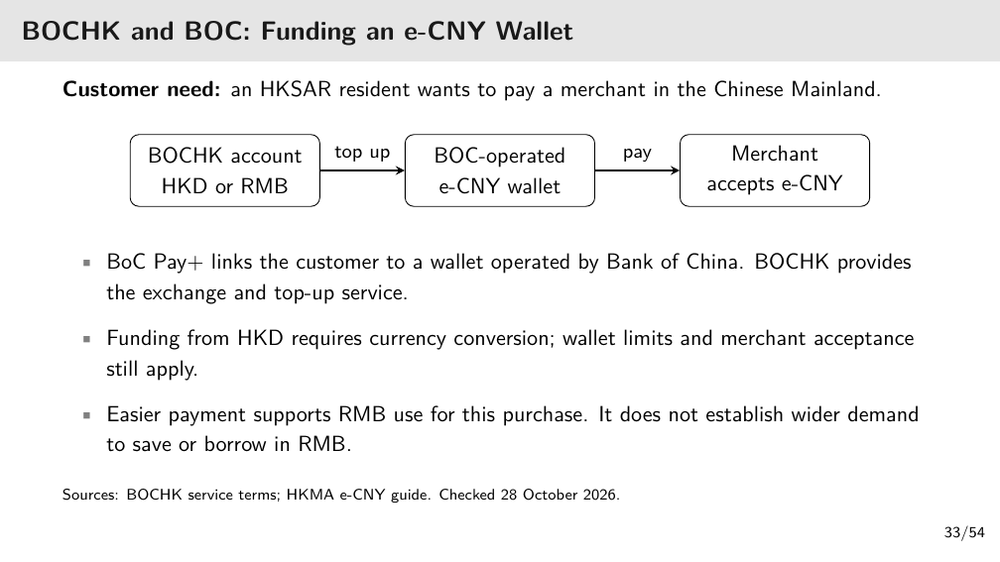

[打开清晰原图](figures/m09/lec09-p33.png)

e-CNY 即数字人民币。左格是中银香港港币（HKD）/人民币（RMB）账户，中格是中国银行运营的 e-CNY 钱包，右格是接受 e-CNY 的商户。左→中表示兑换/充值，中→右表示支付。BoC Pay+ 连接接口，BOCHK 提供换汇充值，钱包服务由 BOC 运营；港币来源先换人民币，仍受钱包限额与商户接受范围限制。

该路线解决特定客户的一次跨境购物摩擦。付款便利有助于这笔交易用人民币，不足以证明全球储蓄、借贷也会改用人民币。产品资格、费用与存款保障按适用条款，本稿不把服务示意当成对所有香港居民的无条件保证。

### 2.34 p.34 · 合作分发与银行现有客户，哪种获客更便宜

讲义保留 2026-08-30 业务快照：Anchorpoint 经授权分发商向机构/专业投资者有限推出 HKDAP，HSBC 计划借 PayMe 与 HSBC HK App 服务现有银行客户。获牌日 2026-04-10 与之后是否已上线是不同事实。

英文原题／原页给定情境（L09 p.34）

<blockquote class="source-original">

HKSAR Stablecoins: Two Distribution Models

                                     First two issuer licences: 10 April 2026

<table class="source-comparison">
<thead><tr><th>Anchorpoint Financial</th><th>HSBC Hong Kong</th></tr></thead>
<tbody>
<tr><td>Partner distribution</td><td>Existing bank customers</td></tr>
<tr><td>Authorized distributors bring HKDAP to institutional and professional investors.</td><td>Plans to use PayMe and the HSBC HK App for transfers and payments.</td></tr>
<tr><td>At 30 August: limited rollout on Ethereum, with access through distributors.</td><td>At 30 August: licensed, with launch still planned for the second half of 2026.</td></tr>
</tbody></table>

   Discussion: Which route can attract repeat users at a lower distribution cost?

   Sources: HKMA, 10 April 2026; issuer disclosures. Business status retains the course’s 30 August 2026 snapshot.

</blockquote>

中文题意：哪条路径能以更低分发成本吸引持续用户？repeat users 指会再次用的客户，不是一次注册。

⚪ 参考作答（笔记推断）：不能仅据渠道名唯一确定。HSBC 可利用既有账户与 App 减少新增获客支出，但仍有合规、整合、激励与使用习惯成本。Anchorpoint 可借伙伴触达特定企业场景，但需支付分成、依赖伙伴覆盖。应对相同用户任务比较每个持续用户的获客/服务成本、重复支付及留存，而非只比下载量。若伙伴已有高频跨境客户，合作路径也可能更低成本。

English reference answer (self-written): Neither route is necessarily cheaper. Compare the incremental distribution and service cost per repeat user for the same use case, including partner revenue sharing, integration, compliance and retention.

🔗 [香港金融管理局（HKMA）2026-04-10 说明](https://www.hkma.gov.hk/eng/news-and-media/insight/2026/04/20260410/)（2026-11-05 核）确认两家获牌；本稿不把课件八月的上线计划当作十一月实时状态。

### 2.35 p.35 · 买 HKDAP 时，客户、分发商、发行人分别做什么

这是合资格企业的 beta-access 简化路线，不能当作所有零售用户的开放申购承诺。（讲义 p.35）

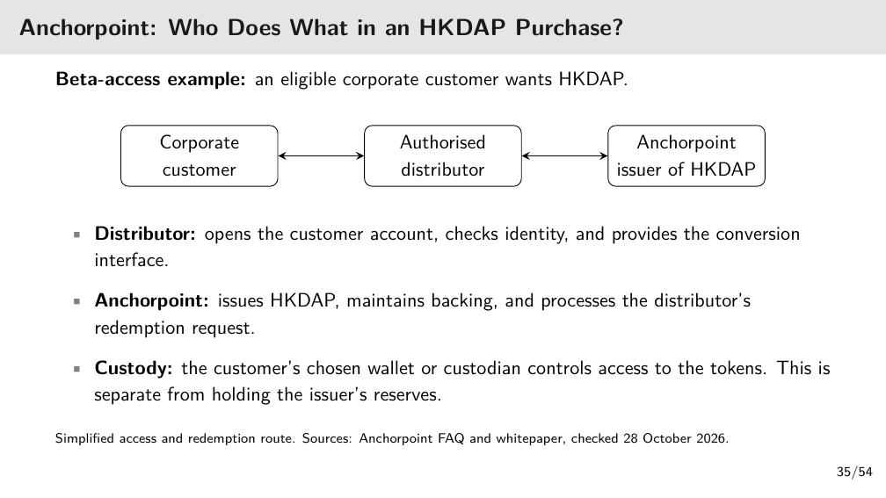

[打开清晰原图](figures/m09/lec09-p35.png)

从左到右读：企业客户 ↔ 授权分发商 ↔ HKDAP 发行人 Anchorpoint。双向箭头对应客户购买/请求退出的通道，不表示三者都是同一法人。分发商开户、核身份并给转换接口；发行人发行币、维护储备并处理分发商的赎回请求。

客户选择的钱包/托管人控制币的使用入口，发行人储备托管则是支持兑付的另一层资产安排。若客户的钱包服务宕机，不足以推出发行人储备已经亏损；若发行人储备出问题，换一个钱包也不会自动解决。

### 2.36 p.36 · 公共与区域替代方案改变哪一层

四种方案不解决同一个问题。国内 CBDC 增加数字形态公共货币；多 CBDC 实验（Multi-CBDC experiment）协调参加的央行和机构；支付网络互联（Linked payment networks）把已有国内轨道连起来；代币化存款（Tokenized deposit）在可编程设施记录商业银行货币。（讲义 p.36）

公共系统也须有人分发、维护隐私和抗故障。跨境平台还需要外汇流动性、治理、法律与交易对手；互联仍受收费、标识符、合规和异常处理影响；代币化存款仍有银行信用及互操作问题。技术降低某一摩擦，不会单独创造对该货币的宏观信任或深厚市场。

💡 笔记补充：固定同一任务——A 地买方要让 B 地供应商收到 100 单位 B 币。下表每行只改变一层安排；费用、汇率、资格和规则仍须另核，不假定四条路线都已商用。

| 方案 | 这笔付款怎样变 | 使用的钱与请求权 |
|---|---|---|
| 国内 CBDC | 可把 A 地国内一段改用数字公共货币；仍要安排跨境和换汇 | 标准模型下由 A 地央行承担该 CBDC 负债 |
| 多 CBDC 平台 | 参与机构在协调的平台上处理各自央行货币的转换或结算 | 各币种仍是相应央行的负债 |
| 现有支付网络互联 | 连接 A、B 两地已有系统，传递指令并协调资金到账 | 可继续用既有银行存款，并未因此发行新 CBDC |
| 代币化存款 | 把银行欠客户的存款记录为可编程代币，用于支持的转移/结算 | 请求权仍由发行存款的商业银行承担 |

例如第三行改变的是两套轨道如何连接，而第二行处理参与央行货币的机构结算。最后一行把记录方式改为代币，并没有把商业银行信用变成央行信用。若 B 地商户不接受 A 地 CBDC，单有第一行的钱包仍完成不了这笔跨境付款。

### 2.37 p.37 · 进入 CBDC 与 e-CNY

这是第三部分分隔页。后文先定义标准 CBDC 与双层服务，再用银行资金流出算例和 e-CNY 新旧版本说明：发行货币的责任、安全网和客户 App 运营是三个须分开的层次。

### 2.38 p.38 · CBDC 的标准定义与比较边界

讲义原定义：“A central bank digital currency (CBDC) is a digital liability of the central bank.” 即 CBDC 是中央银行的数字负债：标准定义下，持有人货币请求权的承担者是央行。（讲义 p.38）

零售型（Retail CBDC）面向家庭与企业日常使用；批发型（Wholesale CBDC）面向金融机构间结算。与私人稳定币比较，区别首先是欠款主体，不是有没有手机 App，也不是一定采用区块链。

此定义用于 p.42/47 的央行直接负债题设。p.45 所谈 2026 年中国银行类运营机构 e-CNY 钱包按商业银行负债管理，不能把这一专门制度机械改写成“持有人任何时点均直接向央行追索”。App 名称相同也须核版本与责任主体。

### 2.39 p.39 · 央行探索的目标不是自动实现的成效

课件列四类目标：国内支付效率、金融包容（Financial inclusion）、货币主权、跨境结算。（讲义 p.39）

效率须看总成本及成功率，不只链速度。金融包容指让原先服务不足的人可使用金融支付，因而钱包、身份、设备及离线方案决定实际覆盖。货币主权目标是私人数字工具扩张时仍能使用公共货币；跨境目标是减少时间、成本和双方对账负担。

若没有网络的人无法安装钱包，即使发行人是央行也未自然改善包容；若身份或外汇审核仍慢，共享账本也未必缩短全程。每项目标要有匹配的结果证据。

### 2.40 p.40 · 双层模式把发行与客户服务分开

双层模式（Two-tier model）表示央行负责发行公共货币，中间层银行/支付企业负责分发钱包和服务用户，用户不必直接在央行开户。（讲义 p.40）

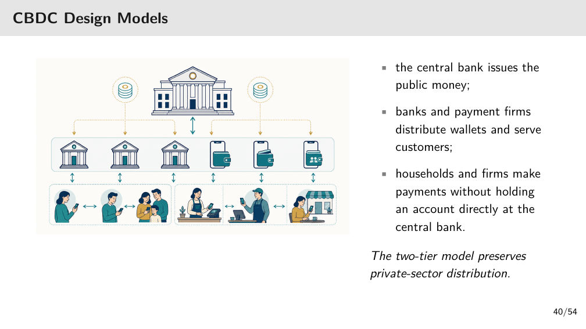

[打开清晰原图](figures/m09/lec09-p40.png)

从上往下看：顶端央行是发行层，中间银行与钱包图标是服务层，底部居民/商户是使用者。层间箭头表示分发和服务联系，底部横向箭头表示使用者之间付款。图没有逐一标每根箭头的法律属性，不能据图认定银行拥有或担保央行负债。

沿一条路径看客户付款：客户先通过运营机构钱包接入，再给商户转货币；央行信用和 App 可用性因此分属不同职责。双层并不等于所有双层系统法律债务相同，e-CNY 2.0 的具体负债安排另见 p.45。

### 2.41 p.41 · 探索比例与项目阶段要分清分母

课件引国际清算银行（Bank for International Settlements，BIS）2025 调查报告：受访为 93 家央行，91% 在 2024 年探索零售或批发 CBDC。91% 的分母是受访央行，不是全球人口，也不是已经推出产品的国家比例。（讲义 p.41）

批发路线关注银行间/跨境结算、流动性与治理；零售路线关注分发、隐私、离线、银行融资与采用。mBridge 在 2024 年到 MVP 阶段，含内地和香港等参与方；最小可行产品（Minimum viable product，MVP）是可验证核心用途的阶段，不等于所有公众都可自由使用或已全面商用。

本页保留 BIS Papers No.159/2024 公告的课件快照；不以“广泛探索”推导每个项目已有同样成效。

### 2.42 p.42 · 存款换直接 CBDC，银行为何不是立刻亏损

题目是假设银行客户把 1,000 万美元存款转成央行直接负债，并用商业银行在央行的准备金结算。这里的准备金（Central-bank reserves）是商业银行持有的央行资产，别与稳定币发行人的储备混义。

英文原题／原页给定情境（L09 p.42）

<blockquote class="source-original">

If Deposits Move into a Retail CBDC, What Happens to the Bank?

   Hypothetical bank: customers convert &#36;10m of deposits into a direct central-bank liability. 
   Assume settlement uses the bank’s central-bank reserves.

<table class="source-comparison">
<thead><tr><th>Customer balance sheet</th><th>Commercial-bank balance sheet</th></tr></thead>
<tbody>
<tr><td>Bank deposits: −&#36;10m</td><td>Reserve assets: −&#36;10m</td></tr>
<tr><td>Retail CBDC: +&#36;10m</td><td>Deposit liabilities: −&#36;10m</td></tr>
</tbody></table>

     • Equity is unchanged at conversion: this is a funding outflow, not an immediate &#36;10m loss.

     • If outflows persist, the bank may need replacement funding or fewer assets. Holding limits 
       can reduce the outflow.

   Simplified retail-CBDC design, not the 2026 e-CNY bank-wallet arrangement discussed later.

</blockquote>

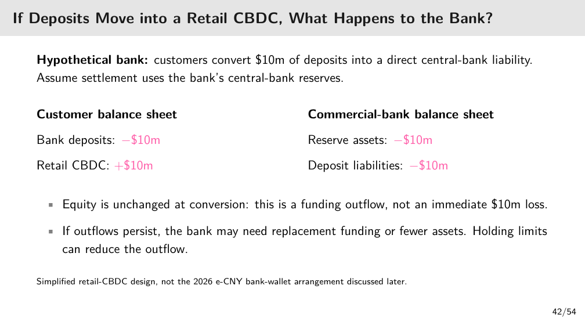

[打开清晰原图](figures/m09/lec09-p42.png)

⚪ 参考解释（依据讲义给定结果）：先看客户账：银行存款资产减少 1,000 万，CBDC 资产增加 1,000 万，总资产不变。再看商业银行账：准备金资产减少 1,000 万，欠客户的存款负债也减少 1,000 万。因此银行净资产即资产减负债的差额没有因这次等额转换减少。

这叫融资流出（Funding outflow），不是立即损失 1,000 万。若继续流出，银行可用的稳定融资减少，可能需借入替代资金、卖资产或缩贷款；这些后续动作可能有成本。持有限额可约束转入量，但不凭限额保证所有银行风险消失。

English reference answer (self-written): The bank loses USD 10 million of reserve assets and extinguishes USD 10 million of deposit liabilities, leaving equity unchanged at conversion. Persistent outflows can create replacement-funding or asset-adjustment costs.

此算例明确不是后面 2026 e-CNY 银行钱包安排。改为存款仅转入同一银行的存款型钱包时，不能照搬准备金必然同额流出的结论，必须先核负债和结算规则。

### 2.43 p.43 · 100% 支持为何仍可能兑不出来

at par 是按面值，instant 是立即；十年期国债和即时现金兑付之间存在期限不匹配。

英文原题／原页给定情境（L09 p.43）

<blockquote class="source-original">

Multiple-Choice Question: Is 100% Backing Enough?

   A stablecoin issuer holds reserves equal to 100% of tokens, entirely in 
   ten-year government bonds, while promising instant redemption at par. 
   Which conclusion is best? 
    A) Full backing removes run risk.

    B) Duration and liquidity losses can still impair redemption.

    C) The market price must remain exactly at par.

   D) Token holders directly own the bonds.

   Discuss 
   Separate the reserve’s face value from its market value and liquidity under mass redemption.

</blockquote>

中文题意：所发币有等额储备，但储备全是十年国债，承诺即时按面值兑。A=全支持消除挤兑，B=期限/流动性损失仍会损害赎回，C=市价必等于面值，D=持有人直接拥有债券；另要求区分面值、市值和大量赎回时可变现能力。

⚪ 参考作答（笔记推断）：选 B。债券面值（Face value）是到期偿付的标称本金，市值（Market value）是现在可出售的价格。长债对利率变化敏感，急售还可能折价；储备的名义 100% 不保证现在足额现金。A 忽略同时提款；C 把目标/承诺当市场成交保证；D 忽略代币权利须由条款规定。

💡 笔记补充：假设旧债每 100 美元面值每年固定付 4 美元票息，到期还 100；后来同信用、类似到期日的新债以 100 美元价格提供每年 6 美元。买家不会因为旧债也叫“政府债”就愿以相同价格接受较低票息。旧债通常须降价，才使买入者相对其支出的总收益更有竞争力。

在其他条件相同时，市场收益率升高，固定现金流旧债的价格通常下降；市场收益率降低时，旧债价格通常上升。较远才收到的现金流更受贴现条件影响，所以较长期固定利率债会有明显的期限价格风险。这里解释方向，不用票息直接除新利率来冒充十年债精确定价。

政府未来仍能还本，与发行人今天出售债券能收到多少，是两个时点的问题。即时赎回迫使今天筹现金，就可能先实现市价损失；若利率反而下降，价格方向可以反转，不能说长债价格只会跌。

💡 笔记补充例：100 枚币承诺兑 100 美元，债券面值 100，但当前只能卖 90。若全部立即赎回且无其他流动性，现金最多 90，缺 10；即使债券将来按面值偿付也赶不上“立即”。若改为可即时支用的 100 现金，期限风险减小，仍须查托管、资格与运营通道。

English reference answer (self-written): B. Full face-value backing does not ensure sufficient liquid market value during a run. Ten-year bonds may fall in price or require a sale at a discount, so instant redemption at par can still fail. Token holders do not automatically own the bonds.

### 2.44 p.44 · 数字美元便利如何影响货币主权

这张图把国内金融/监管设施与跨境数字网络放在两边，用货币节点连接；底部正反符号表达便利和政策风险共存，不是统计估计的因果强度。（讲义 p.44）

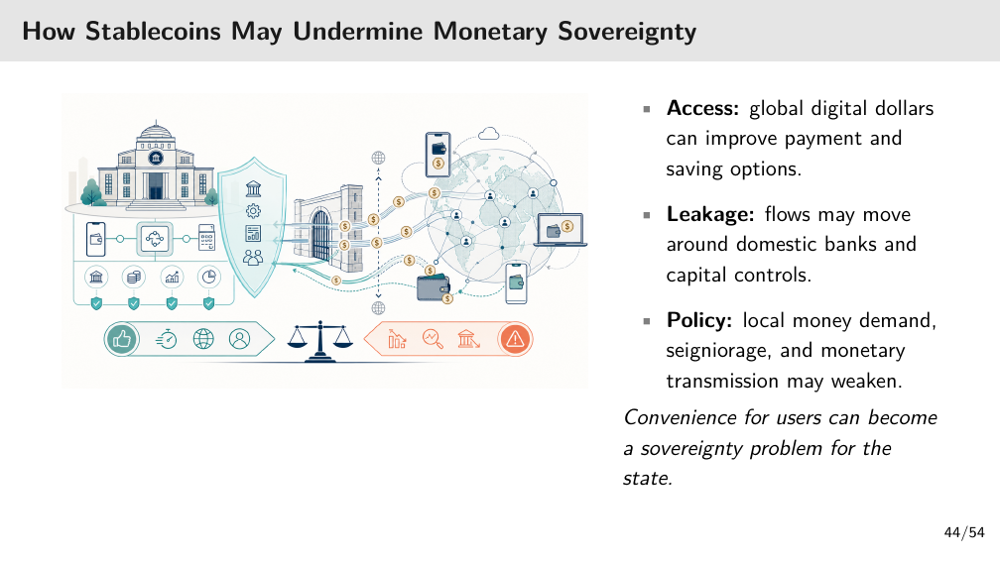

[打开清晰原图](figures/m09/lec09-p44.png)

先从用户读右侧：全球数字美元提供支付与储蓄选择。再从本地政策读左侧：资金可绕开传统银行可见轨道；居民持续改持外币，可能减少本币需求、铸币税（Seigniorage）及货币政策传导。铸币税在这里指发行货币可获得的经济收益，不是每次转账收的税。

关键词是 may。只下载钱包或偶尔跨境买东西不能证明本币已被替代；要查长期余额、支付/储蓄用途和银行资金流。监管限制的有效性也取决于法域与入口，不从图推出绕管制的操作指南。

💡 笔记补充：先看政策传导（Monetary transmission）的简化链。央行利率变化通常会影响本币存贷款利率。存款利率提高，储蓄相对消费可能更有吸引力；贷款利率提高，借钱投资或消费更贵，借款和支出可能减少。实际效果还取决于银行定价、债务结构和需求。

若一部分居民长期改存美元、企业改用美元计价和融资，这部分活动会更多受到美元利率及融资条件影响。本币利率能直接覆盖的储蓄与借贷可能减少，因而本币政策传导可能减弱；汇率、本地信用及其他政策的影响仍在，不能说本币政策完全失效。

再看铸币收益的简化例：假设公共发行机构以成本很低且不付息的 100 单位货币负债，支持持有每年带来 3 单位收入的资产；运营成本为 1，则本例净收益为 $3-1=2$ 单位/年。这是资产收入扣发行负债成本和运营成本的差额，收益是否上缴财政取决于制度。

若公众所需的这类本币余额长期减少，发行机构可支持的对应资产规模可能缩小，收益也可能减少。若负债本身须付息，成本还会改变；所以“铸币税”并非每转一次币就收一笔税，也不是无条件创造财富。上述数字是假设例，不是某央行的实际账目。

### 2.45 p.45 · e-CNY 从现金型试点到存款货币型 2.0

原表按阶段提出评估问题：2014 研究要解决哪种公共货币问题；试点期关注双层钱包的覆盖、隐私、韧性与接受；2026-01-01 起“2.0”转向银行钱包余额与存款货币更密切的关系；下一阶段看已有界面整合及跨境实验能否产生持续使用。（讲义 p.45）

🔗 [司法部平台转新华社 2025-12-30 报道](https://legalinfo.moj.gov.cn/zhfxfzzx/fzzxyw/202512/t20251230_529988.html)（2026-11-05 核）说明新框架 2026-01-01 启动，商业银行钱包中的数字人民币按账户型商业银行负债安排。🔗 [中国银行公告](https://www.boc.cn/ebanking/bi2/202512/t20251231_25636788.html)明确实名钱包自该日起按本行活期存款挂牌利率计息。

因此本讲有两层口径：p.38 的一般 CBDC 定义与 p.42 的直接央行负债模型；本页的银行存款型 e-CNY 特定安排。判断利息、准备金、保险与银行资产负债时须先识别具体钱包/运营者/规则，不把“央行有偿付能力”当作运营银行所有责任的替代。跨境客户适用的保险边界也不能从内地规则自动外推到香港保障计划。

### 2.46 p.46 · 累计交易和钱包数能说明什么

课件使用 2025-10-29 官方统计快照：累计 33.2 亿笔、14.2 万亿元人民币、2.25 亿个人钱包，覆盖 17 个省级地区的 26 个试点地方。（讲义 p.46）

累计笔数是一段历史里完成过的交易总次数，需要另查每月活跃人数。交易额与平均余额、全支付市场份额采用不同分母。钱包数要再区分活跃、已充值和主钱包；试点地方数也要再查商户接受深度。一个人多个钱包、重复转账和长时间累积都可能使规模数与活跃采用脱节。

本页列零售、政府发放、离线/硬件及跨境实验用途。要评估替代微信/支付宝的程度，还需同期间同任务的支付笔数/金额分母、重复使用与商户覆盖。本稿不把旧快照更新成当前规模，也未取得底层明细去推断平均活跃行为。

### 2.47 p.47 · 钱包故障时，信用安全与可用性谁负责

题中央行有偿付能力，意味着货币债务信用未因 App 故障消失；用户当天付不了钱仍是真实运营损失。先按题设的直接央行负债 CBDC 作答，不能偷换成 p.45 的特定银行存款型钱包。

英文原题／原页给定情境（L09 p.47）

<blockquote class="source-original">

Short-Answer Question: Who Bears the Wallet Outage?

   A retail CBDC is accessed through a commercial-bank wallet. The app 
   fails for a day, but the central bank remains solvent. 
    1. Identify the issuer of the monetary claim and the operator of customer access.

    2. Explain which risk remains even though the central bank is solvent.

    3. Name one responsibility or control that should be assigned before an outage occurs.

   Answer in three or four sentences 
   Separate claim safety from operational availability and recovery.

</blockquote>

中文题意：零售 CBDC 通过商业银行钱包访问，App 坏一天，央行仍有偿付能力。第 1 问找货币请求权发行人和客户接入运营者，第 2 问判断剩余风险，第 3 问事前分配一项职责/控制。要求用三四句回答并区分安全、可用和恢复。

⚪ 参考作答（笔记推断）：第 1 问，货币发行/负债主体为央行，商业银行运营客户访问。第 2 问，运营风险（Operational risk）仍在：界面、认证、网络或后台故障可中断付款，不等于币的信用已经受损。第 3 问，可明确银行负责故障恢复/客户通知，提前测试备用通道、恢复时限与交易对账；这是责任建议，不是题面给出的赔偿法律。

English reference answer (self-written): The central bank issues the monetary claim, while the commercial bank operates customer access. Central-bank solvency does not remove operational risk: a wallet outage can prevent payments. The bank’s recovery, customer communication and transaction-reconciliation responsibilities should be assigned and tested before an outage.

改条件：若故障来自核心结算设施，就须将恢复责任连到该设施运营者，不能一律说手机 App 所属银行赔偿。技术能恢复与法律赔偿权仍分开核。

### 2.48 p.48 · 已习惯微信支付，为什么再用一个钱包

使用者已经能在微信支付/支付宝购物。新钱包必须解决现有路线没解决的需求，才有持续切换理由。题中一次性奖励可带来首次使用，未证明奖励停止后还用。（讲义 p.48）

英文原题／原页给定情境（L09 p.48）

<blockquote class="source-original">

Why Would a WeChat Pay User Try an e-CNY Wallet?

  Hypothetical shopper: already uses WeChat Pay and Alipay for daily purchases.

    • At the checkout. If the existing app works and the merchant accepts it, another wallet 
      must offer a useful reason to switch.

    • A one-off reward. A sign-up subsidy may attract a first payment. What brings the 
      shopper back after it ends?

    • A different need. The BOCHK/BOC example helps an eligible cross-border customer 
      fund an e-CNY wallet. Its value should be judged for that customer.

  Compare repeat payments, total cost, and failed transactions for the same shopping task.

  Shopper and reward are teaching assumptions. Cross-border service: BOCHK terms.

</blockquote>

中文题意：问补贴结束后什么使用户回来，并用 BOCHK/BOC 跨境例提示不同用户需求。它是比较用例的讨论，不预设所有国内消费者都缺同一种功能。

⚪ 参考作答（笔记推断）：对同一购物任务，比较实际接受、全程成本、失败率及再次付款，而非只看注册补贴。若跨境用户因此少一步充值或降低换汇摩擦，这是该群体的价值；若本地现有 App 已更便宜好用，新钱包可能缺持续优势。课件没有给结果数据，不能替其判定已胜出。

English reference answer (self-written): Repeat use requires continuing value for the same shopping task, such as lower total cost or reliable access to a needed cross-border service. A one-off reward alone does not establish that value.

### 2.49 p.49 · 注册翻倍为什么不等于支付采用翻倍

本题给了相互制约的证据：注册增加，但每月活跃人数不变、商户很少见重复使用。应把注册看成入口，持续付款看成结果。

英文原题／原页给定情境（L09 p.49）

<blockquote class="source-original">

Short-Answer Question: Wallet Registrations and Payment Use

   In a retail digital-money pilot, registered wallets double after a one-off signup reward. Monthly 
   active users remain unchanged, and merchants report little repeat use.

    1. Does the registration increase establish wider use for payments? Explain using the 
       evidence given.

    2. Choose two measures of sustained payment use. How would you use them to assess 
       adoption after the reward ends?

</blockquote>

中文题意：①这些证据能否证明支付使用更广；②选两项持续使用指标，说明奖励结束后如何评价。double 是注册翻倍，不是题中所有指标都翻倍。

⚪ 参考作答（笔记推断）：第 1 问，不能。每月活跃不变和商户低复用削弱了“新增注册变成长期支付者”的主张，但也不能推断每个新增钱包都不用，因为缺个体追踪。

English reference answer (self-written): No. Registrations doubled, but unchanged monthly active users and little repeat use do not establish broader sustained payment use.

第 2 问，可用奖励后同一注册批次的重复付款留存率（Payment retention），以及每月真实支付的活跃用户数。留存率分母固定为该批注册用户，分子为后续指定月再次支付者；活跃数须限定真实商户支付、去重并排除测试/自转。奖励结束后连续比较相同窗口，同时与奖励前基线/相近对照组核对，不能仅用跨月钱包总量变化。两项指标分别回答有没有回来、使用者规模有没有持续扩大。

English reference answer (self-written): Track post-reward payment retention for the same signup cohort and monthly active merchant-paying users under a consistent definition. Compare several post-reward periods with the pre-reward baseline or a suitable comparison group to test persistence.

### 2.50 p.50 · 2.0 之后用什么证据评价

课件四行把问题与证据配对，不预设银行存款化一定成功。（讲义 p.50）

银行融资看余额、资金流、融资成本：付息钱包会竞争普通存款还是增强银行客户关系？安全网看规则和恢复测试：准备金、保险、钱包层级、责任怎样适用？互操作性（Interoperability）看接受范围、切换和正常运行率：同一工具能否跨多个客户界面工作？跨境看端到端时间、成本、异常，并保留资本、外汇、身份与数据规则。

这四行的共同终点是持续使用、余额和系统价值。钱包注册只是接入记录；某次交易快也不能单独证明低总成本或宏观采用。若资料只给注册数，结论应停在注册触达，而不是补造活跃率。

### 2.51 p.51 · Tether 的用户价值与分发网络

交易者希望把美元计价资产在交易所之间移动，一些国际用户也面临银行美元转账费用或接入限制。USDT 经交易所、钱包、做市商（Market maker）分发，做市商提供买卖报价和库存周转。（讲义 p.51）

小用户多从中介买币，因此发行人与用户未必直接开户往来。退出价格同时依赖市场买盘和对赎回的信心。若交易平台暂停提款，发行人储备充足也不能独立保证该平台账户马上转币；若直接赎回拥堵，做市商补充流动性的能力也可能下降。

### 2.52 p.52 · 直接赎回门槛与固定费用怎样影响小额用户

课件列 Tether 直接申购/赎回最低 100,000 美元、赎回费为 1,000 美元与 0.1% 中较大者，并要求验证。🔗 [Tether 费表](https://tether.to/en/fees/)（2026-11-05 核）与课件一致；核资格不等于本稿建议开户或真实交易。

💡 笔记补充：赎回额为 $V$ 美元时，题述费用为 $F=\max(1000,0.001V)$ 美元，净到账为 $V-F$，未计其他费用。$V$ 为满足门槛的请求额，$F$ 为此次费用。赎回 100,000 时，0.1% 仅 100，所以收 1,000、净 99,000；赎回 2,000,000 时比例费用为 2,000，高于 1,000。

小于门槛或无资格者通常在市场卖出，发行量并不因此减少。固定最低费用也会压缩小笔折价套利空间；交易者必须把合资格、可到账和全部费用共同代入，不能仅据 1 美元承诺认定所有价差都可赚。

### 2.53 p.53 · 储备缓冲与流动性保护不同风险

课件列 Tether 2026 年第二季净经营利润 15 亿美元、6 月 30 日储备缓冲约 41.1 亿美元。🔗 [Tether 2026-07-31 公告](https://tether.io/news/tether-posts-strong-q2-performance-generates-1-5b-net-operating-profit-maintains-4-11b-reserve-buffer-and-expands-gold-holdings-to-more-than-146-tons/)（2026-11-05 核）报告对应金额；属于公司发布、特定时点口径。

缓冲（Reserve buffer）是资产超过负债的部分，可吸收估值损失；流动性（Liquidity）是到需要时能以可接受价格取得现金。资产账面超额却卖不快，仍可能延迟兑付。低利率可在用户不流失时减少储备收益。本页净经营利润与 Circle p.17 的储备收入不是同一指标，也不能用一季比全年直接评价盈利能力。（讲义 p.53）

### 2.54 p.54 · 把本讲收束为三条判断链

讲义最后三点分别回到兑付、发行经济性、公共货币。（讲义 p.54）

第一，储备型稳定币要用可及时变现的资产支持赎回；现金和短期国债的作用是匹配兑付需要，100% 名义支持不够。第二，储备收入和分发成本决定商业模式的重要部分，需在规模、利率、渠道分成和其余成本间追踪利润。第三，标准 CBDC 是央行数字负债，零售/批发只是接入对象差异；mBridge 是批发结算例，不能等同公众钱包。e-CNY 2.0 银行钱包的专门安排仍按 p.45 分开。

课件给分发成本的具体例子是 Circle 向 Coinbase 支付分发费用：交易所提供接触用户和使用币的渠道，发行人因此需要分享收入。这里保留原例，不补造合同比例，也不把 Coinbase 的全部收入归于 USDC。（讲义 p.54）

复习时先问“谁欠谁”，再问“钱怎么到账”，最后问“同一批用户与单位下，收入、成本和风险怎样变化”。不能只背公司名称。

## 3. 一图看懂 · 先找请求权，再查完成条件

这张表按同一付款任务读：一行是一类持有物，第二列说谁承担请求权，第三列追问怎样真正完成支付。它压缩前文，不替代逐页机制。

| 持有物 | 请求权/责任 | 付款完成还要查什么 |
|---|---|---|
| 商业银行存款 | 商业银行负债 | 银行路径、可用资金、费用与时间 |
| 储备型稳定币 | 发行条款下的私人承诺 | 兼容转币、资格、储备流动性与现金出口 |
| 加密抵押型稳定币 | 协议抵押与治理规则 | 价格、清算、市场与合约风险 |
| 算法型稳定币 | 激励和风险吸收代币机制 | 退出资产需求能否承受挤兑 |
| 标准 CBDC | 央行数字负债 | 服务层与基础设施能否正常使用 |
| 银行存款型 e-CNY 钱包 | 2026 特定银行负债安排 | 具体运营机构、付息、准备金及保障范围 |

例如第三行不是“有抵押就安全”，而是接着问抵押物跌价后能否及时卖出。最后两行须分开，以免把 p.42 的直接央行负债模型套错。

## 4. 速查表

每行是一项已解释的判断动作；读左边问题，按右列回到完整过程。

| 要判断什么 | 关键动作 | 回到正文 |
|---|---|---|
| 市场卖出是否减发行量 | 查是否交回发行人并退出流通 | [[#2.22 p.22 · 直接赎回与市场出售不是同一笔交易\|p.22]] |
| 收入是否等于利润 | 收入减渠道分成，再核其余成本 | [[#2.27 p.27 · 储备收入扣分发分成后还剩多少\|p.27]] |
| 哪条付款路线便宜 | 固定实收结果，加转币/换汇/赎回 | [[#2.28 p.28 · 付款要比较相同收款结果的全部成本\|p.28]] |
| 价差是否可套利 | 资格、时间、数量与全部费用 | [[#2.31 p.31 · 赎回套利须扣全部费用\|p.31]] |
| 100% 支持是否充分 | 分面值、市值、可及时变现 | [[#2.43 p.43 · 100% 支持为何仍可能兑不出来\|p.43]] |
| 银行存款转换是否亏损 | 资产和负债同额变化，先算净额 | [[#2.42 p.42 · 存款换直接 CBDC，银行为何不是立刻亏损\|p.42]] |
| 注册是否代表采用 | 同一批次的复用和真实支付活跃 | [[#2.49 p.49 · 注册翻倍为什么不等于支付采用翻倍\|p.49]] |

## 5. 双语术语卡

每行英文为笔记自拟应试定义，不冒充教授原句。首次操作仍在 §2。

| 中文 | English | 英文定义 | 首现/应用 |
|---|---|---|---|
| 稳定币 | Stablecoin | A token designed to track a reference value under a stated support mechanism. | p.6 |
| 铸币 | Mint | Creating tokens under the issuance rules after receiving eligible funds or collateral. | p.5 |
| 赎回 | Redemption | Returning tokens for the promised asset under the applicable eligibility and processing terms. | p.5/22，M08 已有 |
| 结算终局性 | Finality | The point at which a transfer is final under the relevant system rules. | p.7 |
| 储备收入 | Reserve income | Income earned on the assets supporting outstanding stablecoins. | p.17 |
| 分发成本 | Distribution costs | Payments or costs incurred to obtain distribution and use through partners. | p.17 |
| 流动性 | Liquidity | The ability to obtain or transfer usable funds at acceptable cost and within the required time. | p.13/22 |
| 储备缓冲 | Reserve buffer | The excess of the stated reserve assets over the relevant liabilities at a given time. | p.53 |
| 中央银行数字货币 | Central bank digital currency | A digital liability of the central bank under the standard CBDC definition. | p.38 |
| 双层模式 | Two-tier model | An arrangement separating public-money issuance from intermediary distribution and customer service. | p.40 |
| 运营风险 | Operational risk | The risk that failures in systems, processes or service provision prevent expected operation. | p.47 |
| 货币主权 | Monetary sovereignty | A state’s capacity to influence domestic monetary conditions and the use of its money. | p.32/44 |
| 支付留存 | Payment retention | The share of a defined user cohort that makes qualifying payments again in a specified later period. | p.49 |

## 6. 考点预判与答题框架

### 6.1 来源与可信度

无 M09 转录，不能写本讲教授明示考点。以下为 🟡 ILO 反推或 ⚪ 笔记推断：syllabus 要解释机制、商业模式、风险，讲义给出选择/短答题；并不保证正式考题完全相同。

### 6.2 用完整句连接判断与条件

储备型案例可依次回答“用户痛点 → 资金与代币路线 → 收入减成本 → 兑付与运营风险 → 可核证据”。英文参考框架（笔记自拟）：The service addresses a specific payment need. Its token transfer can operate separately from bank-dollar conversion. Revenue depends on circulation, reserve yield and distribution terms, while redemption requires liquid backing and a usable access route.

CBDC 案例先限定题设负债，再分发行、访问和风险。英文参考框架（笔记自拟）：Identify the monetary issuer separately from the wallet operator. Safe claims do not ensure uninterrupted access. Assess adoption using sustained qualifying payments and balances rather than registrations alone.

## 7. 自测 · 改一个条件再判断

这些是笔记补充题，未代表本人已完成自测。答案用已讲机制解释，不引入公司新数据。

### 7.1 渠道分成增加

储备 10 亿、年收益 3%，渠道分成从 60% 升到 70%，其他费用前剩多少？

答案

收入仍 3,000 万美元；剩余比例降到 30%，故剩 900 万。变化是收入分配，未改变本金或收益率。It leaves USD 9 million before other expenses.

### 7.2 有价差但总费更高

1,000 枚以 0.98 买、1 美元立即赎回，总费变 25 美元，还赚吗？

答案

毛差价 20 美元，扣 25 后亏 5。要先确认资格和即时到账，再算净结果；低于目标价不自动保证套利。The net result is a USD 5 loss.

### 7.3 客户存款转入直接 CBDC

同 p.42，改为 300 万美元，准备金与存款负债各变多少、权益呢？

答案

银行准备金资产减少 300 万、存款负债减少 300 万，转换本身权益不变。若被迫之后高价借钱，融资成本是后续影响。Equity is unchanged at conversion; replacement funding can add later costs.

### 7.4 币仍值 1 美元，但交易所钱包被盗

能否因为发行人有足额储备，就说客户交易所余额没有托管损失风险？

答案

不能。储备支持币的兑付价值；客户账户依赖交易所托管与赔付安排。两层责任不同。发行人能冻结某些币也不等于原主已经收回。

### 7.5 只看注册增长

补贴后钱包数翻倍，真实支付活跃不变，能否称支付使用翻倍？

答案

不能。需查同一批用户奖励结束后的支付留存、真实活跃、重复交易及同期间基准。注册只是进入系统，不证明持续付钱。

## 8. 讲义页码映射

每行对应 L09 一个物理页；内容页印刷号同物理页。课堂覆盖全部未知，不推断跳页。点击正文链接直达独立入口；“原图”指已嵌入且有当地读法。

| 源/物理页 | 原页标题 | 正文精确链接 | 图或处置 |
|---|---|---|---|
| L09 p.01 | FinTech and AI in Finance | [[#2.1 p.01 · 课程封面与材料边界\|p.01]] | 封面/纯分隔，说明用途 |
| L09 p.02 | Digital Money and Stablecoin Designs | [[#2.2 p.02 · 从数字货币的用途开始\|p.02]] | 封面/纯分隔，说明用途 |
| L09 p.03 | Why Keep Dollars in USDC? | [[#2.3 p.03 · 卖出比特币后，为什么暂留 USDC\|p.03]] | 原图及读法 |
| L09 p.04 | Bank Dollars and Wallet Dollars | [[#2.4 p.04 · 银行里的美元与钱包里的美元\|p.04]] | 逐页解释；表格/文字及来源已重述 |
| L09 p.05 | Mint and Redemption Are Two Sides of One Promise | [[#2.5 p.05 · 铸币与赎回是一项承诺的正反方向\|p.05]] | 原图及读法 |
| L09 p.06 | What Does a Stablecoin Promise? | [[#2.6 p.06 · 稳定币承诺要拆成三个问题\|p.06]] | 逐页解释；表格/文字及来源已重述 |
| L09 p.07 | Trace Four Functions End to End | [[#2.7 p.07 · 沿四项职能追踪一枚币\|p.07]] | 原图及读法 |
| L09 p.08 | Three Stablecoin Designs | [[#2.8 p.08 · 三种稳定币设计，CBDC 另作比较\|p.08]] | 原图及读法 |
| L09 p.09 | A Stablecoin Payment Ends When the Supplier Can Use the Money | [[#2.9 p.09 · 支付终点是供应商能用钱\|p.09]] | 逐页解释；表格/文字及来源已重述 |
| L09 p.10 | Stablecoin Supply Grew and Remains Concentrated | [[#2.10 p.10 · 规模扩大不等于风险分散\|p.10]] | 原图及读法 |
| L09 p.11 | Allaire and Ardoino: Two Businesses behind Dollar Tokens | [[#2.11 p.11 · 两家发行企业的分发方式\|p.11]] | 逐页解释；表格/文字及来源已重述 |
| L09 p.12 | A Tokenized Fund Is Not a Stablecoin | [[#2.12 p.12 · 代币化基金与稳定币持有人取得不同权利\|p.12]] | 逐页解释；表格/文字及来源已重述 |
| L09 p.13 | Two Collateralized Models | [[#2.13 p.13 · 有抵押，还要问抵押在哪里\|p.13]] | 逐页解释；表格/文字及来源已重述 |
| L09 p.14 | Algorithmic Stablecoins | [[#2.14 p.14 · 算法激励为什么可能反过来加速挤兑\|p.14]] | 逐页解释；表格/文字及来源已重述 |
| L09 p.15 | Stablecoin Issuers, Failures, and Policy | [[#2.15 p.15 · 从设计转到发行人与失败案例\|p.15]] | 封面/纯分隔，说明用途 |
| L09 p.16 | Terra: How a Reflexive Peg Failed | [[#2.16 p.16 · Terra 的挂钩依赖另一项可出售资产\|p.16]] | 逐页解释；表格/文字及来源已重述 |
| L09 p.17 | Circle: Reserve Income and Distribution Costs | [[#2.17 p.17 · Circle 收入与分发成本要分层读\|p.17]] | 原图及读法 |
| L09 p.18 | Current Company Contrast: Tether and Circle | [[#2.18 p.18 · Tether 与 Circle 的共同目标和不同经济性\|p.18]] | 原图及读法 |
| L09 p.19 | Circle: Dollar Payments outside Bank Hours | [[#2.19 p.19 · 全天转币与银行现金出口的边界\|p.19]] | 逐页解释；表格/文字及来源已重述 |
| L09 p.20 | UST and LUNA: The Redemption Spiral | [[#2.20 p.20 · 四格走完 UST/LUNA 赎回螺旋\|p.20]] | 原图及读法 |
| L09 p.21 | The Loss Spread through Several Balance Sheets | [[#2.21 p.21 · 损失沿共同抵押、杠杆与融资传递\|p.21]] | 逐页解释；表格/文字及来源已重述 |
| L09 p.22 | USDC: Redemption or a Market Sale? | [[#2.22 p.22 · 直接赎回与市场出售不是同一笔交易\|p.22]] | 原图及读法 |
| L09 p.23 | USDC and SVB: A Treasury Decision | [[#2.23 p.23 · SVB 压力下，财务主管如何按时付款\|p.23]] | 逐页解释；表格/文字及来源已重述 |
| L09 p.24 | USDC and SVB: What Changed on 12 March 2023? | [[#2.24 p.24 · 2023 年存款可用性改变了什么\|p.24]] | 逐页解释；表格/文字及来源已重述 |
| L09 p.25 | Binance: Reserve Backing and Custody Risk | [[#2.25 p.25 · 储备支持不能代替交易所托管安全\|p.25]] | 原图及读法 |
| L09 p.26 | Who Can Freeze Stolen Stablecoins? | [[#2.26 p.26 · 冻结资产与归还资产之间还有步骤\|p.26]] | 原图及读法 |
| L09 p.27 | Multiple-Choice Question: Reserve Income after Distribution Costs | [[#2.27 p.27 · 储备收入扣分发分成后还剩多少\|p.27]] | 逐页解释；表格/文字及来源已重述 |
| L09 p.28 | Multiple-Choice Question: The Full Cost of a Stablecoin Payment | [[#2.28 p.28 · 付款要比较相同收款结果的全部成本\|p.28]] | 逐页解释；表格/文字及来源已重述 |
| L09 p.29 | Stablecoin Reserves and Treasury Demand | [[#2.29 p.29 · 储备规范怎样连接美国短债需求\|p.29]] | 逐页解释；表格/文字及来源已重述 |
| L09 p.30 | Worked Example: Reserve Income at Two Interest Rates | [[#2.30 p.30 · 用户数不变，降息也会减少发行人利润\|p.30]] | 逐页解释；表格/文字及来源已重述 |
| L09 p.31 | Multiple-Choice Question: Redemption Arbitrage | [[#2.31 p.31 · 赎回套利须扣全部费用\|p.31]] | 逐页解释；表格/文字及来源已重述 |
| L09 p.32 | Policy Questions for China | [[#2.32 p.32 · 中国政策问题要落到交易链与证据\|p.32]] | 逐页解释；表格/文字及来源已重述 |
| L09 p.33 | BOCHK and BOC: Funding an e-CNY Wallet | [[#2.33 p.33 · 中银香港与中国银行在 e-CNY 充值中分工\|p.33]] | 原图及读法 |
| L09 p.34 | HKSAR Stablecoins: Two Distribution Models | [[#2.34 p.34 · 合作分发与银行现有客户，哪种获客更便宜\|p.34]] | 逐页解释；表格/文字及来源已重述 |
| L09 p.35 | Anchorpoint: Who Does What in an HKDAP Purchase? | [[#2.35 p.35 · 买 HKDAP 时，客户、分发商、发行人分别做什么\|p.35]] | 原图及读法 |
| L09 p.36 | Building Public and Regional Alternatives | [[#2.36 p.36 · 公共与区域替代方案改变哪一层\|p.36]] | 逐页解释；表格/文字及来源已重述 |
| L09 p.37 | CBDCs and the e-CNY | [[#2.37 p.37 · 进入 CBDC 与 e-CNY\|p.37]] | 封面/纯分隔，说明用途 |
| L09 p.38 | What is a CBDC? | [[#2.38 p.38 · CBDC 的标准定义与比较边界\|p.38]] | 逐页解释；表格/文字及来源已重述 |
| L09 p.39 | Why Central Banks Explore CBDCs | [[#2.39 p.39 · 央行探索的目标不是自动实现的成效\|p.39]] | 逐页解释；表格/文字及来源已重述 |
| L09 p.40 | CBDC Design Models | [[#2.40 p.40 · 双层模式把发行与客户服务分开\|p.40]] | 原图及读法 |
| L09 p.41 | CBDC Work Is Widespread, but Wholesale Projects Lead | [[#2.41 p.41 · 探索比例与项目阶段要分清分母\|p.41]] | 逐页解释；表格/文字及来源已重述 |
| L09 p.42 | If Deposits Move into a Retail CBDC, What Happens to the Bank? | [[#2.42 p.42 · 存款换直接 CBDC，银行为何不是立刻亏损\|p.42]] | 原图及读法 |
| L09 p.43 | Multiple-Choice Question: Is 100% Backing Enough? | [[#2.43 p.43 · 100% 支持为何仍可能兑不出来\|p.43]] | 逐页解释；表格/文字及来源已重述 |
| L09 p.44 | How Stablecoins May Undermine Monetary Sovereignty | [[#2.44 p.44 · 数字美元便利如何影响货币主权\|p.44]] | 原图及读法 |
| L09 p.45 | Case 2: e-CNY — From Cash-Like Pilot to “2.0” | [[#2.45 p.45 · e-CNY 从现金型试点到存款货币型 2.0\|p.45]] | 逐页解释；表格/文字及来源已重述 |
| L09 p.46 | e-CNY Scale Is Large, but the Denominator Matters | [[#2.46 p.46 · 累计交易和钱包数能说明什么\|p.46]] | 逐页解释；表格/文字及来源已重述 |
| L09 p.47 | Short-Answer Question: Who Bears the Wallet Outage? | [[#2.47 p.47 · 钱包故障时，信用安全与可用性谁负责\|p.47]] | 逐页解释；表格/文字及来源已重述 |
| L09 p.48 | Why Would a WeChat Pay User Try an e-CNY Wallet? | [[#2.48 p.48 · 已习惯微信支付，为什么再用一个钱包\|p.48]] | 逐页解释；表格/文字及来源已重述 |
| L09 p.49 | Short-Answer Question: Wallet Registrations and Payment Use | [[#2.49 p.49 · 注册翻倍为什么不等于支付采用翻倍\|p.49]] | 逐页解释；表格/文字及来源已重述 |
| L09 p.50 | The 2.0 Framework Changes the Evaluation Questions | [[#2.50 p.50 · 2.0 之后用什么证据评价\|p.50]] | 逐页解释；表格/文字及来源已重述 |
| L09 p.51 | Tether: Dollar Access through Crypto Markets | [[#2.51 p.51 · Tether 的用户价值与分发网络\|p.51]] | 逐页解释；表格/文字及来源已重述 |
| L09 p.52 | Tether: Who Can Redeem Directly? | [[#2.52 p.52 · 直接赎回门槛与固定费用怎样影响小额用户\|p.52]] | 逐页解释；表格/文字及来源已重述 |
| L09 p.53 | Tether: Earnings and Reserve Risk | [[#2.53 p.53 · 储备缓冲与流动性保护不同风险\|p.53]] | 逐页解释；表格/文字及来源已重述 |
| L09 p.54 | What to Remember | [[#2.54 p.54 · 把本讲收束为三条判断链\|p.54]] | 逐页解释；表格/文字及来源已重述 |

## 9. 延伸与勘误

### 9.1 课件有但课上略过

没有 M09 转录，课堂覆盖未知，不能把无录音或未记录当成略过。54 页书面内容仍逐页解释。

### 9.2 课上讲了但课件没有

待取得对应转录。M08 p.47–54 的顺延是上一讲记录，本稿没有用 M09 书面材料冒称已听到回补，也未改 M08 课堂状态。

### 9.3 课件口径与易混处

- p.10 原图是 2026-07-29 供应快照，图中金额经舍入，非实时成交量。
- p.17 的分发/交易成本约占储备收入 63%，不等于净利润率；p.18/53 的集团利润、季度净经营利润不能直接与 Circle 全年储备收入比。
- p.25–26 为仍在调查中的公司/链上调查陈述，冻结和承诺承担损失不等于已完成返还。
- p.38/42/47 先按直接央行负债模型读；p.45/50 的 2026 银行存款型 e-CNY 另有负债与安全网口径，不能静默合并。
- p.43 的十年债储备是假设题，不能写为 p.29 美国法规允许的直接储备期限。

### 9.4 外部核对与笔记补充

外部核对均于 2026-11-05，精确来源在 p.17/25/26/29/34/45/52/53。未列为已核的公司金额、历史统计和产品阶段仅承接讲义日期快照。正文标出的新增金额例、费用变式和自测是笔记补充，不能引用成历史公司数据。

### 9.5 待核对与下一步

待 M09 转录、实际授课日/周次及教师逐题答案；没有官方答案的作答均标参考推断。未取得 p.10 底层序列，不称图表完全复算；p.18 的 Tether 2025/审计公告、p.29 特定敞口金额及 p.41/46 统计未重新穷尽核源。个人通读、自测、复习和作业提交/评分须由本人事实记录，本稿不代填。