# M10 · 支付系统：从屏幕批准到可用资金

> **材料 v1.0。** S33 原时钟 `57:16` 转 Class 10，讲到 p.41；S34 `15:06` 从 p.43 续讲，`51:31` 转 Class 11。两份是先后两课的不同录音，时间不可相加成一堂课长度；S33 前段补 M09，S34 开头为考试说明。手机11/12与S33“昨天双十一”支持第一课日期；S34星期四及媒体锚定支持11/19，未由11/21导出日推算。原54页/14原图和完整中英原题保留；本次来源、抽检与显示范围见本批回执，未变旧审证据仅按实际范围承接。

## 0. 三分钟速览

<!-- cityu-nav:opening -->
> [!abstract] 阅读导航
> **预习**：[[#1. 开始之前 · 知识衔接|前置]] → [[#2. 正文 · 按课件页序|逐页／逐格正文]]。
> **课中**：[[#8. 讲义页码映射|按页码／Cell 定位]]。
> **复习**：[[#4. 速查表|速查]] → [[#5. 双语术语卡|英文术语]] → [[#7. 自测|自测]]，点表中位置回正文。
> **返回**：正文关键位置可点“回速查／回术语”，不必滚回页首。
> [[#9. 延伸与勘误|来源／勘误]] · [[EF5560_Fintech_and_AI_in_Finance/00-课程总览|课程入口]]
<!-- cityu-nav:opening:end -->

支付系统把顾客的付款意愿变成商户可用资金；界面、消息、结算和融资各有职责。

- 能追踪一笔 100 港元付款，区分批准、清算、结算、拨款和争议。
- 能根据资金路径解释同为扫码为何费用可能不同。
- 能复算处理商留存、BNPL 贡献、稳定币出金和储备分成。
- 能诊断跨境转账未到账应核哪层，而不凭前端截图断言完成。

> 🎙️ **课堂实况**：S33先用前57分16秒处理行政与M09，之后讲本讲p3–41；S34续讲p43–54再转M11。重心是界面/底层资金职责、支付费用与风险、跨境完成条件和BNPL成本。所有窗口按各源时钟，不相加成一堂课。

## 1. 开始之前 · 知识衔接

### 1.1 当前需要的旧知识

银行存款是客户对银行的请求权；代币到账与银行存款到账是两种余额变化。赎回是按条款把代币交回换资产，二级出售是卖给市场另一位买家，详见 [[EF5560_Fintech_and_AI_in_Finance/notes/M09-稳定币与中央银行数字货币|M09]]。本讲用到时仍会重建资金路径。

### 1.2 新概念入口

支付四阶段在 p.5，费用与风险在 p.6/29/30，QR/NFC 在 p.17–19，跨境互联在 p.34–41，开放银行在 p.43，BNPL 在 p.44–49。每个术语在实际使用处解释，末尾词表只作检索。

### 1.3 三种学习路线

L10 指本讲 54 个物理页；内容页印刷号与物理号一致。预习按 §2 顺读并遮住原题答案复做；课中从 §8 每页入口直达对应原图和解释；复习用 §3–§7 重建比较和条件变式。封面、分隔页有独立入口，课堂覆盖按S33/S34各自时钟，未匹配细项不推为免考。

## 2. 正文 · 按课件页序

### 2.0 先看两周的考试与展示说明（讲义无对应页）

S33 `00:00`–`04:04` 先要求使用最新版 syllabus。S33 说两份 practice exam 拟下周给；S34 `00:10` 说已经发布，`07:41`–`07:48` 点出两份与 Practice Exam B。这里记录课堂状态，不冒充本批已经下载/核完卷面；正式材料以 Canvas 为准。

**🎙️ 课堂补充**（S33 `00:39`–`03:47`；S34 `00:10`–`10:58`，A · 课上展开）

先把三个不同的百分比问题分开。S33 `00:51`–`01:10` 的45%/两份约70%，是教授转述AI对练习卷与期末的相似性估计；他自行改词为 *"I cannot say alike, like similar, so I will just say similar."*（S33 `01:10`） 不表示原题重复率、范围覆盖率或得分保证。S34 `10:18`–`10:40` 的约45% AI finance/55% FinTech，则是两板块比例估计。第三个40%是选择题在卷中的分值，见下表，三者不能混用。

表格逐项写当前课堂说明及旧来源关系；“同格式”来自教师S34 `07:20` 的期末类比，精确实施仍须看正式卷面/通知。

| 项目 | 本次课堂说明 | 新旧关系及证据 |
|---|---|---|
| 题型 | 选择题40%，16题、每题2.5分，填指定答案栏 | S34 `05:48`–`06:09`，本次具体板式 |
| 短答 | 期望不超过3行，给多余空间可划掉重写 | S34 `06:30`–`07:03`；S33p47≤10词、M10p41≤30词及旧2句均保留各自语境，不偷换统一硬限 |
| 小抄 | 一张A4双面，手写，内容可含公式/练习题；随卷交 | S33 `02:52`/`03:35`/`03:47`；S34 `03:33`–`04:13`重申 |
| 身份 | 小抄写seat number及student ID，后续明确不用写name | S34 `01:26`/`02:07`/`02:26`；S33 `03:28`姓名/学号为较早口述，按后续具体说明准备 |
| 设备 | 计算器、电脑、AI不使用，勿用AI眼镜 | S33 `01:49`–`02:21`及S34 `02:26`–`02:33` |
| 草稿纸 | 考场供给，不够举手向监考索取 | S34 `02:34`–`03:19`，不自带额外纸张 |
| 时长/离场 | 2小时；提前走先举手问监考 | S34 `00:17`–`01:07`；助教85/90分钟是教师试做经验，不是每人完成保证 |
| 时间/地点 | S33说12月17日、6:30至8:30；HKT18:30–20:30与LT6来自11/5已有AIMS快照 | S33 `01:34`–`01:49`自己未说AM/PM；不凭晚课猜时制，也不把数个考场概括替换个人座位/地点 |
| 复习材料 | 教师不单发练习答案，建议把slides及题给AI核答并理解理由 | S34 `04:39`–`05:26`，不是允许考场用AI |
| TA | 第二场tutorial口述12/6周日10:30，有录像，Zoom/Canvas查入口 | S34 `07:57`–`08:42`；此特定tutorial与syllabus常规周日10:00 consultation分对象，未据此说冲突 |
| 提问截止 | S34说12/6讲解后不要再问practice exam；S30原预告12/13最后office hour | S34 `09:33`–`09:47`为练习卷答疑范围；不推断取消所有12/13咨询，需看正式安排 |

旧“约60%”留历史，旧“最多60%”仅上限，当前40%在其内；不改变期末占课程40%的另一分母。AI99%是教师一次自报结果，不是标准答案或可靠性保证。普通眼镜与AI眼镜分开；本批没读到校方原始眼镜通知。

S34 `10:40`–`11:02` 把regulation/compliance的“boring things”作口头降权；在M11还会具体指出相应页面（见M11 §6）。范围不能扩大成不懂银行/平台责任或所有含监管字样的题都免考。S33 `01:16:04` 预计M12可能无时间；S34 `14:44`/`02:25:19`又说会留全部slides自学。未讲完不等于未发布材料自动免考。

**展示建议**：S33 `02:02:31`–`02:03:54` 鼓励用漫画/流程图解释公司怎样运作，*"if you have the cartoon a set of photos there and it's very easy for you to do presentation"*（S33 `02:03:47`） 这是辅助视觉建议；没有撤销S25要求本人真实英语讲解、禁AI代演/中文配音转英文的限制。2026-11-21，本人补充老师在课堂说明 A02 用腾讯会议录制。S34 开头仅录到视频分享链接须无密码，录制平台名称来自本人补充。旧版书面 brief 及 syllabus 的 Zoom 要求保留为历史。 A02 截止 11 月 29 日中午，报告 PDF 最多 10 页，首页附无密码视频链接。录像最多 10 分钟、每人至少 2 分钟实质分析。老师和助教须能直接打开无密码视频分享链接。

### 2.1 p.01 · 课程封面与来源边界

本讲为 Class 10 Payment Systems，主题是支付系统。学期标为 Semester A 2026/27，封面没有实际授课日期，不能把 PDF 生成时间当上课时间。下文按 54 个物理页顺读；本讲课堂分两周：S33 `57:16` 起到 p.41，S34 `15:06` 起续讲 p.43–54；课堂行政另在 §2.0，逐页定位见 §8。

### 2.2 p.02 · 支付系统与商业模式

这是纯分隔页，没有新增机制或例题。后面先追踪商店收款，再问服务商承担哪些工作、如何收费。理解支付必须同时看信息是否获准、资金是否转移和出了错谁处理。

### 2.3 p.03 · 100 港元付款为何商店只收到 98 港元

<!-- cityu-nav:landing-3 -->
[[#4. 速查表|↩ 回速查]] · [[#5. 双语术语卡|回术语]] · [[#0. 三分钟速览|阅读导航]]
<!-- cityu-nav:landing:end -->

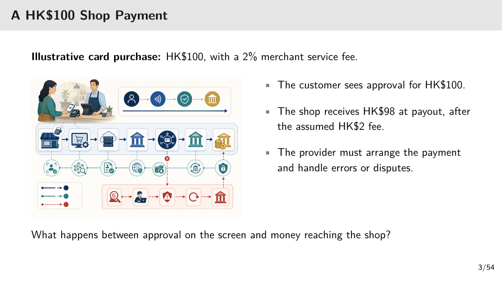

来源：L10 p.3，整页原图；可点击大图核原标注。

顾客买 100 港元商品，商户服务费（Merchant service fee）假设为交易额的 2%。屏幕批准 100 港元，是交易指令获准；商户在后续拨款时收到 98 港元，是扣费后的现金。不能从批准画面推定银行间已经完成结算。

原图左上是顾客和终端，右侧逐级连向支付服务商和银行；中下部还画出检查和异常处理。图中多数图标没有文字定义，因此只把它当多层工作示意，不为每个图标编造机构身份。以本页金额走一遍：顾客发起 100，系统检查并批准，参与者计算应收应付，银行结算，服务商按约定扣 2 后拨 98 给商店；退款或欺诈仍可能进入后续处理。

**原题**：What happens between approval on the screen and money reaching the shop?

**中文题意**：屏幕批准以后，到店家真正收到钱之间，还要做什么？

**⚪ 参考作答（笔记推断）**：还要清算（Clearing），即按规则算各方欠多少；再结算（Settlement），即机构之间实际转移资金；随后按服务条款扣费并向商户拨款（Payout）。批准、结算、拨款是不同节点。

**英文参考答案（笔记自拟）**：After authorization, participants clear their obligations, settle funds between institutions, and pay the merchant net of agreed fees. Disputes may still require later resolution.

按本页假设，费用为 $100\times2\%=2$ 港元，净拨款为 $100-2=98$ 港元。若只把服务费改成 3%，净拨款改为 97 港元，步骤顺序不变。

**🎙️ 课堂补充**（S33 `57:30`–`01:05:21`，A · 课上展开）

屏幕确认与商户资金路径不同。课堂把检查、盗刷和争议处理解释为收费要覆盖的工作；个人信用卡福利/各地用户习惯只是教师体验，未当普遍条款。 *"even though for the customer side,"*（S33 `58:59`）

### 2.4 p.04 · 四类支付安排处在不同层

快速支付系统（Fast payment system）如 UPI 和 Faster Payments，负责支持账户间快速转账；手机界面（Mobile interface）如支付宝和微信支付，负责让用户用 App 或二维码发起指令；储值（Stored value）如八达通，先把价值放入可用于后续付款的安排；中央银行数字货币（Central bank digital currency，CBDC）描述货币发行人的负债性质。

这四项不是互斥的同层产品：一个手机 App 可以发起银行账户转账，也可以使用储值余额。判断时先问界面是什么，再问实际扣了哪一项余额、是谁的负债。Logo 仅作品牌识别，不承担额外支付机制。

**🎙️ 课堂补充**（S33 `01:05:21`–`01:07:36`，A · 课上展开）

课堂用交通储值/手机钱包区分使用入口；儿童手表的封闭好友网只说明生态接入，不能替代支付资金路径。 *"The fast payment system."*（S33 `01:05:25`）

### 2.5 p.05 · 发起、授权、清算与结算

<!-- cityu-nav:landing-5 -->
[[#4. 速查表|↩ 回速查]] · [[#5. 双语术语卡|回术语]] · [[#0. 三分钟速览|阅读导航]]
<!-- cityu-nav:landing:end -->

顾客先发起（Initiation）交易，表示要向商户付钱；发行机构或服务商再授权（Authorization），检查账户、额度和交易。清算计算参与者各自应收应付，结算才改变机构之间的资金余额。商户可用资金何时到账还受拨款安排影响。

💡 笔记补充：例如买书 100 港元，授权回答“这笔交易现在可否批准”，清算回答“该向哪家机构收多少”，结算回答“机构资金是否已划转”。不要把“查了余额”写成“已经转钱”；不同系统可能把部分步骤紧密合并，但概念仍回答不同问题。下图箭头表示处理顺序，不代表每一步都已经到账。

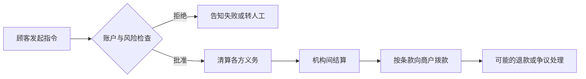

从图上“顾客发起指令”进入“账户与风险检查”，走“批准”分支才能到“清算各方义务”；拒绝分支不能凭屏幕点击直接进入商户到账。退款箭头没有画成结算自动逆转，因为追回需要独立规则。

本图把批准后的处理简化为清算和结算；卡支付可能在授权之后另有捕获/请款（Capture）操作，意为提交后续扣款处理请求。它不等于授权，也不保证最终结算，见 p.54 的 Stripe 原例。

**🎙️ 课堂补充**（S33 `01:07:44`–`01:10:18`，A · 课上展开）

课堂区分发卡银行与Visa等网络，说明同一App可扣不同资金。到账时间仍依具体安排，不把某钱包余额一概保证即时最终结算。 *"The network is Visa."*（S33 `01:08:10`）

### 2.6 p.06 · 速度、费用和风险要按同一链比较

评价速度时分别量授权、机构结算、商户拨款所需时间。评价费用时分清交换费（Interchange）和商户服务费：前者在银行之间转付，后者是商户付给服务提供者的费用，两者不能当同一个收款人。

信用卡发行机构可能先替客户付款再向客户收回，承担信用风险（Credit risk，即客户不还钱的风险）；预付储值先交钱再消费，资金顺序不同。但两者都可能遇到盗用、停机和记录错误。身份核查、数据保护与争议处理要花成本，不能以确认快推论无需反洗钱（Anti-money laundering，AML）或反欺诈。以上按本页课堂比较，不据此推断任何产品现行完整收费表。

**🎙️ 课堂补充**（S33 `01:10:27`–`01:14:43`，A · 课上展开）

课堂以商户服务费影响薄利润解释成本，再谈退款/客户保护；具体taxi费率、政策时间与个人退款体验未外核。虽然教师口头轻视数据保护，本页身份/权限控制仍须保留，不能推成无需保护。 *"For compliance, data protection, customer identification,"*（S33 `01:14:15`）

### 2.7 p.07 · 为何需要身份和交易检查

一次表面正常的付款也可能来自被盗账户。服务商要确认谁经营商店、谁有权收钱，再核异常交易是否需要复查。身份检查回答“是谁”，交易检查回答“这一次行为是否可疑”，二者不能互相替代。

争议调查需要交易证据，但保留记录不等于把所有客户数据开放给所有员工。💡 笔记补充：金额异常时可以转人工核查，而非一律拒绝所有大额交易；这样会增加处理时间，却可能减少误拒真实顾客。支付速度与有效控制要一起评估。

**🎙️ 课堂补充**（S33 `01:22:24`–`01:24:07`，A · 课上展开）

会议注册费用企业账户的例子用于区分商户身份与个人钱包。企业接入、谁有权收款和异常复查仍需证据。 *"So you need some corporate account for doing things like this"*（S33 `01:23:03`）

### 2.8 p.08 · 跨境转账为什么多了成本与等待

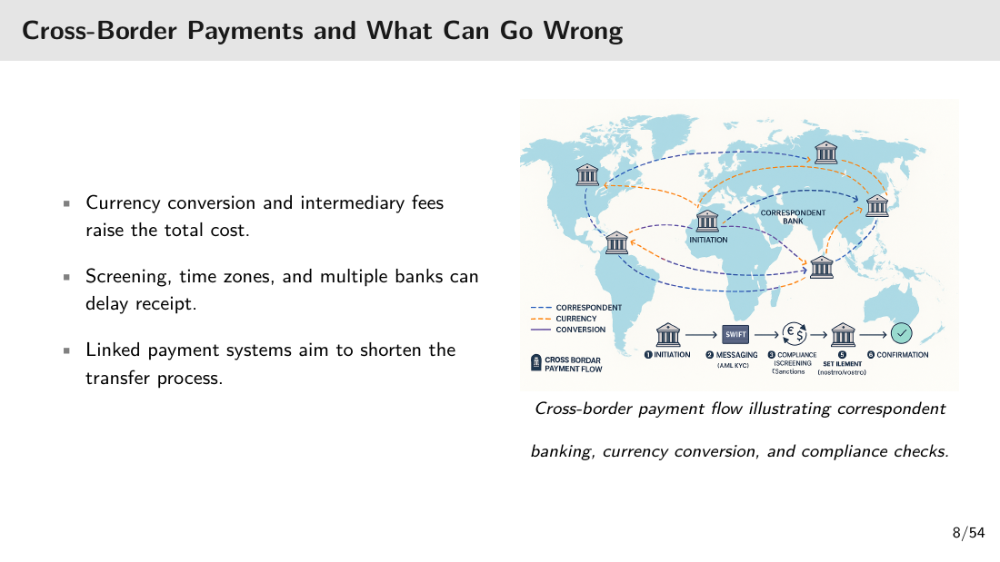

来源：L10 p.8，整页原图；可点击大图核原标注。

跨境款项可能经过代理行（Correspondent bank），即替其他银行提供账户与结算服务的银行。不同币种还需要外汇转换（Foreign exchange，FX）；中介费用、不同营业时间和合规筛查都可能使收款延后。

原图上半部用世界地图和多条虚线显示机构之间的跨境联系，线型区分代理关系与货币转换。下半部从发起、SWIFT 消息、合规筛查走向结算和确认。这里的消息是付款信息，不能把发出消息当作收款人已有钱。沿一条付款路径，要逐站问消息到哪里、资金在哪个账户、是否仍待检查；地图虚线不是每笔付款必经所有银行的意思。

**🎙️ 课堂补充**（S33 `01:24:10`–`01:28:09`，A · 课上展开）

课堂用代理行多站解释筛查/等待/费用。SWIFT主要传消息，图中信息与资金仍按正文区分；不将随手举东京/伦敦当每笔必经路线。 *"AML, Anti-Money Laundering Track, YKYC."*（S33 `01:25:53`）

### 2.9 p.09 · 互联互通能接起来什么

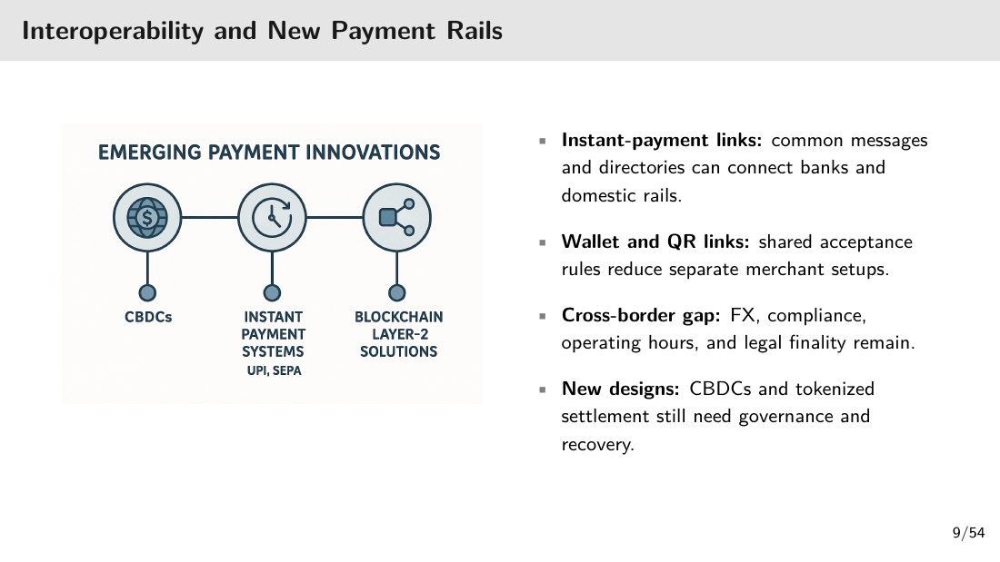

来源：L10 p.9，整页原图；可点击大图核原标注。

互操作性（Interoperability）是不同参与者能按共同规则交换和处理支付信息。共同消息格式和目录帮助国内快速支付系统连银行；共享二维码受理规则让商户减少重复接入。

原图把 CBDCs、即时支付系统（图中 UPI、SEPA）和区块链第二层方案并列为新设计方向，连线用于归类，不是资金依次经过三类系统的路线。系统互联不会自动统一外汇、合规、营业时间或法律终局性。即使采用代币化结算，仍须说明治理者、事故恢复方法和最终责任。

**🎙️ 课堂补充**（S33 `01:28:09`–`01:29:04`，A · 课上展开）

教师把替代安排看成补充，未承诺立刻替代现有网络。比较仍逐项看兑换、结算、合规与使用范围。 *"they can complement swift but"*（S33 `01:28:45`）

### 2.10 p.10 · 用户采用还取决于信任和补救

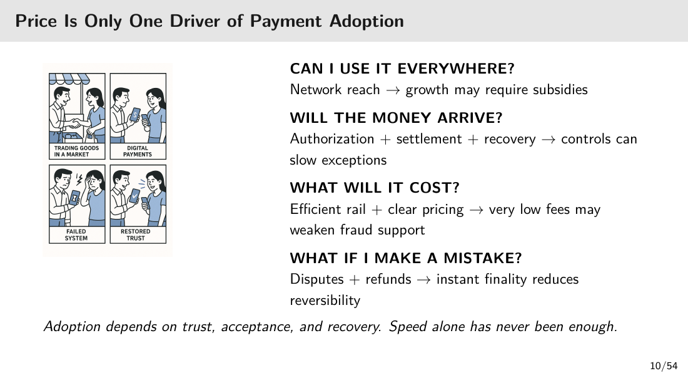

来源：L10 p.10，整页原图；可点击大图核原标注。

原图四格从市场交易、数字付款走到系统失败和信任恢复，回答“第一次能用以后，还愿不愿意继续用”。右侧四问分别是受理范围、钱能否到、总成本、付错怎么办；下方结论是信任、受理与恢复共同影响采用。

网络覆盖（Network reach）让顾客更容易找到受理商户，但扩张可能要补贴；低费用也需要足够收入维持欺诈处理。终局性（Finality）强调结算不可被单方撤回，并不保证顾客输错对象后随时能退回。💡 笔记补充：如果快了 5 秒却没有可用的退款渠道，某些用户反而不愿用于大额消费；不能只看界面反应时间解释采用。

**🎙️ 课堂补充**（S33 `01:29:04`–`01:31:44`，A · 课上展开）

课堂将收费与纠纷处理团队、信任连接；“政府广告背书”的例子仅为认知判断，不替产品安全作保证。 *"They do those things to build your trust."*（S33 `01:30:23`）

### 2.11 p.11 · M-Pesa 的代理人为什么要备两种余额

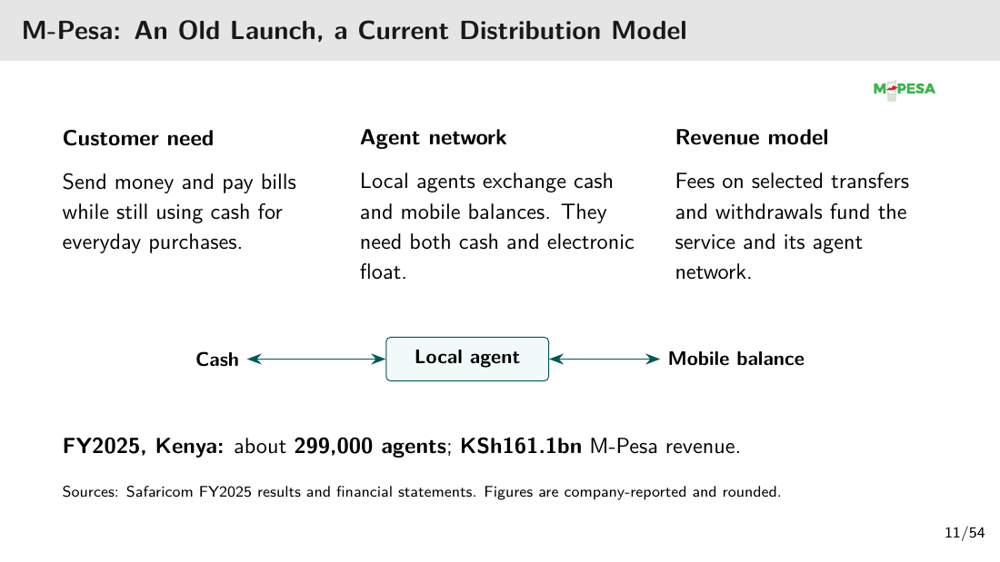

来源：L10 p.11，整页原图；可点击大图核原标注。

M-Pesa 的顾客仍会用现金生活，代理人（Agent）承担现金与手机余额兑换。图从 Cash 双向连接 Local agent，再双向连接 Mobile balance：存入时代理人收现金、交付手机余额；取出时方向相反。电子浮存余额（Electronic float）是代理人可用于交付的电子价值，不是凭空增加的收入。

💡 笔记补充：顾客取 100，当地代理人必须有至少 100 可付现金；即使电子余额充足、网络正常，现金不足也无法完成取现。这说明分发网络的流动性与软件速度是两件事。课件列 FY2025 肯尼亚约 299,000 名代理人、M-Pesa 收入 KSh161.1bn，为公司报告且已四舍五入；bn 是十亿，收入不是经手转账总额。本批未重新取得财报全文，不将课堂数字写成当前实时数据。

讲义的收费链是：选定的转账和取款服务向用户收费，费用支持服务运行和代理人网络。现金与手机余额互换的本金不是全部收入；经营代理网还需支付场地、人员和准备现金等成本。本页未给各类费率或代理分成，不能从总收入倒推出每名代理人的净利润。

**🎙️ 课堂补充**（S33 `01:31:48`–`01:32:38`，A · 课上展开）

教师简讲现金存入/取出，和储值卡作类比，未逐念代理人收入数字。原页代理人现金与电子余额两种库存仍按正文。 *"But this system allows you to take money out."*（S33 `01:32:12`）

### 2.12 p.12 · UPI 增长曲线如何读

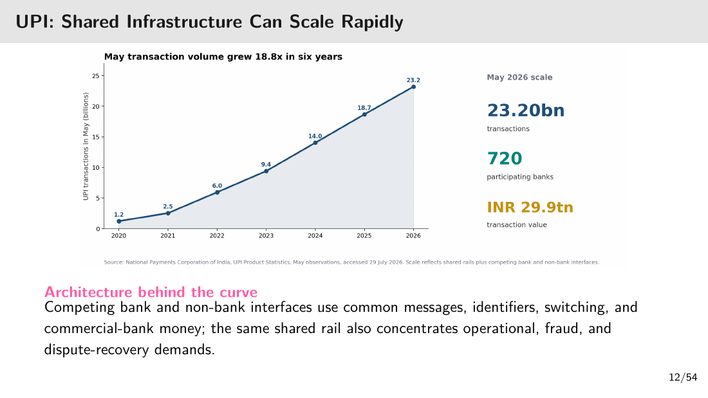

来源：L10 p.12，整页原图；可点击大图核原标注。

原图横轴为 2020–2026 各年，纵轴为对应 5 月交易笔数、单位十亿。标注依次约为 1.2、2.5、6.0、9.4、14.0、18.7、23.2；它不是各年全年累计交易。右侧 2026 年 5 月快照为 23.20bn 笔、720 家参与银行、INR29.9tn 金额，tn 是万亿。图题写六年增长 18.8 倍；用已四舍五入端点算 $23.2/1.2\approx19.33$ 倍，不能声称准确复现 18.8 倍。需要未舍入底数才可核其倍数，差异记入 §9。

曲线说明规模增加，但不单独证明增长由某一个设计造成。共同消息、标识符和交换系统使不同 App 共用商业银行货币；交易扩大也把停机、欺诈和争议处理集中在共享基础设施上。课件注明 NPCI 月度观察与 2026 年 7 月 29 日访问，本批仅核课堂图，没有重抓当月数据。

**🎙️ 课堂补充**（S33 `01:32:41`–`01:34:54`，A · 课上展开）

课堂读增长曲线后比较生态壁垒；18倍为近似口述，原页18.8倍与舍入端点差异不删。UPI全称按书面Unified Payments Interface，不用口述Universal Payments Infrastructure替换。 *"their transaction volume grew 18 times in six years"*（S33 `01:32:54`）

### 2.13 p.13 · UPI 与 M-Pesa 解决不同接入问题

UPI 中银行接一次共享系统，可以面对使用不同参与 App 的客户；支付 ID 与二维码减少小额受理工作，快速确认有助重复使用。App 竞争不等于每家都另建一套银行资金。

与 p.11 对比：M-Pesa 代理人帮助现金与手机余额互换；UPI 的本页重点是银行账户与多种界面的互联。两者都需要反欺诈、错误处理与故障恢复，不能因共享基础设施就假定服务永不出错。

**🎙️ 课堂补充**（S33 `01:35:02`–`01:36:38`，A · 课上展开）

共享设施允许不同App/银行相连是本页核心。私人App竞争与底层互联分开，不从此例断言任何市场永无壁垒。 *"this is the key word share payment system"*（S33 `01:35:12`）

### 2.14 p.14 · 沿一次账户到账户付款走图

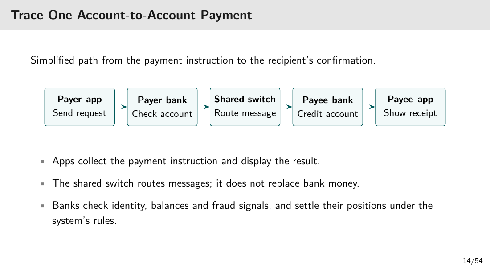

来源：L10 p.14，整页原图；可点击大图核原标注。

原图从付款 App（Payer app）发请求，到付款银行（Payer bank）查账户，再经共享交换系统（Shared switch）路由消息，至收款银行（Payee bank）记入账户，最后收款 App（Payee app）显示回执。箭头主要表示消息和处理路径；图没有展开银行间结算的每一账户。

💡 笔记补充：甲用 App 要付乙 100，交换系统负责把指令送到正确银行，不会自己创造 100 元新货币。银行检查身份、余额和欺诈信号，并按系统规则结清相互头寸。“App 展示成功”和“银行按规则完成记账/结算”要有对应证据，不能只用最后一张截图替代全链核对。本页没有承诺所有系统都在五步之间使用同一种结算时点。

**🎙️ 课堂补充**（S33 `01:36:40`–`01:37:13`，A · 课上展开）

教师沿100元请求、付款行查余额、共享路由、收款行及回执走图。请求消息和银行资金不混同，原图未逐画所有结算账户。 *"I want to send 100 yen to you"*（S33 `01:36:52`）

### 2.15 p.15 · 支付宝怎样把付款与履约信任相连

买家怕付款后收不到货，卖家怕发货后收不到款。普通转账只移动钱；托管支付（Escrow）先保管款项，达到约定条件才放给卖家，把资金释放与履约条件连接起来。

本页把支付宝早期托管模式与后来的商户/日常服务连接：交易场景带来使用机会，受理范围和保护机制影响重复使用。不能把“有托管”扩大成任何商品或退款都自动无风险；本页未给完整产品条款。讲义注明 Ant Group 历史和概览于 2026-10-13 核查，此处保留为讲义来源日期。

**🎙️ 课堂补充**（S33 `01:37:24`–`01:38:35`，A · 课上展开）

托管用交易条件连接买方付款与卖方收款；这是中心化业务规则，不必用区块链才能办到。 *"So holding payment until transaction"*（S33 `01:38:15`）

### 2.16 p.16 · 境外访客绑卡改变哪个环节

境外访客的卡未必能在小店常用二维码直接支付。讲义的路径是把符合资格的境外卡连接支付宝，再借已有商户网络付款；微信支付有类似路径。改变的是资金来源与受理网络的连接，资金并没有因为扫码就变成新的货币。

资格、身份核查、额度和费用仍影响可用性。💡 笔记补充：一个商户接受某 App，不等于该 App 中任何国家的卡都可用；若绑卡被拒，应核卡资格与交易限制，不能从二维码存在推断交易必成功。本批不提供现行绑卡操作或收费建议。

**🎙️ 课堂补充**（S33 `01:38:38`–`01:41:29`，A · 课上展开）

课堂以外来访客缺本地账户说明绑卡价值；200元阈值/2%口述上下方向不一致，未核产品条款，不据此收费。 *"they can include their credit card in the WeChat Pay and Alipay."*（S33 `01:39:00`）

### 2.17 p.17 · 一张打印二维码降低了什么成本

商户展示二维码，顾客扫描并确认，支付服务把顾客资金来源连接到商户账户。商户不必为该受理方式先买传统刷卡终端，数字记录也方便对账（Reconciliation，即把实际收款与销售记录逐项核对）。

这里的低成本主要指接入/受理，不等于所有处理零成本。打印纸可以放在实体店，但纸本本身不会执行联网授权、清算和结算。💡 笔记补充：若顾客扫到被替换的收款码，款项可能去错对象，所以仍需核商户身份与收款记录。

**🎙️ 课堂补充**（S33 `01:44:01`–`01:45:10`，A · 课上展开）

纸面QR降低小商户终端接入成本；它不会自己执行网络检查/资金结算，也不是所有费用为零。 *"Just print the QR code."*（S33 `01:44:27`）

### 2.18 p.18 · NFC 通信与支付安全分开

近场通信（Near-field communication，NFC）让兼容设备靠近终端交换信息。Apple Pay 的设备专用卡凭证、Face ID 或密码验证属于支付服务安全设计，不是所有 NFC 通信天然拥有的保证。

底层卡组织和银行仍处理交易。轻触动作只告诉你信息怎样传到终端，不能据此确定商户费率、哪家承担信用风险或什么时候到账。💡 笔记补充：同一张卡改从手机轻触，并不因此自动取消发卡行；比较系统要继续向底层资金路径追踪。

**🎙️ 课堂补充**（S33 `01:41:47`–`01:44:01`，A · 课上展开）

课堂先讲NFC，再回QR，本文仍按页顺序。Apple Pay凭证/认证是服务设计，不是NFC通信的普遍保证。 *"this is not the NFC functions there,"*（S33 `01:42:52`）

### 2.19 p.19 · 扫码和轻触比较的是交互方式

本页左列 QR 支付：顾客扫描商户码或出示自己的码，打印收款码可降低受理设备门槛。右列 NFC 支付：顾客把支持 NFC 的设备靠近兼容终端，Apple Pay/Google Pay 使用代币化卡凭证（Tokenized card credential，即用受约束的替代凭证参与卡支付）。

这是一组界面与凭证比较，不是“扫码一定不走卡、轻触一定更便宜”的分类。技术可与不同资金安排组合；要比较总成本和终局性，还须核底层支付网络。Logo 只作品牌定位。

**🎙️ 课堂补充**（S33 `01:45:12`–`01:46:15`，A · 课上展开）

教师把打印低成本与NFC兼容终端相对照。小商户能接入与每笔成本/风险分开。 *"allow low cost acceptance."*（S33 `01:46:01`）

### 2.20 p.20 · 香港三个储值案例怎样逐项比较

本页表中每行是一种分发优势和一个待分析问题，不能把问题当已确认产品条款。储值支付工具（Stored-value facility，SVF）允许用户预先存入价值；用户浮存款（User float）是为后续支付而留存的用户资金，不是服务商可随意当利润支出的收入。课件还列许可、保障浮存、安全内控、AML/CFT 与投诉处理的政策层；这里按讲义介绍，不提供当前法律结论。

**讲义给定英文案例情境与原题**

| Example | Distribution advantage | Question for the case |
|---|---|---|
| AlipayHK | merchant QR and app ecosystem | how are stored value, payment data, and refunds handled? |
| WeChat Pay HK | social and merchant touchpoints | when does an app interface become a financial gatekeeper? |
| Octopus | transit habit and broad offline acceptance | how does a local network extend from transport to retail and mobile? |

**中文读表**：每行先给一种分发优势，再让我们问其责任边界。AlipayHK 的商户二维码与 App 生态让用户在已有消费场景找到付款入口；WeChat Pay HK 的社交和商户接触点让支付更容易嵌入既有人际/交易活动。Octopus 的交通习惯与广泛实体受理则提供重复使用基础。分发便利没有直接回答资金保障、数据权限或退款条款，仍要逐项核查。

**中文题意与 ⚪ 参考解析（笔记推断）**：

1. AlipayHK：分别核储值由谁承担返还义务、用户资金怎样保障、数据谁可访问、退款是否回到原付款工具；本页未给完整条款，不能直接断言某种退款时限。

2. WeChat Pay HK：当大量商户/客户依赖其入口，且平台能决定接入、资料和交易通道时，可能成为金融守门人（Financial gatekeeper）；单有一个 App 不足以证明垄断。

3. Octopus：用交通的高频使用习惯和已有受理点向零售延伸，再用手机入口降低携带实体卡的阻力；还须核接入成本、设备兼容和服务可靠性。

**英文参考答案（笔记自拟，逐问）**：1. Check who owes the stored value, how user funds and data are protected, and how refunds reach the customer; the slide does not provide full product terms. 2. An interface can become a financial gatekeeper when access to customers and merchants depends substantially on its rules and distribution. 3. Octopus can extend a high-frequency transport habit and acceptance network into retail and mobile use, subject to compatibility and operating costs.

改条件看边界：如果客户能轻易转用其他入口，守门能力可能较弱；不能仅由用户多推定排他权。

**🎙️ 课堂补充**（S33 `01:46:21`–`01:49:10`，A · 课上展开）

课堂重点是八达通交通习惯扩至零售，再比较Oyster；个人历史/优劣判断不作已核因果。储值保障等三例问题的完整答案仍为笔记参考。 *"Previously for MTR and then they use this for everywhere now."*（S33 `01:46:45`）

### 2.21 p.21 · 商业习惯怎样形成支付分发

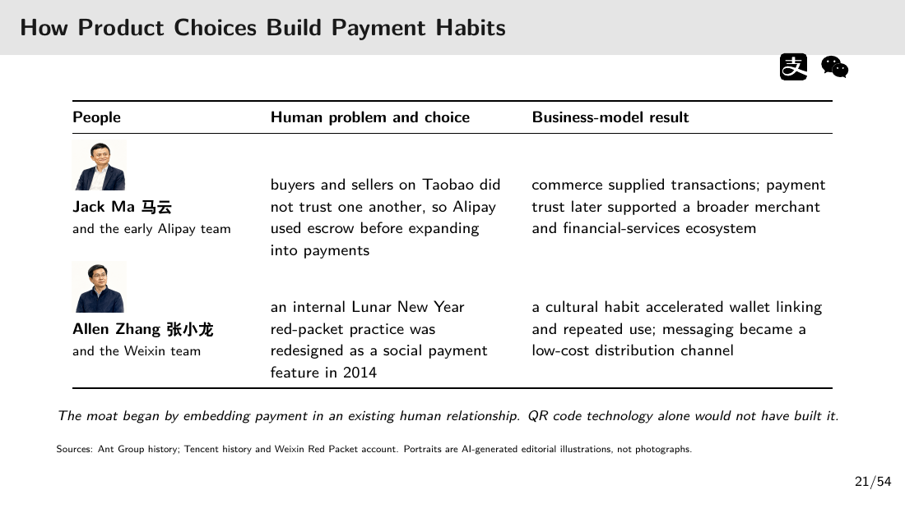

来源：L10 p.21，整页原图；可点击大图核原标注。

原表左列人物为马云/早期支付宝团队及张小龙/微信团队，中列是使用问题与产品选择，右列是商业模式结果。课件明确肖像为 AI 生成的编辑插画，不是人物照片；保留原图时不能将其当史料照片。

支付宝案例把买卖双方的不信任与托管安排连接，淘宝交易带来支付需求；微信案例把 2014 年社交红包与绑钱包、重复使用连接。关键是既有交易/人际关系降低获客成本，二维码单独存在不能解释习惯形成。这里是讲义的历史归纳，不把人物故事视为严格因果实验证明。

**🎙️ 课堂补充**（S33 `01:49:14`–`01:50:11`，A · 课上展开）

课堂用红包和已有社交App解释低成本分发。原页AI人像仍按插画，不作历史照片。 *"they don't need to install another new apps there"*（S33 `01:49:49`）

### 2.22 p.22 · 同一收银画面可能对应三种业务

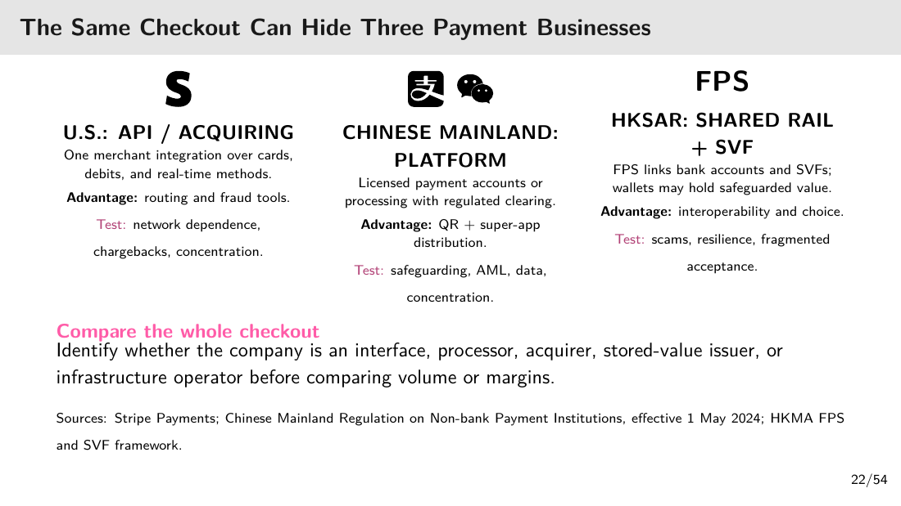

来源：L10 p.22，整页原图；可点击大图核原标注。

本页三栏是课堂比较：美国 API/收单整合多种方式，主要价值是路由和反欺诈工具；中国内地平台结合二维码与超级 App 分发，并有受监管账户/清算安排；香港 FPS 与 SVF 连接银行账户及储值安排，强调互通与选择。API 是供软件调用的接口；收单（Acquiring）指为商户接收卡支付并安排相应处理的服务，不等于发卡。

比较前先确定公司是界面、处理商（Processor）、收单机构（Acquirer）、储值发行人还是基础设施运营者。同样经手 100 元，收入确认和承担风险可能不同。三栏只是分析框架，不能推成每个地区所有公司都属一种模式；讲义提及的 2024-05-01 法规日期保留为来源记录，现行具体法条须另核。

处理商（Processor）把支付指令接入并传送给相关网络，收单机构（Acquirer）服务商户一侧并按安排处理收款和拨款；一个企业可兼任多种角色，但须核具体合同。

按原图三列读风险：

- 美国列的 network dependence 是服务依赖银行和支付网络；chargebacks 是欺诈等争议按规则追回商户款项；concentration 是过度依赖少数伙伴或客户。路由方便不代表这些依赖消失。
- 中国内地列的 safeguarding 是用户资金保障；AML 是反洗钱；data 是资料的用途、权限和安全；concentration 是平台/伙伴集中。平台覆盖广仍要问钱怎样保管、数据谁可用。
- 香港列的 scams 是诈骗，resilience 是故障期间维持与恢复关键服务的能力，fragmented acceptance 是不同商户受理方式不统一。共享设施带来互通，但顾客仍可能受骗或在某店找不到可用方式。

**🎙️ 课堂补充**（S33 `01:50:15`–`01:52:07`，A · 课上展开）

教师从自建网店接支付的负担引出Stripe，比较平台内服务与第三方整合。地区列是分析框架而非所有企业同一种合同。 *"They provide one-stop service."*（S33 `01:51:05`）

### 2.23 p.23 · 选择题：即时批准是最终付款吗

**英文原题**

A merchant sees instant payment approval, but its acquirer settles net proceeds the next day and may charge back fraud. Which statement is correct?

A) Authorization is final settlement.

B) Faster checkout removes credit and fraud risk.

C) Customer-facing speed and settlement finality are different layers.

D) The merchant immediately receives central-bank money.

Discuss: Map authorization, clearing, settlement, and dispute resolution before choosing.

**中文题意**：商户立刻看到批准，但收单方次日才结算扣费后收入，且欺诈可被拒付追回（Chargeback）。问哪项正确。A 把授权当最终结算；B 说更快收银消除信用和欺诈风险；C 区分客户感知速度与终局性；D 说商户立即收到央行货币。

**⚪ 参考答案（笔记推断）：C。** 授权先确认可否批准，清算再确定各方义务，结算转移机构资金，争议处理可按规则追回款项。A 混淆两步；B 忽略盗用与违约；D 既无即时到账证据，也无商户直接持有央行货币的条件。

**英文参考答案（笔记自拟）**：C. Immediate customer-facing approval does not establish settlement finality. Clearing, later settlement, merchant payout, and fraud-related chargebacks remain distinct parts of the payment process.

若题目改为即时银行账户记账，也要继续核系统的法律结算规则；不能因“即时”一词自动选终局。

**🎙️ 课堂补充**（S33 `01:52:10`–`01:54:02`，A · 课上展开）

本题C在课堂明确确认；原英文四选项、中文排除及英文参考句不改。确认此题答案不等于承诺原题会考。 *"The C is correct the customer facing speed and a settlement finality are different layers"*（S33 `01:53:56`）

### 2.24 p.24 · Stripe 卖的是商户少做哪些工作

网上商户若逐一接银行、卡和本地支付方式，要重复开发收银、反欺诈和订阅系统。Stripe 的课堂价值主张是用支付软件和相关服务减少接入与运维工作；银行及卡网络仍参与授权和资金转移。

💡 笔记补充：卖家每月收费 100 元的订阅，不只需要第一次刷卡，还需下一月再次扣费、失败后重试和对账。因此“少接几个系统”可能节约员工时间；但不能由软件品牌推定它拥有每笔付款中的全部资金或全部收费。

**🎙️ 课堂补充**（S33 `01:54:35`–`02:02:29`，A · 课上展开）

课堂用独立品牌网站解释为何要采购整合服务，不必所有商户都加入大平台；中间时评及具体品牌行情未写成实证结论。 *"they are only providing the service, connecting them"*（S33 `01:58:40`）

### 2.25 p.25 · 网上卡支付背后有哪些银行

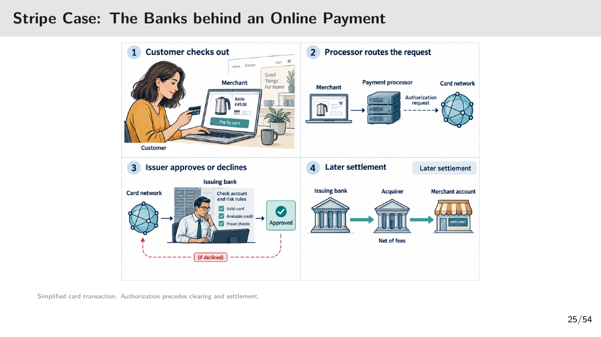

来源：L10 p.25，整页原图；可点击大图核原标注。

原图四格：1 顾客在商户页面结账；2 处理商把授权请求送向卡网络；3 发卡行检查有效卡、可用额度与欺诈，批准或拒绝；4 较后发卡行、收单机构、商户账户完成净额资金流。虚线拒绝路径返回前端，不能把拒绝分支接成仍然向商户付款。

以 100 元交易走图，第二格传的是请求而不是商户现金；第三格批准只让后续处理继续；第四格才突出 Later settlement 和 Net of fees。清算没有独立画成第五格，仍须用 p.5 定义理解中间义务计算。图是简化关系，不是每家真实处理商一模一样的完整架构。

图只画出授权到较后结算的主链，没有单列捕获/请款（Capture）。卡支付获批后还可能需要商户提交后续扣款处理请求；该操作的位置和“获批即最终到账”的区别在 p.54 就地补充。

**🎙️ 课堂补充**（S33 `02:02:31`–`02:03:54`，A · 课上展开）

教师沿四格说Stripe提供相邻环节的连接。商户/处理商/网络/银行职责不合并为Stripe一家；原图读法保留。 *"Stripe provides the service connects one to two two to three three to four"*（S33 `02:03:35`）

### 2.26 p.26 · 收银、Radar 和 Billing 各做什么

Checkout/支付接口让商户接受支持的卡、钱包及本地方式；Radar 对交易筛查欺诈风险；Billing 处理周期性收费。三者分别解决接入、风险识别、重复收费管理，不能把一个产品名当作最终无欺诈保证。

商户应把费用与成功销售、欺诈损失、员工时间一起比较。💡 笔记补充：降低拒绝率可能多卖货，也可能放入更多盗刷；若只比较系统报价，忽略实际损失和维护工作，就无法判断是否划算。此处按讲义给功能位置，不据此承诺任何版本产品的完整功能。

**🎙️ 课堂补充**（S33 `02:05:06`–`02:05:40`，A · 课上展开）

课堂提加购收费及Billing/税务服务，未保证某版本全部功能。 *"they also provide the for weeks the billing"*（S33 `02:05:25`）

### 2.27 p.27 · 欺诈概率怎样变成付款决定

模型用授权当时已知的金额、设备和历史交易估计欺诈概率；事后才知道的退款结果不能偷偷当输入。拟合（Fit）是把较早交易的已知输入与后来查明的真实/欺诈结果配对，让模型从这些例子确定预测关系。调参（Tune）是在另一段较早、未用于拟合的数据上比较设置或候选阈值，选定方案后再固定。样本外评估（Out-of-sample evaluation）是在更晚、未参与前两步的交易上比较模型与原规则；时间顺序保证评估接近实际部署。

例如早期数据用于建立规则，中间旧数据选择拦截门槛，最后一段新交易只作评估。它的结果不能倒流回去重新挑门槛后仍称最终测试。讲义以 Adyen 的可调拦截阈值为案例；此处保留课堂机制定位，不承诺其当前版本功能。

阈值（Threshold）是把概率变为拦截决定的门槛。💡 笔记补充：门槛从 0.8 降至 0.5，原本 0.6 风险的交易会由放行变拦截，通常更严格；真实交易被误拒的机会也可能增加。要比较避免的欺诈损失与损失的正常订单贡献，不能只追求“拦得多”。没有原始交易数据，本页只教决策机制，不虚构模型效果。

**🎙️ 课堂补充**（S33 `02:05:47`–`02:06:36`，A · 课上展开）

课堂把前半学期样本外逻辑接到欺诈阈值，降低门槛可能误拒更多真实订单。未有交易数据，不补造性能。 *"they let the merchant to adjust the blocking threshold when to block a payment"*（S33 `02:06:02`）

### 2.28 p.28 · 处理规模不是服务商收入

课件引 Stripe 2025 annual letter：2025 年总业务量 \$1.9 trillion、增长 34%。这是客户业务规模指标，不是 Stripe 收入；即使交易额上升，也要知道收费比例、分成、处理成本及风险损失，才能判断留存收益。

已有商户可加购 Billing、税务等服务，使一套关系承载更多产品；但竞争可能压低费率。💡 笔记补充：经手金额翻倍而每元净贡献减半，总贡献可能不变；不能用 34% 交易增长直接写 34% 利润增长。该数字为讲义引述的年度快照，本批未重核年信全文。

**🎙️ 课堂补充**（S33 `02:06:45`–`02:07:19`，A · 课上展开）

课堂说1.9万亿美元但增长口述44%，源页写34%；正文保留34%的讲义快照。处理量不是收入，更不是利润。 *"1.9 trillion in total volume"*（S33 `02:06:45`）

### 2.29 p.29 · 从收费走到增量贡献

表格每行是收入扣减链的一层。Gross revenue 问实际向谁收多少钱；Rail and funding cost 问支付网络和资金提供者要多少；Risk cost 问欺诈、争议、信用及外汇损失由谁承担；Operating cost 问接入、合规、服务与追回仍需哪些人和系统。

例如商户付 5 元不等于处理商赚 5 元，先转给银行和网络，再扣自身成本才得到贡献。增量成本（Incremental cost）是多服务这些交易多出的成本；贡献还未扣全部固定管理费与税，不能随意叫净利润。下一页给出同一费用分层的数字题。

按源表补齐每层的实际漏损，避免把表里的名称当成已解释：

- 收入端的 fee sharing 是将收费的一部分分给伙伴；discounts 是合同折扣；mix 是不同交易方式/客户构成。例如高费率卡交易占比降低，即使总交易额不变，平均收费也可能下降。
- 网络/融资端的 interchange 是银行间交换费，scheme 是支付网络的规则与相关网络收费；为及时结算备足可用资金会产生 liquidity 成本，借入垫款资金还要付 interest cost。

本表是核对费用去向的框架。实际合同若把某项分成已从收入净额扣除，就不能在成本再扣一次；应先确定采用总额还是净额列示，再沿同一口径计算。

**🎙️ 课堂补充**（S33 `02:07:23`–`02:10:57`，A · 课上展开）

课堂用盗刷追问谁承担损失，并复述各项成本。个案中风险归属仍依合同/规则，不能把“通常issuer”升级为任何合同都只由发卡行付。 *"integration, compliance, servicing, support, recovery."*（S33 `02:09:40`）

### 2.30 p.30 · 选择题：处理商留存多少费用

<!-- cityu-nav:landing-30 -->
[[#4. 速查表|↩ 回速查]] · [[#5. 双语术语卡|回术语]] · [[#0. 三分钟速览|阅读导航]]
<!-- cityu-nav:landing:end -->

**英文原题**

For a \$200 card payment, a processor charges the merchant 2.5%. It passes 1.6% of the payment value to the issuing bank and 0.3% to the network.

How much does the processor retain before its own operating costs?

A) \$0.60

B) \$1.20

C) \$3.20

D) \$5.00

**中文题意**：同一笔 200 美元交易，商户付交易额的 2.5%，发卡行获 1.6%，网络获 0.3%；问扣处理商自己的经营成本以前，留多少。三个百分比的分母都是 200，不是依次对剩余金额打折。

**⚪ 参考答案（笔记推断）：B，1.20 美元。** 商户费 $200\times2.5\%=5$；转发卡行 $200\times1.6\%=3.2$；转网络 $200\times0.3\%=0.6$；留存 $5-3.2-0.6=1.2$。A 只算网络费，C 只算发卡行费用，D 是未扣转付的商户费。2.5% 减 1.6% 减 0.3% 是 0.6 个百分点，乘交易额后才是美元。

**英文参考答案（笔记自拟）**：B. The processor retains \$200 × (2.5% − 1.6% − 0.3%) = \$1.20 before its own operating costs. This retained amount is not net profit.

改成 400 美元而费率不变，留存为 2.40 美元；若另有固定手续费，不能只按比例翻倍。

**🎙️ 课堂补充**（S33 `02:11:00`–`02:11:52`，A · 课上展开）

教师认可学生算术并明说这是期望的考试数学；学生报数未录清，1.20美元仍由原题算式复核，不补造口头字母。 *"this is the math I expect for exams."*（S33 `02:11:43`）

### 2.31 p.31 · 选择题：同一二维码能推出同一网络吗

**英文原题**

Two shops accept payments through QR codes. One payment routes directly between bank accounts. The other charges a card stored in the customer’s app.

Which conclusion follows?

A) Both payments must have the same merchant fee because both use QR codes.

B) Both payments must settle through the card network.

C) Neither payment involves a financial intermediary because customers scan a code.

D) The checkout technology is similar, but fees and settlement rules depend on the underlying payment rail.

**中文题意**：两家都扫码，一家银行账户直转，另一家扣 App 中的卡。A 说费率必相同，B 说都必经卡网络，C 说扫码就无金融中介，D 说界面相似而费用/结算取决于底层网络。

**⚪ 参考答案（笔记推断）：D。** A 把展示方式当收费规则；B 与第一家账户直转条件冲突；C 忽略银行及支付处理者。D 保留共同的二维码界面，同时区分实际资金处理。

**英文参考答案（笔记自拟）**：D. Similar QR interfaces can initiate different payment rails. Merchant fees and settlement rules depend on the underlying account or card arrangements.

若两家都走同一卡网络，也仍需核各自商户合同，不能自动推出费率完全一样。

**🎙️ 课堂补充**（S33 `02:12:01`–`02:12:58`，A · 课上展开）

教师认可回答，但学生字母/完整句未收清。D仍标参考选项，课堂认可与笔记推算分开。 *"thank you this is correct"*（S33 `02:12:51`）

### 2.32 p.32 · 跨境支付分隔

本页只有 Cross-Border Payments 标题，没有额外模型。下一段把 p.8 的概览展开为总成本、到账追踪与跨系统互联；先确定收款人需要哪种币和何时可用，才可比较路线。

### 2.33 p.33 · 跨境总成本不能只看转账手续费

总成本包括显式转账费、中介收费与汇率价差（FX spread，即客户实际兑换价相对比较基准的差）。即使广告写转账费低，收款人仍可能因较差汇率得到更少本币。

延误可来自筛查和多个银行系统结算；不同机构记录字段不一致还会让追踪困难。💡 笔记补充：比较同一笔钱在同一时间、同一币种和相同收款条件下，最终到手金额与耗时，比只对比 App 显示费率更有意义。课件未给实际汇率，不编造某渠道现行成本。

**🎙️ 课堂补充**（S33 `02:12:58`–`02:13:47`，A · 课上展开）

课堂以零售汇款说明高费用；优势需要全链比较，不能据泛化保证所有稳定币汇款更低。 *"that's the problem for swift system"*（S33 `02:13:07`）

### 2.34 p.34 · 零售、批发与支付互联

零售（Retail）例是工人用汇款 App 给家人转钱，重点是扣费用和兑换后到手多少、多久到；批发（Wholesale）例是银行间结算企业大款项，重点是结算币种资金与终局性。不是金额大就自动无合规检查。

课件介绍 Payment Connect 连接香港 FPS 与内地 IBPS 进行小额跨境汇款，银行仍检查账户并换汇。FPS 是香港快速支付系统，IBPS 是内地网上支付跨行清算系统；它们是基础设施名称，不是收款人的新钱包或新货币。本批按讲义介绍，不推断当前参与名单或个人额度。

**🎙️ 课堂补充**（S33 `02:13:15`–`02:16:04`，A · 课上展开）

教师分享Payment Connect个人使用经验；具体日/年额度与零费未核，不作为操作收费指南。零售/批发与币种需求仍按正文。 *"zero fee, zero fee for this and then instant transfer"*（S33 `02:14:36`）

### 2.35 p.35 · 100 美元跨境付款四格图

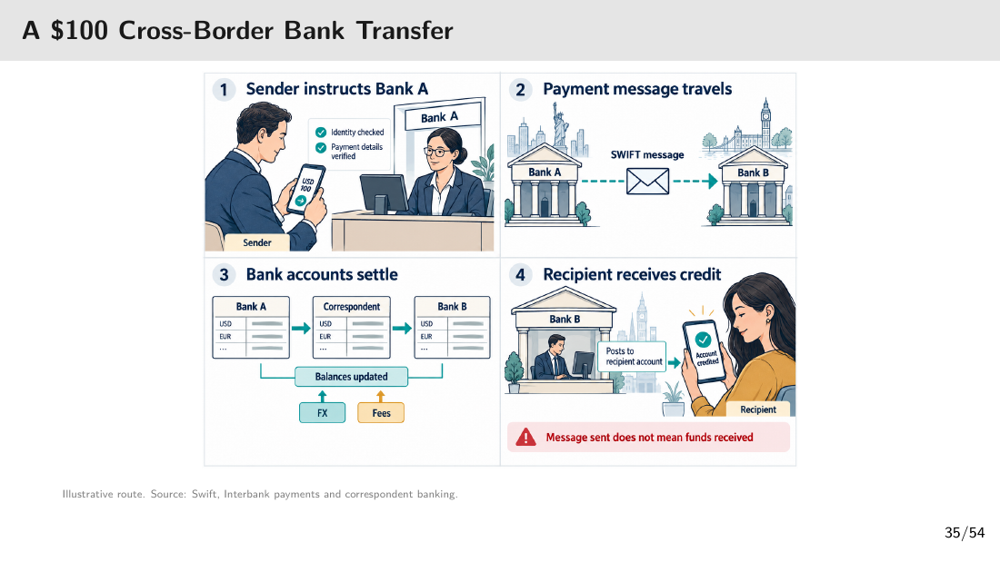

来源：L10 p.35，整页原图；可点击大图核原标注。

原图第 1 格付款人向 Bank A 发指令，身份与细节已检查；第 2 格 SWIFT message 经消息网络到 Bank B；第 3 格银行/代理行相关账户余额更新，另有 FX、Fees；第 4 格 Bank B 记入收款人账户。底部红条明确 Message sent does not mean funds received。

沿图读 100 美元例，消息发出只证明指令在传送；收款多少还取决于兑换与收费。第 3 格货币标签是可能账户币种示意，图没有给汇率和收费数额，无法算最终实收。不能把四格当同一笔款必经的全部真实机构名单。

**🎙️ 课堂补充**（S33 `02:16:09`–`02:17:08`，A · 课上展开）

课堂沿发起行、SWIFT消息、FX/中介费、收款行走图。没有汇率或实收记录，不能计算本币到账。 *"with message there"*（S33 `02:16:34`）

### 2.36 p.36 · Payment Connect 接起哪四层

表格按四层定位：香港机构核发送人、账户、费、用途和授权；FPS 与互联系统处理标准化消息、路由及相关合规/币种信息；内地 IBPS 接向目标机构与最终入账指令；收款机构确认、查限额、处理异常、退款和沟通。这里的层是职责定位，不表示所有检查只在某一层执行一次。

讲义写 2025-06-22 改变的是公共支付设施跨境互操作，面向实时小额汇款；没有创设新钱包或新结算资产。💡 笔记补充：使用原银行账户发起并不等于两边账户币种相同，换汇仍是独立动作。实际现行规则另核，本页不作为汇款操作指引。

**🎙️ 课堂补充**（S33 `02:17:20`–`02:19:04`，A · 课上展开）

四层分别查身份、消息/币种、目标机构、入账。教师记得2025-06-22启动，但个人操作例仍不替代当前条款。 *"Complicated four layers four steps"*（S33 `02:18:43`）

### 2.37 p.37 · 互联以后哪些责任仍在银行

左列“改变”是国内快付系统跨境连接、熟悉标识符简化指令；右列“保留”是身份、AML、FX、额度检查，以及机构各自服务条款和失败处理。共同基础设施减少断点，不会把责任一律转给用户 App。

💡 笔记补充：若收款失败，先核哪家机构收到哪项指令，而不是只换一个界面再重复付款；重复发送可能形成两笔义务。这里给诊断顺序，不假定任何具体故障已经发生。

**🎙️ 课堂补充**（S33 `02:19:04`–`02:20:00`，A · 课上展开）

课堂明确银行仍保留身份/AML/FX/限额及失败处理。互联不会自动清除这些责任。 *"The service terms and failed payment handling still depending on the institution."*（S33 `02:19:37`）

### 2.38 p.38 · 秒到账解决不了晚付 120 天

**讲义完整情境**：Hypothetical supply-chain case: A carmaker owes a supplier RMB1 million on day 60, but expects to pay on day 180. The bank transfer takes seconds.

Supplier’s cash need: Wages and materials must be paid before the invoice is collected. The extra 120 days require funding.

Financing decision: Renegotiate terms or obtain receivables finance. Identify the financing charge and who bears non-payment risk.

**中文拆题与 ⚪ 参考解析（笔记推断）**：应在第 60 天收 100 万元，但预计第 180 天才收，中间 $180-60=120$ 天要先付工资和材料。付款执行快，并没有改变客户何时愿意付款。应收账款融资（Receivables finance）用未来应收款支持提前资金，需核融资费用与追索安排，即客户不付时资金提供者能向谁追偿。原题未给利率和合同，不能唯一计算费用或断言哪方必承担全部损失。

**英文参考答案（笔记自拟）**：The supplier faces a 120-day funding gap on RMB1 million. Renegotiation or receivables finance may bridge it, but the financing charge and allocation of non-payment risk depend on the contract. A faster transfer does not bring the customer's payment date forward.

若客户如期第 60 天付款，额外 120 天缺口消失；工资在此前发生的正常营运资金需求仍可能存在。

**🎙️ 课堂补充**（S33 `02:20:10`–`02:21:39`，A · 课上展开）

课堂把客户晚付与转账技术分开；100万元第60至180天的额外120天缺口仍按原题。后续融资是M11主题。 *"the bank transfer takes seconds."*（S33 `02:21:28`）

### 2.39 p.39 · 收到了 USDC 还差哪一步

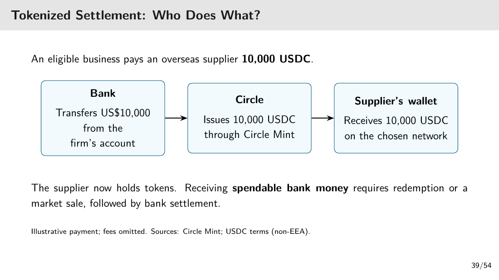

来源：L10 p.39，整页原图；可点击大图核原标注。

原图从银行把企业账户中的 US\$10,000 转出，到 Circle 经 Circle Mint 发行 10,000 USDC，再到供应商钱包在指定网络收到 10,000 USDC。箭头对象先是银行美元，再是代币；不能把两者统称同一个账户余额。图例明确为合资格企业且略去费用。

供应商此时持有的是代币。若最终需要银行可花的钱，须赎回（Redemption，按发行/服务条款交回代币换资产）或市场出售，再完成银行结算。接收地址和网络正确也不保证当地本币已到账。此处沿课堂假设讲职责，不承诺任何账户都有直接赎回资格。

**🎙️ 课堂补充**（S33 `02:21:44`–`02:22:55`，A · 课上展开）

供应商实际收到的是USDC，后续还需赎回/市场卖出取得银行美元。不能把币到账写成所有银行资金已到账。 *"they still need to redeem"*（S33 `02:22:18`）

### 2.40 p.40 · 显示 completed 而收款为零怎样查

**英文原情境与讲义给定诊断方向**

Scenario: The sender’s app says “completed,” but the recipient has no funds after one day.

Possible locations:

- sender or correspondent bank: screening or liquidity delay;
- receiving bank: incorrect account or recipient details.

Evidence to request:

- transaction identifier and timestamps at each bank;
- amount received after FX and fees, and the bank handling the delay.

**中文译解（讲义给定清单）**：可能位置包括发送行/代理行的筛查或流动性等待，以及接收行的账户或收款资料错误。需索取交易标识符、各行时间戳、扣外汇转换和费用后的金额，以及负责处理延误的银行。这些是讲义已经给出的排查方向。

**⚪ 笔记分析**：completed 可能只指发送端已完成其步骤，必须问“完成哪一层”。不能只凭一天未到认定钱已永久丢失，也不能凭发送截图认定收款人看错；原题没有各行日志，不能唯一定位故障。

**英文参考答案（笔记自拟）**：Request the transaction identifier, timestamps and status at each institution, and the amount after FX and fees. Check screening or liquidity delays and recipient details; the app's completion message alone does not locate the failure.

改条件：若接收行已确认入账，应核收款账户与币种，而非继续假定仍卡在发送端。

**🎙️ 课堂补充**（S33 `02:23:00`–`02:23:49`，A · 课上展开）

教师指出筛查/流动性和收款详情两类位置。无日志仍无法唯一定位，原题证据清单保留。 *"some screening or liquidity delay due to the correspondent bank."*（S33 `02:23:27`）

### 2.41 p.41 · 简答：去掉代理行以后还剩什么

**英文原题**

A stablecoin removes two correspondent-bank hops, but users still need local-currency on- and off-ramps.

1. Identify two remaining frictions in completing the payment.

2. Explain why fast token transfer is not the same as final, usable local-currency funds.

3. Name one end-to-end performance measure for comparing the two systems.

Answer in three or four sentences. Trace liquidity, FX, redemption, compliance, and recipient access through the full payment chain.

**中文拆题**：on-ramp 是由法币进入代币安排，off-ramp 是退出到法币；删去两个代理行环节不等于删去所有兑换和到账工作。第 1 问明确要两项摩擦，第 3 问只需一种全链指标，不能以“区块确认速度”替代全链时间。

**⚪ 参考作答（笔记推断）**：1. 可选外汇兑换价差和赎回/本地出金流动性；身份与合规检查也仍存在。2. 快速上链只完成代币转移，收款人还须有可访问的兑换/赎回渠道，并等本地银行钱可用。3. 用从付款人发指令到收款人本币可用的总耗时；比较时固定币种、金额和资格。

**英文参考答案（笔记自拟，四句）**：FX conversion and redemption or off-ramp liquidity remain frictions. Compliance checks and access to a local bank account can also delay completion. A fast token transfer delivers tokens, while final usable local currency still requires conversion or redemption and local settlement. Compare the total time from the sender's instruction to spendable funds in the recipient's local currency.

若收款人本来就要 USDC，终点可改成可支配的正确网络代币，但须明确改变了比较任务，不能拿来证明本币出金也一样快。

**🎙️ 课堂补充**（S33 `02:23:54`–`02:25:32`，A · 课上展开）

学生答复获“全部答了”的认可，但ASR没收完整三问答案。原三问参考英文仍自拟；教师随后说不超过30词，未指定全卷统一限制。 *"short answer question, no more than 30 words, please."*（S33 `02:25:06`）

### 2.42 p.42 · 嵌入式金融分隔

本页只写 Embedded Finance and Payment Services。后续关注把支付或贷款放进已有消费流程以后，界面服务、银行账户与放贷责任如何分工；本页没有额外行政要求。

### 2.43 p.43 · 支付发起服务商与账户银行分工

本页的账户到账户支付（Account-to-account payment）移动银行存款，路径不经卡网络。开放银行（Open banking）在这一例中通过三种角色说明分工：客户授权后，支付发起服务提供者（Payment initiation provider）发送指令；账户服务银行（Account-servicing bank）仍持有账户。付款客户使用账户银行中的账户；顾客在水电费 App 点支付，不等于发送指令的服务商保管了客户的钱或成了银行。

周期性付款需要约定金额/频率等限制，并能撤回授权。💡 笔记补充：客户同意本月付 200 元电费，不能自动推成服务商获准任意日期向任意对象付任意金额。指令权限与资金保管是两个控制点；本页讲机制，不推断某地现行开放银行法律范围。

**🎙️ 课堂补充**（S34 `15:06`–`17:03`，A · 课上展开）

课堂以月费/水电费的初次授权解释周期付款。初次同意仍须有金额/频率/撤销边界，不等于以后任意扣款。 *"recurring payment with some agreed limits there"*（S34 `16:10`）

### 2.44 p.44 · 先买后付四格资金链

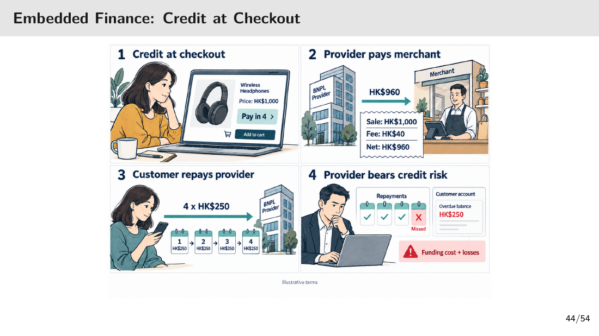

来源：L10 p.44，整页原图；可点击大图核原标注。

先买后付（Buy now, pay later，BNPL）把信用安排放进结账流程。原图第 1 格顾客购买 HK\$1,000 耳机、选择 Pay in 4；第 2 格提供者先付商户 HK\$960，价款减 HK\$40 费用；第 3 格顾客分四次各 HK\$250 还提供者；第 4 格若最后一期未还，提供者出现 HK\$250 逾期，并仍承担资金成本和损失。

沿图看，商户先有钱、顾客后还钱，中间资金由提供者或其资金伙伴支撑。“零利息”描述顾客利息条件，不能抹去出资和坏账成本。图为假设条款，谁最终承担损失仍须按具体合同确认；不要把这一张图当所有 BNPL 产品的法律结构。

**🎙️ 课堂补充**（S34 `17:10`–`21:49`，A · 课上展开）

课堂先把40港元称profit，随后21:37明确纠正：40不是利润，仍扣资金、损失和服务。图中960/四期250与承担风险的时间顺序保留。 *"so \$40 is not the profit"*（S34 `21:37`）

### 2.45 p.45 · 电商平台和贷款提供者怎样分工

讲义美国例 Amazon 提供购物流程，Affirm 对符合条件的购买提供按期还款融资；中国例京东提供购物流程，白条提供循环额度（Revolving credit limit，还款后可按条款再使用的额度）以延期或分期付款。两者都不能只看结账品牌就推定谁承担损失。

**讲义给定英文产品情境**

United States: Amazon + Affirm. Amazon supplies the shopping journey. Affirm offers installment financing for eligible purchases, with an agreed repayment schedule.

China: JD 京东 + Baitiao 白条. JD supplies the shopping journey. Baitiao provides a revolving credit limit for deferred payment or installments.

Sources: Affirm / Amazon agreement; JD Pay, Baitiao. Product terms vary.

这里的 eligible 是符合资格的购买，不是任何订单都获批；Product terms vary 明确条款会因产品而不同，不能只靠品牌推定利率、贷款人和担保。

**本页任务**：For either product: identify the lender, the fees and the holder of the repayment claim. Checkout design alone does not identify the loss bearer.

**中文题意与 ⚪ 参考作答（笔记推断）**：需查出实际出借人、商户/客户费用、谁持有还款请求权（Repayment claim，即谁有权向客户收回欠款），再看风险转移或担保条款。课件只给产品层比较，没有合同版本，不能唯一断言全部产品的贷款人或最终损失方。

**英文参考答案（笔记自拟）**：Identify the actual lender, merchant and customer fees, and the owner of the repayment claim from the relevant contract. The shopping platform or checkout brand alone does not establish who ultimately bears credit losses.

若贷款被出售，持有请求权者可能变化；前端购物页面不变不能证明风险归属未变。

**🎙️ 课堂补充**（S34 `21:54`–`30:18`，A · 课上展开）

课堂用购买数据支持借款人筛查，再区分平台、资金伙伴和投资者。具体产品利率/期限不泛化，谁承担最终损失仍看合同。 *"connect the lenders and the borrowers"*（S34 `26:15`）

### 2.46 p.46 · BNPL 增长为什么先消耗资金

商户先收钱，客户分期后还；新增交易越多，尚未收回的资金越多，所以业务增长需要融资。批准率（Approval rate，申请中获批的比例）提高可增加销售，却可能来自接受更高风险客户。

要将重复使用、商户集中度和批准标准一起看，并压力测试资金成本上升或主要资金伙伴退出。💡 笔记补充：若每笔要先垫 960 元，新增 100 笔就有 96,000 元初始拨款需求，未扣客户首期还款或其他资金安排；本例仅演示资金顺序，不冒充真实产品资金缺口。增长不自动等于单位利润增加。

**🎙️ 课堂补充**（S34 `30:18`–`31:47`，A · 课上展开）

批准更广可增加销售，也可能纳入较高违约风险客户。不是“业务量越大单位利润必越高”。 *"a high approval rate can increase the sales"*（S34 `31:20`）

### 2.47 p.47 · 信用、欺诈与融资三类风险

信用损失来自顾客不能按期还款；顾客同时使用多个分期计划时，单看一笔月供可能低估总义务。欺诈或退款未同步也会造成错误收款/放款，故身份、商户退款与偿还记录需要对齐。

融资风险来自先付商户、后收客户的时间差；即使最终会还，提供者眼下也可能缺现金。因此既要准备流动性，又要检查资金渠道集中。按同一放款期间追踪逾期和损失，才能避免把成熟贷款的坏账与刚发放贷款的未到期余额混比。这里是风险管理分析，不是某地法律建议。

**🎙️ 课堂补充**（S34 `31:47`–`33:33`，A · 课上展开）

课堂分别讲信用损失、欺诈争议和资金；出售贷款能改变出资/持有，但不自动消除合同担保。 *"They can sell the loans to others there."*（S34 `33:18`）

### 2.48 p.48 · BNPL 一笔贡献完整算例

<!-- cityu-nav:landing-48 -->
[[#4. 速查表|↩ 回速查]] · [[#5. 双语术语卡|回术语]] · [[#0. 三分钟速览|阅读导航]]
<!-- cityu-nav:landing:end -->

**讲义给定算例（非真实产品报价）**：商品 HK\$1,000；顾客四期各 HK\$250、无利息；商户先收 HK\$960，提供者取得 HK\$40 费用。假设每笔资金成本 HK\$10、预期信用损失 HK\$20、服务成本 HK\$5。

先算收入 40，再扣因垫款产生的 10、按预期不可收回金额估计的 20、服务工作 5，得到预期贡献（Expected contribution）$40-10-20-5=5$ 港元。这里都是同一笔订单口径，预期信用损失不是“本笔已经实际违约 20”。贡献还未扣固定管理费和税。

当预期损失改成 30，其他输入不变，贡献变成 $40-10-30-5=-5$ 港元。使贡献恰为零的损失上限是 $40-10-5=25$ 港元（笔记补充），不能用无利息推定提供者无成本。

**英文结果说明（笔记自拟）**：The expected contribution is HK\$5 per purchase before fixed overhead and tax. If expected credit losses rise to HK\$30, it becomes a loss of HK\$5.

本页只给总资金成本，不给各期日期和资金费率，不能反推出可靠的年利率。

**🎙️ 课堂补充**（S34 `33:45`–`35:23`，A · 课上展开）

本页5港元获完整口头计算，数字为明确illustrative。预期信用损失是事前估计，不是保证每笔刚好亏20。 *"Subtract 20, subtract 5, just \$5"*（S34 `34:45`）

### 2.49 p.49 · 未到期贷款可能暂时掩盖损失

本页三列先列收入（商户费及可能客户利息/费用）、直接成本（资金、支付处理、服务、催收），再列损失（违约和欺诈侵蚀留存收入）。每列用于不同扣减，不能把收回贷款本金列成新收入。

比较放款批次（Vintage，即相近时间发放的一组贷款）时，要等足够还款到期；刚发的贷款大多还没到首次还款日，当前逾期少不能说明风险低。💡 笔记补充：同样“放款后 3 个月”的累计损失率才更可比；把新批次第 1 周与旧批次第 12 月比较会混入成熟度差异。

**🎙️ 课堂补充**（S34 `35:36`–`36:53`，A · 课上展开）

教师要求公司研究别只看收入，核资金/服务/损失。口头把特定余额产品都当BNPL出资者的概括未核，不能替代真实资金池合同。 *"you cannot just look at their revenue"*（S34 `36:48`）

### 2.50 p.50 · 稳定币付账先看今天能否出金

<!-- cityu-nav:landing-50 -->
[[#4. 速查表|↩ 回速查]] · [[#5. 双语术语卡|回术语]] · [[#0. 三分钟速览|阅读导航]]
<!-- cityu-nav:landing:end -->

**讲义完整情境**：Class 9 CFO case: The firm holds 1 million USDC and must pay a US\$800,000 invoice today. Issuer redemption at par: 800,000 USDC → US\$800,000. The Circle Mint route requires an eligible account. It works for this invoice only if the bank funds arrive by the deadline. Market sale at a US\$0.90 bid: 888,888.89 USDC → US\$800,000. Assume the dealer can deliver bank funds today. The firm sells more tokens to meet the same cash obligation. If the supplier wants HK dollars, USD/HKD conversion is a separate step in either route.

**中文解析与来源地位**：这是讲义的压力报价假设，省略费用，不是当前 USDC 市价。按面值且今天能到账，交回 800,000 USDC，剩 200,000；市场报价是每 USDC 0.90 美元，要交 $800,000/0.90=888,888.888\ldots$ USDC，约剩 111,111.11。多耗约 88,888.89 USDC，并不等于额外损失了同额美元。

两条路线先满足今天的现金截止，再比数量/费用；若面值赎回明天才到，就不能直接作为今天履约方案。供应商需要港元时，两路都需另做 USD/HKD 兑换，题面未给汇率，不能算港元实收。

**英文参考说明（笔记自拟）**：Par redemption uses 800,000 USDC only if the firm is eligible and bank funds arrive today. At a \$0.90 bid, it must sell approximately 888,888.89 USDC to receive \$800,000 before fees. Conversion into HK dollars remains a separate step.

若市场 bid 改 0.80，须卖 1,000,000 USDC，恰好用完持币；若再收费可能不足，本题忽略费用的条件不能丢。

**🎙️ 课堂补充**（S34 `37:05`–`38:57`，A · 课上展开）

课堂把0.90称压力假设偏低并讨论0.98/0.99，但没有撤换原题输入；原0.90算例保留，今日到账及资格条件不能删。 *"if the supplier they want Hong Kong dollars"*（S34 `38:22`）

### 2.51 p.51 · 稳定币支付规模与构成怎样读

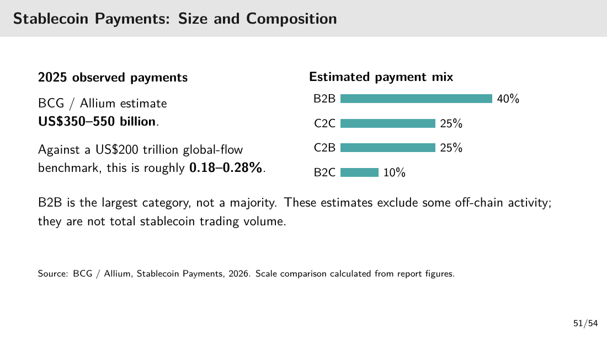

来源：L10 p.51，整页原图；可点击大图核原标注。

原图左侧是 BCG/Allium 对 2025 年观察到的支付估计 US\$350–550bn，右侧横条是估计构成：企业对企业 B2B 40%、个人对个人 C2C 25%、个人对企业 C2B 25%、企业对个人 B2C 10%，合计 100%。这是估计支付分类，不是所有链上转账或交易所成交量。

分母是课件采用的 US\$200tn 全球资金流（Global-flow）比较基准，不是稳定币全部链上活动。本批未重核该基准的统计口径和覆盖方法，只按讲义数值作规模对比。

同单位比较，US\$200tn 等于 US\$200,000bn，所以占比下界 $350/200,000=0.175\%$，上界 $550/200,000=0.275\%$，按讲义约 0.18%–0.28%。B2B 为最大单类，40% 却没有过半，不能写“多数支付都是 B2B”。该估计不含部分链下活动，未重核报告样本和方法，本批不把图外市场总量补成确定事实。

**🎙️ 课堂补充**（S34 `39:04`–`40:17`，A · 课上展开）

课堂说“less than3%”只是较松上界；原表350–550bn除200tn实为约0.18%–0.28%，保留更精确范围。40%B2B最大单类，不是过半。 *"B2B is still the largest category."*（S34 `40:04`）

### 2.52 p.52 · 储备收益怎样分成并覆盖成本

本页左列 Circle/USDC 以储备利息支付分发伙伴，剩余还须覆盖运营成本；右列讲义写 Open USD/OUSD 于 2026-09-30 推出、由 Bridge 发行，伙伴按带来的供应和活动获得奖励。本批没有独立核其发布和当前状态，保留为讲义引述，不能当已验证现行事实。

**讲义假设算例**：储备本金 $R=100$ 百万美元，年收益率 $y=4\%$，分给伙伴比例 $s=50\%$，全年运营成本 $C=1$ 百万美元。全部是年度同币种口径，非两家公司的实际财报。先得年利息 $100\times4\%=4$ 百万；分成 2 百万，留存 2 百万，再扣运营 1 百万，假设利润为 1 百万美元。

一般式为 $\Pi=Ry(1-s)-C$。

这里 $R$ 是全年假设固定的美元储备，$y$ 为年利率，$s$ 是收入分成比例，$C$ 为每年成本，$\Pi$ 为每年利润。

令利润为零，得 $y=C/[R(1-s)]=1/[100\times50\%]=2\%$。

若年收益降到 1%，则 $100\times1\%\times50\%-1=-0.5$ 百万美元。模型未含全部现实成本和余额变化，不能将其当发行人真实净利。

**🎙️ 课堂补充**（S34 `40:28`–`44:42`，A · 课上展开）

课堂按假设储备/4%/50%分成/100万成本算年度利润与2%打平。OpenUSD/参与公司和未来发卡合作为讲义快照/课堂预测，未重核现行产品。 *"So that is a two percent"*（S34 `43:37`）

### 2.53 p.53 · AI 代理付款需要怎样的授权边界

本页把代理代用户购物或按请求购买服务作为新支付入口，讲义列 x402 用 HTTP 402 Payment Required 做逐请求付款，以及 OpenAI/Stripe 维护的 Agentic Commerce Protocol 当时为 beta。两项是讲义版本快照；协议实际版本和状态本批未重核，不作为当前接入教程。

机制重点是“代理可以发起”与“用户授权范围”分开：需明确购买对象、金额上限和可用资金，并记录代理做了什么；意外购买由谁承担损失仍取决于授权和条款。💡 笔记补充：允许为一次报告购买 5 元数据，不等于允许自动订阅每月 500 元服务；同样能发出支付指令，权限边界不同。没有真实部署或交易，本页不声称已测试付款。

**🎙️ 课堂补充**（S34 `44:50`–`48:56`，A · 课上展开）

教师用预设小额免逐笔确认类比AI代理；这是先授有限权限，不能理解为用户完全未授权。协议beta与“明年”推测未变成已部署保证。 *"if they make some unwarranted purchase, so who should bear the loss?"*（S34 `46:10`）

### 2.54 p.54 · 四个结论合起来复述

本页四条总结：授权不等于结算；二维码是界面；外汇转换与传送速度分开；顾客免息不等于提供者免成本。它们共同要求沿完整链条分辨主体、时间、资金性质与收入扣减。

用一个例子复述：顾客在 App 选择无息分期并扫码，不能由界面断言底层不走卡；商户看到批准不能断言资金已最终到账；跨币种供应商付款还要看兑换；提供者仍须用收费覆盖出资和损失。课件末行把 Payment Connect 来源缩写写为 HKMC，而 p.34/36 是 HKMA，原件保留并在 §9 记来源缩写不一致。

本页的四个具体原例还要分开读：

1. Stripe 可以先取得卡授权，再捕获/请款（Capture），即按已获授权向后续处理提交扣款请求；请款是授权后的另一操作，本身也不等于最终结算。它位于 p.5/25 简化链中“批准后继续处理”的位置。
2. Alipay 的购买可由已绑定银行卡出资，所以二维码入口不决定最终资金来源（唤醒 p.16–19）。
3. Payment Connect 例中从 HKD 资金付给 RMB 账户，银行仍需把港元兑换成人民币；转得快没有取消换汇（唤醒 p.34–37）。
4. Affirm 即使对某顾客免息，也仍须覆盖资金成本和预期信用损失（唤醒 p.44–48）。

<!-- cityu-nav:return-3 -->
[[#0. 三分钟速览|↑ 阅读导航]] · [[#8. 讲义页码映射|页／Cell 索引]] · [[#4. 速查表|复习速查]]
<!-- cityu-nav:return:end -->

**🎙️ 课堂补充**（S34 `49:05`–`51:31`，A · 课上展开）

课堂回到金融包容、QR仅界面和BNPL必须计资金/损失成本，之后明确转Class11。四个原总结和具体例均保留。 *"So let's move on to class 11."*（S34 `51:31`）

## 3. 一图看懂

下表按问题找层，行与行不是互相替代的产品分类。

| 问题 | 应核层 | 正文入口 |
|---|---|---|
| 顾客怎样发指令 | QR、NFC、App | p.17–19 |
| 谁批准与处理 | 银行、处理商、共享交换 | p.5/14/25 |
| 钱何时变可用 | 结算、拨款、兑换 | p.33–41 |
| 谁先垫款并承担损失 | 放贷与融资合同 | p.44–49 |
| 谁留住多少收入 | 收费、分成、成本 | p.29/30/48/52 |

例如扫码只先回答第一行，不能跳过第三行直接判到账。

## 4. 速查表

每行是本讲已复算的一项结果，金额和条件必须一起记。

| 算例 | 输入和结果 | 限制 |
|---|---|---|
| 商店净拨款 [[#2.3 p.03 · 100 港元付款为何商店只收到 98 港元\|p.3]] | 100 港元扣 2%，净 98 港元 | 非批准即到账 |
| 处理商留存 [[#2.30 p.30 · 选择题：处理商留存多少费用\|p.30]] | 200 美元 × 0.6%，留 1.20 美元 | 自身成本未扣 |
| BNPL [[#2.48 p.48 · BNPL 一笔贡献完整算例\|p.48]] | 收 40，扣 10/20/5，贡献 5 港元 | 固定费税未扣 |
| 稳定币出金 [[#2.50 p.50 · 稳定币付账先看今天能否出金\|p.50]] | 80 万美元 ÷ 0.90 | 约 888,888.89 USDC，略费 |
| 储备分成 [[#2.52 p.52 · 储备收益怎样分成并覆盖成本\|p.52]] | 1 亿美元、4%、分成 50% | 扣 100 万成本后剩 100 万 |

## 5. 双语术语卡

下列英文定义为笔记自拟，用来组织考试回答，非教授逐字引文。

| 中文 | English | 英文定义 | 位置 |
|---|---|---|---|
| 授权 | Authorization | Approval after checking the account and transaction. | [[#2.5 p.05 · 发起、授权、清算与结算\|p.5]] |
| 清算 | Clearing | Calculation of participants' payment obligations under system rules. | [[#2.5 p.05 · 发起、授权、清算与结算\|p.5]] |
| 结算 | Settlement | Transfer of funds between institutions to discharge obligations. | [[#2.5 p.05 · 发起、授权、清算与结算\|p.5]] |
| 商户拨款 | Merchant payout | Funds made available to a merchant under its provider's terms. | [[#2.3 p.03 · 100 港元付款为何商店只收到 98 港元\|p.3]]/[[#2.6 p.06 · 速度、费用和风险要按同一链比较\|6]] |
| 交换费 | Interchange | A transfer between banks within the payment arrangement. | [[#2.6 p.06 · 速度、费用和风险要按同一链比较\|p.6]] |
| 收单 | Acquiring | Services enabling a merchant to accept and process card payments. | [[#2.22 p.22 · 同一收银画面可能对应三种业务\|p.22]] |
| 捕获/请款 | Capture | Submission of an authorized payment for further processing. | [[#2.54 p.54 · 四个结论合起来复述\|p.54]] |
| 互操作性 | Interoperability | The ability of systems to exchange and process payment instructions under shared rules. | [[#2.9 p.09 · 互联互通能接起来什么\|p.9]] |
| 先买后付 | Buy now, pay later | Credit embedded in a purchase with repayment scheduled later. | [[#2.44 p.44 · 先买后付四格资金链\|p.44]] |
| 放款批次 | Vintage | A group of loans originated in a stated period. | [[#2.49 p.49 · 未到期贷款可能暂时掩盖损失\|p.49]] |

## 6. 考点预判与答题框架

### 6.1 可信度与当前形式

本讲新增2条具体教学作答明示（p.30考试简单数学、p.41短答简洁），另有课程行政说明见 §2.0。课堂讲过或认可答案不自动等于该题必考；🟡讲义目标/⚪参考答案原地位保留。

### 6.2 教授明示与课堂答案地位

| 地位 | 内容 | 证据 | 位置 |
|---|---|---|---|
| 🔴 | 费用题这种简单运算是期望的考试数学 | *"this is the math I expect for exams."*（S33 `02:11:43`） | §2.30 |
| 🔴 | 本题短答简洁，不超过30词 | *"short answer question, no more than 30 words, please."*（S33 `02:25:06`）；与S34≤3行及其他题语境分开 | §2.41/2.0 |
| 🎙️课堂确认 | p23 C、p48贡献5、p52打平2% | S33 `01:53:56`及S34 `34:45`/`43:37` | 对应页 |
| ⚪参考地位保留 | p.30 B、p.31 D、p.41完整三问英文 | 课堂认可学生答法但ASR未收完整报数/字母/原句，按原题复核，不伪造课堂答案 | 对应页 |

### 6.3 答题顺序

支付链先写主体与资金，再分授权、清算、结算、拨款，最后说明争议。比较QR/NFC先界面，再查资金来源和责任。跨境先固定收款币种/金额/截止，再比可用资金时间与总成本。商业模式题先收费，再扣网络、资金、风险和运营成本，区分贡献与最终利润。完整原题与各选项理由都在对应 §2，不用背孤立字母。

## 7. 自测

以下为笔记补充，未代表本人已作答或通过。

### 7.1 相同扫码，是否一定同费率？

查看答案

不一定。二维码只规定交互；一个可走账户直转，另一个走卡网络，合同也可能不同。先核 p.31 的底层安排。

### 7.2 BNPL 只把预期信用损失改为 25 港元，贡献多少？

查看答案

其余沿 p.48，$40-10-25-5=0$ 港元。只是每笔贡献打平，未扣固定管理费用和税，不能称整个公司盈亏平衡。

### 7.3 本地货币收到期限为今天，面值赎回明天到，可以直接选它吗？

查看答案

不能。p.50 要先满足可用资金时点，再比代币数量；若没有过桥资金或延期安排，明天的 80 万美元无法今天支付。

### 7.4 同一基准下 40% 的 B2B 能叫多数吗？

查看答案

不能。p.51 中它是最大单类，但未超过 50%。支付估计也不等于稳定币全部成交量。

### 7.5 付款系统快了，客户从第 180 天提前到第 60 天付吗？

查看答案

系统处理速度本身不会改变商业付款日期。p.38 的 120 天融资缺口需谈付款条件或融资解决。

## 8. 讲义页码映射

每行是一页；S33/S34保留各自原时钟。S33前57分16秒属行政/M09；S34前15分06秒属行政/非教学背景；两课不能拼成一堂连续时钟。点击正文标题定位本页。

| L10 物理页 | 原页标题 | 正文 | 原图或处置 | 课堂覆盖 |
|---|---|---|---|---|
| 1 | FinTech and AI in Finance | [[EF5560_Fintech_and_AI_in_Finance/notes/M10-支付系统与嵌入式金融#2.1 p.01 · 课程封面与来源边界\|p.1]] | 纯封面/分隔 | ⚪ 封面；S33 `57:16`转Class10 |
| 2 | Payment Systems and Business Models | [[EF5560_Fintech_and_AI_in_Finance/notes/M10-支付系统与嵌入式金融#2.2 p.02 · 支付系统与商业模式\|p.2]] | 纯封面/分隔 | ⚪ 分隔；S33 `57:20`导入 |
| 3 | A HK\$100 Shop Payment | [[EF5560_Fintech_and_AI_in_Finance/notes/M10-支付系统与嵌入式金融#2.3 p.03 · 100 港元付款为何商店只收到 98 港元\|p.3]] | 原图整页保留并解释 | ✅ S33 `57:30`–`01:05:21`；课堂定位见正文 |
| 4 | Today’s Main Payment Types | [[EF5560_Fintech_and_AI_in_Finance/notes/M10-支付系统与嵌入式金融#2.4 p.04 · 四类支付安排处在不同层\|p.4]] | 文字/表格及题面逐项解释；品牌Logo不作教学图 | ✅ S33 `01:05:21`–`01:07:36`；课堂定位见正文 |
| 5 | Payment System Architecture & Participants | [[EF5560_Fintech_and_AI_in_Finance/notes/M10-支付系统与嵌入式金融#2.5 p.05 · 发起、授权、清算与结算\|p.5]] | 文字/表格及题面逐项解释；品牌Logo不作教学图 | ✅ S33 `01:07:44`–`01:10:18`；课堂定位见正文 |
| 6 | How to Judge a Payment System | [[EF5560_Fintech_and_AI_in_Finance/notes/M10-支付系统与嵌入式金融#2.6 p.06 · 速度、费用和风险要按同一链比较\|p.6]] | 文字/表格及题面逐项解释；品牌Logo不作教学图 | ✅ S33 `01:10:27`–`01:14:43`；课堂定位见正文 |
| 7 | Why Payment Providers Check Customers and Transactions | [[EF5560_Fintech_and_AI_in_Finance/notes/M10-支付系统与嵌入式金融#2.7 p.07 · 为何需要身份和交易检查\|p.7]] | 文字/表格及题面逐项解释；品牌Logo不作教学图 | ✅ S33 `01:22:24`–`01:24:07`；课堂定位见正文 |
| 8 | Cross-Border Payments and What Can Go Wrong | [[EF5560_Fintech_and_AI_in_Finance/notes/M10-支付系统与嵌入式金融#2.8 p.08 · 跨境转账为什么多了成本与等待\|p.8]] | 原图整页保留并解释 | ✅ S33 `01:24:10`–`01:28:09`；课堂定位见正文 |
| 9 | Interoperability and New Payment Rails | [[EF5560_Fintech_and_AI_in_Finance/notes/M10-支付系统与嵌入式金融#2.9 p.09 · 互联互通能接起来什么\|p.9]] | 原图整页保留并解释 | ✅ S33 `01:28:09`–`01:29:04`；课堂定位见正文 |
| 10 | Price Is Only One Driver of Payment Adoption | [[EF5560_Fintech_and_AI_in_Finance/notes/M10-支付系统与嵌入式金融#2.10 p.10 · 用户采用还取决于信任和补救\|p.10]] | 原图整页保留并解释 | ✅ S33 `01:29:04`–`01:31:44`；课堂定位见正文 |
| 11 | M-Pesa: An Old Launch, a Current Distribution Model | [[EF5560_Fintech_and_AI_in_Finance/notes/M10-支付系统与嵌入式金融#2.11 p.11 · M-Pesa 的代理人为什么要备两种余额\|p.11]] | 原图整页保留并解释 | ✅ S33 `01:31:48`–`01:32:38`；课堂定位见正文 |
| 12 | UPI: Shared Infrastructure Can Scale Rapidly | [[EF5560_Fintech_and_AI_in_Finance/notes/M10-支付系统与嵌入式金融#2.12 p.12 · UPI 增长曲线如何读\|p.12]] | 原图整页保留并解释 | ✅ S33 `01:32:41`–`01:34:54`；课堂定位见正文 |
| 13 | UPI: Why Shared Infrastructure Helps | [[EF5560_Fintech_and_AI_in_Finance/notes/M10-支付系统与嵌入式金融#2.13 p.13 · UPI 与 M-Pesa 解决不同接入问题\|p.13]] | 文字/表格及题面逐项解释；品牌Logo不作教学图 | ✅ S33 `01:35:02`–`01:36:38`；课堂定位见正文 |
| 14 | Trace One Account-to-Account Payment | [[EF5560_Fintech_and_AI_in_Finance/notes/M10-支付系统与嵌入式金融#2.14 p.14 · 沿一次账户到账户付款走图\|p.14]] | 原图整页保留并解释 | ✅ S33 `01:36:40`–`01:37:13`；课堂定位见正文 |
| 15 | Alipay: Payment Trust and Merchant Services | [[EF5560_Fintech_and_AI_in_Finance/notes/M10-支付系统与嵌入式金融#2.15 p.15 · 支付宝怎样把付款与履约信任相连\|p.15]] | 文字/表格及题面逐项解释；品牌Logo不作教学图 | ✅ S33 `01:37:24`–`01:38:35`；课堂定位见正文 |
| 16 | Alipay: Reaching Overseas Visitors to China | [[EF5560_Fintech_and_AI_in_Finance/notes/M10-支付系统与嵌入式金融#2.16 p.16 · 境外访客绑卡改变哪个环节\|p.16]] | 文字/表格及题面逐项解释；品牌Logo不作教学图 | ✅ S33 `01:38:38`–`01:41:29`；课堂定位见正文 |
| 17 | Alipay: Low-Cost Merchant Acceptance | [[EF5560_Fintech_and_AI_in_Finance/notes/M10-支付系统与嵌入式金融#2.17 p.17 · 一张打印二维码降低了什么成本\|p.17]] | 文字/表格及题面逐项解释；品牌Logo不作教学图 | ✅ S33 `01:44:01`–`01:45:10`；课堂定位见正文 |
| 18 | Introduction to NFC-Based Payments | [[EF5560_Fintech_and_AI_in_Finance/notes/M10-支付系统与嵌入式金融#2.18 p.18 · NFC 通信与支付安全分开\|p.18]] | 文字/表格及题面逐项解释；品牌Logo不作教学图 | ✅ S33 `01:41:47`–`01:44:01`；课堂定位见正文 |
| 19 | Comparing QR-Code vs. NFC Payment Systems | [[EF5560_Fintech_and_AI_in_Finance/notes/M10-支付系统与嵌入式金融#2.19 p.19 · 扫码和轻触比较的是交互方式\|p.19]] | 文字/表格及题面逐项解释；品牌Logo不作教学图 | ✅ S33 `01:45:12`–`01:46:15`；课堂定位见正文 |
| 20 | Case: Three HKSAR Stored-Value Payment Models | [[EF5560_Fintech_and_AI_in_Finance/notes/M10-支付系统与嵌入式金融#2.20 p.20 · 香港三个储值案例怎样逐项比较\|p.20]] | 文字/表格及题面逐项解释；品牌Logo不作教学图 | ✅ S33 `01:46:21`–`01:49:10`；课堂定位见正文 |
| 21 | How Product Choices Build Payment Habits | [[EF5560_Fintech_and_AI_in_Finance/notes/M10-支付系统与嵌入式金融#2.21 p.21 · 商业习惯怎样形成支付分发\|p.21]] | 原图整页保留并解释 | ✅ S33 `01:49:14`–`01:50:11`；课堂定位见正文 |
| 22 | The Same Checkout Can Hide Three Payment Businesses | [[EF5560_Fintech_and_AI_in_Finance/notes/M10-支付系统与嵌入式金融#2.22 p.22 · 同一收银画面可能对应三种业务\|p.22]] | 原图整页保留并解释 | ✅ S33 `01:50:15`–`01:52:07`；课堂定位见正文 |
| 23 | Multiple-Choice Question: Is Instant Approval Final Payment? | [[EF5560_Fintech_and_AI_in_Finance/notes/M10-支付系统与嵌入式金融#2.23 p.23 · 选择题：即时批准是最终付款吗\|p.23]] | 文字/表格及题面逐项解释；品牌Logo不作教学图 | ✅ S33 `01:52:10`–`01:54:02`；答案C确认 |
| 24 | Stripe: The Online Merchant’s Problem | [[EF5560_Fintech_and_AI_in_Finance/notes/M10-支付系统与嵌入式金融#2.24 p.24 · Stripe 卖的是商户少做哪些工作\|p.24]] | 文字/表格及题面逐项解释；品牌Logo不作教学图 | ✅ S33 `01:54:35`–`02:02:29`；课堂定位见正文 |
| 25 | Stripe Case: The Banks behind an Online Payment | [[EF5560_Fintech_and_AI_in_Finance/notes/M10-支付系统与嵌入式金融#2.25 p.25 · 网上卡支付背后有哪些银行\|p.25]] | 原图整页保留并解释 | ✅ S33 `02:02:31`–`02:03:54`；课堂定位见正文 |
| 26 | Stripe: Checkout, Fraud Screening, and Billing | [[EF5560_Fintech_and_AI_in_Finance/notes/M10-支付系统与嵌入式金融#2.26 p.26 · 收银、Radar 和 Billing 各做什么\|p.26]] | 文字/表格及题面逐项解释；品牌Logo不作教学图 | ✅ S33 `02:05:06`–`02:05:40`；课堂定位见正文 |
| 27 | Payment Fraud: Predictions and Decisions | [[EF5560_Fintech_and_AI_in_Finance/notes/M10-支付系统与嵌入式金融#2.27 p.27 · 欺诈概率怎样变成付款决定\|p.27]] | 文字/表格及题面逐项解释；品牌Logo不作教学图 | ✅ S33 `02:05:47`–`02:06:36`；课堂定位见正文 |
| 28 | Stripe: Scale and the Cost of Serving Merchants | [[EF5560_Fintech_and_AI_in_Finance/notes/M10-支付系统与嵌入式金融#2.28 p.28 · 处理规模不是服务商收入\|p.28]] | 文字/表格及题面逐项解释；品牌Logo不作教学图 | ✅ S33 `02:06:45`–`02:07:19`；课堂定位见正文 |
| 29 | Payment Revenue after Costs | [[EF5560_Fintech_and_AI_in_Finance/notes/M10-支付系统与嵌入式金融#2.29 p.29 · 从收费走到增量贡献\|p.29]] | 文字/表格及题面逐项解释；品牌Logo不作教学图 | ✅ S33 `02:07:23`–`02:10:57`；课堂定位见正文 |
| 30 | Multiple-Choice Question: Payment Fees and Processor Revenue | [[EF5560_Fintech_and_AI_in_Finance/notes/M10-支付系统与嵌入式金融#2.30 p.30 · 选择题：处理商留存多少费用\|p.30]] | 文字/表格及题面逐项解释；品牌Logo不作教学图 | ✅ S33 `02:11:00`–`02:11:52`；算术认可/结果仍复核 |
| 31 | Multiple-Choice Question: The Same QR Code, Different Payment Rails | [[EF5560_Fintech_and_AI_in_Finance/notes/M10-支付系统与嵌入式金融#2.31 p.31 · 选择题：同一二维码能推出同一网络吗\|p.31]] | 文字/表格及题面逐项解释；品牌Logo不作教学图 | ✅ S33 `02:12:01`–`02:12:58`；答案地位见正文 |
| 32 | Cross-Border Payments | [[EF5560_Fintech_and_AI_in_Finance/notes/M10-支付系统与嵌入式金融#2.32 p.32 · 跨境支付分隔\|p.32]] | 纯封面/分隔 | ⚪ 跨境分隔；S33 `02:12:58`转入 |
| 33 | Cross-Border Payment Costs and Delays | [[EF5560_Fintech_and_AI_in_Finance/notes/M10-支付系统与嵌入式金融#2.33 p.33 · 跨境总成本不能只看转账手续费\|p.33]] | 文字/表格及题面逐项解释；品牌Logo不作教学图 | ✅ S33 `02:12:58`–`02:13:47`；课堂定位见正文 |
| 34 | Retail and Wholesale Cross-Border Payments | [[EF5560_Fintech_and_AI_in_Finance/notes/M10-支付系统与嵌入式金融#2.34 p.34 · 零售、批发与支付互联\|p.34]] | 文字/表格及题面逐项解释；品牌Logo不作教学图 | ✅ S33 `02:13:15`–`02:16:04`；课堂定位见正文 |
| 35 | A \$100 Cross-Border Bank Transfer | [[EF5560_Fintech_and_AI_in_Finance/notes/M10-支付系统与嵌入式金融#2.35 p.35 · 100 美元跨境付款四格图\|p.35]] | 原图整页保留并解释 | ✅ S33 `02:16:09`–`02:17:08`；课堂定位见正文 |
| 36 | Case: Chinese Mainland–HKSAR Payment Connect | [[EF5560_Fintech_and_AI_in_Finance/notes/M10-支付系统与嵌入式金融#2.36 p.36 · Payment Connect 接起哪四层\|p.36]] | 文字/表格及题面逐项解释；品牌Logo不作教学图 | ✅ S33 `02:17:20`–`02:19:04`；课堂定位见正文 |
| 37 | What Payment Connect Changes | [[EF5560_Fintech_and_AI_in_Finance/notes/M10-支付系统与嵌入式金融#2.37 p.37 · 互联以后哪些责任仍在银行\|p.37]] | 文字/表格及题面逐项解释；品牌Logo不作教学图 | ✅ S33 `02:19:04`–`02:20:00`；课堂定位见正文 |
| 38 | A Fast Transfer Cannot Fix Late Invoice Payment | [[EF5560_Fintech_and_AI_in_Finance/notes/M10-支付系统与嵌入式金融#2.38 p.38 · 秒到账解决不了晚付 120 天\|p.38]] | 文字/表格及题面逐项解释；品牌Logo不作教学图 | ✅ S33 `02:20:10`–`02:21:39`；课堂定位见正文 |
| 39 | Tokenized Settlement: Who Does What? | [[EF5560_Fintech_and_AI_in_Finance/notes/M10-支付系统与嵌入式金融#2.39 p.39 · 收到了 USDC 还差哪一步\|p.39]] | 原图整页保留并解释 | ✅ S33 `02:21:44`–`02:22:55`；课堂定位见正文 |
| 40 | Cross-Border Failure Drill: The Recipient Gets Nothing | [[EF5560_Fintech_and_AI_in_Finance/notes/M10-支付系统与嵌入式金融#2.40 p.40 · 显示 completed 而收款为零怎样查\|p.40]] | 文字/表格及题面逐项解释；品牌Logo不作教学图 | ✅ S33 `02:23:00`–`02:23:49`；课堂定位见正文 |
| 41 | Short-Answer Question: What Remains after Removing Correspondents? | [[EF5560_Fintech_and_AI_in_Finance/notes/M10-支付系统与嵌入式金融#2.41 p.41 · 简答：去掉代理行以后还剩什么\|p.41]] | 文字/表格及题面逐项解释；品牌Logo不作教学图 | ✅ S33 `02:23:54`–`02:25:32`；答案地位见正文 |
| 42 | Embedded Finance and Payment Services | [[EF5560_Fintech_and_AI_in_Finance/notes/M10-支付系统与嵌入式金融#2.42 p.42 · 嵌入式金融分隔\|p.42]] | 纯封面/分隔 | ⚪ 嵌入式金融分隔；S34 `15:06`起后续 |
| 43 | Open Banking: Who Can Initiate a Payment? | [[EF5560_Fintech_and_AI_in_Finance/notes/M10-支付系统与嵌入式金融#2.43 p.43 · 支付发起服务商与账户银行分工\|p.43]] | 文字/表格及题面逐项解释；品牌Logo不作教学图 | ✅ S34 `15:06`–`17:03`；续讲，细项/来源边界见正文 |
| 44 | Embedded Finance: Credit at Checkout | [[EF5560_Fintech_and_AI_in_Finance/notes/M10-支付系统与嵌入式金融#2.44 p.44 · 先买后付四格资金链\|p.44]] | 原图整页保留并解释 | ✅ S34 `17:10`–`21:49`；续讲，细项/来源边界见正文 |
| 45 | BNPL in E-commerce: Amazon and JD | [[EF5560_Fintech_and_AI_in_Finance/notes/M10-支付系统与嵌入式金融#2.45 p.45 · 电商平台和贷款提供者怎样分工\|p.45]] | 文字/表格及题面逐项解释；品牌Logo不作教学图 | ✅ S34 `21:54`–`30:18`；续讲，细项/来源边界见正文 |
| 46 | BNPL: Can the Provider Finance Its Growth? | [[EF5560_Fintech_and_AI_in_Finance/notes/M10-支付系统与嵌入式金融#2.46 p.46 · BNPL 增长为什么先消耗资金\|p.46]] | 文字/表格及题面逐项解释；品牌Logo不作教学图 | ✅ S34 `30:18`–`31:47`；续讲，细项/来源边界见正文 |
| 47 | BNPL: Risk and Supervision | [[EF5560_Fintech_and_AI_in_Finance/notes/M10-支付系统与嵌入式金融#2.47 p.47 · 信用、欺诈与融资三类风险\|p.47]] | 文字/表格及题面逐项解释；品牌Logo不作教学图 | ✅ S34 `31:47`–`33:33`；续讲，细项/来源边界见正文 |
| 48 | BNPL Worked Example: One Checkout | [[EF5560_Fintech_and_AI_in_Finance/notes/M10-支付系统与嵌入式金融#2.48 p.48 · BNPL 一笔贡献完整算例\|p.48]] | 文字/表格及题面逐项解释；品牌Logo不作教学图 | ✅ S34 `33:45`–`35:23`；续讲，细项/来源边界见正文 |
| 49 | BNPL: Revenue, Costs, and Credit Losses | [[EF5560_Fintech_and_AI_in_Finance/notes/M10-支付系统与嵌入式金融#2.49 p.49 · 未到期贷款可能暂时掩盖损失\|p.49]] | 文字/表格及题面逐项解释；品牌Logo不作教学图 | ✅ S34 `35:36`–`36:53`；续讲，细项/来源边界见正文 |
| 50 | Stablecoins in Cross-border Payments | [[EF5560_Fintech_and_AI_in_Finance/notes/M10-支付系统与嵌入式金融#2.50 p.50 · 稳定币付账先看今天能否出金\|p.50]] | 文字/表格及题面逐项解释；品牌Logo不作教学图 | ✅ S34 `37:05`–`38:57`；续讲，细项/来源边界见正文 |
| 51 | Stablecoin Payments: Size and Composition | [[EF5560_Fintech_and_AI_in_Finance/notes/M10-支付系统与嵌入式金融#2.51 p.51 · 稳定币支付规模与构成怎样读\|p.51]] | 原图整页保留并解释 | ✅ S34 `39:04`–`40:17`；续讲，细项/来源边界见正文 |
| 52 | Circle and Open USD: Distribution and Reserve Income | [[EF5560_Fintech_and_AI_in_Finance/notes/M10-支付系统与嵌入式金融#2.52 p.52 · 储备收益怎样分成并覆盖成本\|p.52]] | 文字/表格及题面逐项解释；品牌Logo不作教学图 | ✅ S34 `40:28`–`44:42`；续讲，细项/来源边界见正文 |
| 53 | Payments Initiated by AI Agents | [[EF5560_Fintech_and_AI_in_Finance/notes/M10-支付系统与嵌入式金融#2.53 p.53 · AI 代理付款需要怎样的授权边界\|p.53]] | 文字/表格及题面逐项解释；品牌Logo不作教学图 | ✅ S34 `44:50`–`48:56`；续讲，细项/来源边界见正文 |
| 54 | What to Remember | [[EF5560_Fintech_and_AI_in_Finance/notes/M10-支付系统与嵌入式金融#2.54 p.54 · 四个结论合起来复述\|p.54]] | 文字/表格及题面逐项解释；品牌Logo不作教学图 | ✅ S34 `49:05`–`51:31`；续讲，细项/来源边界见正文 |

<!-- cityu-nav:return-9 -->
[[#0. 三分钟速览|↑ 阅读导航]] · [[#8. 讲义页码映射|页／Cell 索引]] · [[#4. 速查表|复习速查]]
<!-- cityu-nav:return:end -->

**课堂覆盖统计**：54页=4封面/分隔+50有课堂定位内容页；完整逐问讲评与未核细项另见§9.1。以下数字由build_m10.py按时间戳相减。

**S33课堂时间分配**（分母为该源首末段首跨度，含互动/背景，不是墙钟课长）：

| 内容 | 原时钟 | 窗口长 | 占本源 |
|---|---|---|---|
| 行政及M09 | `00:00`–`57:16` | 57.27分钟 | 39.3% |
| M10课堂 | `57:16`–`02:25:32` | 88.27分钟 | 60.7% |

**S34课堂时间分配**（分母为该源首末段首跨度，含互动/背景，不是墙钟课长）：

| 内容 | 原时钟 | 窗口长 | 占本源 |
|---|---|---|---|
| 行政及背景 | `00:00`–`15:06` | 15.10分钟 | 10.4% |
| M10续讲 | `15:06`–`51:31` | 36.42分钟 | 25.0% |
| M11及插入讨论 | `51:31`–`02:25:28` | 93.95分钟 | 64.6% |

## 9. 延伸与勘误

### 9.1 课堂覆盖与未核范围

S33在p.41后收束，S34从p.43续讲并到p.54；本批不能再把p.42–54写成未录到。4个纯封面/分隔页为1/2/32/42，其余50内容页有课堂定位；这不表示每个原表项与所有小问都完整讲评。

| 讲义页 | 内容 | 判定 | 依据 | 建议 |
|---|---|---|---|---|
| p.20 | 三个香港案例表问题 | ❓未完整逐问讲评 | S33 `01:46:21`–`01:49:10`主要八达通/Oyster | 不可降权，原英文与参考答案保留 |
| p.31/41 | 学生完整答句 | ❓ASR未收全 | S33 `02:12:18`后/`02:24:14`后留互动间隔，教师认可 | 不冒造原话，参考解答仍可复做 |
| M12计划 | 后续课程覆盖 | 进度预告 | S33 `01:16:04`、S34 `14:44`/`02:25:19` | 预计讲不完且会留slides，不等于未讲自动免考 |

### 9.2 课上讲了但课件没有（🎙️最高价值清单）

| # | 内容 | 时长 | 时间戳 | 小节 | 为什么值钱 |
|---|---|---|---|---|---|
| 1 | 🔴最新题型、指定答题栏、手写小抄与TA安排 | 行政窗口10分58秒，非纯讲话时长 | S34 `00:00`–`10:58` | §2.0 | 当前具体40%/16题×2.5与旧约60%分层；小抄身份/随卷交 |
| 2 | 🔴费用题数学与短答长度 | 分散窗口，未另估纯教学时长 | S33 `02:11:43`、`02:25:06` | §2.30/41 | 明确练手算与写简洁，非题目必中保证 |
| 3 | 用漫画解释公司业务 | 1分23秒窗口 | S33 `02:02:31`–`02:03:54` | §2.25/2.0 | 可辅助A02呈现，不取消真人英语呈现要求 |
| 4 | 借款40收入不是40利润的自我纠正 | BNPL讲解4分39秒窗口 | S34 `17:10`–`21:49` | §2.44 | 课堂先简称profit再纠正，避免只背最早一句 |

### 9.3 讲义/课堂差异及实时性

p.12图题18.8倍与舍入端点约19.33倍差异原样保留。p.54来源缩写HKMC与前文HKMA不一致；p.21肖像是AI插画，不是照片。S33 `02:06:45`把Stripe增长口述成44%，原页34%仍按讲义；S34 `39:33`的less than3%不替换本页0.18%–0.28%的精确量级。

S33绑卡200元/2%口述上下方向不一致；Payment Connect实际限额/零费、信用卡福利、USDC临时查询、协议beta、OpenUSD参与机构和AI代理“明年”均未逐站重核。S34把余额理财产品与贷款出资来源相连是课堂概括，不据此认定任何货币基金资金直接投给消费借款人。具体产品事实和法律/资金合同须另核，本稿不执行金融操作。

### 9.4 保留的原学习材料

54个逐页正文和§8入口、14幅原图及既有机制图、完整英文题面/选项/逐问中文与英文参考答案保留。就地“笔记补充”的变式和英文仍非教授原句；未重跑旧实验，旧源页/计算/独审只承接未变范围。

### 9.5 来源登记、隐私与反方视角

| # | 事项 | 说明 |
|---|---|---|
| 1 | S33 | 原主ASR1533段，00:00–02:25:32，0倒退/0≥120秒空档；8条dropped已按上下文恢复，私有完整1541段；公开1541段位中5段位去身份处理。M09补讲07:33–57:16，M10从57:16起到p41。 |
| 2 | S34 | 原主ASR1509段，00:00–02:25:28，0倒退/0≥120秒空档；24条dropped已恢复为私有完整1533段；公开1533段位中80段位发生整段占位或局部去身份处理。M10内容15:06–51:31，之后M11及讨论。 |
| 3 | 完整性 | S33有开场/告别，S34从视频要求半句开始，缺开头长度未知，尾有告别。S33 01:14:48与S34 01:12:00宣布休息，但原时钟紧接回课，墙钟间隔未知。零空档不证整堂完整。 |
| 4 | 隐私/公开源 | 学生姓名/个人加分与出勤、私人转账个案和S34明示暂勿外传的非教学合作计划由主代理精确遮蔽，保留原时钟占位；本稿不含第三方姓名，原始私存不改。源最终SHA/规范段数需主代理恢复脱敏后回读。 |
| 5 | 作答范围 | 学生声音远时仅确认教师认可，不复原未录内容。p23 C、p48 5与p52 2%有明确课堂支持；其余按原题计算/参考身份。 |

**反方视角**：最易错的是把“在App里成功”“币已转出”当“收款人银行钱可用”；按p39/40逐层取证。费用题若把百分比分母换成扣费后余额会错；按p30同一交易额复算。小抄和题型必须按最新通知，AI练习回答和相似性自报都不保证正式正确，M12讲不完也未自动取消已发slides。

### 9.6 变更记录

| 日期 | 变化 |
|---|---|
| 2026-11-21 | 合并S33/S34转录两课原时钟，新增50个内容页课堂定位、课程考试/展示说明、题解地位及差异；v0.9→材料v1.0，保留54页/14原图/完整中英原题。本次来源、抽检与显示范围见本批回执，写回与各端版本证据见本批回执。 |

