# M11 · 数字信贷与众筹：资金、权利和损失由谁承担

> **材料 v1.0，2026-11-28 增补S35。** S34于11/19讲至p.38；2026-11-26最后一课的S35 `04:19`–`43:59`补讲p.39–54，`44:01`起转M12介绍、`44:52`起进入其主线。S35采用顺序large-v3无VAD最终转录（1460段位，64段隐私占位），全源原时钟`00:00`–`02:07:33`；首尾有议程/告别，不认证墙钟连续或原音逐字完整。S34缺开头、p.12完整观察窗及p.38第2/3问的旧证据边界保留，原54页/17图/中英题与既有解析不删。教学抽检、显示、写回与同步状态另据本批回执。

## 0. 三分钟速览

<!-- cityu-nav:opening -->
> [!abstract] 阅读导航
> **预习**：[[#1. 开始之前 · 知识衔接|前置]] → [[#2. 正文 · 按原课件页序|逐页／逐格正文]]。
> **课中**：[[#8. 讲义页码映射|按页码／Cell 定位]]。
> **复习**：[[#4. 速查表|速查]] → [[#5. 双语术语卡|英文术语]] → [[#7. 自测|自测]]，点表中位置回正文。
> **返回**：正文关键位置可点“回速查／回术语”，不必滚回页首。
> [[#9. 延伸与勘误|来源／勘误]] · [[EF5560_Fintech_and_AI_in_Finance/00-课程总览|课程入口]]
<!-- cityu-nav:opening:end -->

数字入口能改变资料、处理成本和分发；贷款是否值得做，还取决于资金、偿还能力、合同权利及损失。

- 能沿申请到贷后流程指出承做、出资、服务和风险承担者。
- 能计算预期信用损失、贡献和首损担保下的实际损失分配。
- 能说明风险排序正确为何仍可能低估概率与损失。
- 能区分众筹达标、产品交付、贷款偿还与股权权利。

> 🎙️ **课堂实况**：S34先复盘M10，后讲本章至p.38；S35于2026-11-26 `04:19`–`43:59`补完后续p.39–54，重点是登记不替代信用判断、排序与校准、合同损失分配、贡献与资金压力。p.40规则细项再次明确不测试，p.47 C获课堂讲评；p.52完整两问答案仍以清楚参考与实际录到部分分开。p.12及p.38旧缺口不因后页补讲自动消失。

## 1. 开始之前 · 知识衔接

### 1.1 当前用到的旧知识

本金是借入后需要归还的钱，利息/费用是使用资金或服务的代价；本金回收不能全部当收入。M10 的 BNPL 先付商户、后收顾客，会产生资金时间差；本讲 p.19/26 重新给数计算。M08 的 Aave 用抵押品和协议限额决定借款能力，本讲 p.48 对照无抵押企业贷款。

必要前文：[[EF5560_Fintech_and_AI_in_Finance/notes/M03-线性机器学习与收益预测|M03 的样本外逻辑]]、[[EF5560_Fintech_and_AI_in_Finance/notes/M05-可解释机器学习与投资组合决策|M05 的模型解释]]、[[EF5560_Fintech_and_AI_in_Finance/notes/M08-DeFi-NFT与现实世界资产|M08 的抵押借款]]。历史登记不是掌握证明，当前核心在当地搭桥。

### 1.2 新概念入口

承做与出资在 p.5/14–16，十二个月违约评价在 p.12/24/46，概率与损失率在 p.26，担保在 p.27/49，众筹权利在 p.29–38，共有登记与信用判断在 p.39/45。§5 词表用于复习，不代替当地解释。

### 1.3 三条使用路线

L11 是本讲 54 个物理页，内容页页内号与物理页相同。预习顺读 §2 并遮住参考答案复做；课中由 §8 每页精确链接到本页和原图；复习用 §3–§7 按资金/风险/证据重组。原文块保留题面与讲义给定步骤，中文译解、笔记推断和英文自拟答案分别说明。课堂按S34/S35各自原时钟定位；S35补讲p.39–54。没有逐页依据的细项仍须按书面学习，不视为免考。

## 2. 正文 · 按原课件页序

### 2.1 p.01 · 本讲范围与来源边界

本讲为 Class 11 Lending and Crowdfunding，讲授数字信贷与众筹。学期写 Semester A 2026/27，封面没有实际授课日期。S34 `51:31` 转入本讲，`02:25:15` 课堂止于p.38；2026-11-26 S35 `04:19`–`43:59`补讲p.39–54。文件生成日不代替授课日。

### 2.2 p.02 · 数字信贷与信用决定

本页只有 Digital Lending and Credit Decisions 分隔标题。接下来的主问题是：资料不多的小商户能否借到钱，借款人、提供数据者、审核者和出资者分别承担什么责任。后续每页从这些对象继续，不以有 App 推定风险消失。

### 2.3 p.03 · 只有十二个月现金流怎样判断借款人

讲义英文原题／给定情境与步骤（非笔记答案）

Assessing a Borrower with Limited Credit History

Scenario: A small online seller has no long credit history but has twelve months of bank and platform cash-flow data.

Evidence that may help:

- sales, cash inflows, and their seasonality;
- repayment records, refunds, and disputes.

Evidence still missing:

- debts outside the platform and data that may be inaccurate;
- recoveries if the borrower defaults.

原情境的小网店没有很长信用记录，但有 12 个月银行和平台现金流。薄信用档案（Thin credit file）是可用信用历史有限，不等于已证实信用差。销售、入账和季节性帮助判断钱何时来；还款、退款和争议帮助核销售是否能转成稳定现金。

讲义也列出仍缺的平台外负债、资料准确性、违约后的回收。若只见平台每月卖 10 万，没见它另欠 20 万，就不能准确判断还款能力（Repayment capacity）。这不是要求凭常识补出外债；要把未知作为需核证据。英文原情境与两列材料保留在原文块，以下同。

**🎙️ 课堂补充**（S34 `01:04:17`–`01:10:37`，A · 课上展开）

课堂以跨境卖家季节性备货说明短历史与周转资金，平台外负债仍可能不可见。01:07:04–01:09:30为供应链平台推广视频，不冒作教师独立验证；片中专名/性能/专利未核，不把视频承诺当实际授信成效。 *"they might have some debt outside the platform."*（S34 `01:05:49`）

### 2.4 p.04 · 小额贷款为何也可能很贵

网店要先备货，顾客以后才付款，形成营运资金（Working capital）需求。资料短使贷款人难判断未来还款，核身份与审文件又有固定人工工作；贷款金额小，不代表这些工作按比例变少。

数字记录可能减少取证和处理成本，但好销售没有揭示所有债务，也不保证下月销售。💡 笔记补充：同样花 100 元核资料，贷 1,000 元时占 10%，贷 100,000 元时占 0.1%；这只是成本比例例，不是实际费率或客户应付利息。

**🎙️ 课堂补充**（S34 `58:49`–`01:12:00`，A · 课上展开）

小额贷款仍要身份、文件和财务核验，固定工作不随本金同比例缩小。私人经历未入正文；关于社交联系预测还款的朋友故事教师自己说不确定，不能当真实模型输入已验证或获准收集。 *"They don't think a small loan is really worth the cost."*（S34 `01:11:15`）

### 2.5 p.05 · 数字贷款四格流程

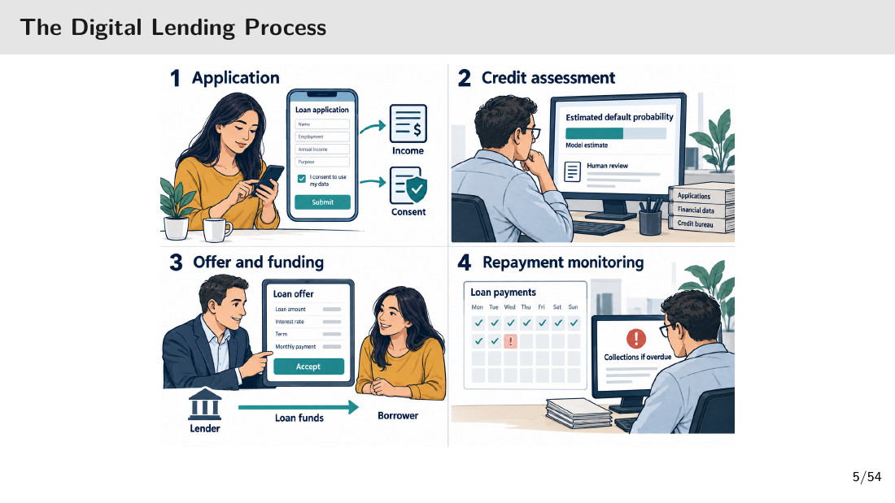

来源：L11 p.5，保留整页原图，可打开大图辨认原标签。

原图四格各回答一步：

1. Application：借款人填收入、目的并同意数据使用。
2. Credit assessment：资料进入违约概率估计和人工检查。
3. Offer and funding：报价写贷款额、利率、期限、月供，客户接受后贷款人提供资金。
4. Repayment monitoring：追踪还款与逾期、必要时催收。

沿一笔申请走图，给了资料不代表已获批，获批不代表无须出资，放款也没有结束责任。图上的同意框只是界面示意，不能据此认定客户已理解所有用途；报价、授权和资金转出是不同证据。贷款承做（Origination）包括接入、审核和建立贷款，资金提供（Funding）回答实际用谁的钱，两者可以由不同机构负责。

**🎙️ 课堂补充**（S34 `01:12:12`–`01:14:25`，A · 课上展开）

教师沿申请/同意、评估、报价、还款监测走原四格。更高违约风险可能影响报价，但不能从一次消费或信号单独证明应提前追回借款；仍须合同与审查。 *"the loan amount, interest rate, term, monthly payment"*（S34 `01:12:49`）

### 2.6 p.06 · 技术改变流程的哪三处

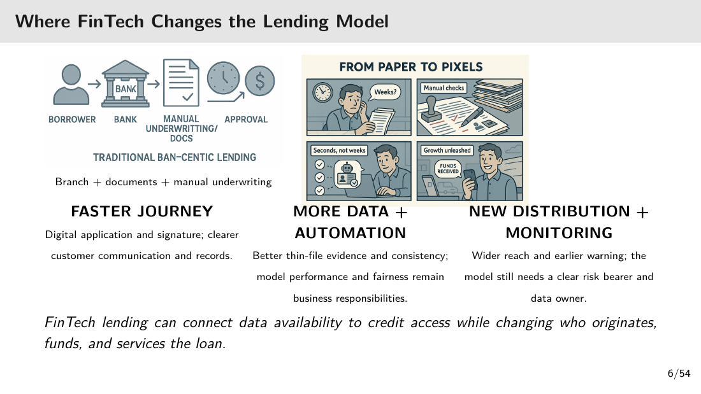

来源：L11 p.6，保留整页原图，可打开大图辨认原标签。

原图左侧传统路线是借款人→银行→文件和人工承贷→批准；右侧漫画对比纸面等待与数字处理。它展示理想化速度优势，不是秒级批准的普遍实测结果。

下方三列增量分别是：电子申请/签名和更清楚沟通；更多资料与自动化，让资料少的借款人也有可核证据；新分发渠道和持续监测，更早发现问题。自动化承贷（Automated underwriting）是用规则/模型支持评估，不会自动决定最终风险由谁承担；模型表现、公平、数据所有者与风险承担者仍须明确。

**🎙️ 课堂补充**（S34 `01:14:34`–`01:17:06`，A · 课上展开）

课堂解释线上流程降低部分网点/人工工作及用新增结果更新模型；就业观点不作公司成本数据，速度提升也不保证公平或回款。 *"Right now they also have your data,"*（S34 `01:15:21`）

### 2.7 p.07 · Ant 的支付生态怎样支持贷款

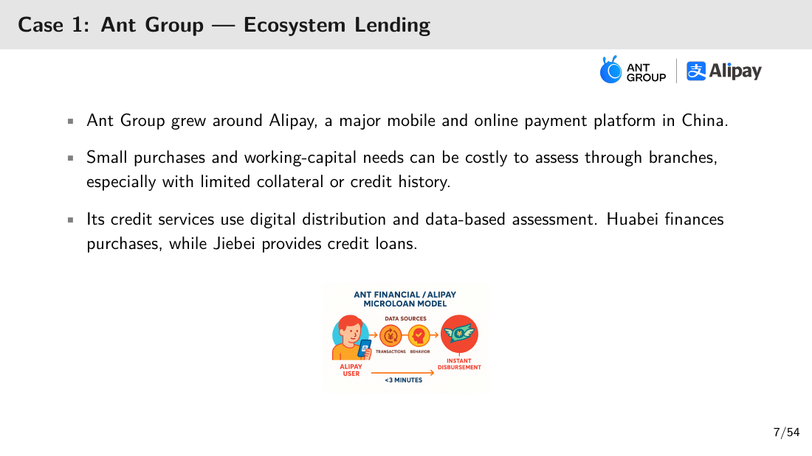

来源：L11 p.7，保留整页原图，可打开大图辨认原标签。

讲义以支付宝生态说明小额消费和商户资金需求：传统网点评估成本高，抵押物（Collateral，即支持债务的可处置资产）或信用记录有限时更明显。花呗面向购买融资，借呗提供信用贷款；这里保留讲义产品定位，不保证当前所有合同条款相同。

原图从支付宝用户、交易和行为数据走向放款，带有少于 3 分钟的示意标注。图是平台小贷概念图，不是所有贷款审批速度或必批的保证。要继续问哪方审核、出钱、收回款、承担违约，而不是把一个品牌当全部角色。

**🎙️ 课堂补充**（S34 `01:17:13`–`01:18:44`，A · 课上展开）

平台将借款需求与数据及资金连接。花呗/借呗按书面拼写和产品定位，不沿ASR的Huawei/JV改名，亦不把两个业务收入比例补成已核财报。 *"connect those people who need to borrow money"*（S34 `01:18:34`）

### 2.8 p.08 · 沿商户一次申请追踪三种责任

讲义英文原题／给定情境与步骤（非笔记答案）

Ant Case: Following a Digital Loan Application

Illustrative online seller using a lender connected to a payment platform.

- Apply. The seller states the amount and purpose of the loan and authorizes access to
relevant records.

- Assess. The lender reviews sales, refunds, and bank receipts, then checks other debts and
repayment capacity.

- Fund and collect. The lender or funding partner supplies the money. The contract
identifies who receives repayments and bears losses.

This is an illustrative platform-lending workflow, not a description of a specific Ant loan
contract.

这是讲义假设的平台贷款流程，不是某一份蚂蚁合同。申请时商户写金额、用途并授权查相关记录；评估时贷款人看销售、退款、银行实收，再查其他债务和偿还能力；出资与收款时由贷款人或伙伴供钱，合同指定收款权与损失归属。

**参考理解**：数据平台让信息可取得，不能据此断言它就是出借人。若合同改为伙伴出资但平台担保首笔损失，资金来源与风险归属便分开了，后面 p.27 会计算这种判断。原文明确不是具体合同，这一限制与流程一并保留。

**🎙️ 课堂补充**（S34 `01:18:51`–`01:21:45`，A · 课上展开）

借款人说明备货用途并授权相关记录，贷款人核销售、退款、银行实收、外债；最后合同确定收款与损失。教师对两平台“交换数据”的假设未核，不能认为公司天然共享所有私有资料。 *"repayment and bear the losses there."*（S34 `01:19:53`）

### 2.9 p.09 · 贷款服务与最终信用责任分开

课件列蚂蚁为金融机构伙伴提供技术，App 提供分发与信息；贷款人/出资伙伴提供本金并按合同收贷款收入。借款本金是需要偿还的资金，不是平台收费收入。

商业上要看更低获客/评估成本能否覆盖资金成本与违约损失；责任上要看合同写谁承担。讲义注明公司材料核于 2026-10-13、安排因产品不同。本批未另查最新产品合同，不把平台外观推成确定责任。

**🎙️ 课堂补充**（S34 `01:21:57`–`01:23:45`，A · 课上展开）

教师强调平台收费定位，却也用简化话说不用管资金/损失。平台若持贷或担保仍可能有信用敞口，后续p27会用合同明确；不能仅凭“技术公司”名称消掉义务。 *"They want to provide a platform to others there."*（S34 `01:22:06`）

### 2.10 p.10 · 自动化怎样降成本又保留复核

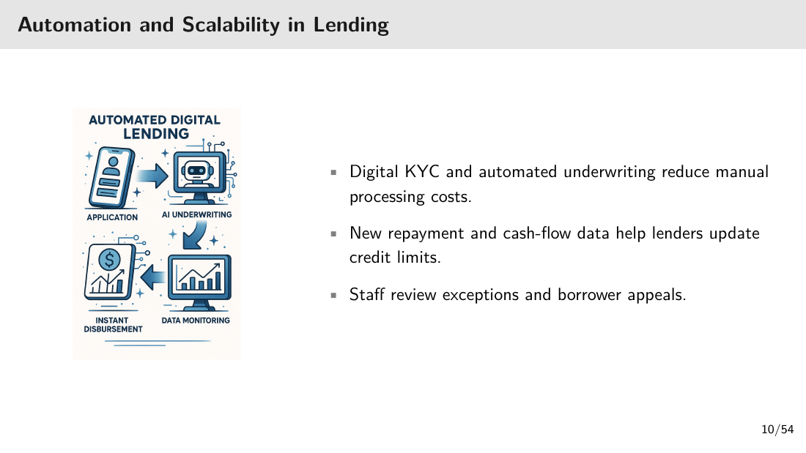

来源：L11 p.10，保留整页原图，可打开大图辨认原标签。

认识你的客户（Know your customer，KYC）是核实客户身份等所需资料；自动承贷把资料按规则或模型处理，减少重复人工工作。新还款和现金流可支持更新额度，异常和借款人申诉仍需工作人员处理。

原图四块是 Application、AI underwriting、Data monitoring、Instant disbursement，用三条箭头连接四个图标，没有从放款回到 Application 的返回箭头，未画完整回路。不能把漫画的排版误读为首次贷款一定先有该笔还款监测再放款；实际流程按 p.5 先申请/审核/出资，再收集贷后结果用于后续监测与更新。少人工不等于无人负责。

**🎙️ 课堂补充**（S34 `01:23:53`–`01:24:55`，A · 课上展开）

课堂按原图四图标说数字化，不把图标空间顺序当完整反馈回路；资金如何交付和是否仍在平台内依具体产品，教师概括不替代合同。 *"Data monitoring, instant disbursement,"*（S34 `01:24:04`）

### 2.11 p.11 · 变量重要为何不能证明因果

在批准以前已经可得的销售与支付记录，可构建销售增长和现金流波动（Cash-flow volatility，即不同时期入账起伏程度）。构造变量先固定期间，例如用过去 12 个月，而不是借款后才出现的结果。

变量重要性（Variable importance）高，表示模型预测较依赖这个输入，不等于人为降低波动就必使违约下降。可能还有经营规模、行业或外债共同影响两者。讲义特别提醒平台外负债可能不可见；不要把缺记录当零负债。这里连接 M01/M05 的时点与解释原则，没有真实数据便不造重要性分数。

**🎙️ 课堂补充**（S34 `01:25:00`–`01:30:12`，A · 课上展开）

教师把前五讲预测思路迁移到违约评估。目标改成未来违约后，数据必须是批准前可得，变量重要不等于因果；未提供数据或代码，本批没有新训练/新准确率。 *"They are not only for return prediction"*（S34 `01:25:29`）

### 2.12 p.12 · 十二个月违约预测如何公平评估

目标是判断借款人在未来 12 个月是否违约。训练（Train）用较早且结果已知的贷款建立预测关系，调参（Tune）用另一段旧贷款选择设置；更晚贷款留作测试，且须走完完整 12 个月观察窗。

例如一笔刚贷出 2 个月、尚未违约，不能自动当“12 个月内不违约”。和既有信用分比较时，用同一批测试贷款、同一目标与观察长度；否则差异可能来自借款人不同。预测更准还要核利息是否覆盖资金、服务和信用损失，模型指标与可盈利决策分开。

**🎙️ 课堂补充**：❓ S34本源没有匹配本页“完整12个月观察窗/同批测试”的独立讲解；`01:25:00`–`01:30:12`只作预测方法迁移。不可降权，当前核心依原书面解释学习，不能把泛谈预测当整页讲完。

### 2.13 p.13 · 四种贷款模式是重叠路线

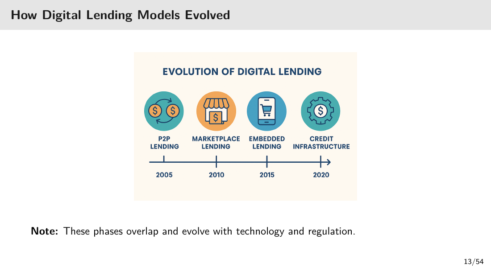

来源：L11 p.13，保留整页原图，可打开大图辨认原标签。

原时间图以约 2005/2010/2015/2020 标出 P2P lending、Marketplace lending、Embedded lending、Credit infrastructure。P2P 是出资者与借款人经平台联系；市场平台可连接机构资金；嵌入式贷款放进购物等已有流程；信用基础设施向其他机构提供评估或服务工具。

图下注明阶段重叠并随技术和监管演化。因此不是过了 2020 年所有 P2P 必然消失，也不是每家企业都依次经过四步。先识别当前合同和资金结构，再用时间图理解发展方向。

**🎙️ 课堂补充**（S34 `01:30:25`–`01:33:04`，A · 课上展开）

课堂从P2P危机转市场平台和嵌入式贷款，历史规模/时间未逐源核，不能把所有P2P等同诈骗，亦不由模式演变断言旧模式全部消失。 *"This is one type of digital lending"*（S34 `01:32:46`）

### 2.14 p.14 · LendingClub 案例怎样分留存与出售

讲义声称 LendingClub 于 2021 年收购银行并于 2026 年 6 月成为 Happen，引用名称变更申报。本批未独立核该名称与申报，不将其当已验证现行公司身份；它不影响下面的课堂合同机制。

消费者可把昂贵信用卡余额合并为固定偿还日程的个人贷款。银行留在账上的贷款可用存款支持并收利息；平台也可承做后卖给投资者。卖出与留存会改变资金占用和损失承担，须看担保等合同。下一页是贷款现金流示意，不是当前零售 P2P 产品说明。

**🎙️ 课堂补充**（S34 `01:33:04`–`01:33:51`，A · 课上展开）

教师提LendingClub/Happen名称及股价，原页仍按未重核外部身份的边界。公司名称/股价不是下面合同现金流的证明。 *"they are called Happn now in June 2026."*（S34 `01:33:12`）

### 2.15 p.15 · 投资者的回款先扣什么

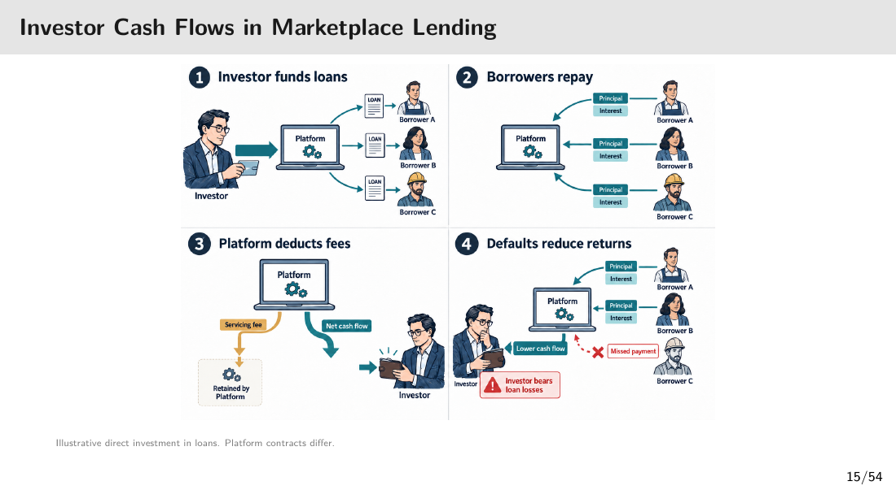

来源：L11 p.15，保留整页原图，可打开大图辨认原标签。

原四格依次是投资者经平台把钱分给 A/B/C 三借款人；借款人还本金和利息回平台；平台扣服务费后把净现金给投资者；若 C 漏还，投资者收到更低现金、承担该示意合同的贷款损失。

钱从投资者流出是本金投入，回来的一部分只是本金归还，不能全部算收益。服务费是平台留存，违约损失会减少投资者净回款。本页特指假设的直接贷款投资，其他平台可能有担保或留存风险，不能把原图“投资者承担”推为一切产品通则。

**🎙️ 课堂补充**（S34 `01:33:52`–`01:41:05`，A · 课上展开）

课堂用不同利率/借款人、投资者分散持有、平台扣费和违约降低回款走图。分散只能降低部分共同以外风险，不保证不同借款人永不同时违约；教师随后举首损分担，说明平台也可能保留风险。 *"the first \$1,000 will be paid by me"*（S34 `01:39:56`）

### 2.16 p.16 · Upstart 的两个判断问题

讲义英文原题／给定情境与步骤（非笔记答案）

Upstart: AI Lending and Outside Funding

- Banks and credit unions use Upstart’s technology to reach borrowers and assess repayment
risk.

- Upstart earns platform, referral and servicing fees. Loans can be held by lending partners,
outside investors or Upstart itself.

- AI can reduce manual review, but investors still decide whether to supply funds. Loan
holdings and contractual guarantees can leave a platform with credit exposure.

Compare two questions: Does the model predict default well? And can the lending
business fund profitable loans?

Source: Upstart 2025 Annual Report.

按讲义，银行/信用合作机构用 Upstart 技术获客和评估，平台赚平台、转介和服务费；贷款可由合作机构、外部投资者或 Upstart 自己持有。AI 降低审核工作并不会迫使投资者供钱，持有贷款或提供担保还可能使平台保留信用风险。

**⚪ 两问参考作答（笔记推断）**：模型能否预测好违约，需要同条件样本外证据、校准与实际损失。校准（Calibration）核预测概率与实际发生比例是否相符，例如预测一组有 2% 违约而实际为 4%，虽可能排序有用，概率水平仍低估；完整表例见 p.46。业务能否融资并获利，还需稳定资金、定价收入和全部成本。一个模型排序好而资金伙伴退出，仍可能无法新放贷。

**English reference answer**: Test prediction quality on comparable out-of-sample loans, including calibration and losses. Separately test whether available funding and loan income cover funding, servicing and credit costs. These are related but different questions.（笔记自拟）

**🎙️ 课堂补充**（S34 `01:41:09`–`01:42:37`，A · 课上展开）

教师分别问模型是否预测好与业务是否能融资获利。AI/少网点不自动产生低利率或利润，需要可比样本外、损失与成本证据，旧正文两问答案仍适用。 *"does the model predict default well"*（S34 `01:42:09`）

### 2.17 p.17 · 微业贷为何需要无抵押评估

小企业先备货/付供应商，后收客户钱；抵押少和网点审核贵可能限制贷款。课件以微众银行微业贷的线上无抵押营运贷款为例，数字资料替代部分现场申请步骤。

无抵押（Unsecured）表示这类贷款没有按本页设定提供特定抵押保障，不等于没有偿还义务或贷款人不会损失。微众仍需给违约风险定价并准备出资。讲义产品资料日期为 2026-10-13，本批不作当前申请资格或利率建议。

**🎙️ 课堂补充**（S34 `01:42:42`–`01:45:50`，A · 课上展开）

教师指出幻灯片logo由AI做错，故原图中的品牌图标不能当权威身份。在线无抵押小企贷仍须给违约定价并出资；捐赠/行业利润泛化未核，不据此推荐产品。 *"this is not a logo for WeBand, so my AI is doing a bad job."*（S34 `01:42:45`）

### 2.18 p.18 · 额度与价格怎样接到贷后结果

申请人授权相关商业资料，贷款人核身份与记录能否支持偿还。信用评估影响额度和价格，借款人按合同提款及还款；贷后再用真实还款检验原评估。

这是一套简化教学框架，不是微众内部专有模型。💡 笔记补充：预测违约率为 2% 也不能单凭这个数自动批款，还要知道违约损失大小、收费、资金和服务成本。p.26 给完整数字例，不能把“预测准确”直接改写成“必盈利”。

**🎙️ 课堂补充**（S34 `01:45:57`–`01:47:08`，A · 课上展开）

课堂用后续真实还款检验早先评估、更新模型；更多数据不保证自动更好，测试集不可被反复用于择优，完整观察窗和冻结原则按p12。 *"test or re-evaluate whether they really pay back"*（S34 `01:47:02`）

### 2.19 p.19 · 一千美元小贷款能留多少贡献

<!-- cityu-nav:landing-19 -->
[[#4. 速查表|↩ 回速查]] · [[#5. 双语术语卡|回术语]] · [[#0. 三分钟速览|阅读导航]]
<!-- cityu-nav:landing:end -->

讲义英文原题／给定情境与步骤（非笔记答案）

WeBank Case: Can a Small Loan Cover Its Costs?

Hypothetical \$1,000 one-year loan, not WeBank results:

| Item | Amount |
|---|---:|
| Interest and origination revenue | +\$120 |
| Expected credit loss | -\$55 |
| Funding cost | -\$25 |
| Acquisition, verification, and servicing | -\$30 |
| Expected contribution before overhead | +\$10 |

- Faster approval helps only if pricing covers loss, funding, fraud, and servicing.
- A small error in expected loss can remove the entire margin.
- For WeBank, digital processing must lower costs without allowing fraud or credit losses to absorb the saving.

讲义假设一笔一年期 1,000 美元贷款，不是微众真实经营结果。收入是利息及承做收入 120；预期信用损失 55；资金成本 25；获客、核验、服务合计 30。全部同一笔贷款和一年口径。

逐项扣减得 $120-55-25-30=10$ 美元，是管理间接费用以前的预期贡献。预期损失是事前估计的不可回收金额，不是本笔已实际亏 55。再多 10 美元损失即可抹平贡献；只把审核加快，却让坏账增加超过节约成本，不能改善经济结果。

**英文结果说明（笔记自拟）**：The expected contribution is \$10 before overhead. An additional \$10 of expected credit losses removes that contribution; faster approval alone does not establish profitability. 原给定表和条件见原文块。

**🎙️ 课堂补充**（S34 `01:47:16`–`01:48:55`，A · 课上展开）

课堂算出10美元并讨论损失多/少10怎样影响贡献。ASR把收入说成1500但又说12%，原页120与末值10一致，因此保留120；本金1000不是新增收入，预期损失不等于已发生损失。 *"this is about \$10."*（S34 `01:47:50`）

### 2.20 p.20 · WeLab Bank 案例保留银行责任

课件以香港数字银行 WeLab Bank 为例，手机开户和数字服务改变客户入口。贷款收入仍要覆盖资金、服务和违约成本，外部伙伴参与并不会使银行对信用决定及客户保护的责任消失。

这页是讲义的银行模式概览；本批没有重新核香港金管局名册或公司现行产品，不将课程案例扩写成现实开户/借款建议。后面把银行留贷、无担保出售、带担保出售分别比较，而非认为“数字”自动代表只做技术不承担风险。

**🎙️ 课堂补充**（S34 `01:49:04`–`01:55:47`，A · 课上展开）

教师现场浏览数字银行服务，产品费率/牌照/首次身份未逐站重核，不能从漂亮网页或牌照名称推成所有服务安全保证。其教学增量是数字银行仍有银行责任，传统银行也能提供数字服务。 *"it is hard to push the new business model"*（S34 `01:54:16`）

### 2.21 p.21 · CDI 研究图能证明到哪一步

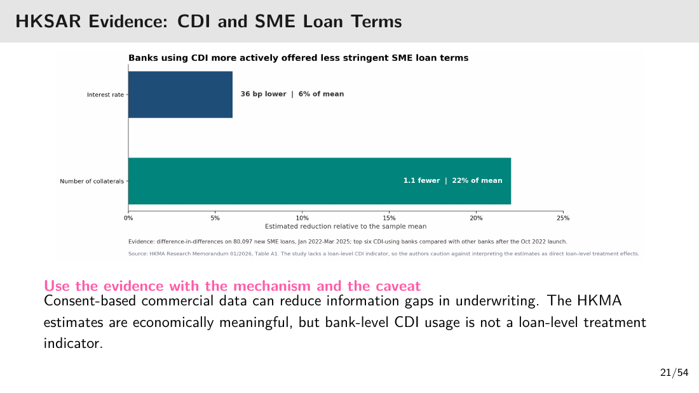

来源：L11 p.21，保留整页原图，可打开大图辨认原标签。

商业数据通（Commercial Data Interchange，CDI）按同意共享商业资料，可能减少承贷信息缺口。原图两条横杆是相对样本均值的估计减少：利率低 36 个基点（Basis point，1 bp 是 0.01 个百分点），约为均值的 6%；抵押物数量少 1.1 项，约为均值的 22%。6% 不是利率低 6 个百分点。

图注说研究覆盖 2022 年 1 月至 2025 年 3 月 80,097 笔新中小企贷款，用双重差分（Difference-in-differences）比较 2022 年 10 月上线后六家较多用 CDI 银行与其他银行的变化。

双重差分先分别算 CDI 组和对照组的前后变化，再用“CDI 组变化减对照组变化”，以扣去两组共同面对的同期因素。起点利率不必相同；关键反事实是假如没有 CDI，两组本应有可比的变化走势。这个假设需要研究证据支持，不能从“扣两次”本身保证成立。

研究没有每笔贷款是否用 CDI 的指标，银行级使用不等于每笔贷款的处理记录，不能把估计当任一贷款直接降息保证。原始数据未提供，本批读图未复跑研究。

💡 笔记补充：假设 CDI 组利率从 5% 到 4%，变化 −1 个百分点；对照组从 6% 到 5.5%，变化 −0.5 个百分点。两组变化再相减得 $(-1)-(-0.5)=-0.5$ 个百分点，即 −50 bp。两组起点不同仍可计算；若没有干预时它们本来就有不同走势，差值不能直接归因 CDI。本例不是原研究资料，不是对 36 bp 的复现。

**🎙️ 课堂补充**（S34 `01:55:47`–`01:56:31`，A · 课上展开）

课堂读6%和22%相对减少，原页分别36基点/约均值6%及抵押品1.1项/约均值22%，不是利率低6个百分点。DID与缺逐笔CDI记录限制按原图，不把相关变化当每笔必享优惠。 *"6% lower than the past"*（S34 `01:55:57`）

### 2.22 p.22 · 互联网助贷政策在课堂模型中的作用

讲义把 NFRA（National Financial Regulatory Administration，国家金融监督管理总局）2025 年通知概括为三项：

- 互联网助贷纳入银行总行风险管理。
- 银行在贷款全生命周期监测伙伴集中和质量。
- 平台可供技术和分发，银行仍负责信用风险与客户保护。讲义注明 2025-10-01 生效。

本批没有核现行法条或后续修订，以上是有日期的讲义陈述，不是现实合规结论。用于课堂比较时，关键是技术合作不能遮住银行角色；须按功能查谁承做、出资、服务、担保和最终负担损失。

**🎙️ 课堂补充**（S34 `01:56:56`–`01:58:12`，A · 课上展开）

教师强调银行通过平台放贷仍承担信用与客户保护管理责任。按功能识别银行/平台，不由外包消掉银行职责；这里为有日期的课堂法律概括，现行法未重查。 *"the ban, they must monitor the concentration and loan"*（S34 `01:57:20`）

### 2.23 p.23 · 三地相似 App 的资金与脆弱点

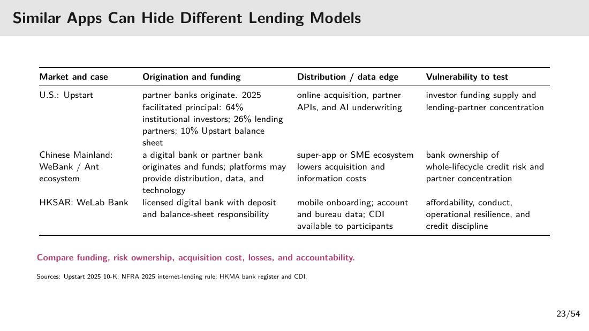

来源：L11 p.23，保留整页原图，可打开大图辨认原标签。

讲义英文原题／给定情境与步骤（非笔记答案）

| Market and case | Origination and funding | Distribution / data edge | Vulnerability to test |
|---|---|---|---|
| U.S.: Upstart | partner banks originate. 2025 facilitated principal: 64% institutional investors; 26% lending partners; 10% Upstart balance sheet | online acquisition, partner APIs, and AI underwriting | investor funding supply and lending-partner concentration |
| Chinese Mainland: WeBank / Ant ecosystem | a digital bank or partner bank originates and funds; platforms may provide distribution, data, and technology | super-app or SME ecosystem lowers acquisition and information costs | bank ownership of whole-lifecycle credit risk and partner concentration |
| HKSAR: WeLab Bank | licensed digital bank with deposit and balance-sheet responsibility | mobile onboarding; account and bureau data; CDI available to participants | affordability, conduct, operational resilience, and credit discipline |

Compare funding, risk ownership, acquisition cost, losses, and accountability.

Sources: Upstart 2025 10-K; NFRA 2025 internet-lending rule; HKMA bank register and CDI.

原表三行比较 Upstart、内地微众/蚂蚁生态、香港 WeLab。Upstart 行称 2025 facilitated principal 的最终持有资金约 64% 机构投资者、26% 贷款伙伴、10% 平台资产负债表，三项合计 100%；不是平台收入构成。本批按讲义表记录，未另核 10-K。

内地行重点是数字/合作银行承做和出资、平台可分发数据技术；香港行重点是有存款与资产负债表责任的持牌数字银行。获客优势分别来自在线/API/AI、超级 App 或小企生态、手机接入与账户/征信/CDI。

**参考比较**：Upstart 要测外部资金供给与伙伴集中；内地生态要明确全生命周期风险由银行管理并测集中；香港数字银行要测负担能力、行为、运营韧性和信用纪律。English reference: Compare funding, risk ownership, acquisition costs, losses and accountability, rather than treating similar apps as the same lending model.（笔记自拟）

**🎙️ 课堂补充**（S34 `01:58:17`–`02:00:20`，A · 课上展开）

课堂比较美国平台、香港持牌银行、内地银行与技术平台分工；本页数据比例及法域框架仍按书面来源，未有完整实际合同就不把地域当损失归属规则。 *"you will see this kind of compliance and regulation summary table"*（S34 `01:59:13`）

### 2.24 p.24 · 选择题：新 AI 是否真的改进

讲义英文原题／给定情境与步骤（非笔记答案）

Multiple-Choice Question: Did the AI Model Really Improve?

Approval rises and defaults fall after a lender deploys a new AI model,
but borrower mix and credit policy also changed. What evidence best
supports model improvement?
A) A higher training-sample AUC.

B) More input variables and a deeper model.

C) Out-of-sample cohort evidence under comparable policy and risk, including calibration and
losses.

D) Faster approvals with fewer manual reviews.

Discuss
Identify which changes affect borrower selection, model performance, and realized losses.

**中文题意**：部署新模型后批准率升、违约降，但借款人组成和信用政策也变了，问什么证据最支持模型改进。A 是训练样本 AUC 更高；B 是更多变量和更深模型；C 是可比政策和风险条件下的样本外批次证据，含校准和损失；D 是批准更快、人工更少。完整英文题与四选项在原文块。

**⚪ 参考答案（笔记推断）：C。** AUC 是排序指标的一种，训练表现可能只是记住旧数据；B 的模型复杂度不是实际改进证据；D 是处理效率，不能分离借款人选择和风险。C 用可比后来贷款分别检验排序（谁较危险）、校准（预测概率与实际比例是否相符）和损失金额，最接近要问的模型效果。

Discuss 的分层：借款人组成和信用政策改变获批的人；模型改变预测关系；后来实际违约受两者及经济环境共同影响。

**English reference answer**: C. Comparable out-of-sample cohorts, including calibration and losses, provide stronger evidence than training AUC, model complexity or approval speed. Changes in borrower selection and credit policy must be separated from model performance.（笔记自拟）

**🎙️ 课堂补充**（S34 `02:00:33`–`02:01:56`，A · 课上展开）

教师问为什么C，认可后说其他三项不成立。因此C有课堂讲评支持；英文完整参考句仍是笔记自拟，可比政策/风险与样本外证据的理由保留。 *"you explain why it is c"*（S34 `02:01:33`）

### 2.25 p.25 · 四种模式没有把风险消掉

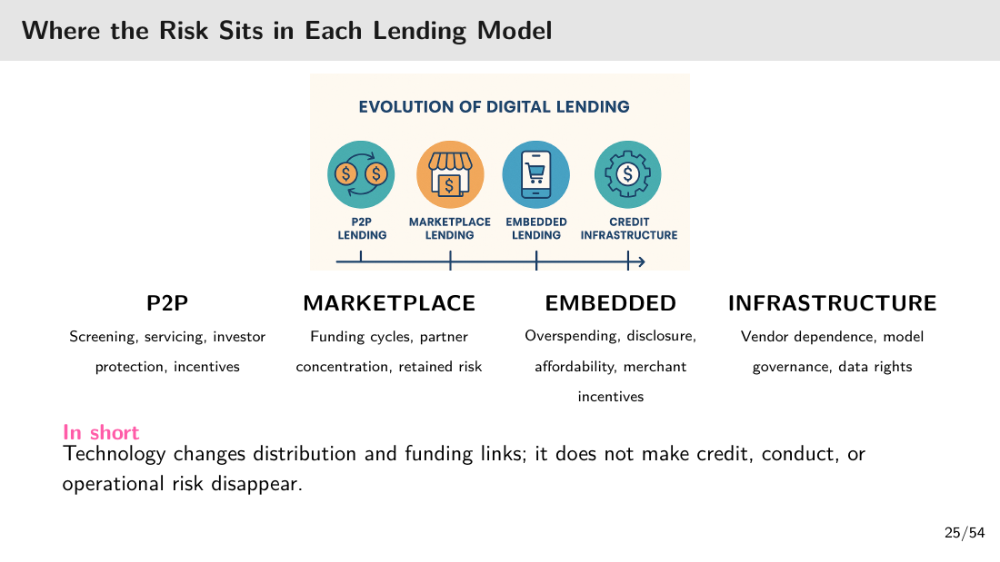

来源：L11 p.25，保留整页原图，可打开大图辨认原标签。

原图复用四阶段分类，但下方新增各模式风险：

- P2P 是筛选、服务、投资者保护和激励。
- 市场平台是资金周期、伙伴集中和保留风险。
- 嵌入式是过度消费、信息披露、负担能力与商户激励。
- 基础设施是供应商依赖、模型治理与数据权利。

沿具体一项读：平台只提供模型工具，仍可能因系统停机或模型错误影响银行，但这不等于它自动承担贷款全部违约。技术会改变分发和资金连接，信用、行为和运营风险仍须依合同、职责和证据分别定位。

**🎙️ 课堂补充**（S34 `02:02:21`–`02:03:14`，A · 课上展开）

课堂先按谁出钱讨论风险，但担保会使不出本金的平台也亏钱，所以不能只问出资者；后面p27是合同例外。 *"Who lend the money?"*（S34 `02:02:27`）

### 2.26 p.26 · 选择题：预期损失与税前利润

<!-- cityu-nav:landing-26 -->
[[#4. 速查表|↩ 回速查]] · [[#5. 双语术语卡|回术语]] · [[#0. 三分钟速览|阅读导航]]
<!-- cityu-nav:landing:end -->

讲义英文原题／给定情境与步骤（非笔记答案）

Multiple-Choice Question: Expected Profit on One Loan

A one-year \$1,000 loan has expected interest income of \$80. Funding costs are \$30 and operating
costs are \$15. Default probability is 4%, with a loss of 50% of principal if default occurs.

Using expected credit loss $PD\times LGD\times\mathrm{principal}$, what is expected profit before tax?

A) \$35

B) \$50

C) \$65

D) \$15

**中文题意**：一年期本金 1,000 美元，预期利息 80，资金成本 30、经营成本 15；违约概率 4%，违约时损失本金的 50%。A/B/C/D 分别为 35/50/65/15 美元。

先固定三个量：违约概率（Probability of default，PD）是 4%；违约损失率（Loss given default，LGD）是在已违约条件下损失的本金比例 50%；本题本金是 1,000 美元。预期信用损失按题给规则 $PD\times LGD\times本金=0.04\times0.50\times1,000=20$ 美元。概率与损失率都是比例，相乘后再乘美元才得到美元。

**⚪ 参考答案（笔记推断）：D，15 美元。** $80-30-15-20=15$。A 忽略信用损失，B 只扣资金成本，C 只扣经营成本；三者都少扣题设项目。

**English reference answer**: D. Expected credit loss is \$20, and expected profit before tax is \$80 − \$30 − \$15 − \$20 = \$15.（笔记自拟）

若 PD 改成 8% 而其他条件固定，损失为 40，利润为 −5 美元；本例用题设预期利息，不能另行重复扣一遍已包含的收入损失。

**🎙️ 课堂补充**（S34 `02:03:20`–`02:06:00`，A · 课上展开）

课堂明确预期损失20与最终利润15，但中间ASR两次出现45。正确先扣资金/经营成本应为80−30−15=35，再减20=15；45−20不等于15。原题D及完整英文/四选项保留，口述中间数不能替代算术。 *"This is like 1000 times 4% times 50%."*（S34 `02:05:30`）

### 2.27 p.27 · 选择题：银行出资是否消除平台风险

讲义英文原题／给定情境与步骤（非笔记答案）

Multiple-Choice Question: Funding and Retained Credit Risk

A platform arranges loans funded by a partner bank. Under their contract, the platform reimburses the bank for the first \$2 million of credit losses.

Which statement best describes the platform’s risk?

A) It bears no credit risk because the loans do not use its funding.

B) It retains credit exposure through the guarantee even though the bank supplies the loan
funding.

C) Its maximum credit loss must equal the origination fees it receives.

D) Its credit exposure disappears when underwriting uses an AI model.

**中文题意**：合作银行出钱，平台承诺补偿最先发生的 200 万美元信用损失。A 说无自有出资就无信用风险；B 说担保保留敞口；C 说最大损失一定等于承做费；D 说用 AI 承贷风险就消失。

**⚪ 参考答案（笔记推断）：B。** 首损担保（First-loss guarantee）使平台先承担约定范围内的信用损失，谁出本金与谁补损失是两种合同角色。A 忽略补偿承诺，C 没有题设依据，D 把预测工具当消除义务。

💡 笔记补充：总信用损失 50 万时按题设平台补 50 万；损失 300 万时平台首损层 200 万，剩 100 万未由这条担保覆盖，仍按其他合同处理。仅这条担保的最高补偿为 200 万，不据此断言平台全部业务最大损失。

**English reference answer**: B. The platform retains credit exposure through its first-loss guarantee even though the bank provides the funding. Using AI does not remove the contractual obligation.（笔记自拟）

**🎙️ 课堂补充**（S34 `02:06:00`–`02:09:03`，A · 课上展开）

教师明确B，首损担保使平台即使不出本金也保留信用风险。担保金额按原题200万，课堂偶尔说100万不更换题设；激励类比不替代实际合同义务。 *"the answer is B"*（S34 `02:08:13`）

### 2.28 p.28 · 众筹分隔

本页只有 Crowdfunding 分隔标题。众筹（Crowdfunding）把许多参与者的支持汇集起来，但参与者拿回什么权利因模式不同；先辨认捐赠、奖励、股权还是债权，才可比较收益和风险。

### 2.29 p.29 · 作品未完成为什么先有人支持

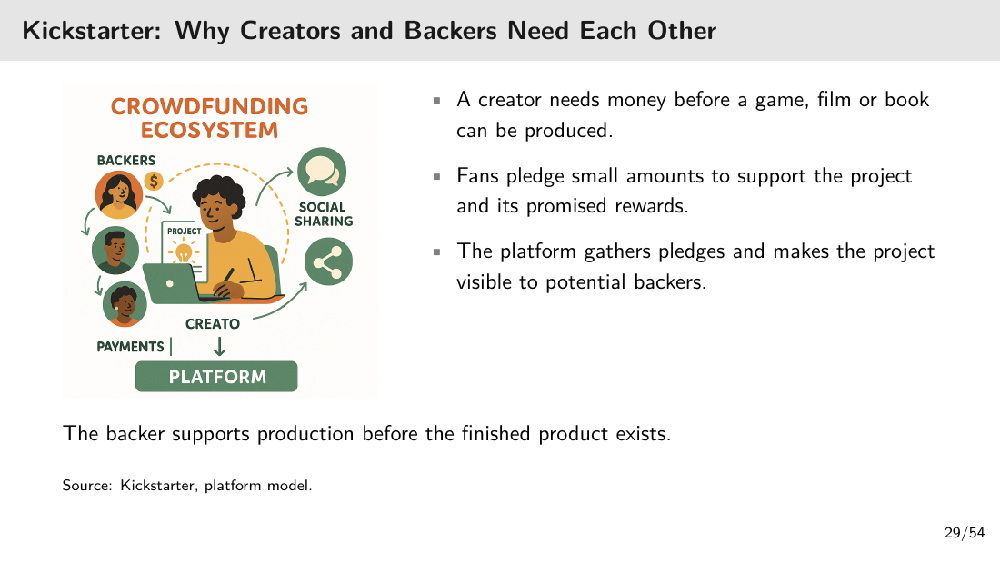

来源：L11 p.29，保留整页原图，可打开大图辨认原标签。

Kickstarter 创作者在游戏、电影、书籍完成以前就需资金，支持者承诺（Pledge）小额支持项目和奖励，平台汇集并增加可见度。原图把 Backers、Creator、Payments、Social sharing 和 Platform 放入关系网，区分资金支持与社交传播。

沿一个桌游例，支持者先承诺钱，创作者才有机会生产；分享消息可带来更多支持，不是平台代创作者保证交货。原图 CREATO 字样不完整，保留原貌，不为图中未注明的每条装饰箭头编造合同义务。

**🎙️ 课堂补充**（S34 `02:09:19`–`02:11:56`，A · 课上展开）

课堂用电影首映票作奖励式众筹例：支持者要产品/体验，平台仍不保证创作者完成。金额随口变化仅类比，原页/后续桌游给定数字保留。 *"you will get a ticket for the first show of the movie"*（S34 `02:11:30`）

### 2.30 p.30 · 四类众筹先看支持者请求权

表的每行先问给钱者收到什么，再看控制重点。

- 捐赠（Donation）无财务回报，核真实性、用途和付款完整。
- 奖励（Reward）得到产品/体验/认可，核生产、交付、质量、退款。
- 股权（Equity）有所有权或证券请求权，核估值、稀释、披露、托管及证券规则。
- 债务/P2P（Debt/P2P）有还本付息请求权，核承贷、资金、服务、违约和借贷规则。

稀释（Dilution）是发行更多权益后原持有者占比可能下降。给同样 40 元买奖励与买股权，前者不会只因付款自动拥有公司；平台名称像“投资”也不能改变真实合同权利。以上为讲义分类，不推断各法域现行许可范围。

**🎙️ 课堂补充**（S34 `02:09:19`–`02:11:56`，A · 课上展开）

课堂区分捐赠无财务回报、股权有所有权、债务有偿还/利息、奖励有产品。权利依合同，不能把有付款统一叫股权投资。 *"for donation, you do not ask for any financial return."*（S34 `02:10:01`）

### 2.31 p.31 · 全有或全无解决哪种筹资门槛

创作者先写目标、截止和承诺奖励。全有或全无（All-or-nothing）指截止前达到目标才收取承诺金额；未达标创作者得不到资金。课件列平台费为已收资金 5%，另有支付处理费，剩余还要生产和交付。

门槛避免项目只拿到很少钱就启动，但达标没有证明成本估算正确或交付必成功。创作者负责项目与奖励，平台不保证交付。💡 笔记补充：目标 20,000，承诺 19,000 未达标，与“收到 19,000 后少做一点产品”不同；必须按该规则理解何时真正收款。

**🎙️ 课堂补充**（S34 `02:12:03`–`02:13:47`，A · 课上展开）

课堂解释达目标才给资金与5%平台费，随后学生举另一平台，教师发现规则可不同。02:15:50关于达标即停止筹款的口述未核，不把它补成Kickstarter普遍规则；本页只按截止/门槛的原题要求。 *"platform they do not they do not guarantee I really make the movie"*（S34 `02:13:15`）

### 2.32 p.32 · 五百人支持桌游怎样分资金

<!-- cityu-nav:landing-32 -->
[[#4. 速查表|↩ 回速查]] · [[#5. 双语术语卡|回术语]] · [[#0. 三分钟速览|阅读导航]]
<!-- cityu-nav:landing:end -->

讲义假设 500 人每人支持 US\$40，目标 US\$20,000 已达成且所有承诺成功收取。总额 $500\times40=20,000$ 美元；平台费 $20,000\times5\%=1,000$；创作者得 19,000，但还没有扣独立支付处理费。

每人得到的是承诺的游戏，不是股票或利息；创作者仍需用可用资金完成生产和交付。达标证实足够承诺需求，不证明每套成本足够低。若处理费假设为总筹款 3%，还需扣 600，创作者余 18,400（笔记补充，不是实际平台报价），不能把 19,000 当净利润。

**🎙️ 课堂补充**（S34 `02:13:51`–`02:16:54`，A · 课上展开）

500×40=20000、平台1000、创作者19000有课堂给数支持；支付费/生产成本仍另扣。学生提出的游戏/平台网页未完整保存，原页桌游金额不据此替换。 *"this is the \$19,000 go to the creator"*（S34 `02:13:59`）

### 2.33 p.33 · Kiva 与 Kickstarter 的资金权利

Kiva 的个人出借人期待本金偿还、不收利息且可能损失；回收的资金可再支持另一借款人。借款人仍可能向当地放贷伙伴付息，所以“个人出借人零利息”不等于借款人零成本。

Kickstarter 支持者期待奖励，单纯支持并不产生贷款偿还请求权或股权。**英文参考说明（笔记自拟）**：A Kiva lender expects principal repayment without interest and may lose money; the borrower may still pay a local partner. A Kickstarter backer seeks a reward, not a loan repayment claim or ownership merely by backing a project. 这是按讲义作比较，不补造当前个别合同。

**🎙️ 课堂补充**（S34 `02:17:00`–`02:18:37`，A · 课上展开）

课堂说明Kiva支持循环资金及社会目的；“不给return”应区分不付利息与本金仍有偿还预期，不能改成捐赠。借款人可能向本地伙伴付息，贷款人无利息与借款零成本不同。 *"they will keep using the money"*（S34 `02:18:22`）

### 2.34 p.34 · 创办理念怎样变成合同规则

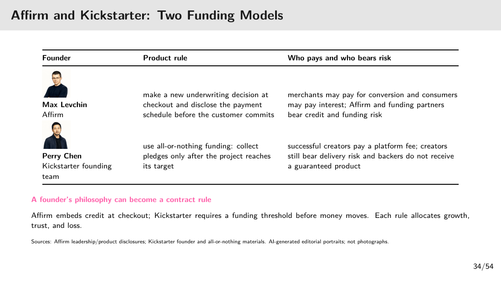

来源：L11 p.34，保留整页原图，可打开大图辨认原标签。

原表用 Affirm 的 Max Levchin 与 Kickstarter 创办团队 Perry Chen 作对照；人物肖像注明为 AI 插画，不是照片。Affirm 在结账重新作承贷决定并在客户承诺前披露付款安排，商户可能为转化付费、消费者可能付息，Affirm/资金伙伴承担信用与融资风险。

Kickstarter 用达标才收承诺款的规则，成功项目创作者付平台费；创作者仍承交付风险，支持者无保证产品。用理念解释规则可以帮助记忆，但风险分配仍看具体产品合同，不把人物故事当每份条款的证明。

**🎙️ 课堂补充**（S34 `02:18:48`–`02:19:18`，A · 课上展开）

教师把创办理念连到规则，人物名字按原页，不以ASR或族裔概括补个人身份。两个模式的合同权利/收费/损失仍分别看正文。 *"Quite important."*（S34 `02:18:55`）

### 2.35 p.35 · 贷款运营与信用风险分隔

本页只有 Lending Operations and Credit Risk 标题。前半已经区分出资和请求权；后半把许可、资料、模型、服务中断和债权记录接入同一条运营链，继续核责任和证据。

### 2.36 p.36 · 一个数字入口不等于一种许可

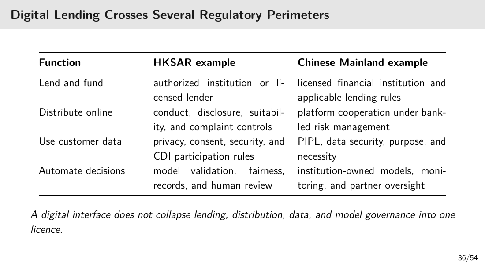

来源：L11 p.36，保留整页原图，可打开大图辨认原标签。

原表四行按功能比较法域：放贷出资、在线分发、使用客户资料、自动决定。香港列分别提：

- 持牌机构/贷款人；
- 行为披露、适当性和投诉；
- 私隐、同意、安全与 CDI；
- 模型核验、公平、记录和人工复核。

内地列按四行相应列出：机构及放贷规则，银行主导的伙伴风险管理，PIPL/数据安全的目的必要性，以及机构拥有模型并监测伙伴。

PIPL 指《个人信息保护法》（Personal Information Protection Law）。课堂意思是不同功能触及不同责任，不能有了 App 就把所有活动装进一种许可。此页是法规分类框架，未逐条核现行法；用来作现实结论前要回当时当地一手条文。

**🎙️ 课堂补充**（S34 `02:19:18`–`02:20:53`，A · 课上展开）

这里是本次明确监管/合规降权的具体语境：快速浏览这几页，不测试这部分表格细项，但仍说业务模式/责任重要。不能扩成所有含监管字眼的机制或课堂选择题都取消。 *"I'm not going to test this"*（S34 `02:19:44`）

### 2.37 p.37 · 监管要求要能找到哪种证据

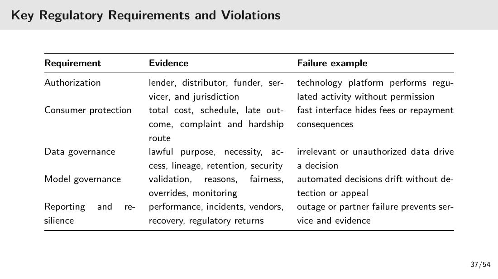

来源：L11 p.37，保留整页原图，可打开大图辨认原标签。

每行连要求、证据和失败例。授权许可要识别贷款人/分发/出资/服务方与法域，避免技术平台无许可做受管活动；客户保护要保存总成本、还款表、逾期后果、投诉和困难援助，避免快界面隐藏费用。

资料治理要证明目的合法、必要、访问权限、来源链、保存期和安全，避免无关/未经授权资料驱动决定。

模型治理要有验证、理由、公平、人工改判与监测。模型漂移（Model drift）是输入资料或预测关系改变，使既有模型表现变化；监测要能发现这种变化并安排复核/申诉，不能让错误持续。p.42 把这项职责放回整条服务链。报告与韧性要有表现、事件、供应商、恢复和监管报表，避免故障同时中断服务和证据。不是列齐字段就证明合规，要核它对应的实际行为。

**🎙️ 课堂补充**（S34 `02:20:58`–`02:22:22`，A · 课上展开）

课堂用服务中断说明韧性和单供应商依赖；具体微软/SOE新闻和法条未逐站核，不作为实时事故结论。原五类控制证据仍可查，按上一段明确语境降低表格细项背诵优先级。 *"we cannot rely everything on a single private company."*（S34 `02:22:09`）

### 2.38 p.38 · 简答：众筹达标证明了什么

讲义英文原题／给定情境与步骤（非笔记答案）

Short-Answer Question: What Did the Funding Threshold Prove?

An all-or-nothing reward-based crowdfunding campaign crosses its funding
threshold on the final day.
1. Explain what the threshold establishes about pledged demand.

2. Identify two risks that remain after the threshold is reached.

3. State one item a backer should verify before contributing.

Answer in three or four sentences
Separate demand evidence from production capability, delivery, and contractual protection.

**中文题意**：奖励式全有或全无项目在最后一天过门槛。第 1 问说明承诺需求，第 2 问要两项剩余风险，第 3 问要支持前核一项，用 3–4 句英文回答。

**⚪ 参考作答（笔记推断）**：达标说明承诺支持达到预设金额条件；生产能力/成本超支与交付延误仍是两项风险。支持前可核创作者生产计划和预算证据，不能只看筹款人数。平台不保证产品的边界仍在。

**English reference answer**: Reaching the threshold establishes that pledged demand meets the campaign's funding rule. It does not establish production capability or guarantee delivery. Cost overruns and delivery delays remain risks. Before contributing, a backer should verify the creator's production plan and supporting budget evidence.（笔记自拟）

若改成股权众筹，就不能沿用“只拿产品奖励”的权利判断，须重查证券/所有权条款。

**🎙️ 课堂补充**（S34 `02:22:28`–`02:25:28`，A · 课上展开）

课堂反复请同学作答第1问；该句来自学生作答，教师在 S34 `02:24:29` 随后明确认可“证明需求、不证明生产/交付能力”。第2/3问虽邀请，但本源没有完整明确的教师题解；这两问仍为笔记参考，不因教师最后true一词就推成全部答案确认。 *"It only proves demand, not whether the maker can make or sell the product."*（S34 `02:24:22`）

### 2.39 p.39 · 卖掉整笔应收款与抵押借款不同

讲义英文原题／给定情境与步骤（非笔记答案）

Invoice Finance: Cash Now, Payment Later

Hypothetical case: Alice delivered goods to a retailer. Invoice R-104 is HK\$1 million due in
60 days.

- Alice needs cash now for wages and suppliers. Bank A buys the entire payment claim at
an agreed discount.

- A shared registry records the transfer. Before buying the same claim, Bank B checks
whether Alice still owns it.

- Bank A must separately assess whether the retailer can pay. Clear ownership does not
establish repayment capacity.

Here the bank buys a claim. On page 45, banks lend against a receivable subject to an
aggregate financing cap. These are different contracts.

讲义假设 Alice 已交货，R-104 发票 HK\$100 万 60 天到期，眼下要付工资/供应商；Bank A 按折价买下整笔付款请求权。共有登记记录转让，Bank B 买同一债权前查 Alice 是否还拥有。这里卖的是请求权，不是只借其中一个比例。

登记可防止同一已转让债权再卖，却不能证明零售商会付款；A 仍要核零售商的偿还能力。折价金额、追索/担保条款未知，不能算 Alice 到手净钱或最终损失。p.45 是以应收款支持有总额上限的借贷，两种合同不得混用。

**English reference explanation**: Bank A buys the entire payment claim at an agreed discount. The registry helps check ownership and prevent a duplicate sale, but repayment capacity still requires credit assessment. This differs from lending against a receivable under an aggregate financing cap.（笔记自拟）

**🎙️ 课堂补充**（S35 `04:19`–`08:36`，A · 课上展开；2026-11-26 顺延回填）

教师把两种合同分开：银行可折价买下整笔付款请求权，也可按应收款抵押提供贷款。折价需考虑等候收款的时间与零售商不付款的风险。*"The second is the credit risk."*（S35 `05:29`）

共享登记帮助后来的银行查请求权是否已转让；这不使付款人必定偿还，也不证明所有登记均真实完整。教师以区块链记录难改作解释，不把它升级为任何系统绝不可修改的保证。课堂随口的95%、50,000等数字不自洽；本页按原题HK\$100万/60天，不新增折价结果或替换p.45的80%融资上限。

### 2.40 p.40 · 两种制度共同要问哪三个对象

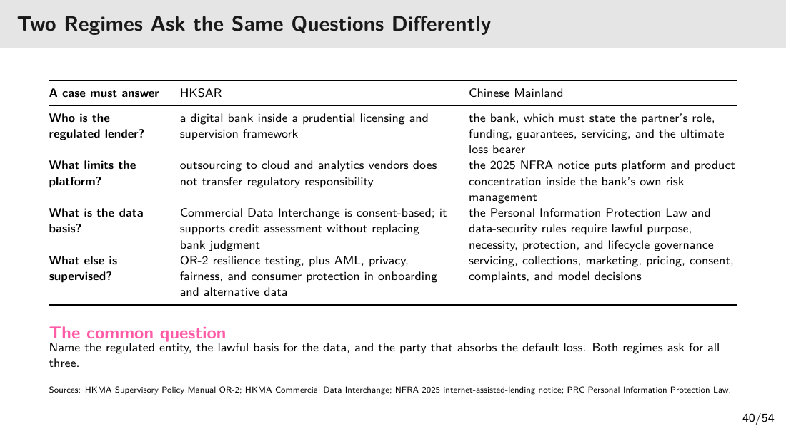

来源：L11 p.40，保留整页原图，可打开大图辨认原标签。

讲义英文原题／给定情境与步骤（非笔记答案）

| A case must answer | HKSAR | Chinese Mainland |
|---|---|---|
| Who is the regulated lender? | a digital bank inside a prudential licensing and supervision framework | the bank, which must state the partner's role, funding, guarantees, servicing, and the ultimate loss bearer |
| What limits the platform? | outsourcing to cloud and analytics vendors does not transfer regulatory responsibility | the 2025 NFRA notice puts platform and product concentration inside the bank's own risk management |
| What is the data basis? | Commercial Data Interchange is consent-based; it supports credit assessment without replacing bank judgment | the Personal Information Protection Law and data-security rules require lawful purpose, necessity, protection, and lifecycle governance |
| What else is supervised? | OR-2 resilience testing, plus AML, privacy, fairness, and consumer protection in onboarding and alternative data | servicing, collections, marketing, pricing, consent, complaints, and model decisions |

The common question: Name the regulated entity, the lawful basis for the data, and the party that absorbs the default loss. Both regimes ask for all three.

Sources: HKMA Supervisory Policy Manual OR-2; HKMA Commercial Data Interchange; NFRA 2025 internet-assisted-lending notice; PRC Personal Information Protection Law.

原表的四问保留在英文原文块。按讲义框架回答：①受监管贷款人是谁——香港例是审慎许可框架内的数字银行，内地例是应说明伙伴职责/资金/担保/服务/损失归属的银行。②平台受何限制——香港例外包云和分析不转移责任；内地例把平台/产品集中纳入银行风险管理。

③资料根据是什么——香港 CDI 以同意为基础，支持评估不替代银行判断；内地列合法目的、必要性、保护和生命周期治理。④还有何监管——香港例列 OR-2 运营韧性及 AML、私隐、公平、客户保护；内地例列服务、催收、营销、定价、同意、投诉与模型。

**英文课堂归纳（笔记自拟）**：Identify the regulated entity, the lawful basis for data use, and the party bearing default losses. Outsourcing does not by itself transfer accountability. The slide compares regulatory functions, not a verified statement of every current legal requirement. 这里按课件有日期比较，未另核现行法。

**🎙️ 课堂补充**（S35 `08:49`–`11:09`，A · 课上展开；2026-11-26 顺延回填）

教师将香港与内地的规则比较连到合规工作，并明确降低此处规则细项的考试要求：*"I promise that you will not be tested for these boring rules there"*（S35 `09:11`）。他同时建议阅读，理由是新产品和业务模式会带来更新中的规则与人工复核需要。

这条反向信号承接本页制度比较，延续S34在p.36–37的具体语境；不扩为登记与信用判断、首损合同、模型监测或整章业务机制都免考。原表继续用于辨认受管实体、数据依据及损失承担者；没有逐条核现行法律，课堂职业判断也不当作招聘事实。

### 2.41 p.41 · 三十秒批准却仍可能失败

讲义英文原题／给定情境与步骤（非笔记答案）

Fast Approval Can Still Be a Regulatory Failure

Scenario: A platform approves a loan in thirty seconds using phone and transaction data, but the customer does not understand the data consent or total repayment.

| Control | Evidence the platform should preserve |
|---|---|
| Consent | which data were collected, for what purpose, and for how long |
| Fair decision | model inputs, adverse-action reason, override, and appeal route |
| Affordability | income, obligations, repayment schedule, and stress assumptions |
| Disclosure | total cost, late consequences, complaints, and collections process |

A smooth interface does not substitute for informed consent and accountable credit judgment.

给定情境中平台用手机和交易数据 30 秒批准，但客户不懂数据同意与总还款。讲义已经列四种应保留证据：

- 同意须说明什么数据/目的/多久。
- 公平决定留输入、不利决定理由（Adverse-action reason）、人工改判和申诉。
- 可负担性（Affordability）留收入、其他义务、还款表和压力假设。
- 披露留总成本、逾期后果、投诉及催收。

**⚪ 笔记分析**：快界面不能代替知情同意与可追责判断。不能仅由情境断言某项现行法律已违反，但足以识别需要修复的控制缺口。

**English reference answer**: Preserve meaningful consent, decision inputs and reasons, affordability evidence, and the full repayment and complaint terms. A fast approval does not show that the customer understood the data use or repayment obligation.（笔记自拟）

**🎙️ 课堂补充**（S35 `11:11`–`13:42`，A · 课上展开；2026-11-26 顺延回填）

教师用客户不明白资料同意和偿还义务说明快批的缺口：*"Have I allowed them to use my data to create an account for me?"*（S35 `11:40`）；*"Do I need to pay back?"*（S35 `11:46`）。

因此，界面上的“同意”和快速得到结果，并不能证明客户理解数据用途、总还款及后果。技术可把操作做快，贷款的同意、披露与信用判断仍须有可追责证据；这里是课堂情境分析，不据此判定某现实平台已违法。

### 2.42 p.42 · 信用分只是整条服务链的一环

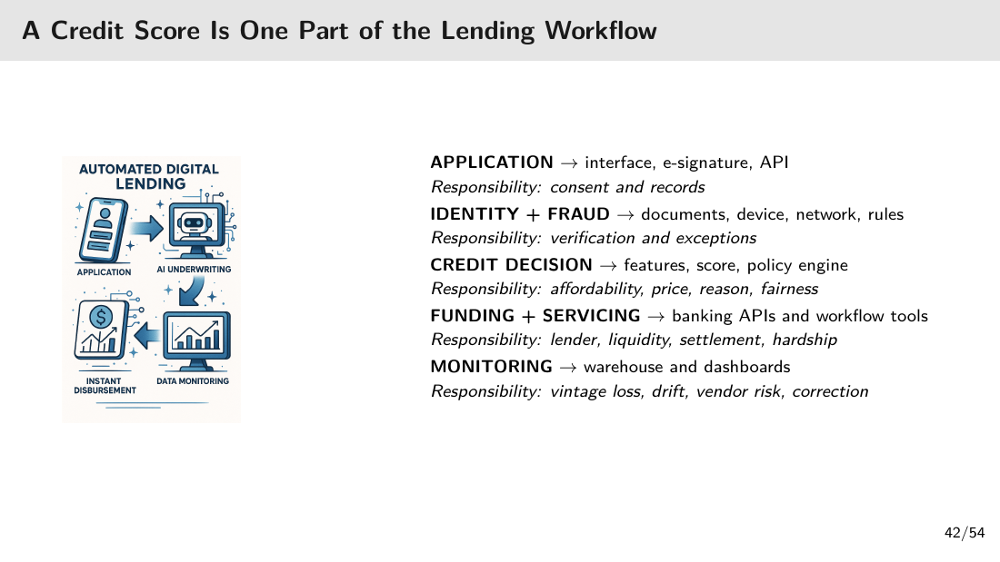

来源：L11 p.42，保留整页原图，可打开大图辨认原标签。

原图复用 p.10 四图标，仍未画出返回 Application 的完整回路；实际贷后反馈用于未来更新是正文机制解释，不能冒称图上有该回边。但右侧新增五层职责：

1. 申请层有界面、电子签名和 API，负责同意记录。
2. 身份/欺诈层核文件、设备、网络及异常。
3. 信用决定层有特征、分数和政策引擎，负责负担能力、价格、理由、公平。
4. 出资/服务层有银行接口和流程，负责贷款人、流动性、结算及困难客户。
5. 监测层有数据仓库/看板，负责批次损失、漂移、供应商与纠正。

模型漂移（Model drift）指模型面对的资料/关系改变使原预测不再保持表现。即使分数输出成功，云服务失败、扣款错或资金不足仍会使服务失败。因此不能把“模型 API 返回了分数”当全链完成。

**🎙️ 课堂补充**（S35 `13:49`–`16:49`，A · 课上展开；2026-11-26 顺延回填）

课堂逐层连接申请、身份/欺诈、信用决定、出资服务和监测。教师的总括是：*"It seems fast, but it includes all the steps there."*（S35 `15:48`）。快来自部分工作自动化，不是把工作和责任删除。

跟一笔申请看原图：客户的点击进入同意记录，身份异常须复核，信用决定形成额度/价格，实际出资与结算后才有贷后数据。原图没有返回Application的完整箭头，不能把正文反馈机制冒作原图已有回路。课堂对特定平台能监测所有消费的泛化未核，不扩大客户授权或银行数据权限。

### 2.43 p.43 · 服务中断先保住哪些动作

讲义英文原题／给定情境与步骤（非笔记答案）

Lending Services during a System Outage

Scenario: The identity or cloud provider fails during a peak shopping period.

Immediate product choices:

- pause new approvals or queue applications for review;
- keep existing repayment services available.

Controls needed beforehand:

- tested recovery arrangements and data backups;
- clear responsibility for customer communication and service restoration.

情境是购物高峰身份或云供应商失效。讲义给的立即选择是暂停新批准或把申请排队复核，同时尽量维持既有还款服务；事前控制是经过测试的恢复安排/备份，以及清楚的客户沟通和恢复责任。

**⚪ 笔记分析**：不要为维持表面批准率而跳过缺失身份核查；也不能把新批暂停理解为所有客户都无需还款。恢复后要核重复申请、状态和账目，避免排队期间重复放款（补充）。

**English reference answer**: Pause new approvals or queue applications for review while maintaining existing repayment services where possible. Use tested recovery arrangements, backups and clear communication responsibilities rather than bypassing the missing control.（笔记自拟）

**🎙️ 课堂补充**（S35 `16:55`–`18:55`，A · 课上展开；2026-11-26 顺延回填）

教师以购物高峰系统失效说明先暂停新增业务、保住既有还款：*"stop doing anything now except for those people they want to repay their money."*（S35 `17:57`）。随后要求检查恢复安排和备份，并明确各项任务的责任（S35 `18:08`–`18:15`）。

“暂停”针对故障下无法正常核验的新审批，不是宣布客户无需还款；排队/暂停与还款服务要分开安排。课堂提到的软件故障及AI代码原因未独立核实，不当作该事故的已证原因。

### 2.44 p.44 · API 接起服务不改变风险归属

应用程序接口（Application programming interface，API）让软件按约定交换请求和结果，例如商户收银页面向贷款人请求报价，再显示给客户。它可连接数据提供者、支付网络、商户及银行，把贷款嵌进购物、工资或银行流程。

课件用 Affirm 在销售点结账提供融资为例。经济问题仍是获客、承贷、出资、服务和客户关系分别归谁；接口只是连接方法。一个商户页面展示某贷款人报价，不自动使商户承担全部贷款损失，须看合同。

**🎙️ 课堂补充**（S35 `19:01`–`20:29`，A · 课上展开；2026-11-26 顺延回填）

教师从购物结账时出现融资选项解释嵌入式贷款，并提醒：*"when you see those financing options there, actually you are borrowing money."*（S35 `20:23`）。API把报价接入商户流程，顾客仍是在接受一份贷款安排。

付款入口顺滑，不代表贷款人、出资者和损失承担方合成一个角色。公司持股、某国模式更先进及品牌口述未另核；本文只采用原页Affirm/API的教学定位，不从界面推断真实合同或当前所有权。

### 2.45 p.45 · 共享登记与八成融资上限

<!-- cityu-nav:landing-45 -->
[[#4. 速查表|↩ 回速查]] · [[#5. 双语术语卡|回术语]] · [[#0. 三分钟速览|阅读导航]]
<!-- cityu-nav:landing:end -->

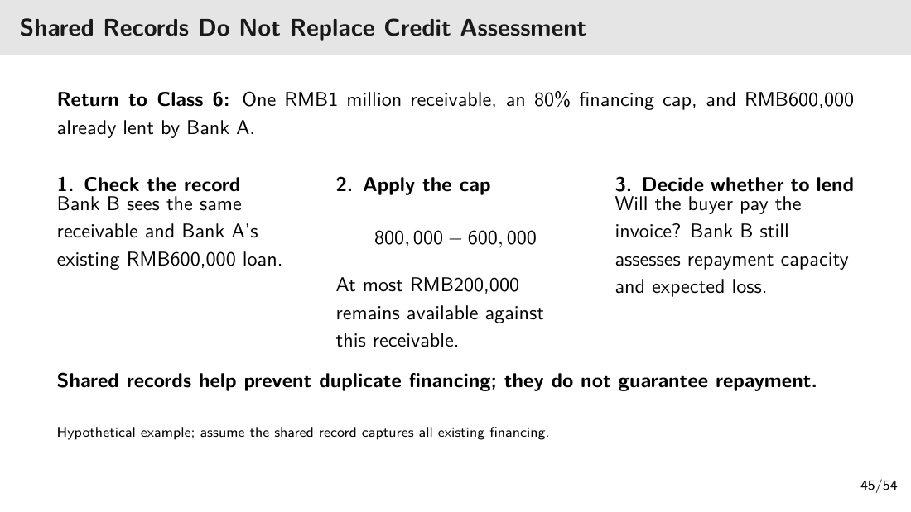

来源：L11 p.45，保留整页原图，可打开大图辨认原标签。

讲义英文原题／给定情境与步骤（非笔记答案）

Shared Records Do Not Replace Credit Assessment

Return to Class 6: One RMB1 million receivable, an 80% financing cap, and RMB600,000 already lent by Bank A.

1. Check the record. Bank B sees the same receivable and Bank A's existing RMB600,000 loan.
2. Apply the cap. $800,000-600,000$. At most RMB200,000 remains available against this receivable.
3. Decide whether to lend. Will the buyer pay the invoice? Bank B still assesses repayment capacity and expected loss.

Shared records help prevent duplicate financing; they do not guarantee repayment.

Hypothetical example; assume the shared record captures all existing financing.

讲义沿 Class 6 的假设：应收款人民币 100 万，总融资上限 80%，A 银行已有 60 万贷款，且登记完整捕捉现有融资。B 先查记录，再算总上限 $1,000,000\times80\%=800,000$，扣已有 600,000，最多余 200,000 元额度。

“最多”不是银行必须再贷 20 万。B 还要判断买方是否会付款、预期损失和其他贷款条件；登记支持防重复融资，不保证还款。若已有贷款改为 75 万，剩余上限为 5 万；若登记不完整，20 万计算的输入本身也可能不可靠。

**English reference answer**: At most RMB200,000 remains under the aggregate cap, assuming the shared record is complete. Bank B must still assess repayment capacity and expected losses before lending.（笔记自拟）

**🎙️ 课堂补充**（S35 `20:37`–`22:57`，A · 课上展开；2026-11-26 顺延回填）

课堂走完100万应收款、80%上限、A已贷60万、B最多余20万的计算，再明确区分“最多可贷”与“愿意批准”：*"but this is not the amount Bambi is willing to lend."*（S35 `22:20`；Bambi按讲义指Bank B）。

B还须评估偿还能力与预期损失。若买方不付、借款人也不能还，登记并不承担损失。S35 `22:36`的“does not return…will not have credit loss”与前后逻辑冲突，按原页及后续信用判断处理，不能据该句否认损失。原题人民币/完整登记假设不变，20万是上限而非必批额度。

### 2.46 p.46 · 排序正确而概率偏低可以同时发生

给定表每行是一个已完整观察 12 个月的借款群：A 预测 2%、实际 4%；B 预测 5%、实际 8%。排序（Ranking）在两列都是 B 比 A 风险高；校准（Calibration）问预测概率水平是否与实际比例相符，这里两组都低估。

A 低估 2 个百分点、B 低估 3 个百分点，不是“两组各低 2%/3%”的相对百分比。应先核可比群组和资料，再重估损失、价格和批准规则；两行汇总没有样本量与不确定性，不能据此证明任意精度或必然因果变化。排名有用不等于预计损失可不改。

**🎙️ 课堂补充**（S35 `23:06`–`25:13`，A · 课上展开；2026-11-26 顺延回填）

教师用预测收益排名与精确水平的区别引出本表：B在预测和实际列都比A危险，但两组预测概率都偏低。*"the predictive probabilities are too low"*（S35 `24:17`）。

低估概率会经预期损失进入盈利判断：按同一本金和违约损失率，概率填得过低，预计损失就过低，扣成本后预计利润便偏高。*"then you underestimate the expected credit loss, then you overestimate your profit."*（S35 `24:52`）。年龄分组只是课堂假设，不是已验证的年龄风险规律；原表2%/4%、5%/8%和完整观察窗保留。

### 2.47 p.47 · 选择题：上线后应怎样监测

讲义英文原题／给定情境与步骤（非笔记答案）

Multiple-Choice Question: A Credit Model after Launch

A lender’s model still ranks riskier borrowers above safer ones. Across several completed loan
cohorts, actual default rates exceed its predicted rates. The recorded borrower mix is similar.

What is the most appropriate next step?

A) Keep loss estimates unchanged because the risk ranking still works.

B) Increase approvals to spread the observed losses over more loans.

C) Investigate the forecast gap and reassess expected losses and pricing.

D) Remove default outcomes from monitoring until the model is retrained.

**中文题意**：数个已完成贷款批次中，实际违约率持续高于预测，而风险排序仍有用、记录中的借款人组成相似。A 保持损失估计；B 多批贷款摊薄损失；C 查预测差并重估损失/价格；D 在重训前移除违约监测。

**⚪ 参考答案（笔记推断）：C。** 排序没有保证概率校准正确；A 延续低估损失，B 增加放款可能扩大风险而非修复估计，D 主动隐藏最重要反馈。记录组成相似也不排除遗漏变量或环境变化，应调查而不是直接确定原因。

**English reference answer**: C. Investigate the forecast gap and reassess expected losses and pricing. Useful risk ranking does not justify keeping underestimated loss levels unchanged, and default outcomes must remain in monitoring.（笔记自拟）

**🎙️ 课堂补充**（S35 `25:21`–`27:51`，A · 课上展开；2026-11-26 顺延回填）

C有清楚课堂讲评支持。教师先说C可能正确，再说明应调查预测差：*"Investigate why there's a forecast gap"*（S35 `27:37`）；随后要求*"you need to reassess the expected loss and pricing"*（S35 `27:51`）。

因此“排序仍有效”不能让低估的损失水平保持不变。调查尚未给出唯一原因，不能直接断言模型、资料或环境中的哪一项必然出错。原英文A–D、中文逐项理由与笔记自拟英文参考句均保留；新增的是C获课堂支持，不把整句英文答案冒作教师原话。

### 2.48 p.48 · Aave 与无抵押小企贷的决定依据不同

原表左边 Alice 保留 ETH 风险敞口，以价值 US\$30,000 的 10 ETH 抵押借 15,000 USDC；借款能力由抵押值和协议限额决定。价格下跌可能在她还没漏还任何款项前触发清算（Liquidation，即按协议处理抵押物偿债）。

右边微业贷为小企备货提供线上无抵押营运贷，重点是企业未来还款能力，不是其是否持币；销售差可导致漏还和贷款损失。两边都叫借款，却不能拿 Aave 的抵押率直接代替企业承贷判断。金额是 Class 8 的课堂例，不是实时协议报价。

**🎙️ 课堂补充**（S35 `28:08`–`31:39`，B · 讲了同讲义；2026-11-26 顺延回填）

课堂比较抵押型Aave与无抵押小企贷：*"for WeBank, there's no collateral."*（S35 `30:19`）。前者按抵押值和协议限额决定能力，后者按企业偿还能力核信用。

原10 ETH/US\$30,000/15,000 USDC是Class8例。ETH价格跌可先触发协议清算；小企销售变弱可能带来漏还，不能把销售下降直接写成银行依法可立即收回全部贷款，仍须合同条件。

### 2.49 p.49 · 卖出贷款后四百美元损失谁承担

<!-- cityu-nav:landing-49 -->
[[#4. 速查表|↩ 回速查]] · [[#5. 双语术语卡|回术语]] · [[#0. 三分钟速览|阅读导航]]
<!-- cityu-nav:landing:end -->

讲义英文原题／给定情境与步骤（非笔记答案）

Who Bears the Loss on a Sold Loan?

WeLab Bank reports customer loans on its balance sheet. Compare three hypothetical contracts for a loan that subsequently defaults:

Principal loss = \$1,000 - \$600 recovered = \$400.

| Contract | Loss allocation | Explanation |
|---|---|---|
| Bank retains the loan | Bank loses \$400. | It funded and still holds the loan. |
| Sale without a guarantee | Investor loses \$400. | The bank has no contractual credit-loss obligation. |
| Sale with a \$100 first-loss guarantee | Bank loses \$100; investor loses \$300. | The bank retains some credit exposure. |

Principal losses only; guarantees honoured. Contracts are illustrative, not WeLab's terms. Company context: WeLab Bank 2025 Interim Report, note 13.

讲义假设本金 1,000、回收 600，所以仅本金损失 $1,000-600=400$ 美元，且担保按承诺履行；这不是 WeLab 实际合同。

三种合同逐项比较：银行留贷，由银行损失 400；无担保售出且无其他信用补偿义务，由投资者损失 400；售出但银行担保首损 100，银行承担 100、投资者承担余下 300。三种都加回总损失 400，不能把销售收入或服务费当自动抵销损失。

**English reference answer**: The principal loss is \$400. The bank bears it if it retains the loan; the investor bears it after a sale without a guarantee. With an honoured \$100 first-loss guarantee, the bank bears \$100 and the investor bears \$300.（笔记自拟）

若回收改为 950、损失 50，首损担保下银行只补 50，不是每次违约一律付满 100。

**🎙️ 课堂补充**（S35 `31:46`–`34:28`，B · 讲了同讲义；2026-11-26 顺延回填）

课堂按原三种合同分400美元本金损失：*"If the bank sold the loan without guarantee, then the investor who buys the loan loses \$400."*（S35 `32:31`）；首损情境则*"the bank loses \$100, co-bear the burden, and the investor loses \$300."*（S35 `33:45`）。

三种分配总额都仍为400，担保改变的是承担者，不是让损失消失。保留“仅本金、担保履行、合同为假设”的原条件；课堂口称投资者“lose everything”不改成本例全部本金损失1000，实际已回收600。

### 2.50 p.50 · 降低成本与增加信用损失分开重算

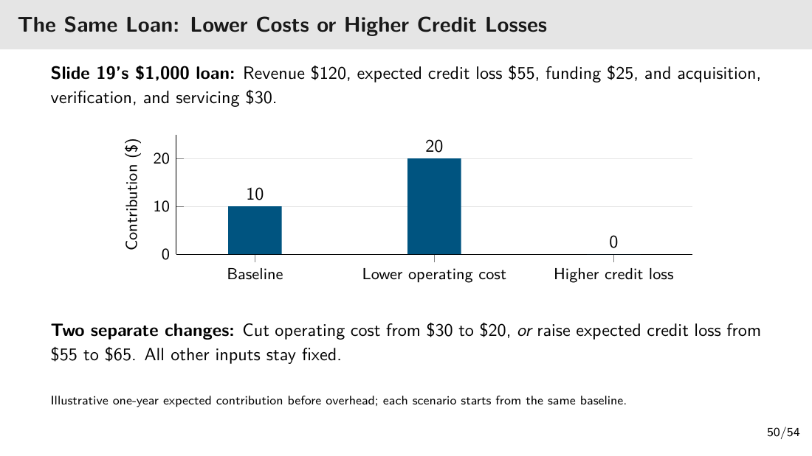

来源：L11 p.50，保留整页原图，可打开大图辨认原标签。

柱图纵轴是每笔贡献美元，三根从同一 p.19 基准开始：基准 10；经营成本从 30 降为 20、其余不变，贡献 $120-55-25-20=20$；预期损失从 55 升为 65、其余沿原基准，贡献 $120-65-25-30=0$。

图下强调 Two separate changes，不能把后一场景错误接成“已经省 10 再多亏 10”的连续变化。若同时发生，贡献是 10（笔记补充），但那是第四种情境，不是原图第三根柱。数字为一年期假设、未扣管理间接费用。

**🎙️ 课堂补充**（S35 `34:35`–`36:36`，B · 讲了同讲义；2026-11-26 顺延回填）

课堂复述120收入、55预期损失、25资金成本、30其他成本与10贡献，再比较降成本和升损失。*"If all the things are the same, that's \$10."*（S35 `35:22`）。

原图两次变化分别从同一基准出发，结果为20或0，不是先省10再多亏10的连续流程。S35 `35:25`后半又出现50→20、`35:46`出现10到10.0，均不据此改原题；30→20与55→65及10/20/0由原图和算术确定。

### 2.51 p.51 · 预测增长前先问四种压力

讲义英文原题／给定情境与步骤（非笔记答案）

Stress the Lending Model before Forecasting Growth

| Shock | Cash-flow question | Evidence to monitor |
|---|---|---|
| Borrower stress | Who absorbs higher defaults and collections cost? | delinquency, roll rates, recoveries |
| Funding withdrawal | Can originations and existing loans still be funded? | funding concentration, maturity, covenants |
| Acquisition inflation | Does growth still cover customer acquisition cost? | repeat use, contribution margin, payback period |
| Control failure | Who pays for fraud, bias, cyber loss, or remediation? | complaints, overrides, incidents, audit findings |

A growth forecast is incomplete until the platform survives plausible credit, funding, and operating shocks.

原表四行分别是借款人压力、资金退出、获客涨价、控制失败，每行都有现金流问题。**参考逐行解释**：

- 违约变多时核谁吸收损失/催收成本，监测逾期、从轻度到重度逾期的迁移率（Roll rate）和回收。
- 资金退出时核新贷与旧贷是否都能继续融资，监测集中、期限和合同约束。

- 获客涨价时核交易增长是否仍覆盖新客成本，看重复使用、贡献率与回本期。
- 控制失败时核欺诈、偏差、网络攻击和补救由谁付，看投诉、人工改判、事故和审计发现。

**English reference summary**: Stress borrower losses, funding availability, acquisition costs and control failures separately. Trace who pays, which cash flows change, and which evidence would reveal the deterioration before forecasting growth.（笔记自拟）

**🎙️ 课堂补充**（S35 `36:46`–`37:56`，B · 讲了同讲义；2026-11-26 顺延回填）

教师按借款人压力、资金退出、获客涨价、控制失败四种情境讨论贷款利润，强调*"many extreme scenarios you need to consider"*（S35 `37:41`）。

应分别追踪哪种收入、成本和资金可得性变化；资金退出不一定只是费率涨，也可能令新贷无法获得资金。表中监测证据与谁承担损失继续逐行核，不能只用贷款量增长证明可持续。

### 2.52 p.52 · 简答：七成新贷资金退出

讲义英文原题／给定情境与步骤（非笔记答案）

Short-Answer Question: A Lending Platform Loses a Funder

A marketplace lender earns origination and loan-servicing fees. An investor providing 70% of
new-loan funding stops financing new loans.

Existing loans remain fully funded to maturity and perform as agreed. The platform provides
no credit guarantees.

1. Explain the likely effects on new lending, origination fees, and fees from servicing existing
loans.

2. Propose one way to reduce dependence on this funder. Explain a cost or trade-off of your
proposal.

**中文拆题**：提供新贷款资金 70% 的投资者停止新出资；题面明确旧贷已足额融资到期且正常还款，平台没有信用担保。不能擅自把它改成旧贷款也抽资或已违约。

**⚪ 第 1 问参考作答（笔记推断）**：若无替代资金，新放贷能力下降，承做费随新业务减少；既有贷款仍正常运行，其服务费可继续按原合同赚取，不因新资金退出立刻归零。70% 是新资金占比，不证明总收入必跌 70%，也不唯一决定实际贷款降幅，其他出资者可能调整。

**第 2 问**：引入更多资金伙伴并分散到期安排可降低单一依赖，代价是关系维护、尽调和可能较高资金价格；不必为凑答案建议用高风险自有资金填满所有缺口。

**English reference answer**: Without replacement funding, new lending and origination fees are likely to fall, while servicing fees on fully funded, performing existing loans can continue under their contracts. The 70% funding share does not imply a 70% decline in total revenue. Diversifying investors can reduce concentration, but adds due-diligence costs and may raise funding prices.（笔记自拟）

若改题为旧贷也需短期续资，就要另查到期流动性；本题刻意排除该条件。

**🎙️ 课堂补充**（S35 `38:02`–`40:54`，A · 课上展开；2026-11-26 顺延回填）

教师重读“70%新贷资金退出、旧贷足额融资到期且正常”的关键条件：*"Existing loans remain fully funded to maturity and perform as agreed."*（S35 `38:15`）。S35 `38:26`将no识别成low的残句不改变原题“无信用担保”。

学生作答未完整清晰录入，不能把已有第1/2问参考全文升级为教师逐句确认。教师对篇幅明确提示*"There's only three lines"*（S35 `39:43`）；可把新贷/承做费、旧贷服务费、分散方案及代价用简句分别说清，而不省掉题问对象。

第二问后的清楚补充是用外部资金做贷款并不容易（S35 `40:47`）。因此“增加出资者”是可行方向与取舍分析，不是随时能无成本补齐70%缺口的保证。原中文逐问、全部条件与英文自拟参考句保留。

### 2.53 p.53 · 把资金、贡献与理由串起来

本页三条复习：Upstart 促成贷款可由伙伴银行、机构或自身持有；假设千元小企贷多 10 损失即消除 10 贡献；课件称 Upstart 给被拒申请人解释原因的不利决定通知。最后一项是讲义产品服务陈述，未另核当前法定义务或网站。

这三点分别回答谁持风险、业务是否划算、决定能否说明。不能以资金不在平台账上就忽略担保，也不能以接口能很快拒绝就忽略客户理解和申诉。

**🎙️ 课堂补充**（S35 `40:54`–`42:42`，B · 讲了同讲义；2026-11-26 顺延回填）

课堂复盘Upstart的伙伴银行、机构投资者和自身三种资金来源，并重申信用决定可由AI/数据支持。*"they have like partner band this is one type"*（S35 `41:11`；band按原页为bank）。

教师关于真实信用卡利率和贷款利润的泛化没有本页数据支持，不改写成贷款业务普遍盈利。原假设多10损失抹去10贡献仍成立；p.53拒贷理由通知的书面陈述保留来源地位，不冒称本段详细讲过其法定义务。

### 2.54 p.54 · 三条结论应能迁移到新案例

本页总结：承做不等于最终出资，Upstart 的发起银行未必是最终投资者；数字贷款仍有信用风险，微业贷的无抵押客户可能违约；支持项目未必是投资，Kickstarter 的奖励不是股权或利息。

遇到新 App，先画借款人、审核/承做者、出资者、服务者与损失承担者，再看费用和权利。名字叫科技、平台或银行都不能替代真实合同；众筹筹足钱也不能替代交付能力证据。S35已口头总结这三条，但没有因此明说它们必作期末原题，不能把课堂总结自动升级为必考。

<!-- cityu-nav:return-3 -->
[[#0. 三分钟速览|↑ 阅读导航]] · [[#8. 讲义页码映射|页／Cell 索引]] · [[#4. 速查表|复习速查]]
<!-- cityu-nav:return:end -->

**🎙️ 课堂补充**（S35 `42:46`–`43:59`，B · 讲了同讲义；2026-11-26 顺延回填）

教师总结承做者未必是最终投资者、数字贷款仍有信用风险，以及众筹支持不总是投资：*"The digital lending still carries credit risk."*（S35 `43:09`）；*"backing is not always investing"*（S35 `43:33`）。

电影支持者可能得到奖励/体验，但不会仅因支持而取得股份或利息。课堂随后“没有payoff”的简化话不抹去奖励价值或合同权利。S35 `43:59`结束本讲总结，`44:01`起介绍压缩后的L12，`44:52`进入其业务主线。

## 3. 一图看懂

下表是一笔贷款的职责追踪，每行回答一种问题，不能用同一个 App 名字跳过其他行。

| 问题 | 查什么 | 本文位置 |
|---|---|---|
| 谁把申请变成贷款 | 承做、审核与报价 | p.5/8 |
| 谁现在付本金 | 银行、投资者或平台 | p.14–16/23 |
| 谁最终亏钱 | 持有与担保合同 | p.27/49 |
| 谁维护还款与客户 | 服务、申诉、恢复 | p.37/41–43 |
| 什么证明模型有用 | 同批样本外、校准和损失 | p.12/24/46 |

例如平台不出本金，也可能因首损担保承担最后一行以外的信用损失；模型排名好也不能代替资金供给。

## 4. 速查表

每行金额仅限原假设，先看单位和合同再复用。

| 任务 | 结果 | 条件 |
|---|---|---|
| 小企贷贡献 [[#2.19 p.19 · 一千美元小贷款能留多少贡献\|p.19]] | 120−55−25−30 = 10 美元 | 一年期，管理费前 |
| 预期损失 [[#2.26 p.26 · 选择题：预期损失与税前利润\|p.26]] | 4% × 50% × 1,000 = 20 美元 | 同一笔本金 |
| 税前利润 [[#2.26 p.26 · 选择题：预期损失与税前利润\|p.26]] | 80−30−15−20 = 15 美元 | 按题给预期收入 |
| 众筹费 [[#2.32 p.32 · 五百人支持桌游怎样分资金\|p.32]] | 筹 20,000，平台费 1,000 美元 | 5%，支付费另扣 |
| 融资余量 [[#2.45 p.45 · 共享登记与八成融资上限\|p.45]] | 800,000−600,000 = 200,000 元 | 人民币，总登记完整 |
| 首损分配 [[#2.49 p.49 · 卖出贷款后四百美元损失谁承担\|p.49]] | 总损 400，银行 100、投资者 300 | 首损担保履行 |

## 5. 双语术语卡

英文定义为笔记自拟，原例与当地解释在所列页。

| 中文 | English | 英文定义 | 位置 |
|---|---|---|---|
| 承贷评估 | Underwriting | Assessment of borrower risk and proposed loan terms. | [[#2.6 p.06 · 技术改变流程的哪三处\|p.6]]/[[#2.10 p.10 · 自动化怎样降成本又保留复核\|10]] |
| 贷款承做 | Origination | Work to arrange, assess and establish a new loan. | [[#2.5 p.05 · 数字贷款四格流程\|p.5]] |
| 资金提供 | Funding | Supply of money supporting the loan. | [[#2.5 p.05 · 数字贷款四格流程\|p.5]]/[[#2.14 p.14 · LendingClub 案例怎样分留存与出售\|14]] |
| 违约概率 | Probability of default | The estimated probability of default over a stated horizon. | [[#2.26 p.26 · 选择题：预期损失与税前利润\|p.26]] |
| 违约损失率 | Loss given default | The fraction lost conditional on default under the stated definition. | [[#2.26 p.26 · 选择题：预期损失与税前利润\|p.26]] |
| 校准 | Calibration | Agreement between predicted probabilities and observed outcome rates. | [[#2.46 p.46 · 排序正确而概率偏低可以同时发生\|p.46]] |
| 首损担保 | First-loss guarantee | A contractual promise to absorb losses up to an agreed first-loss amount. | [[#2.27 p.27 · 选择题：银行出资是否消除平台风险\|p.27]]/[[#2.49 p.49 · 卖出贷款后四百美元损失谁承担\|49]] |
| 全有或全无 | All-or-nothing funding | Collection of pledges only if the campaign meets its target by the deadline. | [[#2.31 p.31 · 全有或全无解决哪种筹资门槛\|p.31]] |
| 请求权 | Claim | An identified contractual right to payment, ownership or performance. | [[#2.30 p.30 · 四类众筹先看支持者请求权\|p.30]]/[[#2.39 p.39 · 卖掉整笔应收款与抵押借款不同\|39]] |

## 6. 考点预判与英文答题顺序

### 6.1 课堂信号和范围

原S34的1条具体反向信号保留；S35再次对p.40规则细项降权，并在p.52提示短答三行。p.47 C新增清楚课堂讲评；课堂回答、题型格式与必考内容分别记录。最新全课程形式见 [[EF5560_Fintech_and_AI_in_Finance/notes/M10-支付系统与嵌入式金融#2.0 先看两周的考试与展示说明（讲义无对应页）|M10考试说明]]：S34具体MCQ40%/16×2.5、短答期望3行、小抄交卷与身份、12/6TA等与旧来源逐项分层。

### 6.2 明示与课堂题地位

| 地位 | 内容 | 证据 | 位置 |
|---|---|---|---|
| 🔴（反向） | 监管/合规表格细项不作这部分考试测试，仍须认业务责任 | *"I'm not going to test this"*（S34 `02:19:44`）；紧接本讲运营/监管部分的“few boring slides”，只限对应语境 | §2.36/37 |
| 🔴（反向） | p40此处香港/内地规则细项不测试，仍建议理解 | *"I promise that you will not be tested for these boring rules there"*（S35 `09:11`）；语境限本页制度比较，不扩为整章机制免考 | §2.40 |
| 🔴答题格式 | 本页短答须压缩到约三行，保留所问对象 | *"There's only three lines"*（S35 `39:43`），是在p52学生作答过长后的提示 | §2.52 |
| 🎙️课堂确认 | p24 C、p26最终15美元、p27 B | S34 `02:01:33`/`02:01:51`、`02:05:30`–`02:05:44`、`02:08:13` | 对应原题 |
| 🎙️部分确认 | p38第1问：需求不等生产能力 | S34 `02:24:18`–`02:24:29`，第2/3问仍参考 | §2.38 |
| 🎙️新增课堂确认 | p47 C：调查预测差并重估损失/定价 | S35 `27:37`、`27:51`；英文完整参考句仍为笔记自拟 | §2.47 |
| ⚪参考地位保留 | p52未清楚录入的完整两问、p38第2/3问 | 不以点名/认可残句升级全部答案；完整原题、过程和英文参考句保留 | §2.38/52 |

“不考监管表细项”不能抹去p27首损合同/谁亏钱、p24样本外证据、p38权利与交付风险，也不能扩成现实监管无需了解。课堂最后说会留全部slides自学；新旧课程目标与本次明确降权分开，不自行宣布整个M12或所有监管关键词免考。

### 6.3 答题顺序

贷款模式先辨 borrower、originator、funder、servicer、loss bearer，并用合同解释归属；盈利题固定期间/本金再扣预期损失、资金和经营成本；模型题固定同批测试与完整观察窗，再分排序/校准/损失。众筹先识别支持者权利，再区分达标与生产交付。原页英文和完整小问仍在§2，简洁不能省掉题目要求的对象。

## 7. 自测

以下为笔记补充，不代表本人已作答或通过。

### 7.1 概率排名正确，能保持原损失估计吗？

查看答案

不能仅凭排名不变保留估计。p.46 的 A/B 排序都对，但预测 2%/5% 对实际 4%/8% 低估概率，应查可比性和预测差，再重估损失与价格。

### 7.2 千元贷款 PD 由 4% 升到 8%，其余沿 p.26，税前利润多少？

查看答案

预期损失 $0.08\times0.5\times1,000=40$ 美元，利润 $80-30-15-40=-5$ 美元。只改 PD，不把经营成本也改成别页数字。

### 7.3 卖出贷款后担保首损 100，实际本金损失只有 50，银行付多少？

查看答案

沿 p.49 条款银行只承担实际首损 50，投资者此例承担 0。100 是约定层上限，不是每次固定赔款。

### 7.4 众筹达标并收钱，证明产品能按期完成吗？

查看答案

不证明。p.31/38 的规则只建立足够承诺需求并允许收款；成本、生产、质量和交付仍待证据，不产生平台保证。

### 7.5 新出资者退出，旧贷服务费是否必定归零？

查看答案

按 p.52 的明确条件，旧贷已足额融资到期且正常，服务费可按合同继续。新贷承做费会受资金缺口影响；不能把新资金退出偷换成旧贷款抽资或违约。

## 8. 讲义页码映射

每页一行；S34在p38后收束，S35在2026-11-26补讲p39–54。早期p12无完整逐页证据单列；原图及英文题面/中文解析/英文参考全文仍保留。

| L11 物理页 | 原页标题 | 精确正文 | 原图／处置 | 课堂覆盖 |
|---|---|---|---|---|
| 1 | FinTech and AI in Finance | [[EF5560_Fintech_and_AI_in_Finance/notes/M11-数字信贷与众筹#2.1 p.01 · 本讲范围与来源边界\|p.1]] | 纯封面/分隔 | ⚪ 封面；S34 `51:31`转Class11 |
| 2 | Digital Lending and Credit Decisions | [[EF5560_Fintech_and_AI_in_Finance/notes/M11-数字信贷与众筹#2.2 p.02 · 数字信贷与信用决定\|p.2]] | 纯封面/分隔 | ⚪ 分隔；S34 `58:49`回贷款 |
| 3 | Assessing a Borrower with Limited Credit History | [[EF5560_Fintech_and_AI_in_Finance/notes/M11-数字信贷与众筹#2.3 p.03 · 只有十二个月现金流怎样判断借款人\|p.3]] | 文字/表格逐项解释；品牌Logo不作机制图 | ✅ S34 `01:04:17`–`01:10:37`，内容及题解地位见正文 |
| 4 | Why a Small Business May Struggle to Borrow | [[EF5560_Fintech_and_AI_in_Finance/notes/M11-数字信贷与众筹#2.4 p.04 · 小额贷款为何也可能很贵\|p.4]] | 文字/表格逐项解释；品牌Logo不作机制图 | ✅ S34 `58:49`–`01:12:00`，内容及题解地位见正文 |
| 5 | The Digital Lending Process | [[EF5560_Fintech_and_AI_in_Finance/notes/M11-数字信贷与众筹#2.5 p.05 · 数字贷款四格流程\|p.5]] | 原图整页保留并解释 | ✅ S34 `01:12:12`–`01:14:25`，内容及题解地位见正文 |
| 6 | Where FinTech Changes the Lending Model | [[EF5560_Fintech_and_AI_in_Finance/notes/M11-数字信贷与众筹#2.6 p.06 · 技术改变流程的哪三处\|p.6]] | 原图整页保留并解释 | ✅ S34 `01:14:34`–`01:17:06`，内容及题解地位见正文 |
| 7 | Case 1: Ant Group — Ecosystem Lending | [[EF5560_Fintech_and_AI_in_Finance/notes/M11-数字信贷与众筹#2.7 p.07 · Ant 的支付生态怎样支持贷款\|p.7]] | 原图整页保留并解释 | ✅ S34 `01:17:13`–`01:18:44`，内容及题解地位见正文 |
| 8 | Ant Case: Following a Digital Loan Application | [[EF5560_Fintech_and_AI_in_Finance/notes/M11-数字信贷与众筹#2.8 p.08 · 沿商户一次申请追踪三种责任\|p.8]] | 文字/表格逐项解释；品牌Logo不作机制图 | ✅ S34 `01:18:51`–`01:21:45`，内容及题解地位见正文 |
| 9 | Ant Group: Credit Services and Lending Responsibility | [[EF5560_Fintech_and_AI_in_Finance/notes/M11-数字信贷与众筹#2.9 p.09 · 贷款服务与最终信用责任分开\|p.9]] | 文字/表格逐项解释；品牌Logo不作机制图 | ✅ S34 `01:21:57`–`01:23:45`，内容及题解地位见正文 |
| 10 | Automation and Scalability in Lending | [[EF5560_Fintech_and_AI_in_Finance/notes/M11-数字信贷与众筹#2.10 p.10 · 自动化怎样降成本又保留复核\|p.10]] | 原图整页保留并解释 | ✅ S34 `01:23:53`–`01:24:55`，内容及题解地位见正文 |
| 11 | Credit Predictors and Model Interpretation | [[EF5560_Fintech_and_AI_in_Finance/notes/M11-数字信贷与众筹#2.11 p.11 · 变量重要为何不能证明因果\|p.11]] | 文字/表格逐项解释；品牌Logo不作机制图 | ✅ S34 `01:25:00`–`01:30:12`，内容及题解地位见正文 |
| 12 | Evaluating Default Predictions | [[EF5560_Fintech_and_AI_in_Finance/notes/M11-数字信贷与众筹#2.12 p.12 · 十二个月违约预测如何公平评估\|p.12]] | 文字/表格逐项解释；品牌Logo不作机制图 | ❓ 无完整逐页课堂对应，不可降权；泛谈预测不算本页完整讲解 |
| 13 | How Digital Lending Models Evolved | [[EF5560_Fintech_and_AI_in_Finance/notes/M11-数字信贷与众筹#2.13 p.13 · 四种贷款模式是重叠路线\|p.13]] | 原图整页保留并解释 | ✅ S34 `01:30:25`–`01:33:04`，内容及题解地位见正文 |
| 14 | LendingClub: From P2P Lending to Happen Bank | [[EF5560_Fintech_and_AI_in_Finance/notes/M11-数字信贷与众筹#2.14 p.14 · LendingClub 案例怎样分留存与出售\|p.14]] | 文字/表格逐项解释；品牌Logo不作机制图 | ✅ S34 `01:33:04`–`01:33:51`，内容及题解地位见正文 |
| 15 | Investor Cash Flows in Marketplace Lending | [[EF5560_Fintech_and_AI_in_Finance/notes/M11-数字信贷与众筹#2.15 p.15 · 投资者的回款先扣什么\|p.15]] | 原图整页保留并解释 | ✅ S34 `01:33:52`–`01:41:05`，内容及题解地位见正文 |
| 16 | Upstart: AI Lending and Outside Funding | [[EF5560_Fintech_and_AI_in_Finance/notes/M11-数字信贷与众筹#2.16 p.16 · Upstart 的两个判断问题\|p.16]] | 文字/表格逐项解释；品牌Logo不作机制图 | ✅ S34 `01:41:09`–`01:42:37`，内容及题解地位见正文 |
| 17 | WeBank: Working Capital for Small Firms | [[EF5560_Fintech_and_AI_in_Finance/notes/M11-数字信贷与众筹#2.17 p.17 · 微业贷为何需要无抵押评估\|p.17]] | 文字/表格逐项解释；品牌Logo不作机制图 | ✅ S34 `01:42:42`–`01:45:50`，内容及题解地位见正文 |
| 18 | WeBank: Data, Approval, and Repayment | [[EF5560_Fintech_and_AI_in_Finance/notes/M11-数字信贷与众筹#2.18 p.18 · 额度与价格怎样接到贷后结果\|p.18]] | 文字/表格逐项解释；品牌Logo不作机制图 | ✅ S34 `01:45:57`–`01:47:08`，内容及题解地位见正文 |
| 19 | WeBank Case: Can a Small Loan Cover Its Costs? | [[EF5560_Fintech_and_AI_in_Finance/notes/M11-数字信贷与众筹#2.19 p.19 · 一千美元小贷款能留多少贡献\|p.19]] | 文字/表格逐项解释；品牌Logo不作机制图 | ✅ S34 `01:47:16`–`01:48:55`，内容及题解地位见正文 |
| 20 | Case 2B: WeLab Bank — A Hong Kong Digital Bank | [[EF5560_Fintech_and_AI_in_Finance/notes/M11-数字信贷与众筹#2.20 p.20 · WeLab Bank 案例保留银行责任\|p.20]] | 文字/表格逐项解释；品牌Logo不作机制图 | ✅ S34 `01:49:04`–`01:55:47`，内容及题解地位见正文 |
| 21 | HKSAR Evidence: CDI and SME Loan Terms | [[EF5560_Fintech_and_AI_in_Finance/notes/M11-数字信贷与众筹#2.21 p.21 · CDI 研究图能证明到哪一步\|p.21]] | 原图整页保留并解释 | ✅ S34 `01:55:47`–`01:56:31`，内容及题解地位见正文 |
| 22 | China’s Policy on Internet-Assisted Lending after 2025 | [[EF5560_Fintech_and_AI_in_Finance/notes/M11-数字信贷与众筹#2.22 p.22 · 互联网助贷政策在课堂模型中的作用\|p.22]] | 文字/表格逐项解释；品牌Logo不作机制图 | ✅ S34 `01:56:56`–`01:58:12`，内容及题解地位见正文 |
| 23 | Similar Apps Can Hide Different Lending Models | [[EF5560_Fintech_and_AI_in_Finance/notes/M11-数字信贷与众筹#2.23 p.23 · 三地相似 App 的资金与脆弱点\|p.23]] | 原图整页保留并解释 | ✅ S34 `01:58:17`–`02:00:20`，内容及题解地位见正文 |
| 24 | Multiple-Choice Question: Did the AI Model Really Improve? | [[EF5560_Fintech_and_AI_in_Finance/notes/M11-数字信贷与众筹#2.24 p.24 · 选择题：新 AI 是否真的改进\|p.24]] | 文字/表格逐项解释；品牌Logo不作机制图 | ✅ S34 `02:00:33`–`02:01:56`，内容及题解地位见正文 |
| 25 | Where the Risk Sits in Each Lending Model | [[EF5560_Fintech_and_AI_in_Finance/notes/M11-数字信贷与众筹#2.25 p.25 · 四种模式没有把风险消掉\|p.25]] | 原图整页保留并解释 | ✅ S34 `02:02:21`–`02:03:14`，内容及题解地位见正文 |
| 26 | Multiple-Choice Question: Expected Profit on One Loan | [[EF5560_Fintech_and_AI_in_Finance/notes/M11-数字信贷与众筹#2.26 p.26 · 选择题：预期损失与税前利润\|p.26]] | 文字/表格逐项解释；品牌Logo不作机制图 | ✅ S34 `02:03:20`–`02:06:00`，内容及题解地位见正文 |
| 27 | Multiple-Choice Question: Funding and Retained Credit Risk | [[EF5560_Fintech_and_AI_in_Finance/notes/M11-数字信贷与众筹#2.27 p.27 · 选择题：银行出资是否消除平台风险\|p.27]] | 文字/表格逐项解释；品牌Logo不作机制图 | ✅ S34 `02:06:00`–`02:09:03`，内容及题解地位见正文 |
| 28 | Crowdfunding | [[EF5560_Fintech_and_AI_in_Finance/notes/M11-数字信贷与众筹#2.28 p.28 · 众筹分隔\|p.28]] | 纯封面/分隔 | ⚪ 众筹分隔；S34 `02:09:19`转主题 |
| 29 | Kickstarter: Why Creators and Backers Need Each Other | [[EF5560_Fintech_and_AI_in_Finance/notes/M11-数字信贷与众筹#2.29 p.29 · 作品未完成为什么先有人支持\|p.29]] | 原图整页保留并解释 | ✅ S34 `02:09:19`–`02:11:56`，内容及题解地位见正文 |
| 30 | Types of Crowdfunding | [[EF5560_Fintech_and_AI_in_Finance/notes/M11-数字信贷与众筹#2.30 p.30 · 四类众筹先看支持者请求权\|p.30]] | 文字/表格逐项解释；品牌Logo不作机制图 | ✅ S34 `02:09:19`–`02:11:56`，内容及题解地位见正文 |
| 31 | Kickstarter: How the Business Model Works | [[EF5560_Fintech_and_AI_in_Finance/notes/M11-数字信贷与众筹#2.31 p.31 · 全有或全无解决哪种筹资门槛\|p.31]] | 文字/表格逐项解释；品牌Logo不作机制图 | ✅ S34 `02:12:03`–`02:13:47`，内容及题解地位见正文 |
| 32 | Kickstarter: A Board Game Example | [[EF5560_Fintech_and_AI_in_Finance/notes/M11-数字信贷与众筹#2.32 p.32 · 五百人支持桌游怎样分资金\|p.32]] | 文字/表格逐项解释；品牌Logo不作机制图 | ✅ S34 `02:13:51`–`02:16:54`，内容及题解地位见正文 |
| 33 | Kiva and Kickstarter: What Does the Funder Receive? | [[EF5560_Fintech_and_AI_in_Finance/notes/M11-数字信贷与众筹#2.33 p.33 · Kiva 与 Kickstarter 的资金权利\|p.33]] | 文字/表格逐项解释；品牌Logo不作机制图 | ✅ S34 `02:17:00`–`02:18:37`，内容及题解地位见正文 |
| 34 | Affirm and Kickstarter: Two Funding Models | [[EF5560_Fintech_and_AI_in_Finance/notes/M11-数字信贷与众筹#2.34 p.34 · 创办理念怎样变成合同规则\|p.34]] | 原图整页保留并解释 | ✅ S34 `02:18:48`–`02:19:18`，内容及题解地位见正文 |
| 35 | Lending Operations and Credit Risk | [[EF5560_Fintech_and_AI_in_Finance/notes/M11-数字信贷与众筹#2.35 p.35 · 贷款运营与信用风险分隔\|p.35]] | 纯封面/分隔 | ⚪ 运营/风险分隔；S34 `02:19:18`转主题 |
| 36 | Digital Lending Crosses Several Regulatory Perimeters | [[EF5560_Fintech_and_AI_in_Finance/notes/M11-数字信贷与众筹#2.36 p.36 · 一个数字入口不等于一种许可\|p.36]] | 原图整页保留并解释 | ✅ S34 `02:19:18`–`02:20:53`，内容及题解地位见正文 |
| 37 | Key Regulatory Requirements and Violations | [[EF5560_Fintech_and_AI_in_Finance/notes/M11-数字信贷与众筹#2.37 p.37 · 监管要求要能找到哪种证据\|p.37]] | 原图整页保留并解释 | ✅ S34 `02:20:58`–`02:22:22`，内容及题解地位见正文 |
| 38 | Short-Answer Question: What Did the Funding Threshold Prove? | [[EF5560_Fintech_and_AI_in_Finance/notes/M11-数字信贷与众筹#2.38 p.38 · 简答：众筹达标证明了什么\|p.38]] | 文字/表格逐项解释；品牌Logo不作机制图 | ✅ S34 `02:22:28`–`02:25:28`，内容及题解地位见正文 |
| 39 | Invoice Finance: Cash Now, Payment Later | [[EF5560_Fintech_and_AI_in_Finance/notes/M11-数字信贷与众筹#2.39 p.39 · 卖掉整笔应收款与抵押借款不同\|p.39]] | 文字/表格逐项解释；品牌Logo不作机制图 | ✅ S35 `04:19`–`08:36`，顺延补讲，来源/口述边界见正文 |
| 40 | Two Regimes Ask the Same Questions Differently | [[EF5560_Fintech_and_AI_in_Finance/notes/M11-数字信贷与众筹#2.40 p.40 · 两种制度共同要问哪三个对象\|p.40]] | 原图整页保留并解释 | ✅ S35 `08:49`–`11:09`，顺延补讲；规则细项有明确反向信号，来源/口述边界见正文 |
| 41 | Fast Approval Can Still Be a Regulatory Failure | [[EF5560_Fintech_and_AI_in_Finance/notes/M11-数字信贷与众筹#2.41 p.41 · 三十秒批准却仍可能失败\|p.41]] | 文字/表格逐项解释；品牌Logo不作机制图 | ✅ S35 `11:11`–`13:42`，顺延补讲，来源/口述边界见正文 |
| 42 | A Credit Score Is One Part of the Lending Workflow | [[EF5560_Fintech_and_AI_in_Finance/notes/M11-数字信贷与众筹#2.42 p.42 · 信用分只是整条服务链的一环\|p.42]] | 原图整页保留并解释 | ✅ S35 `13:49`–`16:49`，顺延补讲，来源/口述边界见正文 |
| 43 | Lending Services during a System Outage | [[EF5560_Fintech_and_AI_in_Finance/notes/M11-数字信贷与众筹#2.43 p.43 · 服务中断先保住哪些动作\|p.43]] | 文字/表格逐项解释；品牌Logo不作机制图 | ✅ S35 `16:55`–`18:55`，顺延补讲，来源/口述边界见正文 |
| 44 | APIs Turn a Lender into an Embedded Service | [[EF5560_Fintech_and_AI_in_Finance/notes/M11-数字信贷与众筹#2.44 p.44 · API 接起服务不改变风险归属\|p.44]] | 文字/表格逐项解释；品牌Logo不作机制图 | ✅ S35 `19:01`–`20:29`，顺延补讲，来源/口述边界见正文 |
| 45 | Shared Records Do Not Replace Credit Assessment | [[EF5560_Fintech_and_AI_in_Finance/notes/M11-数字信贷与众筹#2.45 p.45 · 共享登记与八成融资上限\|p.45]] | 原图整页保留并解释 | ✅ S35 `20:37`–`22:57`，顺延补讲，来源/口述边界见正文 |
| 46 | Model Monitoring: Good Ranking, Wrong Default Rates | [[EF5560_Fintech_and_AI_in_Finance/notes/M11-数字信贷与众筹#2.46 p.46 · 排序正确而概率偏低可以同时发生\|p.46]] | 文字/表格逐项解释；品牌Logo不作机制图 | ✅ S35 `23:06`–`25:13`，顺延补讲，来源/口述边界见正文 |
| 47 | Multiple-Choice Question: A Credit Model after Launch | [[EF5560_Fintech_and_AI_in_Finance/notes/M11-数字信贷与众筹#2.47 p.47 · 选择题：上线后应怎样监测\|p.47]] | 文字/表格逐项解释；品牌Logo不作机制图 | ✅ S35 `25:21`–`27:51`，顺延补讲；C有课堂讲评支持，来源/口述边界见正文 |
| 48 | Aave and WeBank: Different Borrowers, Different Decisions | [[EF5560_Fintech_and_AI_in_Finance/notes/M11-数字信贷与众筹#2.48 p.48 · Aave 与无抵押小企贷的决定依据不同\|p.48]] | 文字/表格逐项解释；品牌Logo不作机制图 | ✅ S35 `28:08`–`31:39`，顺延补讲，来源/口述边界见正文 |
| 49 | Who Bears the Loss on a Sold Loan? | [[EF5560_Fintech_and_AI_in_Finance/notes/M11-数字信贷与众筹#2.49 p.49 · 卖出贷款后四百美元损失谁承担\|p.49]] | 文字/表格逐项解释；品牌Logo不作机制图 | ✅ S35 `31:46`–`34:28`，顺延补讲，来源/口述边界见正文 |
| 50 | The Same Loan: Lower Costs or Higher Credit Losses | [[EF5560_Fintech_and_AI_in_Finance/notes/M11-数字信贷与众筹#2.50 p.50 · 降低成本与增加信用损失分开重算\|p.50]] | 原图整页保留并解释 | ✅ S35 `34:35`–`36:36`，顺延补讲，来源/口述边界见正文 |
| 51 | Stress the Lending Model before Forecasting Growth | [[EF5560_Fintech_and_AI_in_Finance/notes/M11-数字信贷与众筹#2.51 p.51 · 预测增长前先问四种压力\|p.51]] | 文字/表格逐项解释；品牌Logo不作机制图 | ✅ S35 `36:46`–`37:56`，顺延补讲，来源/口述边界见正文 |
| 52 | Short-Answer Question: A Lending Platform Loses a Funder | [[EF5560_Fintech_and_AI_in_Finance/notes/M11-数字信贷与众筹#2.52 p.52 · 简答：七成新贷资金退出\|p.52]] | 文字/表格逐项解释；品牌Logo不作机制图 | ✅ S35 `38:02`–`40:54`，顺延补讲；具体答案仍部分未录清，原参考保留，来源/口述边界见正文 |
| 53 | Lending Business Model Review | [[EF5560_Fintech_and_AI_in_Finance/notes/M11-数字信贷与众筹#2.53 p.53 · 把资金、贡献与理由串起来\|p.53]] | 文字/表格逐项解释；品牌Logo不作机制图 | ✅ S35 `40:54`–`42:42`，顺延补讲，来源/口述边界见正文 |
| 54 | What to Remember | [[EF5560_Fintech_and_AI_in_Finance/notes/M11-数字信贷与众筹#2.54 p.54 · 三条结论应能迁移到新案例\|p.54]] | 文字/表格逐项解释；品牌Logo不作机制图 | ✅ S35 `42:46`–`43:59`，顺延补讲，来源/口述边界见正文 |

<!-- cityu-nav:return-9 -->
[[#0. 三分钟速览|↑ 阅读导航]] · [[#8. 讲义页码映射|页／Cell 索引]] · [[#4. 速查表|复习速查]]
<!-- cityu-nav:return:end -->

**课堂覆盖统计**：54页=4封面/分隔+49有实际课堂内容定位+1早期无完整对应页（p12）；其中p39–54共16页由S35补讲。有定位不表示全部表项详讲或全部小问获课堂解答；p38第2/3问、p52未清楚录入答案的参考地位保留。

**课堂时间分配 · S34历史源**（独立原时钟，分母首末段首跨度；沿原build_m11.py记录，包含互动/视频/背景，非逐秒有效教学）：

| 内容 | 原时钟 | 窗口长 | 占本源 |
|---|---|---|---|
| M10/行政及背景 | `00:00`–`51:31` | 51.52分钟 | 35.4% |
| 转入M11与插入讨论 | `51:31`–`58:49` | 7.30分钟 | 5.0% |
| M11课堂与互动 | `58:49`–`02:25:28` | 86.65分钟 | 59.6% |

**课堂时间分配 · S35独立源**（按build_shard.py相减，分母段首跨度7653秒，含互动/背景，不等有效讲授或墙钟课长）：

| 内容 | 原时钟 | 窗口长 | 占本源 |
|---|---|---|---|
| 开场议程/行政 | S35 `00:00`–`04:19` | 4.32分钟 | 3.4% |
| M11顺延及互动 | S35 `04:19`–`44:01` | 39.70分钟 | 31.1% |
| M12介绍/课堂/尾段行政 | S35 `44:01`–`02:07:33` | 83.53分钟 | 65.5% |

## 9. 延伸与勘误

### 9.1 已讲、未到与反向信号分别记录

| 页 | 内容 | 判定 | 依据 | 学习处置 |
|---|---|---|---|---|
| p3–11/p13–27/p29–34/p36–38 | 本源实际讲授范围 | ✅各页定位见§8 | S34 `58:49`–`02:25:15`，含互动/背景 | 不是每个表项都详讲，课堂答案地位分开 |
| p12 | 完整12个月观察窗 | ❓无独立完整对应 | S34泛谈预测后转模式演变，没有复述此页核心条件 | 不可降权，按书面完整学习 |
| p36–37 | 监管/合规表细项 | 🔴（反向）明确降权 | S34 `02:19:44`说不测试this，前后是此处表格快览 | 知道查哪里与责任，不扩成全课程所有监管题免考 |
| p38第2/3问 | 两项剩余风险与支持前检查 | ❓未录到完整明确题解 | 教师多次请答第1问并认可，未有两问完整口头答案 | 参考中文/英文保留，不造官方确认 |
| p39–54 | 原后续顺延已补讲 | ✅S35补讲 | 2026-11-26 S35 `04:19`–`43:59`，逐页定位见§8 | 原题/图/解析保留；p40规则细项明示降权与其他机制分开 |
| p40 | 香港/内地规则细项 | 🔴（反向）再次明确 | S35 `09:11`：不测试these boring rules，承接本页制度比较 | 仍理解责任问题，不扩为登记/校准/担保等免考 |

### 9.2 课上讲了但课件没有（🎙️最高价值清单）

| # | 内容 | 时长 | 时间戳 | 小节 | 为什么值钱 |
|---|---|---|---|---|---|
| 1 | 🔴监管表的具体降权语境 | 原窗口2分56秒 | S34 `02:19:18`–`02:22:14` | §2.36/37/6 | 区分表格细项免测与业务/责任仍重要 |
| 2 | 首损担保与平台激励 | 1分49秒窗口 | S34 `01:39:56`–`01:41:45` | §2.15/27 | 技术平台标签不消除合同保留风险 |
| 3 | 供应链融资视频 | 视频2分22秒窗口 | S34 `01:07:08`–`01:09:30` | §2.3 | 推广内容另归因，数据/资金工作如何衔接不当成效果已验证 |
| 4 | 众筹平台规则的学生反例 | 查网页及讨论窗口 | S34 `02:14:25`–`02:17:08` | §2.31/32 | 另一平台超目标仍筹资，不据随口概括认所有平台同规则 |
| S35-1 | p40规则细项的再次反向信号 | 08:49–11:09窗口 | S35 `09:11` | §2.40/6 | 明确考试取舍的对象，不能把业务机制一并排除 |
| S35-2 | 低估概率会高估贷款利润 | 23:06–25:13窗口 | S35 `24:52` | §2.46 | 从排序/校准连到经济结果，避免只看排名 |
| S35-3 | p47的C有调查/重估讲评 | 25:21–27:51窗口 | S35 `27:37`、`27:51` | §2.47 | 原参考结论新增清楚课堂支持，未指定唯一原因 |
| S35-4 | p52三行答题与外部资金困难 | 38:02–40:54窗口 | S35 `39:43`、`40:47` | §2.52 | 保留旧贷条件及方案代价，学生全文答案仍不冒作确认 |

### 9.3 课件/课堂的具体差异

p10/42四图标原图没有返回Application的完整回边；本批未改原图或旧读图。p29 CREATO标签不完整；p34AI肖像不是照片。S34 `01:42:45`教师自己指出WeBank logo错误，原图作为课件原貌保留，不当公司身份凭证。

p19收入原页120美元，ASR `01:47:22`为1500但`01:47:30`又说12%，末值10与120一致；按原题120。p26中间口述45与80−30−15的35冲突，最终15及预期损失20由正确步骤复算；不改原题。p27金额以原题200万担保为准。p21的6%为相对均值，非6个百分点。

课堂把理财/货币基金余额笼统连到消费贷款来源、把平台说成无风险、把分散说成不会同时违约，都需合同/资产/相关性条件；正文已保留边界，不将口头泛化升级成真实产品资金流或保证。教师说不确定的朋友模型故事未作公司真实模型事实。

### 9.4 外部事实与未变证据

公司名称变更、牌照/网页功能、份额、利率、捐赠、政策现行性和推广视频性能未逐站重核。来源仍为有日期的讲义/课堂，不作现实金融/法律建议。本批未新训练模型、重跑CDI研究或旧实验；54页、17图、全部原题英文/选项/逐问参考解释保留，旧独审仅承接未变部分。

### 9.5 转录登记与反方视角

| # | 事项 | 说明 |
|---|---|---|
| 1 | S34范围 | 原主ASR1509段，00:00–02:25:28，0倒退/0≥120秒空档；24条dropped已全恢复私有后脱敏；私有完整/公开均1533段位，80段位发生整段占位或局部去身份处理。51:31转M11，58:49恢复贷款，02:25:15止p38后告别。 |
| 2 | 首尾与休息 | 开头为视频链接说明半句，缺开头长度未知；尾有see you next week。01:12:00宣布休息但原时钟紧接后续，实际墙钟课间未知，时间连续不认证整堂完整。 |
| 3 | 隐私 | 学生姓名、个人加分/缺席点名、私人转账经历和教师明示暂勿外传的非教学合作计划由主代理按精确段位公开占位，完整私存不改；本稿未含第三方姓名。 |
| 4 | 原题来源 | p24 C、p26最终15、p27 B有课堂支持；p38第1问获确认，第2/3问参考。p39–54后由S35补讲；p47 C新增清楚讲评，p52完整两问仍不宣称教师逐句确认。原始条件和自拟英文答案保留，不推断本人学会。 |
| 5 | S35最终来源与时钟 | `M11-M12-transcript-source35-redacted.txt`，1460段位，`00:00`–`02:07:33`；媒体7661.738667秒、末语音7659.58秒，零倒退/零≥120秒文本空档。原时钟不与S34拼接；开场议程/尾部告别已录，不认证墙钟无暂停或原音逐字完整。 |
| 6 | S35去向与旧缺口 | M11 p39–54于`04:19`–`43:59`顺延补讲；`44:01`起M12介绍、`44:52`起主线。p12完整观察窗及p38第2/3问未找到本源直接补解，不自动解除旧缺口。 |
| 7 | ASR质量与公开边界 | 首轮VAD批处理版946段存在漏句，不用于融合；最终顺序large-v3无VAD全量采用。64段位非教学个人信息已占位，原件私存；本文不引用占位段或复写姓名/私人安排。 |
| 8 | S35口述/ASR冲突 | p39的95%/50,000不自洽；p45 `22:36`不还钱却无信用损失为反向冲突；p50 `35:25`/`35:46`中途数字冲突；p52 `38:26`low不改原no。全部保留原题、按书面与算术解释，不修写原转录。 |

**反方视角**：p39–54已由S35补讲，现有课堂证据仍较薄弱的是p12完整观察窗、p38第2/3问和p52未清楚录入的完整答案。登记不等于信用判断、校准和首损分配仍需按条件复做，不能因规则细项降权而把这些机制一并跳过。p26若沿口述45继续减20会得25而答错，必须按原题80−30−15−20=15。平台是否亏钱依持有/担保，不依“技术”名称；没有原合同只能作题设内判断。

### 9.6 变更记录

| 日期 | 变化 |
|---|---|
| 2026-11-21 | 合并S34转录的M11范围，补50内容页课堂状态（含p12缺证、p39–54待后续）、监管表降权、课堂答案地位及口述数字纠偏；v0.9→材料v1.0，54页/17原图/完整中英题保留。本批来源、抽检与显示范围见本批回执，写回/同步版本证据见本批回执。 |
| 2026-11-28 | 增补S35最后一课转录（2026-11-26；最终公开1460段位，64隐私占位，`00:00`–`02:07:33`）：p39–54顺延回填16格、更新覆盖与两源分开时间分配；补p40反向信号、p47 C讲评、p52三行提示及口述数字边界，旧S34与原题/解析/图保留。材料仍v1.0；教学抽检/最终显示/写回/同步另据本批回执。 |
