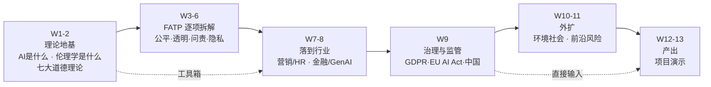

# IS5113 · AI Ethics and Regulations · 课程总览

> **当前材料状态（2026-10-21）**：M06已融合T1 1180段，与U1页行来源并存；T1覆盖p.67–96，其余讲义页未由该音源覆盖。19分40秒残缺MP3按用户授权删除，原始U1文字和独立长音源保留。

> 本课入口。找什么都从这里点。

> 作业、项目及练习索引另有本地私有 `assignment/00-overview/作业总览.md`；个人完整答卷不进入公开仓库。

**一句话**：MScAIB 的 **AI 核心必修课**（3 学分），13 周，Prof. Matthew Lee 主讲。表面叫"AI 伦理与监管"，实质是一门**规范伦理学**课——用两百年前的哲学工具，去分析今天 AI 造成的新问题。

---

## 🔴 现在最要紧的事

✅ **Assignment 1 已于 2026-09-22 提交**。个人作业成品不进入公开仓库；课程任务信息见 [[IS5113_AI_Ethics_and_Regulations/_meta/作业与DDL#⏰ 最近的截止|作业与DDL]]，讲评后仅回填可公开的课程知识点。

✅ **M04 当前材料与审修**：v1.0 / merged 保留；旧 50 页与新 79 页并存，四案已是新版讲义＋转录双源。转录为 969 条记录／968 个唯一时刻（`01:46:32` 两条），`00:00–02:11:34` 只记文本跨度；原音完整性、实际授课日期未另核。2026-10-27 本次全篇独审及实质修复闭合，来源、重要计算与同源浏览器必要图文已核；原生 Obsidian 未直接查看。旧局部 PASS、7 条 🔴 与关键词未命中不作为本次考试或覆盖证明。见 [[IS5113_AI_Ethics_and_Regulations/notes/M04-AI透明-从看得见到信得过|M04]] §0、§6、§8、§9；不把课堂总结/自读安排当作必考或整批排除。

**M03当前材料与验收口径（2026-10-27）**：M03本次所供89页及30段Notta转录全篇独审、集中修复/原审定向接受和主门槛已核。材料仍v1.0/merged，实际授课日期未核；段首00:01→02:02:00只给2:01:59跨度，末段结束/真实总长未知，p53–89仍未录到、不可降权。课堂强调不升级考试承诺，当前直接考试明示0条；来源提问完整中英参考与教学例/现实结论分开。Obsidian原生显示/声轨/外部完整视频及现行法规逐条适用未核，不改变本人学习/提交字段。正式正文及各端回读按本批主写者回执分别登记。

---

## 笔记

| 周 | 主题 | 笔记 | 状态 |
|---|---|---|---|
| 1 | Introduction to AI and Ethics | [[M01-导论-AI与伦理]] | ✅ **v0.9 / transcript:none**（永久无录音）；2026-10-23 全篇教学、来源、原题、计算与图文重审闭合并正式写回。60 页全部保留；p.15/p.25 视频未核，考点置信无红级；材料通过不代表本人已通读 |
| 2 | Ethical Theories, Practical Applications and Limitations | [[M02-道德理论及其应用]] | ✅ v1.0/merged；2026-10-26本次全篇独审、实修与门槛写回完成；86页/三源480段，独立时钟跨度2h18m12s，接缝/原音未核；课堂强调不等于考试明示 |
| 3 | Bias and Fairness | [[IS5113_AI_Ethics_and_Regulations/notes/M03-偏见与公平\|M03 偏见与公平]] | v1.0/merged；本批全篇独审、修复/原审接受和门槛已核，正式回读以本批回执为准；实际日期/末段终点未核，p53–89未录到不可降权，直接考试承诺0条 |
| 4 | Transparency and Explainability | [[M04-AI透明-从看得见到信得过]] | ✅ v1.0 / merged 保留；旧 50 页与新 79 页并存，四案已是新版讲义＋转录双源。转录为 969 条记录／968 个唯一时刻（`01:46:32` 两条），`00:00–02:11:34` 只记文本跨度；原音完整性、实际授课日期未另核。2026-10-27 本次全篇独审及实质修复闭合，来源、重要计算与同源浏览器必要图文已核；原生 Obsidian 未直接查看。旧局部 PASS、7 条 🔴 与关键词未命中不作为本次考试或覆盖证明。 |
| 5 | Accountability and Liability | [[M05-AI问责-责任链治理与救济]] | ✅ v1.0；2026-10-26 本批42单元全篇独审与定向修复完成；20页原题/35作答分量、36项目选项中英对照；Forum两类/十三维已回源纠正。721段来源及缺首尾、12候选未听校、p.49–93缺课堂证据保留；不推定本人学习/提交 |
| 6 | Privacy and Surveillance | [[M06-隐私与监控-从数据采集到行为影响]] | ✅ v1.0（111页讲义 + U1无时间戳第三方文字 + T1音频1180段；T1仅覆盖p.67–96，缺开头、结尾到下课；U1来源/缺席边界保留） |
| 7 | AI in Marketing, Consumer Behavior, HR & Hiring | | 待课件 |
| 8 | AI in Finance & Risk Management, GenAI & Misinformation | | 待课件 |
| 9 | **Global AI Governance & Regulation** ← 法律含量最高 | | 待课件 |
| 10 | Environmental & Social Impacts | | 待课件 |
| 11 | Emerging Risks and Case Studies | | 待课件 |
| 12–13 | Project Presentation | — | 产出为项目，无笔记 |

---

## 元数据

| 文件 | 用途 |
|---|---|
| [[IS5113_AI_Ethics_and_Regulations/_meta/知识层级台账\|知识层级台账]] | ★ 连贯性机制。L0 入场基线 + L1 概念登记表 |
| [[IS5113_AI_Ethics_and_Regulations/_meta/术语表\|术语表]] | 累积的中英对照 + 可默写的英文定义 |
| [[IS5113_AI_Ethics_and_Regulations/_meta/考点库\|考点库]] | 按可信度分级的考点，按 ILO 归集 |
| [[IS5113_AI_Ethics_and_Regulations/_meta/作业与DDL\|作业与DDL]] | 作业、项目、考试的完整要求 |

## 前置资料

| 文件 | 用途 |
|---|---|
| [[IS5113_AI_Ethics_and_Regulations/_prep/课程前置资料\|课程前置资料]] | 官方课程目录 × Course Outline **逐项对校**；项目定位；教授背景；13 周地图 |
| [[口碑与攻略]] | 网络口碑（目前稀薄）+ 从官方材料推出的精力分配建议 |

## 规则

| 文件 | 用途 |
|---|---|
| [[IS5113_AI_Ethics_and_Regulations/CLAUDE\|课程级 CLAUDE.md]] / [[IS5113_AI_Ethics_and_Regulations/AGENTS\|AGENTS.md]] | 本课特有规则：哲学术语译名规范、已知课件错误 |
| [[笔记模板]] / [[转录处理规则]] / [[材料处理规则]] | 全库通用 |

---

## 一分钟必知

**考核**

| 部分 | 权重 |
|---|---|
| 期末笔试（2 小时，英文） | 50% |
| 小组项目（W12–13 演示） | 当前项目文件/课堂50%；旧大纲40%为历史口径 |
| 课堂参与（含线上讨论区） | 10% |

> ❗ **持续评估 ≥25% 且笔试 ≥25%，两部分都要及格**，一边高分补不了另一边。（官方目录规定，讲义上没写）
> **GenAI来源限定**：已核2025/26目录对Participation与Group Project列Yes；2026/27具体任务/考试以已确认要求为准，未确认许可时不使用，本条不撤销其他已核具体许可。

**教材**（Outline，官方目录列的是另外五本法律向的书，且注明 Compulsory Readings: Nil）
- Coeckelbergh, *AI Ethics*, MIT Press, 2020
- Boddington, *AI Ethics: A Textbook*, Springer, 2024

**复习重点（来源限定）**：已核旧目录的笔试维度有application/critical thinking，小组评分另有其他维度。重视理论应用及准确定义；不能据未提memory排除定义题，当前实际题型待核。

---

## 课程的骨架

> 💡 W9 是小组项目 (b) 部分（设计治理策略）的**直接输入**，但它在 10/27 才上，而演示在 11/17。**等 W9 之后才开始做项目只剩三周**——建议提前选定行业与公司、先做完研究部分。

---

## 跨课链接

同属 MScAIB (P85) 项目的另外三门课：

- **IS5542 GenAI in Business**（AI 核心）— W8「生成式 AI 与虚假信息」交叉；**M03 §2.11 ↔ IS5542 M01 §2.9.7**（偏见的入口清单互证）、**M03 §2.13.2 ↔ IS5542 M01 §2.7.2 / §2.9.3**（XAI 与人在环路：IS5542 立场更硬——解释不了就找人兜底）
- **EF5560 Fintech & AI in Finance**（商业核心）— W8「金融风控伦理」交叉；M03 §2.12 的信贷公平指标是 W8 的前置
- **IS6400 Business Data Analytics** — M03 §2.11.4 抽样偏见的现成例子：Airbnb 数据只有美国 6 城、NYC+LA 占 75%（[[IS6400_Business_Data_Analytics/_meta/数据集卡片|数据集卡片]] §5.6）
- **AC6761 AI Accounting**（商业核心）— W5「问责」与审计合规交叉

## 进度追踪

Notion：[🎓 CityU 学习进度](https://app.notion.com/p/526a0242e72d40b3aa4f1a26f9ac7f4f) ｜ [📌 CityU 作业与 DDL](https://app.notion.com/p/c4bab444ac4f457fb3516cf13d19517d)

## 2026-09-30 M05 转录与项目更新

[[M05-AI问责-责任链治理与救济]] 已完成v1.0：从解释/质询/纠正到监管、案例、代理权限、治理工具和六主题研究。原录音误选EF5560已更正并成功重转；`transcripts/M05-transcript-partial.txt`及provenance保留721段，其中12段为未回听过滤候选。录音止于p.48，后半p.49–93不可标略过。

目录新增 `notes/M05-AI问责-责任链治理与救济.md`、`transcripts/M05-transcript-partial.txt`及`.provenance.json`。完整性和来源边界见笔记§9。

项目当前要求：新文件和课堂50%（旧大纲40%保留历史）、最多8人、两部分各最多15页、Part2需公司标杆比较；报告统一12/1 12:00 HKT。既有Group17记录对应11/24展示、11/23邮件PDF（时刻未给），实际分工仍由本人核定；私有作业总览已更新，公开要求见本课作业与DDL。

## 2026-10-15 M06 隐私与监控：第三方无时间戳续讲

本次新增 [[M06-隐私与监控-从数据采集到行为影响]]：13 个正文主题、3 个局部流程图、7 道自测。材料 `status: v1.0 / transcript: merged` 仅表示现有文字已纳入，不代表整个隐私主题或整堂课完整；本轮教学与最终视觉状态以笔记 §9 及发布回执为准，不继承其他讲的旧验收。

来源是同学提供的 19 页无时间戳转录，本人本周未到场；缺对应讲义和前次隐私课材料，无可核听音频与可靠说话人标签。M06 按 Course Outline p.2 的 Privacy and Surveillance 主题编号归档，不把它当已核实际第六周；日期与实际周次待确认。全文使用 U1 物理页及稳定行号，不计算课堂时长或停留比例，未出现不等于课上略过。

新增材料入口：

- `notes/M06-隐私与监控-从数据采集到行为影响.md`：中文自学笔记。
- `transcripts/M06-transcript-peer-untimed.txt`：剔除标题及导出元数据的原词逐页文本，保留原始页行号。
- `transcripts/M06-transcript-peer-untimed.source.json`：公开来源哈希、每页行数和删行坐标。

M05 原有 p.49–93 课堂证据缺口继续保留，不因新稿出现相似主题而标为补齐。本次没有确认新 DDL；U1 p.5 L006–L010 的 Canvas 更新提示识别不清，具体行政信息待当前 Canvas 核对。

## 2026-10-20 M06 讲义 p.1：项目日期与交付现行口径

新原件 `Module 6 - AI Privacy and Security and Responsible AI Framework.pdf`（111页，Canvas file16295592）p.1 明确：Group 1–15 在 2026-11-17 展示，Group 16–29 在 2026-11-24 展示，每组10分钟。展示用 PPT Deck 转成 PDF，在展示前1天发邮件给教师；未给小时。

项目报告用 Word 或 PDF，由 coordinator 在 Canvas 提交，统一截止 **2026-12-01 12:00 香港时间（UTC+08:00）**。本日 Assignments 仍只见 Assignment1；提交链接尚未发布，不编造上传入口。旧“本组展示后7天”是9/30书面与课堂历史口径，当前以M06 p.1的新统一截止为准，不删除历史引文。

Notion 既有10/9核对记录为本人 Group17：Part1 A17 金融交易算法AI伦理；Part2 B17 时尚业趋势预测/设计自动化政策，具体公司自选。本轮回读保留该组别和任务分配，未重新查询MyGroups。因此按Group17对应安排为11/24展示、11/23发送展示PDF；若教师后续改组须重核，不冒充本轮重新确认组员。本组具体展示小时未给。

两部分各最多15页、最多8人、项目50%及贡献/AI使用披露沿用既有已核项目文件。当前仍为要求登记/准备，不改变本人已提交/评分状态。来源：[M06讲义](https://canvas.cityu.edu.hk/courses/71377/files/16295592) p.1、[10/9分配公告](https://canvas.cityu.edu.hk/courses/71377/discussion_topics/638730)、Notion既有Group17登记。

## 2026-10-21 G/E实质审修

M04补NCA显著性、新p44/p50–51原问与逐问中英答案，并核Apple物理p43–44/p45重复COMPAS；旧标题锚和课堂时钟保留。M06补公开问句、逐问中英、红队/可控性/四支柱/数据血缘，p41原文短语/p60方向歧义明确。旧50/新79页和新111页/U1第三方19页分别定位；本人没去上课、无时间戳、音频/说话人/前次课未核等限制不变。

8篇本次范围的教学、来源、R疑点和同源显示已集中核对并正式写回；L/R硬项0，旧G/E配额FAIL及局限如实保留。[[G-E诊断与实质修复回执-2026-10-21|本次G/E回执]]。

## 2026-10-21 · 23 条待核线索闭环

M04 的 9 条线索中，H04 实核发现原生／事后解释混写并修复两处；7 条父节提示为误报，H10 的双版本约束合理保留。另清理顶部过期候选状态告示，整篇 pending 与 v1.0／merged 不变。 [[待核线索核实与修复回执-2026-10-21|23 条线索回执]]

## 2026-10-21 转录融合与录音归档

M06已融合T1 1180段，与U1页行来源并存；T1覆盖p.67–96，其余讲义页未由该音源覆盖。19分40秒残缺MP3按用户授权删除，原始U1文字和独立长音源保留。

录音新旧名称、来源和缺口见 [[_meta/audio-library/录音索引|全库录音索引]]。本次来源/教学/R疑点与实际同源显示已核对，原生Obsidian与逐声全听校未做；个人学习/提交字段不动。

## 2026-10-27 M03 本次审修

M03本次所供89页及30段Notta转录全篇独审、集中修复/原审定向接受和主门槛已核。材料仍v1.0/merged，实际授课日期未核；段首00:01→02:02:00只给2:01:59跨度，末段结束/真实总长未知，p53–89仍未录到、不可降权。课堂强调不升级考试承诺，当前直接考试明示0条；来源提问完整中英参考与教学例/现实结论分开。Obsidian原生显示/声轨/外部完整视频及现行法规逐条适用未核，不改变本人学习/提交字段。正式正文及各端回读按本批主写者回执分别登记。

## 2026-10-27 M04 全篇审修

本次保留材料状态和历史授课登记；同一拒贷记录、五路径研究图、完整 tie 搜索、FPR/FNR 分母、21 项审查及法律角色/日期边界均以本篇已审内容为准。Notion、跨文件应用及 Git 状态单独回读，不升级本人学习字段。
