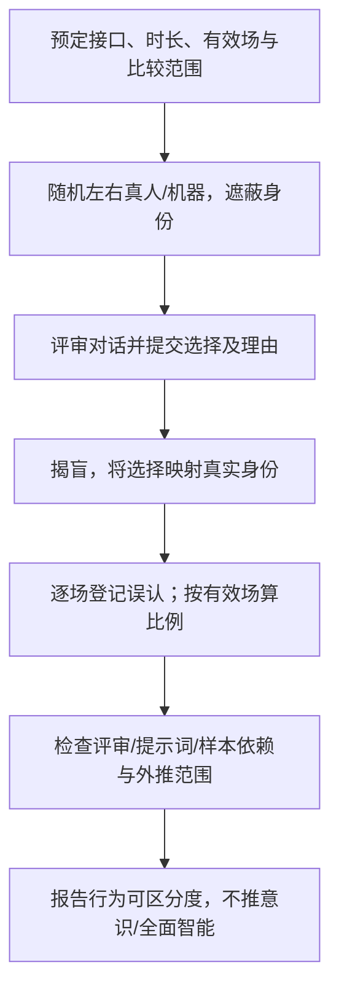
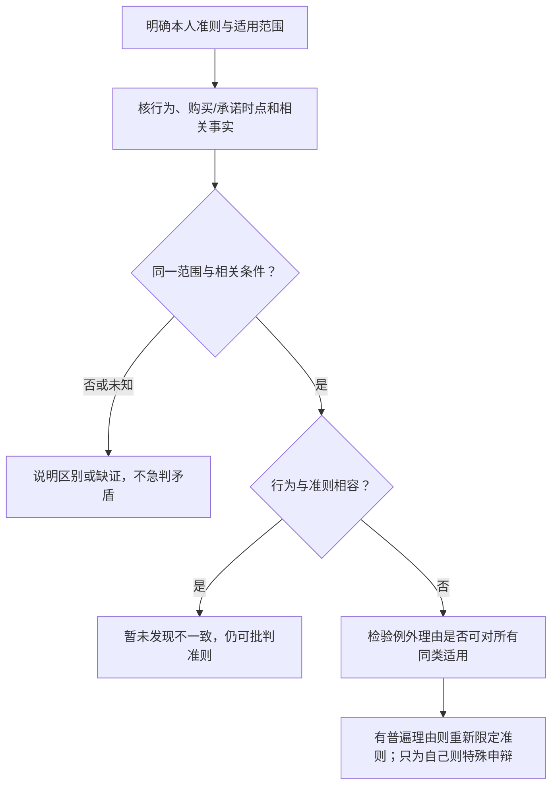
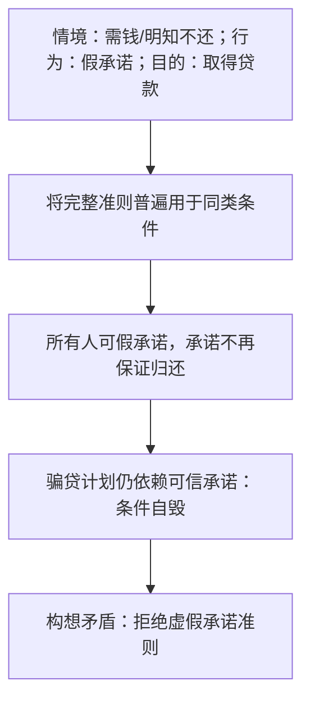
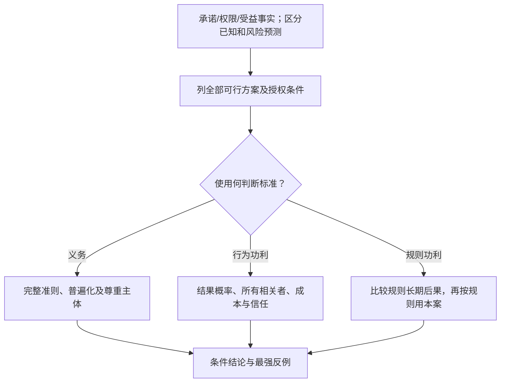
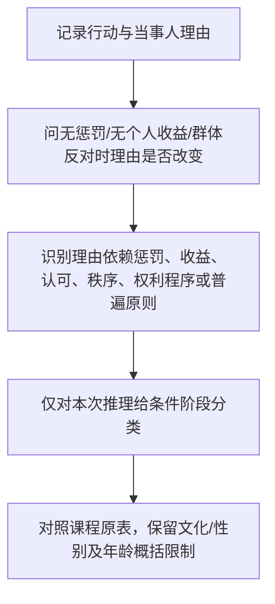
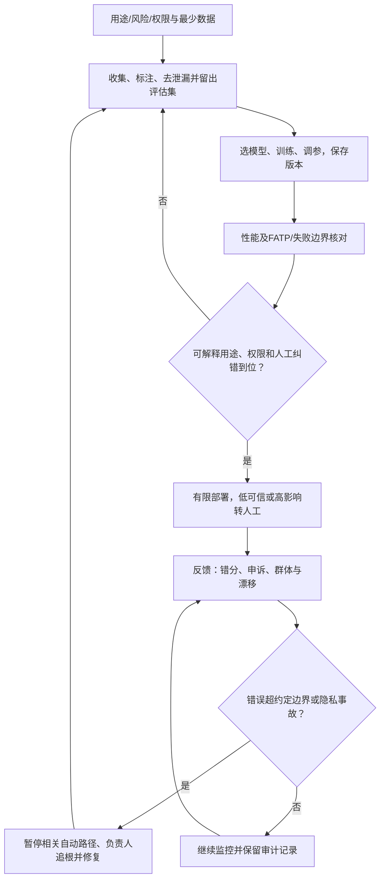
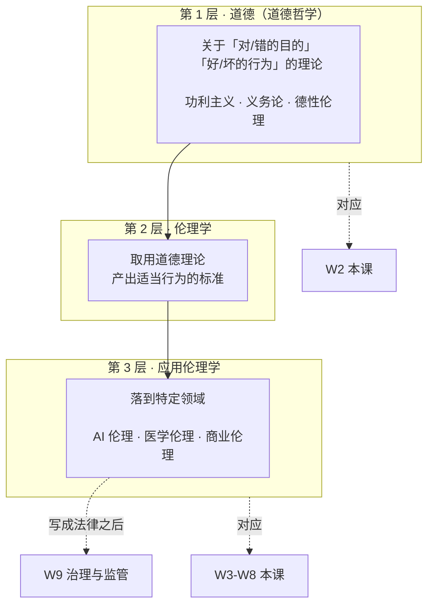
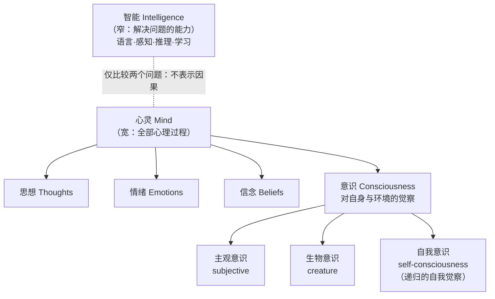

# M01 · 导论：AI 与伦理

> **2026-10-23 本次重审**：全篇独立高中知识起点审查、来源/原题与实际图文核对已完成；本次正式回执位于 `_meta/vault-notes-review-20261023/is5113-m01/review.json`。材料 status/transcript 保留原值，永久无录音、视频未核等限制仍在；旧机制/验收记录不作为本次通过依据。写回、同步和 Git 状态另记。

> **本讲一句话**：这一讲不解决任何伦理问题，它负责把后面十讲要用的**三套词汇**发给你——AI 是什么（技术侧）、伦理学是什么（哲学侧）、以及为什么这两件事必须放在一起谈（商业侧）。
> **原始材料**：`Module 1 - Introduction.pdf`（60 页） ｜ **转录**：`none`（本讲未录音，永久无课堂补充）

---

## 0. 三分钟速览

**这一讲讲了什么**

课件是四段拼接的：课程行政（p.1–13）→ AI 是什么（p.14–23）→ 伦理学是什么（p.24–35）→ 商业 AI 全景（p.36–60）。

四段之间几乎没有过渡，但它们合起来回答一个问题：*为什么一群商科学生要花一个学期学哲学？

答案是：AI 已经在替人做决定了，而"该不该这么决定"这类问题，技术指标（准确率、F1）答不了，只能靠伦理学的框架去答。

第二、三段就是在分别给你技术侧和哲学侧的最小词汇表。

**学完你应该能**

1. **说清** intelligence（智能）、mind（心灵）、consciousness（意识）三者的区别，并解释为什么图灵测试测的只是第一个
2. **复述**图灵测试的 3 项优点与 4 项批评，并据此评价"某某 AI 通过了图灵测试"这类新闻
3. **区分** morality（道德）、ethics（伦理学）、applied ethics（应用伦理学）三层，并说出 AI 伦理位于哪一层
4. **判断**定言令式与黄金法则的关键差异（不是同一回事）
5. **用 FATP** 四个词给任意一个 AI 商业案例做一次初步伦理体检

**如果只记三件事**

1. **伦理学不是"讲道理"，是一套可被审视的推理程序**——结论要靠事实、共享价值和逻辑撑住，能说服一个"抱持怀疑但心态开放"的听众
2. **道德相对主义是本课要面对的第一个挑战**，但"有些价值是相对的"推不出"所有价值都是相对的"
3. **FATP（公平、问责、透明、隐私）是整门课的目录**，W3–W6 就是把这四个字逐一拆开讲

---

## 1. 开始之前 · 知识衔接

### 1.1 你已经有的

本讲是全课起点。读者只需会四则运算、简单代数和百分数；不假定会 AI、机器学习、统计、哲学或法律。[[IS5113_AI_Ethics_and_Regulations/_meta/知识层级台账#L0 · 入场基线|L0 台账]]只登记依赖，不替代正文教学。

先认一条最小 AI 链：一条人工判断过的“咨询文本→应去部门”叫带标签样本；模型从一批样本中学习输入与答案的对应关系。训练集用来学规则，验证集用来选阈值，最终测试集冻结到最后一次检验。准确率是正确条数除以全部条数；它必须和误报、漏报及群体分项一起读。§2.7 会用 20 条小例把阈值、泄漏、部署、反馈与漂移走完。

哲学、伦理学和法律也从当前案例所需位置起步。

### 1.2 本讲全新引入的概念

| 概念 | English | 展开于 |
| --- | --- | --- |
| 图灵测试 | Turing Test | §2.2.1 |
| 智能 / 心灵 / 意识 | Intelligence / Mind / Consciousness | §2.2.2 |
| 认知科学 vs 工程取向 | Cognitive Science vs Engineering | §2.2.3 |
| 道德 / 伦理学 / 应用伦理学 | Morality / Ethics / Applied Ethics | §2.3.1 |
| 道德相对主义 | Moral Relativism | §2.3.2 |
| 道德一致性 | Moral Consistency | §2.3.3 |
| 义务伦理 · 定言令式 · 黄金法则 | Duty Ethics · Categorical Imperative · Golden Rule | §2.4.2 |
| 功利主义 | Utilitarianism | §2.4.3 |

本组沿用上表列名，继续列后面的条目。

| 概念 | English | 展开于 |
| --- | --- | --- |
| 善良意志 · 特殊申辩 · 无知之幕 | Good Will · Special Pleading · Veil of Ignorance | §2.4.4 |
| 伦理困境 | Ethical Dilemma | §2.4.5 |
| 科尔伯格道德发展阶段 | Kohlberg's Stages of Moral Development | §2.5 |
| 破坏性技术 | Disruptive Technology | §2.6.1 |
| FATP | Fairness, Accountability, Transparency, Privacy | §2.6.2 |

### 1.3 为什么这一讲放在这里 · 重排说明

这是第 1 讲，没有"承接"，只有"铺路"。它铺的路是：

- §2.2（AI 是什么）→ 为 W3 偏见、W4 透明性打底。

  要先区分可观察的理性行动与尚未由本材料证明的内在理解，才能进一步讨论偏见和解释边界
- §2.3–2.5（伦理学）→ **直接就是 W2 的前置**。M02 把这里一笔带过的义务论、功利主义等展开成多类伦理理论逐一深挖
- §2.6（FATP）→ **是 W3–W6 的目录**。公平→W3，透明→W4，问责→W5，隐私→W6

**重排说明**

讲义原顺序是「课程行政(p.1–13) → AI(p.14–23) → 伦理学(p.24–35) → 商业 AI(p.36–60)」。

本笔记基本保留这个大顺序，但做了两处调整：

1. **把 p.45 的 FATP 从第四段抽出来**，与 p.35「为什么需要 AI 伦理」合并成 §2.6。

原因：FATP 夹在一堆商业 AI 泛论中间容易被忽略，但它其实是整门课的目录，值得独立成节
2. **把第四段（p.36–59）按应用任务重排进 §2.7**。

先用一个咨询分流例串起数据、开发、部署、反馈和治理，再解释各行业及每页独有内容，避免把不同范围的流程图混成一套步骤。重复与模板问题见 [[#9.3 课件自身的问题|§9.3]]；重排不删页，也不凭模板风格判断考核优先级。

小节 ↔ 页码的完整对应见 [[#8. 讲义页码映射|§8]]。

---

## 2. 正文

### 2.1 这门课怎么运作（先把实用信息说完）

讲义 p.1 是封面页，仅列课程标题，无独有教学内容；按封面例外处理。

以下行政信息按 M01 讲义及本篇当时核对日期阅读。

后续材料若有新人数、项目占比或期限，真实版本冲突须在对应讲次保留。

本候选不把旧大纲40%默改为后续项目50%，也不更新作业登记。

这一小节对应讲义 p.2–13，是课程行政信息。它不是"知识"，但它决定你怎么分配精力，所以放最前面、一次说完。

**p.3–13 行政页逐页行动入口**

| 页 | 独有信息与学生动作 |
|---:|---|
| 3、7、10 | 三张 agenda 逐步展开 Course Objective、Logistics、Seminar、Participation 与 Group Project；用于确认课程要求的组成，不是三份不同任务 |
| 4–5 | 课程目标是把伦理理论用于商业/社会 AI；六项 ILO 依次要求理论、FATP、商业价值、影响评估、治理政策和批判讨论 |
| 6、9 | 研讨/案例/线上反思/团队项目；学生要承担小组责任并训练口头、逻辑、批判与写作能力 |
| 8 | Modules 下载、Assignments 提交、邮件/预约沟通（“our KM course”为模板残留） |
| 11 | 50% 两小时笔试、40% 八人小组项目、10% 参与；参与含出勤、小测/短作业、研讨和线上讨论，两大考核部分须分别及格 |
| 12 | 两本推荐教材和按主题追加阅读，不等于 compulsory reading |
| 13 | W1–W13 完整主题地图，见表后清单 |

读 p.8 的直接动作：材料去 Modules，正式提交只去 Assignments；邮件/预约是沟通渠道，不是提交渠道。

**p.13 周次清单**：W1 导论；W2 理论；W3 公平；W4 透明；W5 问责；W6 隐私；W7 营销/消费者/HR；W8 金融/风险/生成式 AI 与错误信息；W9 全球治理监管；W10 环境社会影响；W11 新兴风险案例；W12–W13 项目展示。

授课教师（讲义 p.2）：Prof. Matthew Lee，HKMU 数字商业与 AI 讲席教授，曾任 CityU 系主任、学院院长、副校长。

讲义自述 200+ 篇论文、引用 38,000+、H 指数 83、Stanford 全球前 2% 高被引学者。

邮箱 `Matthew.lee@cityu.edu.hk`。

💡 这一页对预习的用处只有一点：他是资深 IS（信息系统）学者。

不是哲学系出身——所以这门课讲伦理理论的方式是"商科应用取向"，考核语言也全是"应用与批判性思维"（见下文）。

教师背景详见 [[IS5113_AI_Ethics_and_Regulations/_prep/课程前置资料#6. 授课教师|课程前置资料 §6]]。

**考核结构**（讲义 p.11，数字经[[IS5113_AI_Ethics_and_Regulations/_prep/课程前置资料|官方课程目录]]核实）

| 部分 | 权重 | 说明 |
| --- | --- | --- |
| 期末笔试 | **50%** | 2 小时，英文作答 |
| 课堂参与 Participation | **10%** | 含线上讨论区发帖 |
| 小组项目 Group Project | **40%** | 研究 + 治理策略设计，W12–W13 演示 |

> ❗ **两条讲义没写、但官方目录写死的规则**：
> 1. **持续评估（10%+40%）至少要拿 25%，笔试也至少要拿 25%，且两部分必须都及格才能通过本课。** 一边高分补不了另一边。
> 2. **Participation 和 Group Project 官方明确允许使用 GenAI。**（笔试当然不行。）

**官方评分维度**（讲义未给，考前值得对照）

- 小组项目：Original thinking / Rational analysis / Structure and formation / Reasonable conclusion
- 笔试：Application of learned knowledge **with critical thinking**

> 💡 **换个说法（笔记补充）**：三项评分语言全都指向**应用与批判性思维**，没有一个字提"记忆"或"复述"。这强烈暗示笔试不是名词解释题，而是给你一个场景、要你用理论去分析。所以背定义只是起点，练"拿理论套案例"才是重点。M02 的作业（交警摄像头案例）就是这种题型的预演。

**教材**（讲义 p.12）

- Mark Coeckelbergh, *AI Ethics*, MIT Press, 2020
- Pauline Boddington, *AI Ethics: A Textbook*, Springer Nature Singapore, 2024
- McKinsey, *What is AI?*（2024-04-03）

官方课程目录上写的是另外五本、且全是法律向的书，与这两本不重叠。

详见 [[IS5113_AI_Ethics_and_Regulations/_prep/课程前置资料#4.3 阅读材料：几乎不重叠|课程前置资料 › 4.3 阅读材料：几乎不重叠]]。

官方明确写 Compulsory Readings: Nil，所以两边都属推荐性质，不是必读。

<details><summary>讲义 p.6 英文任务与管理者反思问题（无选项）</summary>

The course uses seminars, case learning and discussion, out-of-class sharing via an online discussion forum, teamwork, and an interactive and participative approach. Take the course from the perspective of a responsible business professional: **What changes do you, as a manager, intend to make to yourself, your team, and in the organization?**

</details>

中文限定词：问题要求管理者分别写自己、团队、组织三个层次的改变。**English reference answer（⚪ 笔记自拟）**: I would document my own decision criteria, require my team to record evidence and dissent, and establish an organizational review and appeal process for high-impact AI decisions. The exact controls should depend on the system's risks and authority.

**学习方式**（讲义 p.6, p.9）

13 次课，研讨式（seminar），强调课堂互动、小组讨论、线上讨论区反思、小组项目。

教授在 p.6 明确要求：以"一个负责任的商业专业人士"的视角来上这门课——即不断问自己"作为管理者，我打算对自己、对团队、对组织做出什么改变"。

> 💡 这句话不是客套。Participation 占 10% 且评分维度包含"对临时提问的准备"，意味着课上被点到时能否用这个视角作答，是会计分的。

**所以呢**：把这些行政信息弄清楚之后，真正的内容才开始——下一节从"AI 是什么"讲起。

先给"智能"和"心灵"这两个后面反复要用的词定好位。

---

### 2.2 AI 是什么（讲义 p.14 章节标题页起，p.15–23）

#### 2.2.1 图灵测试（Turing Test）

**是什么**

1950 年，Alan Turing 提出的一个判据：让一位审问者（interrogator）通过文字与两个看不见的对象对话，一个是人、一个是机器。

如果审问者无法可靠地分辨哪个是机器，那么这台机器就应当被认为具有智能。

它的原名叫**模仿游戏（Imitation Game）**——这个名字比"测试"更准确，因为它衡量的是"模仿得像不像"，而不是"内部是否真的在思考"。

**为什么需要它**

因为"机器能不能思考"这个问题无法直接回答——我们连"思考"是什么都没有公认定义。

图灵的做法是把一个无法回答的哲学问题，替换成一个可以操作的行为测试。

这是一次典型的"绕开定义、直接测行为"的科学策略。

**课件原例**（讲义 p.15–16）

课件给出优缺点两栏：

| 优点 STRENGTHS | 缺点 WEAKNESSES |
| --- | --- |
| **可操作、简单**（tractability and simplicity） | **审问者的判断是主观的**（interrogators' subjective judgement） |
| **覆盖面广**（breadth of subject matter）——要通过一个设计良好的图灵测试，机器必须会用自然语言、会推理、有知识、能学习、能解决问题 | **有些人类行为并不智能**（some human behaviour is unintelligent） |
| 除认知智能外，测试还可纳入**共情与审美**（empathy and aesthetic sensitivity） | **有些智能行为并不像人**（some intelligent behaviour is inhuman） |
|  | **是"真的"在思考，还是仅仅在"模拟"思考**？ |

**课件还整页贴了一篇 2025 年的论文**（讲义 p.17）

> **Large Language Models Pass the Turing Test**
> Cameron R. Jones, Benjamin K. Bergen — Department of Cognitive Science, UC San Diego
> arXiv:2503.23674v1 [cs.CL], 31 Mar 2025

摘要要点：评测 4 个系统（ELIZA、GPT-4o、LLaMa-3.1-405B、GPT-4.5），做了两组随机化、受控、预注册的图灵测试，面向独立人群。

参与者进行 5 分钟对话，同时与一名真人和一个系统交谈，再判断哪个是人。

| 系统 | 被判定为「人类」的比例 |
| --- | --- |
| **GPT-4.5**（提示其扮演类人人设） | **73%** —— *显著高于*真人参与者被选中的比例 |
| LLaMa-3.1-405B（同样提示） | 56% —— 与被比较的真人无显著差异 |
| ELIZA（基线） | 23% |
| GPT-4o（基线） | 21% |

论文结论：这是**首个“任何人工系统通过标准三方图灵测试”的实证证据**。

> 🔗 **版本更新（外部资料，获取日 2026-10-23）**：讲义 p.17 展示的是 2025-03-31 的 arXiv 预印本快照，上述两组 5 分钟测试和四系统数字应按该快照保留。论文已于 2026 年在 PNAS 以 *Large language models pass a standard three-party Turing test* 正式发表，并新增第三个 15 分钟研究及更多系统（[PNAS](https://doi.org/10.1073/pnas.2524472123)）。因此不能把“两组、四系统”写成当前正式版研究的全部范围。

> ⚠️ **73% 这个数字的含义要看清楚**：GPT-4.5 不只是"骗过了人"，而是**比真人更像人**——审问者把它选作"人类"的次数，比选真正的人还多。
>
> 这个反直觉的结果恰好印证了上表右栏的第二、三条批评：真人在 5 分钟闲聊里的表现，未必比一个被精心提示的模型更"像人"。**图灵测试测的是"像不像人"这个相对量，而不是"聪不聪明"这个绝对量**——一旦对照组（真人）表现平平，通过它就没有想象中那么难。

**🎙️ 课堂补充**

本讲无录音，无课堂补充。

**💡 换个说法（笔记补充）**

第二栏那四条批评，可以用一个日常场景全串起来。假设你在微信上跟一个账号聊了十分钟，分不出对面是人是 AI：

- 也许只是**你**不够会问（→ 主观判断）
- 也许对面那个"人"本来就答得敷衍、错字连篇，所以 AI 装得很容易（→ 有些人类行为并不智能）
- 反过来，一台能瞬间算出 20 位数乘法的机器**因为太强而暴露了自己**，可它显然是智能的（→ 有些智能行为并不像人）
- 就算它全程表现完美，它可能只是在做极其复杂的模式匹配，内部一片漆黑（→ 模拟 vs 真的思考）

第三条尤其值得记：**图灵测试测的是"像人"，不是"聪明"**。这两件事被它绑在了一起，而它们本来可以分开。

**⚠️ 常见误解**

- ❌ **"某某模型通过了图灵测试，所以它有意识了。"** —— 图灵测试从设计上就不测意识，它只测外部行为。

  Jones & Bergen 测的也只是"能否被判定为人"，与"是否有内在体验"无关。

  见下一节的三层区分
- ❌ **"图灵测试早就没人在乎了。"** —— 恰恰相反，课件专门整页贴了 2025 年的论文。

  把“像人交谈”当作所有 AI 系统的统一工程目标并不合适：系统应按自己要完成的任务评价。但图灵测试仍可作为衡量特定对话条件下人机可区分度的实验范式，不能从课件观点推出“现在没有人以通过它为研发目的”。
- ❌ **"通不过图灵测试就不算 AI。"** —— 例如一个只接收医学影像、没有对话接口的模型，应按诊断任务的表现及限制评价，不能因为它不会闲聊就排除其 AI 身份；这里是笔记假设例，不是在报告某个模型已超过医生。

**与其他概念的关系**

图灵测试是把“智能”转成可操作行为评测的一次经典尝试，它绕开了 §2.2.2 的心灵与意识问题。

这个"绕开"在今天有直接的伦理后果：如果我们无法判断 AI 是否真的理解。

那么把决定权交给它就需要额外的正当性论证——这正是 W5「问责与责任」的核心问题。

**所以呢**：图灵测试只测行为、不测内心，这个"只测外部"的局限，正是下一节要正面拆开的问题——智能、心灵、意识到底是不是一回事。

---

#### 2.2.1.1 盲选记录、统计分母与误判

把图灵测试真的执行一遍（笔记补充微实验，不是p.17论文原样本）：输入为遮蔽身份的两个文字对话通道，每场一真人H、一系统M，顺序随机。

同一评审有固定5分钟及相同接口，结束必须选“哪个是人”，之后才揭盲。

输出是每场盲选及理由、误判次数与分母。

样例固定一评审10场，不拿它推总体统计结论。

| 场次 | 左/右身份（揭盲后登记） | 评审选为人 | 是否把机器认作人 |
| --- | --- | --- | --- |
| 1 | H / M | 右 | 是 |
| 2 | M / H | 右 | 否 |
| 3 | H / M | 左 | 否 |
| 4 | M / H | 左 | 是 |
| 5 | M / H | 左 | 是 |
| 6 | H / M | 右 | 是 |
| 7 | H / M | 左 | 否 |
| 8 | M / H | 左 | 是 |

本组沿用上表列名，继续列后面的条目。

| 场次 | 左/右身份（揭盲后登记） | 评审选为人 | 是否把机器认作人 |
| --- | --- | --- | --- |
| 9 | H / M | 右 | 是 |
| 10 | M / H | 左 | 是 |

按十场表的真实身份与盲选结果统计：

1. 对每场先揭盲，将“选左/选右”对应到人或机器。
2. 机器被选7场，真人被选3场。预定有效场数为10。
3. 机器误认比例为 $7/10=70\%$；真人被选为 $3/10=30\%$。

每场只有一次二选一，不因为有两个通道就用20作分母。70%也不是认知题正确率。随机选择基线50%来自本二选一设计。

10场不能证明总体显著超过随机。同评审重复有依赖；有效场、退出与无效场排除规则须预定，不能事后选择有利分母。

本图回答：盲选、揭盲与统计分母该怎样读？

从上/左方开始。

机制图箭头表示分析顺序，结构图表示分类或课程衔接，虚线比较不表示因果。

内容限原讲义或本节已声明的笔记补充。





**例子走图（笔记补充）**：第1场H/M、选右，揭盲后记机器误认；最后7/10=70%，别把两个通道当20场。

文字替代：盲选、揭盲与统计分母须由具体输入、理由与条件支持；图不补出缺失录音、现实权限或精确总体结论。停止或换路条件按对应正文读。

<details><summary>读图自测：出现两场退出就自动算7/12吗？</summary>

不能。按预定有效场/缺失处理协议决定分母，并另报退出；不能事后改口径。

</details>

**失败与最强反例**：懂得伪装闲聊的系统可被误认却在严肃任务不可靠；说话风格特殊的真人也可被误判，故结果依赖评审、时长、对照人与persona。

胜过这个样本不等于拥有内在体验。

p.17对应的Jones/Bergen研究采用三方测试及persona，其73%是该条件的误认比例，不能拿本补例70%冒充其原数或把论文分母猜成100。

🔗 [作者论文arXiv:2503.23674](https://arxiv.org/abs/2503.23674)，核对2026-10-02。

<details><summary>迁移：再出现两场退出且未提交选择，机器误认率是7/12吗？</summary>

不是自动7/12。

若预先约定未提交排除，有效分母仍10并另报退出2。

若原协议定义所有分配场次，则另解释缺失处理。

不能结果出来才选有利分母，也不把缺失当机器胜/负。
</details>

#### 2.2.2 智能 · 心灵 · 意识（Intelligence / Mind / Consciousness）

本节要回答：能解决问题、能生成拟人语言，是否已经证明有内在体验？

先分解题表现和心理过程，再读对照表。

原补充已明确，下一词预测机制不能单独证明有意识或没有意识。

以下比喻也须保持这项未知。

**是什么**

课件（讲义 p.18）给了两个定义，其区别是本讲最容易被跳过、但后面用得最多的一处：

> **Intelligence（智能）**是获取并运用知识与技能来解决问题的能力，使用既有知识，并运用语言、感知、推理、学习方面的能力。
>
> **Mind（心灵）**指涉更宽的一系列心理过程，包括思想、情绪、信念，以及**意识**（consciousness，即对自身与环境的觉察）。

意识本身又分三层：

| 层 | English | 含义 |
| --- | --- | --- |
| 主观意识 | subjective consciousness | 有"感觉起来是什么样"的主观体验 |
| 生物意识 | creature consciousness | 作为一个有机体对环境的清醒觉察 |
| **自我意识** | **self-consciousness** | **递归的自我觉察**——不仅知道，还知道自己知道 |

**为什么需要它**

因为**智能可以有、而心灵可以没有**。这个区分是后面所有"AI 该不该负责""AI 有没有权利""AI 能不能被信任"讨论的地基。

一台机器可以在解题能力上远超人类（高智能），却完全没有情绪、信念、对自身处境的觉察（无心灵）。

反过来，一只狗有生物意识和情绪（有心灵的一部分），但解不了微积分（低智能）。

两个维度是正交的。

**课件原例 ①**（讲义 p.19）—— 智能 vs 心灵，五维对照

| Attribute 维度 | Intelligence 智能 | Mind 心灵 |
| --- | --- | --- |
| **Definition** 定义 | The ability to acquire and apply knowledge and skills.<br>获取并运用知识与技能的能力 | The faculty of consciousness and thought.<br>意识与思想的官能 |
| **Measurement** 测量 | Can be measured through IQ tests and cognitive assessments.<br>可用 IQ 测验与认知评估测量 | Difficult to measure as it encompasses various mental processes.<br>难以测量，因其涵盖多种心理过程 |
| **Types** 类型 | Includes emotional, fluid, and crystallized intelligence.<br>含情绪智能、流体智能、晶体智能 | Includes conscious, subconscious, and unconscious mind.<br>含意识、下意识、无意识 |
| **Role in Problem Solving** 解决问题中的角色 | Helps in analyzing and solving complex problems.<br>帮助分析并解决复杂问题 | Processes information and generates solutions.<br>处理信息并生成解决方案 |
| **Development** 发展方式 | Through education, practice, and exposure to new experiences.<br>通过教育、练习、接触新经验 | Through learning, memory formation, and cognitive processes.<br>通过学习、记忆形成、认知过程 |

> 💡 **这张表最该注意 Measurement 那一行**：智能**可测**，心灵**难测**。
>
> 这条差异是整门课的一个隐藏前提——AI 的全部评估指标（准确率、精确率、召回率、F1）测的都是**智能侧**；主观体验侧没有已公认的充分判据，不能把行为指标直接等同意识测量。所以"这个模型有没有意识/有没有真的理解"这类问题，在工程上没有任何评估体系接得住。这也是为什么 §2.2.1 图灵测试只能退而求其次去测行为。

（讲义 p.18 是同一标题的前一页，给的是上面引用的文字定义，配一张仿真人形机器人照片，来源标注 `thisvsthat.io/intelligence-vs-mind`。）

**课件原例 ②**（讲义 p.22）—— 人类智能 vs AI，"Summary of Differences"

| Feature 特征 | Human Intelligence (Biological) | AI Intelligence (Digital) |
| --- | --- | --- |
| **Hardware & Software** 硬件与软件 | **Fused together** 融为一体<br>（If brain dies, mind dies 脑死则心灭） | **Separated** 相互分离<br>（可备份、可复制） |
| **Knowledge Sharing** 知识共享 | **Very slow** 极慢<br>（需要教与学） | **Instantaneous** 瞬时<br>（完美数字克隆） |
| ⭐ **Knowledge Capacity** 知识容量 | **Limited** 受限于单个人的寿命 | **Nearly unlimited** 近乎无限<br>（靠机器组网） |
| **Power Efficiency** 能效 | **Amazing** 惊人<br>（约 30 瓦即可运行） | **Terrible** 糟糕<br>（需要发电厂） |

> ⭐ **教授在这一页用红框 + 红箭头单独圈出了 "Knowledge Capacity" 那一行。** 这是整份 60 页讲义里**唯一一处这种视觉强调**——属于明确的重点信号，值得记牢。

> 💡 **换个说法（笔记补充）**：这四行其实在说同一件事——**人类的智能被"焊死"在肉体上，AI 的不是**。
>
> 脑死则心灭、知识只能靠教、容量受寿命限制，三者全都源自第一行的"硬件与软件融为一体"。AI 把这两层拆开了，于是同时获得了可复制、可瞬时共享、可无限扩容三种能力。
>
> 代价写在最后一行：**能效**。人脑约 30 瓦，AI 要发电厂。这一行直接通向 **W10「环境与社会影响」**，讲义 p.58 的可持续性那页讲的正是它。

**🎙️ 课堂补充**

本讲无录音，无课堂补充。

**💡 换个说法（笔记补充）**

用计算器来想最清楚：计算器在"算术"这个窄任务上的智能远超你，但没人会问"关掉计算器算不算谋杀"。

因为我们默认它没有心灵——没有主观体验，没有对自身存在的觉察。

现在把计算器换成一个能写诗、能安慰人、能说"我不想被关掉"的大模型。

它的行为可以模拟有心灵的对话；但下一词预测这一机制本身既不能证明有意识，也不能单独逻辑证明没有意识。

内部主观体验仍无已公认的直接测量。

这就是为什么"AI 权利""AI 人格"这类议题今天既热闹又棘手：我们唯一能观察的是行为，而行为恰恰是图灵测试已经证明不可靠的那个指标。


**⚠️ 常见误解**

- ❌ **把 mind 翻译成"思维"然后与 intelligence 混用。** 课件用 mind 是取其"含意识、情绪、信念"的宽义，译作"心灵"才不丢信息
- ❌ **认为自我意识就是"能说出'我'"。** 大模型天天说"我"，但 self-consciousness 要求的是**递归的自我觉察**，不是能生成第一人称代词

**与其他概念的关系**

这个三分法是 §2.2.1 图灵测试局限的根源（它只测智能层）。

也是 W5「问责与责任」的前提——不能仅凭拟人对话赋予系统道德主体资格。

现实问责不能由“意识尚未证实”直接推出唯一归属。应沿控制、知情、权限与职责追踪开发者、供应商、部署组织、操作人员和管理者；谁解释、纠正和承担何种后果，要按制度与事实分配，W5 再展开。

这条线索会贯穿整门课。

**所以呢**：行为解题能力与主观体验是不同问题，前者指标不能直接回答后者。

下一节说明 AI 研究为何可以关注“解决好问题”，而不以“模仿人”作为唯一目标。

---

#### 2.2.3 AI 的两种取向：认知科学 vs 工程学

**是什么**

课件（讲义 p.20–21）区分了研究 AI 的两条路：

|  | 认知科学取向 | 计算机科学 / 工程取向 |
| --- | --- | --- |
| 目标 | **解释人类是怎么思考的** | **把问题解决好** |
| 对"像人"的态度 | 建模就是为了像人 | 像不像人无所谓 |
| 课件原话 | 认知科学的目标是解释人如何思考，若顺带推进了 AI，那是额外收获 | "We will use any idea or approach that gives good results!"（讲义 p.21） |

课件明确说明**本课采取工程取向**：AI 关心的是**理性地思考或理性地行动**（thinking or acting rationally / intelligently）。

**为什么需要它**

课件用了一个很好的反例（讲义 p.20）：

> 人类在很多事情上表现很差。大多数人做算术的速度和准确度都不如计算机——**所以一台"达到人类水平"的计算器根本算不上好用。**

这句话说明：**以人为标准不总是对的**。自动驾驶要的是"在所有情况下做对的事"，不是"开得像人"——人类司机会疲劳、会路怒、会分心。

**🎙️ 课堂补充**

本讲无录音，无课堂补充。

**💡 换个说法（笔记补充）**

这个区分在伦理上有个不太直观的推论：**正因为我们选了工程取向、不要求 AI 像人，AI 才会做出人绝不会做的决策**。

一个按“最小化总伤亡”这一预设目标运行的自动驾驶系统，可能在极端情况下算出牺牲车内乘客。这只是相对给定目标与约束的**工具理性**选择，不自动等于道德上正当。

也是任何人类司机都不会做的。

工程取向带来的效率，和它带来的伦理麻烦，是同一件事的两面。

这个张力会在 M02 的功利主义部分再次出现。

**⚠️ 常见误解**

- ❌ **"AI 就是在模仿人脑。"** 课件明确否认。神经科学只是 AI 的八个灵感来源之一，不是蓝图

**与其他概念的关系**

工程系统会执行被写入的目标、约束和更新规则，但不会自动获得一套已经证明正当的伦理标准。系统是否存在主观体验仍未知；工程目标、道德正当和制度责任是三个不同问题。

**所以呢**：工程取向要求外部伦理与治理去审查目标、约束和后果；具体问责按控制、知情、权限和义务分配。

下一节先补完"AI 是什么"这条线的最后一块：它到底是从哪些学科拼出来的。

---

#### 2.2.4 AI 的八个学科源流

讲义 p.23 列出 AI 的思想来源。这一页信息密度高但概念都不难，用表格记即可：

| 学科 | 贡献了什么 |
| --- | --- |
| 逻辑学 Logic | 把理性编码成逻辑规则 |
| 数学 Mathematics | 概率论等工具，用来给理性建模 |
| 计算机科学 Computer Science | 算法研究；多数人认为理性主体靠算法运作 |
| 经济学 Economics | 效用（utility）、最大化收益；决策论与博弈论正是关于此 |
| 神经科学 Neuroscience | 把人脑当作生物对象研究并尝试模拟 |
| 心理学 Psychology | 人与动物如何行动；提供"信念""意图""感知"等更高层概念 |
| 硬件工程 Hardware Engineering | 通过研究实际元件，设计出智能的计算机 |
| 语言学 Linguistics | 语言与思维的关系；语言是人类理性的重要部分 |

> 💡 **换个说法（笔记补充）**：经济学那行引入效用与目标最大化，后面功利主义也讨论“计入什么结果、为谁计入”。二者可作机制类比；优化某个目标数值，不证明 AI 具有完整道德理论。原“AI 天生就是个功利主义者”只可作为这个类比，不能当主体或规范判断。

**p.23 页底三条补充**：经济学家 Herbert Simon 与 Allen Newell 参与了早期 AI 研究；具身观点认为某些智能需要机器人等身体与环境互动；GPU 和专用硬件提升了基础神经网络算法性能，是深度网络近期成功的重要工程因素。三条分别补“人物来源、具身假说、硬件条件”，不能只记八个学科名称。

**所以呢**："AI 是什么"到这里讲完了——历史、定义、路线、源流都齐了。

下一节换到这门课真正的主角：伦理学本身是什么，它和道德、应用伦理学是什么关系。

---

### 2.3 伦理学是什么（讲义 p.24 章节标题页起，p.25–35）

#### 2.3.1 三层结构：道德 → 伦理学 → 应用伦理学

**是什么**

讲义 p.25 给了一组层层递进的定义。**这是本讲最该背下来的一段**，因为它是后面所有讨论的坐标系。原文（考试可直接用）：

> **Ethics** refers to standards of conduct, standards that indicate how one should behave based on **moral duties and virtues**, which themselves are derived from principles of right and wrong.
>
> - **Morality (moral philosophy)** consists of theories of "right" and "wrong" **ends**, and "good" and "bad" **acts**.
> - **Ethics** draws on moral theories to provide standards of appropriate conduct.
> - **Applied ethics** deals with standards of appropriate conduct in a particular application domain (e.g. **AI ethics**).

中文对应：

| 层 | 中文 | 干什么 | 例子 |
| --- | --- | --- | --- |
| 1 | **道德（道德哲学）** | 提供关于"对/错的目的"和"好/坏的行为"的**理论** | 功利主义、义务论 |
| 2 | **伦理学** | **取用**道德理论，产出适当行为的**标准** | "不应欺骗"这类准则 |
| 3 | **应用伦理学** | 把标准落到**特定领域** | **AI 伦理**、医学伦理、商业伦理 |

**为什么需要它**

因为日常中文里"道德"和"伦理"基本混用，但在这门课里它们是**不同层级**，且考试会用英文出题。搞混了，答"what is applied ethics"这类题就会失分。

**💡 换个说法（笔记补充）**

用软件工程类比最贴切：

- **道德（morality）** = 底层的理论/算法库——回答"什么算好"
- **伦理学（ethics）** = 基于这些库写出的**规范与准则**——回答"那么该怎么做"
- **应用伦理学（applied ethics）** = 把规范部署到**某个具体业务域**——AI 伦理就是部署到 AI 这个域

所以AI 伦理不是一套独立的新道德，它是把已有的道德理论（康德、密尔那些）搬到 AI 场景里用。

这解释了为什么 M02 要花整整一讲、86 页来讲两百年前的哲学——那是本课的标准库。

**⚠️ 常见误解**

- ❌ **"AI 伦理是全新的东西。"** 它是 applied ethics 的一个分支，用的是老理论
- ❌ **把 ethics 当成"道德感"或"良心"。** 课件的定义里 ethics 是**standards（标准）**，是外部的、可被论证的东西，不是内心感受

**与其他概念的关系**

这个三层结构是全课的骨架：M02 处理第 1 层（道德理论），M03–M08 处理第 3 层（AI 各领域的应用伦理），M09 处理当第 3 层被写成法律之后会怎样。

**所以呢**：有了道德、伦理学、应用伦理学这三层坐标。

下一节就可以正面处理一个直接挑战这门课存在意义的立场——如果压根没有普世的对错，谈何"标准"？

---

#### 2.3.2 道德相对主义（Moral Relativism）

**是什么**（讲义 p.26）

> 价值由我们成长其中的社会决定，**不存在普世价值**。道德价值不过是随文化而异的习俗或约定。

**为什么需要它**

因为这是任何伦理课都必须先过的一关。

如果相对主义是对的，那这门课就没得上了——既然没有普世标准，讨论"AI 该不该做某事"就毫无意义。

只能说"在你们文化里不该，在我们文化里该"。

**💡 换个说法（笔记补充）**

这个立场在 AI 语境下有很强的现实版本：一套人脸识别系统在中国、欧盟、美国面对的社会预期完全不同。

相对主义者会说"那就各按各的来"。

但真实世界里，同一套模型往往要**同时**部署在多个法域——这时候"各按各的来"根本不是一个可执行的答案。

W9「全球 AI 治理」处理的正是这个困境。

**⚠️ 常见误解**

- ❌ 把"应当尊重文化差异"等同于"接受道德相对主义"。

  前者是一种态度，后者是一个关于道德本质的强主张（"不存在普世价值"）。

  可以持前者而拒绝后者

**与其他概念的关系**

M02 会把相对主义拆成**主观相对主义**和**文化相对主义**两种，并各给一组 case for / case against。本讲只需知道有这个立场、以及它构成挑战。

**所以呢**：相对主义质疑的是"有没有普世标准"。

下一节的道德一致性问题换了个角度发难——就算有标准，人自己也做不到，那讲标准还有什么用？

---

#### 2.3.3 道德一致性（Moral Consistency）与"人是自私的"

**是什么**

讲义 p.27 给了六个案例，问「你认为以下各人在道德上有多不一致？」：

|  | 案例 |
| --- | --- |
| A | 反堕胎者，同时支持死刑 |
| B | 素食者，但买皮鞋 |
| C | 社会主义者，却送孩子上私立学校 |
| D | 鼓吹家庭价值的政客，却有婚外情 |
| E | 环保活动家，却开汽油大 SUV |
| F | 认为偷窃是错的，却盗版软件和音乐 |

**为什么需要它**

这一页配合 p.26 构成对伦理学的**第二重挑战**：既然人人都言行不一，谈道德有什么用？

**课件如何回应**（讲义 p.28，重要）

> 虽然某些价值可能是相对的、人也常常自私，**但我们不必因此断定所有价值都是相对的、或人永远自私**。伦理理论试图提供一组与我们的道德直觉相协调的基本道德原则。

**💡 换个说法（笔记补充）**

这句话是本讲的**方法论声明**，值得单独记住。它的逻辑形式是：

> 「有些 X 是 Y」 **推不出** 「所有 X 都是 Y」

这是一个很朴素但极其常用的反驳。

以后遇到"AI 反正也做不到完全公平，那还谈什么公平"这类论调，用的就是同一个反击：部分做不到，推不出完全不必做。

F 这一条（反对偷窃却盗版）离本课最近——它正是知识产权与 AI 训练数据问题的日常版。官方 Keyword Syllabus 里就有 "Intellectual property and copyright considerations" 这一条。

**⚠️ 常见误解**

- ❌ 以为这六个案例有标准答案。

  课件问的是"在多大程度上"（to what extent），它是讨论题。

  目的是暴露"言行不一"其实有程度差别、也有可辩护的情形（比如 B 的皮鞋可能是成为素食者之前买的）

**所以呢**：课件对两个挑战的回应是同一句话——"有些人做不到"推不出"标准没有用"。

带着这条方法论，下一节可以正式进入四大伦理理论——它们就是"标准"具体长什么样的四个候选答案。

---

#### 2.3.3.1 准则、事实与相关区别

<details><summary>讲义 p.27 完整英文原题与 A–F（无单选答案）</summary>

**To what extent do you think the following individuals are morally inconsistent?**

A. an anti-abortionist who supports the death penalty

B. a vegetarian who buys leather shoes

C. a socialist who educates his children at a private school

D. A politician who advocates family values and has an affair

E. An environmental activist who drives a gasoline SUV

F. Someone who thinks stealing is wrong but makes illegal copies of computer software or music.

</details>

中文限定词是“to what extent”：不是机械判真/假，而要说明准则、事实、时间和例外。**English reference answers（A–F，⚪ 笔记自拟）**

- **A.** The two positions may conflict if the principle is “all intentional killing is wrong”; a narrower principle distinguishing innocent life from punishment would require further justification and safeguards against error.
- **B.** Buying new leather after adopting a principle against animal products is inconsistent; continuing to use shoes bought earlier may be less inconsistent because the purchase decision occurred before the commitment.
- **C.** Private schooling conflicts with an absolute opposition to private education; a reformer using the present system during transition must still explain equal access and why no feasible alternative exists.
- **D.** Secretly having an affair strongly conflicts with publicly advocated family fidelity; a consensual non-monogamous arrangement would change the relevant facts.
- **E.** Driving a gasoline SUV for convenience conflicts more strongly with environmental commitments when lower-harm alternatives exist; necessary remote or emergency use requires separate analysis.
- **F.** Unauthorized copying conflicts with a principle against taking or violating others’ rights, although copying is not physically identical to removing an object and the exact rights must be stated.

p.27六个一致性例逐问判断（⚪参考作答，非官方唯一答案）：先写当事人实际接受的准则，再核行为、时间与范围，最后看有没有相关区别。

不能只看到行为标签就判人虚伪。

| 原例 | 需要核的准则与事实 | 不一致成立的条件 / 最强区分 |
| --- | --- | --- |
| A反堕胎且支持死刑 | 若准则为“任何人的生命在任何情况下不得主动剥夺” | 两者冲突；若准则只保护无辜/未犯重罪者，结论需进一步辩护谁有权划分、误判风险，不能直接说逻辑矛盾已证 |
| B素食却买皮鞋 | 素食是饮食政策，还是不资助动物伤害？鞋是否真皮、何时购买？ | 接受后一准则后新买资助伤害才冲突；成为素食者前购得并继续穿不等现在新买，改时间会改变结论 |
| C社会主义者送子私校 | 准则是平等教育制度/反对私校，还是当前照护孩子？ | 明确反对任何私教却为己例外才矛盾；主张改革而过渡期用现有资源需说明公平过渡理由，不能由政治标签直接推禁令 |
| D家庭价值政客婚外情 | 已承诺忠诚或公开要求忠诚、实际是否欺骗伴侣？ | 接受忠诚准则却秘密违反很强冲突；若事实为彼此知情的非单偶安排，不能仅用“婚外关系”三个字偷换同一行为 |
| E环保者开汽油SUV | 准则是绝不排放，还是尽合理努力减环境伤害？用途/替代方案？ | 有低伤害可行替代却只为便利作己例外，较难辩护；偏远救援等必要用途不等同全部环保承诺失效 |
| F反偷窃却盗版 | 准则保护什么利益、复制是否未经允许、是否明确反对非法复制？ | 若接受“未经许可侵占/侵犯作品权益不可”却为自己例外，冲突；复制与夺走原物机制不同，须给权利依据，不把伦理分析冒作具体法域版权裁判 |

本图回答：准则、相关事实和例外该怎样读？

从上/左方开始。

机制图箭头表示分析顺序，结构图表示分类或课程衔接，虚线比较不表示因果。

内容限原讲义或本节已声明的笔记补充。





**例子走图（笔记补充）**：B旧皮鞋在接受不资助动物伤害准则前买，沿相关区别出口；改为采纳后新买，则核是否违反准则。

文字替代：准则、相关事实和例外须由具体输入、理由与条件支持；图不补出缺失录音、现实权限或精确总体结论。停止或换路条件按对应正文读。

<details><summary>读图自测：只是看到素食与皮鞋标签，能直接判虚伪吗？</summary>

不能。要先核准则到底针对饮食还是资助伤害、购买时点以及材质。

</details>

变式答案：B在改采不资助动物伤害准则前买鞋，后来继续使用，旧购买不反驳当前准则。

若准则还规定必须立即弃用所有动物产品，则“继续穿”又触发另一个适用条款。

必须写清检验的是哪个承诺，不能靠任意补准则保人无错。

**所以呢**：一致性是准则—事实的检验，不是从“某人做不到”推伦理标准整体无效。

### 2.4 四大伦理理论初览

讲义 p.28 一次性抛出四种理论。**这里只需要建立直觉，M02 会把它们（以及另外三种）逐一深挖。**

#### 2.4.1 全景

**是什么**

先想一个日常场景：室友忘关炉子把你家熏黑了，你决定要不要当面说他。

室友忘关炉子后，你可能用四种理由决定是否当面对质：
- 权威规则：是否有大家认可的规矩？
- 义务：自己作为室友应尽什么责任？
- 后果：当面责备之后，关系和总体处境会怎样变化？
- 普遍化：如果所有人在相同条件下都这样对质，准则能否成立？

四个问题不是同一把尺子。下面四条理论分别突出其中一种理由。

这四种"讲道理"的方式，对应的正是下面四套伦理理论——讲义 p.28 把它们一次性摆了出来，作为整门课的第一张地图：

| 理论 | 一句话 | 核心问题 |
| --- | --- | --- |
| **宗教伦理** Religious Ethics | 有一本权威规则书告诉我们该守什么规则 | 规则从哪来？→ 经典 |
| **义务伦理** Duty Ethics | 履行你的义务。**义务与权利是一体两面** | 我的义务是什么？ |
| **功利主义** Utilitarianism | 唯一至高原则：追求**最大多数人的最大幸福** | 哪个选项后果最好？ |
| **康德的进路** Kant's Approach | 表16说明1 | 这条准则能成为普遍法则吗？ |

**表16说明1 · 康德的进路 Kant's Approach / 一句话**

你的行为能被一致地普遍化吗？

问自己"**如果人人都这么做会怎样**？

"


> ⚠️ 课件把「义务伦理」和「康德的进路」并列成两条，但康德主义**就是**义务论最著名的版本。这是课件的一处口径不一致，见 [[#9.3 课件自身的问题|§9.3]]。M02 会把它们统一成 Kantianism (Deontology) 一条。

**所以呢**：这四条现在都只是一句话速写，够你在读下面四小节时心里有张地图，但还远远不够拿去答题。

§2.4.2–§2.4.5 会把"义务伦理"和"康德的进路"这两条拆开揉碎，配上完整的论证与例子。

功利主义在这里先按下不表，M02 会用整整一节把它拆成两支深挖。

#### 2.4.2 义务伦理与定言令式（Duty Ethics / Categorical Imperative）

**是什么**（讲义 p.29）

义务伦理**强调遵守道德规则或义务的重要性，而不是只盯着行为的后果**。它的核心工具是**定言令式**：

> **Act only according to that maxim whereby you can, at the same time, will that it should become a universal law.**
> （只按照那样一条准则去行动：你能够同时愿意它成为一条普遍法则。）

课件给了通俗版：**在采取任何行动之前，问自己——"我能愿意每个人在类似情况下都这么做吗？"**

**与黄金法则的对比**（讲义 p.29，重要考点）

课件特意把定言令式与**黄金法则（Golden Rule）**对照：

> 「己所欲，施于人」（Do unto others as you would have them do unto you）——出自新约《登山宝训》，孔子的教诲中也有。

**💡 换个说法（笔记补充）· 两者的关键差异**

课件只是把它们并列，没讲清区别，但这个区别几乎肯定是考点：

|  | 黄金法则 | 定言令式 |
| --- | --- | --- |
| 参照系 | **我**的偏好 | **任何**理性存在者 |
| 追问 | 我希望别人怎么对我？ | 这条规则能不能被所有人普遍遵守？ |
| 失效场景 | 一个受虐狂"希望别人打自己"，按黄金法则他就该去打别人 | 不受个人偏好影响 |

一句话：黄金法则以"我的欲望"为尺，定言令式以"逻辑上的可普遍化"为尺。

康德认为前者不够格当道德法则，正是因为它依赖偶然的个人偏好。

**⚠️ 常见误解**

- ❌ **"定言令式就是黄金法则的西方版。"** 见上表，两者的尺不同
- ❌ **"义务论完全不看后果。"** 准确说法是**不以后果作为对错的判据**，而不是对后果视而不见

**与其他概念的关系**

M02 会把定言令式拆成两个表述（普遍化 + 把人当目的而非手段），并给出完全义务 / 不完全义务的区分。本讲的直觉版足够应付 §2.4.5 的困境题。

**所以呢**：定言令式用“能不能普遍化”作为最终对错判据。分析准则和义务冲突时仍须知道可预见伤害、必要性与替代方案；这些事实不会把后果变成唯一标准。下一节的功利主义则以后果作为最终判断中心。

#### 2.4.2.1 从虚假承诺准则到构想矛盾

把康德的“人人如此”走成推理（笔记补充）：问题是“为拿到贷款，我明知不会还却承诺会还，是否可做？

”输入包括缺钱、明知不还、依赖对方相信承诺、以欺骗取得贷款。

输出为准则是否可作为普遍法则，而不是猜哪个人会生气。

1. 准则写完整：“当我需要钱但不愿归还时，以虚假还款承诺获得贷款。”不把行为改写成模糊的“借钱”。

2. 设所有在同类条件的人均这样承诺；这是统一规则，不是要求人人一天做同一件事。

3. 借款行动依赖别人把承诺当可信理由；普遍采用虚假承诺后，承诺不再提供这种保证，靠它骗到钱的计划失去前提。

4. 准则一面依赖可信承诺、一面普遍撤销这个条件，形成构想矛盾；在该分析中不能据此行动。

本图回答：普遍化与计划依赖条件该怎样读？

从上/左方开始。

机制图箭头表示分析顺序，结构图表示分类或课程衔接，虚线比较不表示因果。

内容限原讲义或本节已声明的笔记补充。





**例子走图（笔记补充）**：虚假承诺取得贷款，计划依赖可信承诺；普遍虚假后这个前提被撤销，走构想矛盾。

文字替代：普遍化与计划依赖条件须由具体输入、理由与条件支持；图不补出缺失录音、现实权限或精确总体结论。停止或换路条件按对应正文读。

<details><summary>读图自测：如借款人诚实说明风险并获同意，还能直接套欺骗矛盾吗？</summary>

不能。准则事实已改，原依赖欺骗前提不成立，须重新分析。

</details>

最强反例与条件变式：真实借款人坦诚说明风险而对方同意，不再以虚假承诺剥夺知情判断，原矛盾不能套用。

遭遇不可预见灾难无法还款，也不等于承诺时明知不还。

只说“如果人人借钱社会会乱”既过宽也没点出欺骗所依赖条件。

原理依据为康德原著第二部分虚假承诺例；🔗 [Groundwork英译原文](https://www.gutenberg.org/files/5682/5682-h/5682-h.htm)，获取2026-10-02。

<details><summary>讲义 p.32 完整英文题干与 1a–4b</summary>

**Which of the following is a special case that justifies breaking a generally accepted rule?**

1a. You should respect the traffic code, but it is ok to drive through a red light if you are late for work.

1b. You should respect the highway code, but it is ok to drive through a red light if you are taking a critically ill person to the hospital.

2a. You should keep your word, but it is ok to break a social engagement if something more interesting comes up.

2b. You should keep your word, but it is ok to break a social engagement if you have just contracted an infectious disease.

3a. You should pay your taxes, but it is ok not to pay them if you are short of money that year.

3b. You should pay your taxes, but it is ok not to pay them if they are being spent on a nuclear arms program.

4a. Murder is wrong, but it would have been ok to assassinate Hitler in 1942.

4b. Murder is wrong, but it would be OK to kill someone planning a terrorist attack.

</details>

中文限定词：题目问何种事实足以辩护破例，不等于 b 全对、a 全错。**English reference answers（1a–4b，⚪ 笔记自拟）**

- **1a.** Being late for work is personal convenience and does not justify imposing traffic risk on others.
- **1b.** Transporting a critically ill person may create a competing duty to protect life, but only if the emergency is real and no safer alternative exists.
- **2a.** A more interesting invitation is not a consistent reason to break a promise.
- **2b.** An infectious disease is relevant because attending may harm the other person; notice and rescheduling should be considered.
- **3a.** Personal shortage alone does not create a private exemption from a common tax rule; lawful relief must apply consistently.
- **3b.** Conscientious opposition to nuclear spending raises a serious conflict, but it does not automatically justify non-payment without addressing common obligations and lawful alternatives.
- **4a.** Preventing Hitler’s mass violence supplies a grave-harm argument, yet strict duty ethics must still confront the prohibition on killing, evidence, necessity, and alternatives.
- **4b.** Stopping an imminent terrorist attack may be necessary, but planning, imminence, evidence, and non-lethal alternatives must be verified before lethal force can be defended.

**讲义 p.32 八个原小问：逐项条件作答（⚪ 笔记参考）**

原题问哪些特殊情形足以辩护破例。先写行为准则，再检验相关条件，不能把 a 一律判错、b 一律判对。

1. **1a · 迟到闯红灯**：个人迟到只是便利理由。它没有说明为什么同类人都应获得例外，也把风险转给其他道路使用者，因而不足以辩护。
2. 1b · 送危重病人闯红灯：保护生命与个人便利不同。

  仍须核病情紧急、无更安全替代，以及对他人的风险。

  只有这些条件得到支持，才有讨论例外的理由。

  “救人”标签不允许任意闯灯。
3. 2a · 为更有趣的活动爽约：原承诺使对方形成安排。

  只因自己发现更有趣的事便毁约，是为自己的偏好开例外，尚无可以对所有同类情况采用的理由。
4. 2b · 染上传染病而改约：保护赴约者免受感染，是与原承诺有关的新条件。

  应通知并考虑延期或其他履约方式。

  这个可对同类人适用的保护理由，比单纯追求趣味更能辩护改约。
5. 3a · 手头紧而不交税：困难可能支持依法申请延期或其他公平安排。

  个人不能仅凭“我缺钱”给自己免除共同负担。

  应说明为何相同困难者也可获同样安排。
6. 3b · 反对税款用于核武计划：这是良心与公共制度的冲突。

  需讨论共同负担、其他抗议途径及拒缴的理由，不能因为动机指向和平，就把 b 自动判为正当。
7. 4a · 1942 年刺杀希特勒：理由是阻止重大伤害，不是个人便利。

  仍须核事实、必要性、替代方案与人的主体地位。

  严格康德框架对不可杀害的约束也须回应，不能用预期好结果直接代替论证。
8. 4b · 杀死策划恐袭的人：先核策划与危险证据、紧迫性以及是否存在制止或拘捕等替代。

  仅有“可能作恶”的判断，不足以取消生命价值。

  还须论证必要性及对所有同类情境的适用条件。

以上是伦理条件分析，不构成现实交通、税务或暴力行动的法律许可。

**a4不是个人便利**。

这些是伦理推理，不给现实交通/税/暴力法律许可；严格康德框架如何处理各准则不能被“大多数觉得可以”替代。

**所以呢**：普遍化检验看计划的理由和逻辑前提，公众赞成率及好后果都不能直接代替它。

#### 2.4.3 功利主义（Utilitarianism）

**是什么**（讲义 p.28, p.30）

> 有且只有一条至高道德原则——**我们应当追求最大多数人的最大幸福**。最大化幸福。由 Jeremy Bentham 与 John Stuart Mill 在 1800 年前后确立。

<details><summary>讲义 p.30 完整英文开放题（无选项）</summary>

What do you think is the relationship between pleasure and happiness? Is happiness just the sum of pleasures, or can you have many pleasures and still be unhappy?

Are the richest nations of the world home to the happiest people in the world?

According to Bertrand Russell (1872–1970), “To be without some of the things you want is an indispensable part of happiness.” What did he mean? Do you agree?

</details>

中文限定词：分别回答概念关系、财富是否足以推出幸福、Russell 句意和你的有条件立场。**English reference answer（⚪ 笔记自拟）**: Pleasure can contribute to happiness, but repeated pleasure may coexist with poor health, relationships, or purpose. National wealth alone does not establish happiness without comparable evidence. Russell can be read as saying that limits and continued aspiration may give life meaning; I agree only for non-basic wants, not deprivation of food, housing, or care.

**课件原例**（讲义 p.30）课件用三个问题引导思考幸福的本质：

1. 快乐（pleasure）与幸福（happiness）是什么关系？

幸福只是快乐的总和吗？

还是可能拥有很多快乐却仍然不幸福？

2. 世界上最富裕的国家，住着最幸福的人吗？

3. Bertrand Russell（1872–1970）说：

> *"To be without some of the things you want is an indispensable part of happiness."*

（得不到某些想要的东西，是幸福不可或缺的一部分。

）他什么意思？

你同意吗？

**讲义 p.30 逐问参考作答**（⚪ 笔记解释；课件是开放讨论题，没有唯一标准答案）：

1. 快乐与幸福是什么关系？

快乐通常指某一刻的愉悦感，幸福还包含较长期的关系、健康、目标感与自主性；快乐可以是幸福的一部分，却不必等于幸福的总和。

一个人可能不停刷短视频、每次都得到短暂快感，却因睡眠、关系和目标受损而总体不幸福。

答题时先说明你采用哪一种“幸福”定义，不能把两词无说明地当同义词。

2. 富裕国家的人一定最幸福吗？

** **不能只凭财富下结论。

较高收入可以改善基本需要和安全感，但“最富裕”不自动推出“最幸福”；还要比较健康、关系、自由、分配与调查口径。

讲义未给跨国数据、年份或幸福指标，所以不能在这里编一个国家排名；若题目要求实证判断，需先指定人均收入与幸福测量及同一年的数据。

3. Russell 那句话是什么意思、是否同意？

一种合理解读是：并非所有欲望立刻被满足才会幸福；保留追求、期待和珍惜的空间，可能构成生活的意义。

我**有条件同意**：这适用于非必要的愿望，不适用于食物、住房或医疗等基本需要的匮乏；不能把贫困美化成幸福。

这个限定也说明，把“幸福”压成单一快乐分数会遗漏重要差异。

**💡 换个说法（笔记补充）**

这三个问题指出功利主义的测量难题：幸福没有一套无争议、可直接相加的单位。若明确利益相关者、期间、尺度、概率与价值假设，可以建立条件性的效用模型；但算出排序不证明这些度量与权重本身道德正当。

这一点对 AI 尤其致命——AI 必须把目标写成一个可计算的数。

推荐算法把"幸福"操作化成了"停留时长"，然后我们得到了成瘾式的信息流。

目标函数与真实价值之间的落差，是 AI 伦理最核心的技术—哲学问题之一。

**⚠️ 常见误解**

- ❌ **"功利主义 = 自私自利。"** 恰恰相反，它要求把**所有人**的幸福平等计入，包括你不喜欢的人。中文"功利"一词的贬义是翻译造成的误导
- ❌ **"最大多数人的最大幸福"可以直接拿来算。** 谁算在内？算多久？怎么加总？这些 M02 会展开

**所以呢**：功利主义要求比较后果，但“谁被计入、算多久、用什么尺度和权重”没有无争议的唯一答案。§2.4.5.1 的数字只是显式假设下的教学模型，不是从题面自动测出的真实幸福。

看他怎么用"善良意志"和"普遍化"绕开这个计算难题。

#### 2.4.4 康德的进路：善良意志、特殊申辩、无知之幕

**是什么**（讲义 p.31）

> 在康德看来，**幸福不等于道德**。只有**善良意志（good will）**具有终极的道德价值。道德规则应当是**普遍的**。

配套三个概念：

| 概念 | English | 含义 |
| --- | --- | --- |
| **特殊申辩** | Special pleading | 对自己搞例外的自我合理化 |
| 黄金法则 | The golden rule | 以你希望被对待的方式对待他人 |
| **无知之幕** | Veil of ignorance | 选择规则时不知道自己会处于哪种社会位置、拥有何种优势或个人特征，以限制偏私；不只是站到双方位置换位思考 |

**为什么需要它**

"特殊申辩"是定言令式的实操检测器。

你说"人人都不该插队，但我今天赶时间所以可以"——这就是特殊申辩，它恰恰证明你的准则无法普遍化。

**课件原例**（讲义 p.32）课件用四组对照题问「以下哪些属于可以为破例辩护的特殊情况？」：

|  | a（较难辩护） | b（较易辩护） |
| --- | --- | --- |
| 1 | 上班迟到了，可以闯红灯 | 送危重病人去医院，可以闯红灯 |
| 2 | 有更有趣的事，可以爽约 | 刚染上传染病，可以爽约 |
| 3 | 今年手头紧，可以不交税 | 税款被用于核武计划，可以不交税 |
| 4 | 1942 年刺杀希特勒是可以的 | 杀死一个正在策划恐袭的人是可以的 |

**💡 换个说法（笔记补充）**

这四组的设计很精巧：**每组的 a 和 b 破的是同一条规则，区别只在理由的性质**。

- 1a–3a 主要诉诸当事人便利；**4a刺杀希特勒涉及防重大伤害，不属于个人便利，须独立论证**
- b 系列的理由都指向**更高阶的价值或对他人的重大伤害**（生命、公共健康、和平、阻止大规模杀戮）

康德式检验先写完整准则，问同类情境下它能否被一致普遍化，而非问多数人是否喜欢。

“赶时间可以闯灯”与“送危重病人且没有更安全替代”给出的理由不同。

还须核对他人风险、必要性及替代方案，才能评价例外是否可以对所有同类情况适用。

原笔记用“大多数人会觉得可以接受”说明分界。

这只是社会直觉，不足以完成 §2.4.2.1 的普遍化推理。

此处依同节补充机制统一，不能据此给现实交通法律许可。

> 注意第 4 组两条**都**难：即便是"刺杀希特勒"，严格的康德主义者也会说谋杀就是错的。课件把它放在最后，就是要暴露义务论的刚性。M02 的「case against Kantianism」会正面处理这个问题。

**⚠️ 常见误解**

- ❌ 把无知之幕当成康德的概念。

无知之幕（veil of ignorance）是 John Rawls 在 1971 年系统提出的，比康德晚近两百年。它要求选择原则时不知道自己将是富或穷、强或弱、多数或少数的一方；若不知道自己会落在哪个位置，还愿意接受什么规则？这比普通换位思考更严格（[Stanford Encyclopedia of Philosophy](https://plato.stanford.edu/entries/original-position/)，获取日 2026-10-23）。

课件把它列在「Kant's approach」一页下，属于归类粗糙。

M02 讲社会契约论时会把它归还给 Rawls。

见 [[#9.3 课件自身的问题|§9.3]]

**所以呢**：特殊申辩给了你一个"这条规则我是不是在给自己开后门"的检测器。

下一节用一个真实的两难场景，让康德和密尔的方法正面对撞，看它们会不会给出不同答案。

#### 2.4.5 伦理困境：遗产案（Ethical Dilemma）

<details><summary>讲义 p.33 完整英文原题（货币符号仅作 Markdown 转义）</summary>

An elderly woman living alone in poor circumstances with few friends or relatives is dying,

and you, her friend, are at her bedside.

She draws your attention to a small case under her bed, which contains some momentos along with the money she has managed to save over the years, despite her apparent poverty. She asks you to take the case and to promise to deliver its contents, after she dies, to her nephew living in another state.

Moved by her plight and by your affection for her, you promise to do as she requests.

After a tearful goodbye, you take the case and leave.

A few weeks later the old woman dies,

and when you open the case, you discover that it contains \$500,000 dollars. No one else knows about the money, or the promise you made.

You learn that the nephew is a compulsive gambler and has a drug addiction.

What would Kant say you should do?

What would John Stuart Mill say you should do?

What would you do? Why?

</details>

中文限定词：分别写 Kant、Mill 和自己的论证；原题没有官方唯一答案。**English reference answer（⚪ 笔记自拟）**: Kant would normally require keeping the promise because a maxim permitting secret promise-breaking would undermine promising. A utilitarian answer is conditional because the prompt gives no probabilities or comparable utilities; it must compare feasible options, harms, trust, and longer-term effects under stated assumptions. **English reference answers（⚪ 笔记自拟）**

- **Kant:** Kant would normally require keeping the promise because a maxim permitting secret promise-breaking would undermine promising.
- **Mill:** A utilitarian answer is conditional because the prompt gives no probabilities or comparable utilities; it must compare feasible options, harms, trust, and longer-term effects under stated assumptions.
- **My view:** I would keep the promise unless I obtained valid authorization or a lawful protective arrangement. The promise created a specific obligation, and the prompt does not authorize me to replace the woman’s decision with my preferred use of the money. I would reconsider if new facts showed incapacity, fraud, or a legally appointed trustee with protective duties.

**课件原例**（讲义 p.33）

> 一位独居、境况贫寒、亲友寥寥的老妇人临终，你作为她的朋友守在床边。她指着床下一个小箱子，里面除了纪念品，还有她多年积攒的钱。她请你带走箱子，并**承诺**在她死后把里面的东西交给住在外州的侄子。你被她的处境和情谊打动，答应了。几周后老妇人去世，你打开箱子——**里面有 50 万美元**。没有别人知道这笔钱，也没人知道你的承诺。你还得知，**那个侄子是个嗜赌成性的瘾君子**。
>
> 康德会说你该怎么做？John Stuart Mill 会说你该怎么做？你会怎么做？为什么？

**💡 换个说法（笔记补充）· 两条路的分叉**

这道题是本讲**唯一一次让两大理论正面对撞**，价值极高。分叉点在这里：

康德（义务论）：承诺就是承诺。

把"在无人知晓且钱可挪作他用时，可以毁约"当作普遍法则——那么承诺这个制度本身就会瓦解，没人再会相信任何承诺。

所以必须把钱给侄子，无论后果如何。

他的赌瘾是他的问题，不是你毁约的理由。

功利主义的条件分析：比较所有可行方案的预期总效用，不能仅由赌瘾预设转捐更优。

原题没有各结果概率、援助收益、程序成本与信任损失，因而不能断言Mill必然要求不给侄子。

行为/规则层次及完整补充算例见下文。

“你会怎么做？

为什么？

”的示范立场（⚪ 笔记示范，不代表教授或笔记使用者的个人决定）：我不会因为无人知晓就私吞或自行转捐。

先核实老妇人的正式遗愿与遗产安排，按有效程序履行承诺，同时尽可能帮助侄子获得成瘾方面的支持。

理由是我没有获得替她重写受益人的授权，而“他可能滥用”仍是预测，不是已发生的事实。

若有人选择功利主义的转捐结论，也必须说明如何权衡守信制度受损与预期伤害，不能只说“捐出去更好”。

> ⚠️ 但要小心：M02 会讲到**规则功利主义（rule utilitarianism）**，它可能反过来支持康德的结论——因为"人们普遍遵守承诺"这条规则，长期看能带来最大总效用。行为与规则功利主义可能因范围/预测假设不同而分叉，也可能结论一致，这正是 M02 的核心内容之一。本讲先不展开，只需记住这道题有分叉。

**⚠️ 常见误解**

- ❌ 以为这道题有正确答案。

  它是一个 dilemma——两条道德原则（守信 vs 防止伤害）真实冲突，无论怎么做都要违背其一。

  考试若考它，得分点在能否清晰地把两条推理线各自走完，而不是选对边

**所以呢**：在不同判断标准和充分补充的条件下，本案可能产生不同结论。

不预设密尔本人的必然决定，说明"四大理论"不是摆设——换一套理论，结论真的会变。

四大理论初览到此结束，下一节换个角度问：人的道德判断能力本身是怎么一步步发展出来的。

---

#### 2.4.5.1 可行方案、事前效用与信任

**遗产案的完整条件比较（笔记补充，不编Mill官方答案或实际遗产法律结论）**：原题只给承诺、50万美元、无人知晓和侄子成瘾。

先核承诺含义、是否有授权的受托/协商方式；列直接交付A、在获得有效授权/受益人同意等条件下支持性安排B、擅自转捐C。

B若现实不可行应从方案集中删去，不假设朋友自有处分权。

以下数字使用人为教学效用单位。

它们不是钱款、生命价格或实测心理幸福。

所有相关者的收益、伤害、办理成本与信任效应都要纳入，不能只算慈善收益。

| 方案 | 有利结果：概率/效用 | 不利结果：概率/效用 | 办理成本 | 信任效应 |
| --- | --- | --- | --- | --- |
| A直接交付 | 0.4 / +80 | 0.6 / −100 | 2 | +20 |
| B有效授权支持安排 | 0.8 / +70 | 0.2 / −20 | 10 | +20 |
| C擅自转捐 | 0.9 / +100 | 0.1 / 0 | 15 | −30 |

一行是一个候选行动；前两列分别列结果概率和效用，概率和为1。成本要从期望结果中减去；信任效应有正有负，按符号加入。

读 A 行：有0.4概率带来80单位福利，也有0.6概率加剧100单位伤害。

另计办理成本2与守诺制度效用20。

B还须先确认有效授权和现实可行性，没有授权不能留在候选集合。


$$EU(A)=0.4\times80+0.6\times(-100)-2+20=-10$$


$$EU(B)=0.8\times70+0.2\times(-20)-10+20=62$$


$$EU(C)=0.9\times100+0.1\times0-15-30=45$$


$EU$ 是事前预期总效用。按同一口径计算：

1. 各可能结果用概率乘效用。
2. 加总这些结果。
3. 减办理成本，并加入信任外部性。

原教学算式分别得到 A=−10、B=62、C=45，所以在 B 可行的假设下选 B。原题没有这些概率和效用，无法由原题单独断言 Mill 必选 C。

若 B 不可行，只能在 A/C 中比。若 C 信任损失改为100，C值为−25，A反而更高。不能为偏爱转捐而遗漏程序、成瘾风险、信任或替代方案。

行为与规则功利：行为层比较这次可行行动。

规则层先比较“承诺普遍有约束力/按明确例外与授权处理/受托人只要自行预测好结果就改遗愿”等规则长期可遵循与被滥用的后果。

再应用于本案。

规则功利不靠一句“守诺一定最好”直接结束，仍要证实规则整体后果。

康德分析则检验“利用死者信任作未经同意的改配”准则，不能借只计好处使被信任者成为任意工具。

是否有新授权/正当义务冲突须明示，不能把本教学案写成各地法律必然交付命令。

本图回答：先可行再按不同标准分析该怎样读？

从上/左方开始。

机制图箭头表示分析顺序，结构图表示分类或课程衔接，虚线比较不表示因果。

内容限原讲义或本节已声明的笔记补充。





**例子走图（笔记补充）**：遗产案先核B是否获有效授权；可行时分别走义务/行为功利/规则功利，EU为−10/62/45。

文字替代：先可行再按不同标准分析须由具体输入、理由与条件支持。

图不补出缺失录音、现实权限或精确总体结论。

停止或换路条件按对应正文读。

<details><summary>读图自测：B现实不可行却EU62最高，可以仍选B吗？</summary>

不能。先从候选集合剔除B，再按可行行动比较；数值最优不产生处分权。

</details>

<details><summary>迁移：C成功援助概率降0.5，其余不变，谁更高？</summary>

C为0.5×100−15−30=5，仍低于可行B的62。

A为−10。

若收益/概率不能估，报告敏感条件与缺证，不把此人为分数当道德真相。

算术一致只检查给定假设的排序，不能证明效用度量有规范正当性。
</details>

### 2.5 道德是怎么长出来的：科尔伯格阶段

本节必须分两栏读。**讲义 p.34 的简化口径**把第 5 阶写成维护群体/文化价值、第 6 阶写成依个人信念和情境判断；分类讲义原题时保留此措辞。**标准 Kohlberg 操作口径**通常把第 5 阶写成社会契约、权利与公共福利，把第 6 阶写成普遍伦理原则（[ERIC 教学材料 pp.17–18](https://files.eric.ed.gov/fulltext/ED129718.pdf)，获取日 2026-10-23）。下文练习与速查明确采用哪一栏，不静默混用。

**是什么**（讲义 p.34）

Kohlberg（1973）的道德发展阶段论，课件称其为"被引用最多"的模型，同时注明**它是否同等适用于不同性别和不同文化，一直存在质疑**。

三个水平，每个再分两阶：

| 水平 | 年龄 | 课件的概括 | 阶段 |
| --- | --- | --- | --- |
| **前习俗** Preconventional | 九岁以前 | **自我聚焦的道德** | 1. 道德 = 服从规则、避免负面后果（规则由父母设定）<br>2. 能满足自己需要的就是好的、道德的 |
| **习俗** Conventional | 九岁至青春期 | **他人聚焦的道德** | 3. 开始理解父母师长对自己的期望，道德 = 达成这些期望<br>4. 履行义务、遵循期望被视为道德法则 |
| **后习俗** Postconventional | 成年 | **更高层次聚焦的道德** | 5. 明白人们对道德看法不同、规则因群体与文化而异，道德 = 维护自己所属群体或文化的价值<br>6. 理解自身信念，据更高层次的道德标准评判自己和他人；对错取决于行为的具体情境 |

**为什么需要它**

它解释了一件对本课很重要的事：**道德推理是有层次的，而大多数关于 AI 的公共讨论停留在前两层。**

**💡 换个说法（笔记补充）**

用"为什么不该在 AI 项目里偷用用户数据"这个问题，可以把六个阶段全串起来：

| 阶段 | 你的理由 |
| --- | --- |
| 1 | 被抓到会被罚款 |
| 2 | 不偷数据对我职业发展更有利 |
| 3 | 我的团队和上司会看不起我 |
| 4 | 公司规定和行业规范禁止这么做 |
| 5 | 社会需要数据信任这套契约，我认同并维护它 |
| 6 | 未经同意使用他人数据，是把人当作纯粹的手段，这本身就错 |

注意阶段 6 的措辞——那正是康德的第二表述（把人当目的而非手段）。

科尔伯格的最高阶，接的就是 §2.4 的理论。

这不是巧合，Kohlberg 本人深受康德影响。

**⚠️ 常见误解**

- ❌ **把它当成"评人的等级"。** 它描述的是**推理方式**，不是人的好坏。同一个人在不同议题上可能处于不同阶段
- ❌ 忽略课件明确写出的质疑。

  课件第一句就写了它在性别与文化适用性上受到质疑（最著名的批评来自 Carol Gilligan）。

  答题时带上这个限定，比无保留地引用要好

**所以呢**：科尔伯格的最高阶段（按讲义简化口径：据自身信念与情境判断）已经在向康德靠拢，说明"道德怎么发展"和"道德理论怎么论证"这两条线迟早要汇合。

下一节回到最直接的问题：为什么偏偏是 AI，逼着我们现在就要处理这些理论。

---

#### 2.5.1 按理由而非动作识别六阶段

同一动作可以有不同理由。

下方六人都不偷用数据，分类前先问：他是在避免惩罚、争取收益、迎合认可，还是维护秩序、权利程序或可公开辩护原则？

不能按年龄或动作给整个人评分。

**同一动作不证明同一道德阶段（笔记补充）**：六人都拒绝在AI项目偷用用户数据，却分别说

1. 怕被抓罚，

2. 这样我职业发展更好，

3. 大家觉得我是好同事，

4. 制度赋予职责应维护规则，

5. 规则应保护权利且可以经公开程序修正，

6. 即使不受罚、群体赞同，我仍按可向所有人辩护的人格尊重原则拒绝。

对应六阶段关注惩罚、个人交换、群体认可、秩序义务、社会契约、普遍原则，**分类依据是理由，而不是“拒绝”这个结果**。

本图回答：同动作与六种推理理由该怎样读？

从上/左方开始。

机制图箭头表示分析顺序，结构图表示分类或课程衔接，虚线比较不表示因果。

内容限原讲义或本节已声明的笔记补充。





**例子走图（笔记补充）**：都拒绝偷数据，怕罚走惩罚理由；为职业收益走第二阶段；即使不受罚仍给公共原则则继续核第六阶段。

文字替代：同动作与六种推理理由须由具体输入、理由与条件支持；图不补出缺失录音、现实权限或精确总体结论。停止或换路条件按对应正文读。

<details><summary>读图自测：一次披露缺陷为了打败竞争者，能凭动作称第六阶段吗？</summary>

不能。给定理由更接近个人收益；需核实际推理，而非奖励好看行为。

</details>

**最强反例**：说“原则”可能只是口号，实际理由仍怕处罚；需追问反事实而非直接给整个人固定人格分数。

课件p.34的年龄与第5/6阶文字是教学概括，不能由年龄认证道德成熟。

若

4. 拒绝违法数据使用却愿在规则迫害群体时服从，这是秩序理由边界；

5. 支持公开改革与

6. 基于普遍理由反抗并非同义。

把同一行为分类也不代替评价它是否正确。

<details><summary>迁移：一人披露模型缺陷只为击败竞争对手，仍属于第6阶段吗？</summary>

单凭披露行为不能。

本题给的理由是个人收益，较接近第2阶段。

若提供的是普遍权利理由并能承担反利益行动，还需核实际推理，不能仅听漂亮措辞。
</details>

### 2.6 为什么 AI 需要伦理

#### 2.6.1 五条理由

课件（讲义 p.35）给出的完整论证链：

1. AI **强大、发展迅速、已嵌入各行各业**，带来前所未有的商业与生活可能
2. AI 是一种**破坏性技术（disruptive technology）**，如同蒸汽机、电力、互联网的发明
3. AI 的开发、部署与使用，对**个人、企业与社会**产生巨大影响——**其中许多方面至今仍不明朗**
4. 伦理考量是确保 AI 健康发展、让**所有利益相关者**共同受益的关键
5. **AI 伦理取用道德原则，为 AI 系统的开发与使用提供治理准则**

> 第 5 条正好回扣 §2.3.1 的三层结构——AI 伦理 = 应用伦理学的一支。课件在这里完成了闭环。

**💡 换个说法（笔记补充）**

第 3 条那句"许多方面至今仍不明朗"是整段最诚实、也最有用的一句。

它意味着：AI 伦理不是一门有标准答案的课。

你在小组项目里被要求的不是找出正确答案，而是在不确定性下做出可辩护的判断——这正好对应官方评分维度里的 "Original thinking" 和 "Rational analysis"。

**所以呢**：五条理由的落点是“许多 AI 伦理案例没有唯一答案，但判断必须可辩护”——下一节的 FATP 提供四类具体检查问题。

#### 2.6.2 FATP：整门课的目录

**是什么**（讲义 p.45）

课件用 FATP 概括 AI 的核心伦理考量：

| 字母 | 议题 | 课件给的应对措施 | 展开于 |
| --- | --- | --- | --- |
| **F** | **Bias / Fairness** 偏见与公平 | 定期审计以识别并缓解算法偏见 | **W3** |
| **T** | **Transparency** 透明性 | 确保 AI 决策过程被清晰传达 | **W4** |
| **A** | **Accountability** 问责 | 为 AI 结果与影响建立责任框架 | **W5** |
| **P** | **Privacy** 隐私 | 在 AI 系统开发中采取严格的数据保护措施 | **W6** |

**为什么需要它**

> 💡 **换个说法（笔记补充）**：把这四个字记牢，因为**它就是本课 W3–W6 的目录**。对照 [[IS5113_AI_Ethics_and_Regulations/_prep/课程前置资料#5. 13 周地图（Tentative）|13 周地图]]：W3 公平、W4 透明、W5 问责、W6 隐私——一周一个字母，顺序完全对上。
>
> 更实用的是，FATP 可以当**体检清单**用。拿到任何一个 AI 商业案例，依次问四个问题：
>
> 1. **F**：谁可能被这个系统系统性地不利对待？
> 2. **A**：出了事，谁负责？能追到具体的人吗？
> 3. **T**：受影响的人能不能知道自己为什么被这样判定？
> 4. **P**：收集了什么数据？当事人知情且同意吗？
>
> 这四问基本能撑起一次课堂发言或一段项目分析。M02 的作业（交警摄像头案例）就完全可以用它开场——虽然那道题要求的是用道德理论作答，但 FATP 能帮你快速定位争议点。

**⚠️ 常见误解**

- ❌ 把 FATP 当成四个独立指标。

  它们常常互相冲突：提高透明性（公开模型细节）可能损害隐私。

  追求群体公平可能牺牲个体准确性。

  这些权衡才是 W3–W6 的真正内容，不是四个可以各自达标的 KPI

**所以呢**：FATP 是这门课后半程的目录，也是本讲"为什么需要伦理"这条线的终点。

下一节把镜头拉远，快速扫一遍讲义里那 24 页商业 AI 全景——信息量不大，但值得知道它们在讲什么。

---

### 2.7 商业 AI 全景速通（讲义 p.36–59）

**零基础贯穿例：20 条咨询怎样变成分流系统。** 一行是一条咨询，人工答案是训练或核验用的正确部门；“紧急”是本例的正例。

| ID | 咨询输入（简写） | 人工答案 | 用途 |
|---:|---|---|---|
| 1 | 学费账单金额不对 | 财务 | 训练 |
| 2 | 想把课程 A 换成 B | 选课 | 训练 |
| 3 | 现在有自伤风险 | 紧急支援 | 训练 |
| 4 | 奖学金何时到账 | 财务 | 训练 |
| 5 | 怎么退掉一门课 | 选课 | 训练 |
| 6 | 今晚没有安全住处 | 紧急支援 | 训练 |
| 7 | 收据抬头要修改 | 财务 | 训练 |
| 8 | 课程时间冲突 | 选课 | 训练 |
| 9 | 正在遭受即时威胁 | 紧急支援 | 训练 |
| 10 | 退款多久到账 | 财务 | 训练 |
| 11 | 想加候补课程 | 选课 | 训练 |
| 12 | 需要今天联系辅导员 | 紧急支援 | 训练 |
| 13 | 我现在喘不过气 | 紧急支援 | 验证阈值 |
| 14 | 奖学金何时发 | 财务 | 验证阈值 |
| 15 | 系统显示马上停学 | 紧急支援 | 验证阈值 |
| 16 | 怎么改选修课 | 选课 | 验证阈值 |
| 17 | 退学退款多久到账 | 财务 | 最终测试 |
| 18 | 今晚无处住宿 | 紧急支援 | 最终测试 |
| 19 | 课程冲突怎么换班 | 选课 | 最终测试 |
| 20 | 学生账户被锁 | 财务 | 最终测试 |

训练内部不在本讲展开。冻结模型后，四条最终测试得到下表；不能看完这些结果再改模型或阈值。

| ID | 人工真值 | 模型预测 | 是否正确 |
|---:|---|---|---|
| 17 | 财务 | 财务 | 对 |
| 18 | 紧急支援 | 紧急支援 | 对 |
| 19 | 选课 | 财务 | 错 |
| 20 | 财务 | 财务 | 对 |

正确 3 条、总计 4 条，所以准确率是 $3/4=75\%$。这 75% 不表示“紧急识别也只有 75%”：在最终测试里，以紧急为正例时，TP=1、FP=0、FN=0、TN=3；唯一错误发生在选课与财务之间。

阈值要在验证集决定。给 ID13–16 的“紧急分数”分别为 0.85、0.65、0.55、0.35。

| 阈值 | 判为紧急的 ID | TP | FP | FN | TN | 结果 |
|---:|---|---:|---:|---:|---:|---|
| 0.70 | 13 | 1 | 0 | 1 | 2 | 漏掉 ID15 |
| 0.50 | 13、14、15 | 2 | 1 | 0 | 1 | 抓到 ID15，但把 ID14 误报紧急 |

因此降低阈值会减少漏报，也可能增加误报。Precision 是 $TP/(TP+FP)$，Recall 是 $TP/(TP+FN)$；分母为 0 时不能硬算。上线后，低分或高影响记录转人工；新课程名造成错分上升叫漂移。反馈先由人核标签，模型/数据/阈值版本要留痕，缓存过期或含隐私时要失效。

这条链只演示机制，不代表 20 条足以训练真实系统，也不把 75% 当合格线。后面 p.38–59 的用途、数据、开发、界面、治理、反馈和可持续性都接在这条链上。

> ⚠️ **先说清楚**：p.36–59 有模板化和重复内容，但仍有逐页独有信息，不能用“低信噪比”跳过。以下按学习任务合并，页码逐项保留；p.50 明示为 sample dashboard，其数字不作真实模型结果。
>
> 下列表格先定位每页主题，后续小节再完成逐项的输入、动作、结果与边界。它们是索引，不能代替机制讲解。

**AI 发展史时间线**（讲义 p.37）提供背景；后面的行业用途、开发与治理同样有本讲需要解释的内容：

| 年份 | 事件 | 意义 |
| --- | --- | --- |
| **1956** | **Dartmouth Workshop** | 首届 AI 会议，AI 作为学科的起点 |
| 1966 | ELIZA（Joseph Weizenbaum） | 第一个聊天机器人 |
| 1972 | Shakey Robot | 第一个通用移动机器人 |
| 1980 | Expert Systems | 模拟人类专业知识的 AI 系统登场 |
| 1997 | Deep Blue | IBM 国际象棋计算机击败世界冠军 |
| 2011 | Watson 赢下 Jeopardy | IBM Watson 在问答节目上获胜 |
| 2020 | GPT-3 发布 | OpenAI 的先进语言模型 |

**AI 模型开发的典型流程**（讲义 p.49，八步）

`Define（定义问题）→ Collect（收集数据）→ Preprocess（预处理）→ Select（选算法）→ Train（训练）→ Evaluate（评估）→ Tune（调参）→ Deploy（部署）`

> 这些步骤即使名称熟悉，也不能免除实际数据、评估、部署与反馈机制；下文用同一咨询分流例跑到运营纠错。课件 p.49、p.52、p.55、p.57 有四套范围不同的图：开发到部署、业务应用、训练升级、上线反馈；步数不同不表示互相冲突，见 [[#9.3 课件自身的问题|§9.3]]。

**其余各页要点**（每页一句话，够用了）

| 讲义页 | 主题 | 一句话 |
| --- | --- | --- |
| p.38–39 | AI 无处不在 | 医疗、金融、制造、交通；数据分析、流程自动化、预测分析、决策增强、个性化、降本 |
| p.40 | AI 的核心概念 | 数据、算法、训练、评估、自动化、集成、扩展、**伦理**（伦理被列为核心概念之一） |
| p.41 | 三大技术方向 | 机器学习、自然语言处理、计算机视觉 |
| p.42 | 行业应用 | 零售、制造、金融、交通、医疗、教育 |
| p.43 | 商业用例范式 | 问题 → 方案 → 收益（例：客服低效 → AI 聊天机器人 → 体验提升、响应时间下降） |
| p.44 | **实施挑战** | **数据质量、技能缺口、集成难题、伦理顾虑** ← 值得记 |
| p.46 | 未来趋势 | 边缘计算、人机协作、**AI 伦理**、生成式 AI |
| p.47–48 | 工具与数据采集 | 数据来源多样性、数据质量、伦理标准、数据标注、数据安全、持续更新 |

本组沿用上表列名，继续列后面的条目。

| 讲义页 | 主题 | 一句话 |
| --- | --- | --- |
| p.50 | 性能指标 | 四指标、阈值与两类错误；该页模板数字不可当真实结果 |
| p.51–55 | 建设策略与训练升级 | 数据收集、模型选择、持续学习 |
| p.56 | **AI 治理六件事** | **数据伦理、合规框架、风险评估、透明性措施、利益相关者参与、持续监控** ← 值得记，是 W9 的预告 |
| p.57 | 反馈机制 | 数据→处理→学习→反馈→调整→测试→迭代 |
| p.58 | **可持续性** | **能效、资源管理、伦理采购、碳足迹、社区参与** ← **W10「环境与社会影响」的预告** |
| p.59 | 结语 | 四件事：懂 AI 基础（AiB 核心课）、**AI 伦理（本课）**、探索商业应用（项目内其他课）、AI 的未来 |
| p.60 | **UNESCO 自动驾驶案例** | 全讲收尾，见 [[#2.8 收尾：课件留给你的案例（讲义 p.60）\|§2.8]] |

> 💡 **值得单独指出**：p.44、p.56、p.58 这三页虽然写得笼统，但分别对应了后面的 W3–W6、W9、W10。**它们预告课程后半程的主题**；其他页仍须按其用途和学习任务理解。

**所以呢**：先用下面的开发、部署与反馈链把各页连起来，最后再用 p.60 案例综合应用；不能只记时间线或只读收尾案例。

把本讲"AI 是什么、伦理学是什么、为什么需要伦理"这三条线在一个具体场景里重新接在一起。

---

#### 2.7.1 从用途与数据走到评估

把FATP接进实际开发/部署反馈（笔记补充公开教学案，不是评分作业）。

假设学校用AI给学生咨询问题分流到课程/行政/人工三队列，系统只建议路由、不得自行修改学籍。

输入为明确授权的去标识咨询与人工参考类别，输出为路线、置信状态、版本、可人工纠错的理由与记录。

1. **Define/Collect**：产品负责人写清错分会导致延误、哪些问题必须人工，资料最少化；不因能收就收身份证/健康细节。

保留有权使用的来源及撤回边界。

2. **Preprocess/Select/Train**：数据负责人核重复、错标签与群体覆盖，分出训练/验证/最终留出集合，处理人员隐私。

模型负责人保存配置/版本；相同咨询不得跨训练和测试泄漏。

3. **Evaluate/Tune**：先看整体错分，再按语言/问题类型检查错误差异；检查阈值变动的延误代价，不能以p.50模板95%等数宣布此系统达标。

公平标准先定义，不能把一条群体指标当全部公平。

**逐页独有信息对照（p.38–59）**

| 页 | 独有动作与边界 |
|---:|---|
| 38–39 | 医疗/金融/制造/交通四种行业用途；数据分析、自动化、预测、决策支持、个性化和降本是不同业务动作，不能只写“用了 AI” |
| 40–42 | 数据到评估的核心环节、ML/NLP/CV 三技术，以及六行业的具体输入输出 |
| 43–44 | 客服问题→聊天机器人→响应时间变化；实施还受数据质量、技能、旧系统集成和伦理风险限制 |
| 46–48 | 边缘计算、人机协作、生成式 AI、专业工具，以及数据多样性/质量/标注/安全/更新/伦理 |
| 49 | Define→Collect→Preprocess→Select→Train→Evaluate→Tune→Deploy，强调从问题到生产的八步 |
| 50–51 | 模板指标不可当证据；真实方案仍要核数据、模型选择和持续学习 |
| 52–54 | Identify→Develop→Implement→Evaluate；人机协作和界面还涉及个性化、语音、情境与需求预测 |
| 55–57 | 训练升级六步、治理六项与上线反馈七步环 |
| 58–59 | 能效、资源、伦理采购、碳足迹、社区参与；结论页把 AI 基础、伦理、应用和未来课程分开 |

**把目录走进同一咨询例**

**p.38 原页四行业：源字面与机制分开**

讲义字面只给四项用途：医疗数据支持临床决策；金融交易中评估风险、识别欺诈；制造流程优化与预测维护；自动驾驶与交通管理。

| 行业 | 谁使用什么输入 | 系统动作 | 输出交给谁、为何有用 | 当前边界 |
|---|---|---|---|---|
| 医疗 Healthcare | 临床团队使用病历、检验或影像等医疗数据 | 找模式并提供临床决策支持 | 把风险提示或摘要交给临床人员，用于辅助判断 | 💡 笔记补充机制；原页没有真实数据、诊断准确率或自动治疗授权，不能写成替代医生 |
| 金融 Finance | 风控/反欺诈团队使用交易记录及已获准的账户信号 | 评估风险并标记可疑交易 | 把风险分数/告警交给分析员复核，用于优先调查 | 💡 原页没有阈值、误报率或真实安全提升；不能把告警直接当欺诈定罪 |
| 制造 Manufacturing | 工厂运营人员使用机器传感器、故障史与生产日志 | 优化流程并预测维护需求 | 把维护告警/排程建议交给工程师和排产人员，用于减少意外停机 | 💡 原页没有设备样本或停机改善量；建议须经现场安全与设备规则验证 |
| 交通 Transportation | 车辆/交通管理人员使用车载传感器、道路与交通流数据 | 支持自动驾驶控制并优化交通管理 | 把控制/路线建议交给车辆系统或交通中心，用于改善安全与拥堵 | 💡 原页没有部署效果、事故率或法律授权；安全关键动作仍需约束、监控与人工/组织责任链 |

- p.39（另页）：数据分析统计积压主题，自动化执行低风险转派，预测提示未来需求，人工仍决定高影响案件；输出是部门、紧急标记和人工转接，不是笼统“洞察”。
- p.40–41：监督式 ML 用已标注咨询学习部门，NLP 读取文本意图；只有上传证明图片时，CV 才处理图像。三者的输入、输出和证据不同。

**p.42 原页六行业：源字面与机制分开**

| 行业 | 谁使用什么输入 | 系统动作 | 输出交给谁、为何有用 | 当前边界 |
|---|---|---|---|---|
| 零售 Retail | 推荐/商品团队使用经授权的浏览、购买和偏好记录 | 个性化排序商品或优惠 | 向顾客显示候选商品，也向商品团队提供分群结果，以改善相关性 | 💡 原页只说提升满意度，没有实测提升；须核同意、价格歧视与过滤气泡 |
| 制造 Manufacturing | 供应链与产线人员使用订单、库存、交期和机器状态 | 优化供应链与生产线安排 | 向计划员/操作员给补货、排产或瓶颈提示，以减少等待与浪费 | 💡 原页没有供应中断、成本或安全数据；优化目标须写明，不能只追求速度 |
| 金融 Finance | 投资团队使用市场价格、交易量、新闻及组合约束 | 预测市场趋势并提出组合管理建议 | 把预测和权重建议交给分析员/组合经理，用于比较方案 | 💡 原页没有预测期、基准或风险结果；趋势预测不保证收益，最终决定须含风险和授权检查 |
| 交通 Transportation | 车辆/调度人员使用路况、位置、订单和车队容量 | 支持自动驾驶并优化物流路线 | 向车辆控制系统或调度员输出路线/控制建议，以改善行程和配送 | 💡 原页没有事故、迟到或燃料改善值；自动驾驶与物流路线是两个动作，均须安全边界 |
| 医疗 Healthcare | 医护人员使用病历、检验和影像 | 分析医疗数据，辅助诊断与治疗选择 | 把候选诊断/风险/治疗提示交给临床人员，以支持而非替代专业判断 | 💡 原页没有临床试验、适用人群或监管状态；不能宣称已改善患者结果 |
| 教育 Education | 教师/学生使用作业表现、学习进度和互动记录 | 个性化学习内容并分析学业表现 | 向学生提供练习建议，向教师提供困难点摘要，以调整教学 | 💡 原页没有成绩提升证据；须核学生隐私、标签偏差和教师申诉/纠正路径 |

同一“分析数据”机制可以复用，但六行业的被服务者、输入、输出和失败后果不同，不能用一份咨询模型替代原页六项。
- p.43–44：问题是客服慢，chatbot 只是候选方案；数据脏、人员不会维护、旧系统接不上、偏见/隐私会使“响应更快”仍不合格。
- p.46–48：边缘计算是在本地设备先处理以降低延迟；人机协作把低风险自动化、高影响转人工；生成式 AI 只生成草稿。专业工具分别做表格、语言、图像和预测。数据标注要说明谁给答案、如何复核，安全和持续更新要有负责人。
- p.52：Identify 发现积压，Develop 定义标签/阈值，Implement 有限上线并接人工队列，Evaluate 用错分、延误、申诉和 FATP 结果评价。
- p.53：数据分析、任务自动化、预测、减少人工错误和改善体验是五个不同目标；本例只能用实际测试分别证明。
- p.54：个性化、语音、情境感知和需求预测是四种界面能力；使用个人历史前先核授权和最少数据。

读 p.43 的结论：问题、方案和待验证结果是三层，不保证满意度一定改善。

指标读法：Accuracy 看全部判断中正确的比例；Precision 看报为正的案例有多少真为正；Recall 看真实正例抓到多少；F1 综合 Precision 与 Recall。阈值变化会改变误报和漏报。

#### 2.7.2 有限部署与运营反馈

评估完成后需要将模型接入人工纠错及实际服务能力，输出错误不会因离线分数通过而消失。

部署者负责确定可自动路由范围和暂停条件，反馈记录必须能关联使用时的模型版本与操作者。

4. **Deploy**：治理负责人核用途、退出、权限、人工fallback与更正路径；向学生说明AI作用/局限，复杂或低可信请求交人工，版本及操作者能追踪。

通过一次离线评估不等在线可靠。

5. Monitor/Feedback：登记错分/申诉/人工改路，按时间与群体观察，新课程名称导致错分上升就停该自动路线。

  回查数据/模型/阈值，修复后在未用于修改的留出例上定向确认，再由负责人恢复。

本图回答：有限部署、反馈与恢复该怎样读？

从上/左方开始。

机制图箭头表示分析顺序，结构图表示分类或课程衔接，虚线比较不表示因果。

内容限原讲义或本节已声明的笔记补充。





**例子走图（笔记补充）**：咨询分流先授权去标识数据、留出评估、保存模型；上线新课程名错分上升，暂停对应路线、核数据/规则并复验。

文字替代：有限部署、反馈与恢复须由具体输入、理由与条件支持；图不补出缺失录音、现实权限或精确总体结论。停止或换路条件按对应正文读。

<details><summary>读图自测：人工队列容量不足，调准确率能自动解积压吗？</summary>

不能。服务能力是另一系统条件；必须核人工路径实际能否完成处理。

</details>

#### 2.7.3 FATP的事实映射与权衡

**FATP事实映射与冲突**

- F核语言组错分及延误，不只均值

- A明确产品/数据/模型/部署负责人及申诉处置，不能“模型负责”

- T说明路由依据/不确定性而不公开他人原咨询

- P最少采集、访问控制与保留周期。

公开全部训练原文看似透明却会泄露隐私，应提供用途、证据摘要与受控审核。

若人工队列容量不足，模型虽把高影响咨询转人工仍会积压，这个系统反馈失败需核服务能力，不由调准确率解决。

#### 2.7.4 失败边界、恢复与迁移

**结束、失败与变式**：这是持续治理循环，单次修复止于明确缺陷已改、受影响流程复验和负责人恢复；运营不会“训练一次永久结束”。

若新语言样本没有合法数据，不能硬宣称该群体公平，应转人工并记录缺口。

若学生能直接修改参考答案，反馈污染会教坏下一版，需人工核标签及独立留出。

课件 p.49/p.52/p.55/p.57 四套图分别覆盖开发部署、业务应用、训练升级和上线反馈；以上只是把它们接入同一咨询例，不冒充课件新增统一流程。

<details><summary>迁移：为了提高透明性拟公开全部原咨询，是否FATP四项都更好？</summary>

不是。

隐私和权限明显受损，解释输出也不需要公开他人的原文。

采用可用范围内的摘要/理由、受控审查与当事人访问，并追责泄露。

公平与准确/服务容量亦可能冲突，应按定义的影响指标比较，不以四个标签齐全判完成。
</details>

**所以呢**：伦理分析必须落到谁存状态、怎样发现失败、由谁纠正及何时恢复；不能用“AI基础属L0”省掉本讲开发治理链。

#### 2.7.5 可持续性怎样加入同一系统的治理（p.58）

p.58要求能效、资源管理、伦理采购、碳足迹与社区参与。

沿咨询分流例，问题是达到相同服务质量时是否需要更大模型全天重复推理。

先记录实际调用量、机器用电、可用计算时段与数据中心电源依据，再比较缓存重复问题、按用途选择模型和降低无用调用。

不能把更少参数自动当碳排必更低，因为调用量、供电与硬件制造边界也会改变结论。

笔记补充的完整条件例：大量请求内容重复且缓存不含个人咨询，缓存可以减少重复计算。

若缓存含敏感原文或旧课程答案，隐私与错误风险增加，应保存可公开的审核答案并设版本/失效规则。

先核内容授权和更新来源，再比较服务等待与资源耗用；缺电源和用电测量就只报告节省调用，不编碳减排百分比。

采购硬件还需供应方来源证据与相关社区影响，不能仅因包装有“绿色”宣称伦理采购完成。

**所以呢**：可持续性同样需要输入事实、比较边界与反馈更新，不能用一个节能标签结束论证。

### 2.8 收尾：课件留给你的案例（讲义 p.60）

全讲最后一页只有一句标题——**"A case in AI ethics to think about !"**——配一段 UNESCO 的材料。

<details><summary>讲义 p.60 完整英文原题（Source: UNESCO）</summary>

**Autonomous car**

An autonomous car is a vehicle that is capable of sensing its environment and moving with little or no human involvement. For the vehicle to move safely and to understand its driving environment, an enormous amount of data needs to be captured by myriad different sensors across the car at all time. These are then processed by the vehicle's autonomous driving computer system.

The autonomous car must also undertake a considerable amount of training in order to understand the data it is collecting and to be able to make the right decision in any imaginable traffic situation.

Moral decisions are made by everyone daily. When a driver chooses to slam on the brakes to avoid hitting a jaywalker, they are making the moral decision to shift risk from the pedestrian to the people in the car.

Imagine an autonomous car with broken brakes going at full speed towards a grand-mother and a child. By deviating a little, one can be saved.

This time, it is not a human driver who is going to take the decision, but the car's algorithm.

Who would you choose, the grandmother or the child? Do you think there is only one right answer?

This is a typical ethical dilemma, that shows the importance of ethics in the development of technologies.

</details>

中文限定词：刹车失灵、只能救一人、算法作决定；题目同时问选择与“是否只有一个正确答案”。**English reference answer（⚪ 笔记自拟）**: The prompt does not establish one uniquely correct choice. A defensible answer must state missing facts, the ethical principle used, the strongest objection, and how the conclusion changes if survival probabilities, passengers, alternatives, or governing rules change. Age alone does not determine equal human worth.

**课件原文要点**（讲义 p.60，Source: UNESCO）

> **Autonomous car（自动驾驶汽车）**
>
> 自动驾驶汽车能够感知环境、在极少或无需人类介入的情况下行驶。为了安全行驶并理解驾驶环境，车辆需靠遍布全车的各种传感器**持续采集海量数据**，再由车载自动驾驶计算机系统处理。
>
> 它还必须经过大量训练，才能理解所采集的数据，并在**任何可以想象的交通情境**中做出正确决策。
>
> **道德决策是每个人每天都在做的事。** 当司机为避免撞上乱穿马路的人而猛踩刹车时，他就是在做一个道德决策——把风险从行人转移到车内的人身上。
>
> 设想一辆**刹车失灵**的自动驾驶汽车全速冲向**一位祖母和一个孩子**。只要稍微偏转一点，其中一个可以获救。
>
> **这一次，做决定的不是人类司机，而是这辆车的算法。**
>
> 你会选谁——祖母还是孩子？以下只作伦理分析练习，不假设存在唯一标准答案。
>
> **逐问参考作答（笔记推断）**：题面没有给出乘员位置、两人的生存概率、车内乘客、偏转角度或控制者预先写入的规则，因此只能给条件性答案。
>
> - **若选择祖母**：只有在额外前提是“祖母一侧的可救人数或生存概率更高，且规则允许按可预见伤害最小化”时，选择祖母才可由后果标准辩护。年龄本身不能代表价值；若概率相同，仍需说明为何把年龄作为决定性依据。
> - **若选择孩子**：只有在额外前提是“规则优先保护儿童，或孩子一侧的可救概率更高”时，选择孩子才可辩护。儿童优先不是题面已给的普遍规则，不能把“更年轻”直接当作答案。
> - **若不主动偏转**：可以把它理解为不把车辆主动转向某一人，但刹车失灵且偏转可救一人的事实仍要求解释为何保留原路线；不能把“算法选择”偷换成“没有选择”。
>
> 因此，可评分答案不是报出祖母或孩子中的一个名字，而是写清额外前提、适用理论、反方限制，以及条件改变后结论如何变化。
>
> 这是一个典型的**伦理困境**，它说明了伦理在技术发展中的重要性。

**💡 为什么课件用它收尾（笔记补充）**

这一页把本讲的三根柱子在同一个场景里全接上了：

| 柱子 | 在这个案例里怎么体现 |
| --- | --- |
| **AI 是什么**（§2.2） | 车靠传感器采数据、由算法决策——它在"理性地行动"，但不能由算法行为推定它有主观为难体验 |
| **伦理学是什么**（§2.3–2.5） | 这是标准的**伦理困境**（[[#2.4.5 伦理困境：遗产案（Ethical Dilemma）\|§2.4.5]]）：两条道德原则冲突，怎么选都要违背其一 |
| **为什么 AI 需要伦理**（§2.6） | 决策权从人转移到了算法，因此必须能被追问、被辩护 |

**⚠️ 这一页最容易被读漏的一句**

> "This time, it is **not a human driver** who is going to take the decision, **but the car's algorithm**."

关键差别不在"撞谁"，而在决定是什么时候做出的。

人类司机是在 0.5 秒内本能反应。

算法运行时会依据传感输入、训练结果、目标、约束和实时控制作出输出；不能把每次取舍简化成工程师在会议室预先写死。可审计的问题是：谁设目标和约束、谁提供数据/模型、谁批准部署、谁监控和干预，以及谁负有解释与补救义务。具体责任需沿控制、知情、权限和职责分配，这是 W5 的起点。

**与 M02 的衔接**

M02 开场（讲义 p.4–5）就是**电车难题（The Trolley Problem）**。

UNESCO 这个自驾案例本质上是电车难题的当代技术版。

**M01 用它收尾、M02 用电车难题开场，是有意的接力**——先让你带着一个具体难题离场，下一讲再发给你解决它的多类伦理理论工具。

**所以呢**：M01 到此收尾。带着“运行时算法选择如何追溯到设计、部署与监控责任链”的问题进入 M02——下一讲会提供多类伦理理论工具来分析这种难题。

---

## 3. 一图看懂

### 3.1 本讲的三根柱子

为什么商科学生要学哲学？本讲从三个方向回答。下表按三条并列的学习主线组织，不是先后发生的因果链；按“核心问题 → 本讲要分清什么 → 后续课程衔接”横向读。

| 学习主线与来源 | 本讲要分清什么 | 后续课程衔接与边界 |
|---|---|---|
| 柱一：AI 是什么（讲义 p.14–23）· 测试 | 图灵测试只测可见行为 | 不能从对话能力直接推得主体资格 |
| 同一主线 · 概念 | 智能、心灵与意识分开 | 实际问责须核人的控制、知情、权限与义务，再分配组织与个人责任（W5） |
| 同一主线 · 工程取向 | 把事做对，不要求处处像人 | 与上两行合读，不由拟人行为推内在体验 |
| 柱二：伦理学是什么（讲义 p.24–34） | 按课件口径区分道德、伦理学与应用伦理学，处理相对主义与言行不一问题，再初步比较四大理论 | M02 继续深化多类伦理理论；分类的具体含义见 §2.3–§2.4，不用名称替代判断理由 |
| 柱三：商业 AI 全景（讲义 p.36–59） | 用公平、问责、透明与隐私（FATP）检查商业应用 | FATP 对应 W3–W6 的主题目录；理解本讲的伦理分类有助于使用这些标准，但课程衔接不等于 FATP 是某个理论的推论 |

**例子走表（笔记补充）**：分析自动驾驶，先分清模型输出能力，再说明采用哪种伦理标准，最后追踪谁能控制系统并承担治理责任。三条主线分别定位问题，不能由拟人行为直接推得主体资格。

<details><summary>读表自测：模型能说抱歉，是否直接承担了制度责任？</summary>

不能。仍需能解释、控制及落实后果的人和组织；能力与地位分开。

</details>

### 3.2 伦理学的三层结构与本课的对应

本图回答：三层伦理的课程口径该怎样读？

按从上到下的三层顺序读；虚线只表示课程主题衔接。

机制图箭头表示分析顺序，结构图表示分类或课程衔接，虚线比较不表示因果。

内容限原讲义或本节已声明的笔记补充。





**例子走图（笔记补充）**：从不欺骗的道德理由到行为标准，再用于AI数据授权；应用领域变化不等另造道德。

文字替代：三层伦理的课程口径须由具体输入、理由与条件支持；图不补出缺失录音、现实权限或精确总体结论。停止或换路条件按对应正文读。

<details><summary>读图自测：应用伦理到法规箭头是否表示所有伦理要求已成为法律？</summary>

不是。它仅作课程主题衔接；具体法律还须法域、主体与条文依据。

</details>

### 3.3 智能 / 心灵 / 意识 的关系

本图回答：心理过程包含关系与解题能力比较该怎样读？

从上/左方开始。

机制图箭头表示分析顺序，结构图表示分类或课程衔接，虚线比较不表示因果。

内容限原讲义或本节已声明的笔记补充。





**例子走图（笔记补充）**：计算器能算术，定位智能侧；拟人语言仍不是主观体验证据。心灵下思想/情绪/信念/意识是包含分类。

文字替代：心理过程包含关系与解题能力比较须由具体输入、理由与条件支持。

图不补出缺失录音、现实权限或精确总体结论。

停止或换路条件按对应正文读。

<details><summary>读图自测：图的智能—心灵连线能证明前者导致后者吗？</summary>

不能。虚线仅比较两个问题，不表示因果或测量已证意识。

</details>

---

## 4. 速查表

### 4.1 图灵测试

|  | 内容 |
| --- | --- |
| 年份 / 原名 | 1950 · Imitation Game |
| 判据 | 审问者无法区分人机 ⇒ 机器有智能 |
| 优点 ×3 | 可操作简单 · 覆盖面广（需语言/推理/知识/学习/解题）· 可纳入共情与审美 |
| 缺点 ×4 | 审问者主观 · 有些人类行为不智能 · 有些智能行为不像人 · 真思考 vs 仅模拟 |
| **2025 实证**（讲义 p.17） | 见说明 1 |

**说明 1 · **2025 实证**（讲义 p.17） / 内容**

Jones & Bergen, *LLMs Pass the Turing Test*, arXiv:2503.23674。

5 分钟三方测试：**GPT-4.5 被判为人类 73%**（高于真人）· LLaMa-3.1 56% · ELIZA 23% · GPT-4o 21%

### 4.2 智能 / 心灵 / 意识

| 术语 | 范围 | 关键点 |
| --- | --- | --- |
| Intelligence | 窄 | 表29说明1 |
| Mind | 宽 | 思想 + 情绪 + 信念 + 意识。**难测**（涵盖多种心理过程） |
| Consciousness | Mind 的子集 | 三层：subjective / creature / self-consciousness |

**表29说明1 · Intelligence / 关键点**

解决问题的能力。

语言、感知、推理、学习。

可测（IQ、认知评估）


> ★ 关键差异：**智能可测、心灵难测** —— 本节列出的常用行为与性能指标主要覆盖智能侧。

**人类智能 vs AI**（讲义 p.22，"Summary of Differences"）

| Feature | Human (Biological) | AI (Digital) |
| --- | --- | --- |
| Hardware & Software | Fused together（脑死则心灭） | Separated（可备份可复制） |
| Knowledge Sharing | Very slow（需教与学） | Instantaneous（完美克隆） |
| ⭐ **Knowledge Capacity** | **Limited**（受寿命限制） | **Nearly unlimited**（机器组网） |
| Power Efficiency | Amazing（约 30 瓦） | Terrible（需发电厂） |

> ⭐ 「Knowledge Capacity」那行是**讲义里唯一被红框+红箭头强调**的内容。

### 4.3 伦理学三层

| 层 | English | 干什么 |
| --- | --- | --- |
| 道德（道德哲学） | Morality / Moral Philosophy | 关于对错目的、好坏行为的**理论** |
| 伦理学 | Ethics | 取用道德理论 → 产出行为**标准** |
| 应用伦理学 | Applied Ethics | 标准落到**特定领域**（AI 伦理） |

### 4.4 四大理论初览（M02 会深化）

这里保留 M01 课件的四栏及原“最大多数人”措辞，康德是义务论的一支。

M02 会进一步区分效用总量与分配要求。

课件四栏不是四个互斥家族，不能机械当四票。

| 理论 | 核心主张 | 判断标准 | 代表人物 |
| --- | --- | --- | --- |
| 宗教伦理 | 权威规则书 | 经典怎么说 | — |
| 义务伦理 | 履行义务；义务与权利一体两面 | 是否尽到义务 | （康德） |
| 功利主义 | 最大多数人的最大幸福 | 后果的总效用 | Bentham, Mill |
| 康德的进路 | 只有善良意志有终极道德价值 | 准则能否普遍化 | Kant |

### 4.5 定言令式 vs 黄金法则 ★

|  | 黄金法则 | 定言令式 |
| --- | --- | --- |
| 出处 | 新约《登山宝训》/ 孔子 | 康德 |
| 尺子 | **我的**偏好 | **可普遍化性** |
| 追问 | 我希望别人怎么对我？ | 这条准则能成为普遍法则吗？ |
| 弱点 | 依赖偶然的个人偏好 | 过于刚性，难处理困境 |

### 4.6 科尔伯格六阶段

这张速查表保留讲义年龄与阶段概括，不用年龄认证道德成熟。严格分类看本次理由，例子与后补边界见 §2.5.1；原表与补充的不同层次并列保留。

| 水平 | 年龄 | 焦点 | 阶段 |
| --- | --- | --- | --- |
| 前习俗 | <9 | 自我 | 1 服从规则避免惩罚 · 2 满足自身需要 |
| 习俗 | 9–青春期 | 他人 | 3 达成他人期望 · 4 履行义务遵循规范 |
| 后习俗（讲义 p.34 简化口径） | 成年 | 更高层次 | 5 维护群体/文化价值 · 6 依自身信念与情境判断 |
| 后习俗（标准操作口径） | 不用年龄认证成熟 | 原则与权利 | 5 社会契约、权利与公共福利 · 6 普遍伦理原则 |

### 4.7 FATP ★

|  | 议题 | 应对 | 周次 |
| --- | --- | --- | --- |
| F | Fairness / Bias | 定期审计 | W3 |
| A | Accountability | 责任框架 | W5 |
| T | Transparency | 决策过程可传达 | W4 |
| P | Privacy | 严格数据保护 | W6 |

### 4.8 AI 发展史七节点

`1956 达特茅斯 → 1966 ELIZA → 1972 Shakey → 1980 专家系统 → 1997 深蓝 → 2011 Watson → 2020 GPT-3`

---

## 5. 双语术语卡

> 英文定义优先采用讲义原句，考场上可直接使用。

| 中文 | English | 考试可用的英文定义 | 首现 |
| --- | --- | --- | --- |
| 图灵测试 | Turing Test | 见说明 1 | §2.2.1 |
| 智能 | Intelligence | 见说明 2 | §2.2.2 |
| 心灵 | Mind | A broader range of mental processes, including thoughts, emotions, beliefs, and consciousness. | §2.2.2 |
| 意识 | Consciousness | Awareness of oneself and the environment; comprises subjective, creature, and self-consciousness. | §2.2.2 |
| 自我意识 | Self-consciousness | Recursive self-awareness. | §2.2.2 |
| 认知科学 | Cognitive Science | 见说明 3 | §2.2.3 |
| 伦理学 | Ethics | 见说明 4 | §2.3.1 |
| 道德 / 道德哲学 | Morality / Moral Philosophy | Theories of "right" and "wrong" ends, and "good" and "bad" acts. | §2.3.1 |

本组沿用上表列名，继续列后面的条目。

| 中文 | English | 考试可用的英文定义 | 首现 |
| --- | --- | --- | --- |
| 应用伦理学 | Applied Ethics | Standards of appropriate conduct in a particular application domain (e.g. AI ethics). | §2.3.1 |
| 道德相对主义 | Moral Relativism | 见说明 5 | §2.3.2 |
| 道德一致性 | Moral Consistency | Whether a person's moral claims cohere with their actual conduct. | §2.3.3 |
| 伦理理论 | Ethical Theory | A set of fundamental moral principles in harmony with our moral intuitions. | §2.3.3 |
| 义务伦理 | Duty Ethics | 见说明 6 | §2.4.2 |
| 定言令式 | Categorical Imperative | 见说明 7 | §2.4.2 |
| 黄金法则 | Golden Rule | Do unto others as you would have them do unto you. | §2.4.2 |
| 功利主义 | Utilitarianism | 见说明 8 | §2.4.3 |

本组沿用上表列名，继续列后面的条目。

| 中文 | English | 考试可用的英文定义 | 首现 |
| --- | --- | --- | --- |
| 善良意志 | Good Will | For Kant, happiness does not equal morality; only a good will has ultimate moral value. | §2.4.4 |
| 特殊申辩 | Special Pleading | Rationalizing an exception for oneself. | §2.4.4 |
| 无知之幕 | Veil of Ignorance | Choose principles without knowing your own social position, advantages, or personal characteristics. （概念属 Rawls；课件“双方换位”只是过度简化） | §2.4.4 |
| 伦理困境 | Ethical Dilemma | A situation in which two moral principles conflict and either choice violates one of them. | §2.4.5 |
| 科尔伯格道德发展阶段 | Kohlberg's Stages of Moral Development | 见说明 9 | §2.5 |
| 破坏性技术 | Disruptive Technology | A technology that reshapes society, like the steam engine, electricity, or the internet. | §2.6.1 |
| FATP | Fairness, Accountability, Transparency, Privacy | The four core ethical considerations in AI. | §2.6.2 |

**说明 1 · 图灵测试 / 考试可用的英文定义**

A test (1950) in which a machine is considered intelligent if an interrogator cannot reliably distinguish it from a human. Also called the Imitation Game.

**说明 2 · 智能 / 考试可用的英文定义**

The ability to acquire and apply knowledge and skills to solve problems, using existing knowledge and utilizing abilities in language, perception, reasoning, learning.

**说明 3 · 认知科学 / 考试可用的英文定义**

A discipline interested in how humans think and in models of cognition, intelligence and rational behaviour.

**说明 4 · 伦理学 / 考试可用的英文定义**

Standards of conduct that indicate how one should behave based on moral duties and virtues, which are derived from principles of right and wrong.

**说明 5 · 道德相对主义 / 考试可用的英文定义**

Values are determined by the society we grow up in; there are no universal values. Moral values are customs or conventions that vary from culture to culture.

**说明 6 · 义务伦理 / 考试可用的英文定义**

Emphasizes following moral rules or duties rather than focusing solely on the consequences of an action. Duties and rights are two sides of the same coin.

**说明 7 · 定言令式 / 考试可用的英文定义**

Act only according to that maxim whereby you can, at the same time, will that it should become a universal law.

**说明 8 · 功利主义 / 考试可用的英文定义**

There is one and only one supreme moral principle — that we should seek the greatest happiness of the greatest number.

**说明 9 · 科尔伯格道德发展阶段 / 考试可用的英文定义**

(1973) Three levels — preconventional, conventional, postconventional — each divided into two stages.

---

## 6. 考点预判与答题框架

### 6.1 可信度分级

| 级别 | 含义 |
| --- | --- |
| 🔴 教授明示 | 转录里教授明确说过会考 —— **本讲无录音，此级为空** |
| 🟡 ILO 反推 | 对应课程 ILO / 官方 CILO，官方口径上必须考核 |
| ⚪ 笔记推断 | 我根据内容重要性与题型惯例的判断 |

### 6.2 考点清单

| 可信度 | 考点 | 依据 | 对应小节 |
| --- | --- | --- | --- |
| 🟡 | **Morality / Ethics / Applied Ethics 三层区分** | ILO-1「理解核心伦理理论与框架」；官方 CILO-1「描述 AI 的基本伦理概念与原则」（权重 15%） | §2.3.1 |
| 🟡 | **FATP 四议题的含义与应对** | ILO-2「理解当代 AI 伦理议题（公平、问责、透明、隐私）」 | §2.6.2 |
| 🟡 | **为什么 AI 需要伦理**（五条论证） | ILO-3「理解伦理 AI 的商业价值」 | §2.6.1 |
| ⚪ | **图灵测试的优缺点** | 经典考点，且课件专列一页做优缺点对照——这种排版通常意味着考点 | §2.2.1 |
| ⚪ | **定言令式 vs 黄金法则的差异** | 课件特意把两者并置对比 | §2.4.2 |
| ⚪ | **Intelligence / Mind / Consciousness 区分** | 定义题的高频形态 | §2.2.2 |
| ⚪ | 科尔伯格三水平六阶段 | 有明确结构，易出简答 | §2.5 |
| ⚪ | AI 发展史节点 | 易出选择/填空 | §2.7 |

### 6.3 答题框架

**框架 A · 定义类**（"What is X? / Distinguish between X and Y"）


```
1. 给定义（优先用讲义原句的英文）
2. 给一个区分点 —— 说清 X 不是什么
3. 举一个例子
4. 若是区分题，用一句话点出关键差异
```


**框架 B · 案例分析类**（本课主力题型，因为评分维度写明 "with critical thinking"）


```
1. 定位争议 —— 用 FATP 四问快速扫一遍，指出这个案例主要触碰哪一到两项
2. 识别利益相关者 —— 谁受益、谁受害（这两问在 M02 作业里被直接问出来了）
3. 用至少两种道德理论各走一遍
     · 义务论视角：涉及什么义务/权利？这条准则可普遍化吗？
     · 功利主义视角：总效用如何？谁的幸福被计入、谁被漏掉？
4. 指出两者的分歧点，并说明为什么会分歧
5. 给出你的判断 + 理由，并承认其局限
6. 列出「还需要什么额外信息才能更好地判断」
```


> 第 6 步不是凑字数。M02 的作业第 5 问就是 "What additional information, if any, would help you answer the previous questions?"——**承认不确定性本身是这门课的得分点**，呼应 §2.6.1 第 3 条「许多方面至今仍不明朗」。

**框架 C · 评价类**（"Evaluate / Critically assess…"）


```
1. 正方论据（case for）
2. 反方论据（case against）
3. 你的立场 + 为什么反方论据不足以推翻它（或反之）
4. 边界条件：在什么情况下你的结论会改变
```


> M02 的课件对每个理论都给了 *Case for* / *Case against* 两页——这个结构本身就是在示范评价类答题该怎么写。

---

## 7. 自测

### 概念题

**1.** 图灵测试测的是智能、心灵，还是意识？为什么这个区分重要？

<details><summary>答案</summary>

**只测智能**，而且只测其外部表现。

图灵测试的设计是纯行为主义的：它只看机器的输出能否骗过审问者，完全不追问机器内部有没有主观体验、情绪或自我觉察。

课件的第四条批评（"actually" thinking or merely "simulating" thinking）指的正是这一点。

为什么重要：因为道德责任通常预设了心灵。

一个没有意识、没有意图的系统，无法"有意"作恶，也就无法承担道德责任。

这意味着 AI 造成伤害后，不能用“算法决定”结束解释；应按控制、知情、权限和义务追踪相关个人与组织，具体分配留待 W5。
</details>

**2.** 用一句话说清 morality、ethics、applied ethics 的关系，并指出 AI 伦理在哪一层。

<details><summary>答案</summary>

Morality 提供关于对错的**理论**；ethics **取用**这些理论产出适当行为的**标准**；applied ethics 把标准落到**特定领域**。

**AI 伦理属于第三层（applied ethics）。**

推论：AI 伦理不是一套全新的道德，而是把已有的道德理论搬到 AI 场景中应用——这解释了为什么 M02 要用一整讲讲两百年前的哲学。
</details>

**3.** 有人说："既然连素食者都买皮鞋、环保人士都开 SUV，可见道德标准根本站不住脚。" 用课件的立场反驳。

<details><summary>答案</summary>

课件（讲义 p.28）的回应是：**「有些价值是相对的、人常常自私」推不出「所有价值都是相对的、人永远自私」。**

这是一个从"部分"到"全部"的不当推广。

伦理理论的任务，恰恰是提供一组与我们的道德直觉相协调的基本原则——言行不一是人的问题，不是标准的问题。

事实上，正因为我们能识别出"这个人言行不一"，才说明我们心里存在一把尺。

补充：这六个案例问的是"在多大程度上"不一致，本身就暗示不一致有程度差别，有些还可辩护（如皮鞋是成为素食者之前买的）。
</details>

**4.** 定言令式和黄金法则的关键差异是什么？举一个黄金法则失效而定言令式仍有效的例子。

<details><summary>答案</summary>

**关键差异**：黄金法则以**我的偏好**为尺（"我希望别人怎么对我"），定言令式以**可普遍化性**为尺（"这条准则能否成为普遍法则"）。

失效例子：一个受虐倾向者"希望别人打自己"，按黄金法则他就该去打别人。

定言令式不受此影响——"可以随意殴打他人"这条准则无法被一致地普遍化。

更贴近本课的例子：一个不介意自己数据被使用的工程师，按黄金法则可以随意使用他人数据。

但"未经同意即可使用他人数据"无法普遍化——普遍化后数据信任就崩塌了。
</details>

**5.** FATP 四个字母各代表什么？分别对应本课第几周？

<details><summary>答案</summary>

- **F** = Fairness / Bias（偏见与公平）→ **W3**
- **A** = Accountability（问责）→ **W5**
- **T** = Transparency（透明性）→ **W4**
- **P** = Privacy（隐私）→ **W6**

补充要点：这四项经常**互相冲突**（提高透明性可能损害隐私；追求群体公平可能牺牲个体准确性），权衡才是 W3–W6 的真正内容。
</details>

### 案例分析题

6.（讲义 p.33 遗产案）老妇人托你把箱子里的东西交给她侄子，你答应了。

她死后你发现里面有 50 万美元，且无人知晓这个承诺，而侄子是嗜赌的瘾君子。

康德会怎么说？

Mill 会怎么说？

<details><summary>参考思路</summary>

**康德（义务论）**
- 承诺创造了一项义务，义务的效力不取决于后果
- 检验准则："当无人知晓、且钱可以有更好的用途时，可以毁约" —— 把它普遍化，承诺制度本身就会瓦解，因为没人再会相信任何承诺
- 结论：**必须把钱交给侄子**。

他的赌瘾不是你毁约的理由
- 补充（第二表述）：为了自己认为更好的结果而毁约，等于把老妇人的信任当作达成自己目的的手段

**功利主义（条件结论，非Mill个人断言）**
- 列履约、协商受托/支持、转捐等可行方案与概率、成本及信任后果
- 原题只给50万和成瘾事实，没有效用/概率，不能预设转捐净收益更高
- 按补充假设计算才作条件选择；规则功利还比较制度长期影响，见§2.4.5

**分歧点在哪**
分歧不在事实，而在**什么使一个行为正确**：义务论看行为本身（守信）是否合乎义务，功利主义看行为的后果。这是本课最核心的分野。

**必须提到的复杂性（加分点）**
M02 的规则功利主义可能反过来支持康德的结论——因为"人们普遍遵守承诺"这条规则长期看能带来最大总效用。

行为功利主义与规则功利主义会在这道题上分道扬镳。

**答题时不要做的事**
不要直接选边然后只论证一边。这是 dilemma，得分点在于**把两条推理线各自走完并说清为什么会冲突**。
</details>

**7.**（预热 M02 作业）某市交警在所有路口安装 AI 摄像头，能识别超速、读车牌、拍摄司机人脸（识别准确率 99%），自动开出带照片证据的罚单。

三个月后超速行为减少 90%。

随后，有组织罪案调查科要求实时调取这些数据，交警照办；三个月后据此抓获 5 名通缉犯。

用 FATP 做一次初步体检。


<details><summary>参考思路</summary>

**F（公平）**
- 摄像头装在"所有路口"，但路口的分布本身可能不均——某些区域被更密集地监控
- 人脸识别在不同族裔、性别上的准确率通常有差异，99% 是**总体**准确率，特定群体的错误率可能显著更高
- 99% 总体准确率若用于 1,000 个案件，只能推出约 990 个判断正确、10 个判断错误；不知道这 10 个是把无辜者误报为违规，还是把违规者漏掉。必须取得四格混淆矩阵、真实正负例基数，以及各群体样本量和误报/漏报率，才能判断公平影响（[NIST FRVT Demographics](https://pages.nist.gov/frvt/html/frvt_demographics.html)，获取日 2026-10-23）

**A（问责）**
- 罚单是**自动**开出的。误判时，谁负责？开发商、交警、还是算法？
- 申诉渠道是什么？举证责任在谁一方？

**T（透明）**
- 司机知道自己被拍了吗？知道判定标准吗？
- **题面没有说明司机是否被告知会把数据转给 OSCB**。摄像头可见只说明可能知道“有交通监控”，不能推出知道人脸识别、实时访问或刑侦用途；这些都应列为待核事实。

**P（隐私）**
- 数据是为**交通执法**目的收集的，却被用于**刑事侦查** —— 这是典型的**目的外使用（function creep）**
- **授权与同意待核**：题面没有给出第二种用途的告知、同意或独立法律授权；只能说“若没有告知、同意或其他授权，第二种用途可能构成目的外使用”，不能写成已证事实。
- "实时访问"意味着这已不是事后取证，而是**持续监控基础设施**

**关键洞察**
这个案例真正的争议点不在第一段（自动开罚单），而在第二段的数据转用。

第一段是效果良好的执法自动化。

第二段把交通系统扩展成刑侦监控用途；**若**没有事先告知、同意或其他合法授权，这会构成未经说明的目的扩张。题面未给授权事实，所以结论必须保持条件句。

> ⚠️ 提醒：**这道题就是 9 月 22 日中午截止的正式作业**（讲义 p.85–86）。作业要求用 5 个问题作答（做错了吗 / 谁受益 / 谁受害 / 有什么替代方案 / 还需要什么信息），并且要求 1–2 页。FATP 适合用来快速定位争议，但**正式作答应以 M02 的道德理论为主干**。见 [[IS5113_AI_Ethics_and_Regulations/_meta/作业与DDL|作业与DDL]]。
</details>

---

## 8. 讲义页码映射

| 笔记小节 | 讲义页 | 课堂覆盖 |
|---|---|---|
| §2.1 这门课怎么运作 | p.2–13（p.2 教师简介） | — |
| §2.2 / §2.3 标题 | p.14、p.24（章节标题页，各只有一行标题） | — |
| §2.2.1 图灵测试 | p.15–17 | — |
| §2.2.2 智能/心灵/意识 | p.18–19, 22 | — |
| §2.2.3 认知科学 vs 工程取向 | p.20–21 | — |
| §2.2.4 八个学科源流 | p.23 | — |
| §2.3.1 伦理学三层 | p.24–25 | — |
| §2.3.2 道德相对主义 | p.26 | — |
| §2.3.3 道德一致性 | p.27–28 | — |
| §2.4.1 四大理论全景 | p.28 | — |
| §2.4.2 义务伦理与定言令式 | p.29 | — |
| §2.4.3 功利主义 | p.30 | — |
| §2.4.4 康德：善良意志等 | p.31–32 | — |
| §2.4.5 伦理困境（遗产案） | p.33 | — |
| §2.5 科尔伯格阶段 | p.34 | — |
| §2.6.1 为什么 AI 需要伦理 | p.35 | — |
| §2.6.2 FATP | p.45 | — |
| §2.7 商业 AI 全景速通 | p.36–44, 46–59；p.38 四行业与 p.42 六行业逐项解释，p.46 孤立标签记入 §9.3 | — |
| §2.8 UNESCO 自动驾驶案例 | p.60 | — |

> 「课堂覆盖」列本讲整列为 `—`：**本讲无录音**，无法判断教授实际讲了哪些页、跳过了哪些页。

**页面统计**：原 PDF 共 60 页，不存在额外空白页。p.1 是封面；其余页按行政与课程入口、AI/伦理核心、商业 AI 模板与案例分组，分组若重叠不再用百分比冒充不相交总和。

**本轮修订后，60 页均有正文归属；封面/标题页按例外处理。** 商业 AI 模板页已在 §2.7 的逐页对照中补回独有动作，但最终教学与视觉状态仍待独立定向复核，不能由映射表宣称通过。 曾因纯图片、文本提取为空而遗漏的 4 页（p.17 / 19 / 22 / 60）已于 2026-09-09 用视觉复核方式补齐，内容分别并入 §2.2.1、§2.2.2、§2.8。

---

## 9. 延伸与勘误

### 9.1 课件有但课上略过

**本讲无转录，无法判断。**

### 9.2 课上讲了但课件没有

**本讲无转录，无法判断。**

> ⚠️ 这是 M01 的**永久性缺口**。9 月 1 日那节课未录音，此后也无法补录。这意味着：
> - 第 6 节的考点预判**没有 🔴 教授明示级**的依据，全部只能靠 ILO 反推与推断
> - 教授在课上举的例子、强调的重点、跳过的内容，本笔记一律没有
>
> **补救建议**：找同学要第一节课的笔记或录音，或在后续课上留意教授是否回指第一讲的内容。从 M02 起录音已恢复，此问题不会再出现。

### 9.3 课件自身的问题

**① p.50 是未编辑的模板占位页**

该页图表下方直接印着：*"This is a sample dashboard. Please edit the metrics according to your message"*。页面明确写着 sample dashboard；所有数字和图形都只是模板示例，不是任何真实模型的指标。不要誊录或记忆坐标刻度、柱值或仪表值。

**② p.36–59 有重复与模板内容，须区分各图范围**

这 24 页（占全讲 40%）包括行业用途、开发、应用、治理与反馈，部分主题重复。以下四套流程的对象和范围并不相同，不能只数步骤就判断矛盾：

- p.49 给出 8 步流程：Define → Collect → Preprocess → Select → Train → Evaluate → Tune → Deploy
- p.55 给出 6 步流程：Data → Model → Train → Evaluate → Tune → Deploy
- p.52 给出 4 步应用流程：Identify → Develop → Implement → Evaluate
- p.57 给出 7 步反馈环：Data → Processing → Learning → Feedback → Adjustment → Testing → Iteration

至少四套图强调不同范围：p.49 是开发到部署，p.52 是业务应用，p.55 是训练升级，p.57 是上线反馈循环。步数不同不等于互相矛盾；先说明所画范围再比较。课件未充分解释它们怎样衔接，本笔记 §2.7 用同一应用例补足读法；“模板拼接”只是对版式的判断，不是对教授制作过程的已知事实。

**学习处理**：区分流程范围后，按 §2.7 完成各页对应的用途、数据、开发、治理和反馈任务。p.44（实施挑战）、p.56（AI 治理六件事）、p.58（可持续性）还分别衔接 W3–W6、W9、W10；这不是仅保留这三页或降低其他页要求的依据。

**③ p.8 的"our KM course"是复制残留**

原文：`Canvas (a KMS for our KM course)`。本课不是知识管理（KM）课程，这句是从另一门课的模板复制时留下的。

**④ 无知之幕被归到了康德名下（p.31）**

**Veil of ignorance（无知之幕）是 John Rawls 在 1971 年《正义论》中提出的概念，不是康德的。** 康德死于 1804 年。课件把它与"善良意志""黄金法则"并列在「Kant's approach to ethics」一页下，属于归类粗糙。

M02 讲社会契约论（p.62–63）时会把它归还给 Rawls。**答题时不要说"康德的无知之幕"。**

**⑤ 义务伦理与康德被并列成两条（p.28）**

课件把 "Duty Ethics" 和 "Kant's Approach To Ethics (duty ethics)" 列为四大理论中的两条，但**康德主义就是义务论最著名的版本**，两者不是并列关系。课件自己在第二条的括号里也写了 "(duty ethics)"，说明是知道的。M02 会统一成 **Kantianism (Deontology)** 一条。

**⑥ 官方课程目录与 Course Outline 的 ILO 差异**

官方 CILO 中法律相关内容占 50% 权重，而本讲及 M02 的实际内容几乎全是伦理学理论。详见 [[IS5113_AI_Ethics_and_Regulations/_prep/课程前置资料#4.1 学习目标：显著差异，必须留意|课程前置资料 › 4.1 学习目标：显著差异，必须留意]]。

**⑦ p.46 底部有孤立的 `Humanoid Robot` 标签**

p.46 正文编号只解释 Edge Computing、Human-AI Collaboration、AI Ethics、Generative AI 四项；实际查看原图时，底部另有 `Humanoid Robot` 文字和图片，但没有编号或说明，像模板裁切/排版残留。正文不据此编造第五项趋势，也不把图片当成人形机器人机制已讲解。

### 9.4 课外补充

**① 中文房间论证（Chinese Room）🔗**

课件在 p.16 提出"真的在思考 vs 仅仅在模拟思考"的批评，但没有点出这个批评最著名的形式：**John Searle 1980 年的中文房间论证**。

大意：一个不懂中文的人被关在房间里，手边有一本规则书，告诉他收到某串中文符号时该递出哪串符号。房外的人看来，房间"懂中文"；但房内的人**只是在做符号操作，完全不理解意义**。Searle 用它论证：**语法（symbol manipulation）不等于语义（understanding）**，因此通过图灵测试不足以证明理解。

这个论证与 §2.2.1 的第四条批评是同一件事，且和今天关于"LLM 到底懂不懂"的争论直接相关。课件未讲，但课堂讨论或小组项目中很可能有用。
（🔗 常识性哲学内容，非本课材料）

**② Carol Gilligan 对科尔伯格的批评 🔗**

课件 p.34 提到科尔伯格"是否同等适用于不同性别和不同文化受到质疑"，但没说批评者是谁。最著名的是 **Carol Gilligan**（1982, *In a Different Voice*）：她认为科尔伯格的阶段体系建立在男性样本上，偏向"正义伦理"（抽象规则、权利），而忽视了"关怀伦理"（关系、责任、具体情境）。

这条对本课有直接价值——**关怀伦理（ethics of care）是德性伦理的近亲**，而 M02 会讲德性伦理。
（🔗 常识性哲学内容，非本课材料）

**③ Michael Quinn《Ethics for the Information Age》⚪**

M02 的理论清单与结构，与该书第 2 章高度吻合（同样的多类伦理理论、同样的 *Case for* / *Case against* 结构、同样的 "workable ethical theory" 提法）。该书不在任何官方书单上，但若某个理论看不懂，它是最直接对得上的补充读物。

**⚪ 这是我根据内容结构做的推断，不是教授说的**，仅供参考。详见 [[IS5113_AI_Ethics_and_Regulations/_prep/课程前置资料#8. 延伸发现（⚪ 我的推断，非官方）|课程前置资料 › 8. 延伸发现（⚪ 我的推断，非官方）]]。

### 9.5 待核对

| # | 事项 | 说明 |
|---|---|---|
| 1 | ~~讲义 p.17, 19, 22, 60 为纯图片页，内容未纳入~~ | ✅ **已解决（2026-09-09）**。四页已视觉复核并补入：p.17 → §2.2.1（Jones & Bergen 2025 论文）；p.19 → §2.2.2（智能 vs 心灵五维表）；p.22 → §2.2.2（人类 vs AI 四维表，含红框强调）；p.60 → §2.8（UNESCO 自驾案例）。四个低文本页已有正文归属；2026-10-23 全篇及定向复核结果见本次正式回执，不继承旧结论 |
| 2 | 上课日期 2026-09-01（周二） | 据课件文件时间戳推断，未经确认 |
| 3 | p.15 与 p.25 的两个 YouTube 链接 | 讲义引用了两段视频（`sXx-PpEBR7k` 关于 AI，`VqfWt2OS4rI` 关于伦理与道德），内容未纳入 |
| 4 | 官方 Keyword Syllabus 中的三项无对应周次 | 数据所有权与数据治理、在线平台监管、知识产权与版权。见 [[IS5113_AI_Ethics_and_Regulations/_prep/课程前置资料#4.4 大纲主题对照\|课程前置资料 › 4.4 大纲主题对照]] |

> **2026-09-11 按预习可读性规则重写 §2**：对照 [[笔记模板]]「★ 预习可读性」六条逐小节零基础试读，给 §2.1、§2.2.1–§2.2.4、§2.3.1–§2.3.3、§2.4.2–§2.4.5、§2.5、§2.6.1–§2.6.2、§2.7、§2.8 共 17 个小节补齐"所以呢"收尾句（§2.4.1 原已合格未动）。未删改任何原有事实、页码与数字，只做增补。

### 9.6 变更记录

| 日期 | 变更 |
|---|---|
| 2026-09-11 | 链接修复：本文件 7 处 Markdown 形式的同文件锚点（`[§x](#slug)` 写法）改为 Obsidian 双链 `[[#标题原文\|§x]]`——Obsidian 按标题原文匹配，GitHub 式小写连字符 slug 一律点不开（对抗自检清单 9b）；另修正 1 处双链锚点仍为 slug 的旧写法（§2.4.5）。只改链接写法，标题与正文未动 |
| 2026-10-02 | 机制内容按 2026-10-02 简化流程验收：新增/改变的 7 张图、3 个显示公式和 1 个行内公式已实际查看，中文、分支、返回边与数学均可读，无裁切或横向溢出；未做独立全量 Q/R 盲读。原 `status: v0.9`、`transcript: none` 与来源限制不变。 |

---

## 相关

- 上一讲：无（本讲为起点）
- 下一讲：**M02 · 道德理论及其应用**（把 §2.4 的课件四栏展开成多类伦理理论）
- 元数据：[[IS5113_AI_Ethics_and_Regulations/_meta/知识层级台账|知识层级台账]] ｜ [[IS5113_AI_Ethics_and_Regulations/_meta/术语表|术语表]] ｜ [[IS5113_AI_Ethics_and_Regulations/_meta/考点库|考点库]] ｜ [[IS5113_AI_Ethics_and_Regulations/_meta/作业与DDL|作业与DDL]]
- 课程背景：[[IS5113_AI_Ethics_and_Regulations/_prep/课程前置资料|课程前置资料]] ｜ [[IS5113_AI_Ethics_and_Regulations/00-课程总览|00-课程总览]]
