# M02 · 道德理论及其在伦理中的应用与局限

> **本次教学状态（2026-10-26）**：全篇独立审查、实修与定向复核、所供来源及必要同源图文核验、full-v2门槛与正文写回已完成，见 [[_meta/vault-notes-review-20261023/is5113-m02/review|本次回执]]。材料 status/transcript 保留原值；原音、接缝及外源限制保留。关联/Notion/Git另见逐篇台账，历史记录不追改，不代表本人已通读或已提交。

> **本讲一句话**：这一讲把 M01 一笔带过的伦理学词汇，展开成**八个道德理论**，并用同一把尺子把它们分成"不能用的三个"和"可以用的五个"——**这把尺子本身，才是本讲真正要教的东西**。
> **原始材料**：`Module 2 - Moral Theories and Ethics.pdf`（86 页） ｜ **转录**：`merged`（`M02-transcript-part1.txt`：`00:00`–`59:32`，214 段；`M02-transcript-part2.txt`：`00:10`–`35:16`，121 段；`M02-transcript-part3.txt`：`00:01`–`43:35`，145 段）。三源各自独立计时，共480段、时间戳跨度合计 2 小时 18 分 12 秒；这不是课堂墙钟或媒体精确时长。

---

## 0. 三分钟速览

> 🎙️ **课堂实况**：本讲由三份独立时钟转录组成；part1 从哲学四支柱到伦理利己主义，part2 主要覆盖康德主义，part3 承接行为功利主义并讲到课程收束。三源合计480段、时间戳跨度合计 2 小时 18 分 12 秒；接缝是否连续和课堂墙钟总长未知，不能把跨度写成精确课长。
>
> part1 `37:29`：*"I have uploaded the assignment on your [Canvas], so you can look at it and try to write down what you think."*（ASR 原词为 *campus*，按课堂平台语境校正）  
> part2 `12:36`：*"The formulations are just different ways of expressing the same moral law."*

**这一讲讲了什么**

课件表面上是一份"道德理论目录"。

相对主义、神命论、伦理利己主义、康德主义、行为功利主义、规则功利主义、社会契约论、德性伦理。

八个理论各来一套「是什么 / 支持的理由 / 反对的理由」。

但它其实只在做一件事：先立一条判据——**"可用的伦理理论（workable ethical theory）"**，然后拿这条判据去筛。

前三个被筛掉，后五个留下。

留下的五个不是"正确答案"，而是五个可以用来给结论撑腰的论证工具。

课件反复出现的那句话就是判据本身（讲义 p.12、p.84 两次出现）：

> Workable ethical theory produces explanations that might be **persuasive to a skeptical, yet open-minded audience**.
> 可用的伦理理论，产出的解释能说服一个**抱持怀疑、但心态开放**的听众。

教授在课上把这句话翻译成了更直白的版本（🎙️ part1 `38:20`–`39:03`）：

> *"Not only tells you to do the right thing, you have to be able to explain **why** you have come up to this conclusion. And good explanations are based on **facts, shared values and logic**."*（part1 `38:20`–`38:45`）
> *"There's **no right or wrong decision**, but there are **bad and good decisions**."*（part1 `38:35`–`39:03`）
**学完你应该能**

1. **复述**"可用的伦理理论"的两条标准，并用它解释为什么相对主义、神命论、伦理利己主义被排除
2. **说清**定言令式两个表述的内容，并证明它们对同一案例给出同一结论
3. **区分**完全义务与不完全义务，以及它们背后的两种矛盾（概念矛盾 / 意愿矛盾）
4. **区分**行为功利主义与规则功利主义，并说出后者解决了前者的哪两个毛病
5. **说出**功利主义即使做对了计算也仍然解决不了的那个问题（分配公正）
6. **区分**消极权利 / 积极权利 / 绝对权利 / 有限权利，并解释罗尔斯差异原则在说什么
7. **用五个可用理论中的至少三个**分析同一个 AI 场景，并把三条结论"三角测量"成一个可辩护的判断

**如果只记三件事**

1. **本课要的不是"正确结论"，是"可辩护的结论"**——判断标准是事实、共享价值、逻辑三样东西撑不撑得住（🎙️ part1 `12:52`–`13:03`、part1 `38:20`–`39:03`、part1 `40:12`–`40:22`）
2. 五个可用理论回答的是两个不同层次的问题：行为功利主义、德性伦理直接问"这个行为对不对"。

  康德主义、规则功利主义、社会契约论先问"这条规则对不对"（讲义 p.80 的判断树）
3. 每个理论都有一个致命弱点，而且各不相同。

  康德主义卡在规则冲突、功利主义卡在分配不公、社会契约论卡在没人真的签过字、德性伦理卡在没法指导公共政策。

**考试不能只背优点：批判性题目尤其要能说出关键弱点，同时准备支持与反对理由**

---

## 1. 开始之前 · 知识衔接

### 1.1 你已经有的

M01 已经把下面这些词发给你了，本讲会**在它们之上加深**，不会重新定义。

| 概念 | 一句话唤醒 | 回看 |
| --- | --- | --- |
| 伦理学 / 道德 / 应用伦理学 | 表1说明1 | [[M01-导论-AI与伦理]] §2.3.1 |
| 道德相对主义 | 个人判断与文化习俗可以不同；本讲§2.5.1区分主观/文化两型，并检查内部评价与公共理由的边界 | [[M01-导论-AI与伦理]] §2.3.2 |
| 义务伦理 | 看你有没有履行义务，而不是只看后果 | [[M01-导论-AI与伦理]] §2.4.2 |
| 定言令式 | 先写准则检查一致普遍化，并尊重人；本讲§2.6展开构想/理性意愿两关与双表述，不把单例同结论当一般等价证明 | [[M01-导论-AI与伦理]] §2.4.2 |
| 黄金法则 | "己所欲，施于人"——注意它**不等于**定言令式 | [[M01-导论-AI与伦理]] §2.4.2 |
| 功利主义 | 纳入受影响者的总效用，不能以“多数人数多”替代损益比较；本讲§2.7区分行为/规则评价单位与分配限制 | [[M01-导论-AI与伦理]] §2.4.3 |
| 善良意志 | 康德：只有"想把事做对"这个意愿本身具有无条件的道德价值 | [[M01-导论-AI与伦理]] §2.4.4 |
| 无知之幕 | 站在不知道自己是谁的位置上判断，以求公正——**本讲 §2.8.3 会把它接回罗尔斯的完整理论** | [[M01-导论-AI与伦理]] §2.4.4 |

**表1说明1 · 伦理学 / 道德 / 应用伦理学 / 一句话唤醒**

- 道德是社会的行为规则

- 伦理学是对这些规则的理性检验

- AI 伦理是伦理学落到 AI 领域的一支


本组沿用上表列名，继续列后面的条目。

| 概念 | 一句话唤醒 | 回看 |
| --- | --- | --- |
| 伦理困境 | 两条道德原则冲突、怎么做都要违背其一 | [[M01-导论-AI与伦理]] §2.4.5 |
| 特殊申辩 | 为自己找例外的自我合理化 | [[M01-导论-AI与伦理]] §2.4.4 |
| FATP | 公平、问责、透明、隐私——整门课的目录 | [[M01-导论-AI与伦理]] §2.6.2 |

> **只需要这些。** 哲学史、宗教、法律仍然**不需要任何基础**，本讲遇到的所有专名（尤西弗罗、罗素、边沁、密尔、霍布斯、卢梭、罗尔斯、亚里士多德、安·兰德）都会就地交代清楚。

### 1.2 本讲全新引入的概念

| 概念 | English | 展开于 |
| --- | --- | --- |
| 哲学的四根支柱 | Metaphysics / Epistemology / Logic / Ethics | §2.1 ★ 讲义完全没有，纯课堂内容 |
| 电车难题及其变体 | The Trolley Problem (and variations) | §2.2.2 |
| 伦理的视角 vs 自利的视角 | Ethical point of view vs Selfish point of view | §2.3.1 |
| 可用的伦理理论 | Workable Ethical Theory | §2.4 ★ 全讲的判据 |
| 主观相对主义 / 文化相对主义 | Subjective / Cultural Relativism | §2.5.1 |
| 神命论 | Divine Command Theory | §2.5.2 |
| 尤西弗罗困境（等价谬误） | Euthyphro Dilemma / Equivalence Fallacy | §2.5.2 |
| 伦理利己主义 | Ethical Egoism | §2.5.3 |

本组沿用上表列名，继续列后面的条目。

| 概念 | English | 展开于 |
| --- | --- | --- |
| 康德主义（义务论） | Kantianism (Deontology) | §2.6 |
| 假言令式 | Hypothetical Imperative | §2.6.3 ★ 讲义没有，纯课堂内容 |
| 完全义务 / 不完全义务 | Perfect / Imperfect Duty | §2.6.7 |
| 概念矛盾 / 意愿矛盾 | Contradiction in Conception / in the Will | §2.6.7 ★ 讲义没有，纯课堂内容 |
| 效用原则（最大幸福原则） | Principle of Utility (Greatest Happiness Principle) | §2.7.1 |
| 行为功利主义 | Act Utilitarianism | §2.7.2 |
| 快乐计算 | Hedonic Calculus | §2.7.3 |
| 道德运气 | Moral Luck | §2.7.5 ★ 讲义一行，课堂三个案例 |

本组沿用上表列名，继续列后面的条目。

| 概念 | English | 展开于 |
| --- | --- | --- |
| 规则功利主义 | Rule Utilitarianism | §2.7.6 |
| 量 vs 质之争 | Quantity vs Quality of Pleasure | §2.7.7 |
| 社会契约论 | Social Contract Theory | §2.8 |
| 消极 / 积极 / 绝对 / 有限权利 | Negative / Positive / Absolute / Limited Right | §2.8.2 |
| 罗尔斯正义二原则 · 差异原则 | Rawls's Principles of Justice · Difference Principle | §2.8.3 |
| 德性伦理 | Virtue Ethics | §2.9 |
| 德性与恶习 · 中道 | Virtues and Vices · The Mean | §2.9.2 |
| 五常（儒家德性） | Confucian Virtues | §2.9.4 |

本组沿用上表列名，继续列后面的条目。

| 概念 | English | 展开于 |
| --- | --- | --- |
| 客观主义 vs 相对主义 | Objectivism vs Relativism | §2.10.3 |

### 1.3 为什么这一讲放在这里 · 重排说明

承接：M01 结尾停在 UNESCO 自动驾驶案例——"该撞谁"这个决定从司机 0.5 秒的本能反应，变成了会议室里的一次设计选择。

M02 开场立刻接上电车难题。

这不是巧合，是接力：M01 提出问题，M02 发工具。

铺路：M02 是本课唯一一讲纯理论。

从 M03 起全是议题（公平、透明、问责、隐私、监管），而议题课上的每一次"这么做对不对"的争论，用的都是本讲的五个工具。

- §2.6 康德主义 → M05 问责（"人不能只被当作手段"是问责的哲学根据）
- §2.7 功利主义 → M03 公平（"总效用最大"和"分配公平"的冲突，就是算法公平性争论的原型）
- §2.8 社会契约论 · 权利分类 → M06 隐私（隐私是典型的**消极权利**）、M09 监管
- §2.9 德性伦理 → 小组项目的"企业该成为什么样的组织"

**重排说明**

讲义原顺序是：
导论（p.1–13）→ 主观相对主义（14–18）→ 神命论（19–23）→ 伦理利己主义（24–27）→ 康德主义（28–41）→ 行为功利主义（42–51）→ 规则功利主义（52–56）→ 社会契约论（57–65）→ 德性伦理（66–75）→ 横向对比（76–84）→ 作业（85–86）

本笔记做了**三处调整**：

1. 把"什么叫可用的伦理理论"（p.12–13 + p.78）从导论里抽出来，单独成 §2.4，放在八个理论之前。

理由：p.12 那句判据被夹在导论的杂项里，很容易滑过去；但它是整讲的筛子。

不先立判据，后面"不是可用的伦理理论"这句结论就成了没来由的宣判。

教授在课上也是先立判据再开讲的（🎙️ part1 `40:12`）。

2. 把课堂讲了、讲义完全没有的三块内容提到它们该在的位置。

  哲学四支柱（→ §2.1，全讲最前）、假言令式（→ §2.6.3，夹在定言令式两个表述之间）、两种矛盾（→ §2.6.7，紧跟完全/不完全义务）。

理由：这三块是本讲**信息密度最高**的部分，而它们**只存在于录音里**。

放回逻辑位置比按"课件有/没有"分堆更有用。

3. **把电车难题（p.4–5）设为贯穿线索**。

理由：三份自动语音识别（Automatic Speech Recognition, ASR）转录先后回到电车案例；它们是可能出错的机器文字，不等于本次已听原音。具体顺序是：立题与变体在 part1 `13:03`–`29:01`，利己主义解在 part1 `53:30`–`55:48`，规则功利主义解在 part3 `25:00`–`25:28`。

它不是开场白，是本讲的公共测试用例。

所以每个理论讲完，我都补一格"**这个理论怎么答电车难题**"。

小节 ↔ 页码的完整对应见 [[#8. 讲义页码映射|§8]]。

---

## 2. 正文

### 2.1 先定位：伦理学在哲学里的哪个位置

> 📄 **讲义 p.2 议程**只有三行：Introduction → Review of ethical theories → Comparing workable ethical theories。对应本笔记：Introduction = §2.1–2.3（定位、引子、伦理视角），Review = §2.5–2.9（三个不可用理论家族 + 五个可用理论；相对主义家族内分主观/文化两型），Comparing = §2.4（判据）+ §2.10（横向对比）。判据被我提到 Review 前面讲，理由见 §1.3。

> ★ **本节 100% 来自课堂录音，讲义上一个字都没有**（🎙️ part1 `01:02`–`05:46`）。教授用了近 5 分钟做这件事，而课件直接从标题页跳到了电车难题。

**是什么**

哲学（philosophy）是一个至少三千年历史的研究领域。课堂在 part1 `01:02`–`05:46` 把它拆成**四根支柱（four pillars）**：

| 支柱 | English | 研究什么 | 教授举的问题 |
| --- | --- | --- | --- |
| **形而上学** | Metaphysics | 实在（reality） | 表7说明1 |
| **认识论** | Epistemology | 知识（knowledge） | 表7说明2 |
| **逻辑学** | Logic | 有效推理 | 什么样的推理是有效的？怎么把可靠论证和逻辑谬误分开？ |
| **伦理学** | **Ethics** | **价值与道德** | 表7说明3 |

**表7说明1 · 形而上学 / 教授举的问题**

什么是真实的？

宇宙有目的吗？

人有自由意志，还是一切都被决定了？

**表7说明2 · 认识论 / 教授举的问题**

我们怎么知道我们知道？

能相信自己的感官吗？

什么算"真"？

**表7说明3 · 伦理学 / 教授举的问题**

什么是好？

该怎么对待他人？

一个行为是因为后果而正当，还是因为它是义务？


**为什么需要它**

因为它一次性交代了三件事：

1. 伦理学不是"讲道理"或者"心灵鸡汤"，它是一个有三千年方法论积累的学科分支。

本课后面所有"可辩护的论证"的要求，根源在这里。

2. 逻辑学是哲学的工具。

课堂把逻辑称为 *"the algebra of arguments"*（part1 `04:08`–`04:25`）——即论证的代数。

这解释了为什么本讲每个理论都要做"普遍化会不会自相矛盾"这类形式检验：伦理学的论证要过逻辑这一关。

3. 认识论顺带解释了为什么研究生要懂一点它——教授在这里插了一段（🎙️ part1 `03:39`）。

  研究是"发现新知识"，你得先知道知识的性质，才能评估自己发现的东西是不是可靠。

这对小组项目和毕业论文都成立。

**课件原例**

无。讲义 p.3 是纯标题页 "INTRODUCTION"，p.4 直接进电车难题。

**🎙️ 课堂补充**

教授给形而上学举的例子很好记（part1 `02:01`）：你抬头看天上的星星，看到的是它很久以前发出的光。

等你看见的时候，那颗星可能早就不存在了。

所以"你看见的东西是真实的吗"？

这就是形而上学在问的问题。

**💡 换个说法（笔记补充）**

四根支柱可以按"问句"记：

- 形而上学问 **What is?**（有什么）
- 认识论问 **How do we know?**（怎么知道）
- 逻辑学问 **Does it follow?**（推得出来吗）
- 伦理学问 **What ought to be?**（应该怎样）

前三个描述世界，只有第四个规定应该。

这个 is / ought 的分界，是伦理学区别于其他一切学科的地方，也是为什么准确率、F1 这些指标永远回答不了"该不该"。

**⚠️ 常见误解**

- ❌ "伦理学 = 道德说教"。→ 伦理学是**检验**道德规则的，不是**宣布**道德规则的。宣布规则的是道德（morality），检验它的才是伦理学（见 §2.3.2）。
- ❌ "四支柱是四个互不相干的领域"。→ 逻辑学是另外三个的共同工具；本讲的康德主义几乎完全建立在逻辑检验之上。

**与其他概念的关系**

四支柱 → 伦理学 → 应用伦理学 → AI 伦理，是一条从宽到窄的四级嵌套。前两级本节交代，后两级 M01 已给（[[M01-导论-AI与伦理]] §2.3.1）。

**所以呢**：定位完成之后，光知道"伦理学研究什么"还不够——你得先亲身感受到"我的直觉会打架"，才会真正想要一套理论来仲裁。

下一节就用两个引子（一个纯课堂案例、一个电车难题）让你先体会这种矛盾。

---

### 2.2 两个引子：先让你体会到"需要理论"

课件用电车难题开场，教授在此之前还先讲了一个更贴身的例子。两个引子的功能一样：**让你先发现自己的直觉自相矛盾，你才会想要一套理论。**

#### 2.2.1 引子一：救妈妈还是救老婆（🎙️ 纯课堂内容）

> ★ **讲义完全没有这个例子**（🎙️ part1 `06:16`–`12:34`）。

**场景**：你母亲和配偶同时落水，都不会游泳，你只能救一个。你救谁？为什么？

教授在课堂上真的点了同学回答，然后把答案拆成了**三条不同的论证路线**：

| 路线 | 论证 | 对应本讲哪个理论 |
| --- | --- | --- |
| **文化 / 法律路线** | 东亚社会把孝置于很高的位置。课堂在 part1 `09:17`–`12:16` 提到**中国法律里赡养父母是法定义务**，并把婚姻照顾义务与契约相连——在东方语境下前者被认为高于后者 | 接近社会契约论（§2.8）＋ 德性伦理（§2.9） |
| **后果主义路线** | 课堂大意是配偶较年轻、可能陪伴更久，能带给“我”更多幸福；称为 **real consequentialism**（part1 `10:59`–`11:29`） | 展示按后果推理，尚不是完整全体功利计算；须把母亲、配偶等所有受影响者及替代后果纳入§2.7的比较 |
| **义务路线** | 西方视角：**对配偶的义务来自你自由签订的契约**（你自己选择结婚），对父母的关系你没得选。这是课堂用自愿承诺说明的路线，不自动给出所有情境的义务优先级 | 与义务/契约问题相联，完整康德判断仍见§2.6 |

**为什么这个例子好用**

三条路线显示人们重视的理由不同；每条是否足以支持结论，还要核规范前提与事实，不能把课堂回答直接当完整理论判决。这可用来理解教授紧接着说的那句话（🎙️ part1 `12:52`）：

> *"The right decision is the one that you can **justify** well with reason and with logic."*（part1 `12:52`–`13:03`）
> 对的决定，就是你能用理性和逻辑**替它辩护**的那个决定。

**💡 换个说法（笔记补充）**

这个例子的真正教学功能不是"哪个答案对"，而是让你意识到：你脑子里同时装着三套互相冲突的道德直觉，而你从来没检查过它们是否自洽。

本讲剩下的部分，就是把这三套直觉分别提纯成明确的理论。

**⚠️ 常见误解**

- ❌ "东方看孝、西方看契约，所以道德是相对的"。

  → 课堂原话是 *"You see a little bit [of] difference. Not totally contradictory."*（part1 `12:16`–`12:34`）——差异在优先级排序上，不在核心价值上。

  双方都承认"对家人有义务"，只是排序不同。

  这个区分是 §2.5.1 反驳相对主义的关键。

**与其他概念的关系**

⚠️ **有日期的背景来源**：旧笔记于2026-09-09标注《中华人民共和国民法典》婚姻家庭编及《老年人权益保障法》的成年子女赡养扶助义务。本次未重新取得并核完现行条文/适用例外，因此这里只保留法律与道德可能重叠的背景线索，不据它断本例具体违法或义务范围；当前法律结论待一手文本核验。

但**注意区分**：法律义务 ≠ 道德义务。

本课讲的是后者；两者在 M09 监管那一讲才会正面碰头。

**所以呢**：这个例子还没有给出任何理论，只是把你脑子里三套互相打架的直觉摆上台面。

接下来的电车难题会把同样的冲突剥离成一个更干净、更容易分析的版本，方便后面每个理论逐一表态。

---

#### 2.2.2 引子二：电车基础场景及其两个变体（讲义 p.4–5）

**是什么**

电车难题（The Trolley Problem）：一辆失控的电车正冲向轨道上五个无法移动的工人。

你站在道岔扳手旁边，扳一下就能让电车转向侧线——但侧线上有一个人。

> The trolley problem presents a dilemma: is it preferable to pull the lever to divert the runaway trolley onto the side track with just one person?（讲义 p.4，图源 Wikipedia）

**English reference answer（⚪ 笔记自拟；讲义只给问题，课堂给的是简化对照，不是唯一标准答案）**：*A simple consequentialist calculation favors pulling the lever because it saves five lives at the cost of one. A Kantian answer cannot be fixed before the maxim and causal structure are stated: it must ask whether redirecting the trolley uses the one person merely as a means or causes the death as a foreseen side effect, and whether the maxim can be universalized.*

**两种课堂简化口径与严谨边界**

| 立场 | 课堂简化回答 | 完整分析还要补什么 |
| --- | --- | --- |
| **后果主义 / 功利主义** | 倾向扳 | 在“结果确定且只比较五死与一死”的简化条件下，净存活人数较大；现实题还须纳入概率、其他伤害与替代方案 |
| **义务论（康德主义）** | 课堂口径倾向不扳 | 先写准则并核手段／副作用、因果角色、同意与权利；本文不预设唯一答案 |

**🎙️ 课堂补充：三个变体**（part1 `19:34`–`27:00`，讲义 p.5 本身有三幅带标签的情境图；完整口头分析在录音里）

讲义 p.5 原图给出三幅标签：`the switch (Foot, 1967)`、`the fat man (Thomson, 1976)`、`the fat villain`；课堂再逐一展开。教授接连给了三个版本，用来暴露直觉的不一致：

| 变体 | 场景 | 多数人的选择 | 逻辑上有区别吗？ |
| --- | --- | --- | --- |
| **① 扳道岔** | 你扳手柄，电车转向，撞死侧线 1 人 | **多数人愿意扳** | — |
| **② 天桥胖子** | 没有道岔。你站在天桥上，旁边有个胖子，把他推下去能拦停电车 | **绝大多数人拒绝推** | 伤亡计数相同，但手段与因果角色不同；不可说所有道德结构均无区别 |
| **③ 胖子是恶人** | 同 ②，但这个胖子正是把五个人绑到轨道上的凶手 | **多数人转而愿意推** | 仍然是"杀 1 救 5" |

教授对此的分析（part1 `23:58`）：

> *"Under the same situation sometimes people **do not apply the same** reasoning. Because we are **emotional**... when in essence they're the same logic."*（part1 `23:58`–`24:17`）
**为什么会有这个差别？** 教授给了两组解释：

**比较一｜① 扳道岔 vs ② 推胖子：副作用／作为手段与间接／直接的因果角色。**

扳手柄是"改变一个已经在发生的因果链的方向"；亲手把人推下去是"直接夺走一条命"。

前者你只是"介入"，后者你是"施加"。

教授在 part1 `28:46` 的课堂简化是：如果什么都不做，五个人的死不是你的 fault；一旦亲手推人，行动者进入直接因果链。

**比较二｜② 无辜胖子 vs ③ 施害者胖子：是否以及为何丧失某项权利。**

课堂在 part1 `25:42` 的破损 ASR 表达了：恶人主动试图谋杀五个人，因此有人会认为他失去了原本受保护的生命权。关键谓词被识别成 `forty tagged`，原音未核，故这里只作中文转述，不把 `forfeited` 写成教授逐字原话。

课堂在 part1 `26:04`–`26:31` 把它解释为让恶意制造者承担其行为后果的一种惩罚理由。ASR 把术语识别成 `COVID punishment`，原音未核，因此这里只保留中文机制，不把术语恢复成 `poetic punishment`。

但 part1 `27:00`–`27:17` 的 ASR 严重破损，只能确认课堂在强调义务的普遍性不随情境改变。这里采用中文转述，不把补出的 *deontological framework* 冒充逐字原话：在该课堂简化口径下，严格义务论在变体 ③ 里仍倾向不推。

**⚠️ 常见误解**

- ❌ "多数人改主意了，说明变体 ③ 在道德上确实不同"。

→ 多数人的直觉不是论证。

本讲要求的是"能对怀疑者辩护的理由"，不是"多少人这么想"。

原笔记将课堂讨论概括为伤亡结构相同、直觉受情绪和身体距离影响（emotional connection and physical experience）。

笔记纠正：人数相同不证明道德结构全相同，推人作手段与道岔副作用的因果角色必须另析。

识别出这一点，正是学伦理学的意义。
- ❌ "电车难题有标准答案"。→ 它没有标准答案。它是一台**理论测试仪**：把你的理论输进去，看它输出什么、以及输出的东西你能不能接受。

**与其他概念的关系**

本讲后面每个理论都会回到这台测试仪。速览：

| 理论 | 对①的回答 | 关键理由 |
| --- | --- | --- |
| 伦理利己主义（§2.5.3） | 比较行动者自身长远利益；亲疏只是可能影响 | 若救陌生人也有合作、声誉等自身回报，自利标准仍可能支持；不能只由“陌生人”推出不扳 |
| 康德主义（§2.6） | **课堂简化倾向不扳；完整分析不预设唯一答案** | 先写准则，再区分一人死亡是手段还是副作用，并核因果角色、同意与权利 |
| 行为功利主义（§2.7.2） | **扳** | 净效用 +4 |
| 规则功利主义（§2.7.6） | 道岔须按候选规则及长期后果的声明假设判断 | 改道与天桥推人是不同规则；不能直接拿变体②的信任论证判定① |
| 德性伦理（§2.9） | **有德之人会怎么做** | 不给公式，给榜样 |

**所以呢**：电车难题本身不需要标准答案——它的作用是当一台"理论测试仪"，本讲后面每个理论都会被拿来跑一遍这台测试仪（见上表）。

下一节讲义自己的引子会把同样的张力搬到一个更贴近 AI 伦理课主题的场景里。

---

#### 2.2.3 讲义自己的引子：交警 AI 摄像头（讲义 p.10–11；p.85–86 原题重出，即 9/22 作业）

**评分作业英文原题（p.85–86；p.10–11 同场景）**

> **ASSIGNMENT (DUE AT NOON, 22 SEPT)**  
> **ANSWER IN 1–2 PAGES**
>
> Trying to deter speeding offenders, the Traffic Police installs AI-video cameras on all road junctions. The AI-video cameras can reliably detect cars traveling more than five km per hour above the speed limit, read license plate numbers and capture high-resolution pictures of vehicle drivers, in real time. Equipped with AI face recognition ability (99% accuracy), the system automatically issues a speeding ticket to the driver, complete with photo evidence. 3 months after the system is put into operation, the number of people speeding is reduced by 90 percent.
>
> The Organized Serious Crimes Bureau (OSCB) asks the Traffic Police for real-time access to the information collected by the AI-video cameras. The Traffic Police complies. 3 months later, OSCB uses this information to successfully arrest 5 wanted serious criminals.
>
> 1. Did the Traffic Police do anything wrong?
> 2. Who benefited from the actions of the Traffic Police?
> 3. Who was harmed by the actions of the Traffic Police?
> 4. What other courses of action could the Traffic Police have taken to achieve its objectives?
> 5. What additional information, if any, would help you answer the previous questions?

**中文限定词**：`anything wrong` 不等于只问违法；`who` 要分主体；`other courses` 要给可执行替代方案；第5问要求承认题面事实不足。99%只是一项未定义测试条件的总体准确率，不能推出每100次必错1次、误报数、群体差异、效用或合法授权。

**读题前先把判断工具讲清（💡 笔记补充，不预设本案适用某国法条）**

本题有“治超”和“寻找通缉身份”两个任务，不能把两者的识别指标或授权混为一谈。这里把当前任务真正要找的人/行为称为“目标”。

**必要性（Necessity）**

先写具体目标，再比较能取得近似效果的较少侵入方案。例如只处理超速事件，是否就足以替代持续保存所有司机人脸？没有效果比较时不能直接声称“必须全量采集”。

**比例性（Proportionality）**

对齐目的的重要性与给每位司机造成的持续识别、误罚和申诉负担，问这些限制是否相称。超速人数下降并不自动证明事故/伤亡下降，也不能自动抵消任何隐私代价。

**基率（Base rate）**

在被扫描群体中，真正目标所占比例；它决定“多数被扫描者原本无目标行为”这一背景。交通任务的超速比例与刑侦任务的通缉者比例是两个量。

**误报 / 漏报（False positive / False negative）**

误报是把非目标标为目标；漏报是实际目标没被识别。须分别知道两类人数及分母，不能把题面的99%总体准确率直接当误报率。

**一个只为说明计数的假设例**：若扫描10,000人，其中100人是真目标、9,900人不是；另假设非目标误报率为1%，就会有 $9{,}900\times1\%=99$ 名非目标被标记。这里的1%是另加的教学假设，绝不是由原题99%准确率推出；目标被漏掉多少仍未知。要由告警算误罚、伤害或效用，还须知道复核怎样处理这些标记。

**改条件后**：若扫描人数变大但目标人数不变，误报人数可能随非目标人数增加；若人工复核能排除多数误报，最终误罚人数又会不同。故先分别登记对象、分母和后续动作，再谈效用与比例，不能直接用一个准确率下结论。

**逐问参考作答（⚪ 笔记自拟；无课堂标准答案）**

**第 1 问｜是否做错**

第一段可降低超速，但仍须核准确率定义、申诉与人工复核；第二段改变用途，须核法域、主体权限、告知、必要性、比例性和保障，不能仅凭抓到 5 人判正当或违法。

**理论推理**

- **康德主义**：把第二段写成准则“为目的 A 收集的数据可在未说明条件下转作目的 B”。知情、真实选择及是否存在欺骗/强迫，是第二表述要核的线索。公共执法未必允许每人任意拒绝，因此还须独立说明限制为何尊重人格；清楚告知、一次同意或法律授权都不自动完成全部伦理检验。
- **行为功利主义**：比较道路安全、抓捕收益与误判、持续监控、申诉成本；题面没有部署识别量、误报／漏报构成与伤害权重，不能只凭 90% 和 5 人算出净效用。
- **规则功利主义**：检验“执法机关可普遍实时共享目的外数据”作为长期规则会怎样影响信任、配合与治理成本，而不是只看本次成功抓捕。
- **社会契约论／权利**：分别写隐私与公共安全主张的主体、义务对象和限制条件，再核必要性、比例性、低侵入替代方案、监督与申诉；积极／消极标签不能直接决定优先级。

*English（⚪ 笔记自拟）: The facts are insufficient for a categorical legal or moral verdict. Kantian, utilitarian, rule-utilitarian, and rights-based analyses each remain conditional on authority, notice, necessity, proportionality, error evidence, safeguards, and review.*

**第 2 问｜谁受益**

守法道路使用者、潜在事故受害者、执法机构及被捕犯罪的潜在受害者可能受益；须核真实因果。  
   *English: Potential beneficiaries include road users, possible accident victims, enforcement agencies, and people protected by the arrests, subject to causal evidence.*

**第 3 问｜谁受害**

被误罚者、被持续识别者、错误匹配群体及隐私受影响公众可能受害；人数未知。  
   *English: Potentially harmed groups include falsely ticketed drivers, continuously identified individuals, groups facing unequal errors, and the wider public whose data are repurposed.*

**第 4 问｜还有哪些替代方案**

把治超与刑侦访问分开授权，限制字段/期限/查询对象，引入人工复核、通知、申诉、日志和独立审计，并比较低侵入方案。  
   *English: Alternatives include purpose-specific authorization, data minimization, retention limits, human review, notice, appeal, audit logs, and independent oversight.*

**第 5 问｜还缺什么信息**

指标定义、测试集与基率、误报/漏报及群体分项、每日识别量、授权主体与法域、保存/共享规则、申诉和实际成效。  
   *English: We need the metric definition, base rates, false-positive and false-negative rates by group, deployment volume, legal authority, retention and sharing rules, appeal safeguards, and verified outcomes.*


公共题面与学习边界：保留原场景、五个问题及概念分析。

本候选不提供个人评分提交稿、不读取或修改 assignment。

后方 §7 的既有参考思路是公开教学讨论，结论须按事实缺口读，不能直接当可提交成品。

> 讲义在电车难题之后、理论综述之前放了 **Scenario 1**；p.85–86 把**同一段文字**再贴一遍，标题换成 "ASSIGNMENT (DUE AT NOON, 22 SEPT) · ANSWER IN 1–2 PAGES"。⏭️ 课上没有逐条讨论，教授只说"作业已上传 Canvas"（🎙️ part1 `37:29`）——所以这个场景**只能靠笔记学**。

场景（讲义 p.10 / p.85 原文大意）：为遏制超速，交警在所有路口安装 AI 视频摄像头，能实时识别超速 5 km/h 以上的车辆、读车牌、拍高清驾驶员照片。

配合 99% 准确率的人脸识别，系统自动开出附带照片证据的罚单。

运行 3 个月后，超速减少 **90%**。

随后，有组织及严重罪案调查科（OSCB）向交警索要摄像头数据的**实时访问权**，交警**照办**；3 个月后 OSCB 据此抓获 **5 名**通缉的严重罪犯。

**五问（讲义 p.11 / p.86）**：

1.  交警做错了什么吗？

2.  谁从交警的行为中受益？

3.  谁受害？

4.  交警本来还能怎么做？

5.  要下判断，还需要知道什么？

💡 它为什么被放在这个位置：原题没有足够法域、授权条文与程序事实。

本笔记不认证每一步合法或违法。题给超速人数下降90%和抓到5人，是两项效果描述，尚缺事故、误判、复核与完整成本信息；连“净结果好”也不能仅由这两个数证明。第二段又增加用途与访问范围问题：题面没有说明授权环节，不能把“未说明”写成实情从未授权。

这种"直觉说不对、却说不出为什么"的感觉。

正是讲义接下来要给你一套理论的理由——违法与不道德是两件事（§2.6 康德部分、§2.8 社会契约"法律只是最低限度"会再讲）。

**怎么用本讲的理论答它**：完整的五理论分析演练在 **§7 第 10 题**（答题框架在 §6.3）。先自己写一版，再对照。

**所以呢**：这个场景没有标准答案摆在这里等你抄——真正的五理论分析留到 §7 第 10 题练习。

但它已经把本讲要解决的问题摆清楚了：光靠"合不合法"判断不了道德，你需要下一节讲的"伦理的视角"和后面八个理论。

---

### 2.3 伦理的视角：为什么必须把别人算进来

#### 2.3.1 两种看世界的方式（讲义 p.6）

**是什么**

人生活在共同体 / 社会（community / society）之中。讲义说，几乎所有人都共享一组**核心价值（core values）**：

**生命（Life）**
**幸福（Happiness）**
**达成目标的能力（Ability to accomplish goals）**

在此之上有两种视角：

| 视角 | English | 内容 |
| --- | --- | --- |
| **自利的视角** | Selfish point of view | 只考虑你自己和你自己的核心价值 |
| **伦理的视角** | **Ethical point of view** | **尊重他人以及他人的核心价值** |

**为什么需要它**

"伦理的视角"是本讲的入场券。

§2.5.3 反驳伦理利己主义时，最后一条、也是最致命的一条理由就是：它按定义就不尊重伦理的视角（讲义 p.27："By definition, it does not respect the 'ethical point of view'"）。

**🎙️ 课堂补充**

教授强调这三个核心价值是**跨文化**的（part1 `29:42`）：

> *"It might be disagreement as to what exactly the set of core values are, but there must be some value. **Life. Happiness. Ability to accomplish goals.** Whether you are the east, west, south and north."*（part1 `29:42`–`29:58`）
这一点**直接构成对相对主义的反驳材料**：如果连核心价值都完全相对，社会根本无法运转。

**⚠️ 常见误解**

- ❌ "伦理的视角 = 利他主义 = 牺牲自己"。→ 不是。伦理的视角只要求你**把别人的核心价值算进考量**，不要求你把自己的排在最后。

**所以呢**："伦理的视角"是整讲的入场券——后面判定一个理论"可不可用"，第一步永远是看它站不站在这个视角上。

下一节先把"道德"和"伦理学"这两个中文里几乎不分的词彻底分开，因为接下来审视八个理论用的正是伦理学这把尺子。

---

#### 2.3.2 道德 vs 伦理学：一个必须说清的区分（讲义 p.7–8）

**是什么**

红灯停、绿灯行——这条规矩本身，就是**道德**在起作用：一套已经写好、要求你照做的行为规范，不需要你每次都想清楚为什么。

但如果有人追问"凭什么红灯要停？

这条规矩定得合不合理？

要是所有十字路口都没有信号灯呢？

"——这时候讨论已经跳出了规矩本身，开始**审查**这套规矩站不站得住脚，这就是**伦理学**在起作用。

讲义 p.7 把这两个身份的正式定义摆了出来：

| 术语 | English | 定义（讲义 p.7 原句） |
| --- | --- | --- |
| 共同体 / 社会 | Community / Society | An association of people organized under a system of rules. 规则的作用是**长期地促进全体成员的善** |
| **道德** | **Morality** | A society's / person's **rules of conduct**——什么该做、什么不该做 |
| **伦理学** | **Ethics** | **Rational examination of morality**；对人的行为的评价 |

一句话：**道德给规则，伦理学审规则。**

**🎙️ 课堂补充：交通规则类比**（part1 `32:36`–`33:26`）

讲义 p.8 不是无字装饰图：同一个写有 “Welcome to Society” 的社区上方，有三个分别标为 **Ethical Theory 1 / 2 / 3** 的热气球，从不同位置照看同一社会。图义是：事实对象是同一个共同体，不同伦理理论像不同观察角度，会突出不同的判断理由；多个角度并存不等于每个结论自动同样正确。图源为 M. Quinn《Ethics for the Information Age》。课堂随后用交通规则类比把“社会规则”与“理性检验规则”讲出来：

> 马路上有一大堆规则——什么时候能左转、红灯怎么办——**这些就是道德**。
> **伦理理论则是站在不同角度去审视这些规则**："They look at the same situation using different [lenses]... you see slightly different picture."

**💡 换个说法（笔记补充）**

用软件的说法：

- **道德** = 已经部署在跑的一套规则引擎（每个社会一份，配置不同）
- **伦理学** = 对这套规则做 code review 的方法论
- **道德理论** = code review 用的不同 lint 规则集（康德一套、功利主义一套……）

**⚠️ 常见误解**

- ❌ 把 morality 和 ethics 当同义词混用。→ 在本课这是需要分清的概念；具体失分规则未由材料给出。凡是写"社会的规则"用 morality，写"对规则的理性检验"用 ethics。
- ⚠️ **英文写作提醒**：中文"伦理"和"道德"日常几乎不分，英文考卷上必须分清。

**所以呢**：道德给规则、伦理学审规则——这个分工决定了本讲接下来要干什么。

八个理论（§2.5–§2.9）本质上都是"审规则"的不同方法，各有自己的一把尺子。

而 §2.4 马上要交代的，是审这些审查方法本身的元标准：一套"审规则的方法"要满足什么条件，才配被当真。

---

#### 2.3.3 为什么要学 AI 伦理（讲义 p.9）

**是什么**

AI 发展得比人类社会形成的道德直觉快得多——过去两百万年的人类历史里。

从来没有出现过"一个系统自己决定要不要停下来"这种处境，旧有的常识和经验找不到现成答案。

这就是这一页要回答的问题：为什么这门课非学伦理学不可。

讲义给了四条理由：

1. AI 在各行各业迅速普及带来大量新问题，影响巨大
2. 伦理学是帮你判断"最佳行动方案"的一种方法
3. **"常识"可能不适用**（"Common wisdom" may not be applicable）
4. 目标是成为**负责任的 AI 使用者与开发者**

**🎙️ 课堂补充**（part1 `33:26`–`36:53`）

教授把第 3 条说得更重：

课堂在 part1 `33:26`–`36:53` 的方向是：AI 带来很新的情境，旧有常识未必足够。ASR 实际写作 *We have dealt with before*，否定词无法由原音确认，因此这里不把 `[not]` 补成教授逐字原话。
并谈到两类担忧：

- **课堂对未来AI的设想**：part1 `35:29`–`36:53` 的ASR在关键术语处作 saving/salient，原音未核，实际术语保留 `[?]`，不将旧笔记的“AGI门槛”标签或修复后的sentient当教授确切用词。

可辨的后句谈 agency（能依目标采取行动）与自己决定做什么。这里不认证现实AI已经有主观感受或道德责任主体资格。

本课摄像头即使未证明有感受，也已经可分析其对人的影响，学伦理不以意识已获证明为前提。

  *"What do you do before it happens?"*（part1 `36:33`；原转录同句，本次逐字核到）
- **kill switch（急停开关）**：课堂在 part1 `35:29`–`36:53` 主张，未来 AI 技术需要能在失控时安全停机。旧补充以 EU AI Act 第14条高风险系统监督/停止机制作对照；本次未实际取得并核完该条的现行文本、生效安排及适用条件，因此这里只标背景待核，不将它认证为本案或所有AI的统一现行义务。

> 💡 两点是本次课堂补充。若把安全停机与现实监管相联，只能先列为背景类比；本次未核完EU AI Act现行条文、适用和生效安排，不认证“本质就是”某统一制度，也不保证后续某讲必逐项讲到。

**所以呢**：这四条理由（尤其是"常识不适用"）说明了本讲接下来要花大力气建一整套理论工具箱的必要性——常识不够用了。

你需要能讲道理、能被检验的论证。

下一节就交代这套论证要满足的门槛：什么样的理论才"可用"。

---

### 2.4 ★ 判据：什么叫"可用的"伦理理论（讲义 p.12–13, p.78）

> **本节是全讲的枢纽。** 后面八个理论，每一个的结尾都会回到这两条标准做判决。

**是什么**

后面还有八个道德理论等着讲，但不是随便一个理论、随便说出个结论就算数——比如"神让我这么做"和"这样做让大多数人受益"。

哪一个能拿去说服一个不轻易买账、但愿意听道理的人？

这一节要定的，就是筛选这八个理论的门槛，讲义称之为"可用的伦理理论"。

讲义 p.12 三句话：

1. **Ethics: rational, systematic analysis**——伦理学是理性的、系统的分析
2. **"Doing ethics" means explaining conclusions**——"做伦理"意味着**解释你的结论**
3. **Best explanations based on facts, shared values, logic**——最好的解释建立在**事实、共享价值、逻辑**之上

以及第四句，本讲的主旨句（p.12，p.84 再次出现）：

> **Workable ethical theory produces explanations that might be persuasive to a skeptical, yet open-minded audience.**

讲义 p.78 给出正式的两条标准：

> We seek theories with these characteristics:
> 1. Based on the **ethical point of view**（基于伦理的视角，即把他人算进来）
> 2. **Objective moral principles developed using logical reasoning based on facts and commonly held values**（用逻辑推理、基于事实与共同价值发展出的客观道德原则）

**为什么需要它**

因为**没有这条判据，本讲就只是八个理论的流水账**。有了它，本讲变成一个论证：*给定这两条标准，哪些理论过关？*

**🎙️ 课堂补充：教授把判据说得更硬**

这是本讲最该背下来的三段原话：

> 🎙️ **① 课堂方法：这是商学院，不是哲学系**（part1 `40:12`）
> *"We need **workable** [theories] because we're talking about — this is **not a philosophy course. This is a business school.** We need [theories] we can work with, which produces explanation, which might be persuasive to a **skeptical but yet open minded** [audience]."*（part1 `40:12`–`40:22`）
> 🎙️ **② 课堂方法：什么算可辩护的决定**（part1 `38:20`–`38:45`）
> *"Not only tells you to do the right thing, you have to be able to **explain why** you have come up to this conclusion. And good explanations are based on **facts, shared values and logic**."*（part1 `38:20`–`38:45`）
> *"There is **no right or wrong decision**, but there are **bad and good decisions**... The good decisions are those you can **explain, you can defend** based on facts, logic and shared values."*（part1 `38:35`–`39:03`）
> 🎙️ **③ 课堂方法：伦理判断以可选择的行动为对象**（part1 `39:19`–`40:12`）
> *"It focuses on situations where you have **voluntary** choices. **If you don't have choices, then it's very difficult to talk about** [ethics]. For example, a soldier ordered to kill — you don't have choices."*（part1 `39:19`–`39:55`）
**笔记适用边界**：这段是课堂对分析情境的聚焦。被命令、受胁迫或选择很少，会改变可行行动与责任的评价，不能直接推出当事人/命令者没有任何伦理责任；“很难讨论”也不是“伦理学永远不能讨论”。本讲摄像头的公共强制仍须提供理由，不靠每个人能否拒绝一项决定。

**💡 换个说法（笔记补充）**

把这条判据当成**⚪ 笔记论证自检表**来记：

| 判据要素 | 在答卷上长什么样 |
| --- | --- |
| 基于事实 | 你有没有交代场景里的关键事实（谁受益、谁受害、数据怎么流动） |
| 基于共享价值 | 你有没有指出触及的是生命 / 幸福 / 自主 / 隐私中的哪一个 |
| 基于逻辑 | 你的结论是不是从前提推出来的，而不是宣布的 |
| 能说服怀疑者 | 你有没有**主动处理反方最强的理由** |
| 有可选项 | 你有没有讨论"本来还能怎么做"（这正是 9/22 作业的第 4 问） |

**⚠️ 常见误解**

- ❌ "可用的理论 = 正确的理论"。→ **不是。** 五个可用理论互相冲突，不可能都对。"可用"只意味着**能产出可检验、可辩护的论证**。
- ❌ “课堂已经给了唯一正确结论”。→ 课堂在 part1 `38:35`–`39:03` 区分好／坏决定与简单的对／错决定，要求用事实、共享价值与逻辑辩护；转录没有谈具体得分规则。
- ⚠️ **"skeptical, yet open-minded" 这两个词要分开理解**：skeptical = 不会因为你说了就信，要求理由；open-minded = 只要理由够好就愿意被说服。**你的读者不是敌人，也不是粉丝。**

**与其他概念的关系**

这条判据是本讲的筛子。筛选结果：


```
八个理论
├─ ❌ 不可用（§2.5）
│   ├─ 主观相对主义 / 文化相对主义 —— 可作个人／文化内部评价；仅凭该起点不足以向不共享者提供公共判据
│   ├─ 神命论 —— 基于服从而非理性（based on obedience, not reason）
│   └─ 伦理利己主义 —— 按定义不尊重伦理的视角
└─ ✅ 可用（§2.6–2.9）
    ├─ 康德主义
    ├─ 行为功利主义
    ├─ 规则功利主义
    ├─ 社会契约论
    └─ 德性伦理
```


**进入机制补强前先记**：有了这把筛子，后面八个理论就不再是"各说各话"的清单，而是一场有输有赢的淘汰赛。

§2.5 先出局三个，§2.6–2.9 留下的五个才是本讲真正要你掌握的工具。

---
**机制补强｜公共可用性不等于内部自洽**

**本课“可用”是工作判据，不是理论被逻辑证明真假**：p.12/13/78及课堂要求从伦理视角、理性可讨论理由分析共同决策；这决定课程如何筛选workable理论。

相对主义/神命/利己主义可能在各自前提内形成有结构的推理，不能仅因被课程排除就称所有版本逻辑自相矛盾。

实际答题先声明所用公共判据，再说明哪个条件不满足；若对方拒绝该判据，还需讨论为什么应接受它，而不是用“不可用”重复结论。

这张图回答：公共可用性怎样落实为判断？

从起点沿箭头读。

流程箭头表示分析/检查顺序。

总览分类箭头只表示课程归类。

以下案例是笔记补充，适用条件按正文保留。


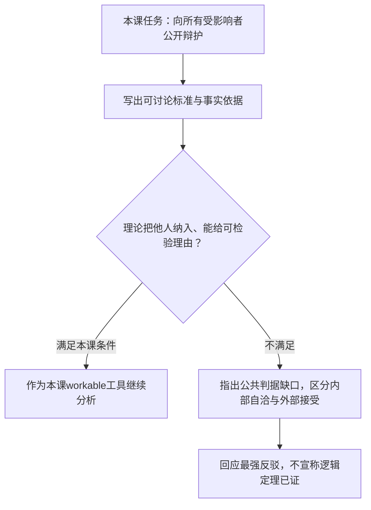


**例子走图（笔记补充）**

学校咨询系统只需要课程问题，却要求学生提交身份证号码。团队给出的唯一理由是“收集越多，广告收入越高”。

1. 起点是向所有受影响者公开辩护：受影响者包括提交资料的学生。
2. 写出待讨论标准：资料采集应能说明与咨询目的的必要关系，并考虑学生承担的暴露风险。
3. 进入“把他人纳入、能给可检验理由？”节点：只有广告收入，尚未回答身份证对咨询是否必要，也没有计入学生风险。
4. 因而走“不满足本课条件”出口，指出公开理由的缺口。结论是这份理由不充分，并非所有商业收益理由都无效。
5. 若团队改为只收课程问题，并说明用途、访问范围和必要性，就可重新检验；有证据支持两项判据时，才走“继续分析”出口。

文字替代：本图将公共可用性拆成可定位的问题，结果是带前提的分析，不是未知事实或现实法律许可。循环、例外及其他人格条件按本节正文读。

<details><summary>读图自测：理论内部自洽是否就满足本课公共可用？</summary>

不一定。还须把他人纳入并给可讨论理由；内部自洽与公共接受分开。

</details>

**所以呢**：读下三理论的优劣时，要分清“给出某标准的结论”和“证明这个标准必须被所有人接受”。

### 2.5 三个不可用的理论

> 讲义花了 14 页（p.14–27）讲三个最后都被判定“不可用”的理论。**⚪ 笔记题型推断**：这种“定义—支持—反对—判决”的重复结构适合用来准备批判性评价题；它不是教授明示考试范围。

#### 2.5.1 主观相对主义与文化相对主义（讲义 p.14–18）

读反驳时先区分两个任务：在某群体标准内部评价行为，与给不同群体提供共同可接受的理由。

后者是本课“可用”的判据。

原引文及九条批评保留。

不能将本课排除等同所有相对主义版本没有内部推理。

后补例会实际走一次内部批评。

**是什么**

先给上位概念：

> **相对主义（Relativism）**：不存在普世的对错规范；一个人说"X 是对的"，另一个人说"X 是错的"，**两个人可以都对**。（讲义 p.15）

在此之下分两支：

| 分支 | English | 定义（讲义原句） | 通俗说法 |
| --- | --- | --- | --- |
| **主观相对主义** | Subjective Relativism | Each person decides right and wrong **for himself or herself** | "对你对的，对我不一定对" |
| **文化相对主义** | Cultural Relativism | 表15说明1 | "入乡随俗" |

**表15说明1 · 文化相对主义 / 定义（讲义原句）**

对错取决于某个社会实际的道德准则。

这些准则因地而异、因时而异。

同一个行为在此时此社会是对的，在彼时彼社会可能是错的（讲义 p.16）


讲义 p.16 明说：**文化相对主义是主观相对主义的一个变体**（a variation of subjective relativism）。

**支持它的四条理由**（讲义 p.17）

1. 善意而聪明的人、以及**同样成功的不同文化**，在道德问题上确实会有分歧
2. 伦理争论令人不快且没有结果（disagreeable and pointless）
3. 不同的社会情境要求不同的道德准则
4. 一个社会去评判另一个社会是傲慢的

**反对它的九条理由**（讲义 p.18）

这是讲义中**罕见的把反驳列到九条**的地方，显示材料把拆解相对主义放在较高权重。分组记忆：

| 组 | 反驳 | 展开 |
| --- | --- | --- |
| **A. 混淆"想做"与"该做"** | ① 模糊了"做你认为对的事"与"做你想做的事"之间的界线 | 这是最致命的一条。见下 |
|  | ④ 决定可能不基于理性 | 只剩直觉、情绪、冲动 |
| **B. 无法做道德区分** | ② 对不同人的行为无法做道德区分 | 特蕾莎修女和连环杀手在道德上等价 |
|  | ③ **主观相对主义 ≠ 宽容** | 见下 |
| **C. 逻辑跳跃** | ⑤ 两个社会**确实**有不同道德观，推不出它们**应该**有不同道德观 | 典型的 is → ought 谬误 |
| **D. 解释不了现象** | ⑥ 它解释不了道德准则**是怎么被确定的** |  |
|  | ⑦ **如果根本没有文化规范怎么办？** | 多元社会里"这个社会的准则"是哪一个？ |
|  | ⑧ 它解释不了道德准则的**演化** | 见下 |

本组沿用上表列名，继续列后面的条目。

| 组 | 反驳 | 展开 |
| --- | --- | --- |
| **判决** | ⑨ **Not a workable ethical theory** |  |

**🎙️ 课堂补充**

教授把三条讲透了（part1 `40:42`–`44:18`）：

1. **"混淆想做与该做"是核心毛病**（part1 `42:42`）：
   > *"It blurs the line... between what you think is right and doing what you want to do. **Simply because you want to do something may not be the right thing to do.**"*（part1 `42:42`–`43:26`）
   > 笔记解释：若把“我此刻想做”直接当成最终标准，就混淆了欲望与规范理由。主观评价仍可能给出自己的理由；本课批评的是仅凭个人起点不足以要求不共享该起点的人接受，不能概括成所有相对主义都毫无推理。

这跟 M01 讲的**特殊申辩（special pleading）**是同一个病。

2. **"不基于理由"是它出局的直接原因**（part1 `43:26`）：
   > *"Your decisions may not be based on reason. It can be just [intuition], emotion..."*（part1 `43:26`–`43:49`）
   > 对照 §2.4 的公共论证要求：原话的 may 只说决定“可能”不基于理由，不能据此断言每个版本一条判据都不满足。现有习俗/偏好可供内部评价，跨起点的公共辩护仍须额外理由。

3. **"演化"这条最有力**（part1 `43:49`）：
   > *"It basically **rejects the moral principles**... it's not [workable]."*（part1 `43:49`–`44:02`）
   > 展开说：如果"当时的社会准则"就是对错的全部标准，那么**任何道德进步都不可能被描述为进步**。

废奴、女性投票权、废除童工——这些都只是"从一套准则换成另一套准则"，谈不上"变好了"。

而我们**确实**认为它们变好了。

所以相对主义与我们最基本的道德判断冲突。

**💡 换个说法（笔记补充）**

区分两句听起来像、其实完全不同的话：

| 句子 | 是什么 | 成立吗 |
| --- | --- | --- |
| "不同社会有不同的道德实践" | **描述性**主张（人类学观察） | ✅ 真的 |
| "因此不同社会的道德实践同样正确" | **规范性**主张（相对主义） | ❌ 推不出来 |

**从“各社会实践不同”不能直接推出“各实践同样正确”。** 相对主义仍可在个人或文化内部给出理由、用其自身准则做批评；本课的反对点是，仅凭“我／我们如此认为”不能向不共享该前提的人提供可共同检验的公共判据。

**⚠️ 常见误解**

- ❌ **"反对相对主义 = 主张文化沙文主义"**。

→ 讲义 p.18 第 ③ 条专门澄清：**主观相对主义与宽容是两回事**。

你可以一面主张客观道德原则，一面对其他文化保持谦逊。差异事实本身推不出跨文化普遍宽容义务；但某个相对主义共同体仍可能以自身规范支持宽容。这里的缺口是没有额外公共规范就推不出普遍义务，不是说相对主义提供不了任何内部宽容理由。
- ⚠️ **讲义拼写错误**：p.16 与 p.18 两处把 relativism 写成了 **"subjective realism"**。realism（实在论）是完全不同的哲学立场，**考试千万别照抄**。详见 [[#9.3 课件自身的问题|§9.3]]。

**这个理论怎么答电车难题？** 它可以在所选个人或文化标准内部给理由，也能用该文化自己的准则做内部批评；问题是仅凭“我/我们如此认为”不能给不共享该前提的人一套跨主体、公共可评估的判据。

**与其他概念的关系**

M01 §2.3.2 已经引入过"道德相对主义"的直觉版，本节是它的完整版。

相对主义是 §2.10.3 客观主义 vs 相对主义这条大分界的一侧。

另外七个理论全部站在客观主义那一侧（讲义 p.77）。

**进入机制补强前先记**：按本课“可用理论”标准，相对主义的问题不是完全没有内部理由，而是缺少跨主体可共同检验的公共判据。

下一节的神命论会证明，"有理由"和"有好理由"是两回事——神命论确实给了一个依据（神的旨意），但这个依据本身经不起追问。

---

**机制补强｜相对主义的内部评价与跨文化边界**

**相对主义怎样在内部与跨文化推理（笔记补充）**：假设社会A认可人脸识别普遍用于便利、B要求先证明必要性。

文化相对主义输入是所选群体实际准则与行为事实，输出只能首先写“按A/B准则，此行为被认可/反对”。

在A内部，如果准则同时要求保密而机构任意出售数据，可以用A自己的保密准则批评；不是说一旦相对主义就没人能说任何行为错。

这张图回答：内部与跨文化评价怎样落实为判断？

从起点沿箭头读。

流程箭头表示分析/检查顺序。

总览分类箭头只表示课程归类。

以下案例是笔记补充，适用条件按正文保留。


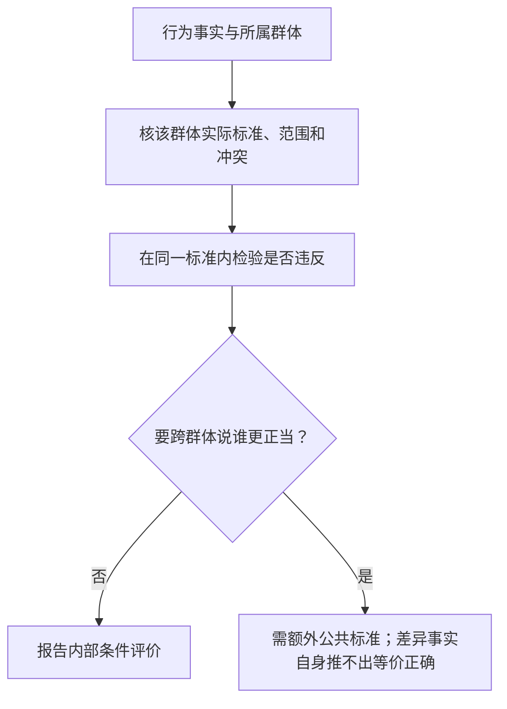


**例子走图**：社会A认可便利但又承诺保密；先核保密范围，泄露可沿内部准则判违反。若跨文化比较，进入需公共标准出口。

文字替代：本图将内部与跨文化评价拆成可定位的问题，结果是带前提的分析，不是未知事实或现实法律许可。

循环、例外及其他人格条件按本节正文读。

<details><summary>读图自测：A接受便利，是否任意出售数据都对？</summary>

不能。还要核A自身保密准则和例外，不能由文化标签给任意豁免。

</details>

最强反例/回应：改革者可诉诸文化内部更高价值、矛盾承诺或被排除者声音，不能全称相对主义“禁止批评/改革”。

但若实际多数习俗是最终标准且不承认独立价值，跨文化谴责仍缺统一依据。

主观相对主义按个人准则，批评重点为跨人冲突与个人任意例外的可辩护性。

宽容仍需自身规范理由，不能由“文化不同”自动推出“应该一律宽容”。

<details><summary>迁移：A多数接受便利，但其本人也公开承诺保密；泄露仍可内部批评吗？</summary>

可以，先核保密准则是否适用且无一致可接受例外。只有在准则范围未知/彼此冲突时须继续澄清，不能以相对主义标签给任意豁免。
</details>

**所以呢**：以上补强改变了本节结论的成立条件；复习时须与主线结论一并读取。

#### 2.5.2 神命论（讲义 p.19–23）

本节检验“命令是善的唯一依据”。

两分支要分别列前提，再检查最强回应。

它不检验神是否存在。

后补的“必善本性”回应保留，不能以两难图宣称已穷尽所有神学版本。

**是什么**

> **神命论（Divine Command Theory）**：好的行为是**与神的意志一致**的行为；坏的行为是**违背神的意志**的行为。神的意志由**圣典（holy books）**揭示，因此我们应当以圣典作为道德决策的指南。（讲义 p.20）

讲义 p.21 给了一张漫画作为"神命论的实际运作"：一位牧师站在讲坛上，手持圣经，说：

> **"Stealing is wrong. Exodus 20:15"**（偷窃是错的。《出埃及记》20:15）

**这张图就是整个理论的运作方式**：问"为什么偷窃是错的？"→ 答"因为经文里神说了"。推理到此结束。

**支持它的三条理由**（讲义 p.22）

1. 我们**欠造物主以服从**（We owe obedience to our Creator）
2. 神是**全善且全知**的（all-good and all-knowing）
3. 神是**终极权威**（the ultimate authority）

**反对它的五条理由**（讲义 p.23）

1. 不同圣典在某些教义上**互相矛盾**
2. 社会是**多元文化的、世俗的**
3. 一些现代道德问题**经文里根本没有涉及**
4. **"善" ≠ "神"**（equivalence fallacy — **Bertrand Russell**，等价谬误，罗素）
5. **基于服从，而非基于理性**（Based on obedience, not reason）
6. → **Not a workable ethical theory for our purposes**

**🎙️ 课堂补充：第 4 条的完整论证**（part1 `47:15`–`51:33`）

讲义只有一行"'The good' ≠ 'God'（equivalence fallacy - Bertrand Russell）"。教授花了 4 分钟把这个两难完整讲了出来，**这是本节最值钱的部分**。

论证结构是一个**两难（dilemma）**——问"神命令 X，是因为 X 是善的；还是 X 之所以善，是因为神命令了它？"两条路都走不通：

| 分支 | 假设 | 推论 | 后果 |
| --- | --- | --- | --- |
| **分支一** | 善 = 神所命令的（除此之外无别的标准） | 事物本身**没有内在的善恶** | 见说明 1 |
| **分支二** | 神之所以善，是因为祂**符合**善的标准 | 那么**善必须独立于神而存在** | 见说明 2 |

**说明 1 · 分支一 / 后果**

① **"神是善的"变成空话**——它只等于"神就是神"，一句同义反复，没有道德内容

② **道德变得任意**：课堂在 part1 `48:14`–`48:31` 用“若权威明天命令谋杀为善，谋杀便随命令变善”的反设说明任意性。ASR 把主语识别成 *blood*；这里只按两难结构转述，不把 `[God]` 冒充原音逐字。

**说明 2 · 分支二 / 后果**

① 神不再是道德的**源头**，只是道德标准的**遵循者**

② 课堂在 part1 `51:07` 的 ASR 严重破损；可确认的论证方向是：如果善独立于神的意志，道德标准便不需要由创世者命令来创造。这里按论证转述，不保留伪逐字引文

课堂在 part1 `50:38`–`51:07` 的结论是：若善独立于神的意志，客观道德价值便不能只靠“神命令了”来推出，道德宇宙也不需要以创世者命令作为唯一来源。原 ASR 被拼成多段且语法破损，因此这里保留转述，不把修复后的顺句写成逐字引文。
> 💡 **背景补一句**（🔗 笔记补充）：这个两难最早出现在柏拉图对话《**尤西弗罗篇（Euthyphro）**》中，通常称为**尤西弗罗困境**。讲义把它归给罗素（Bertrand Russell，1872–1970，英国哲学家兼数学家），罗素确实在《我为什么不是基督徒》里用过类似论证。**答题时两个名字都可以提，但要说清"讲义的提法是 equivalence fallacy, Bertrand Russell"。**

**🎙️ 其余三条的课堂补充**（part1 `46:09`–`47:15`）

- 关于矛盾：课堂在 part1 `46:09`–`47:15` 指出，不同宗教的圣典会冲突，同一圣典的不同版本也可能有出入
- 关于经文过时：课堂在 part1 `46:09`–`47:15` 说圣典写于很久以前，现代问题未被直接覆盖，所以必须依赖解释（interpretation）；解释权在人手里，理论又回到人的判断
- 关于多元社会：现代社会是 multicultural、secular 的，成员各有各的书，"they contradict in terms of telling you what you [should] do"

**💡 换个说法（笔记补充）**

神命论出局的**结构性原因**，可以和相对主义并排看：

| 理论 | 把道德的最终依据放在哪 | 为什么不可用 |
| --- | --- | --- |
| 主观相对主义 | **个人的主观意见** | 能解释“我为何这样选”，但仅凭个人偏好不能要求不共享偏好的人接受 |
| 文化相对主义 | **社会的现行习俗** | 能作文化内部评价，也能指出内部不一致；仅凭现行习俗不能完成跨文化的公共辩护 |
| **神命论** | **一个外部权威的命令** | 对信仰共同体可构成内部依据；面向不共享该权威者时，还须解释命令为何是善、如何可靠识别以及怎样处理冲突解释 |

三者在本课“可用理论”筛选中的共同缺口，不是“一句话理由都没有”，而是**不能只凭各自起点，向不共享该起点的人提供本课要求的公共理由**。

**⚠️ 常见误解**

- ❌ "反驳神命论 = 论证神不存在"。

  → 完全不是。

  课堂在 part1 `47:46` 澄清：这个两难不是在证明神不存在。ASR 在 *doesn't* 后破损，因此不补 `[exist]` 作为逐字原话。

  这个论证是关于道德的逻辑结构，不是关于神的存在。

  一个信神的人完全可以接受这个论证（他只需要选分支二：神符合善的标准）。
- ❌ "它出局是因为宗教不科学"。→ 讲义给的理由是 **based on obedience, not reason**。**理由必须准确引用，别自己发挥成"不科学"。**

**这个理论怎样处理电车难题？** 信仰共同体可以从经文与解释传统提出理由；“不可杀人”是否适用于道岔副作用或把人作手段，还需解释。讲义批评的是现代问题不能只靠命令字面直接决定，且面向不共享该权威者时仍缺公共辩护；不是说所有信徒都会“翻经文然后停止思考”。

**进入机制补强前先记**：神命论和相对主义都能在各自前提内解释“为什么”；本课筛选质疑的是，仅凭权威命令、个人偏好或现行习俗，不能完成面向不共享该起点者的公共辩护。讲义对神命论的 *based on obedience, not reason* 是课程筛选标签，不等于信仰共同体内部没有任何理由。

第三个不可用的理论——伦理利己主义——换了一种方式失败：它其实讲得出完整的"为什么"，只是这套理由拒绝把别人算进来。

---

**机制补强｜两难前提、最强回应与停止边界**

神命两难的前提、推理与最强回应（笔记补充）：要检验的是“神的命令作为善的唯一来源”，不是证明神不存在。

前提为“命令决定善”与“善指导命令”两个候选解释。

这张图回答：神命两难及回应怎样落实为判断？

从起点沿箭头读。

流程箭头表示分析/检查顺序。

总览分类箭头只表示课程归类。

以下案例是笔记补充，适用条件按正文保留。


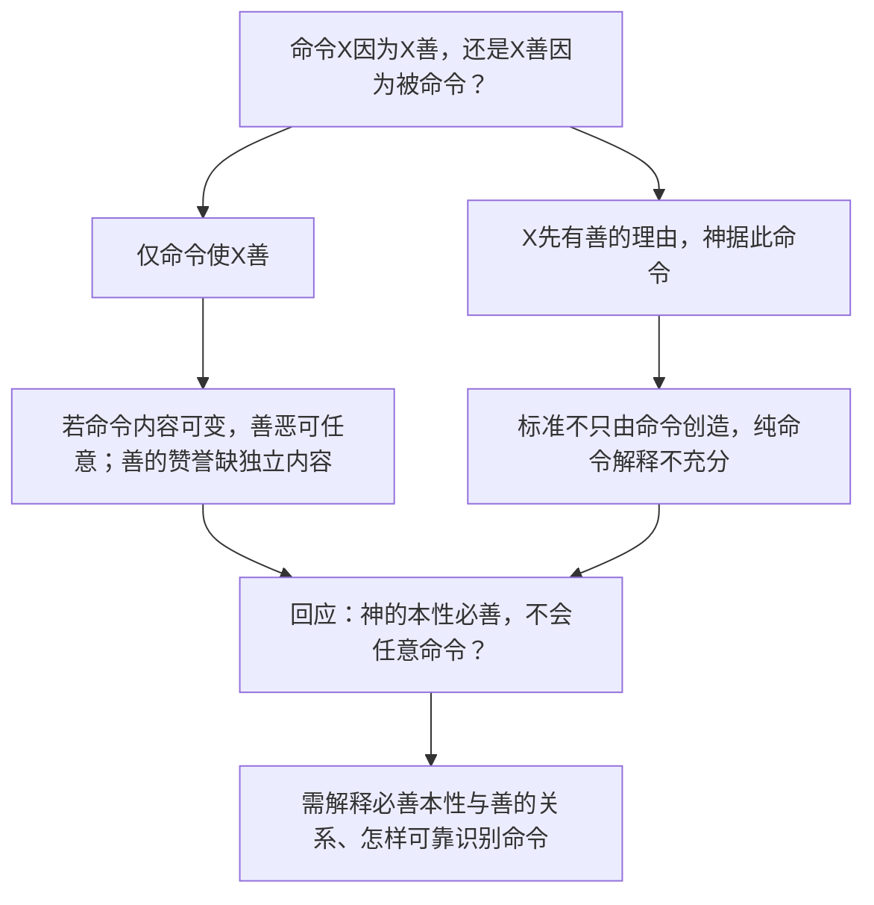


**例子走图**：以伤害无辜的命令为例，分别走命令创造善与善指导命令；再处理本性必善回应。

文字替代：本图将神命两难及回应拆成可定位的问题，结果是带前提的分析，不是未知事实或现实法律许可。

循环、例外及其他人格条件按本节正文读。

<details><summary>读图自测：如果回应否认可任意反转命令，图哪项前提受挑战？</summary>

命令内容可任意变的前提受挑战；须解释必善本性及可靠识别命令，不是证明不存在神。

</details>

完整事实映射：某人说“伤害无辜者是对的，因为被命令”，若任何命令都足以变善，就算明日命令反转也必须认可。

这暴露任意性，但“一个本性必善的神不可能这样命令”否认了可任意反转前提，必须正面回应，不能假装两条路已穷尽一切神学版本。

另一解释说因伤害无辜有独立错误理由所以神不命令，说明道德理由并非仅“权威说了”。

即便接受必善本性，还需解释冲突经文、解释者可靠性与如何在公共决策中让不同信仰者评估理由。

**停止与变式**

- 当已声明版本、前提与回应的解释负担时，可报告本课公共可用性限制

- 不能由这个论证输出某现实信仰必不理性。若所谓命令来自AI伪造文本，先核来源，而不是直接在“神命是真的”前提下推理

- 这是认识证据与规范理由不同层。

**所以呢**：以上补强改变了本节结论的成立条件；复习时须与主线结论一并读取。

#### 2.5.3 伦理利己主义（讲义 p.24–27）

**是什么**

> **伦理利己主义（Ethical Egoism）**：每个人都应当**只**关注自己的**自身利益（self-interest）**。道德上正确的行为，就是**给自己带来最大长期利益**的那个行为。（讲义 p.25）

讲义在标题旁直接写了 **"(aka Capitalism)"**——把它等同于资本主义。并点名：

> **安·兰德（Ayn Rand）**，《源泉》（The Fountainhead）与《阿特拉斯耸耸肩》（Atlas Shrugged）的作者，主张的理论与伦理利己主义相近。

**支持它的四条理由**（讲义 p.26）

1. **务实**——我们本来就倾向于做对自己最好的事
2. 让别人照顾他们自己**更好**
3. 每个人都把自己的福祉放在第一位时，**共同体反而受益**
4. **其他道德原则本来就根植于自利原则**

**反对它的六条理由**（讲义 p.27）

1. **容易的道德哲学未必是最好的道德哲学**
2. 我们其实**很清楚什么对别人好**（"We know a lot about what is good for someone else"）
3. **自利会导向公然不道德的行为**
4. 其他道德原则**优于**自利原则
5. **把他人之善纳入考量的人，活得更幸福**
6. **按定义，它不尊重"伦理的视角"** → **Not a workable ethical theory**

**🎙️ 课堂补充：兰德的立场与"资本主义的哲学基础"**（part1 `52:07`–`57:12`）

教授给的背景比讲义丰富得多：

- 兰德的核心命题是：

> *"The good is what furthers the life of a rational being."*（part1 `52:29`–`52:48`）

  课堂据此概括“自私就是德性”（being selfish is the virtue）。
- 第二条课堂命题是：

> *"Every individual is an end to themselves, not a means to others."*（part1 `52:29`–`52:48`）

  ⚠️ 这句话的形状和康德第二表述相近，但论证方向不同。

康德说"把每个人都当作目的"。

兰德说"我是我自己的目的，别人不是我的义务"。

这是本讲最容易混的一对，见下面的"常见误解"。
- 兰德**明确反对传统道德**——课堂在 part1 `52:58`–`57:12` 把她的立场概括为：要求个人为他人牺牲幸福的传统道德会伤害个人。原 ASR 的形容词不清，不保留 *disruptive* 作为逐字引文
- 教授把它定位为 **capitalism 的道德哲学**（part1 `56:43`）：
  > *"Society, economic production will be best if all [players] focus on their own economic interest. Because everybody will try [their] best... and then the whole system will reach an [optimum]."*（part1 `52:58`–`57:12`）
  > 💡 这其实就是亚当·斯密"看不见的手"的道德版本

**🎙️ 课堂补充：伦理利己主义怎么答电车难题**（part1 `53:30`–`55:48`）

这是全讲最有画面感的一段，**建议记住**：

> 把兰德本人放到扳道岔的位置上——**她的决定完全取决于她跟轨道上的人是什么关系。**

一行是一种轨道人物与你的关系。“答案”列保存课堂的选择，“理由”列说明它为什么符合只计自身利益的标准。

| 情形 | 伦理利己主义的答案 | 理由 |
| --- | --- | --- |
| 五个人和一个人**都是陌生人** | **不扳，什么都不做** | 表21说明1 |
| **你所爱的人在那一个人那边** | **绝对不扳** | 为救五个陌生人而牺牲所爱之人是"an act of immoral **self-betrayal**"（不道德的自我背叛） |
| **你所爱的人在那五个人里面** | **立刻扳** | "your life is better with that person in it" |

**表21说明1 · 五个人和一个人都是陌生人 / 理由**

你对陌生人没有道德义务。

他们也无权要求你去杀另一个陌生人。

课堂在 part1 `54:30`–`54:57` 的意思是：你没有造成这辆失控电车，因此仅按伦理利己主义的标准，你没有为陌生人的生命承担额外风险的义务。该段 ASR 严重破损，这里只作转述。


为什么这个例子重要：它显示了伦理利己主义不是"随便乱来"——它有清晰、一致、可预测的推理程序。

它出局不是因为不自洽，而是因为它拒绝进入"伦理的视角"。

这个区分很关键：一个理论可以完全自洽，却仍然不可用。

**🎙️ 反驳的课堂展开**（part1 `57:12`–`58:50`）

课堂在 part1 `57:12`–`58:50` 展开第 5 条：

> 📄 讲义 p.27 的稳定原句是 **"People who take the good of others into account lead happier lives."**；课堂 part1 `57:37`–`58:35` 另外说明，助人带来的心理满足也可能服务一个人的长期自利。课堂 ASR 多段破损，因此后半只作中文转述，不与讲义原句拼成教授逐字引文。
💡 这是一个内部反驳：如果自利真是唯一标准，而助人恰恰增进自利，那么伦理利己主义自己也会推荐工具性助人。

它仍以自身长远利益为最终标准，不因此塌缩为无私或功利主义。

批评焦点是无法独立赋予他人利益同等道德地位。

最终的判决（part1 `58:07`）：

> *"Fundamentally the problem with this is **it does not respect the ethical point of view**... contrary to the ethical point of view that we're trying to teach in this class. So that is not a workable [theory]."*（part1 `58:07`–`58:50`）
**💡 换个说法（笔记补充）**

三个概念极易混，用一张表钉死：

| 术语 | English | 说的是 | 是道德理论吗 |
| --- | --- | --- | --- |
| **心理利己主义** | Psychological Egoism | 人**事实上**只会追求自身利益（描述性） | ❌ 不是，是心理学主张 |
| **伦理利己主义** | Ethical Egoism | 人**应当**只追求自身利益（规范性） | ✅ 是，但不可用 |
| **利己 / 自私** | Selfishness | 日常贬义词 | ❌ 不是理论 |

**⚠️ 常见误解**

- ❌ **把兰德的“每个人都是自身的目的”与康德第二表述混为一谈**。两套规范都可以对**每个行动者**陈述，不是“一个只管所有人、一个只管我一个人”。
- 康德要求每个行动者都把自己和他人作为目的，不能仅把他人当工具（讲义 p.33）。
- 伦理利己主义要求每个人以自己的长远利益为最终标准；帮助他人也可作为实现自身利益的办法（讲义 p.25 的 Each person）。
- 差别在**最终计入谁的利益、对他人负什么义务**，不在规范能否用“每个人都应……”的形式表达。
- ❌ "讲义说它 aka Capitalism，所以批评它就是批评市场经济"。

→ 讲义这个等号打得很粗糙。

**市场经济是一套经济制度安排，伦理利己主义是一套关于个人道德义务的规范理论**，两者可以分开评价。

答题时可以指出这个等号是简化的——这本身就是"批判性思维"的表现。
- ⚠️ 讲义 p.27 那句 "We know a lot about what is good for someone else" 读起来有点突兀。

  它反驳的是支持理由第 2 条（"让别人照顾自己更好"）：如果我们对别人的需要一无所知，那条理由才成立。

  但事实上我们常常知道，所以袖手旁观说不通。

**与其他概念的关系**

伦理利己主义是 §2.3.1 里"自利的视角"的理论化版本。

它与功利主义（§2.7）的关系尤其要注意：两者都做后果计算，区别只在于把谁算进去——功利主义算所有受影响者，伦理利己主义只算自己。

**进入机制补强前先记**：三个理论都能在自身起点内形成理由；本课的排除依据分别是公共判据不足、权威命令尚需公共解释，以及伦理利己主义不赋予他人利益独立地位。

接下来 §2.6 开始的五个理论，每一个都同时满足"基于伦理视角"和"基于逻辑推理"，这也是它们能被称为"可用"的原因。

---

**机制补强｜工具性助人与最终理由**

**利己主义为何可以助人而不变成功利主义（笔记补充）**：输入为各方案对行动者的长远利益、风险与关系，输出为自身收益最优行动。

例：同事需要帮助，助人使信任/合作与未来回报高于耗时，利己标准会支持。

若无人知道且无回报仍帮、理由仅为对方利益，则不由纯自利标准必然支持。

两个行为都叫“帮助”，最终理由不同。

这张图回答：自利标准与工具性帮助怎样落实为判断？

从起点沿箭头读。

流程箭头表示分析/检查顺序。

总览分类箭头只表示课程归类。

以下案例是笔记补充，适用条件按正文保留。


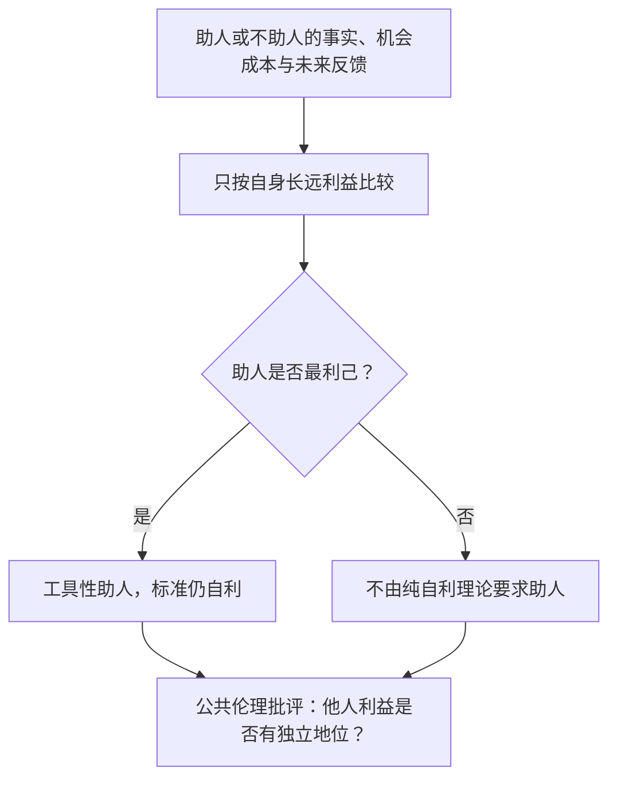


**例子走图**：同事求助，比较行动者耗时与长远合作收益；有利则工具性助人，不利时不由纯自利要求。

文字替代：本图将自利标准与工具性帮助拆成可定位的问题，结果是带前提的分析，不是未知事实或现实法律许可。

循环、例外及其他人格条件按本节正文读。

<details><summary>读图自测：帮助别人是否自动是功利主义？</summary>

否。看最终理由；自利只以行动者长远利益为最终标准，功利计所有受影响者。

</details>

最强反例是现实助人与自利常相容，这反驳“利己者必害人”，却不反驳它以谁为最终标准。

相反即使精确自利策略自洽，本课要求所有相关者理由的公共标准仍不满足。

不把机制自洽与规范可接受混为一谈。

**所以呢**：以上补强改变了本节结论的成立条件；复习时须与主线结论一并读取。

### 2.6 康德主义 / 义务论（讲义 p.28–41）

> **第一个可用理论。** 讲义用了 14 页，是本讲篇幅最大的一块；课堂上从 part2 `00:10` 一直讲到 30:34，接近半小时。
>
> **术语提示**：Kantianism（康德主义）与 Deontology（义务论）在本课当作同义词用（讲义 p.28 标题就是 "KANTIANISM (DEONTOLOGY)"）。严格说 deontology 是更大的家族，康德主义是其中最著名的一支。
> ⚠️ **ASR 提醒**：转录里 deontology 常被识别成 "the ontology"、Kant 被识别成 "can"/"cat"/"Karen"、duty 被识别成 "beauty"。本笔记已全部还原。

#### 2.6.1 起点：善良意志（讲义 p.29）

**是什么**

> **善良意志（Good will）：想把事情做对的那个意愿**（the desire to do the right thing）。
>
> **康德（Immanuel Kant，1724–1804，讲义 p.28 配图注明生卒年）**：世界上**唯一**无条件为善的东西，就是善良意志——**为了正确本身而想要做对的意愿**（a desire to act right **for its own sake**），即一种**内在的、无条件的善**，独立于外部处境、后果与他人评判。（讲义 p.29）

**为什么需要它**

因为它一句话就把康德主义和功利主义**永久地分开了**：

|  | 道德价值在哪 |
| --- | --- |
| **康德主义** | **在动机里**——你为什么这么做 |
| **功利主义** | **在后果里**——这么做产生了什么（讲义 p.46 明说 "Morality of an action has **nothing to do with intent**"） |

**🎙️ 课堂补充**（part2 `00:35`–`01:34`）

课堂在 part2 `01:01`–`01:17` 强调“为其自身之故”这个限定：

> *"The **only** thing in the world that is good without qualification is a good [will] — [the] desire to [do] right **for its own sake, not because of some other peripheral consideration**."*（part2 `01:01`–`01:17`）
也就是说：**因为怕被抓而不偷东西，不具有道德价值；因为偷窃本身是错的而不偷，才有。**

**💡 换个说法（笔记补充）**

判断一个行为有没有康德意义上的道德价值，要问两步：

1. **排除外在奖惩**：即使无人知道、没有奖励或惩罚，你仍会做吗？
2. **识别最终理由**：你是因为认定这是义务而做，还是因为习惯、同情、自我形象或个人满足？

第一问只能排除部分外在动机；两问都支持“为义务本身”时，才接近本节的善良意志。

**⚠️ 常见误解**

- ❌ "善良意志 = 好心"。

  → 不是情绪上的善意，是理性上认定某事该做、于是去做。

  康德甚至认为出于同情心的助人，道德价值低于出于义务的助人（这一点讲义没讲，属延伸）。

**所以呢**：善良意志只是康德理论的起点——它说明道德价值在动机里，但"动机对不对"总得有个判断办法，不能只凭感觉。

下一节的定言令式第一表述，就是康德给出的那个可操作的判断办法。

---

#### 2.6.2 定言令式 · 第一表述：普遍法则（讲义 p.30–32）

**p.31 英文问题与讲义给定结论**：*"Can a person in dire straits make a promise with the intention of breaking it later?"* 讲义给定规则是 *"I may make promises with the intention of later breaking them."*；普遍化后承诺失去可信度，破坏行动者想让承诺被相信的前提。**English answer（讲义给定推理）**: *No. Universalizing the maxim would make promises unbelievable and would contradict the agent's own purpose of being believed.*

**是什么**

> **定言令式，第一表述**：
> **Act only from moral rules that you can, at the same time, will to be universal moral laws.**
> 只依据那些你**同时能够意愿它成为普遍道德法则**的道德规则行动。（讲义 p.30）

**怎么用它：四步检验法**

讲义 p.31 用"能不能做一个打算日后毁弃的承诺"演示了完整流程：

| 步 | 动作 | 例子（讲义 p.31） |
| --- | --- | --- |
| ① | **把你的行为写成一条规则**（maxim，准则） | "我可以做出打算日后毁弃的承诺" |
| ② | **说清你做这事时依赖的前提** | 这个陷入困境的人**希望自己的承诺被相信**，这样才能拿到他需要的东西 |
| ③ | **普遍化**——设想人人都这么做 | 所有人都可以做出并毁弃承诺 |
| ④ | **看有没有矛盾** | 如果人人都毁弃承诺，**承诺就不再可信**——这与第 ② 步"希望承诺被相信"的前提**直接矛盾** |
| **判决** |  | 见说明 1 |

**说明 1 · 判决 / 例子（讲义 p.31）**

**规则有缺陷。答案是"不可以"。**

**🎙️ 课堂补充：快速自检法**（讲义 p.32 + part2 `10:19`）

讲义 p.32 给了一个更快的近似方法：

<details><summary>p.32 A QUICK CHECK 完整英文原问与给定提示</summary>

**讲义 p.32 原文**

> A QUICK
>           When evaluating a proposed action,
> CHECK     reverse roles
> 
> 
> 
>           What would you think if that person
>           did the same thing to you?
> 
> 
> 
>           Negative reaction → evidence that
>           your will to do that action violates the
>           Categorical Imperative

</details>

**中文题意**：调换角色后，你怎样评价别人对你做同一行为？原页说负面反应是 evidence（证据/线索），不是已经充分证明违反。

**⚪ 参考作答**：负面反应可提示需要检查，但个人厌恶不能代替完整准则检验；仍要核构想矛盾、理性意愿及人格尊重。*English: A negative reaction is evidence inviting examination, not a sufficient verdict. Formulate the maxim, test conception and rational willing, and examine respect for persons.*

教授的说法（part2 `10:36`）：

课堂在 part2 `10:19`–`10:54` 用角色反转作快速检查：如果别人对你做同样的事，你是否接受？ASR 在判决词处只剩 *it is not. A sense.*，不能补成 `[permissible]` 作为逐字原话。
⚠️ 这里有个必须澄清的点：这个"角色反转"检验听起来就是黄金法则（己所不欲，勿施于人），但它不是定言令式，只是一个便捷的近似。

区别在：

|  | 判据 | 靠什么 |
| --- | --- | --- |
| **黄金法则** | 我**愿不愿意**别人这样对我 | **我的偏好** |
| **定言令式** | 这条规则**普遍化后会不会自相矛盾** | **逻辑** |

为什么区别重要：黄金法则会被怪癖绑架（一个不怕痛的人可以据此打人），定言令式不会——它检的是逻辑一致性，与个人偏好无关。

M01 §2.4.2 已经提醒过这两者不同，本节给出了为什么不同的确切理由。

**💡 换个说法（笔记补充）**

第一表述本质是一个**自指一致性检验**，跟程序员熟悉的东西同构：

> 你的准则相当于一条要部署到**所有人**身上的规则。
> **如果这条规则全网部署之后，会摧毁它自己赖以生效的前提，那它就是一条坏规则。**
>
> "毁弃承诺"依赖"承诺被信任"这个环境；全网部署后信任消失，规则失效——**自毁（self-defeating）**。

**⚠️ 常见误解**

- ❌ "普遍化 = 问'如果人人都这么做，后果会不会很糟'"。

  → 这是把康德读成了功利主义。

  康德问的不是后果好坏，而是能不能被无矛盾地设想。

  区别在下面的例子里最清楚：
- "人人都不生孩子" → 后果很糟（人类灭绝），但**没有逻辑矛盾** → 康德的第一表述**过不了这一关**（需要用第二种矛盾，见 §2.6.7）
- "人人都毁弃承诺" → **有逻辑矛盾**（承诺这个概念本身崩塌）→ 直接判错
- ❌ 把 maxim（准则）写得过于具体，比如"我，张三，在 2026 年 9 月 22 日，可以为了赶 DDL 而抄袭"。

→ 准则**必须写成一般形式**，否则任何行为都能靠加限定词躲过检验。

这正是 M01 讲的特殊申辩（special pleading）。


**所以呢**：第一表述用逻辑一致性检验准则。

但"逻辑"和"尊严"听起来是两件事——下一节先插一段课堂内容讲清 categorical 这个词到底多硬核。

再回头看第二表述怎么从"人的尊严"这个完全不同的角度出发。

---

#### 2.6.3 ★ 插入：categorical 到底是什么意思（🎙️ 纯课堂内容）

> ★ **讲义完全没有这一节**（🎙️ part2 `05:24`–`09:34`）。教授花了 4 分钟解释 "categorical" 这个词，**因为不懂这个词就不懂这个理论**。

**是什么**

康德对逻辑和语法极为精通，他用 categorical 这个词是**取其形式逻辑上的严格含义**：

> **Categorical（定言的）= 绝对的、无条件的（absolute and unconditional），在一切情形下为真。**

它的反面是：

> **Hypothetical（假言的）= 有条件的。**
> **假言令式（Hypothetical Imperative）**：只有在你想达成某个特定目标时才适用的命令。

**对照表**（教授给的例子）

|  | 形式 | 例子 | 道德地位 |
| --- | --- | --- | --- |
| **假言令式** | **如果**你想要 X，**那么**就做 Y | "**如果**你不想坐牢，**那就**别偷东西" | ❌ 不是道德法则——它依赖你碰巧有"不想坐牢"这个欲望 |
| **定言令式** | 就是做 Y | "**不要偷窃**" | ✅ 是道德法则——**不管**偷了会不会让你发财、会不会被抓 |

教授的原话（part2 `08:21`）：

> *"'Do not steal' — **it is categorical. Why?** Because **it doesn't matter if** stealing will make you rich or [that] you would not be caught... stealing is **inherently wrong**, because if everybody [steals] there will not be [the kind of] society that you want to live in."*（part2 `08:21`–`08:39`）
**为什么需要它**

因为它给出了康德**为什么必须排除后果**的理由（part2 `09:00`）：

> *"He argued that **true morality cannot be hypothetical, cannot be conditional**. If morality changed based on our desires or the specific situations, then **morality would be unstable**."*（part2 `09:00`–`09:18`）
**道德如果随欲望和处境变化，就不再是道德，而只是策略。** 这句话同时也是康德对功利主义最强的攻击。

**💡 换个说法（笔记补充）**

用配置文件类比：

- **假言令式** = 带条件的规则：`if goal == "avoid_prison": do_not_steal()`。目标一改，规则就失效
- **定言令式**要求准则具有无条件约束力；这不表示推理时不看事实。事实决定行为是否满足准则，不能把它写成“**不接受任何参数**”的程序常量。

**⚠️ 常见误解**

- ❌ "categorical 就是'类别'的意思"。

  → 在这里不是。

  是逻辑学术语，意为"无条件断言的"。

  考试如果问 "What does 'categorical' mean in 'categorical imperative'?"，答 absolute / unconditional / applies regardless of desires or goals。
- ❌ "假言令式是坏的"。→ 不是坏的，**只是不是道德的**。"想减肥就少吃"是完全正确的实践建议，它只是不属于道德法则。

**所以呢**：搞清楚 categorical＝无条件之后，第一表述"能不能普遍化"的检验才真正立得住——因为康德要的正是不放过任何"如果……那么……"式的借口。

下一节的第二表述会换一个角度（人的尊严）重新审视同一批例子。

---

#### 2.6.4 定言令式 · 第二表述：人是目的（讲义 p.33）

**是什么**

> **定言令式，第二表述**：
> **Act so that you treat both yourself and other people as ends in themselves, and never only as a means to an end.**
> 你要这样行动：把**你自己和他人**都当作**目的自身**，而**绝不只当作手段**。
> （把人当作**理性的道德主体**看待，尊重他们的**尊严**与**自由意志**。）（讲义 p.33）

**关键在 "only" 这个词**

> ⚠️ **最容易错的地方**：第二表述**不禁止**把人当手段。你叫外卖，就是把骑手当作达成"吃饭"这个目的的手段——这没有任何问题。
> 它禁止的是把人**仅仅**（only / merely）当作手段——即**无视对方也是有目的、有意志的理性主体**。
> **先核一个具体线索**：对方是否知道你要他配合什么、是否有真实选择？骑手清楚任务、没有欺骗或强迫且能真实拒绝，支持把它理解为合作；这不自动证明所有条款与目的都尊重人格。欺骗对方替你干活，则绕过了其判断。公共执法等正当强制另须公共辩护，不能用“能否拒绝”一项包办全部结论。

**🎙️ 课堂补充**（part2 `11:20`–`11:55`）

教授把"为什么人不能只当手段"的理由讲了出来：

> *"Treat people as **rational moral agents**. And therefore, because [they are] rational moral agents, they have **dignity**, they have **free will**, they have [autonomy]... **human rights**."*（part2 `11:20`–`11:55`）
即：**人有理性 → 人能自己定目的 → 因此人有尊严 → 因此不能只被当作别人目的的工具。** 这条链是现代人权论述的哲学源头之一。

**💡 换个说法（笔记补充）· 为什么这条对 AI 伦理特别重要**

第二表述是**整门课后面最常被引用的一条原则**，因为它直接对应几个 AI 议题：

| AI 场景 | 第二表述要求继续核什么（不是单项事实自动通关） |
| --- | --- |
| 未经告知就拿用户数据训练模型 | 须核隐藏用途是否绕过用户判断，以及是否有可辩护的独立依据；不能把用户只当方便的数据来源 |
| 算法以信用分拒贷且不给解释 | 须问能否给出合理理由与异议渠道；仅用评分不等于已证明仅把人当手段，拒绝对人的合理质询则引出人格尊重问题 |
| 推荐算法刻意利用心理弱点延长使用时长 | 须核是否操纵而绕过人的自主判断，是否把用户目的置于纯工具地位 |
| 明确告知并可退出的个性化推荐 | 告知与真实退出是支持合作的条件，仍须核目的、强迫、欺骗及其他人格要求，不能自动放行 |

**⚠️ 常见误解**

- ❌ 把 "ends in themselves" 译成"最终目的"。→ 应译**"目的自身"**——意思是"其存在本身就是目的，不是为了服务别的什么"。
- ❌ 只记住"别把人当工具"。

  → 会漏掉 **"both yourself and other people"**：这条对你自己也成立。

  康德据此反对自杀、也反对荒废自己的才能（发展才能属不完全义务；原p.39误归类与更正见§2.6.7）。

**所以呢**：第一表述查逻辑、第二表述查尊严，听起来像两条独立的规则——下一节保留教授将其视为同一理念不同角度的课堂说明。

本例同输出不构成一般等价证明，这也是本讲最容易出简答题的一个点。

---

#### 2.6.5 ★ 两个表述是同一回事（🎙️ 课堂大幅展开）

> ★ **讲义没有讲这一点**（🎙️ part2 `11:55`–`15:07`）。教授花了 3 分钟专门论证，**并且明确说这是康德本人的主张**。

**问题**：第一表述讲逻辑一致性，第二表述讲人的尊严。听起来是两条完全不同的原则。它们是同一条吗？

**答案**：是。课堂在 part2 `12:18`–`12:36` 说康德本人坚持二者 *conceptually the same*。

**教授的比喻**（part2 `12:36`）：

> *"The formulations are just **different ways of expressing the same moral law**. It's like looking at **the same diamond [from] a different angle** — a little bit different refractions, but they [are] the same thing that you're looking at."*（part2 `12:36`–`13:06`）
> 同一颗钻石，换个角度看，折射不同，东西是同一个。

**两个角度分别强调什么**（part2 `13:06`）：

|  | 强调什么 | 检验的问题 |
| --- | --- | --- |
| **第一表述**（普遍法则） | 道德的**形式逻辑一致性**（form / logical consistency） | 如果人人都这么做，我的行为在逻辑上还成立吗？ |
| **第二表述**（人是目的） | 道德的**实质内容**（matter / human value） | 我的行为尊重了人的价值吗？ |

**教授用本例说明两种表述的共同结论（单例不是一般等价性证明）**（part2 `14:15`，用的是"为骗钱而做虚假承诺"）：

| 检验 | 过程 | 结论 |
| --- | --- | --- |
| **第一表述** | 普遍化"人人都可以做虚假承诺"→ 承诺这个概念崩塌 → 逻辑矛盾 | ❌ 不通过 |
| **第二表述** | 你在**欺骗**对方，把他**仅仅当作**获取金钱的工具，没有尊重他作为目的自身 | ❌ 不通过 |

> *"Any action [that fails] the first test, [it] also [fails] the second."*（part2 `14:15`–`15:07`）
> **凡是过不了第一关的，也过不了第二关。**

**💡 换个说法（笔记补充）**

为什么本例两路径给出同样结论？虚假承诺依赖对方相信一个自己明知不履行的保证。

- 普遍化检验：计划依赖可信承诺，却要求同类人都可撤销这种可信性。
- 人格检验：对方无法对被隐藏的欺骗用途作知情判断。

这是该例的共同结构。教授关于两表述统一的主张保留；单例共同结论不能证明所有准则一般等价。

- 从**逻辑**看：这要求"别人诚实、只有我例外"——不可普遍化
- 从**尊严**看：这要求"绕过对方的理性同意"——把人只当手段

**同一件事的两种描述。**

**⚠️ 常见误解 · ⚪ 笔记题型推断**

- ⚪ **笔记自拟题型示例**：*Show that the two formulations of the Categorical Imperative lead to the same conclusion in the following case.* 这来自讲义 p.35–36 的双表述示范，不是课堂明示考题。
- **标准答题结构**：
1. 写出 maxim
2. 第一表述：普遍化 → 找出矛盾 → 判定
3. 第二表述：指出谁被当作**手段**、目的（end）是什么、手段（means）是什么 → 判定
4. 一句话收尾：两条路径结论一致，符合康德所主张的两表述等价
- ❌ “既然等价，写一个就够了”。→ 若题目要求两个表述，就分别写两个。第二表述可明确点名 end 和 means；这是笔记作答建议，不是评分承诺。

**所以呢**：课堂将两个表述联系起来。

实际答题须按题目要求说明准则与人格分析。

不能因单例同结论就省掉所问论证。下一个抄袭案例会示范怎样把两个表述都写完整；这是笔记作答建议。

---

#### 2.6.6 案例：抄袭（讲义 p.34–36）

**场景**（讲义 p.34）

- 一名学生：**单亲妈妈、全职工作**、每学期上两门晚课，其中一门是 **AI 课**
- 这门课**工作量高于一般课程**
- 她**此前所有作业都拿 A**
- 期末报告**没时间写**
- 于是她让**男朋友（AI 博士）**代写，作为自己的作品提交

> ⚠️ **讲义在这里有明显错误**：p.34 前半用 "Mary"，后半改用 "Carla"，而 p.35–36 的评价又回到 "Mary"。**同一个人有两个名字。** 详见 [[#9.3 课件自身的问题|§9.3]]。本笔记统一称 **Mary**。

**第一表述的评价**（讲义 p.35）

| 步 | 内容 |
| --- | --- |
| 行为 | Mary 想为一份抄袭的报告取得学分 |
| 准则 | **"You may claim credit for work performed by someone else."**（我可以为他人完成的工作邀功） |
| 普遍化 | 如果人人都可以这么做…… |
| 矛盾 | **报告将不再是学生知识水平的可信指标**，教授于是**不会再为报告给学分** —— 而 Mary 的整个行为**依赖于"报告能换来学分"这个前提** |
| 判决 | 准则**自我挫败（self-defeating）**，**Mary 在道德上是错的** |

**第二表述的评价**（讲义 p.36）

| 步 | 内容 |
| --- | --- |
| 事实 | Mary 提交了他人的作品作为自己的 |
| 定性 | 她**试图欺骗教授** |
| 判定 | 她把教授**当作了手段**：**目的（end）= 通过课程**；**手段（means）= 操纵教授** |
| 判决 | **Mary 在道德上是错的** |

**🎙️ 课堂补充**（part2 `15:07`–`18:28`）

教授在讲这个例子时，先问了一句很有意思的话（part2 `16:05`）：

> *"You know the rules against it. **But is it immoral?**"*（part2 `16:05`）
> 你知道校规禁止它。**但它不道德吗？**

这个提问本身就是本课的方法：违规（illegal / against the rules）与不道德（immoral）是两件事，需要分别论证。

这个区分在 9/22 的作业里同样关键——"交警做的事合法"和"交警做的事对不对"是两个问题。

**💡 换个说法（笔记补充）· 这个案例为什么在 AI 伦理课里出现**

它不是随便选的。它精确对应本课的现实处境：

- 已核的官方 **2025/26 版本**只明确 Participation/Group Project 两项可用 GenAI；考试段仅写 written examination，不能由两个Yes推出考试No。本次不认证考试可用或禁用，具体考试及2026/27任务条件仍待相应正式说明核验（见 [[IS5113_AI_Ethics_and_Regulations/_meta/作业与DDL|作业与DDL]]）
- 那么"让 AI 写报告"和"让男朋友写报告"，在康德的检验下有区别吗？

**值得自己想清楚的一条**：第一表述的矛盾来自"报告作为知识指标的可信度崩塌"。

如果规则明确允许使用 AI 并要求披露，那么"报告"衡量的东西就重新定义了（从"你会不会写"变成"你会不会用工具做出好东西"）。

矛盾就不成立。

关键差别是有没有欺骗，不是有没有借助外力。

在题设明确允许该种辅助、披露真实且没有冒领成果或违反其他条件时，披露可以消除本例“欺骗评分者”的理由；这不表示一次披露就穷尽第二表述，仍须核其他人格与任务要求。


**⚠️ 常见误解**

- ❌ "她是单亲妈妈很辛苦，所以情有可原"。

  → 在本案给定的欺骗评分安排下，处境困难本身不足以把冒领他人成果变成许可；但情境仍用于识别义务、准则及可用替代方案。无条件不是事实与处境一概无关（§2.6.3）。

  讲义把她的困难写得很详细，恰恰是在测试你会不会被处境带偏。
- 💡 但这**可以作为对康德主义的批评**来写：本课对完全义务无例外的严格说法可能限制处境上的让步；不能进一步说康德判断完全不看事实，这正是 §2.6.9 的弱点之一。**指出这一点能让论证更完整；这是笔记答题建议，不是教授评分承诺。**

**所以呢**：这个案例把"用 AI 代写"和"找人代写"放进同一个逻辑框架里检验。

结论取决于有没有欺骗、而不是有没有借助外力——这个"普遍化会不会出问题"的检验方式，下一节会用来划分完全义务与不完全义务。

---

<details><summary>p.34–36 抄袭场景与讲义给定双表述评价（英文保真）</summary>

**讲义 p.34 原文**

> PLAGIARISM   • Mary
>                  • Single mother
> SCENARIO         • Works full time
>                  • Takes two evening courses/semester
> 
>              • AI class
>                  • Requires more work than normal
>                  • Carla earning an “A” on all work so far
>                  • Carla doesn’t have time to write final report
> 
>              • Carla gets her boy friend (who has a PhD in
>                AI) to write the report; submits it as her own
>                work

**讲义 p.35 原文**

> KANTIAN
> EVALUATION (1ST   • Mary wants credit for plagiarized report
> FORMULATION)      • Rule: “You may claim credit for work
>                     performed by someone else”
>                   • If rule universalized, reports would no longer
>                     be a credible indicator of student’s
>                     knowledge, and professors would not give
>                     credit for reports
>                   • Proposal moral rule is self-defeating
> 
>                   • Mary is morally wrong

**讲义 p.36 原文**

> KANTIAN EVALUATION
> (2ND FORMULATION)
> • Mary submitted another person’s work as her own
> 
> • She attempted to deceive professor
> 
> • She treated professor as a means to an end
>    • End: passing the course
>    • Means: manipulate professor
> 
> • What Mary did was morally wrong

</details>

**来源与读法**：p.34 同一案例把姓名写成 Mary/Carla，引用保留原错，中文将其作为同一学生分析；p.35 的 Proposal moral rule 原拼写也不静默改。以上是讲义给定评价。

**英文参考说明（⚪ 笔记自拟）**：*The maxim permits claiming credit for another person's work. Universal adoption would undermine reports as credible evidence of the student's knowledge and therefore defeat the stated way of obtaining credit. Under the humanity formulation, deception prevents the professor from judging the work on the true basis; the professor is treated merely as a means to passing. These are two arguments about this case, not a proof that the formulations are equivalent in every case.*

#### 2.6.7 完全义务与不完全义务（讲义 p.38–40 + 🎙️ 两种矛盾）

本节先保留课件的两类义务，再解释两种矛盾和课件勘误。

后方 Mermaid 给的是较完整的判断流程。

下面的旧文字树用于理解提问顺序：其中“你愿意”应读作理性者能否一致意愿，不能当个人喜欢。

“允许”也只表示这两步未发现禁止，仍要核人格尊重等条件。

**是什么**（讲义 p.38）

同样叫"义务"，分量却不一样："不能说谎"这条，任何时候违反都不行，一次都不能破例。

"要帮助别人"这条却可以看情况灵活处理——你不可能对每一个路过的陌生人都伸出援手，但你也不能一次都不帮、对谁的求助都无动于衷。

讲义 p.38 把这两种"义务的强度"分别定了名：

|  | English | 定义 | 例子 |
| --- | --- | --- | --- |
| **完全义务** | **Perfect duty** | **无例外**必须履行的义务 | **说真话** |
| **不完全义务** | **Imperfect duty** | **一般情况下**必须履行、但**不是每一次**都必须的义务 | **帮助他人** |

**完整清单**（讲义 p.39–40，⚠️ 这两页在 PDF 里是纯图片，文本层提不出来）

> **完全义务（讲义 p.39）**
> These are **strict moral obligations** that must always be followed. Violating them leads to **logical contradiction if universalized**.
>
> - **对自己（To oneself）**
>   - 不可自杀（Do not commit suicide）
>   - ~~发展自己的才能（Develop one's talents）~~——**讲义 p.39 原列有误；当前答案归入下方不完全义务**
> - **对他人（To others）**
>   - 不可说谎（Do not lie）
>   - 不可偷窃（Do not steal）
>   - 不可毁约（Do not break promises）
>
> **例**：你绝不可说谎，**即使是为了保护某人**，因为说谎一旦普遍化就会瓦解信任。

> **不完全义务（讲义 p.40）**
> These are **flexible duties** that allow for **discretion** in how and when they are fulfilled, but they are **still morally required**.
>
> - **对自己**
>   - 培养道德与理智上的德性（Cultivate moral and intellectual virtues）
> - **对他人**
>   - 帮助有需要的人（Help others in need）
>   - 促进他人的幸福（Promote the happiness of others）
>
> **例**：你在道德上有义务帮助他人，**但你可以选择何时、以何种方式去帮**。

**★ 🎙️ 课堂补充：为什么会分成两类——两种矛盾**（part2 `24:48`–`27:28`）

> **这是本节最有价值的内容，讲义完全没有。** 它回答了"凭什么某些义务是完全的、某些是不完全的"。

课堂在 part2 `24:48`–`27:28` 说明：当你把一条准则放进普遍化检验时，它可能以**两种不同的方式**失败：

| 失败方式 | English | 含义 | 产生哪类义务 | 例子 |
| --- | --- | --- | --- | --- |
| **① 概念矛盾** | Contradiction in **Conception** | 这条规则**根本无法被设想**为普遍法则——**概念自我摧毁** | **完全义务**（绝对、无例外） | "人人都可以毁约"→ **承诺这个概念本身消失** |
| **② 意愿矛盾** | Contradiction in the **Will** | 这条规则**能够**作为普遍法则存在（逻辑上讲得通），**但任何理性者都不可能真心愿意它成立** | **不完全义务**（有裁量空间） | "没有人帮助任何人"→ 这样的世界**完全可以想象**，但你不可能愿意生活在其中 |

教授对第 ② 种的解释（part2 `26:23`）：

> **中文转述（据 ASR 与讲义方向整理，非核音逐字）**：课堂 part2 `26:03`–`27:09` 围绕“无人互助”的世界作讨论；文本可以支持其逻辑上可设想、但理性意愿遇到困难的论证方向。原 ASR 关键谓词有损坏，因此不保留作者恢复后的完整英语句作为教授逐字引文。原著/讲义中的正式表述与这份课堂转述分开。
>
> 课堂在 part2 `26:03`–`27:28` 的结论是：理性者不能一致意愿“无人帮助任何人”的世界，因此存在帮助他人的不完全义务；执行对象、时间和方式有裁量。尾部 ASR 破损，不保留修复后的英文逐字句。

**💡 换个说法（笔记补充）**

用两个不同的检验来记：


```
把准则普遍化
   │
   ├─ 能想象吗？
   │    否 → 概念矛盾 → 完全义务（绝不可为）
   │    是 ↓
   └─ 你愿意活在这个世界里吗？
        否 → 意愿矛盾 → 不完全义务（目的仍有义务，执行可裁量）
        是 → 这两步未发现禁止，仍核人格尊重等条件
```


为什么不完全义务"可裁量"：教授说（part2 `27:28`）"the reason it is called an imperfect duty is because it provides some latitude in its execution"——留有余地的是执行方式，不是义务本身。

你不能说"我不帮任何人"，但你可以决定帮谁、什么时候帮、帮多少。

**🎙️ 课堂补充：冲突时谁优先**（讲义 p.41 + part2 `28:07`）

讲义 p.41 说：**完全义务与不完全义务冲突时，完全义务优先。**

教授的例子非常好记（part2 `28:28`）：

> 课堂在 part2 `28:28`–`29:05` 说：不能为了履行帮助穷人的不完全义务而违反不可偷窃的完全义务；因此按课堂采用的康德口径，Robin Hood 的做法不能成立。ASR 的判词损坏，不把 `[wrong]` 写成逐字原话。
> **罗宾汉在康德那里是错的。**

教授还给了一个结构性的说法（part2 `28:47`）：

> **完全义务（消极的、"绝不可做"的）构成一个硬边界（hard boundary）；在这个边界之内，你才有自由去选择如何执行不完全义务（积极的目标）。**

**💡 换个说法（笔记补充）**：完全义务是**约束条件**，不完全义务是**目标函数**。你在可行域**之内**优化，不能为了目标函数更大而跑出可行域。

**⚠️ 常见误解**

- ❌ "不完全义务 = 可做可不做"。→ 讲义 p.40 明确写着 **"but they are still morally required"**。可裁量的是**方式和时机**，不是**要不要**。
- ❌ "完全义务都是'不要做某事'"。

  → 原p.39这样归类，但属课件勘误。

  发展才能是对自己的不完全义务，不可用错误归类作反例。

  别背成"完全=否定、不完全=肯定"。
- ⚠️ **讲义 p.40 标题拼错了**：写的是 "INPERFECT DUTIES"，应为 **"IMPERFECT DUTIES"**。见 [[#9.3 课件自身的问题|§9.3]]。

**进入机制补强前先记**：完全义务是硬边界、不完全义务是可裁量的目标——这个区分不是知识点凑数。

它直接决定了两条义务打架时该听谁的（下面"冲突时谁优先"）。

搞懂了这一节，康德主义的骨架就装完了，下一步该回头总结它整体的优点和最致命的缺点。

---

**机制补强｜两类矛盾的完整检验**

p.39人才分类的明确勘误与实际推理：原页确把Develop one's talents列在Perfect duty，前面原课件记录保留。

但康德原著第二部分四例把培养才能引出为对自己的不完全义务：人人都荒废才能的世界可以设想。

作为理性者却不能愿所有实现目的的能力都被放弃。

这是意愿矛盾，不是每时每刻必须学习同一门技能的严格行为指令。

🔗 [康德Groundwork第二部分原著英译](https://www.gutenberg.org/files/5682/5682-h/5682-h.htm)，核对2026-10-02。

完整准则例与对照（笔记补充）：虚假承诺准则包含“需钱→明知不还却许诺→依赖对方信任取得借款”。

普遍化撤销可信承诺条件，使行为计划自毁，构想矛盾。

荒废才能准则“为安逸永不发展任何能力”普遍化并非不能存在，问题为理性目的所需能力与愿望的冲突。

义务在发展能力这个目的，路径/时间有裁量。

若本周休息而未来继续发展，不等违反“永不发展”准则；不能把“忙一天没学习”直接判违义务。

这张图回答：两种矛盾的判断怎样落实为判断？

从起点沿箭头读。

流程箭头表示分析/检查顺序。

总览分类箭头只表示课程归类。

以下案例是笔记补充，适用条件按正文保留。


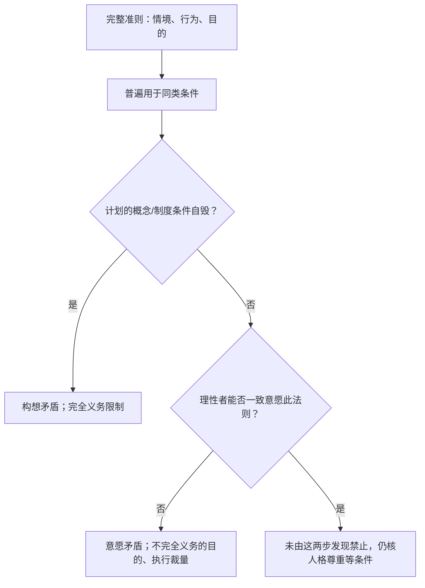


**例子走图**：虚假承诺先走制度条件自毁出口；荒废才能的世界可设想，再走理性意愿失败出口。

文字替代：本图将两种矛盾的判断拆成可定位的问题，结果是带前提的分析，不是未知事实或现实法律许可。

循环、例外及其他人格条件按本节正文读。

<details><summary>读图自测：本周休息等于永不发展才能准则吗？</summary>

不等于。须核完整准则；不完全义务允许在方式和时机上裁量。

</details>

第一/第二表述的边界：借款假承诺同时破坏可普遍化条件并剥夺对方知情同意，是同一例得到同结论。

并未证明两表述对所有准则一般等价。

康德关于表述统一的哲学主张与本例演示分开，不能用一格同输出当逻辑等价证明。

**所以呢**：以上补强改变了本节结论的成立条件；复习时须与主线结论一并读取。

#### 2.6.8 康德主义的优点与缺点（讲义 p.37, p.41）

**支持它的四条**（讲义 p.37）

1. 与常见的道德关切一致：**"如果人人都这么做会怎样？"**（What if everyone acted that way?）
2. 产出**普遍的**道德准则
3. **把所有人当作道德上的平等者**（Treats all persons as moral equals）
4. **义务高于情绪**（Duty over emotion）

**🎙️ 教授对第 3 条的强调**（part2 `19:25`）：

> 课堂在 part2 `19:25`–`20:01` 强调所有人具有同等道德地位，规则应平等适用，不能因某人不同便随意设例外。ASR 中 *[count] yourself* 及尾句破损，因此只保留来源绑定的中文转述。
> 💡 **这条直接接到 AI 公平性（M03）**：算法歧视之所以是伦理问题而不只是技术缺陷，康德给的理由就是"所有人是道德上的平等者"。

**反对它的六条**（讲义 p.41）

| # | 批评 | 展开 |
| --- | --- | --- |
| ① | 有时**没有任何规则能恰当地刻画一个行为**（道德困境） |  |
| ② | 有时**规则之间的冲突无法化解** |  |
| ③ | 完全义务与不完全义务冲突时，**完全义务胜出** | 这条其实是"规则"不是"批评"，但它引出下一条 |
| ④ | **两个完全义务冲突时，无解** | ★ **这是康德主义最致命的弱点** |
| ⑤ | 康德主义**不允许完全义务有任何例外** |  |
| ⑥ | **规则需要被解释**（例如 "do not kill" 到底涵盖什么） | 表34说明1 |
| **判决** | **尽管有这些弱点，它仍是一个可用的伦理理论** |  |

**表34说明1 · ⑥ / 展开**

自卫算吗？

安乐死算吗？

堕胎算吗？


**🎙️ 课堂补充**（part2 `29:24`–`30:34`）

教授对第 ④ 条的说明：

> *"When you have perfect duties... **what if you have [two] perfect duties [that] conflict with each other? How do you choose?** And there will be [such] a situation."*（part2 `29:57`–`30:22`）
**争议外部案例（不是课程标准答案）**：Kant 对 Constant 的回应常被改写为“凶手上门问受害者是否藏在家中”。Kant 原文围绕所谓说谎权展开；学界对责任、行动与不作为的解释存在争议。本文没有从讲义或课堂推出“不可协助杀害无辜”是第二条独立完全义务，因此不能用该案直接证明“两条完全义务冲突而康德无解”。

这里能安全得到的结论只有：讲义明确指出完全义务之间可能冲突，却未给一般裁决程序。

本次可核相关段落来自 [Cambridge 原文节选](https://assets.cambridge.org/97811088/34216/excerpt/9781108834216_excerpt.pdf) 的已有有效缓存；[Korsgaard, *The Right to Lie*](https://dash.harvard.edu/bitstream/handle/1/3200670/Korsgaard_RighttoLie.pdf) 是旧列候选链接，本次请求未取得有效正文，不能拿链接或旧2026-10-23日期冒充当前已核该文。

教授的最终评价（part2 `30:22`）：

> 课堂在 part2 `30:22`–`30:34` 的评价是：尽管有弱点，义务论仍被本课视为可用理论，因为它提供一套可依逻辑分析并形成结论的程序。ASR 原文为 *logical fluids ... write ... conclusion*，不能把 `[rules]`、`[reach]` 补成逐字引文。
**⚠️ 考试提示**

> ⚪ 讲义把"支持 4 条 / 反对 6 条"这种结构**在八个理论上重复了八次**——这是本讲最明显的排版信号。**"给出某理论的两条支持理由和两条反对理由"是极可能的题型。** 建议每个理论至少记住**两优两劣**，其中劣势要记那条**最致命的**。

**所以呢**：康德主义的一个重要弱点是：讲义承认完全义务之间可能冲突，却没有提供可普遍适用的裁决程序。争议案例不能替代这一缺口本身的论证。

下一节换一套完全不同的逻辑（只看后果、不问动机）的功利主义，看它能不能补上这个缺口。

---
### 2.7 功利主义（讲义 p.42–56）

> **第二、三个可用理论。** 功利主义在讲义里被拆成**行为功利主义**（p.42–51）和**规则功利主义**（p.52–56）两个独立理论，横向对比表（p.78）也是分开列的——**答"有哪五个可用理论"时它们算两个。**

#### 2.7.1 效用原则（讲义 p.43–45）

**是什么**

> **效用原则（Principle of Utility）**：
> **一个行为是好的，如果它的收益超过它的伤害；一个行为是坏的，如果它的伤害超过它的收益。**（讲义 p.43）
>
> **效用（Utility）**：一个对象**为个人或共同体产生幸福、或阻止不幸**的倾向。（讲义 p.43）

讲义 p.43 给了两串等价词，**必须记住**，因为考卷上会换着用：

| 正向 | 负向 |
| --- | --- |
| Happiness = advantage = benefit = good = **pleasure** = well-being<br>幸福 = 好处 = 收益 = 善 = **快乐** = 福祉 | Unhappiness = disadvantage = cost = evil = **pain**<br>不幸 = 坏处 = 成本 = 恶 = **痛苦** |

讲义 p.44 给出更正式的版本，叫 **最大幸福原则（Greatest Happiness Principle）**：

> **An action is right (or wrong) to the extent that it increases (or decreases) the total happiness of the affected parties.**
> 一个行为的对错程度，取决于它在多大程度上**增加（或减少）所有受影响方的总幸福**。

**创始人**（讲义 p.43）：**Jeremy Bentham（杰里米·边沁）** 与 **John Stuart Mill（约翰·斯图尔特·密尔）**。

讲义 p.45 用一张天平图表达：**左盘放 Benefit（收益），右盘放 Harm（伤害），指针指向 GOOD 或 BAD。** 图右侧那张照片是边沁——见下面的课堂补充。

**🎙️ 课堂补充：边沁其人**（part2 `31:00`–`32:20`）

教授给了一段讲义完全没有的背景：

- 边沁与 **UCL（University College London）** 关系密切
- 课堂在 part2 `31:00`–`32:20` 将边沁与UCL及保存展示的身体/人像相联；ASR相关措辞有损坏，这里只转述课堂背景。讲义p.45确有人像配图，但不由照片认证现时机构、陈列位置或遗体构成。

<details><summary>旧外部补注原文（2026-09-09 标注；本次UCL一手现状/校史未复核）</summary>

本次未取得UCL页面有效响应，以下只保留旧字句和日期供回源，不作为本次新确认的机构现状或应试事实；效用机制并不依赖这些细节。

> 🔗 **笔记补充与勘误（2026-09-09 核）**：这个展品叫 **Auto-Icon（自我圣像）**——边沁遗嘱要求把遗体保存展示，现存于 UCL 学生中心。**⚠️ 课堂在 part2 `31:27` 的说法与史实有出入**：边沁常被称为 UCL 的"精神奠基人"（spiritual founder），但他并非创办人；UCL 的历史声誉在于它是英格兰第一所**不问宗教信仰**招生的大学，女性获得平等入学资格是 1878 年（边沁已去世 46 年）。**答题不要引用这条。**

</details>

- 教授还说边沁与密尔的思想**横跨了近百年**（🔗 边沁 1748–1832，密尔 1806–1873，两人合计跨越 1748–1873，共 125 年）
- 课堂在 part2 `31:50`–`32:20` 强调功利主义**对公共政策影响巨大**；关于此前社会秩序主要依靠宗教权威的说法保留为课堂观点，不扩写成普遍史实

**🎙️ 课堂补充：为什么它叫"功利"主义**（part2 `32:44`）

教授的讲法很干净：

> *"First he recognizes that **any action has two sides**. [It] is good if [it] produce[s] benefit, [bad] if [it] produce[s] harm... **Just look at the result.** If there [is] more good than bad, [it is] a good action. **It's called utility.**"*（part2 `32:44`–`33:17`）
**⚠️ 常见误解**

- ❌ **把"功利主义"理解成中文日常语义的"功利"（势利、只讲好处、自私）**。

→ 完全不是。

功利主义要求你把**所有受影响者**的幸福**平等地**计入——包括陌生人，甚至（在某些版本里）包括动物。

它是本讲最"无私"的理论之一。

中文译名在这里是个陷阱，考试用英文写 Utilitarianism 反而更安全。
- ❌ "utility = 有用"。→ 这里的 utility 是**技术术语**，专指"产生幸福 / 阻止不幸的倾向"，跟"实用"没关系。
- ⚠️ 讲义把 happiness 与 pleasure 直接画等号（p.43），**但这正是边沁与密尔的分歧点**——密尔认为快乐有高低之分（见 §2.7.7）。**讲义 p.43 的等号只代表边沁的立场。**

**所以呢**：效用原则回答了"好坏怎么算"，但"算给谁看"——是只看这一次行为，还是看长期的规则——讲义把功利主义拆成了两支。

下一节先看最直接的一支：行为功利主义。

---

#### 2.7.2 行为功利主义（讲义 p.46）

**是什么**

> **行为功利主义（Act Utilitarianism）**：把效用原则应用到**每一个具体行为**上。
>
> - 一个行为的道德性**与动机无关**（has **nothing to do with intent**）
> - 只看**后果**（focuses on the consequences）
> - 是一种**后果主义（consequentialist）**理论
> - 做法：**把所有受影响者的幸福变化加总**
>   - 总和 > 0 → 行为是好的
>   - 总和 < 0 → 行为是坏的
> - **应当采取的行为：使总和最大的那个**（讲义 p.46）

**🎙️ 课堂补充**（part3 `00:01`–`00:56`）

课堂在 part3 `00:01`–`00:56` 强调两点：

1. **必须把所有利益相关者算进来**：
   > *"You need to look at **all the stakeholders** involved in the action."*（part3 `00:01`）
2. **它是在给你"多选一"时的判据**：
   > *"You have alternative action[s] A, B, C, D — [what] we want to choose is the one which produce[s] the **highest utility**."*（part3 `00:34`）

**💡 换个说法（笔记补充）**

行为功利主义本质上就是**逐个行为做成本收益分析（cost-benefit analysis）**，只不过：

- "收益 / 成本"的单位是**幸福**，不是钱
- 计入范围是**所有受影响的人**，不是只有你或你的公司

> 💡 **和 §2.5.3 伦理利己主义对照记**：两者的计算方法完全一样，**唯一区别是计入谁**。利己主义只算自己；行为功利主义算所有人。

**⚠️ 常见误解**

- ❌ "功利主义 = 少数服从多数"。→ **不是投票，是加总。** 一个人的巨大痛苦可以压过很多人的微小快乐。
- ❌ "动机不重要 = 可以恶意行事"。

→ 讲义确实说 morality "has nothing to do with intent"，但这是在说**评价标准**不看动机；**恶意动机通常产生更坏的后果**，所以实践上仍会被判定为错。

不过——**恶意动机 + 好运气 = 好行为**，这个反直觉的推论正是 §2.7.5 道德运气的攻击点。

**所以呢**：行为功利主义逐案计算，简单直接，但"恶意动机+好运气=好行为"这个反直觉结论已经埋下了伏笔。

下一节的快乐计算先解决"怎么量化幸福"这个操作性难题，§2.7.5 道德运气再回来正面攻击这个漏洞。

---

#### 2.7.3 快乐计算（讲义 p.47）

**p.47 英文原文（讲义给定维度；不是七个统一问句）**：

- *Intensity: How strong is the pleasure?*
- *Duration: How long will the pleasure last?*
- *Certainty or uncertainty: How likely or unlikely is it that the pleasure will occur?*
- *Propinquity or remoteness: How soon will the pleasure occur?*
- *Fecundity: Potential to generate more pleasure.*
- *Purity: The probability that it will not be followed by sensations of the opposite kind.*
- *Extent: How many people will be affected?*

**English use（⚪ 笔记自拟）**：*A defensible calculation states an assumption for every dimension; the slide does not supply objective units or weights.*

**是什么**

边沁给出了一套**衡量快乐的七个维度**，称为 **快乐计算（Hedonic Calculus）**：

| # | 维度 | English | 问什么 |
| --- | --- | --- | --- |
| 1 | **强度** | Intensity | 这个快乐有多强？ |
| 2 | **持续时间** | Duration | 能持续多久？ |
| 3 | **确定性** | Certainty / uncertainty | 它发生的可能性有多大？ |
| 4 | **远近** | Propinquity / remoteness | 多快会发生？ |
| 5 | **丰产性** | Fecundity | 它有没有潜力**产生更多快乐**？ |
| 6 | **纯粹性** | Purity | 它**不被相反感受跟随**的概率有多大？ |
| 7 | **广度** | Extent | 会影响**多少人**？ |

**🎙️ 课堂补充**（part3 `00:56`–`03:46`）

教授把这七条当作**功利主义的操作性难题**来讲，而不是当作工具：

> *"It is an **easy principle to say, but very difficult [a] principle to actually operationalize.**"*（part3 `03:46`）
他逐条追问：

- **强度**：课堂在 part3 `01:16` 追问，快乐究竟是生理感受还是情绪感受，以及不同快乐强度如何比较。原 ASR 是 `biologically or emotions`，语法不稳定，故不保留英文逐字引文。
- **不同种类的快乐怎么比**？
- **远近（remoteness）**：课堂在 part3 `01:56`–`02:26` 追问，如果好处三天后、一周后才出现，应该怎样折现；`discount` 在 `02:26` 可辨。💡 这与金融里的贴现概念相通，可以和 EF5560 对照。
- **丰产性**：一个后果引出另一个后果（A → B → C），**链条要算到哪里为止**？
- **纯粹性**：做某件事当下很兴奋，**事后却内疚**——两种相反的感受怎么加？

**💡 换个说法（笔记补充）· 快乐计算与 AI**

七个维度里，⑦ Extent（广度）在 AI 场景下最有分析力：AI 系统的一个设计决定，影响的往往是数以百万计的人。

这解释了为什么"一个小小的偏差"在 AI 里会变成严重的伦理问题——广度把微小的单位伤害放大成了巨大的总伤害。

> 💡 **反过来也成立，而且更危险**：一个只伤害少数人、却让多数人受益的 AI 系统，仍可能总损失很大；须乘受影响人数并计各类伤害/收益强度，不能只数哪边人多。即使某套完整总账净正，也不自动解决独立的公平分配问题。**这正是 §2.7.8 分配公正批评所针对的。**

**⚠️ 常见误解**

- ❌ 把 Fecundity 和 Purity 记混。

  → Fecundity = 会不会带来更多同向的快乐（正向连锁）。

  Purity = 会不会被反向感受跟随（负向污染）。

  一个问"能不能滚雪球"，一个问"会不会反噬"。
- ⚠️ 讲义在这一页把标题写成 "BENTHAM: WEIGHING PLEASURE/PAIN (HEDONIC CALCULUS)"，**明确归给边沁**——本页给的是边沁的七维版本；密尔的质量判准另见§2.7.7，不能从标题推出他拒绝一切数量比较。

**所以呢**：边沁想把"多少快乐"量化到可以计算，但连他自己列的七个维度都经不起追问（怎么比较不同种类的快乐、链条算到哪里为止）。

下一节的"道德运气"会从另一个方向证明：就算算得清楚，只看后果这件事本身也有致命漏洞。

---

#### 2.7.4 案例：高速公路改线（讲义 p.48–49）

**场景**（讲义 p.48）

- 州政府要把一段**弯曲的高速公路**改直
- 新路段**缩短 2 公里**
- 需要**拆除 150 户民宅**
- 会**破坏一部分野生动物栖息地**

**评估**（讲义 p.49）

|  | 项目 | 金额 |
| --- | --- | --- |
| **成本** | 补偿房主 | \$20,000,000 |
|  | 修建新路 | \$10,000,000 |
|  | 损失的野生动物栖息地价值 | \$1,000,000 |
|  | **成本合计** | **\$31,000,000** |
| **收益** | 驾驶成本节省 | **\$39,000,000** |
| **结论** | **收益 > 成本 → 修路是好的行为** | **净 +\$8,000,000** |

**🎙️ 课堂补充**（part3 `04:00`–`05:18`）

教授把它称为 "a very simplistic way of doing the cost benefit analysis"——"非常简化"这个评价是他自己下的，不是我加的。

他的讲述里也带出了这个方法的核心动作：把一切都换算成钱。

**⚠️ 常见误解 · 这个案例真正的教学功能**

**笔记读法**：原例先给定一套净正的演示，我们须会复做；也可以用它练习§2.7.8的批评。下面三点是笔记提出的核查问题，不把它们写成已证讲义动机或数据造假：

| 可疑操作 | 问题 |
| --- | --- |
| 把**野生动物栖息地**定价为 \$1,000,000 | 这个数字从哪来的？谁有资格定价？ |
| 把**150 户人家的家园**换算成补偿款 | 搬迁的情感成本、社区解体、老人适应问题——**都没有出现在账本上** |
| **只报总额，不问分配** | 表38说明1 |

**表38说明1 · 只报总额，不问分配 / 问题**

承担成本的是那 150 户。

享受收益的是所有开车的人。

账面净赚 800 万，但代价集中在少数人身上


> 📄 讲义 p.56 写道：*"In certain circumstances utilitarians must quantify the value of a human life."* 高速公路案例可用来演示这项批评；这是讲义来源，不是教授明示考试。

答题提示：如果考题给你一个类似的成本收益表并问"用功利主义评价"，先按它的框架算出结论。

再指出上面三条。**⚪ 笔记答题建议**：这样才能把计算结果与批判性评价分开。

**进入机制补强前先记**：这张成本收益表看着很科学，但"野生动物栖息地值一百万"这种定价、以及"只报总账不问分配"的做法。

正是 §2.7.8 要正面批评的两个漏洞。

先记住这个案例，后面批评部分会直接点名它。

---

**条件变式｜从事后净额回到事前期望**

**高速公路原例跑到比较结束（p.48–49）**：原输入缩短2km、拆150屋、损部分生态；补偿20million、建设10million、生态1million、驾驶成本节省39million。

单位百万美元。课堂在 part3 `04:00`–`05:18` 用可货币化后果近似效用；$39-(20+10+1)=8$ 是原单方案净值，不等于“只要净正就在所有方案中最优”。

原未给不建/A/B或概率，以下完整比较均笔记补充。

**三方案与同一事前口径（笔记补充）**

原课件只给原路线的确定金额。

下面概率与替代方案均是教学假设，单位统一为百万美元。

未货币化的拆迁痛苦、分配、文化与生态后果不能自动填 0。

| 方案 | 成功收益 | 成功概率 | 失败收益 | 固定成本 |
| --- | --- | --- | --- | --- |
| 不建 N | 0 | 基准 | 0 | 0 |
| 原路线 A | 39 | 0.8 | 0 | 31 |
| 替代 B | 30 | 0.9 | 0 | 22 |

- 一行是一个可行行动。收益列按同一观察期计入

- 概率是本教学设定

- 失败收益为该失败结果的收益，固定成本不随成功概率再缩减。B 的成本22包含建设、搬迁与环境

- 先按利益相关者核后果、防止重复计入，再归集金额。

1. N 是比较基准，期望净值为 0。
2. A：$0.8\times39-31=0.2$。
3. B：$0.9\times30-22=5$。
4. 在本假设与候选中，选 B。这不是原讲义给出的方案选择。


$$EU(a)=\sum_j p_{aj}B_{aj}-C_a.$$


公式中的符号这样读：

| 符号 | 是什么 | 单位/角色 |
| --- | --- | --- |
| $a$ | 待比较方案 | N、A、B之一 |
| $j$ | 方案的可能结果 | 结果标识 |
| $p_{aj}$ | 该结果概率 | 已给，结果概率和为1 |
| $B_{aj}$ | 该结果收益 | 百万美元，教学已给 |
| $C_a$ | 固定成本 | 百万美元，教学已给 |
| $EU(a)$ | 事前期望净值 | 百万美元，要算 |

先逐结果用概率乘收益，再相加，最后减固定成本。这是一项金额近似，不是所有幸福的精确度量。

A 成功后实际净值是 8，失败为 −31。

不能用事后 8 证明事前一定应选 A。

B 失败也不自动证明事前选择不合理。

原资料只有确定性收益39/成本31，不能把补充概率算成教授输入。

这张图回答：方案可比与事前效用怎样落实为判断？

从起点沿箭头读。

流程箭头表示分析/检查顺序。

总览分类箭头只表示课程归类。

以下案例是笔记补充，适用条件按正文保留。


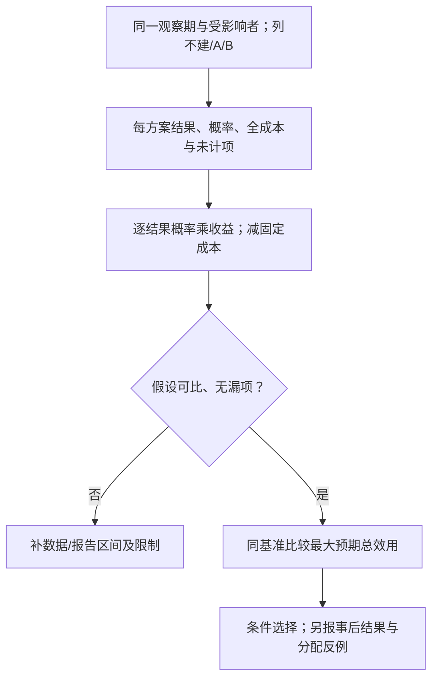


**例子走图**：N0/A0.2/B5按同一事前口径比较；B漏6成本后回到输入，B成−1。

文字替代：本图将方案可比与事前效用拆成可定位的问题，结果是带前提的分析，不是未知事实或现实法律许可。

循环、例外及其他人格条件按本节正文读。

<details><summary>读图自测：原路线事后成功净8能证明事前应选A吗？</summary>

不能。事前按结果概率和所有成本比较；成功只是一个已实现结果。

</details>

<details><summary>迁移：B遗漏6million不可避免成本，或A成功概率提高0.95，选择如何变化？</summary>

B补成本后5−6=−1；A维持0.2则A优于N0/B−1。

另单独将A概率改0.95，A=0.95×39−31=6.05，超过原B5。

两个变式分别算，不混参数。

若受影响者痛苦无法稳定换钱，可列未计后果及敏感阈值，不假装8million等于全部幸福。

</details>

**所以呢**：以上补强改变了本节结论的成立条件；复习时须与主线结论一并读取。

<details><summary>p.48–49 道路情境及给定成本收益演示（英文原文）</summary>

**讲义 p.48 原文**

> HIGHWAY
> ROUTING
> SCENARIO
>            • State may replace a curvy stretch of highway
> 
>            • New highway segment 2 km shorter
> 
>            • 150 houses would have to be removed
> 
>            • Some wildlife habitat would be destroyed

**讲义 p.49 原文**

> EVALUATION
>              • Costs
>                 • \$20 million to compensate homeowners
>                 • \$10 million to construct new highway
>                 • Lost wildlife habitat worth \$1 million
> 
>              • Benefits
>                 •   \$39 million savings in automobile driving costs
>              • Conclusion
>                 • Benefits exceed costs
>                 • Building highway is a good action

</details>

**英文说明（⚪ 笔记自拟，非新增教授问句）**：*Using the supplied common monetary accounting assumption, the balance is 39 million dollars minus 20, 10, and 1 million dollars, or 8 million dollars. The slide calls this a good action because benefits exceed costs. This positive balance alone does not establish that it maximizes utility among all feasible alternatives; omitted harms, time bases, and other options still matter.*

原48–49页没有提供备选方案概率。前文N/A/B的概率、漏成本与改条件练习均是笔记补充，不能写成讲义观察或真实工程成本。

#### 2.7.5 ★ 道德运气（讲义 p.51 一行 + 🎙️ 三个课堂案例）

> ★ **讲义只有一行**：p.51 的第六条批评 "Susceptible to the problem of **moral luck** (i.e. being assigned moral praise/blame for consequences out of one's control)"。
> **课堂窗口为 part3 `07:32`–`14:15`，跨度 6 分 43 秒；三个案例主体约 6 分钟。** 原音未核听，不把窗口跨度写成精确讲话时长。

**是什么**

> **道德运气（Moral Luck）**：因为**不在你控制之内**的后果，而被赋予道德上的赞扬或责备。

**为什么它对功利主义是致命的**：功利主义只看后果；而后果部分由运气决定；于是**道德评价被运气支配**。

**🎙️ 案例一：两个醉驾司机**（part3 `07:54`–`10:46`）

|  | 司机 A | 司机 B |
| --- | --- | --- |
| 血液酒精浓度 | 相同 | 相同 |
| 决定 | 相同——"喝完开车回家" | 相同 |
| 内在的道德抉择 | **完全相同** | **完全相同** |
| **发生了什么** | 路上空无一人，**安全到家**，第二天宿醉 | 一个孩子突然冲上马路，**因反应迟钝撞死了孩子** |
| **社会如何评价** | 没人知道，**无事发生** | **入狱，被社会唾弃** |

教授先在 part3 `09:30`–`10:46` 追问：两名司机的意图和选择相同，为什么后果会如此决定社会评价？

> *"They do exactly the same action. Same intention, same action... How come the consequences are so important?"*（part3 `09:30`–`10:46`）

随后他在另一个分段概括：

> *"Luck can completely flip the moral value of your actions."*（part3 `11:02`–`11:20`）
**🎙️ 案例二：意图恶劣、后果良好**（part3 `11:34`–`12:39`）

一个独裁者出于恶意下令空袭，**却因为打偏了**，反而摧毁了一个真正的威胁、**净救了更多人**。

> 课堂在 part3 `11:34`–`12:39` 用恶意发动攻击却意外产生好结果的例子说明：严格行为功利主义若只看总后果，会把该行为判为道德上正确。ASR 在动机词处识别为 *irregular*，不能补成 `[malice]` 作为逐字原话。
> 课堂用这个极端例说明只按已实现后果评价会受运气影响。若采用该版本，仍需总效用相较可行替代方案最高才支持“行为正确”；本例没有全部替代资料，不能仅由净救人数证明最大化，更不能倒推事前应作同一决定或赞许恶意。

**🎙️ 案例三：幸运的医生**（part3 `13:16`–`13:53`）

一个医生做出了错误的判断，病人却恰好自己康复了，于是医生反而收获了声誉。这里的“好运”是病人自愈这个不受医生控制的结果；医生是否出于善意，题面没有说明，不能自动写成善意。

教授说中文/粤语里对此有专门的说法（🎙️ ASR 未能识别出具体词汇，见 [[#9.5 待核对|§9.5]]）。

**💡 换个说法（笔记补充）**

道德运气的攻击结构可以写成一句话：

> **如果道德评价取决于后果，而后果取决于运气，那么道德评价就取决于运气。**
> 但我们**不认为**一个人应当为运气负道德责任。**所以后果不能是道德评价的全部。**

这是一个标准的 **reductio（归谬）**：接受功利主义的前提，推出一个我们无法接受的结论。

**💡 这条批评对 AI 特别锋利**

自动驾驶系统在两次完全相同的决策中，一次没撞到人、一次撞到了（因为行人恰好从盲区冲出）。

系统的设计、代码、决策逻辑完全一样。

如果只按后果追责，那么同样的工程质量会得到完全相反的道德与法律评价。

这正是 M05 问责那一讲要处理的核心难题——**也说明为什么 AI 治理必须评价"过程"而不只是"结果"**。

**⚠️ 常见误解**

- ❌ "道德运气说明后果不重要"。→ 不是。它说明的是**后果不能是唯一标准**。课堂将规则功利主义（§2.7.6）作为回应这类问题的路线；不把课堂的演变说法认证为唯一思想史，也不保证长期估计完全无运气。
- ❌ "这只是理论上的问题"。→ 现实法律里到处都是：醉驾致死与醉驾未致事故的量刑差距巨大，而两者的行为完全相同。

**所以呢**：道德运气证明"只看后果"这件事本身不可靠——同样的决策，运气不同就会得到相反的道德评价。

规则功利主义（下一节）正是想绕开这个问题：不再逐案看运气，而是看"这条规则长期执行下来"的整体效果。

---

#### 2.7.6 规则功利主义（讲义 p.52–55）

**是什么**

> **规则功利主义（Rule Utilitarianism）**：
> 我们应当采纳这样一些**道德规则**——**如果所有人都遵守，将带来总幸福的最大增加**。（讲义 p.52）
>
> - **行为**功利主义把效用原则应用于**个别行为**
> - **规则**功利主义把效用原则应用于**道德规则**

**关键区别**（讲义 p.54，⚠️ 纯图片页）

| Feature 特征 | **Act Utilitarianism 行为功利主义** | **Rule Utilitarianism 规则功利主义** |
| --- | --- | --- |
| **Core Principle** 核心原则 | 按**直接后果**评价每一个行为 | 遵守那些**总体上带来最大善**的规则 |
| **Decision Basis** 决策依据 | **逐案分析**（case-by-case） | **从效用推导出的一般规则** |
| **Flexibility** 灵活性 | 高度灵活，因情境而变 | 较不灵活，恪守既定规则 |
| **Moral Guidance** 道德指引 | 没有固定规则，取决于情境 | 规则提供**一致的**道德指引 |
| **Risk** 风险 | **只要能最大化效用，可能为道德上可疑的行为辩护** | 依靠稳定的规则，**避免**为有害行为辩护 |
| **Example in Dilemma** 困境中的例子 | 救那个"此刻能带来最大幸福"的人 | 遵守"先救配偶"之类的规则，只要它总体促进福祉 |

> 💡 注意最后一行——**讲义在这里悄悄回到了 §2.2.1"救妈妈还是救老婆"那个例子**。

**支持规则功利主义的五条**（讲义 p.55）

1. **不是每个道德决定都要做一次功利计算**（省算力）
2. **道德规则在例外情境下依然成立**
3. **避免了道德运气的问题** ★
4. **减少了偏见问题**（Reduces the problem of bias）
5. **能被社会广泛接受**

**🎙️ 课堂补充**（part3 `14:15`–`15:57`、part3 `25:28`–`26:25`）

教授把它的动机说得很直接：

> *"You should **not think about whether an action is moral or not**. You [should] think about **what a rule is** [and whether] people [who] follow the rule [produce] the greatest increase in total happiness."*（part3 `14:59`–`15:14`）
以及它怎么解决道德运气（part3 `26:08`）：

> 课堂在 part3 `26:08`–`26:25` 的方向是：规则功利主义查看社会中过往行动的总体历史与净收益，借此降低单次好运／坏运对判断的支配。ASR 只到 *get everything out*，没有稳定说出 `[averages] out`；“平均掉”只能作为笔记解释，不能当教授逐字。

**🎙️ 规则功利主义怎么答电车难题**（part3 `25:00`）

> 在天桥变体里，可以比较“任何自称救多人者都可推人”“严格限定的紧急规则”“禁止该做法”等规则。若普遍允许推人会带来大于救援收益的长期信任损失，规则路线可反对它；这是需要说明的后果假设。不能只由单次救5死1或一句“会摧毁信任”就完成所有可行规则的比较。
> **所以规则功利主义倾向于"不推"——它在这里给出了和康德主义相同的答案，但理由完全不同。**

**🎙️ 一个具体对比：说谎救人**（part3 `21:19`）

|  | 面对"说一个谎能救一条命" |
| --- | --- |
| **行为功利主义** | **逐案比较可行行动**：在同一范围计完救援、误导与其他后果后，若说谎的总效用最高，才条件判它正确；净正本身不足 |
| **规则功利主义** | **先比较候选规则**<br>R1 绝不欺骗<br>R2 有证据、留记录、可审查的紧急例外<br>R3 个人判断利大就欺骗<br>选择人人采用时长期净效用最高者，答案不预设 |

**💡 换个说法（笔记补充）**

用工程比喻：

- **行为功利主义** = 每次请求都重新做一次全量计算 → 灵活但昂贵，而且**容易被单次的异常输入带偏**
- **规则功利主义** = 预先算好一套策略并固化下来 → 快、稳定、可预测，代价是**在真正的边缘案例上会次优**

**⚠️ 常见误解**

- ❌ **把规则功利主义和康德主义搞混**。→ 两者都"遵守规则"，但**规则的来源完全不同**：
- **康德**：不能仅用结果好来替代义务与人格检验；仍要识别准则适用的事实和行为依赖，不能把“不按效用总量裁定”说成完全不查后果/处境。
- **规则功利主义**：规则的正当性来自**后果**（人人遵守时是否最大化总幸福）——**仍然是后果主义**
- **一句话记**：**康德问"这条规则自洽吗"，规则功利主义问"这条规则好用吗"。**
- ❌ "规则功利主义是行为功利主义的升级版，所以更好"。

  → 讲义 p.78 把它们并列为两个可用理论，没有优劣排序。

  规则功利主义换来了稳定性，代价是在明显该破例的场合仍然守规则。

**所以呢**：讲义 p.55 将“避免道德运气”列为规则功利主义的优点。按长期规则而非单次碰巧结果判断，可以减轻一次好运对评价的支配；但规则后果仍需估计，统计平均不保证消除不确定性。

下一节再区分快乐的量/质。讲义把边沁/密尔与行为/规则作人物简配，但量质与评价单位是两条轴，不能用人物配对推出后者的唯一历史来源。

---

#### 2.7.7 边沁 vs 密尔：快乐的量与质（讲义 p.53）

> ⚠️ 讲义 p.53 是一张纯图片（图源 Lyric Treco-Hanna），文本层完全提不出来。**它是本讲最好用的一张对比表**，下面是完整转录。

**是什么**

边沁和密尔都被叫作"功利主义的创始人"，但两人说的不完全是同一件事：同样是追求"快乐"。

边沁说"只要快乐的总量够大就行，打游戏的快乐和读诗的快乐没有高低之分"。

密尔却说"不对，快乐是分层次的，有些快乐天生比另一些更值得追求"。

这里有两条不同比较轴：量/质是在问怎样衡量幸福；行为/规则是在问把效用标准用于一次行动还是普遍规则。讲义 p.53 把边沁与 act、密尔与 rule 作人物简配，但不能从量/质分歧逻辑推出这两种评价单位，也不据此认证唯一哲学史。

讲义 p.53 用一张表把两人的全部差异摆在了一起：

|  | **BENTHAM 边沁** | **J.S. MILL 密尔** |
| --- | --- | --- |
| 原则名称 | **Principle of Utility**（效用原则） | **Greatest Happiness Principle**（最大幸福原则） |
| 强调 | **pleasure**（快乐） | **happiness**（幸福） |
| 关心的是 | 见说明 1 | 见说明 2 |
| 社会改革方向 | criminal, judicial, penal（刑事、司法、刑罚改革） | **equality for women**（女性平等） |
| 被归类为 | **act utilitarian**（行为功利主义者） | **rule utilitarian**（规则功利主义者） |

**说明 1 · 关心的是 / BENTHAM 边沁**

**QUANTITY of pleasure**（快乐的**量**）

> 📄 讲义 p.53 原句：*"Push-pin is as good as poetry."*（方括号解释移到引文外：push-pin 是一种简单游戏。）

（一个简单的儿童游戏和诗歌一样好）

**说明 2 · 关心的是 / J.S. MILL 密尔**

**QUALITY of pleasure**（快乐的**质**）

> *"…better to be a Socrates dissatisfied than a fool satisfied"*

（做一个不满足的苏格拉底，胜过做一个满足的傻瓜）

**🎙️ 课堂补充**（part3 `16:47`–`24:38`）

教授把这场分歧讲得很透：

- **两人的共识**：都要**最大化人们的幸福**
- **分歧点**：**how to measure**——什么算好、什么算幸福（part3 `16:47`）
  > *"The core disagreement between them is: **is it quantity or is it quality?**"*（part3 `16:58`）

- **边沁的立场**（part3 `18:08`）：**一个玩弹珠的孩子获得的快乐，和读诗的人获得的快乐，在量上是一样的就是一样的。** 快乐没有等级。

- **密尔的立场**（part3 `18:55`, 19:18）：
  > *"It is **better to be a human being dissatisfied than a pig satisfied**."*（part3 `19:18`）
  > 快乐是**分层级的（hierarchical）**：**低级快乐**是身体上的；**高级快乐**是智识的、艺术的、道德的。

- **教授给的日常例子**（part3 `17:14`）非常好用：
  > 你去看电影。**喜剧**让你当场大笑，出了影院就忘了。**一部有深度的剧情片**当时可能笑不出来，**但你回家之后还会想，而且能想很久**——它带来的快乐**总量更大，而且质地不同**。

**这个电影例的边界（笔记补充）**：想得更久首先也涉及持续时间，不能单凭电影类型或停留时间就证明质量优先。它只帮助体会评价角度的不同；密尔另要求熟悉两类快乐者比较并给出理由。

- **怎么测量"质"？** 密尔的答案（part3 `21:00`）：
  > **不需要公式，也不需要计算器。** 你只需要**去问那些两种快乐都体验过的人**，让他们说哪一种更值得追求。（🔗 这就是密尔著名的 "competent judges" 判准；[《Utilitarianism》Chapter II（Project Gutenberg）](https://www.gutenberg.org/files/11224/11224-h/11224-h.htm)，获取日 2026-10-25；原著以同时体验过两类快乐者的判断、分歧时多数意见为标准，原著用语 *qualified by knowledge of both*。外部一手书面来源，不是课堂逐字。）
  > 课堂用边沁的计算与密尔的质量评价作对照。这里不把“无需一套统一公式”推广为密尔拒绝所有数量、持续时间或后果比较；两种评价维度仍须分清。

- **密尔的论证**（part3 `23:58`）：
  > 课堂在 part3 `23:58`–`24:22` 的方向是：体验过智识、艺术和道德等较高层次的快乐后，人不会满足于只剩较低层次的快乐。具体理论名按讲义 p.53 校正；ASR 破损，不保留修复后的整句英文直引。
  > 课堂用“不愿只剩低层次快乐”帮助理解密尔的质量论证，不是本笔记验证了所有人每次都不回头的经验规律。已核的《Utilitarianism》第二章还讨论诱惑、能力衰退等情形；应把论证主张、合格比较者的评价与现实反例分开。

**⚠️ 常见误解**

- ⚠️ **密尔那句名言常被引错**。完整版是两句：
  > "It is better to be a **human being dissatisfied than a pig satisfied**; better to be **Socrates dissatisfied than a fool satisfied**."
  > 讲义 p.53 只引了后半句。**两半句都能用，别把"苏格拉底"和"猪"拼在一起。**
- ❌ "密尔认为身体快乐是坏的"。→ 不是。他只认为它们**级别更低**，不是不好。
- ⚠️ 讲义 p.53 明确把边沁标为 act utilitarian、密尔标为 rule utilitarian，但 p.43 又把两人并列为"效用原则"的共同提出者。

  而 p.42 那张行为功利主义的扉页配图上印的却是 JOHN STUART MILL。

**这三处口径不一致**，见 [[#9.3 课件自身的问题|§9.3]]。

答题以 p.53 为准（边沁=行为，密尔=规则）。


**所以呢**：量 vs 质这场分歧不只是历史八卦——它说明"效用"这个听起来很客观的词，一旦要落地计算，连"怎么算快乐"都没有共识。

带着这个疑问，下一节回到功利主义作为整体要面对的批评：它究竟有多难操作、又忽视了什么。

---

#### 2.7.8 对功利主义的总批评（讲义 p.51, p.56）

**p.50 讲义给出的三条支持理由**：`FOCUSES ON HAPPINESS` 指把受影响者福祉作为核心；`DOWN-TO-EARTH (PRACTICAL)` 指提供可执行的后果比较；`COMPREHENSIVE` 指把所有受影响者和后果纳入，而非只看行动者。

**p.56 英文开放问**：*"What happens when a conflict arises between the Principle of Utility and a principle of justice?"* **English answer（⚪ 笔记参考）**: *Utilitarianism by itself supplies no independent priority rule for justice; the conflict requires an additional distributive or rights-based principle.*

**对行为功利主义的七条批评**（讲义 p.51）

| # | 批评 |
| --- | --- |
| ① | 不清楚**该把谁算进来**，以及**要考虑到多远的未来** |
| ② | **难以测量** |
| ③ | **工作量太大**——每个行为都要单独评估 |
| ④ | **忽视我们与生俱来的义务感或道德紧迫感** |
| ⑤ | **我们无法确定地预测后果** |
| ⑥ | **易受道德运气问题的影响**（见 §2.7.5） |
| **判决** | **总体上，是一个可用的伦理理论** |

**🎙️ 教授对 ④ 的展开**（part3 `06:39`）非常传神：

> *"Everything you [do], you just **lay down, coolly look at the situation, [do] your calculation**... That seems to be **contrary to our intuition as a human person**."*（part3 `06:39`–`07:12`）
> **面对该不该救人这种事，你居然先掏出计算器**——这本身就让人不适。这种不适感，正是义务论要保护的东西。

**★ 对功利主义（两支通用）的总批评**（讲义 p.56）

这一页是**全讲对功利主义最深刻的一击**，分两组：

**第一组：所有后果必须在同一把尺子上度量**

- 所有单位必须相同才能相加
- **在某些情况下，功利主义者不得不给人命定价**（must quantify the value of a human life）

**第二组：功利主义忽视了好后果的分配不公问题** ★★

- **"功利主义并不意味着'最大多数人的最大善'"**（Utilitarianism does **not** mean "the greatest good of the greatest number"）
- **那需要一条正义原则**（That requires a **principle of justice**）
**当效用原则与正义原则冲突时怎么办？**

**判决**：尽管有这些弱点，**行为功利主义与规则功利主义都是可用的伦理理论**。

**🎙️ 课堂补充**（part3 `27:04`–`28:02`）

教授把分配问题讲得很清楚：

> *"It **ignores the problem of [the] distribution of good consequences**... **you do the sum of all the people [affected], but it doesn't tell you how to** [distribute it]. It [may produce] a lot of benefits for only [a few] people... it may **not be fair**."*（part3 `27:04`–`27:46`）
**💡 换个说法（笔记补充）· 一个数字例子**

按同一行标识拆开列组，所有原列均保留；本组列为：方案、甲、乙、丙、丁。

| 方案 | 甲 | 乙 | 丙 | 丁 |
| --- | --- | --- | --- | --- |
| **方案 A** | +25 | +25 | +25 | +25 |
| **方案 B** | +97 | +1 | +1 | +1 |

按同一行标识拆开列组，所有原列均保留；本组列为：方案、**总和**、功利主义的判断。

| 方案 | **总和** | 功利主义的判断 |
| --- | --- | --- |
| **方案 A** | **100** | 二者相同 |
| **方案 B** | **100** | 二者相同 |

**总效用完全一样，功利主义无法区分它们。** 但几乎没有人认为这两个方案在道德上等价。

> ★ **这就是为什么讲义 p.56 说"最大多数人的最大善"这句流行口号其实是错的**：它偷偷混进了一个**分配**要求（"最大多数人"），而效用原则本身**只关心总量**。要真正实现"最大多数人"，你需要一条**额外的正义原则**——**而这正是下一节社会契约论（尤其是罗尔斯）要提供的东西。**

**💡 这条批评在 AI 里的对应**

算法公平性（algorithmic fairness）争论的哲学原型就是这里。

准确率不是效用。先用各群体样本量、误报/漏报类型及其具体伤害，把错误映射成受影响人数和效用；若两个方案总效用相同或近似但伤害分配不同，纯总量原则不能保证公平分配。功利计算本身也可能因少数群体伤害很大而反对模型；缺的是把分配公平当独立约束的正义原则。

M03 讲公平时会正面处理。

**⚠️ 常见误解**

- ❌ 直接把功利主义定义成"最大多数人的最大幸福"。

→ 讲义 p.56 明确说这个说法是错的。

正确表述是 §2.7.1 讲义 p.44 那句：increases the total happiness of the affected parties（增加受影响方的总幸福）。

这是一个高价值的辨析点。**⚪ 笔记答题建议**：在比较行为／规则功利主义时主动说明共同弱点。


**进入机制补强前先记**：纯总量版本共同的限制是：即使把各人损益计入总账，也没有额外把公平分配设为独立约束——这正好是下一个理论（社会契约论）要补的位置。

它专门用"权利"和"正义原则"来处理"好处该怎么分"这个功利主义留下的空白。

---

**机制补强｜候选规则、长期后果与一致例外**

**规则功利的运行与最强反例（笔记补充）**：问题不是“这一次说谎好处是否大”，而是哪个可公开理解、实际遵循的规则在长期带来最大总福利。

输入候选如绝不欺骗R1、可证明紧急救助且记录审查的有限例外R2、个人判断利大便欺骗R3，以及长期信任、误用、执行成本与受害风险。

先比较规则整体后果，再按所选规则判本案。

这张图回答：规则功利的运行怎样落实为判断？

从起点沿箭头读。

流程箭头表示分析/检查顺序。

总览分类箭头只表示课程归类。

以下案例是笔记补充，适用条件按正文保留。


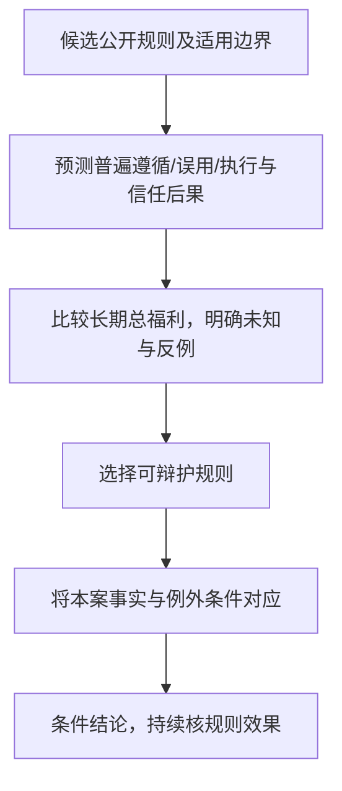


**例子走图**：公开规则R1不欺骗、R2有记录的紧急例外、R3自判利大便欺骗，先比长期后果再套本案。

文字替代：本图将规则功利的运行拆成可定位的问题，结果是带前提的分析，不是未知事实或现实法律许可。

循环、例外及其他人格条件按本节正文读。

<details><summary>读图自测：可以因这次好处大直接给自己R2例外吗？</summary>

不能。先确认R2规则整体可辩护及事实满足例外，不将逐案偏好冒成规则。

</details>

R1可能保护信任但在真实紧急保护中产生严重伤害；R2可能减伤却增加证明/审核成本；R3可能放大任意自利欺骗。

仅说“人人说谎会毁信任”不足以证明R1在所有候选必最佳，也不是先看本次好处再给自己后门。

若例外无法被可靠区别、普遍被滥用，原R2后果预测需改；若假紧急证据明显缺失，本案不能自动进入例外。

规则层仍需要事实与因果判断，不以一句严禁代替效用依据。

**所以呢**：以上补强改变了本节结论的成立条件；复习时须与主线结论一并读取。

### 2.8 社会契约论（讲义 p.57–65）

> **第四个可用理论。**

#### 2.8.1 基础：从自然状态到隐性契约（讲义 p.58–59）

**是什么**

**霍布斯（Thomas Hobbes）的版本**（讲义 p.58）：

- 在**"自然状态（state of nature）"**下，人的生活将是
  > **"solitary, poor, nasty, brutish, and short"**
  > 孤独、贫困、龌龊、野蛮而短暂
- 因此我们**隐性地接受了一份社会契约（implicitly accept a social contract）**，其内容是：
- 建立**规范公民之间关系的道德规则**
- 建立一个**有能力执行这些规则的政府**

**卢梭（Jean-Jacques Rousseau）的补充**（讲义 p.58）：

- 在理想社会中，**没有人凌驾于规则之上（no one above the rules）**
- 这防止了社会制定坏规则

**James Rachels 的经典定义**（讲义 p.59，**这句建议原文背下来**）：

> **"Morality consists in the set of rules, governing how people are to treat one another, that rational people will agree to accept, for their mutual benefit, on the condition that others follow those rules as well."**
> 道德是这样一套规范人际相待方式的规则：**理性的人，为了相互的利益，在他人也遵守的条件下，会同意接受它们。**

**🎙️ 课堂补充**（part3 `28:19`–`30:16`）

教授的讲法侧重"你已经签了字，只是你没意识到"：

> *"The fact that you [live in] society, you live here in the neighborhood, **means that you accept it**. Part of it is the **laws**... but apart from law — **which is the minimum** — there are other kinds of expectations everybody expects you to [meet]."*（part3 `28:46`–`29:06`）
💡 这里有一个重要区分（课堂观点与本案边界）：教授把法律概括为社会契约的最低限度。

契约还包含不成文期待。

“我没违法”因此不能代替伦理理由。

摄像头公共题面没有足够法域、授权条文与程序事实。

原笔记在此称“交警的行为完全合法”，与 §2.2.3 的缺证说明矛盾。

本候选统一为“是否合法待核；即使合法，也须独立论证伦理正当性”。

不据整改新增现实法律裁决。

**⚠️ 常见误解**

- ❌ "社会契约是历史上真的签过的一份文件"。

  → 不是。

  它是隐性的（implicit），通过你参与社会生活这个事实而成立。

  讲义 p.65 的第一条批评正是"没有人签过这份契约"。
- ⚠️ 注意 Rachels 定义里的三个限定词，缺一不可。

  理性的人（不是任意的人）／为了相互利益（不是单方面牺牲）／在他人也遵守的条件下（是有条件的承诺）。

**所以呢**："隐性契约"说明了道德规则为什么对你有约束力，但契约里具体包含哪些权利、这些权利分几种。

讲义马上给出一套分类——下一节的"权利的四种分类"就是把这份隐性契约拆解成可以操作的语言。

---

#### 2.8.2 权利的四种分类（讲义 p.60–61）

> **这一节是整门课后面引用最频繁的工具之一**，尤其是 M06 隐私。

**是什么**（讲义 p.60）

你有"不被偷拍"的权利，这只需要别人别做某件事——别偷拍你——就能满足。

你还有"生病能就医"的权利，这却需要别人主动做点什么——政府建医院、医生给你看病——才能兑现。

这是两种性质完全不同的权利：一种靠"别人别插手"保障，一种靠"别人得出力"保障。

讲义 p.60 给它们分了类，而且这套分类会在后面反复被用到：

| 类型 | English | 定义 | 例子 |
| --- | --- | --- | --- |
| **消极权利** | **Negative right** | 别人**只要不打扰你**就能保障的权利 | 隐私、言论自由、人身安全 |
| **积极权利** | **Positive right** | **要求他人为你做某事**的权利 | 受教育权、医疗保障 |
| **绝对权利** | **Absolute right** | **无例外**被保障的权利 |  |
| **有限权利** | **Limited right** | **可以依情况被限制**的权利 |  |

**两者的相关性**（讲义 p.61）：

> **积极权利倾向于是有限的；消极权利倾向于是绝对的。**
> （Positive rights tend to be more limited；Negative rights tend to be more absolute）

**🎙️ 课堂补充**（part3 `30:35`–`32:32`）

教授的解释：

- **消极权利**："**you don't need to do anything**. But other people are **not allowed** to [interfere]"——不许侵犯你的隐私，不许偷你的东西
- **积极权利**："**require others to do** [something] on your behalf"，教授举的例子是**目击犯罪时有义务报案、配合警方**
- 他还给了一个额外的说法（part3 `32:00`）：

  > 课堂在 part3 `32:00`–`32:32` 的方向是：每个人的权利主张必须与其他人拥有同等权利主张相容。ASR 在 *claim / rights / the same* 等关键词处破损，因此改为中文转述。

💡 这句话已经是**罗尔斯第一原则**的口语版，正好接下一节。

**💡 换个说法（笔记补充）· 为什么这个分类对 AI 伦理这么关键**

| 权利 | 类型 | AI 场景 |
| --- | --- | --- |
| **隐私** | **消极** | 见紧邻表后“隐私例”完整说明 |
| **获得解释** | **积极** | 表49说明1 |
| **不被算法歧视** | 两者兼有 | 见紧邻表后“不歧视例”完整说明 |

**隐私例：类型与落实条件分开**

例如要求企业不越权收集/取用/披露资料；“不新收集”不包办保障，因为已持有资料仍可能被滥用或泄露。落实该不干预要求也可需要积极安全措施 → **M06**

**不歧视例：类型与落实条件分开**

消极面是不作不正当区别对待；仅删身份字段不保证其他信息不会替代它产生相同不公。积极面可含检测与纠正偏差；具体义务须另核适用条件 → **M03**

**表49说明1 · 获得解释 / AI 场景**

要求企业主动做事（构建可解释性、生成解释）。

但履行方式不自动决定它绝对或有限。

现实法律条件须另按法域与条文核，不能由积极权利分类推出GDPR具体结论 → M04


**⚠️ 常见误解**

- ❌ "消极权利 = 不重要的权利"。→ negative / positive 说的是**履行方式**（不作为 vs 作为），**不是重要性**。讲义 p.61 恰恰说**消极权利更倾向于绝对**。
- ❌ 把"绝对/有限"和"消极/积极"当成同一个维度。

  → 是两个独立维度，讲义p.61给教学倾向，未提供统计样本，不能称实证相关或逻辑必然对应。

**进入机制补强前先记**：这套分类给了社会契约论一套"权利的语言"，可以直接用来拆解 AI 场景（隐私是消极权利、受教育是积极权利……）。

但它只回答了"这是什么权利"，没回答"权利之间打架了该怎么办"——罗尔斯的正义二原则。

正是为了给"权利该怎么分配"这个更难的问题一个答案。

---

**条件变式｜两维权利怎样进入实际冲突**

**权利分类是两个维度（笔记补充）**：积极/消极问相关义务通常需做什么或不做什么；绝对/有限问是否有可辩护限制。

两维没有逻辑必然配对，课件p.61的“tend”也未提供实证统计。

隐私可能要求不任意窥探，也可能要求主动保护已收数据；解释可能需主动提供但限制由另有依据的规则决定，不能由“积极”直接推天然有限。

**完整冲突例**：机构拟公开咨询原文来保证透明。

隐私理由要求避免泄露，透明理由要求解释自动路由，两者不迫使“公开原文/完全不解释”二选一。

可说明用途、规则摘要、不确定性及本人申诉，将外部独立审核放在有权限范围。

先识别权利主体、义务对象与最小必要动作，再核替代方式和实际影响。

若声称安全例外，仍要必要性、比例与授权依据；这是规范条件例，不给GDPR/本地法律具体结论。

**所以呢**：以上补强改变了本节结论的成立条件；复习时须与主线结论一并读取。

#### 2.8.3 罗尔斯的正义二原则与差异原则（讲义 p.62–63）

**是什么**

**约翰·罗尔斯（John Rawls）的两条正义原则**（讲义 p.62）：

> **第一原则（自由原则）**
> Each person may claim a **"fully adequate" number of basic rights and liberties**, so long as these claims are **consistent with everyone else having a claim to the same** rights and liberties.
> 每个人都可以主张一组"**充分适当的**"基本权利与自由，**只要这些主张与其他所有人主张同样的权利与自由相容**。

> **第二原则（关于不平等）**
> Any **social and economic inequalities** must:
> - **Be associated with positions that everyone has a fair and equal opportunity to achieve**（与人人都有公平且平等机会获得的职位相关联）—— 机会公平
> - **Be to the greatest benefit of the least-advantaged members of society**（对社会中**最不利者**最有利）—— **这就是差异原则（the difference principle）**

**差异原则的图示**（讲义 p.63，⚠️ 纯图片页）

一张柱状图，横轴是**个人收入**（\$10,000 到 \$100,000，每 \$10,000 一档），纵轴是**缴纳的所得税**，两个方案对比：

| 收入 | Plan A（浅色） | Plan B（深色） |
| --- | --- | --- |
| \$10,000 | 约 \$1,000 | **约 \$0** |
| \$20,000 | 约 \$2,200 | 约 \$600 |
| \$30,000 | 约 \$3,200 | 约 \$1,300 |
| \$40,000 | 约 \$4,500 | 约 \$3,100 |
| \$50,000 | 约 \$5,500 | 约 \$5,000 |
| \$60,000 | 约 \$6,600 | 约 \$7,400 |
| \$70,000 | 约 \$7,800 | 约 \$10,500 |
| \$80,000 | 约 \$8,900 | 约 \$14,000 |

本组沿用上表列名，继续列后面的条目。

| 收入 | Plan A（浅色） | Plan B（深色） |
| --- | --- | --- |
| \$90,000 | 约 \$10,000 | 约 \$18,000 |
| \$100,000 | 约 \$11,000 | **约 \$22,500** |

（数值为读图估计，用于表达趋势）

**这张图在说什么**：

- **Plan A** 接近**比例税**（税额随收入近似线性上升，税率大致恒定）
- **Plan B** 是**累进税**——低收入者几乎不纳税，高收入者税负显著更重
**两个方案在 \$50,000–\$60,000 之间交叉**
- 课堂用PlanB累进结构说明照顾最不利者的意图。

  只有核税款用途、行为反应、基本自由和公平机会，且其实际改善最不利者条件时才能支持，税率曲线本身不足

**🎙️ 课堂补充**（part3 `33:14`–`34:07`）

教授正是用累进税来讲这个原则的：

> 课堂在 part3 `33:42`–`34:07` 用“为什么我缴税更多”作例子，并把较高税负与失业救济、社会保障等公共服务联系起来。该窗口 ASR 大面积破损，不能把 `[fund] social [services]` 等补词当成逐字原话。
**💡 换个说法（笔记补充）· 无知之幕怎么接上来**

M01 §2.4.4 给过**无知之幕（veil of ignorance）**，本节可以把它接回去：

> 罗尔斯的论证方法是：**假设你要为一个社会设计规则，但你不知道自己将在其中处于什么位置**——不知道自己的家庭、天赋、种族、性别、健康状况。**你会选 Plan A 还是 Plan B？**
>
> 若B确实在优先原则内最有利于最不利者，可得到支持；不知道自己位置促使公平考量，但不是只凭可能穷就选一条税率。**差异原则就是无知之幕背后的人会选的原则。**

> 💡 **这个"不知道自己是谁"的设定，在 AI 公平性里有直接对应**：设计一个招聘算法时，问自己"如果我不知道自己会以哪个群体的身份被这个系统评估，我还愿意部署它吗？" —— **这是把罗尔斯直接用作 AI 设计准则的方法，值得写进小组项目。**

**⚠️ 常见误解**

- ❌ "差异原则 = 平均主义"。→ **完全不是。** 罗尔斯**允许不平等**，只要它对最不利者有利。一个让所有人都变穷的绝对平均方案，差异原则**会拒绝**。
- ❌ 把两条原则的顺序弄反。

  → 第一原则优先于第二原则：基本自由不能拿去交换经济利益。

  （讲义未强调，但这是罗尔斯理论的核心结构，🔗 笔记补充）
- ⚠️ 讲义 p.62 的排版把第二原则的两个子条件挤在一起，容易看漏。**记住是两条：机会公平 + 差异原则。**

**进入机制补强前先记**：差异原则把"不平等要对最弱势者有利"变成了一条可检验的标准，这也是社会契约论对功利主义"不管分配"这个弱点最直接的回应。

下一节回头总结社会契约论整体的优缺点，看它自己又有哪些讲不通的地方。

---

**机制补强｜先过自由与机会，再比较最不利者**

罗尔斯先问自由/机会，再看最不利者（笔记补充）：输入为制度方案、基本自由、公平机会与不同群体真正可用资源。

输出为满足优先约束后的最不利者比较。

不能直接把税率图当完结的社会福利表。

这张图回答：自由/机会优先于资源比较怎样落实为判断？

从起点沿箭头读。

流程箭头表示分析/检查顺序。

总览分类箭头只表示课程归类。

以下案例是笔记补充，适用条件按正文保留。


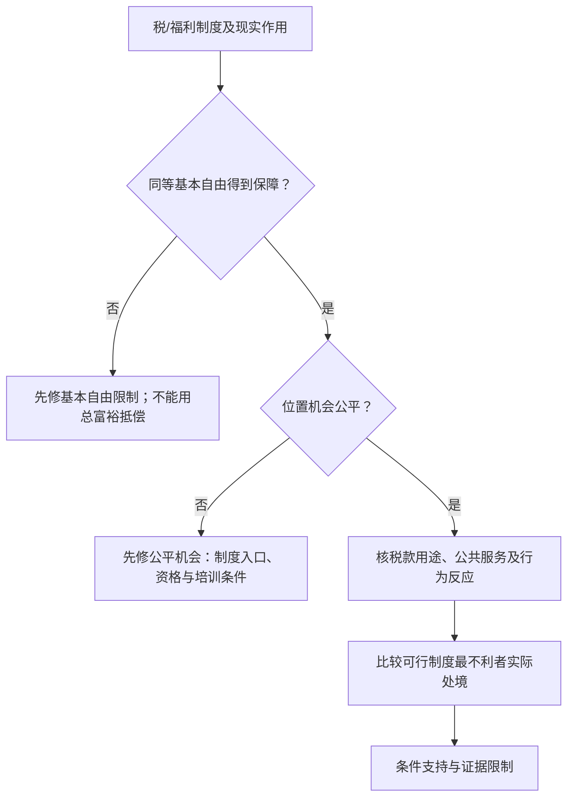


**例子走图**：A最不利者100、B110先通过两门，再比资源；C120却剥夺自由，在第一门失败。

文字替代：本图将自由/机会优先于资源比较拆成可定位的问题，结果是带前提的分析，不是未知事实或现实法律许可。

循环、例外及其他人格条件按本节正文读。

<details><summary>读图自测：税率更累进能直接走最终支持出口吗？</summary>

不能。税款用途、行为反应与真实资源未知时保留条件结论。

</details>

**完整税制变式（教学资源单位，不是 p.63 原数字）**

先假设各方案都保障基本自由与公平机会，而且可支配资源和服务使用同一教学刻度。

| 方案 | 最不利者税后资源 | 可得服务 | 合计 |
| --- | --- | --- | --- |
| A | 80 | 20 | 100 |
| B | 70 | 40 | 110 |
| B服务缩水变式 | 70 | 10 | 80 |

读 B 行：税后钱虽较少，但本例可得服务增加，合计110高于A100。在这一可比假设内，B改善该群体处境。

1. 若财政执行成本或行为反应使 B 服务只剩10，合计变成80，A反而更好。
2. 若 C 合计120，却剥夺某群体基本政治自由，先在自由检查失败，不进入资源最大化比较。

服务与可支配资源相加是简化假设，不是原著声称所有权利可以换钱。税率曲线不能提供这张福利结果表。

最强反例与边界：更累进的法定税率不保证更高实际税收/有效服务，也可能改变劳动投资与执行成本。

同样比例税配有效公共服务可能更惠最不利者。

无知之幕要求不按已知个人位置制定私利规则，不能单凭“怕自己最穷”推出一条税曲线必优。

差异原则关注社会经济基本结构的不平等如何最大有利于最不利者，不等任意决策总取一行最小值的万能算法。

<details><summary>迁移：B比A税率高，但没有公共服务用途数据，能判B较正义吗？</summary>

不能给确定比较。需财政用途/可得服务、行为反应与最不利者资源，并先核自由公平机会。p.63图可作累进结构示意，不能替代这些输入。
</details>

**所以呢**：以上补强改变了本节结论的成立条件；复习时须与主线结论一并读取。

#### 2.8.4 社会契约论的优点与缺点（讲义 p.64–65）

> 📄 p.64 原文写的是 *"How civil obedience could be morally justified"*（公民服从如何得到道德辩护）。若要讨论 `civil disobedience`（公民不服从），那是另一个问题；本笔记不静默改写原题。

**支持它的五条**（讲义 p.64）

1. **以权利的语言表述**（Framed in language of rights）—— 💡 这条对 AI 伦理特别有用，因为法规（GDPR、EU AI Act）也是用权利语言写的
2. 解释了为什么**在缺乏共同约定时人们会自利行事**
3. 对某些**公民/政府问题**给出清晰分析：
- 为什么政府可以剥夺罪犯的某些权利
- **公民服从（civil obedience）**如何可能在道德上被辩护（讲义 p.64 原文；`civil disobedience` 是另一问题，不能静默替换）
4. **可用的伦理理论**

<details><summary>p.64 两个公民/政府问题及上下文（英文原文）</summary>

**讲义 p.64 原文**

> CASE FOR SOCIAL CONTRACT
> THEORY
>  • Framed in language of rights
>  • Explains why people act in self-interest in the absence of common
>    agreement
>  • Provides clear analysis of certain citizen/government problems
>     • Why okay for government to deprive criminals of certain rights
>     • How civil obedience could be morally justified
> 
>  • Workable ethical theory

</details>

**问题一：政府为什么可以剥夺罪犯某些权利？（⚪ 参考论证）**

从互利的公共规则出发，成员需要防止侵害、保护彼此权利。但“已经犯罪”不等于一切权利消失：若适用规则经过正当公开程序、犯罪事实可靠认定，限制确为保护他人所必要且相称，并保留申诉、复核与其余基本保障，某些限制才可被条件辩护。这里是规范理由，不是对某国刑法已经核实的法律结论。

*English reference: Certain restrictions may be justified under public rules protecting reciprocal rights, provided responsibility is established by fair procedures and the restrictions are necessary, proportionate, reviewable, and compatible with remaining basic safeguards. Criminal status alone does not cancel every right.*

**问题二：公民服从怎样可能得到道德辩护？（⚪ 参考论证）**

若共同规则在公平条件下保障互惠利益，成员享有保护，也有支持这套正当合作安排的理由。必须再问规则是否公平、是否侵犯基本权利、是否可公开质询；不能从“法律存在”直接推出无条件服从。原题是 civil obedience，当前回答不把它偷换成公民不服从的题目。

*English reference: Civil obedience can be morally justified when fair public rules protect reciprocal interests and support legitimate cooperation. Mere legal existence is insufficient; rights, fairness, and available avenues of challenge still matter.*

**反对它的四条**（讲义 p.65）

| # | 批评 | 教授的展开（🎙️ part3 `34:07`–`35:58`） |
| --- | --- | --- |
| ① | **没有人真的签过社会契约** | "No one actually signs [it]... [it] is **implied by the actions**" |
| ② | 有些行为**可以有多种刻画方式** | 同一件事既可说成"行使言论自由"，也可说成"侵犯他人名誉" |
| ③ | **权利冲突问题**（Conflicting rights problem） | 课堂在 part3 `34:52`–`35:15` 提到权利可能彼此冲突，但关键谓词与对象在 ASR 中严重破损；这里只保留理论方向，不恢复教授逐字句 |
| ④ | 讲义 p.65：可能不公正地对待 *incapable of upholding contract*（不能履约）者 | 课堂 part3 `35:15`–`35:58` 的 ASR 另谈协议能力，未列具体群体；履约能力、参与协议与数字接入不能直接互换，下面另分问题 |
| **判决** | **尽管有弱点，仍是可用的理论** |  |

**💡 换个说法（笔记补充）· 第 ④ 条对 AI 特别重要**

社会契约论的成员资格建立在**理性能力 + 互惠**上。这带来两个 AI 时代的难题：

1. **数字接入不足**：不会用智能手机、没有网络，只证明某个程序可能排除人，不证明其不能互惠履约，更不能推出其没有道德地位。可以比较线下渠道、代理协助及其他公平安排，使其利益进入公共规则；这与讲义提出的真正不能履约者怎样获公平照顾，是相邻但不同的问题。
2. **AI 自身有没有道德地位**：如果 AI 有了 agency（教授在 §2.3.3 提过），它算不算契约的一方？

**契约论的回答依赖"能否互惠地遵守规则"，而这恰恰是最难判定的**

**⚠️ 常见误解**

- ❌ 把社会契约论和"合法性"混为一谈。→ 课堂在 part3 `28:46`–`29:06` 说明法律只是社会契约的最低限度（§2.8.1）。
- ⚠️ **笔记练习重点**：权利冲突问题（③）可用隐私/安全、言论/免受伤害演练；原材料未给“最常被考”的统计或承诺。

  社会契约论能清楚地把冲突陈述出来，但它本身不提供裁决方法——这正是它的弱点。

  9/22 作业里"隐私 vs 公共安全"就是这类冲突的标准形态。

**所以呢**：社会契约论的成员资格建立在"有理性、能互惠"之上。

这个前提本身就是它最大的软肋——恰好是下一个理论（德性伦理）的切入点。

德性伦理根本不问"你签没签约"，只问"一个有德之人会怎么做"。

---

### 2.9 德性伦理（讲义 p.66–75）

> **第五个可用理论，也是最古老的一个。**

#### 2.9.1 出发点：对启蒙理论的批评（讲义 p.67）

**是什么**

德性伦理是从**批评前面几个理论**开始的。讲义 p.67：

> **康德主义、功利主义、社会契约论忽视了重要的道德考量：**
> - **道德教育**（moral education）
> - **道德智慧**（moral wisdom）
> - **家庭与社会关系**（family and social relationships）
> - **情感的作用**（role of emotions）

> **德性伦理（Virtue Ethics）**
> - **arete, virtue, excellence**：达到最高潜能（reaching highest potential）
> - **亚里士多德《尼各马可伦理学》（Aristotle's Nicomachean Ethics，公元前 4 世纪）**

**为什么需要它**

前四个理论都在问 **"我该做什么（What should I do?)"**，并试图给出一个**程序**。德性伦理换了个问题：

> **"我该成为什么样的人（What kind of person should I be?)"**

**🎙️ 课堂补充**（part3 `35:58`–`36:52`）

教授的表述：

> *"**Instead of** [asking] what is ethical to do, **you look at the ethical person**. If a person has all these ethical virtues... [they] will be guided by these virtues [to] do the right thing."*
课堂还给出历史定位：

课堂在 part3 `35:58`–`36:25` 将德性伦理概括为最古老的伦理理论类型，并追溯到约 2500 年前的 Aristotle。原 ASR 把 Aristotle 识别为 *aristocracy*，这里用讲义专名校正并作转述。

**所以呢**：德性伦理换了个问题——不问"该做什么"，问"该成为什么样的人"。

这个问题听起来很虚，但下一节会把它落实成两个可以操作的概念：德性、恶习，和两者之间的"中道"。

---

#### 2.9.2 德性、恶习与中道（讲义 p.68, p.70–71）

**是什么**

一个人说话算话，往往不是因为他每次开口前都临时算一遍"这次说真话划不划算"。

而是因为"诚实"已经长成了他性格的一部分——撒谎这件事他做起来会别扭。

德性伦理关心的正是这种刻进性格里的稳定倾向，而不是每次行动前的临时推理。

讲义先把"德性"本身分成了两类：

**两类德性**（讲义 p.68）

| 类型 | English | 内容 |
| --- | --- | --- |
| **理智德性** | intellectual virtues | 与**推理和真理**相关的德性 |
| **道德德性** | moral virtues | **品格**的德性（如诚实） |

**道德德性的三个特点**（讲义 p.68）：

- 通过**习惯性地做正确的事**而养成（developed by **habitually performing right action**）
- 是**根深蒂固的品格特质**（deep-seated character traits）
- 是一种**以特定方式行动、并以特定方式感受的倾向**（disposition to act **and feel** in a certain way）

> ⚠️ 注意最后一条里的 **"and feel"**——**德性不只是行为习惯，还包括情感反应**。一个内心极度想偷东西但强忍住的人，在德性伦理看来还不够有德性；真正诚实的人**不会想偷**。这是德性伦理与康德主义最大的气质差异。

**恶习与中道**（讲义 p.70）

> **恶习（Vice）**：阻碍人**繁盛（flourishing）**或真正幸福的品格特质。
>
> **常常，一种德性位于两种恶习之间：**
> - **勇气** 位于 **怯懦（cowardliness）** 与 **鲁莽（rashness）** 之间
> - **慷慨** 位于 **吝啬（stinginess）** 与 **挥霍（prodigality）** 之间

这就是亚里士多德著名的**中道（the mean / golden mean）**学说。

**德性伦理的总结**（讲义 p.71，**三句话建议背下来**）

> 1. **正确的行为，就是一个有德之人在相同情境下、依其品格行事时会做的行为。**
>    (A right action is an action that a **virtuous person, acting in character**, would do in the same circumstances.)
> 2. **有德之人，就是拥有并活出这些德性的人。**
> 3. **德性，就是人为了繁盛并真正幸福所需要的那些品格特质。**

**🎙️ 课堂补充**（part3 `36:52`–`37:30`）

课堂在 part3 `36:52`–`37:30` 强调“内化”这个机制：

> *"You develop this by **habitually performing the right action** through time [until it gets] **internalized** to become a virtuous person... [it] become[s] part of your **character strength**... [then a] moral person is likely to do [the right thing] because **you know it by heart**."*（part3 `36:52`–`37:30`）
以及**幸福的来源**（part3 `37:30`，对应讲义 p.69 的标题）：

> **"Happiness derives from living a life of virtue."**（讲义 p.69 整页只有这一句话 + 一张"施粥"的插画）

**💡 换个说法（笔记补充）· 习惯与实践智慧一起工作**

德性培养需要反复实践，形成可靠倾向；但讲义 p.68 的理智德性和 p.72 的实践智慧（Practical Wisdom）仍要求核事实、理解处境和判断怎样行动。它不是“训练好后就不需推理”。比如发现自己给人的建议可能有危险，应先核具体风险与证据、采取适当减伤行动，再判断是否更正与怎样通知；不能只说“有德之人自然知道”。

可用反复练习作有限类比，但不能从机器学习模型会输出答案，推断它已经拥有人的道德品格。其他理论也需要情境判断，不是真正给定一个函数就自动完成所有伦理问题。

**⚠️ 常见误解**

- ❌ "中道 = 折中 = 取平均"。

  → 不是数学平均。

  中道是相对于人和情境的"恰到好处"：面对真正的危险，恰当的勇气可能非常接近"鲁莽"那一端。
- ❌ "德性伦理就是让你做个好人，没什么理论内容"。

  → 讲义 p.71 给的是一个完整的、可检验的判据：判断行为对错 → 参照有德之人 → 有德之人由德性定义 → 德性由"人的繁盛"定义。

  这是一条完整的论证链，而不是口号。

**所以呢**：知道了德性分两类、中道是什么，下一个自然的问题是——具体有哪些德性？

西方传统和儒家传统各开了一张清单，下面两节把它们摆在一起看。

---

#### 2.9.3 亚里士多德的核心德性（讲义 p.72）

> ⚠️ 纯图片页。完整转录如下。

每行是一项讲义列出的德性。英文描述说明行为倾向，中文列给对应读法；例如勇气是面对恐惧并承担适当风险。

| Virtue 德性 | Description | 中文 |
| --- | --- | --- |
| **Courage** | Facing fears and taking appropriate risks | **勇气**——面对恐惧、承担适当的风险 |
| **Temperance** | Practicing self-control and moderation | **节制**——自我克制与适度 |
| **Justice** | Treating others fairly and giving each their due | **正义**——公平待人，各得其所 |
| **Prudence (Practical Wisdom)** | Making wise decisions based on reason and experience | **明智（实践智慧）**——基于理性与经验做出明智决定 |
| **Honesty** | Being truthful and transparent | **诚实**——真实且透明 |
| **Compassion** | Showing empathy and concern for others | **同情**——对他人的共情与关切 |
| **Generosity** | Willingness to give and share with others | **慷慨**——乐于给予和分享 |
| **Loyalty** | Being faithful to commitments and relationships | **忠诚**——忠于承诺与关系 |

本组沿用上表列名，继续列后面的条目。

| Virtue 德性 | Description | 中文 |
| --- | --- | --- |
| **Humility** | Recognizing one's limitations and avoiding arrogance | **谦逊**——认识自身局限、不傲慢 |
| **Perseverance** | Persisting through challenges and adversity | **坚韧**——在挑战与逆境中坚持 |

> 💡 前四项（勇气、节制、正义、明智）是西方哲学传统里的 **四枢德（cardinal virtues）**，其余六项是本讲义的扩充。

**所以呢**：有了这张清单，德性伦理才从"做个好人"这句空话变成一份可以对照检查的品格清单。

下一节看儒家提供的另一份清单——五常——两份清单放在一起对比，能同时看出德性伦理的说服力和它的文化局限。

---

#### 2.9.4 儒家德性：五常（讲义 p.73）

> ⚠️ 纯图片页。这一页是讲义**唯一一处中文内容**，说明教授有意做东西方对照。

每行是一项儒家五常。第一列给中文与拼音，第二列给英文译名，第三列说明在行为中怎样体现。

| Virtue (Chinese) | Translation | Meaning |
| --- | --- | --- |
| **仁（Rén）** | Benevolence / Humaneness | 对他人的同情、共情与善意 |
| **义（Yì）** | Righteousness / Justice | 做道德上正确的事，超越自身利益 |
| **礼（Lǐ）** | Ritual / Propriety | 尊重传统、礼节与社会和谐 |
| **智（Zhì）** | Wisdom | 道德辨识力，对是非的理解 |
| **信（Xìn）** | Integrity / Trustworthiness | 诚实守信 |

**🎙️ 课堂补充**（part3 `38:31`–`38:49`）

教授的原话很简短但点明了要害：

> *"In Chinese [and] Eastern philosophy we have **the same thing** in Confucius... Confucius [virtues]... you **build this into your character**. Then [when] you're facing a situation, then your **wisdom will help you make the right** [choice]."*（part3 `38:31`–`38:49`）
**💡 换个说法（笔记补充）· 东西方德性表的对照**

这两张表放在一起看，最值得注意的是**重合与差异**：

| 亚里士多德 | 儒家 | 关系 |
| --- | --- | --- |
| Justice 正义 | **义** | 高度重合 |
| Prudence 明智 | **智** | 高度重合 |
| Compassion 同情 | **仁** | 高度重合 |
| Honesty 诚实 | **信** | 高度重合 |
| — | **礼** | ⚠️ **在本讲两份已列清单中只见于儒家一列**；不能据此断言整个西方德性传统没有关系或和谐观念 |
| Courage 勇气 / Temperance 节制 | — | ⚠️ 亚里士多德侧重**个体的自我治理** |

> ★ **这个对照本身就是一个极好的答题素材**：它同时**支持**德性伦理（不同文明独立发展出高度相似的德性清单 → 支持道德客观主义，见 §2.10.3），又**暴露**它的弱点（"礼"的存在说明德性清单确实带有文化印记 → 对应讲义 p.75 第一条批评"理性的人会对哪些品格特质构成繁盛产生分歧"）。
> **在小组项目里做跨文化 AI 治理时，这一页可以直接用。**

**⚠️ 讲义拼写**：p.73 标题写作 "CONFUCIOUS VIRTUES"，正确拼法是 **Confucian / Confucius**。副标题写的是"賢德"，而五常的标准中文名是 **五常**（仁义礼智信）。见 [[#9.3 课件自身的问题|§9.3]]。

**所以呢**：东西方独立发展出高度重合的德性清单。

这件事本身能反过来支持"道德不是纯粹相对的"——但本讲两份清单对“礼”的列法不同，也提示具体清单有文化背景；它们的相似或不同本身都不是全传统或道德客观性的证明。

这个张力留到下一节的优缺点小结里正面处理。

---

#### 2.9.5 德性伦理的优点与缺点（讲义 p.74–75）

**支持它的五条**（讲义 p.74）

1. 关注**德性**往往比关注义务、权利或后果**更说得通**
2. **个人关系可以与道德决策相关**（personal relationships can be morally relevant）——本课将其列为德性伦理的优点；不能说前四理论全部排除关系：p.54 的规则功利主义配偶优先例已经给出反例
3. 我们的**道德决策能力是随时间发展的**
4. **在这个理论下没有无法解决的道德困境** —— ★ 因为它不靠规则相撞，靠的是有德之人的判断
5. **情感在道德生活中扮演重要角色**

**反对它的四条**（讲义 p.75）

| # | 批评 | 说明 |
| --- | --- | --- |
| ① | **理性的人对"人的繁盛需要哪些品格特质"可能意见不一** | 见 §2.9.4"礼"的例子 |
| ② | **无法用德性伦理来指导政府政策** ★★ | 讲义的批评是单凭“有德之人”不足以确定可执行、可审查的公共程序；不据此推出政策不能包含诚信目标或德性判断不能论证 |
| ③ | **德性伦理削弱了追究人对其恶行之责任的努力** | 如果坏行为源于"品格未养成"，追责就变得困难 |
| **判决** | **尽管有弱点，仍是可用的理论** |  |

**💡 换个说法（笔记补充）· 第 ② 条对本课的意义特别大**

**本课的落点包括 AI 治理（governance）与监管（regulation）**——本学期Course Outline第5学习目标要求设计企业治理机制与政策；不是在四条官方CILO里另造“第5条”。本节讨论单靠品格怎样仍不足以确定完整程序，也保留它对治理目标和理由的作用：

> 这里保留讲义 p.75 的批评原句 *“Cannot use virtue ethics to guide government policy”*。笔记将其限为：单靠品格要求还不能确定授权、记录、监督与申诉的具体程序；不是说政策不能包含诚信目标，也不在此凭例句认证某法条当前内容。

所以在小组项目里：德性伦理适合用来论证"为什么这家公司应该在意"。

规则型理论（康德、规则功利主义、社会契约论）适合用来设计"具体该怎么做"。

两者分工，不要用错。

**⚠️ 常见误解**

- ❌ "第 4 条'没有无法解决的困境'说明德性伦理更强"。

→ 它是通过**放弃给出通用程序**来避免困境的——把判断交给"有德之人的实践智慧"。

**局限在于**单凭“有德之人会这样做”不足以交付公共机构可执行的完整程序；并不推出全部德性判断无法论证、核事实、审查或教育。后面的实践智慧例恰好要解释证据、理由与负责行动。

**进入机制补强前先记**：德性伦理是本讲最后一个可用理论。

它强调品格与实践智慧；要形成公共治理安排，仍须把这些目标接到可解释的事实、职责和程序上。不能把这一分工说成德性没有理由或原则。

五个可用理论到此讲完，下一节把它们并排放在一起横向比较。

---

**条件变式｜德性怎样映射为可检查的行动**

**德性与实践智慧：冲突怎么实际判断（笔记补充公开案例）**：一个咨询AI发现自己的建议可能错，值班员想维护机构声誉不告知学生。

事实是建议未执行、可能延误选课、尚可由人工核。

诚实要求承认不确定，关怀要求减少焦虑与延误，勇气要求承担报告成本，谨慎要求先核而非无证据宣布系统全部无效。

1. 分清已证实/未证实错误、谁受影响与可逆性；不是先给值班员贴“勇敢/懦弱”标签。

2. 问有实践智慧的人怎样在具体职责下实现各德性：暂停本条自动建议、请有权限者核资料。

  向当事人说明“正在核对，请暂勿据此操作”，给可用人工途径。

3. 证实错误后更正、记录负责角色与版本；若未证实仍报告不确定性的消除理由。

坦诚不需公开他人隐私，关怀也不是为避免紧张而隐瞒。

4. 在类似事件中通过记录、训练与反馈养成可靠倾向，不以一次善举证明整个人已具德性。

这张图回答：德性映射到实际动作怎样落实为判断？

从起点沿箭头读。

流程箭头表示分析/检查顺序。

总览分类箭头只表示课程归类。

以下案例是笔记补充，适用条件按正文保留。


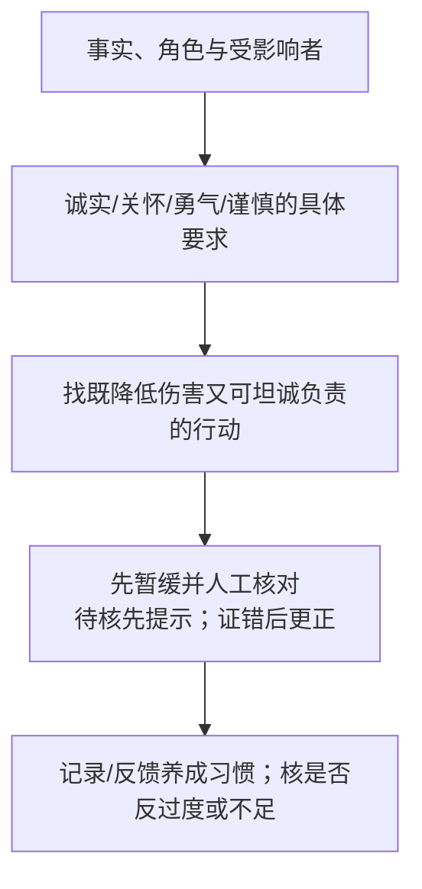


**例子走图**：选课建议可能错，诚实/关怀/勇气/谨慎共同要求暂停本条、核资料、通知、更正并记录。

文字替代：本图将德性映射到实际动作拆成可定位的问题，结果是带前提的分析，不是未知事实或现实法律许可。

循环、例外及其他人格条件按本节正文读。

<details><summary>读图自测：直接夸大未证危险是否就是勇气？</summary>

不是。可能鲁莽；中道由事实、对象与时机判断，不是数字折半。

</details>

**最强反例与变式**：如果不披露将造成不可逆伤害，单纯等待机构许可可能是懦弱；如果立即夸大未经证实的危险，又可能鲁莽伤人。

中道不是数值折半，而是根据事实、目的、对象和时机找到适度行动。

若有人“有德之人会同意我”，仍需说明德性如何映射事实，不能循环论证。

实践智慧提供情境判断，公开政策仍须权利/程序与可检验后果约束。

**所以呢**：以上补强改变了本节结论的成立条件；复习时须与主线结论一并读取。

### 2.10 五个可用理论的横向对比（讲义 p.76–84）

#### 2.10.1 ★ 判断树：所有理论的骨架（讲义 p.80）

- 本节原 ASCII 图是课件结构的文字转录

- 可编辑图在 §3 图2。两图是一套课程分类，不是一个自动算法。用同一“说谎借款”例读：先问是直接比较这次后果，还是先评所用规则

- 进入规则后，康德问准则，规则功利问普遍遵循后果，契约论问可接受的共同规则。

> ⚠️ 纯图片页。**这是全讲最有价值的一张图**，它把五个理论组织进了一个两层结构。

**原图内容**（完整转录）：


```
                    What makes an action morally right?
                    （什么使一个行为在道德上正确？）
                              │
        ┌─────────────────────┼─────────────────────┐
        ▼                     ▼                     ▼
It results in the        It is in accord      It is consistent with
maximum net increase     with a correct       the actions of a
in the total good of     moral rule.          virtuous person.
the affected parties.
【ACT UTILITARIANISM】   【↓ 继续追问】        【VIRTUE THEORY】
 行为功利主义                                    德性理论
                              │
                    What makes a moral rule correct?
                    （什么使一条道德规则正确？）
                              │
        ┌─────────────────────┼─────────────────────┐
        ▼                     ▼                     ▼
We can imagine           The effect of        Rational people would
everyone following       everyone following   collectively accept it
this rule all the        this rule all the    as binding because of
time without producing   time would be the    the resulting benefits
a logical contradiction  greatest increase    to the community.
that undermines the      in the total good.
rule.
【KANTIANISM】           【RULE               【SOCIAL CONTRACT
 康德主义                 UTILITARIANISM】     THEORY】
                          规则功利主义          社会契约论
```


**这张图在说什么**

**五个理论分成两层**：

| 层 | 理论 | 直接回答的问题 |
| --- | --- | --- |
| **第一层：直接评价行为** | 行为功利主义、德性伦理 | "这个**行为**对不对？" |
| **第二层：先评价规则** | 康德主义、规则功利主义、社会契约论 | "这条**规则**对不对？"（再由规则判定行为） |

**第二层三个理论的分歧，就在于"什么使规则正确"**：

| 理论 | 规则的正当性来自 | 一个词 |
| --- | --- | --- |
| **康德主义** | p.80简图提示构想一致性；完整判断还须检查理性意愿，并核人格尊重（§2.6.7） | 一致性只是入口 |
| **规则功利主义** | **后果**——人人遵守时总善最大 | **有效性** |
| **社会契约论** | **同意**——理性者会因共同体收益而集体接受它为约束 | **可接受性** |

**💡 换个说法（笔记补充）**

这张图是**本讲最好的记忆钩子**，因为它同时给出了：

1. 五个理论的**完整清单**（不会漏）
2. 它们的**分类逻辑**（不会混）
3. 每个理论在本课分类中的记忆入口；不能把简图一句话当完整许可判据

**建议做法：把这张图默画一遍，能画出来，本讲的骨架就有了。**

**所以呢**：这张图把五个可用理论装进了一个两层结构里，是本讲最浓缩的记忆锚点。

下一节把同样的五个理论换成表格形式，逐条列出它们的核心主张、代表人物和优缺点，方便考前一页纸复习。

---

#### 2.10.2 横向对比表（讲义 p.79, p.83）

**是什么**

前面八节把每个理论拆开、逐个讲清楚。**⚪ 笔记题型推断**：讲义后段集中比较多个理论，因此可以用一张对照表准备比较题；这不是教授明示题型。

讲义给了三个层次的版本，从一句话到完整表格：

**四理论一句话版**（讲义 p.79）

| 理论 | 讲义原句 |
| --- | --- |
| **Kantian Ethics** | 见说明 1 |
| **Utilitarianism** | 见说明 2 |
| **Virtue Ethics** | 见说明 3 |
| **Social Contract Theory** | 见说明 4 |

**说明 1 · Kantian Ethics / 讲义原句**

Focuses on **duty and universal moral laws**, emphasizing **intentions** behind actions and **respect for individuals**.

**说明 2 · Utilitarianism / 讲义原句**

Aims for the **greatest good for the greatest number**, focusing on **outcomes** and promoting overall well-being.

**说明 3 · Virtue Ethics / 讲义原句**

Centers on **moral character and virtues** like courage and honesty, promoting holistic moral development.

**说明 4 · Social Contract Theory / 讲义原句**

Bases morality on **mutual societal agreements**, emphasizing **justice, fairness, and cooperative rights**.

> ⚠️ 注意 p.79 关于功利主义的表述用了 "the greatest good for the greatest number"，**而 p.56 明确说功利主义并不意味着这句话**。这是讲义内部的口径冲突，见 [[#9.3 课件自身的问题|§9.3]]。**考试若被问及，以 p.56 的辨析为准并主动指出这一点。**

**完整对比表**（讲义 p.83）

| Ethical Framework | Core Principle | Key Thinkers | Moral Focus | Strengths | Criticisms |
| --- | --- | --- | --- | --- | --- |
| **Kantian Ethics**<br>康德伦理 | Duty and universal moral laws | **Immanuel Kant** | Intentions and adherence to duty | Emphasizes consistency, respect for persons, and moral autonomy | **Can be rigid; ignores consequences** |
| **Utilitarianism**<br>功利主义 | Greatest good for the greatest number | **Jeremy Bentham, John Stuart Mill** | Outcomes and consequences | Practical, outcome-focused, promotes overall well-being | **Can justify harmful actions if they benefit the majority** |
| **Virtue Ethics**<br>德性伦理 | Cultivation of moral character | **Aristotle** | Character and virtues (e.g., courage, honesty) | Holistic, focuses on moral development and personal growth | **Lacks clear guidance for specific actions** |
| **Social Contract Theory**<br>社会契约论 | Morality based on mutual agreement in society | **Thomas Hobbes, John Locke, Jean-Jacques Rousseau** | Justice, rights, and societal rules | Grounds ethics in fairness and cooperation | **Assumes rational agreement; may exclude marginalized voices** |

> ⚠️ p.83 出现了 **John Locke（洛克）**，但正文 p.58 只讲了霍布斯和卢梭，**洛克全程没有出现过**。答题时提到他是安全的（他确实是社会契约论三大家之一），但要知道**讲义正文没讲他**。

**各理论提供的洞见**（讲义 p.82，**这一页最适合直接用在作业里**）

| 理论 | 它给你的那句话 |
| --- | --- |
| **Kantianism** | 每个人都同样有价值；与人交往时，**始终把他们当作理性存在者来尊重** |
| **Utilitarianism** | 判断对错之前，**先考虑行为的后果** |
| **Social contract theory** | 我们应当**集体地促进人权**——生命权、自由权、财产权 |
| **Virtue ethics** | **你可以指望一个好人**在恰当的时间、以恰当的方式做正确的事 |

**所以呢**：这张表是考前复习的骨架，但表格本身讲不清"为什么它们的分类不一样"——下一节回到一个更深的问题。

五个可用理论加上三个不可用理论，到底可以按什么更根本的标准分成两派。

---

#### 2.10.3 客观主义 vs 相对主义（讲义 p.77）

**是什么**

> **客观主义（Objectivism）**：道德**在人心之外有其存在**（Morality has an existence **outside the human mind**）
> **相对主义（Relativism）**：道德是**人的发明**（Morality is a **human invention**）

**讲义给出的归类**（p.77）：

> **神命论、伦理利己主义、康德主义、功利主义、社会契约论、德性伦理，都是客观主义的例子。**

**💡 这一页的意义**（笔记补充）

它揭示了本讲**真正的第一道分界线**——**不是"可用 / 不可用"，而是"客观 / 相对"**：


```
所有道德理论
├─ 相对主义
│   ├─ 主观相对主义    ❌ 不可用
│   └─ 文化相对主义    ❌ 不可用
└─ 客观主义
    ├─ 神命论          ❌ 不可用（客观，但基于服从不基于理性）
    ├─ 伦理利己主义    ❌ 不可用（客观，但不采纳伦理的视角）
    ├─ 康德主义        ✅
    ├─ 行为功利主义    ✅
    ├─ 规则功利主义    ✅
    ├─ 社会契约论      ✅
    └─ 德性伦理        ✅
```


> ★ **一个高价值的观察**：**是客观主义只是必要条件，不是充分条件。** 神命论和伦理利己主义都是客观主义的，照样被淘汰——因为它们各自违反了 §2.4 判据的**另一条**。**答题时能说清这个层次，说明你真的理解了这一讲的结构。**

**⚠️ 常见误解**

- ⚠️ 社会契约论为什么算客观主义？

  它明明说道德来自人的约定。

  → 关键在于：它主张理性的人在给定条件下会汇聚到同一套规则上，这套规则不因你个人的偏好而改变。

  "由人达成"不等于"随人而变"。

  这个区分容易被问到。

**所以呢**：这条分界线说明"可用/不可用"和"客观/相对"其实是两层判断——客观只是入场券，不是通行证。

最后一节把五个可用理论重新组织成一套实战方法：分歧出现时怎么用它们互相印证。

---

#### 2.10.4 ★ 怎么用这五个理论：三角测量（🎙️ 课堂方法）

**p.84 两个英文自问**：*"What kind of person do I want to be?"* 与 *"What kind of world do I want to live in?"*。**English answer frame（⚪ 笔记参考）**: *I would choose an action that I can defend in terms of duties and rights, foreseeable consequences, and the character and social world it helps create.*

**逐问写作示范（⚪ 笔记自拟；不是官方标准答案，也不是本人已作出的价值承诺）**

1. **想成为什么样的人**：示范选择诚实、尊重他人并愿用理由说明和修正决定。*English example: I would like to be an honest and respectful person who can explain decisions with reasons and correct mistakes.*
2. **想生活在什么世界**：示范选择权利与福祉受到重视、决定可被公开质询并有负责合作的社会。*English example: I would like to live in a world where people's rights and well-being matter, decisions can be questioned, and people cooperate responsibly.*

两句只是把“什么样”具体写出来的例子。读者可以选择不同品质或社会目标，但仍须解释理由、回应反例与取舍；不能把本文示范当作自己的观点记录或教师评分承诺。

> ★ **讲义 p.84 只给了两个问句，实际的操作方法是教授在课堂上讲的**（🎙️ part3 `39:57`–`41:18`）。**这是本讲最直接可用的答题方法。**

**讲义 p.84**（本讲的收束页，与 p.12 的判据首尾呼应）：

> **ETHICAL EXPLANATIONS THAT MIGHT BE PERSUASIVE TO A SKEPTICAL, YET OPEN-MINDED AUDIENCE**
>
> 做道德决定时，你可以同时考虑**义务、权利、后果与德性**。
> **但最终，你必须自己决定：**
> - **我想成为什么样的人？**（What kind of person do I want to be?）
> - **我想生活在什么样的世界里？**（What kind of world do I want to live in?）

**🎙️ 教授给的方法**（part3 `40:09`–`41:18`）：

> 课堂在 part3 `40:09`–`40:56` 给出的顺序是：先看这一次行为的后果，再从三种规则路径分析，最后用德性伦理换角度检查；若各路径相互支持，课堂把这种做法称为 *triangulate*。理论名依据讲义校正；原 ASR 的 *canism / blue ... terrorism / contract three* 严重破损，不写成教授逐字原话。

**💡 这是一个可直接套用的答题框架**（笔记补充）


```
第 1 步：直接看行为的后果        → 行为功利主义：在相同事实、对象和期间下，哪项可行行动的总效用最高？净正只表示正余额，不单独决定最优。
第 2 步：从三个角度检验规则
        ① 这条规则能普遍化吗？    → 康德主义
        ② 人人遵守它效果好吗？    → 规则功利主义
        ③ 理性人会同意它吗？      → 社会契约论
第 3 步：换一个角度做交叉验证    → 德性伦理：一个有德之人会怎么做？
第 4 步：三角测量
        · 理由一致且独立核过共同前提 → 暂时增信，仍回应最强反例
        · 出现分歧 → ★ 这才是最有价值的部分：
                     说清分歧在哪、为什么分歧、你采纳哪一边、以及理由
```


> ⚠️ **重要**：**出现分歧不是失败**。课堂在 part1 `38:35`–`39:03` 区分简单的对／错决定与可辩护的好／坏决定。**笔记建议把分歧及其前提讲清楚，不强行让五个理论给出同一答案；课堂没有给出相应分数承诺。**

**进入机制补强前先记**：三角测量给了你一套把五个理论同时用起来的操作方法——这也是本讲要交给你的最终产出。

不是"背哪个理论对"，而是"怎么用它们一起论证"。

下一节教授会告诉你，这套工具箱接下来要用在哪里。

---

**机制补强｜一致只能增信，不能代替前提与反例**

电车与多理论比较：同伤亡数不等同一个论证（笔记补充）：道岔案改变轨道使车不碰五人、另一轨一人死亡。

推人案通过把一个人的身体推下作阻车手段救五人。

假设两案确定五活一死，只证明计人数同；前案一人的死亡可能是行动副作用，后案利用其身体是救援因果链的一部分。

人格尊重、同意/权利及因果角色会改变义务分析，不能只在表填“5>1”完成全部理论。

这张图回答：同事实集与多理论论证怎样落实为判断？

从起点沿箭头读。

流程箭头表示分析/检查顺序。

总览分类箭头只表示课程归类。

以下案例是笔记补充，适用条件按正文保留。


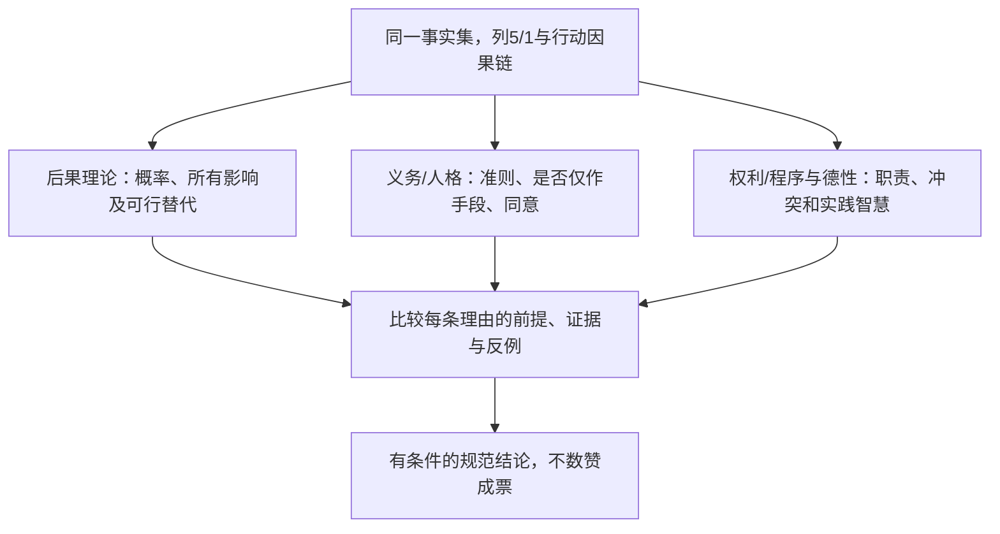


**例子走图**：道岔与推人案同五活一死，沿后果和人格两支分别看死亡副作用与利用身体手段，再比较理由。

文字替代：本图将同事实集与多理论论证拆成可定位的问题，结果是带前提的分析，不是未知事实或现实法律许可。

循环、例外及其他人格条件按本节正文读。

<details><summary>读图自测：五理论四票一致能证明正确吗？</summary>

不能。理由可能依赖同一错误前提；回应最强反驳，不数票替代论证。

</details>

**四比一的边界**：五种理论不必是五份独立经验观测，同意结论也可能重复同一事实假设或忽略同一成本。

多数一致可提示稳健，但不能自动证明规范有效；要把最强反对意见写出来并回应，不能以4票压1票代替理由。

评分个人作业的摄像头题保留原题与课堂资料，本补充电车/咨询案例不替任何学生完成提交或给现实法律权限裁定。

<details><summary>迁移：推人成功概率只0.2，道岔成功概率1，还能只比五人对一人吗？</summary>

不能。

即便只按存活人数作简化，需另列失败时会死谁、被推者是否也死亡，才能算期望后果。

不能缺失败分支就写0.2×5。

人格/手段问题也不因概率乘算消失。
</details>

**所以呢**：多理论分析的收束是有来源、前提与反例的推理链；多表标签或多数同意不是其替代。

### 2.11 下一步：从道德理论到 AI 伦理原则（🎙️ 教授的预告）

> 🎙️ part3 `42:16`–`43:35`，本讲结尾。**讲义上没有这一段。**

教授在下课前给了一段承上启下的话：

课堂在 part3 `42:16`–`43:35` 的意思是：AI 伦理原则在不同组织之间出现一定收敛，后续课程会逐项讨论，并把康德主义、功利主义等用于商业 AI。原 ASR 在原则名处只能辨出 *awareness? capability? transparency*；其中是否说了 accountability 无法由文本确认，因此这里不把它当逐字引文。

**这段话的三个信息**：

1. **AI 伦理领域已经在原则层面收敛了**——不同组织提出的 AI 原则清单高度相似（这与 M01 的 FATP 完全对应）
2. **接下来的几讲会逐条展开这些原则**（对应 M03 公平 → M04 透明 → M05 问责 → M06 隐私）
3. ★ **本讲的五个理论会在后面反复被调用**——课堂在 part3 `42:16`–`43:13` 预告会用康德主义与功利主义分析商业 AI。

M02 不是可以学完就放下的一讲，它是后面每一讲的工具箱。


**所以呢**：M02 到此收尾，但它不是可以学完就丢开的一讲——从 M03 开始。

公平、透明、问责、隐私每一讲都会回头调用这里的五个理论和三角测量方法。

带着这套工具箱进入下一讲。

---
## 3. 一图看懂

**图 1 · 八个理论的筛选逻辑**（本讲的总骨架）

这张图回答：理论筛选总览怎样落实为判断？

从起点沿箭头读。

流程箭头表示分析/检查顺序。

总览分类箭头只表示课程归类。

以下案例是笔记补充，适用条件按正文保留。


**图1a · 相对主义家族的两种起点**

本课先将相对主义家族与客观主义分类分开；两张图分别读这两支。相对主义的个人起点与文化起点不能落入同一解释出口。

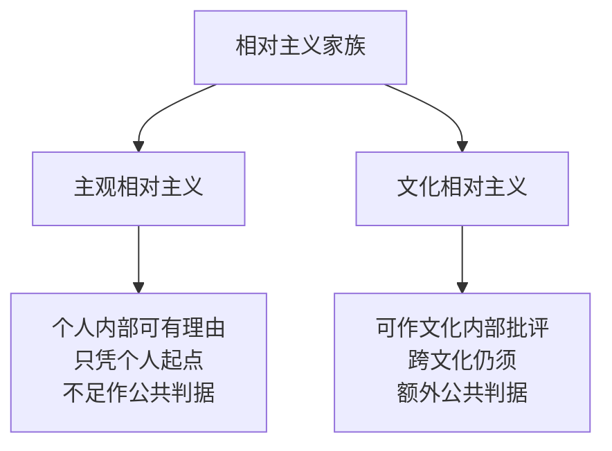

**图1b · 客观主义分类仍要通过本课筛选**

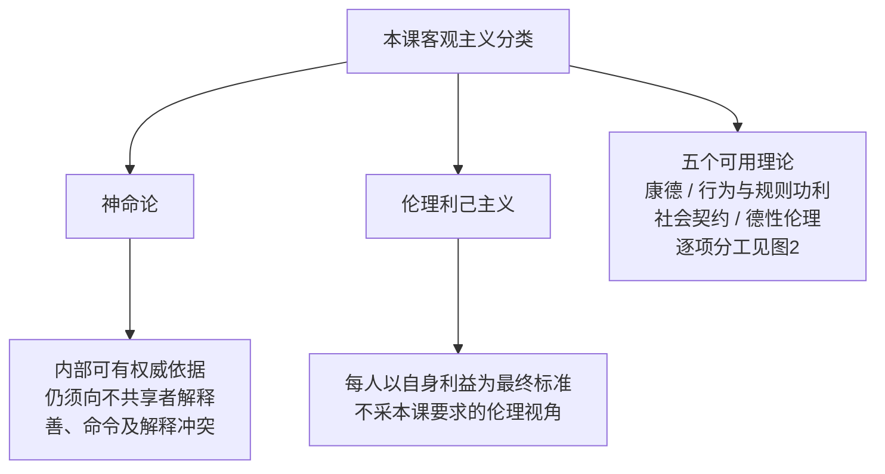


**例子走图**：神命论先按课件归入客观主义，再到公共理由缺口；文化相对主义则到独立的“文化内部/跨文化”出口，不能误落到个人偏好出口。改变对象为只按各自利益行动时，走的是利己主义的伦理视角问题。五个可用理论的重复名称在本图合并为一个节点，下一图逐项展开；没有把五套理论当同一标准。

文字替代：图1a/1b将同一理论分类的两支分别展开；每个出口说明其在本课公共理由/伦理视角筛选中的位置，不认证未知事实或现实法律许可。

循环、例外及其他人格条件按本节正文读。

<details><summary>读图自测：客观主义是否是本课可用充分条件？</summary>

不是。还须伦理视角与公共理性条件；课程分类不认证全版本逻辑真假。

</details>

> 这张图表达本课筛选：客观主义分类本身不足以得到“可用”。神命论和利己主义的具体缺口不同；这不是对所有哲学版本的真假证明。相对主义家族含主观/文化两型，所以八个理论家族展开后会出现九个名称，不是漏算一个可用理论。

**图 2 · 五个可用理论的分工**（讲义 p.80 判断树的 Mermaid 版）

本图保留p.80的课程简图。康德节点只提示构想/制度条件矛盾，不能作充分判定。
完整判断还须回到§2.6.7的意愿矛盾，并核人格尊重等条件；该节的完整准则流程图保留两关顺序，不能只凭这里的课程分类简图放行。


这张图回答：行为/规则/品格的不同入口怎样落实为判断？

从起点沿箭头读。

流程箭头表示分析/检查顺序。

总览分类箭头只表示课程归类。

以下案例是笔记补充，适用条件按正文保留。


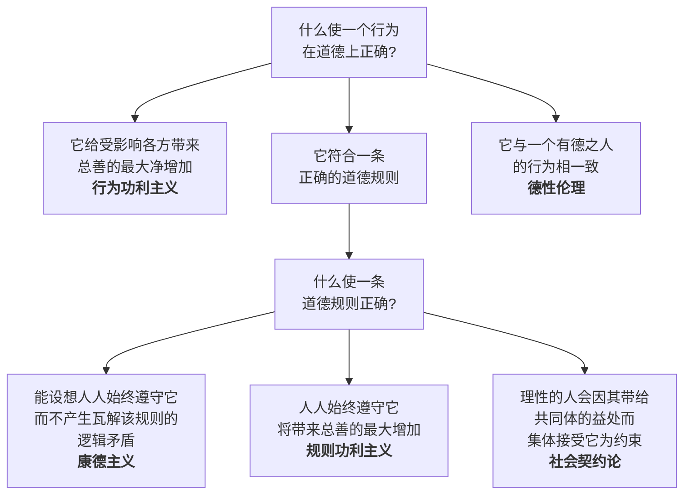


**例子走图**：同一说谎借款行为，行为功利看当次所有后果，规则入口看规则来源，德性入口看诚实/实践智慧。

文字替代：本图将行为/规则/品格的不同入口拆成可定位的问题，结果是带前提的分析，不是未知事实或现实法律许可。

循环、例外及其他人格条件按本节正文读。

<details><summary>读图自测：同样守规则的康德与规则功利在哪个节点分开？</summary>

在什么使规则正确：可普遍化与人人遵循后果是不同判断理由。

</details>

> **建议默画这张图。** 它同时给出五个理论的清单、分类逻辑和一句话核心。

**图 3 · 答题用的三角测量流程**（🎙️ 教授的方法，part3 `40:09`）

这张图回答：三角测量与分歧怎样落实为判断？

从起点沿箭头读。

流程箭头表示分析/检查顺序。

总览分类箭头只表示课程归类。

以下案例是笔记补充，适用条件按正文保留。


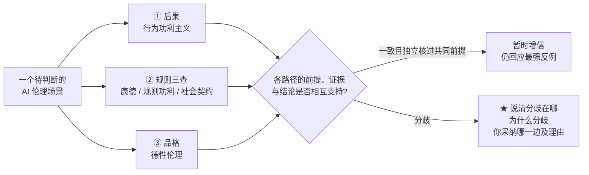


**例子走图**：同一咨询AI错误例，从后果、规则和品格找理由，再比较最强反对意见。

文字替代：本图将三角测量与分歧拆成可定位的问题，结果是带前提的分析，不是未知事实或现实法律许可。

循环、例外及其他人格条件按本节正文读。

<details><summary>读图自测：一致出口能否当统计置信区间？</summary>

不能。这里是课堂论证信心，理论不是独立随机观测；未知事实仍待核。

</details>

---

## 4. 速查表

### 4.1 八个理论一页纸

这份速查列的是本课筛选结果。

主观/文化相对主义拆列后有九行，但课程将相对主义归作一组，仍称八理论。

人物与分类是讲义版本。

不能把共同文化特征或后补哲学批评压成全部版本都错误。

先看核心问题，再回到对应正文核论证。

按同一行标识拆开列组，所有原列均保留；本组列为：理论、English、核心主张、代表人物、判断标准。

| 理论 | English | 核心主张 | 代表人物 | 判断标准 |
| --- | --- | --- | --- | --- |
| **主观相对主义** | Subjective Relativism | 各人自定对错 | — | 我认为 |
| **文化相对主义** | Cultural Relativism | 对错随社会习俗而定 | — | 本社会的现行准则 |
| **神命论** | Divine Command Theory | 善 = 合于神意 | — | 圣典怎么说 |
| **伦理利己主义** | Ethical Egoism | 只追求自身长期利益 | **Ayn Rand** | 对我最有利吗 |
| **康德主义 / 义务论** | Kantianism / Deontology | 义务与普遍道德法则 | **Immanuel Kant** | 能否通过构想与理性意愿两关；有没有把人**仅仅**当手段 |
| **行为功利主义** | Act Utilitarianism | 比较可行行动的总幸福 | **Jeremy Bentham**（本课配对） | 相同范围下，哪项行动使受影响各方总效用最高；净正不等于最优 |
| **规则功利主义** | Rule Utilitarianism | 采纳"人人遵守能最大化总幸福"的规则 | **John Stuart Mill** | 这条**规则**普遍施行的总效果 |
| **社会契约论** | Social Contract Theory | 道德 = 理性者为互利而同意接受的规则 | **Hobbes, Rousseau**（p.83 另列 **Locke**）；**Rawls** 补正义原则 | 理性人会同意吗 |

本组沿用上表列名，继续列后面的条目。

| 理论 | English | 核心主张 | 代表人物 | 判断标准 |
| --- | --- | --- | --- | --- |
| **德性伦理** | Virtue Ethics | 培养品格并运用实践智慧 | **Aristotle**；东方对应**孔子** | 如何按事实、相关德性和理由作负责行动，而非只贴“有德”标签 |

按同一行标识拆开列组，所有原列均保留；本组列为：理论、最强的优点、**最致命的缺点**、判决。

| 理论 | 最强的优点 | **最致命的缺点** | 判决 |
| --- | --- | --- | --- |
| **主观相对主义** | 承认分歧真实存在，也能作个人内部评价 | **仅凭个人偏好不足以向不共享者提供公共判据；还可能把“想做”误当“该做”** | ❌ |
| **文化相对主义** | 反对文化傲慢，可作内部评价 | 若现行习俗是全部最终标准，就缺跨时进步的独立判据 | ❌（本课公共理由筛选） |
| **神命论** | 提供绝对权威 | **等价谬误**（尤西弗罗困境）；**基于服从而非理性** | ❌ |
| **伦理利己主义** | 务实、自洽 | **按定义不采纳"伦理的视角"** | ❌ |
| **康德主义 / 义务论** | 人人同等地位；不以一时利益替代义务论证，仍须核适用事实 | **两个完全义务冲突时无解**是本课p.41所列批评；完全义务严格说法需解释适用 | ✅ |
| **行为功利主义** | 务实、可计算、覆盖所有人 | 表67说明1 | ✅ |
| **规则功利主义** | 讲义列避免道德运气/减少偏见/省算力；正文解释其条件 | 纯总量不独立约束分配；规则边界仍有取舍、长期效果仍不确定 | ✅ |
| **社会契约论** | 用**权利语言**表述，直接对接法规 | 表67说明2 | ✅ |

**表67说明1 · 行为功利主义的主要批评**

- 道德运气

- 难测量

- 忽视分配

**表67说明2 · 社会契约论的主要批评**

- 没人真的签过

- 权利冲突无裁决方法

- 排除无法履约者


本组沿用上表列名，继续列后面的条目。

| 理论 | 最强的优点 | **最致命的缺点** | 判决 |
| --- | --- | --- | --- |
| **德性伦理** | 本课强调关系/情感/实践判断 | 讲义批评单靠品格不足以指导政策；还须具体公共程序，清单也有分歧 | ✅ |

### 4.2 最容易混的五组辨析

| 组 | 区别的一句话 |
| --- | --- |
| **定言令式 vs 黄金法则** | 定言令式先查构想与理性意愿，并核人格；黄金法则的角色反转常从个人接受程度出发，不能替完整两关 |
| **定言令式 vs 假言令式** | 定言 = **无条件**（不要偷）；假言 = **有条件**（若不想坐牢就别偷） |
| **康德的人格尊重 vs 伦理利己主义** | 二者都可对每个行动者陈述；康德要求尊重所有人的目的，利己主义以各自自身利益为最终标准 |
| **康德主义 vs 规则功利主义** | 都守规则，但康德问"这条规则**自洽**吗"（逻辑），规则功利主义问"这条规则**好用**吗"（后果） |
| **完全义务 vs 不完全义务** | 完全 = **概念矛盾** → 绝无例外；不完全 = **意愿矛盾** → 可裁量执行方式，但仍必须履行 |

### 4.3 每个理论怎么答电车难题

下表的“净+4”只在确定救5死1、生命等权且无其他成本/后果、可行选项限定为题设两项的简化条件下成立。规则路线还须比较长期候选规则；这不是对所有变体的无条件判决。

| 理论 | 扳道岔（变体①） | 天桥推胖子（变体②） | 理由的关键词 |
| --- | --- | --- | --- |
| 伦理利己主义 | 比较自身长远利益，不以陌生直接判不扳 | 同一标准，推人行为的风险/后果另比 | 他人利益是否作为独立理由，是与伦理视角的分歧；不是每次固定选项 |
| 康德主义 | **课堂简化倾向不扳；须先写准则** | **通常更明确地不推** | 道岔案须判断死亡是副作用还是手段；推人案把人的身体作为救援手段，第二表述的反对更直接 |
| 行为功利主义 | **扳** | **推** | 净 +4 |
| 规则功利主义 | 倾向扳，但要看规则的长期效果 | **不推** | "可杀少数救多数"作为规则会摧毁信任 |
| 德性伦理 | **不给公式** | 不给公式 | 有德之人在此情境会怎么做 |

---

## 5. 双语术语卡

| 中文 | English | 考试可用的英文定义 | 首现 |
| --- | --- | --- | --- |
| 形而上学 | Metaphysics | 见说明 1 | §2.1 |
| 认识论 | Epistemology | The theory of knowledge; asks how we know what we know and what is true. | §2.1 |
| 逻辑学 | Logic | 见说明 2 | §2.1 |
| 电车难题 | The Trolley Problem | 见说明 3 | §2.2.2 |
| 伦理的视角 | Ethical point of view | 见说明 4 | §2.3.1 |
| 核心价值 | Core values | Values most everyone shares and desires: life, happiness, and the ability to accomplish goals. | §2.3.1 |
| 道德 | Morality | 见说明 5 | §2.3.2 |
| 伦理学 | Ethics | The rational examination of morality; the evaluation of people's behaviour. | §2.3.2 |

本组沿用上表列名，继续列后面的条目。

| 中文 | English | 考试可用的英文定义 | 首现 |
| --- | --- | --- | --- |
| 可用的伦理理论 | Workable ethical theory | 见说明 6 | §2.4 |
| 相对主义 | Relativism | 见说明 7 | §2.5.1 |
| 主观相对主义 | Subjective Relativism | Each person decides right and wrong for himself or herself. | §2.5.1 |
| 文化相对主义 | Cultural Relativism | 见说明 8 | §2.5.1 |
| 神命论 | Divine Command Theory | 见说明 9 | §2.5.2 |
| 等价谬误 | Equivalence fallacy | The fallacy of equating "the good" with "God" (Bertrand Russell); classically the Euthyphro dilemma. | §2.5.2 |
| 伦理利己主义 | Ethical Egoism | 见说明 10 | §2.5.3 |
| 善良意志 | Good will | 见说明 11 | §2.6.1 |

本组沿用上表列名，继续列后面的条目。

| 中文 | English | 考试可用的英文定义 | 首现 |
| --- | --- | --- | --- |
| 定言令式（第一表述） | Categorical Imperative (1st formulation) | Act only from moral rules that you can, at the same time, will to be universal moral laws. | §2.6.2 |
| 定言令式（第二表述） | Categorical Imperative (2nd formulation) | 见说明 12 | §2.6.4 |
| 假言令式 | Hypothetical Imperative | 见说明 13 | §2.6.3 |
| 完全义务 | Perfect duty | 见说明 14 | §2.6.7 |
| 不完全义务 | Imperfect duty | 见说明 15 | §2.6.7 |
| 概念矛盾 | Contradiction in conception | 见说明 16 | §2.6.7 |
| 意愿矛盾 | Contradiction in the will | 见说明 17 | §2.6.7 |
| 效用 | Utility | 见说明 18 | §2.7.1 |

本组沿用上表列名，继续列后面的条目。

| 中文 | English | 考试可用的英文定义 | 首现 |
| --- | --- | --- | --- |
| 效用原则 | Principle of Utility | An action is good if its benefits exceed its harms; bad if its harms exceed its benefits. | §2.7.1 |
| 最大幸福原则 | Greatest Happiness Principle | 见说明 19 | §2.7.1 |
| 后果主义 | Consequentialist theory | A theory holding that the morality of an action depends only on its consequences, not on intent. | §2.7.2 |
| 行为功利主义 | Act Utilitarianism | 见说明 20 | §2.7.2 |
| 快乐计算 | Hedonic Calculus | 见说明 21 | §2.7.3 |
| 道德运气 | Moral luck | Being assigned moral praise or blame for consequences outside one's control. | §2.7.5 |
| 规则功利主义 | Rule Utilitarianism | 见说明 22 | §2.7.6 |
| 社会契约论 | Social Contract Theory | 见说明 23 | §2.8.1 |

本组沿用上表列名，继续列后面的条目。

| 中文 | English | 考试可用的英文定义 | 首现 |
| --- | --- | --- | --- |
| 自然状态 | State of nature | 见说明 24 | §2.8.1 |
| 消极权利 | Negative right | A right that another can guarantee by leaving you alone. | §2.8.2 |
| 积极权利 | Positive right | A right obligating others to do something on your behalf. | §2.8.2 |
| 绝对权利 | Absolute right | A right guaranteed without exception. | §2.8.2 |
| 有限权利 | Limited right | A right that may be restricted based on the circumstances. | §2.8.2 |
| 差异原则 | The difference principle | 见说明 25 | §2.8.3 |
| 德性伦理 | Virtue Ethics | 见说明 26 | §2.9.2 |
| 德性 | Virtue (arete, excellence) | 见说明 27 | §2.9.2 |

本组沿用上表列名，继续列后面的条目。

| 中文 | English | 考试可用的英文定义 | 首现 |
| --- | --- | --- | --- |
| 恶习 | Vice | 见说明 28 | §2.9.2 |
| 繁盛 | Flourishing | Living up to one's highest potential; the goal that the virtues serve. | §2.9.2 |
| 客观主义 | Objectivism | Morality has an existence outside the human mind. | §2.10.3 |

**说明 1 · 形而上学 / 考试可用的英文定义**

The study of reality; asks what is real, whether the universe has a purpose, whether humans have free will.

**说明 2 · 逻辑学 / 考试可用的英文定义**

The study of the rules of valid reasoning; the working tool of philosophy, separating sound arguments from logical fallacies.

**说明 3 · 电车难题 / 考试可用的英文定义**

A dilemma: is it preferable to pull the lever to divert a runaway trolley onto a side track with just one person, rather than let it hit five?

**说明 4 · 伦理的视角 / 考试可用的英文定义**

Respecting other people and their core values, as opposed to the selfish point of view of considering only your own.

**说明 5 · 道德 / 考试可用的英文定义**

A society's or person's rules of conduct — what people ought or ought not to do in various situations.

**说明 6 · 可用的伦理理论 / 考试可用的英文定义**

A theory that produces explanations that might be **persuasive to a skeptical, yet open-minded audience**; based on the ethical point of view and on objective moral principles developed through logical reasoning from facts and commonly held values.

**说明 7 · 相对主义 / 考试可用的英文定义**

The view that there are no universal norms of right and wrong; one person can say "X is right", another "X is wrong", and both can be right.

**说明 8 · 文化相对主义 / 考试可用的英文定义**

What is right and wrong depends upon a society's actual moral guidelines, which vary from place to place and from time to time.

**说明 9 · 神命论 / 考试可用的英文定义**

Good actions are those aligned with God's will; bad actions are those contrary to it; holy books reveal God's will and should be used as moral decision-making guides.

**说明 10 · 伦理利己主义 / 考试可用的英文定义**

Each person should focus exclusively on his or her self-interest; the morally right action is the one that provides the self with maximum long-term benefit.

**说明 11 · 善良意志 / 考试可用的英文定义**

The desire to do the right thing; for Kant, the only thing in the world that is good without qualification — a desire to act right **for its own sake**.

**说明 12 · 定言令式（第二表述） / 考试可用的英文定义**

Act so that you treat both yourself and other people as ends in themselves, and never **only** as a means to an end.

**说明 13 · 假言令式 / 考试可用的英文定义**

A conditional command that applies only if you want to achieve a certain outcome (e.g. "if you want to avoid prison, do not steal"); not a moral law.

**说明 14 · 完全义务 / 考试可用的英文定义**

A strict moral obligation that must always be followed without exception; violating it leads to a logical contradiction if universalized. Example: telling the truth.

**说明 15 · 不完全义务 / 考试可用的英文定义**

A flexible duty, obliged to be fulfilled in general but not in every instance, allowing discretion in how and when. Example: helping others.

**说明 16 · 概念矛盾 / 考试可用的英文定义**

A maxim that cannot even be conceived as a universal law because the concept destroys itself; generates perfect duties.

**说明 17 · 意愿矛盾 / 考试可用的英文定义**

A maxim that could exist as a universal law but which no rational being could consistently will; generates imperfect duties.

**说明 18 · 效用 / 考试可用的英文定义**

The tendency of an object to produce happiness or prevent unhappiness for an individual or a community.

**说明 19 · 最大幸福原则 / 考试可用的英文定义**

An action is right (or wrong) to the extent that it increases (or decreases) the total happiness of the affected parties.

**说明 20 · 行为功利主义 / 考试可用的英文定义**

Applies the Principle of Utility to individual actions: add up the change in happiness of all affected beings; the right action maximizes the sum.

**说明 21 · 快乐计算 / 考试可用的英文定义**

Bentham's seven dimensions for weighing pleasure: intensity, duration, certainty, propinquity, fecundity, purity, extent.

**说明 22 · 规则功利主义 / 考试可用的英文定义**

We ought to adopt moral rules which, if followed by everyone, will lead to the greatest increase in total happiness; applies the Principle of Utility to rules rather than acts.

**说明 23 · 社会契约论 / 考试可用的英文定义**

Morality consists in the set of rules, governing how people are to treat one another, that rational people will agree to accept, for their mutual benefit, on the condition that others follow those rules as well. (Rachels)

**说明 24 · 自然状态 / 考试可用的英文定义**

Hobbes's hypothetical condition without a social contract, in which life would be "solitary, poor, nasty, brutish, and short".

**说明 25 · 差异原则 / 考试可用的英文定义**

Any social and economic inequalities must be to the greatest benefit of the least-advantaged members of society. (Rawls)

**说明 26 · 德性伦理 / 考试可用的英文定义**

A right action is an action that a virtuous person, acting in character, would do in the same circumstances.

**说明 27 · 德性 / 考试可用的英文定义**

A deep-seated character trait, developed by habitually performing right action, that human beings need in order to flourish and be truly happy.

**说明 28 · 恶习 / 考试可用的英文定义**

A character trait that prevents a human being from flourishing or being truly happy; often a virtue sits between two vices.

> ⚠️ **译名提醒**：`Utilitarianism` 一律译**功利主义**，但答题写英文更安全——中文"功利"的贬义会误导理解（见 §2.7.1）。`Deontology` 译**义务论**。`Mind` 译**心灵**不译"思维"（沿用 M01 的约定）。

---

## 6. 考点预判与答题框架

### 6.1 可信度分级

| 级别 | 含义 |
| --- | --- |
| 🔴 **明示考试** | 转录里明确说会考、要记或给正式评分规则；本讲未找到此类话语 |
| 🎙️ **课堂强调／课程方法** | 课堂反复强调或给出好论证方法，但没有明说会考 |
| 🟡 **ILO 反推** | 对应课程 ILO / CILO，官方口径上必须考核 |
| ⚪ **笔记推断** | 据内容重要性、课件排版信号、题型惯例的判断 |

> ⚠️ **本讲没有 🔴 明示考试条目**：三份转录中未找到 “this will be on the exam”、要求记忆或正式评分规则。下表课堂项只标 🎙️ 课堂强调／课程方法；其余是 🟡 ILO／讲义结构反推或 ⚪ 笔记推断。

### 6.2 考点清单

| 可信度 | 考点 | 依据 | 对应小节 |
| --- | --- | --- | --- |
| 🎙️ | **好的伦理论证 = 基于事实 + 共享价值 + 逻辑**，且要**解释为什么**得出这个结论 | 见说明 1 | §2.4 |
| 🎙️ | **没有简单的对错决定，关键是能否公开辩护**（不含得分声明） | 🎙️ part1 `38:35` "There is **no right or wrong decision**, but there are **bad and good decisions**" | §2.4 |
| 🎙️ | 本课要 **workable** 理论，因为**这是商学院不是哲学系** | 🎙️ part1 `40:12` "this is **not a philosophy course. This is a business school**" | §2.4 |
| 🎙️ | 课堂把自愿选择作为主要工作情境；选择受限时须另分析余地与责任，不是所有强制情境都没有伦理问题 | 🎙️ part1 `39:37` 原话是 very difficult，不是已证明普遍不可能 | §2.4 |
| 🎙️ | **三角测量法**：后果 + 三种规则检验 + 德性；理由一致且独立核过共同前提时暂时增信，仍回应最强反例 | 见说明 2 | §2.10.4 |
| 🎙️ | 定言令式的**两个表述在概念上是同一条法则**，"同一颗钻石的不同切面" | 🎙️ part2 `12:36`；教授花 3 分钟专门论证 | §2.6.5 |
| 🟡 | **五个可用理论的名称、核心主张、代表人物、一条优点、一条缺点** | ILO-1（核心伦理理论与框架）；讲义在八个理论上重复"支持 N 条 / 反对 M 条"结构八次 | §4.1 |
| 🟡 | **为什么相对主义 / 神命论 / 伦理利己主义不是可用的伦理理论**（各给出讲义列的理由） | ILO-1；讲义每一节结尾都用同一句 "Not a workable ethical theory" 收束 | §2.5 |

本组沿用上表列名，继续列后面的条目。

| 可信度 | 考点 | 依据 | 对应小节 |
| --- | --- | --- | --- |
| 🟡 | **行为功利主义 vs 规则功利主义**的区别与各自的优缺点 | ILO-1；讲义 p.54 专列一张对比表 | §2.7.6 |
| 🟡 | **完全义务 vs 不完全义务**，以及冲突时完全义务优先 | ILO-1；讲义 p.38–41 用了 4 页 | §2.6.7 |
| 🟡 | **四种权利的分类**及"积极权利倾向有限、消极权利倾向绝对" | ILO-1（权利论）+ ILO-2（隐私议题的前置） | §2.8.2 |
| 🟡 | **罗尔斯正义二原则与差异原则** | ILO-1；讲义 p.62–63 用了 2 页含一张专图 | §2.8.3 |
| ⚪ | **用两个表述分别评价同一案例并证明结论一致**（抄袭案例是模板） | 讲义 p.35–36 就是这个题型的完整示范 | §2.6.5, §2.6.6 |
| ⚪ | **功利主义的分配公正问题**——"最大多数人的最大善"这个流行说法是错的 | 讲义 p.56 唯一一处**明确否定一个流行口号**的地方，是强排版信号 | §2.7.8 |
| ⚪ | **道德运气**——两个醉驾司机 | 讲义 p.51 只有一行；课堂在 part3 `07:32`–`14:15` 展开三个案例 | §2.7.5 |
| ⚪ | **判断树**（讲义 p.80）：五个理论分两层 | 全讲唯一一张结构性总图 | §2.10.1 |

本组沿用上表列名，继续列后面的条目。

| 可信度 | 考点 | 依据 | 对应小节 |
| --- | --- | --- | --- |
| ⚪ | **讲义对德性伦理指导政策的批评及其限度**：单靠品格不够完整公共程序，不等于不能提供治理目标与理由 | 讲义p.75原句＋本文范围说明；Course Outline第5学习目标是设计治理机制/政策 | §2.9.5 |

**说明 1 · 🎙️ 课堂强调 / 来源**

🎙️ part1 `38:20` "you have to be able to explain **why**... good explanations are based on **facts, shared values and logic**"

**说明 2 · 🎙️ 课程方法 / 来源**

🎙️ part3 `40:35`–`40:56`：课堂从三个角度说明 triangulate，并把一致与更大信心相连。**笔记必要边界**：理论不是独立观测；共同错误前提会造成伪一致，所以只能暂时增信，仍须回应最强反例。

### 6.3 答题框架

**题型 A：单一理论的解释与评价**
> ⚪ **笔记自拟题型示例**：*Explain Kantianism and give two arguments for and two against it.*


```
1. 一句话核心主张（用讲义原句）
2. 关键机制（康德=定言令式两表述；功利=效用原则+加总；契约=Rachels 定义；德性=有德之人）
3. 一个例子（优先用讲义的：虚假承诺 / 抄袭 / 高速公路 / 累进税 / 中道）
4. 两条支持（讲义 p.37 / p.50 / p.55 / p.64 / p.74）
5. 两条反对（讲义 p.41 / p.51 / p.56 / p.65 / p.75）—— ★ 挑最致命的那条
6. 收束：despite its weaknesses, a workable ethical theory
```


**题型 B：两个理论的对比**
> ⚪ **笔记自拟题型示例**：*Compare act utilitarianism and rule utilitarianism.*


```
1. 共同点（都是后果主义，都用效用原则）
2. 分歧点（应用于"行为" vs 应用于"规则"）
3. 用同一个案例跑出不同结论（说谎救人 / 天桥推胖子）
4. 本课把规则路线用来回应哪些问题（单次运气、计算负担、偏见），为何只是条件性改善而非全部消除
5. 但共同的弱点仍在（分配公正、单一尺度、给人命定价）
```


**题型 C：场景分析（最可能的大题）** ★
> 本次实际核到的 CityU **2025/26 版本**官方详细课程文件写有 *"Application of learned knowledge with critical thinking in examine."* 这支持答案要应用知识并展现批判思维；“大题可能采用场景”是 ⚪ 笔记推断，不是 Course Outline 明示的必然题型。


```
① 事实梳理：谁做了什么？谁受影响？（区分直接与间接的利益相关者）
② 识别争议点：触及了哪些核心价值 / 权利？（生命 / 幸福 / 自主 / 隐私）
③ 三角测量（§2.10.4）：
     · 行为功利主义：在相同事实、对象和期间下，哪项可行行动的总效用最高？净正只表示正余额，不单独决定最优。谁承担成本、谁获得收益？
     · 康德主义：这条准则能普遍化吗？有没有把谁仅仅当作手段？
     · 规则功利主义：作为一条社会规则长期效果如何？
     · 社会契约论：涉及哪些权利？是消极还是积极？有没有权利冲突？
     · 德性伦理：一个有德之人 / 一家有德的公司会怎么做？
④ 处理分歧：★ 明确指出理论之间的冲突，而不是掩盖它
⑤ 替代方案：本来还能怎么做？（讲义 p.86 第 4 问）
⑥ 信息缺口：还需要知道什么？（讲义 p.86 第 5 问；主动列未知是笔记答题建议，转录没有加分声明）
⑦ 结论：给出判断 + 说清你为什么采纳这一边
```


> ⚠️ **笔记答题建议**：不要写成“五个理论各来一段然后没有结论”。课堂在 part3 `40:35`–`40:56` 提出 triangulate；把它转成“给出一个有条件判断并回应反例”是本笔记的作答建议，不是教授给出的评分规则。

---

## 7. 自测

### 概念题

**1.** 讲义反复出现的那句判据是什么？它有几个要素？

<details><summary>答案</summary>

> **Workable ethical theory produces explanations that might be persuasive to a skeptical, yet open-minded audience.**（讲义 p.12、p.84）

讲义 p.78 给出的正式两条：① 基于**伦理的视角**；② 用**逻辑推理**、基于**事实与共同价值**发展出的**客观道德原则**。

拆解 "skeptical, yet open-minded"：听众不会因为你说了就信（所以必须给理由）。

但只要理由够好就愿意被说服（所以理由必须是理性可评估的，不能诉诸权威或情绪）。

</details>

**2.** 为什么神命论被判定不可用？请给出讲义列的理由，并完整复述那个"等价谬误"的论证。

<details><summary>答案</summary>

**讲义 p.23 的理由**：

1.  不同圣典互相矛盾；

2.  社会是多元、世俗的；

3.  一些现代道德问题经文未涉及；

4.  **"善" ≠ "神"（等价谬误，Bertrand Russell）**；

5.  **基于服从，而非基于理性**。

**等价谬误的论证（两难）**：问"神命令 X，是因为 X 善；还是 X 善，是因为神命令了它？"

- 分支一（善 = 神所命令的）：则事物无内在善恶，"神是善的"沦为同义反复（只等于"神就是神"）。

  且道德变得任意——神若明天说谋杀是善的，谋杀就成了善的。
- **分支二**（神因符合善的标准而善）：则**善独立于神而存在**，神不是道德的源头，只是遵循者——**没有创世者，道德照样成立**。

在已列的两个解释版本及任意性前提下，纯命令作为唯一依据面临负担；仍须回应“必善本性”反驳（§2.5.2），不能称两路穷尽所有版本。

⚠️ **关键澄清**：这个论证**不是在论证神不存在**。课堂在 part1 `47:46` 明确作了这一澄清，但 ASR 在 *doesn't* 后破损，不能补 `[exist]` 作为逐字原话。

</details>

**3.** "定言（categorical）"这个词在康德那里是什么意思？它的反面是什么？举一个例子说明区别。

<details><summary>答案</summary>

**categorical = 绝对的、无条件的（absolute and unconditional）**：本课用它说明道德要求不以行动者碰巧想要什么为条件。这不等于不用核对行为情境、目的与准则适用范围；“无条件”与“不查事实”是两回事（见 §2.6.3）。

反面是 **hypothetical（假言的）= 有条件的**。**假言令式**是只有在你想达成某个目标时才适用的命令。

例子：
- **假言**："**如果**你不想坐牢，**那就**别偷东西"——依赖你碰巧有"不想坐牢"这个欲望，欲望没了规则就失效
- **定言**："**不要偷窃**"——不管偷了会不会让你发财、会不会被抓

课堂的理由（part2 `05:24`–`09:34`）是：若要求只随个人欲望而变，道德就变成达成欲望的策略。这里保留课堂的 absolute/unconditional 说法；实际套用仍先查处境，不能从它推出“任何事实差异都不相关”。

⚠️ 这一整段**讲义上没有**，只在课堂录音里（part2 `05:24`–`09:34`）。

</details>

**4.** 完全义务与不完全义务的区别是什么？背后的两种"矛盾"分别是什么？各举一例。

<details><summary>答案</summary>

|  | 完全义务 | 不完全义务 |
| --- | --- | --- |
| 定义 | 在已成立的适用条件内必须遵守的严格限制 | 必须采纳目的；具体时机和方式有裁量 |
| 背后的矛盾 | **概念矛盾**（contradiction in conception）：普遍化破坏准则赖以执行的概念或制度前提 | **意愿矛盾**（contradiction in the will）：世界可构想，但理性者不能一致意愿，见表后互助例 |
| 例子 | 不可说谎、不可偷窃、不可毁约、不可自杀 | 发展自己的才能、帮助有需要的人、促进他人幸福、培养自己的德性 |
| 验证 | 在假承诺依赖对方信任的前提下，普遍假承诺会摧毁该手段 | “无人帮助任何人”的世界可以存在；理性意愿的冲突见下例 |

**互助例的推理（笔记补充，承接 §2.6.7）**：有限的理性行动者要实现多种目的，需要相应能力，也可能需要他人的协助。若一面意愿这些目的及实现它们所需的手段，一面又意愿普遍法则排除一切互助，就会在理性意愿上冲突。这里不是预测每个人将来必定求助，也不是把“我不喜欢这个世界”当作检验；需要说明目的与所需手段为什么不一致。

这要求把帮助他人纳入目的，但不等于每次求助都必须满足；具体何时、用何种方式帮助仍有裁量。

冲突时完全义务优先（讲义 p.41）。

课堂例子（part2 `28:28`–`29:05`）：罗宾汉在康德那里是错的——不能为了履行“帮助穷人”这条不完全义务，而违反“不可偷窃”这条完全义务。

⚠️ 原p.39将发展才能误列完全义务；正确属对自己的不完全义务——别背成"完全=禁令、不完全=倡导"。

</details>

**5.** 什么是道德运气？它为什么对行为功利主义是致命的？

<details><summary>答案</summary>

**道德运气（moral luck）**：因为**不在你控制之内**的后果而被赋予道德赞扬或责备（讲义 p.51）。

**攻击结构**：
> 如果道德评价取决于后果，而后果取决于运气，那么**道德评价就取决于运气**。
> 但我们不认为人应当为运气负道德责任。**所以后果不能是道德评价的全部。**

课堂案例（part3 `07:54`–`10:46`）：两个醉酒程度相同、决定相同的司机——A 路上无人，平安到家。

B 遇到孩子冲上马路，撞死了人。

内在的道德抉择完全相同，社会评价天壤之别。

更极端的两个：
- **恶意 + 好运** = 独裁者恶意空袭却意外净救更多人 → 课堂按已实现结果的版本展示评价会改变；只有再满足相较可行替代效用最高，才可条件判行为正确，不等于赞许恶意或证明事前应该空袭
- **错误判断 + 好运** = 医生判断错误，但病人恰好自愈，医生反而获得声誉；医生的意图仍待核，不能从结果倒推善意或恶意。

**本课把规则功利主义作为回应这类问题的路线之一**：评价长期普遍规则，减轻单次偶然结果对判断的主导。它仍要估计长期后果，不因“统计平均”自动消除运气；这保留课堂演变说法，不认证唯一真实思想史。

</details>

**6.** 讲义 p.56 说"功利主义并不意味着'最大多数人的最大善'"。这句话什么意思？

<details><summary>答案</summary>

因为"最大多数人的最大善"这个流行口号**偷偷混进了一个分配要求**（"最大多数人"），而效用原则本身**只关心总量**。

反例：

| 方案 | 甲 | 乙 | 丙 | 丁 | 总和 |
| --- | --- | --- | --- | --- | --- |
| A | +25 | +25 | +25 | +25 | **100** |
| B | +97 | +1 | +1 | +1 | **100** |

**总效用完全相同，功利主义无法区分**，但几乎没有人认为二者在道德上等价。

讲义的结论：要真正实现"最大多数人"，需要一条额外的正义原则（a principle of justice）——而效用原则不提供它。

这正是社会契约论（罗尔斯）要补的位。

**正确表述**（讲义 p.44）：An action is right to the extent that it increases the **total happiness of the affected parties**。

💡 **AI 对应（笔记补充）**：整体准确率95%、少数群体70%只说明错误分布不同，不能直接推出总效用高。还要按群体人数、误报/漏报及每类伤害计入效用；少数群体损害很大时，功利计算自身就可能反对该模型。纯总量原则的问题是没有把公平分配当作独立约束，不能说它对任何不公平都给不出反对理由。

</details>

**7.** 罗尔斯的差异原则在说什么？在什么条件下可以支持图示累进方案；单凭税率曲线，能否断定它优于比例税方案？

<details><summary>答案</summary>

**差异原则**：任何社会与经济上的不平等，必须**对社会中最不利者最有利**（to the greatest benefit of the **least-advantaged** members of society）。（讲义 p.62，第二原则的后半）

讲义 p.63 的图对比两套税制：Plan A 接近**比例税**（税率大致恒定），Plan B 是**累进税**（低收入者近乎免税，高收入者税负显著更高）。

不能仅凭累进税率曲线断言差异原则必支持B；须核基本自由、公平机会、税款用途与行为反应，再比较最不利者的真实处境。

连接无知之幕（M01 §2.4.4）：假设你要为一个社会设计规则，但你不知道自己将处于什么位置。

不知道自己位置会要求考虑最不利者，但这不直接证明某条累进税率最好。

税后资源和公共服务结果未知时只能给条件答案。

⚠️ **差异原则不是平均主义**：它**允许**不平等，只要不平等对最不利者有利。一个让所有人都变穷的绝对平均方案，它**会拒绝**。

</details>

**8.** 五个可用理论中，哪些是"先评价规则"的？它们判断规则正确性的标准分别是什么？

<details><summary>答案</summary>

**先评价规则的三个**（讲义 p.80 判断树第二层）：

| 理论 | 什么使一条道德规则正确 | 一个词 |
| --- | --- | --- |
| **康德主义** | 先查普遍化能否构想，再查理性者能否一致意愿，并核人格尊重；p.80只压缩提示第一关 | 构想 + 理性意愿 |
| **规则功利主义** | 人人始终遵守它将带来**总善的最大增加** | **有效性** |
| **社会契约论** | **理性的人会因其带给共同体的益处而集体接受它为约束** | **可接受性** |

**直接评价行为的两个**：**行为功利主义**（受影响各方总善的最大净增加）、**德性伦理**（与有德之人的行为相一致）。

**用同一变式检查是否漏关**：若准则是“为安逸永不发展任何能力”，这样的世界可以设想，第一关不自毁；但理性者追求自己的各种目的仍需要能力，因此本例在理性意愿关失败，不能据“可设想”就放行。这里保留p.80的课程分类，不把简图扩称原页已有完整算法；完整步骤见§2.6.7，人格要求另核。

</details>

**9.** 亚里士多德的核心德性与儒家五常有哪些重合、哪些不重合？这个对照说明了什么？

<details><summary>答案</summary>

**重合**：正义 ↔ **义**、明智 ↔ **智**、同情 ↔ **仁**、诚实 ↔ **信**

**不重合**：
- 本讲所列儒家清单有 **礼**，所列亚里士多德清单未给对应项；比较限于这两份清单
- 亚里士多德侧重**个体的自我治理**（勇气、节制、谦逊、坚韧）

**说明了两件相反的事**（两边都能写，这正是这道题的价值）：
- **支持道德客观主义**：两个独立发展的文明汇聚出高度相似的德性清单，说明德性不是任意的文化发明
- **支持对德性伦理的批评**（讲义 p.75 第一条）："礼"的存在说明德性清单**确实带有文化印记**，"理性的人可能对哪些品格特质构成繁盛意见不一"

</details>

### 案例分析题

10. ★ 9/22 作业的预演：为遏制超速，交警在所有路口安装 AI 视频摄像头。

  可实时检测超速 5 km/h 以上的车辆、读取车牌、拍摄司机高清照片，配合人脸识别（99% 准确率）自动开出罚单。

运行 3 个月后超速人数下降 90%。

随后**有组织及严重罪案调查科（OSCB）要求实时访问这些数据，交警照办；3 个月后 OSCB 借此逮捕 5 名通缉的严重罪犯**。

请用本讲的**至少三个**可用理论分析：交警做错了什么吗？

<details><summary>参考思路（不是标准答案）</summary>

**① 先做事实梳理与争议定位**

这个场景有**两段**，必须分开评价：

|  | 第一段：自动执法 | 第二段：数据转用 |
| --- | --- | --- |
| 做了什么 | 为交通安全采集数据并自动开罚单 | 把交通执法数据实时开放给刑侦部门 |
| 新增待核范围 | 自动识别、持续采集与罚单程序本身都须论证 | 跨目的/跨部门实时访问又增加新的范围与权利问题 |
| 关键问题 | 比例性、准确率（若 99% 指可比部署分布上的总体准确率，长期平均错误比例约 1%；实际错误数仍取决于识别量、基率及误报/漏报构成，题面不足以推出误判人数） | **目的外使用（function creep）**——题面未说明；若无告知、同意或其他授权，则可能构成目的外使用 |

**② 三角测量**

**行为功利主义**
- 已知效果是超速人数下降90%及抓到5人；道路事故/伤亡减少和被捕带来的实际净福利均未由题面给出。把这些潜在收益、误判伤害、持续监控与复核成本列齐后，才能同可行替代方案比较总效用
- 可能成本：实际采集对象承担的信息暴露/识别负担，错误识别若未被复核排除可能造成误罚与申诉负担，及可能的寒蝉或信任影响；不假定全体公民均被持续监控。99%若确为可比部署总体准确率，整体错误比例才近似1%，错误类型、最终伤害和人数仍未知
- ⚠️ **§2.7.8的分配问题**：若安全收益较广、误判或识别负担集中，完整总账即使净正也不自动保证公平；本题尚未给出实际安全收益及伤害分布，不能先写成全社会受益、特定群体已受害
- ⚠️ **§2.7.3的广度（Extent）**：实际影响范围须按采集对象、触发条件和部署覆盖核；规模可能放大单位伤害，不能从路口部署直接推出每位上路者都已受同一伤害

**康德主义**
- 第一段先写准则：“政府按可公开辩护的范围与程序，为道路安全使用自动执法。”它能否通过还取决于范围、证据与人格条件；不能只凭摄像头存在就假定司机知道人脸识别。
- 第二段可拟准则：“执法机关可把为目的A采集的数据，在未说明用途边界时转作目的B。”原题没有A专用承诺，也没说采集依赖司机自愿提供数据，因此**尚不能从本题直接构造出承诺制度自毁的第一表述反证**。
- **改条件的补充例**：若机构明确承诺A专用以取得对方合作，却秘密用于B，那么普遍允许这种假承诺可能摧毁它所依赖的信赖；这个新增承诺条件必须明标，不能塞回原题。
- 第二表述另问是否通过隐瞒、欺骗或不当强制绕过人的判断。告知与真实选择是线索，公共强制还需独立公共辩护；一次同意或法律授权不自动完成伦理检验。
- 因此本题不能先宣布两个表述都确定失败。第一表述资料不足与第二表述的人格质疑可以分别报告；Mary抄袭案同结论不证明所有场景都必同结论。

**社会契约论 + 权利分析**
- **权利两维不能直接排优先级**：先分别写隐私与公共安全主张的权利主体、义务承担者、具体内容与限制条件。`negative / positive` 只描述通常要求不干预还是积极作为；讲义的 `tend` 不是逻辑规则，不能推出哪方自动优先。
- 再比较法定授权、必要性、比例性、低侵入替代方案、申诉与监督。社会契约论能把冲突陈述清楚，但仍需这些公共判据裁决。
- 🎙️ 课堂补充（part3 `28:46`–`29:06`）：**法律只是社会契约的最低限度**。交警的行为可能完全合法，**但“合法”不构成伦理辩护**

**规则功利主义**
- 在同一目标下至少比较三条候选规则：R1不作跨部门共享；R2任何执法目的均可实时全量共享；R3只在明确目的、适用授权、必要字段/期限及独立复核下逐案共享。这是笔记设计的比较，不冒称题面已有这些制度。
- 对每条分别问抓捕/安全收益、隐私与误判、办案时延、执行成本、长期信任和误用。R1可能失去有益线索，R2可能扩大伤害与不信任，R3可能降低部分风险但增加程序成本；这些是待核的机制/风险，不是已证净数。
- 只有在同范围证据下，才能选长期总效用最高的可行规则，再评价本案是否符合它。抓到5人不证明一次净收益为正，也不能仅预言“不信任”便确定R2最差。

**德性伦理**
- 一个有德的公共机构会怎么做？**明智（prudence）**要求在采集前就想清楚用途边界；**诚实 / 透明（honesty）**要求主动告知；**正义（justice）**要求各得其所
- The Traffic Police **complies** 只证明交警给了访问权，没交代内部审查过程。德性分析应问是否核过用途、风险与受影响者处境，不能仅由这一句就确定工作人员缺乏审慎。

**③ 明确处理分歧**

- 行为功利主义：若完整计入的预期总效用最高，可条件支持；原题效果数字不足以独断净收益
- 在用途、告知、授权与保障不明时，先说明哪些规范理由尚未建立：第一表述缺必要信赖/承诺前提，第二表述核人格，规则功利主义待比较长期候选规则，契约论核公共可辩护条件。不能只给同一组缺信息假设就宣告三套反对证明已经完成
- 行为功利主义也不是自动支持：只有在完整计入全部受影响者、概率、伤害与长期后果后，预期净效用最高时才条件支持
- “四比一”只展示一组假设下的倾向，不是理论投票。

  不能多数票证明规范正确。

  须检查事实、独立理由、反例与理论前提，不把无原证据的法律权限缺口当已证实违法

**④ 回答讲义 p.86 剩下的三问**

- **谁可能受益**：道路使用者、潜在犯罪受害者及执法机构；题给超速人数下降和5人被捕，但实际安全/伤害变化、因果和完整净福利仍须核，不把潜在收益写成已证事实
- **谁承担负担或可能受害**：被实际采集信息的司机承担识别/信息暴露负担；若系统全量持续采集，未超速者也可能被包括，但是否全量、影响哪些人须核。错误标记经不充分复核后可能造成误罚，人数和损害未知；更广公众的信任或隐私预期可能受影响，不能写成全体公民均已受害
- **还能怎么做**（讲义第 4 问明确要求；具体分值未提供）：
- 只保留车牌不采集人脸
- 数据本地处理、只上传超速事件
- 设定保留期限并自动删除
**OSCB 的访问改为逐案申请 + 司法授权，而非实时全量接入**
- 清楚说明用途并核真实选择/其他正当依据；公告不等于有效同意，也不自动等于伦理正当
- **还需要什么信息**（第 5 问；讲义原题，以下为笔记参考，转录没有“承认不确定性会加分”的话语）：
- 数据保留多久？谁能访问？有无审计日志？
- 99% 准确率是在什么人群上测的？**各群体的错误率是否一致**（→ 这是 M03 公平性的伏笔）
- 有无申诉机制？举证责任在谁？
- 是否有法律授权 OSCB 的这种访问？

**⑤ 结论怎么写**

不要写"这很复杂，见仁见智"。

要写成：
> 仅拿到题给事实时，我会给有条件的保留意见：超速下降和抓获人数不足以单独为跨目的实时访问提供充分伦理辩护，需要补授权、范围、错误与保障证据。若进一步确认缺少正当依据且侵害不相称，可据相应理论论证不正当；第一段同样要核识别、比例与复核条件。

原题授权事实不足，不把未知写成已证违法。

理由必须分别建立：本题第一表述缺少可自毁的信赖/承诺前提，不能强判失败；第二表述继续核人格尊重，规则功利主义比较可行规则的长期效果，社会契约论核公共规则及权利保障。它们提供不同的提问路径，不等于题面已经完成三条反对证明。

行为功利主义在某些完整净效用假设下可能支持第二段，但它仍须回答讲义 p.56 的分配公正批评；其他理论也只在各自声明前提下倾向反对，不能用理论数量代替论证。

★ 这个结构正好演示了 §2.10.4 的三角测量，也按课堂在 part1 `38:20`–`39:03` 给出的 facts + shared values + logic 方法组织。

</details>

11. 一名学生因工作与育儿压力实在没时间写期末报告，让有 AI 博士学位的伴侣代写并作为自己的作品提交。

  用定言令式的两个表述分别评价，并说明为什么两者结论相同。

<details><summary>参考思路</summary>

**第一表述（普遍法则）**
1. 准则："**我可以为他人完成的工作邀功**"（You may claim credit for work performed by someone else）
2. 她的行为依赖的前提：**报告能换来学分**
3. 普遍化：人人都可以为他人的工作邀功
4. 矛盾：**报告将不再是学生知识水平的可信指标**，课堂推理是评分者于是不会再把报告当作给学分的依据（part2 `16:43`–`17:20`）——**这摧毁了她行为所依赖的前提**
5. 判决：准则**自我挫败**，道德上错误

**第二表述（人是目的）**
1. 她提交他人作品作为自己的
2. 她**试图欺骗**评分者
3. **目的（end）**= 通过课程；**手段（means）**= 操纵评分者
4. 她把评分者**仅仅**当作达成自己目的的工具，未尊重其作为理性道德主体
5. 判决：道德上错误

**为什么本例结论相同**：说谎 / 欺骗的共同结构就是"**让对方在不知情的前提下配合你的目的**"——
- 从**逻辑**看：这要求"别人诚实、只有我例外"，不可普遍化
- 从**尊严**看：这绕过了对方的理性同意，把人只当手段

**同一件事的两种描述**。课堂比喻是同一颗钻石的不同切面（part2 `12:36`–`13:06`）。

**⚪ 笔记批判性补充**（讲义没写）：
- 她的单亲、全职与课业压力不足以单独许可本案的欺骗；它们仍影响能否申请延期、取得已获允许的帮助以及如何准确写出准则。无条件不等于不识别情境。

**但你可以把这一点转成对康德主义的批评**（讲义 p.41："Kantianism allows no exceptions to perfect duties"），这比顺着讲义答更能体现批判性思维。

- **有版本边界的现实对照**：已核2025/26官方版本列 Participation/Group Project 允许GenAI；不自动证明本年这一任务的全部使用方式已获准，须先查具体要求。

那么"让 AI 写"和"让伴侣写"有区别吗？

第一表述的矛盾来自"报告作为知识指标的可信度崩塌"；如果规则明确允许使用 AI 并要求披露，报告衡量的东西就被重新定义了，矛盾不成立。

关键差别是有没有欺骗，不是有没有借助外力。

在确实获准、真实披露且没有冒领或违反其他条件的声明情境中，第二表述可以不再以“欺骗评分者”为反对理由；不能由披露一步就宣称全部人格条件已通过。

</details>

**12.** 有人说："既然不同文化的道德观不同，我们就不该用自己的标准去评判别人。"请评价这个论证。

<details><summary>参考思路</summary>

按题目明示的前提，文化实践不同这一事实，还推不出“我们不应评判”这项规范义务。要得到后者，须另给“差异本身足以要求不评判”或宽容/谦逊的规范桥梁，并辩护其条件。下面先用相关的“实践同样正确”中间推断说明事实/规范差别，不能把它偷换成题目唯一结论（讲义 p.18 第5条）。

| 句子 | 性质 | 成立吗 |
| --- | --- | --- |
| "不同社会有不同的道德实践" | **描述性**（人类学观察） | ✅ 真的 |
| "因此不同社会的道德实践同样正确" | **规范性**（相对主义） | ❌ 推不出来 |

**这一步只说明“实践不同”不能推出“同样正确”；相对主义仍可作内部评价，跨主体结论则需要额外的公共判据。**

**其余可用的反驳**（讲义 p.18，保留原编号）：

3. 主观相对主义不等于宽容；可以同时承认客观原则并对其他文化保持谦逊。
8. 它难以说明道德准则的进步；若当时准则就是全部标准，废奴、女性投票权和废除童工只能叫“换规则”。
7. 多元社会中，“本社会的准则”可能没有唯一答案。
1. 它可能模糊“做你认为对的事”与“做你想做的事”，形成特殊申辩。

**还可以补一条正面论据**（讲义 p.6 + 🎙️ part1 `29:42`–`29:58`）：课堂把**生命、幸福、达成目标的能力**概括为跨地域共享的核心价值。

§2.2.1 的救人例子也显示，东西方的差异在**优先级排序**上，**不在核心价值上**——课堂原话是 *"Not totally contradictory."*（part1 `12:16`–`12:34`）。

</details>

---

## 8. 讲义页码映射

### 三源课堂时间分配（按各源时间戳跨度，不是墙钟）

| 来源 | 范围 | 主要内容 | 边界 |
|---|---|---|---|
| part1 | `00:00`–`59:32` | 哲学四支柱、电车、相对主义、神命论、利己主义 | 独立时钟；与 part2 接缝长度未知 |
| part2 | `00:10`–`35:16` | 善良意志、定言令式、义务分类、康德批评 | 独立时钟；不是从 part1 继续累计 |
| part3 | `00:01`–`43:35` | 功利主义、社会契约、德性、总结 | 独立时钟；有正式下课语 |

三源逐段原始记录为 480 段；现行 audit 会把跨文件相同秒值合并显示为 460，不代表少读 20 段。

**每 10–15 分钟以内的课堂内容块**（按各源自己的时间戳；设备切换无共同墙钟，故不把下表换算成整堂课占比）：

| 来源 | 区间 | 本源跨度 | 内容 | 占比边界 |
|---|---|---:|---|---|
| part1 | `00:00`–`06:16` | 06:16 | 议程、哲学四支柱 | 不计算跨源课堂占比 |
| part1 | `06:16`–`13:03` | 06:47 | 落水案例与三种论证路线 | 不计算跨源课堂占比 |
| part1 | `13:03`–`19:34` | 06:31 | p.4 电车基本题与两种课堂简化路线 | 不计算跨源课堂占比 |
| part1 | `19:34`–`29:01` | 09:27 | p.5 三个变体、直觉变化与因果角色 | 不计算跨源课堂占比 |
| part1 | `29:01`–`37:47` | 08:46 | p.6–11 伦理视角、定义、AI 伦理与作业行政 | 不计算跨源课堂占比 |
| part1 | `37:47`–`44:18` | 06:31 | p.12–18 可用判据与相对主义 | 不计算跨源课堂占比 |
| part1 | `44:18`–`51:51` | 07:33 | p.19–23 神命论 | 不计算跨源课堂占比 |
| part1 | `51:51`–`59:32` | 07:41 | p.24–27 伦理利己主义；末尾宣布休息 | 不计算跨源课堂占比 |
| part2 | `00:10`–`05:24` | 05:14 | p.29–31 善良意志、第一表述、虚假承诺 | 不计算跨源课堂占比 |
| part2 | `05:24`–`11:20` | 05:56 | categorical / hypothetical；p.32 quick check | 不计算跨源课堂占比 |
| part2 | `11:20`–`15:07` | 03:47 | p.33 第二表述与两表述关系 | 不计算跨源课堂占比 |
| part2 | `15:07`–`20:21` | 05:14 | p.34–37 抄袭案例与康德支持理由 | 不计算跨源课堂占比 |
| part2 | `20:21`–`29:24` | 09:03 | p.38–41 义务分类、两种矛盾与 Robin Hood | 不计算跨源课堂占比 |
| part2 | `29:24`–`35:16` | 05:52 | p.41 康德批评与 p.42–46 功利主义起点 | 不计算跨源课堂占比 |
| part3 | `00:01`–`06:05` | 06:04 | p.46–50 行为功利、快乐计算与高速路 | 不计算跨源课堂占比 |
| part3 | `06:05`–`14:15` | 08:10 | p.51 批评与道德运气三例 | 不计算跨源课堂占比 |
| part3 | `14:15`–`16:47` | 02:32 | p.52 规则功利主义 | 不计算跨源课堂占比 |
| part3 | `16:47`–`25:28` | 08:41 | p.53–54 边沁／密尔、说谎与电车 | 不计算跨源课堂占比 |
| part3 | `25:28`–`28:19` | 02:51 | p.55–56 规则优点与分配批评 | 不计算跨源课堂占比 |
| part3 | `28:19`–`35:58` | 07:39 | p.58–65 社会契约、权利与 Rawls | 不计算跨源课堂占比 |
| part3 | `35:58`–`38:49` | 02:51 | p.66–75 德性伦理 | 不计算跨源课堂占比 |
| part3 | `38:49`–`43:35` | 04:46 | p.76–84 比较、三角测量与收束 | 不计算跨源课堂占比 |

三源跨度可分别相加为 2 小时 18 分 12 秒，但这只是独立转录时钟跨度之和，不是课堂墙钟或媒体精确时长。

**总页数：86 页。封面/分隔页与实质页均按真实页序登记；不存在 p.87。**

| 笔记小节 | 讲义页 | 课堂覆盖 |
|---|---|---|
| （封面 / 议程） | p.1–2 | ✅ 详讲（part1 `00:00`–`00:46`） |
| — 章节扉页，无内容 | p.3 | ⚪ 分隔/封面页，不要求课堂实质内容 |
| §2.2.2 电车难题及其变体 | p.4–5 | ✅ **详讲，且课上远超课件**（part1 `13:03`–`29:01`，三个变体全部在录音里） |
| §2.3.1 伦理的视角 | p.6 | ✅ 详讲（part1 `29:23`–`31:14`） |
| §2.3.2 道德 vs 伦理学 | p.7–8 | ✅ 详讲 + 🎙️ 交通规则类比（part1 `31:14`–`33:26`） |
| §2.3.3 为什么学 AI 伦理 | p.9 | ✅ 课堂谈未来AI能动性与安全控制（part1 `33:26`–`36:53`）；关键术语ASR不稳标[?]，不认证AGI/意识门槛或现行法条 |
| §2.2.3 交警场景 · §7 自测题 10（9/22 作业） | p.10–11 | ⏭️ **课上未逐条讨论**，教授只说"作业已上传 Canvas"（part1 `37:29`）；场景与五问已在 §2.2.3 展开 |
| §2.4 可用的伦理理论（判据） | p.12–13 | ✅ **详讲，全讲最强调的一处**（part1 `37:47`–`40:42`） |
| — 章节扉页 | p.14 | ⚪ 分隔/封面页，不要求课堂实质内容 |
| §2.5.1 主观 / 文化相对主义 | p.15–18 | ✅ 详讲（part1 `40:42`–`44:18`）；⚠️ p.17"支持的理由"课上略过 |
| — 章节扉页 | p.19 | ⚪ 分隔/封面页，不要求课堂实质内容 |
| §2.5.2 神命论 | p.20–23 | ✅ **详讲，且 p.23 第 4 条在课上被展开成完整的两难论证**（part1 `44:18`–`51:33`） |
| — 章节扉页 | p.24 | ⚪ 分隔/封面页，不要求课堂实质内容 |
| §2.5.3 伦理利己主义 | p.25–27 | ✅ 详讲 + 🎙️ 兰德背景 + 电车难题的利己主义解（part1 `51:51`–`58:50`） |
| — 章节扉页（含康德肖像 1724–1804） | p.28 | ✅ 提及 |
| §2.6.1 善良意志 | p.29 | ✅ 详讲（part2 `00:35`–`01:34`） |
| §2.6.2 定言令式第一表述 | p.30–32 | ✅ 详讲（part2 `01:55`–`05:11`、part2 `10:19`–`11:20`） |
| §2.6.3 **假言令式** | **讲义无** | 🎙️ **课外展开（part2 `05:24`–`09:34`）** |
| §2.6.4 定言令式第二表述 | p.33 | ✅ 详讲（part2 `11:20`–`11:55`） |
| §2.6.5 **两表述等价** | **讲义无** | 🎙️ **课外展开（part2 `11:55`–`15:07`）** |
| §2.6.6 抄袭案例 | p.34–36 | ✅ 详讲（part2 `15:07`–`18:28`） |
| §2.6.8 康德主义的优点 | p.37 | ✅ 详讲（part2 `18:51`–`20:01`） |
| §2.6.7 完全 / 不完全义务 | p.38–40 | ✅ **详讲；p.39–40 是纯图片页，已用 Read pages 视觉复核**（part2 `20:21`–`24:48`） |
| §2.6.7 **两种矛盾** | **讲义无** | 🎙️ **课外展开（part2 `24:48`–`27:28`）** |
| §2.6.7 冲突优先级 · 罗宾汉 | p.41（第 3 条） | 🎙️ 课外展开（part2 `28:07`–`29:05`） |
| §2.6.8 康德主义的缺点 | p.41 | ✅ 详讲（part2 `29:24`–`30:34`） |
| — 章节扉页 | p.42 | ⚠️ 配图署名 Mill，与 p.53 冲突，见 §9.3 |
| §2.7.1 效用原则 | p.43–45 | ✅ 详讲 + 🎙️ 边沁背景（part2 `30:34`–`34:05`）；**p.45 纯图片页已视觉复核** |
| §2.7.2 行为功利主义 | p.46 | ✅ 详讲（part2 `34:32`–`35:16`、part3 `00:01`–`00:56`） |
| §2.7.3 快乐计算 | p.47 | ✅ **详讲，且课上主要用它来说明"难以操作"**（part3 `00:56`–`03:46`） |
| §2.7.4 高速公路案例 | p.48–49 | ✅ 详讲（part3 `04:00`–`05:18`） |
| §2.7.8 行为功利主义的优点 | p.50 | ✅ 简述（part3 `05:32`–`06:05`） |
| §2.7.5 / §2.7.8 行为功利主义的缺点 | p.51 | ✅ **详讲；“道德运气”三个案例主体约 6 分钟**（案例窗口 part3 `07:32`–`14:15`） |
| §2.7.6 规则功利主义 | p.52 | ✅ 详讲（part3 `14:15`–`15:57`） |
| §2.7.7 边沁 vs 密尔 | p.53 | ✅ **详讲；纯图片页已视觉复核**（part3 `16:47`–`24:38`） |
| §2.7.6 规则 vs 行为对比表 | p.54 | ✅ **纯图片页已视觉复核**；课上以口述形式覆盖 |
| §2.7.6 规则功利主义的优点 | p.55 | ✅ 详讲（part3 `25:28`–`26:25`） |
| §2.7.8 对功利主义的总批评 | p.56 | ✅ 详讲，尤其分配公正（part3 `26:25`–`28:02`） |
| — 章节扉页 | p.57 | ⚪ 分隔/封面页，不要求课堂实质内容 |
| §2.8.1 社会契约论基础 | p.58–59 | ✅ 详讲；⏭️ **霍布斯的 "solitary, poor, nasty, brutish, and short" 与卢梭课上未点名**（part3 `28:19`–`30:16`） |
| §2.8.2 权利的四种分类 | p.60–61 | ✅ 详讲（part3 `30:35`–`32:32`） |
| §2.8.3 罗尔斯正义二原则 | p.62 | ✅ 详讲（part3 `32:32`–`33:14`） |
| §2.8.3 差异原则（图） | p.63 | ✅ **纯图片页已视觉复核**；🎙️ 课上用累进税解释（part3 `33:14`–`34:07`） |
| §2.8.4 社会契约论优缺点 | p.64–65 | ✅ 详讲（part3 `34:07`–`35:58`）；⏭️ p.64 的“公民服从如何获得道德辩护”课上略过 |
| — 章节扉页 | p.66 | ⚪ 分隔/封面页，不要求课堂实质内容 |
| §2.9.1 对启蒙理论的批评 | p.67 | ⏭️ **课上略过四条被忽视的道德考量**，只讲了"看人不看行为" |
| §2.9.2 德性与恶习 | p.68, p.70–71 | ✅ 简讲（part3 `36:25`–`38:19`）；⏭️ **p.70 的"中道"（勇气介于怯懦与鲁莽之间）课上未展开** |
| §2.9.2 亚里士多德：幸福源于德性 | p.69 | ✅ **纯图片页已视觉复核**；课上口述覆盖（part3 `37:30`） |
| §2.9.3 核心德性 | p.72 | ✅ **纯图片页已视觉复核**；课上口头列举了部分 |
| §2.9.4 儒家五常 | p.73 | ✅ **纯图片页已视觉复核**；🎙️ 教授明确做东西方对照（part3 `38:31`–`38:49`） |
| §2.9.5 德性伦理优缺点 | p.74–75 | ⏭️ **课上几乎未讲**，只一句带过 |
| — 章节扉页 | p.76 | ✅ **纯图片页已视觉复核**（装饰图） |
| §2.10.3 客观主义 vs 相对主义 | p.77 | ⏭️ **课上完全未讲** |
| §2.4 / §2.10 可用理论的两条标准 | p.78 | ✅ 判据在 part1 已讲 |
| §2.10.2 四理论一句话 | p.79 | ✅ 详讲（part3 `38:49`–`39:57`） |
| §2.10.1 **判断树** | p.80 | ✅ **纯图片页已视觉复核**；🎙️ 教授逐层口述（part3 `39:57`–`40:35`） |
| — 章节扉页 SUMMARY | p.81 | ⚪ 分隔/封面页，不要求课堂实质内容 |
| §2.10.2 各理论的洞见 | p.82 | ✅ 简述（part3 `41:18`–`41:57`） |
| §2.10.2 完整对比表 | p.83 | ✅ 课堂说 *"You can see from the slides."*（part3 `40:56`） |
| §2.10.4 三角测量 / 收束 | p.84 | ✅ **详讲，三角测量法全在录音里**（part3 `40:35`–`42:16`） |
| §2.2.3 · §7 自测题 10（9/22 作业） | p.85–86 | ⏭️ 课上未逐条讨论（与 p.10–11 同题，文字逐字相同） |
| — | — | PDF 于 p.86 结束；不存在 p.87 |
| §2.1 **哲学四支柱** | **讲义无** | 🎙️ **课外展开（part1 `01:02`–`05:46`）** |
| §2.2.1 **救妈妈还是救老婆** | **讲义无** | 🎙️ **课外展开（part1 `06:16`–`12:34`）** |
| §2.11 **下一步预告** | **讲义无** | 🎙️ **课外展开（part3 `42:16`–`43:35`）** |

**课堂覆盖统计**：PDF 共 86 页。10 页为封面／章节扉页（p.1、3、14、19、24、42、57、66、76、81）；其余 76 页均在正文有教学落位。课堂对其中 66 页有完整或部分实质覆盖；完全未逐项讲的 10 页为 p.10–11、17、67、70、74–75、77、85–86；p.58 与 p.64 为部分内容略过。三份文字转录没有可定位为 ❓ 的讲义页（0 页），但设备切换的墙钟接缝和原音完整性未核，不能据此声称媒体无缺口。

---

## 9. 延伸与勘误

### 9.1 课堂未覆盖与录音边界（⏭️ / ❓）

**❓ 未录到页：0 页（仅限现有三份文字转录能覆盖的内容判断）**。part1 有课程开场且末尾宣布休息；part2 首句承接 Kant、末句承接效用；part3 首句承接功利主义且有正式下课语。内容接缝支持 part1 → part2 → part3，但三源无共同墙钟、原音未在本轮核听，所以设备切换是否存在极短缺口仍未知，不能把“0 个 ❓ 页”扩写成“录音绝对完整”。

| 讲义页 | 内容 | 判定 | 依据 | 复习建议 |
|---|---|---|---|---|
| **p.77** | **客观主义 vs 相对主义** | ⏭️ 完全略过 | part3 `38:49`–`39:57` 直接进入理论比较，未讲 p.77 | 仍学 §2.10.3；它解释“客观”不等于“可用” |
| **p.74–75** | 德性伦理的优缺点 | ⏭️ 几乎略过 | part3 `35:58`–`38:49` 只展开德性、习惯与儒家对照 | 仍学 p.75 政策指导缺口 |
| **p.67** | 启蒙理论忽略的四项考量 | ⏭️ 未逐项讲 | part3 `35:58` 后直接讲“看有德之人” | 作为德性伦理动机自学 |
| **p.70** | 中道 | ⏭️ 未展开 | part3 `36:52`–`38:19` 讲习惯、品格与德性清单，未解释两端恶习 | 仍学 §2.9.2 的具体例 |
| **p.17** | 支持主观相对主义的四条理由 | ⏭️ 略过 | part1 `40:42`–`44:18` 重点讲反驳 | 若答双边评价，补讲义支持理由 |
| **p.58** | Hobbes 名句与 Rousseau 名字 | ⏭️ 部分略过 | part3 `28:19`–`30:16` 讲隐性契约，但未点两人 | 理论主线已讲；专名另记 |
| **p.64** | **公民服从（civil obedience）**如何获道德辩护 | ⏭️ 部分略过 | part3 `34:07`–`35:58` 讲优缺点，未展开此条 | 保留原文，不改成 disobedience |
| **p.10–11, p.85–86** | 交警 AI 摄像头场景与五问 | ⏭️ 未逐问讨论 | part1 `37:29` 只说作业已上传 [Canvas] | 不降学习优先级；§2.2.3 已逐问解析 |

### 9.2 课上讲了但课件没有（🎙️ 最高价值）

| 内容 | 时间戳 | 为什么值钱 |
|---|---|---|
| ★ **哲学的四根支柱**（形而上学 / 认识论 / 逻辑学 / 伦理学） | part1 `01:02`–`05:46` | 讲义直接从标题跳到电车难题。这 5 分钟给出了整门课的坐标系 → §2.1 |
| ★ **救妈妈还是救老婆**及其三条论证路线 | part1 `06:16`–`12:34` | 一个比电车难题更贴身的引子，且完整演示了"同一处境三种论证" → §2.2.1 |
| ★ **电车难题的三个变体**及"逻辑相同、直觉不同"的分析 | part1 `13:03`–`29:01` | 讲义 p.5 有三幅带标签情境图，**完整分析在录音里** → §2.2.2 |
| ★ **假言令式**与 categorical 的技术含义 | part2 `05:24`–`09:34` | **不懂这个词就不懂康德主义**，而讲义只字未提 → §2.6.3 |
| ★ **两个表述在概念上等价**的课堂论证（“同一颗钻石的不同切面”） | part2 `11:55`–`15:07` | ⚪ 笔记题型推断：可用于准备双表述比较题；讲义没有给出该论证 → §2.6.5 |
| ★ **概念矛盾 vs 意愿矛盾** | part2 `24:48`–`27:28` | 回答了"凭什么某些义务是完全的"这个讲义没答的问题 → §2.6.7 |
| ★ **道德运气的三个案例**（两个醉驾司机 / 恶意好运的独裁者 / 幸运的医生） | part3 `07:32`–`14:15` | 讲义 p.51 只有一行；课堂窗口 6 分 43 秒，案例主体约 6 分钟 → §2.7.5 |
| ★ **三角测量法** | part3 `40:09`–`41:18` | **直接可用的答题方法**，讲义 p.84 只给了两个问句 → §2.10.4 |
| **神命论两难的完整论证** | part1 `47:15`–`51:33` | 讲义 p.23 只有一行"equivalence fallacy - Bertrand Russell" → §2.5.2 |
| **伦理利己主义怎么答电车难题** | part1 `53:30`–`55:48` | 讲义完全没有；是理解该理论的最好例子 → §2.5.3 |
| **罗宾汉在康德那里是错的** | part2 `28:28` | 完全/不完全义务冲突的最好记忆点 → §2.6.7 |
| **密尔的"问体验过两者的人"判准** | part3 `21:00` | 讲义 p.53 只给了两句引言 → §2.7.7 |
| **边沁/UCL与展示人像的课堂背景** | part2 `31:00`–`32:20` | 讲义p.45有人像，课堂另谈机构/身体保存；旧校史更正与展品现状本次未核UCL一手页面，不能从该表恢复成已证史实，见§2.7.1旧补注折叠 |
| **未来AI能动性与安全控制的课堂设想** | part1 `35:29`–`36:53` | 关键术语ASR不稳定保留[?]；不将AGI标签、感受能力与自主行动混为已证门槛，也不认证后续监管法规，见§2.3.3 |
| **法律只是社会契约的最低限度** | part3 `28:36`–`29:06` | ★ **9/22 作业直接可用**："合法"不构成伦理辩护 → §2.8.1 |
| **下一步预告：AI 伦理原则已收敛** | part3 `42:16`–`43:35` | 交代了 M02 与后续各讲的关系 → §2.11 |

### 9.3 课件自身的问题

> 如实记录。这些地方**不要照抄进考卷**。

| # | 页 | 问题 | 应为 |
|---|---|---|---|
| ① | **p.34 / p.35–36** | **同一个人有两个名字**：p.34 场景先写 "Mary"，随后三行改用 "Carla"；p.35–36 的评价又回到 "Mary" | 应统一。本笔记统一称 **Mary** |
| ② | **p.40** | 标题拼写 **"INPERFECT DUTIES"** | **IMPERFECT DUTIES** |
| ③ | **p.16, p.18** | 两处把 relativism 写成 **"subjective realism"** | **subjective relativism**。realism（实在论）是完全不同的哲学立场 |
| ④ | **p.73** | 标题拼写 **"CONFUCIOUS VIRTUES"**；副标题写作"賢德" | **Confucian / Confucius Virtues**；仁义礼智信的标准中文名是**五常** |
| ⑤ | **p.42 vs p.53** | p.42配图印JOHN STUART MILL，p.53另把边沁/密尔作act/rule配对 | 保留两处原信息；p.53只作本课人物配对导航，理论定义仍按评价单位，不把配图或配对认证为人物唯一归属/完整思想史 |
| ⑥ | **p.56 vs p.79 / p.83** | p.56 明说"功利主义**并不**意味着'最大多数人的最大善'"，但 p.79 和 p.83 都把功利主义描述为 "greatest good for the greatest number" | **以 p.56 为准**，并在答题时主动指出这个辨析（§2.7.8） |
| ⑦ | **p.83** | 表中列出 **John Locke** 为社会契约论代表人物之一，但**正文 p.58 全程未提及洛克** | 提到他是安全的（他确实是三大家之一），但要知道正文没讲 |
| ⑧ | **全篇页脚** | 所有页脚编号都是 **"1-XX"** 格式（如 p.63 页脚写 "1-63"），沿用了 Module **1** 的模板 | 应为 2-XX。**引用页码时以 PDF 实际页序为准**，本笔记全部使用 PDF 页序 |
| ⑨ | **p.62** | 第二原则的两个子条件排版重叠，文本层提取时会串行 | 内容无误，只是版式问题。正确内容见 §2.8.3 |
| ⑩ | **页数记录** | PDF 实际于 p.86 结束 | 不登记不存在的 p.87 |
| ⑪ | **p.39** | EXAMPLES OF PERFECT DUTIES把Develop one's talents列在完全义务下 | 原图照留；按本文§2.6.7的原著第三例及两关，永不发展能力的世界可构想、在理性意愿关失败，发展才能属不完全义务，不能照该栏直接背分类 |

> 💡 **本次来源范围**：这里同时有拼写/版式、跨页标签，以及p.39义务分类等实质教学问题。应按对应正文分清原文、给定演示与笔记更正；不能由图表多、页码覆盖或机械通过，就概括成“这些都不影响内容可信度”。这也不对其他讲次材料作新的全篇评分。

### 9.4 课外补充

| 主题 | 内容 | 来源 |
|---|---|---|
| **尤西弗罗困境** | 讲义 p.23 归给罗素的"等价谬误"，其原型出自柏拉图对话《尤西弗罗篇》，通称 **Euthyphro dilemma**。罗素在《我为什么不是基督徒》中用过同型论证。答题时两个名字都可提，但**要说清讲义的提法是 "equivalence fallacy, Bertrand Russell"** | [Plato《Euthyphro》10e（Perseus）](https://www.perseus.tufts.edu/hopper/text?doc=Perseus%3Atext%3A1999.01.0170%3Atext%3DEuthyph.%3Apage%3D10)；[Russell 1927 文本](https://users.drew.edu/jlenz/whynot.html)，2026-10-23 |
| **边沁Auto-Icon旧外部线索（本次未核）** | 人像相关的展品名称、保存细节与当前陈列位置只保留旧资料线索；本次未获UCL有效一手响应，不作新确认或应试事实。旧原文完整见§2.7.1折叠 | [UCL旧列链接](https://www.ucl.ac.uk/laws/research/research-projects/bentham-project/about-jeremy-bentham/auto-icon)；旧2026-10-23日期不证明本次取得正文 |
| **UCL校史旧更正待复核** | 课堂ASR有损坏；“精神奠基人/并非创办人”、招生史与1878年份等旧补充，本次未取得机构一手页复核，不在本表重新断“与史实有出入”。旧实际字句保留§2.7.1以便回源 | [UCL旧校史链接](https://www.ucl.ac.uk/about/who-we-are/history)；旧补注日期保留，未升级本次来源状态 |
| **边沁与密尔的生卒年** | Jeremy Bentham **1748–1832**；John Stuart Mill **1806–1873**。课堂在 part2 `31:50` 把两人思想概括为“横跨近百年”；仅按生卒覆盖区间计算是约 125 年，不能把生卒跨度当作精确思想影响期 | 🔗 2026-09-09 |
| **密尔名言的完整版** | 讲义 p.53 只引了后半句。完整是两句："It is better to be a **human being dissatisfied than a pig satisfied**; better to be **Socrates dissatisfied than a fool satisfied**." 出自《功利主义》 | [Project Gutenberg《Utilitarianism》](https://www.gutenberg.org/files/11224/11224-h/11224-h.htm)，2026-10-25 |
| **罗尔斯两条原则的优先次序** | 讲义未强调：**第一原则（基本自由）优先于第二原则**——基本自由不能拿去交换经济利益。这是罗尔斯理论的核心结构 | [Stanford Encyclopedia of Philosophy: Rawls](https://plato.stanford.edu/archives/spr2024/entries/rawls/)，2026-10-23 |
| **凶手上门案的争议边界** | 本次可核Cambridge已有有效缓存相关段落；本篇未推导第二条独立完全义务，不能据改写案直接证明康德无解。Harvard/Korsgaard仅旧候选链接，本次未取得有效正文，不并列成成功核验 | [Cambridge原文节选](https://assets.cambridge.org/97811088/34216/excerpt/9781108834216_excerpt.pdf)；Harvard旧链接见§2.6.8，旧日期不代替响应/实读 |
| **中国法律赡养义务的背景线索（本次现行条文待核）** | §2.2.1 保留课堂 part1 `09:17` 的法律/道德对照与旧引用；本次未重新取得并核完整现行条文/例外，不据此作具体法律适用结论。法律义务与道德义务仍须分开 | [《民法典》第二十六条](https://www.sdcourt.gov.cn/lcgtfy/374994/374995/6120123/index.html)；[《老年人权益保障法》](https://www.moe.gov.cn/jyb_xwfb/s6319/zb_2017n/2017_zb01/17zb01_zcfg/201701/t20170111_294611.html)，2026-10-23 |

### 9.5 待核对

**反方视角**：本篇最易误导之处是把课程简化答案当成理论唯一结论。电车案须区分作为手段与副作用；规则功利主义须比较候选规则；准确率须先拆误报/漏报、基率和伤害；权利的积极/消极分类不能直接决定优先级。三源接缝、严重 ASR 重构和外部法域事实仍须按来源边界读。

**三源完整性台账**

| 来源别名 | 文件 | 起止／段数 | 空档 | 首尾与接缝证据 | 当前限制 |
|---|---|---|---|---|---|
| part1 | `M02-transcript-part1.txt` | `00:00`–`59:32`；214 段；跨度 `59:32` | 0 个 ≥120 秒时间戳空档 | 首段是本讲介绍；末段宣布休息 15 分钟 | 原音未在本轮核听；时间戳连续不证明逐秒完整 |
| part2 | `M02-transcript-part2.txt` | `00:10`–`35:16`；121 段；跨度 35 分 06 秒 | 0 个 ≥120 秒时间戳空档 | 首句承接 Kant；末句引到 utility；与 part1 内容可接 | 无共同墙钟；设备切换缺口长度未知 |
| part3 | `M02-transcript-part3.txt` | `00:01`–`43:35`；145 段；跨度 43 分 34 秒 | 0 个 ≥120 秒时间戳空档 | 首句承接行为功利；末尾有正式下课语；与 part2 内容可接 | 无共同墙钟；原音未在本轮核听 |

三份 ASR 已逐源通读并保留各自别名。段数合计 480；独立跨度合计 2 小时 18 分 12 秒，不叫课堂墙钟或媒体精确时长。现有内容接缝未暴露讲义页级缺口，但不能据此排除设备切换处的短缺口。ASR 乱码与未核原音继续保持未知。

| # | 事项 | 说明 |
|---|---|---|
| ① | **粤语俗语（part3 `13:33`–`13:53`）** | 教授讲"幸运的医生"时说"In Chinese we will say... In Cantonese is..."，随后的具体词无法由 ASR 确认。⚠️ 原音未核，保持未知；若你记得原话，可以补进 §2.7.5 |
| ② | **p.63 图中的具体数值** | 该页是纯图片，柱状图没有数据标签。§2.8.3 表格里的数字是**读图估计**，仅用于表达趋势，**不要在考卷上引用具体金额** |
| ③ | **上课日期** | frontmatter 记为 2026-09-08（周二），据 README 的课表（IS5113 周二、首课 9/1）推算，⚠️ **未经确认** |
| ④ | **9/22 作业的占分** | 讲义未说明。⚪ 推测计入 Participation（10%），见 [[IS5113_AI_Ethics_and_Regulations/_meta/作业与DDL\|作业与DDL]]。**建议在 Canvas 或课上确认** |
| ⑤ | **part1 `35:29` 的时事引用** | 教授提到"两国领导人会晤会谈及 AI"，属课堂时事评论，与考试无关，未纳入正文 |
| ⑥ | **转录中的 ASR 专名错误已还原的清单** | `the ontology` → deontology；`can / cat / Karen / canteens` → Kant / Kantianism；`beauty` → duty；`solving / trolling / truest problem` → trolley problem；`bularity / variety / molarity` → morality；`polytherm` → utilitarianism；`Brussels` → Russell；`quite a dollar calculus` → hedonic calculus；`peak satisfied` → pig satisfied；`John's world view` → Mill's view。**本笔记中所有术语均已还原为正确形式** |

### 9.6 变更记录

| 日期 | 变更 |
|---|---|
| 2026-09-11 | 链接修复：本文件 8 处 Markdown 形式的同文件锚点（`[§x](#slug)` 写法）改为 Obsidian 双链 `[[#标题原文\|§x]]`——Obsidian 按标题原文匹配，GitHub 式小写连字符 slug 一律点不开（对抗自检清单 9b）。只改链接写法，标题与正文未动 |
| 2026-10-25 | **定向修复 residual RR1–RR7**：统一公共理由边界；把未核音的高重构英文降为来源绑定转述；清理考试／得分语义；修 Q1 Markdown、三角测量镜像与时间桶。仍待原独立审查者定向复核 |
| 2026-10-23 | **重审既有三源转录融合结果，未新增音源**：按三份独立时钟重新登记来源；修复康德电车、公共理由、p.5／p.8／p.47／p.64、总体 accuracy、三角测量、凶手上门、考试标签、机制补强结构与 §8／§9 来源台账；D16 另附全量课堂直引／教授归因 registry。教学与材料状态分开，仍待原独立审查者定向复核 |
| 2026-10-02 | 机制内容按 2026-10-02 简化流程验收：新增/改变的 10 张图、1 个显示公式和 6 个行内公式已实际查看；尤其复核康德义务、功利概率与罗尔斯自由优先/机会公平/差异原则分支，中文与公式可读，无重叠、裁切或横向溢出；未做独立全量 Q/R 盲读。原 `status: v1.0`、`transcript: merged` 与来源限制不变。 |

---

> **材料历史状态**：`v1.0 / transcript: merged`；86页讲义与三份独立时钟转录已纳入。本次作者修复稿仍待原独立审查者定向复核。
> **同步状态**：正式写回、课程元文件、Notion 与 Git 均由主代理另行确认；本文不把旧回写记录当作本次完成。
> **上一讲**：[[M01-导论-AI与伦理]] ｜ **下一讲**：M03 公平与算法偏见
>
> **2026-09-11 按预习可读性规则重写 §2**：对照 [[笔记模板]]「★ 预习可读性」六条逐小节零基础试读，给 §2.1–§2.11 全部 41 个概念小节补齐"所以呢"收尾句；另将 §2.3.3、§2.4、§2.10.2 三处"标题后直接上讲义原文列表/表格、没有人话开头"的小节改写为"人话引入 → 原文列表/表格"的结构。未删改任何原有事实、页码、转录原话与数字，只做增补与开头改写。
