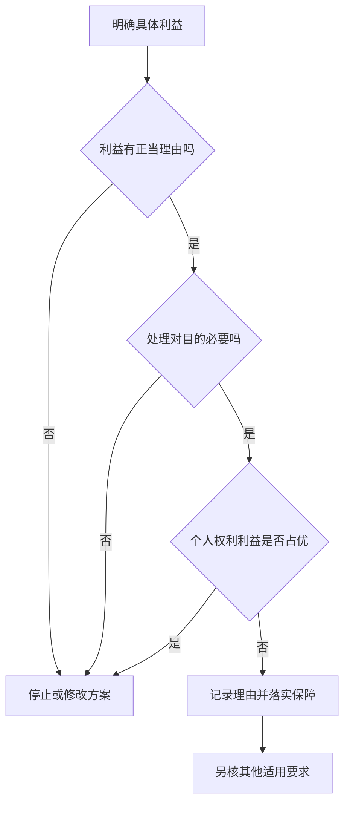
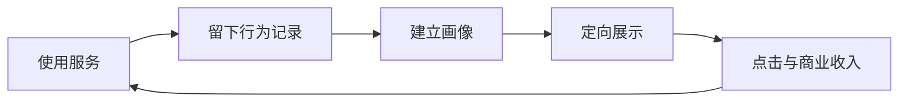
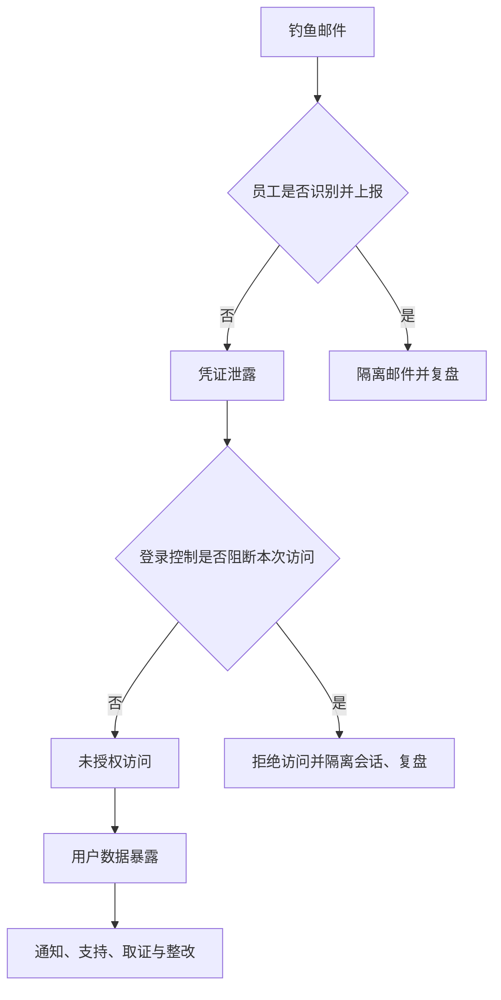
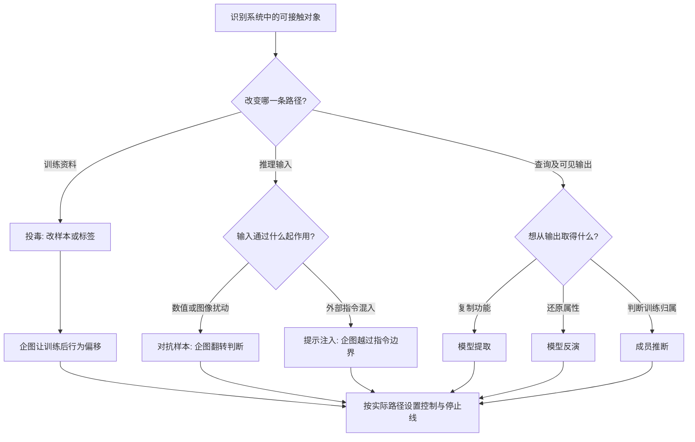
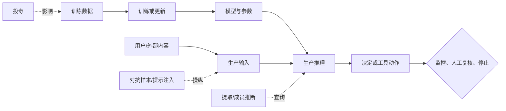
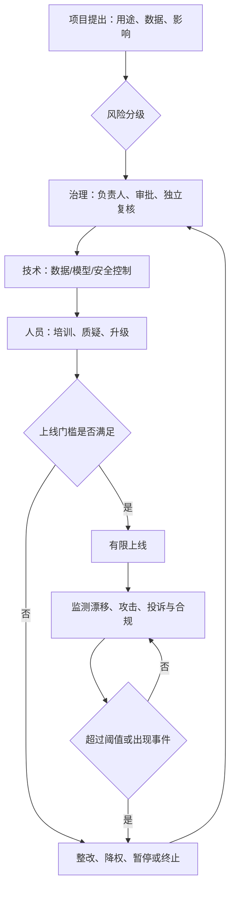

# M06 · 隐私与监控：从收集数据到影响选择

> **材料边界**：本篇保留同学提供的 19 页无时间戳文字 U1；本人本周未到场，U1 的实际授课日期与说话人仍未独立核实。现新增音频 `IS5113-M06-source14-partial.m4a` 的 ASR 来源 T1（1,180 段，缺开头、有明确结尾）与 111 页正式讲义。U1 页行、T1 时间戳和讲义页码是三套独立定位，不能互换；新增音频不把“本人缺席 / U1 说话人未核”改成已确认。

> **新旧范围**：§2.1–§2.13 保留 U1 课堂层与既有定位；§2.14–§2.21 按新讲义补齐 p.2–111。讲义 p.1 的项目行政由课程 DDL 单独管理，本篇只保留学习所需的提交提示，不把材料整理写成本人已提交。

> **编号与定位**：Course Outline p.2 把 Privacy and Surveillance 列为 Week 6，因此归档为 M06；实际授课周次与日期未核。`U1 p.03 L012-L018` 指所供 PDF 的物理第 3 页及固定提取文本行号，绝非课堂时间。引文只归因于所提供转录，未独立确认说话人。

> **阅读方法**：🎙️ 课堂格内分别标 U1（第三方无时间戳文字）与 T1（新音频 ASR）；📄 表示 111 页讲义；💡 表示笔记补充的解释或假设例；🔗 表示外部一手核对。§2.1–§2.13 保留全部 U1 locator 和原引文，再添加 T1 的真实段首时间戳；T1 未直接覆盖的格明确说明。§2.14 起用新讲义补齐正式课件层。前次隐私课完整课堂材料仍缺失。

## 0. 三分钟速览

一句话：本讲把个人数据的采集与推断、AI 系统遭受攻击的路径，以及组织持续治理这些风险的四支柱连成一条主线。

学完你能：

1. 追踪原始数据怎样变成敏感推断、画像及对人的限制。
2. 区分 GDPR Article 6 的一般处理依据与 Article 9 的特殊类别额外条件。
3. 为人脸识别或智慧城市项目提出接受、拒绝或附条件部署方案，并写出停止线。
4. 对六类 AI 攻击分别指出输入、攻击动作、中间结果、输出、控制与失败边界。
5. 用 Governance、Technology、People、Monitoring 四支柱设计上线、监测、暂停和整改闭环。

**🎙️ 所供文字的教学进程**：先从合规之外的伦理问题讲起，再讨论商业追踪、人脸识别与智慧城市。随后梳理数据保护原则、一般处理依据和敏感数据，最后用免费平台商业模式及历史案件收束。文本以 `where we left` 开始，并回顾前次课；不能据此恢复未提供的内容。（`U1 p.01 L006-L010`；`U1 p.12 L015-L019`；`U1 p.19 L004-L017`）

> 🎙️ **课堂实况**（实际上课日期未确认）：T1 从正式讲义 p.67 的 Cambridge Analytica / Google 案例讨论中段开始，故 p.2–66 均只能标录音未覆盖。 课堂最充分展开的是 Target 推断隐私、准确率与鲁棒性的差别、交易机器人治理和前沿模型可控性。 正式讲义内容到 p.96 为止；p.97–111 四支柱未录到，课堂随后转入 Asimov 与后续课程安排，并在 `02:19:33` 明确结束。

## 1. 开始之前 · 知识衔接

### 1.1 你已经见过的判断工具

先把“发生什么”“按什么标准评价”“谁来纠正”分开。本讲将这三件事应用到人的数据。

下面一行是一种旧工具，三列依次说明名称、眼下怎样用、去哪里复习。

| 工具 | 本讲怎样用 | 回看 |
|---|---|---|
| 功利主义 | 比较各方利益和损害 | [[M02-道德理论及其应用]] |
| 义务论 | 检查是否尊重人的知情选择 | [[M02-道德理论及其应用]] |
| 公平 | 检查错误和成本落在谁身上 | [[M03-偏见与公平]] |
| 透明 | 给当事人理解与质疑的理由 | [[M04-AI透明-从看得见到信得过]] |
| 问责 | 落实解释、复核和纠正的人 | [[M05-AI问责-责任链治理与救济]] |

读第一行：比较利益时，要同时看市民获得的安全与可能失去的自由；不能只计算采购者的收入。三列均为概念信息，没有数值单位。

**所以呢**：本讲会同时用利益、权利和程序判断，不靠一句“技术有效”结束分析。

### 1.2 新词先看它改变什么

遇到以下词时，先找对应动作，再记英文名称。

- **个人数据（personal data）**：能与一个可识别的人联系起来的信息，例如与账户绑定的位置记录。
- **处理（processing）**：对数据进行收集、储存、分析、共享或删除等操作；本篇不把处理缩成模型训练。
- **数据主体（data subject）**：数据所描述的人。例如医院记录中的病人。
- **控制者（controller）**：决定为什么以及怎样处理数据的一方；外包算法并不自动消除这种角色。
- **自主性（autonomy）**：当事人能理解选择并作出自己的决定。
- **AI 攻击面（AI attack surface）**：训练数据、模型、API、用户输入和工具权限中可被攻击者利用的入口；§2.19 展开。
- **对抗样本（adversarial example）与数据投毒（data poisoning）**：前者在推理时改输入，后者在训练前改学习材料；§2.19.1–§2.19.2 展开。
- **模型提取（model extraction）、模型反演（model inversion）与成员推断（membership inference）**：分别问能否复制模型行为、反推出敏感特征、判断某记录是否参加训练；§2.19.3–§2.19.5 展开。
- **提示注入（prompt injection）**：让不可信外部文本伪装成控制指令；§2.19.6 展开。
- **代理式失配（agentic misalignment）与可控性测试（controllability testing）**：观察 agent 在目标冲突、关停或工具权限情境下是否越过人类边界；§2.20 展开。
- **Responsible AI 四支柱**：用治理、技术、人员、监控组成持续控制闭环；§2.21 展开。

以上为 💡 笔记最小先修；控制者等法律概念的实际角色须按具体事实核对。§2.2 讲选择，§2.9/§2.17 讲处理依据，§2.11/§2.17 讲额外保护，§2.19–§2.21 进入安全与治理。

本篇论证中的 P1、P2、P3 是逐条前提，C 是从前提推出的结论。ASR 指自动语音识别；GPS 是卫星定位，本篇只把它当位置记录的来源。ILO 是课程学习目标。

**所以呢**：先问谁处理谁的数据，再判断哪项要求适用。

### 1.3 为什么这样重排

所供转录先谈智慧城市，再回到 GDPR 基础。本篇保留这个问题导向，但先补齐数据链与实质同意，再进入项目取舍。法律部分按“原则 → 一般依据 → 正当利益 → 敏感数据”展开，避免把不同门槛混为一谈。

这是 💡 笔记重排。§8 主表保留 U1 转录页码，§8.1 另列 111 页讲义映射；两套页码不能混用。

**所以呢**：读者可先理解风险怎样产生，再看每一道保障在链条中阻止什么。

## 2. 正文

### 2.1 合规为什么还要问伦理（U1 p.1–2）

城市依法安装摄像头，就已经回答了“应该装多少、保留多久、谁能查看”吗？法律问题与伦理问题有关联，但所需理由不完全相同。

**是什么**：合规是满足适用法律要求。伦理判断进一步问行为是否有充分理由，是否尊重受影响者，利益与损害是否合理分配。

**为什么需要它**：一项收集行为即使有法律依据，也可能范围过大、解释不足，或让某些人承担特别高的负担。只写“合法”无法说明为什么选这个方案。

**课件原例**：本次未取得讲义，不能确认课件原例。

**🎙️ 课堂补充**（混合来源：U1 无时间戳；T1 `23:26`–`24:40`、`49:56`–`52:31`）

**U1（第三方无时间戳文字，原定位与边界保留）**

转录把是否有必要收集、监控是否与风险相称、未来是否会滥用，列为合规之外的追问。（`U1 p.01 L009-L024`；`U1 p.02 L001-L016`）

*"Law often established a minimum standard."*（`U1 p.02 L001-L002`）

意思是：所供文字把法律描述为最低标准。这是一种课堂解释框架，不是声称所有法律都低于所有伦理标准。

**T1（新音频 ASR）**

- 教师要求先做利益与损害分析，再检查最低限度的基本权利：*"you have to apply the ethical principles ... One is utility, [the other is] basic rights"*（T1 `23:26`–`23:53`）。
- 他再次把合规称为最低标准：*"Compliance alone is not enough because ... legal compliance only establish[es] minimum standards."*（T1 `49:56`–`50:17`），随后追问是否该收集、风险是否相称、系统未来会否被滥用（T1 `51:39`–`52:14`）。
- **这段改变了什么**：T1 与 U1 的中心判断一致，并补出“效用 + 基本权利”两条伦理分析线；仍不能把“合法”自动改写成“符合伦理”。

**💡 换个说法（笔记补充）**：假设车站为找回遗失物而保存视频。能保存某种视频，不直接推出应当无限期保存每个人的完整行程。

- P1〔规范〕：增加对人的限制，应有与目的相关的充分理由。
- P2〔事实假设〕：无限保存行程会增加被追踪和误用的机会。
- P3〔事实假设〕：找回遗失物通常不需要永久记录所有人的行程。
- 推理：由 P1–P3，永久保留比实现目的所需的侵入更大。
- C：应缩小保存范围并说明期限，而非只援引合法性。
- 最强反驳：攻击 P3；某类调查可能确实需要更长记录。
- 条件改变后：若能证明更长保留的必要性，应再比较较温和方案及监督条件。

**常见误解**：“法律允许，所以伦理分析已经完成。”合法性提供重要约束，但还要解释选择这个范围的理由。

**与其他概念的关系**：M05 的问责要求有关组织说明理由；本讲把理由落实到数据收集范围。

**所以呢**：接下来先问，被收集的人是否真正知道并能选择。

### 2.2 勾选框与有意义的同意（U1 p.1、5–6）

一个人点击“我同意”，却不知道应用会把轨迹交给广告合作方。这次点击提供了什么证据，又缺少什么？

**是什么**：有意义的同意（meaningful consent）要求当事人理解有关用途，并有实际可行的选择。它关注人的决定过程，而不只看系统存下了一个勾。

**为什么需要它**：用途藏在长条款里，当事人无法预见后果。若拒绝就失去必需服务，形式上的“可以拒绝”也可能缺乏实际自由。

**课件原例**：本次未取得讲义；长服务条款是转录中的讨论。

**🎙️ 课堂补充**（混合来源：U1 无时间戳；T1 `34:20`–`46:15`）

**U1（第三方无时间戳文字，原定位与边界保留）**

转录提出两类难题：公众很难通过不进入城市来退出公共监控；用户可能勾选自己并不理解的条款。（`U1 p.01 L025-L034`；`U1 p.05 L017-L031`）

*"you don't understand what you're taking."*（`U1 p.05 L020-L021`）

意思是：文字讨论的是勾选时缺乏理解，不能把这个动作自动当成充分知情。

**T1（新音频 ASR）**

- 教师指出，约 20 页条款即使被勾选，99.9% 的人也不会逐页阅读；消费者还可能缺少理解 AI 推断的技术知识（T1 `34:20`–`36:48`）。
- 长政策与复杂算法使 informed consent 难以成立，公司却更了解处理风险并有能力落实 safeguards、transparency 与 privacy by design（T1 `39:22`–`41:17`）。
- 他提出比一次性 yes/no 更细的做法：让用户在持续互动中调整同意范围，用多个等级或控制项表达不同用途的许可（T1 `44:24`–`46:15`）。
- **这段改变了什么**：T1 把“有意义”落到理解能力、权力不对称与持续控制；一次勾选不能证明用户理解后续推断。

**💡 换个说法（笔记补充）**：健身应用可以将“保存跑步路线”和“把路线用于广告画像”分开说明。用户接受前者，仍可拒绝后者。这样能看清用户究竟选择了哪项用途。

检查过程：

1. 写清收集什么，例如 GPS 路线，而非笼统写“改善体验”。
2. 写清目的、接收方和保留方式，让用户知道数据接下来去哪。
3. 检查拒绝的实际代价，尤其是基本服务与雇佣情境。
4. 给出能使用的撤回及询问渠道，并检验它是否容易找到。

🔗 **法律边界**：GDPR 是欧盟《通用数据保护条例》（General Data Protection Regulation）。若其适用，并以同意为处理依据，还须核自愿、知情、具体、明确行为及撤回要求。其适用时间为 2018-05-25 起；本篇按欧委会现行说明核对，不把“公共场所必须取得每个人同意”当通则。（来源见 §9.4）

**常见误解**：“同意是唯一合法依据。”§2.9 会列出其他依据；有其他依据也不会自动解决伦理上的选择困难。

**与其他概念的关系**：M02 的自主性关心人是否参与形成自己的决定，M04 的透明帮助人理解决定。

**所以呢**：理解采集条款之后，还要看数据能被推导出什么。

### 2.3 一条数据怎样变成对人的限制（U1 p.2–3、17）

用户只留下购买记录，平台却推测其健康状况，再用推测决定给他什么服务。风险在哪一步发生了变化？

**是什么**：推断隐私（inference privacy）关注从看似普通的记录推得敏感特征。推断可能正确，也可能错误；两种情况都可能影响个人。

**为什么需要它**：保护直接填写的病历仍不够。普通轨迹与交易可以组合成画像，画像再影响个人被看到的选择或机会。

**课件原例**：本次未取得讲义；位置、购物及社交信息的例子来自所供转录。

**🎙️ 课堂补充**（混合来源：U1 无时间戳；T1 `11:05`–`33:53`）

**U1（第三方无时间戳文字，原定位与边界保留）**

转录把个性化、劝说、操控、预测及预先限制串成风险递进，并举位置与购物模式可能暴露敏感倾向的例子。（`U1 p.02 L018-L038`；`U1 p.03 L001-L007`；`U1 p.17 L004-L015`）

*"AI may infer it"*（`U1 p.17 L008`）

意思是：AI 可能推断相关信息。前后语句的 ASR 有破损，因此这里只引清楚的短语；具体例子按相邻段内容转述，不把不完整句子补成原话。

**T1（新音频 ASR）**

- Target 案从普通购买模式推断怀孕，再投放孕产广告；教师强调这不是用户直接交出的 pregnancy data，而是模型从其他行为记录推出的敏感信息（T1 `11:05`–`13:19`）。
- 核心追问是：*"who owns the knowledge that AI generates about us from our data?"*（T1 `20:03`–`20:36`）。教师没有给所有权法律结论，而是要求比较伤害、效用和基本权利。
- 正反两方都被保留：敏感推断造成的隐私伤害可能与直接收集相同；企业则会主张推断是计算、模型和分析劳动的产品（T1 `28:15`–`31:19`）。
- 课堂给出的条件判断是，越能精确锁定个人、越敏感、潜在伤害越大，保护要求应越强；群体层面的统计不能直接等同个人画像（T1 `31:23`–`33:53`）。
- **这段改变了什么**：T1 为“记录 → 推断 → 干预”增加了 Target 案和两方论证；不能把“推断数据属于谁”写成已有确定法律答案。

**💡 换个说法（笔记补充）**：假设平台知道某人反复购买止咳药。它可能推测此人有长期疾病，但购买者也可能替别人买药。若保险方把推测当诊断，就把不确定画像变成了机会损失。

这张图帮助找出“观察”与“干预”的分界。箭头表示数据在系统中被加工和使用，不表示每个系统都会经过所有阶段。

按上面的假设走图：

1. 购药记录进入 A，B 把记录推断为“长期疾病”。
2. C 预测保险风险，D 据此改变报价。
3. E 让当事人指出代购事实，F 纠正错误画像及受影响决定。

缺少 E 时，错误容易一直影响人。

文字替代：记录与推断是两种信息，推断仍有不确定性。每次跨到下一阶段，都要增加相应证据与保护。此图是 💡 笔记补充的分析流程，不是原文系统架构。

**常见误解**：“没有采集敏感字段，就没有敏感隐私风险。”组合和推断会产生新信息，需同时检查输入与推断输出。

**与其他概念的关系**：M03 的公平检查错误落在谁身上；M05 的救济要求错误能被发现并纠正。

**所以呢**：风险来自用途及后果，不能用一个模型准确率概括。

### 2.4 人脸识别：先看任务，再看谁被误认（U1 p.3–5）

手机确认“是不是机主”，与街头摄像头判断“这是谁”，需要回答同一个问题吗？

**是什么**：验证（verification）比较一个人是否匹配已声称的身份；识别（identification）则在候选人中寻找身份。任务、环境和受影响群体不同，错误后果也不同。

**为什么需要它**：实验室图像上的指标，不能直接变成远距离、不同光线与角度下的表现。整体结果还可能掩盖某些群体承担更多错误。

**课件原例**：未取得讲义，无法核对源中提到的技术性能数字。

**🎙️ 课堂补充**：❓ **T1 未直接覆盖本节验证 / 识别性能。** U1 无时间戳证据按原 locator 保留。

**U1（第三方无时间戳文字，原定位与边界保留）**

转录比较照片、移动环境、2D 与 3D，并讨论人口群体差异。数字、术语及比较分母混乱，本文不把 99%、98%、70% 等当已验证性能或考试数字。（`U1 p.03 L030-L038`；`U1 p.04 L005-L035`；`U1 p.05 L001-L004`）

*"Accuracy. Maybe 99%"*（`U1 p.04 L008-L009`）

意思是：原文自己有 “Maybe”。缺数据集、任务及错误定义，不能据此得出可靠性能结论。

**T1（新音频 ASR）**

T1 后半确实提到人脸识别可能被特制扰动误导（`01:25:36`），但没有重新讲 verification / identification 区分、人口群体差异或 U1 的性能数字。因此本格不借用安全段的单句来冒充完整重合，也不为 T1 生造覆盖区间。

**💡 换个说法（笔记补充）**：假设门禁误拒一次，用户还能请管理员核实；若同样的误认触发拘留，后果严重得多。分析应同时记录技术错误与制度如何处置错误。

建议依次检查：

1. 任务是验证还是识别，候选范围多大。
2. 真实环境是否接近测试环境。
3. 哪些群体被误认或漏认，谁承受后果。
4. 决定前是否复核，决定后能否申诉与纠正。

**常见误解**：“总体准确，所以对每个人都公平。”整体指标不说明错误分布，也不说明每次决定的证据是否充分。

**与其他概念的关系**：回看 M03 的群体影响与 M04 的个案解释；本节增加监控环境及识别后果。

**所以呢**：当技术扩展到整个城市，除了错误，还会改变权力与生活方式。

### 2.5 智慧城市的三种隐私风险（U1 p.6–8）

摄像头减少找路与应急调度的困难，也让居民很难避开被追踪。如何同时说明收益与损害？

**是什么**：监控（surveillance）是持续或有组织地观察人的活动。智慧城市把摄像头、车牌、交通及环境信息联结，用于管理公共空间。

**为什么需要它**：公共安全有价值，但持续观察还会改变人是否敢表达、数据未来会被怎样使用，以及谁掌握有关他人的信息。

**课件原例**：未取得讲义。智慧城市在本文仅作为转录中的讨论场景，不指定某个真实城市。

**🎙️ 课堂补充**（混合来源：U1 无时间戳；T1 `49:56`–`01:00:15`、`01:05:51`–`01:08:42`）

**U1（第三方无时间戳文字，原定位与边界保留）**

转录提出三组问题：

- 居民是否能实质退出。
- 被观察是否压缩自由。
- 原为防罪采集的数据会否改用于其他用途。

以上来自 `U1 p.06 L008-L038`、`U1 p.07 L001-L038` 与 `U1 p.08 L001-L010`。

*"is surveillance ethical? When individuals cannot reasonably refuse it."*（`U1 p.07 L001-L002`）

意思是：当拒绝并不现实，不能只以居民没有提出反对来证明监控正当。

**T1（新音频 ASR）**

- 教师再次提出必要性、相称性、未来误用、实际退出与持续观察是否改变行为（T1 `51:39`–`53:25`）。
- 香港摄像头讨论同时保留支持理由与 safeguards：市民可能因防罪更安心；系统应限目的、设程序，并只在犯罪热点做主动实时监控（T1 `54:10`–`57:54`）。
- 课间后明确命名 function creep：原为防罪、交通或公共健康收集的数据，逐步进入员工监控、画像、定向推断或操纵（T1 `58:11`–`01:00:15`）。
- 20% 降罪题的课堂结论是“可在重大公共利益下有条件使用”，条件包括必要、相称、透明、问责和独立监督（T1 `01:05:51`–`01:07:20`）。
- **这段改变了什么**：T1 与 U1 的三类风险重合，并补了支持监控的最强理由；笔记不能只写反对监控的一边。

**💡 换个说法（笔记补充）**：假设人们担心合法集会会留下可检索身份记录，便不再参加。行为没有被直接禁止，但观察改变了选择。这叫寒蝉效应（chilling effect）。

再假设原为调度拥堵而收集的轨迹，被改成评价员工出勤。这种用途逐渐扩张称为用途扩张（function creep）。是否违法另查适用法律；伦理上先问新用途是否有独立理由。

完整分析链：

- P1〔规范〕：限制自由应有必要且相称的理由。
- P2〔事实假设〕：持续实名识别会形成个人活动记录。
- P3〔事实假设〕：匿名流量统计已能完成交通调度。
- 推理：由 P2 和 P3，实名持续识别增加了完成目的不需要的侵入。
- C：在这些事实下，应先选匿名统计。
- 最强反驳：攻击 P3；某种紧急事件可能需要定位具体人。
- 条件改变后：按事件启用受限查询，并核授权、期限和事后审查。

**常见误解**：“在公共场所，所以没有隐私问题。”单次被看见与长期跨地点联结成画像，影响不同。

**与其他概念的关系**：本节将 §2.1 的必要性落实到可替代方案，将 §2.2 的选择问题放进公共空间。

**所以呢**：选择方案前，必须先列出不同的人各自得到什么、失去什么。

### 2.6 利益相关者：收益不能抵消谁的损害（U1 p.8–9）

采购者说系统降低成本，但居民承担误识别风险。只把两项相加，能判断项目是否合理吗？

**是什么**：利益相关者（stakeholder）是会影响项目或承受其影响的人和组织。影响分析分别列每一方的收益、风险和能采取的行动。

**为什么需要它**：有能力签合同的人，未必是承受最多风险的人。把各方分开，才能看到利益和发言权的差距。

**课件原例**：未取得讲义；以下表依据转录归纳，具体保障为笔记建议。

**🎙️ 课堂补充**（混合来源：U1 无时间戳；T1 `34:20`–`41:17` 为责任与权力不对称增量）

**U1（第三方无时间戳文字，原定位与边界保留）**

转录依次讨论市民、政府、执法者、商业机构及技术供应商。末一类风险表述不完整，不能补成老师给过的完整表。（`U1 p.08 L011-L038`；`U1 p.09 L001-L014`）

*"benefits and risk"*（`U1 p.08 L016`）

意思是：每一方都要同时检查收益和风险，而不只问项目有没有总体好处。

下面一行是一类角色。列中“风险”表示可能损害，不是已发生的统计结果。

| 角色 | 可能收益 | 可能风险 | 💡 可检查的保障 |
|---|---|---|---|
| 市民 | 更快应急响应 | 误认与表达顾虑 | 申诉和错误纠正 |
| 政府 | 调度资源 | 信任受损 | 独立监督与公开说明 |
| 执法者 | 查找证据 | 过度依赖预测 | 个案证据复核 |
| 商家 | 更安全的经营环境 | 顾客抵触追踪 | 限制商用共享 |
| 供应商 | 合同和后续服务 | 参与有害用途 | 用途条款及停用条件 |

逐列读法：

- 角色是被分析者。
- 可能收益是其可能得到的改善。
- 可能风险是其可能承担的负担。
- 保障是需要核查的措施。

四列均为定性信息，不按金额相加。

读第一行：市民可能因应急响应变快而受益，也可能被系统误认；这时需要能改变决定的申诉渠道。

**T1（新音频 ASR）**

T1 没有重新列出 U1 的五类智慧城市 stakeholder。它新增的是责任分配原则：个人有一定责任，但公司设计系统、控制处理并更了解风险，因此在信息和权力不对称下应承担更重的保护责任（T1 `34:20`–`41:17`）。这与 U1 表互补，不能替换原有角色分析。

**💡 换个说法（笔记补充）**：即使多数居民觉得方便，也应单独询问更容易被误认的少数群体。多数受益不能直接证明给少数人的负担合理。

**常见误解**：“有商业收益，供应商就是唯一受益方。”市民也可能真实受益；完整分析必须保留这种有力理由。

**与其他概念的关系**：M03 检查分配是否公平；M05 检查谁能要求解释和纠正。

**所以呢**：有了角色分析，下一步才能形成可辩护的投标决定。

### 2.7 智慧城市投标：三个立场怎样论证（U1 p.9–12）

公司要决定是否供应监控系统。接受、拒绝、附条件接受，都需要说明能成立的理由与边界。

**是什么**：这是把伦理标准应用到具体选择的讨论。题目原始开场未完整提供；以下按转录中明确讨论的三立场整理，不补造合同金额、城市或采购者承诺。

**为什么需要它**：提出“平衡”仍不够。要写清哪项风险不能接受、哪项保障能改变决定，以及保障失效时怎么办。

**课件原例**：未取得讲义；三立场题目来源为所供转录。

**🎙️ 课堂补充**（混合来源：U1 无时间戳；T1 `01:05:51`–`01:08:42`）

**U1（第三方无时间戳文字，原定位与边界保留）**

转录讨论无条件接受、拒绝以及有保障才接受，并质疑“我不做别人也会做”是否足以免责。（`U1 p.09 L016-L036`；`U1 p.10 L001-L038`；`U1 p.11 L001-L033`）

*"strict safeguards are included."*（`U1 p.10 L019-L020`）

意思是：附条件接受需要能检验的保障，不能仅依靠采购者承诺善意。

**T1（新音频 ASR）**

- T1 没有重述“是否投标”的三立场，但给了同类 20% 降罪题的课堂参考答案：部分监控在产生重大公共利益时可以正当化，但须有防误用保障（`01:05:51`–`01:06:41`）。
- 必要、相称、透明、问责与独立监督被明确列为 guardrails（T1 `01:06:46`–`01:07:20`）。
- **这段改变了什么**：T1 支持 U1 的“附条件接受”结构，但没有证明它是智慧城市投标题的唯一官方答案；原三立场仍需分别论证。

**💡 换个说法：三立场参考解析（笔记补充，非官方答案）**

1. **接受**：理由可包括应急、安全与交通收益。前提是这些收益有证据、风险可以控制。最强反驳是供应商把治理责任全部推给客户，忽视自己的设计及供应选择。
2. **拒绝**：若大规模识别带来的权利风险无法控制，公司可以拒绝参与。最强反驳是项目可能转由保障更弱的供应商承接；回应应比较实际可行替代，不把拒绝自动当最有效方案。
3. **附条件接受**：把用途、访问权、保留期限、监督、申诉和停用写进可核的安排。最强反驳是合同存在但无人执行；若无法查验或执行，条件就没有真正改变风险。

**完整作答示范：选择附条件接受**

- P1〔规范〕：安全收益应与对个人的侵入及错误风险一同评估。
- P2〔事实限制〕：题目未证明持续实名识别是实现目标的必要手段。
- P3〔规范〕：无法退出的人应得到更强的监督与纠正保护。
- 推理：由 P1–P3，应把参与限制在经过必要性证明且有保障的用途。
- C：先要求可执行条件；条件达不到则拒绝该方案。
- 最强反驳：紧急风险可能要求快速部署，完整条件会延误收益。
- 条件改变后：可比较范围受限、可撤回的试点；紧急性不能使所有限制永久失效。

转录提出的保障包括：限制持续识别、独立监督、透明报告、数据最小化、限期保存、申诉及二次用途控制。（`U1 p.10 L021-L038`）

**“哪种城市更危险”怎样回答**

所供文字比较“看不见风险的城市”与“看见一切的城市”。安全不足会使权利难以行使；无限监控也会积累滥用能力。两种理由都应保留，再依据威胁证据和可控措施作条件判断。（`U1 p.11 L008-L033`）

**常见误解**：“别人会做，所以我做也没有额外责任。”这个预测没有证明参与本身正当，也没有证明公司不能改变设计与保障。

**与其他概念的关系**：这是 M02 利益与权利判断、M05 责任链及本讲数据控制的联合应用。

**所以呢**：下一步把“保障”拆成具体的数据处理要求，避免停在口号。

### 2.8 数据保护原则怎样约束全过程（U1 p.12–13）

组织取得一条记录以后，还需要对目的、内容、保存和使用承担什么要求？

**是什么**：数据保护原则约束整个处理过程，不只是数据库是否装了加密工具。

**为什么需要它**：加密可降低某些泄露风险，却不会让不必要收集、错误记录或无期限保留变得合理。

**课件原例**：未取得讲义；以下原则来自转录概述，并用欧委会说明核对基本边界。

**🎙️ 课堂补充**（混合来源：U1 无时间戳；T1 `05:45`–`10:53`）

**U1（第三方无时间戳文字，原定位与边界保留）**

转录逐项提到合法、公平、透明、目的限制、最小化、准确、保留限制、安全及证明遵守原则的责任。（`U1 p.12 L019-L038`；`U1 p.13 L001-L004`）

*"Don't collect more than we need"*（`U1 p.12 L023-L024`）

意思是：收集应围绕已说明的目的，不能先无限收集，再等将来发现用途。

**T1（新音频 ASR）**

- 教师用 Cambridge Analytica / Google 对照五项原则：privacy、informed consent、purpose limitation、user control、data minimisation（T1 `05:45`–`06:13`）。
- purpose limitation 的例子是购物 / 平台数据转作政治说服或 personalized advertising（T1 `07:28`–`08:21`）；user control 要求用户能控制超出原同意的共享（T1 `08:33`–`09:25`）。
- 数据最小化的课堂理由是：数据被视为可变现资产会诱使企业多收集，而多余收集本身增加 privacy risk（T1 `09:25`–`10:08`）。
- **这段改变了什么**：T1 把原则逐项套入两个案例，但没有完整重讲 U1 所列的准确性、保留期限、安全与问责原则。

**💡 换个说法（笔记补充）**：为预约门诊，只需联系与预约资料时，不应顺便索取全部通讯录。下面一行是一项检查，后列给出要查的证据。

| 检查 | 具体问法 | 预约例中的证据 |
|---|---|---|
| 合法、公平、透明 | 凭什么处理，是否说明清楚 | 依据及易懂告知 |
| 目的限制 | 为什么收集 | 门诊预约目的 |
| 最小化 | 这项字段是否必要 | 通讯录与预约无关 |
| 准确性 | 错了怎样改 | 联系号码更新入口 |
| 保留限制 | 何时删除或再评估 | 经说明的期限 |
| 安全 | 谁能接触和改变数据 | 权限、加密及日志 |
| 问责 | 怎样证明做到 | 决策和检查记录 |

逐列读法：

- 第一列是原则。
- 第二列把原则转成行动问题。
- 第三列是 💡 假设例的证据，不是已核医院做法。

读第三行：若通讯录对预约没有必要，就应删除这个收集要求。

🔗 **法律范围**：本节对应欧盟 GDPR 第 5 条，2018-05-25 起适用；还须先核具体处理是否落入其范围。目的改变要作兼容性或其他适用条件检查，不能把所有二次使用一概写成违法。（见 §9.4）

**常见误解**：“没有人证明我们违法，就算已经证明合规。”转录强调留下遵守原则的证据；这不能简化成所有法律程序都倒置举证责任。

**与其他概念的关系**：M05 的可追溯性让组织能还原决定，本节让它证明收集和保存的理由。

**所以呢**：原则说明怎样处理；下一节回答具体处理凭什么开始。

### 2.9 六种依据：不把同意当万能通行证（U1 p.13–14）

医院急救昏迷病人，无法先取得签字。不能签字，是否就一律不能查看必要病史？

**是什么**：合法处理依据（lawful basis）是法律认可某项处理可以进行的理由。适用 GDPR 时，第 6 条列出六类一般依据，不能按方便随意挑选。

**为什么需要它**：把所有处理都塞进“用户同意”，会忽略公共职责、必要合同或紧急生命保护，也会诱使组织以模糊勾选掩盖真实用途。

**课件原例**：未取得讲义；下表为对所供文字和一手说明的归纳。

**🎙️ 课堂补充**：❓ **T1 未直接覆盖六种 lawful bases。** U1 无时间戳证据按原 locator 保留。

**U1（第三方无时间戳文字，原定位与边界保留）**

转录依次列出同意、合同、法律义务、重大利益、公共任务、正当利益，并要求组织记录所依赖的依据。（`U1 p.13 L005-L025`；`U1 p.14 L001-L009`）

*"document and justify the choice"*（`U1 p.13 L023-L024`）

意思是：组织要说明为什么这项处理能依赖所选依据，而不是只在表格里勾一个名称。

**T1（新音频 ASR）**

T1 多次讨论 consent、GDPR 与目的限制，但没有列出 Article 6 的六种一般依据，也没有逐项解释合同、法律义务、重大利益、公共任务与正当利益。因此本格仅保留 U1 证据，不能把 T1 的一般“合规”话语当作六项重讲。

**💡 换个说法（笔记补充）**：商店处理送货地址，可能为了履行送货合同。把地址长期用于另一个广告目的，不能仅靠前一个目的的合同解释。

以下一行是一类一般依据；第三列是理解用的小例，不是自动适用结论。

| 一般依据 | 核心条件 | 💡 小例 |
|---|---|---|
| 同意 | 针对具体用途有效同意 | 订阅可选推荐 |
| 合同 | 对履行合同必要 | 送货地址 |
| 法律义务 | 有适用法定义务 | 法定申报 |
| 重大利益 | 保护人的生命等重大利益 | 紧急救治 |
| 公共任务 | 有法律依据的公共职责 | 授权公共服务 |
| 正当利益 | 目的、必要性及权衡成立 | 适度防欺诈 |

逐列读法：

- 依据是理由类别。
- 条件限制何时能用。
- 小例帮助理解，不证明任何具体公司已合规。

读第二行：只有履行合同所必需的处理，才可据此解释，不能把所有营销都捆绑进去。

🔗 **法律范围**：欧盟 GDPR 第 6 条，2018-05-25 起适用。六依据由欧委会及欧洲数据保护委员会（EDPB）当前说明核对。若是特殊类别数据，还要叠加 §2.11 的门槛。

**常见误解**：“签过合同或同意过，就能处理全部数据。”依据针对具体目的和必要范围，其他原则继续适用。

**与其他概念的关系**：§2.8 仍约束每一种依据；取得一种依据不是跳过所有保护。

**所以呢**：最容易被扩大解释的正当利益，需要单独走完检验过程。

### 2.10 正当利益：有用为什么还不够（U1 p.14）

商场说保存每位访客的全年轨迹有助防盗。防盗是好事，就足以证明全年追踪必要吗？

**是什么**：正当利益（legitimate interests）在特定条件下可支持处理，但须证明具体目的、处理必要性，并权衡个人权利和利益。

**为什么需要它**：若“有用”就足够，几乎所有商业收集都能被解释成合理。必要性检查迫使组织比较更少侵入的方法。

**课件原例**：未取得讲义；防欺诈、网络安全等名称来自转录，商场轨迹例为笔记补充。

**🎙️ 课堂补充**：❓ **T1 未直接覆盖 legitimate interests 三步检验。** U1 无时间戳证据按原 locator 保留。

**U1（第三方无时间戳文字，原定位与边界保留）**

*"necessary, you know, not useful"*（`U1 p.14 L020-L021`）

意思是：转录强调处理须有必要性，而非仅带来便利。不能把口语“唯一方式”机械化为排除所有其他想象可能。（`U1 p.14 L006-L033`）

**T1（新音频 ASR）**

T1 用“公共利益须与风险相称”分析 surveillance，也说 personalization 的 usefulness 不能自动正当化敏感推断（`42:40`–`43:42`）。但它没有直接讲 legitimate interests 的 purpose / necessity / balancing test。因此这些口头内容可作伦理类比，不能替代本节的法律三步检验。

**💡 完整检验例（笔记补充，条件分析）**

1. **目的**：商场希望调查近期失窃。写清目的和利益，不能笼统写“改善运营”。
2. **必要性**：比较有限范围事件视频与全年实名轨迹。若前者足以调查，后者的额外侵入缺理由。
3. **权衡**：看访客合理预期、追踪规模、误用风险及拒绝能力。再评估限期、权限和监督能否降低风险。
4. **结果**：在替代方案足够且大范围追踪负担高的假设下，不应以该理由启动全年追踪。应缩小方案或停止该处理。

这张图解决“商业目的成立后，能不能直接开始收集”的误读。箭头是判断顺序；任何一步不满足，都应修改方案后重新检查。

走图：全年轨迹方案即使通过 B，也可能因有限事件视频足够而在 C 走“否”。若缩小到必要数据，再到 D 检查剩余负担。E 只是本项依据检查的结果，仍须到 F 核其他要求。

文字替代：目的合理、处理必要、权衡成立，是不同问题；任何一项缺口都不能靠前一项补足。图是 💡 分析框架，不是所有法定例外的完整决策树。

🔗 **法律范围**：欧盟 GDPR 第 6(1)(f) 条，2018-05-25 起适用；此依据用于公共机关履行任务等情形有限制，特殊数据还需另核。现实使用须核具体适用情境及现行指导。（来源见 §9.4）

**常见误解**：“防欺诈出现在例子里，所以任何防欺诈收集都合法。”名称不替代必要性和权衡，也不证明措施实际有效。

**与其他概念的关系**：§2.1 的相称理由，在此转成有记录的具体检查。

**所以呢**：某些数据后果更重，还需要额外的一道门槛。

### 2.11 医疗与敏感数据：两层依据都要核（U1 p.14–16）

医疗 AI 可能帮助诊断，但只说“有公共利益”，能否处理所有病历？

**是什么**：特殊类别个人数据（special categories of personal data）受到额外保护。健康、政治意见、宗教等信息可能造成严重歧视或其他权利损害。

**为什么需要它**：一般商业利益的理由，不能单独解决敏感数据的高风险。适用 GDPR 时，须同时处理一般合法依据和第 9 条的额外条件。

**课件原例**：未取得讲义；急救、医疗研究和敏感类别来自所供转录。

**🎙️ 课堂补充**（混合来源：U1 无时间戳；T1 `11:05`–`33:53`）

**U1（第三方无时间戳文字，原定位与边界保留）**

转录明确指出一般正当利益单独不够，并讨论明确同意、无法同意时的生命保护，以及依法开展的医疗或研究等条件。（`U1 p.14 L034-L038`；`U1 p.15 L001-L038`；`U1 p.16 L001-L018`）

*"no longer sufficient on its own"*（`U1 p.15 L001-L002`）

意思是：原本的一般依据仍需检查，但不能单独承担特殊数据的全部要求。原文的 “article 91/92” 按条文结构理解为 9(1)/9(2)，不写成第 91、92 条。

**T1（新音频 ASR）**

- Target 案把 pregnancy / biological status 作为从普通购物记录推得的敏感事实；教师反复问企业是否能在没有 explicit consent 的情况下把它用于营销（T1 `11:05`–`19:29`）。
- 他主张敏感推断可能造成与直接收集相似的 privacy harm，并提出保护强度应随“是否精准指向个人、信息有多敏感、伤害有多大”增加（T1 `28:15`–`33:53`）。
- **这段改变了什么**：T1 直接支持“敏感性不因来源是推断就消失”，但没有讲 Article 6 + Article 9 的法律双层结构；双层门槛仍由 U1 与法源承担。

**💡 换个说法：两层检查（笔记补充）**

1. 先写处理目的、主体和适用范围。
2. 检查 GDPR 第 6 条的一般依据。
3. 若涉及第 9 条特殊类别，再核第 9(2) 条具体条件及其附带限制。
4. 落实目的、最小化、安全、透明、访问控制及其他适用要求。
5. 依据或保护无法满足时，停止该方案或修改后重判。

这里的“双层”用步骤清楚分开即可；它与 §2.10 的一般依据图相接，不画一张遗漏法定例外的万能通行图。

**讨论题一：改善医疗结果，就可以处理敏感数据吗？**

⚪ 参考作答：改善结果是支持理由，但不能单独替代依据和保障。假设某医院想用病历训练诊断工具，应分别核训练与临床使用的目的、一般依据、特殊数据条件和安全措施。不能因“用于医疗”就自动许可全部用途。

**讨论题二：病人不懂 AI，同意是否就没有意义？**

⚪ 参考作答：不必先懂模型每个参数，才可能理解数据用途。应以病人能懂的方式说明用途、接收方、风险、选择及撤回。若这些仍无法理解，不能把签名当充分知情；若依法适用其他依据，也不能假称已取得同意。

**💡 急救变式（笔记补充）**：昏迷者的必要病史可能关系生命保护。这个情境与为了优化商业产品长期保留全院病历不同，后者不能借用前者的紧急理由。

🔗 **法律范围**：欧盟 GDPR 第 9 条，2018-05-25 起适用。明确同意只是可能条件之一；研究、公共健康等条件常受法律基础和保障限制。不是所有照片都当然属于用于唯一识别的生物识别特殊数据。（欧委会一手说明见 §9.4）

**常见误解**：“有明确同意就一切没问题。”一般原则、适用限制及其他要求仍存在，原文口语的 “everything is fine” 不能照用为法律结论。

**与其他概念的关系**：本节叠加 §2.8–2.10，而不是以公益目的替代那些检查。

**所以呢**：数据的经济价值越大，组织越有动机扩大收集；接下来分析这种动机。

### 2.12 监控资本主义与免费交换（U1 p.16–17）

健身应用免费提供步数与路线，但用行为数据建立广告画像。用户得到服务，是否就说明交换公平？

**是什么**：监控资本主义（surveillance capitalism）在本讲指通过收集、分析行为信息，把预测或定向影响转为商业价值的模式。这里是伦理分析用语，不是给全部免费服务下违法结论。

**为什么需要它**：用户看见的是眼前服务，企业掌握的却可能是长期画像及推断能力。信息与控制权不对称，使“自愿交换”的说法需要进一步检查。

**课件原例**：未取得讲义。转录举免费平台、健身应用及广告画像；书名作者的 ASR 人名不清，本稿不凭发音补作者履历。

**🎙️ 课堂补充**（混合来源：U1 无时间戳；T1 `04:09`–`10:53`、`42:40`–`49:38`）

**U1（第三方无时间戳文字，原定位与边界保留）**

转录描述收集行为、分析模式、预测兴趣、广告变现，再扩大收集的循环，并提出交换是否公平的问题。（`U1 p.16 L019-L038`；`U1 p.17 L001-L034`）

*"the imbalance of information and power"*（`U1 p.17 L024-L025`）

意思是：分析要看谁知道什么、谁能决定用途，不能仅看用户是否付了钱。

**T1（新音频 ASR）**

- 教师把 surveillance-capital model 概括为用户交出数据换免费服务，而平台须在同意与目的边界内管理数据（T1 `04:09`–`05:20`）。
- personalization 有真实效用，但 usefulness 不能自动正当化不透明、无同意的敏感推断；应给 transparency、user controls 与 explicit safeguards（T1 `42:40`–`44:21`）。
- 课堂进一步强调 AI 带来的权力集中：它可从广告说服走向利用弱点进行操纵；未来 CEO 应问“just because we can, should we do that?”（T1 `46:49`–`49:38`）。
- **这段改变了什么**：T1 把商业交换连接到动态同意、操纵和领导者红线；没有声称全部免费平台都直接出售原始个人数据。

**💡 从输入到结果（笔记补充）**

1. 用户使用健身服务，留下路线和使用时间。
2. 平台把这些记录转成活动习惯与兴趣画像。
3. 广告系统按画像选择展示内容，平台获得收入。
4. 新的点击又留下行为记录，进入下一轮分析。

下面的图帮助理解收入为何可能刺激进一步收集。箭头表示该假设商业流程；没有宣称更多数据必然提高预测或收入。

走图：用户打开跑步应用是 A，路线是 B，“经常夜跑”是 C，相关商品广告是 D，点击及可能的交易是 E。返回边表示继续使用后可再产生数据；它不是效果保证。

文字替代：服务产生数据，数据用于画像，画像影响展示；继续使用会产生新反馈。若只有无法关联个人的汇总统计，这条个人画像路径可能被削弱，但须核实技术与用途。

**讨论题：免费服务换数据，是公平交换吗？**

⚪ 参考作答：可能是，但需满足真实知情、可行选择、用途明确和风险相称。用户得到价值是支持理由；难以理解后续推断、无法拒绝或转移服务，是有力反对理由。

- P1〔规范〕：公平交换需要双方有足够信息与实际选择。
- P2〔事实假设〕：用户只知道路线用于运动记录，不知道用于第三方画像。
- 推理：由 P1 和 P2，当前交换缺少关键用途的信息。
- C：不能仅凭免费服务和一次勾选认定公平。
- 最强反驳：攻击 P2；用途可能已被清楚说明。
- 条件改变后：若用途易懂且可单独拒绝，公平交换的理由增强，仍需检查实际损害。

**常见误解**：“平台一定在直接出售每个人的原始数据。”定向广告机会、预测服务与直接出售数据是不同商业动作，要按事实区分。

**与其他概念的关系**：本节把 §2.2 的同意、§2.3 的推断及 §2.8 的最小化放到商业激励中。

**所以呢**：真实案件要分清数据流、被查行为与法律处理，不能只贴“侵犯隐私”的标签。

### 2.13 Facebook 与 Google：历史案能支持什么（U1 p.17–19）

两个平台都靠广告盈利，就说明它们在同一案件中犯了同一种错吗？

**是什么**：案例分析要把商业模式、具体行为、监管指控及处理结果分开。本节仅讨论转录提到的历史事件，不评价平台当前全部服务。

**为什么需要它**：如果把 Cambridge Analytica 事件、Facebook 的 FTC 和解及 Google 的法国处罚混成一件事，就无法解释哪项原则在什么行为上失效。

FTC 是美国联邦贸易委员会；CNIL 是法国的数据保护监管机构。这里分别核对它们发布的历史材料。

**课件原例**：本次未取得讲义。转录的年份、人数及案件细节有 ASR 混乱；下面将来源与外部补核分开。

**🎙️ 课堂补充**（混合来源：U1 无时间戳；T1 `00:00`–`10:53`）

**U1（第三方无时间戳文字，原定位与边界保留）**

转录讨论第三方应用及朋友数据、政治画像与定向广告，再以 Google 的透明和同意问题作对照。（`U1 p.17 L035-L038`；`U1 p.18 L001-L038`；`U1 p.19 L001-L013`）

*"strong incentives to collect more data."*（`U1 p.19 L005-L006`）

意思是：原文用两案说明商业收集激励与数据保护要求的张力；并非证明所有数据变现都违法。

**Facebook 案例卡**

下面一行是一项案例信息。内容明确区分转录归纳与 🔗 外部核对。

| 字段 | 内容 |
|---|---|
| 时间与地点 | 美国，2019 年 FTC 和解公告 |
| 当事方 | Facebook、FTC、第三方应用及用户 |
| 发生了什么 | 转录讨论应用及朋友数据进入画像用途 |
| 争议点 | 用户以为能控制的信息是否按承诺受保护 |
| 结果 | 🔗 FTC 公告：50 亿美元及治理限制 |
| 本讲用来说明 | 知情、共享控制和组织问责 |

读“结果”一行：50 亿美元是 FTC 公告的处罚金额，不是转录对损害的计算。FTC 2019 公告称和解解决违反 2012 年命令的指控；不能把金额说成针对 Cambridge Analytica 的单项罚款。

**Google 案例卡**

| 字段 | 内容 |
|---|---|
| 时间与地点 | 法国，2019-01-21 |
| 当事方 | Google LLC、CNIL、有关用户 |
| 发生了什么 | 转录概述广告个性化中的告知与同意问题 |
| 争议点 | 用户是否得到清楚信息并有效同意 |
| 结果 | 🔗 CNIL 名录：5,000 万欧元处罚 |
| 本讲用来说明 | 有隐私文件不保证有效透明 |

读“结果”一行：这里是欧元，不能与前案美元混算。CNIL 名录确认历史处罚及其理由；本文未据此宣称 Google 当前政策已充分整改。

**T1（新音频 ASR）**

- T1 从第一段就说明是在回顾上周 Cambridge Analytica，因而新录音不是该案完整首次讲解（`00:00`–`00:59`）。
- 课堂把政治竞选的关键讲成对少量摇摆选民做行为画像和定向说服（`01:18`–`03:21`）；其中“只需 3%”属于口头示意，缺具体选举数据，不作为通用实证。
- Google 被用来说明 personalized advertising 的 transparency / consent 缺口；教师又说政策后来改变，但没有给日期、版本或监管证据，因此不能据此宣布整改已核（T1 `04:45`–`05:20`）。
- 五原则对照集中在 `05:45`–`10:53`：informed consent、purpose limitation、user control、data minimisation 及 privacy。
- **这段改变了什么**：T1 确认两案在课堂中的功能是把原则落到数据用途；FTC / CNIL 的金额、日期和法律结果仍以正文外部一手核对为准。

**Facebook 案例卡**

下面一行是一项案例信息。内容明确区分转录归纳与 🔗 外部核对。

| 字段 | 内容 |
|---|---|
| 时间与地点 | 美国，2019 年 FTC 和解公告 |
| 当事方 | Facebook、FTC、第三方应用及用户 |
| 发生了什么 | 转录讨论应用及朋友数据进入画像用途 |
| 争议点 | 用户以为能控制的信息是否按承诺受保护 |
| 结果 | 🔗 FTC 公告：50 亿美元及治理限制 |
| 本讲用来说明 | 知情、共享控制和组织问责 |

读“结果”一行：50 亿美元是 FTC 公告的处罚金额，不是转录对损害的计算。FTC 2019 公告称和解解决违反 2012 年命令的指控；不能把金额说成针对 Cambridge Analytica 的单项罚款。

**Google 案例卡**

| 字段 | 内容 |
|---|---|
| 时间与地点 | 法国，2019-01-21 |
| 当事方 | Google LLC、CNIL、有关用户 |
| 发生了什么 | 转录概述广告个性化中的告知与同意问题 |
| 争议点 | 用户是否得到清楚信息并有效同意 |
| 结果 | 🔗 CNIL 名录：5,000 万欧元处罚 |
| 本讲用来说明 | 有隐私文件不保证有效透明 |

读“结果”一行：这里是欧元，不能与前案美元混算。CNIL 名录确认历史处罚及其理由；本文未据此宣称 Google 当前政策已充分整改。

**💡 换个说法：四步参考分析（笔记补充）**

1. 事实：先画清谁收集、谁共享、谁收到、用于什么；未知细节保留未知。
2. 标准：从用途、透明、同意、最小化和问责中选与事实有关的要求。
3. 套用：例如用户以为控制了共享，系统却允许朋友安装的应用取得数据，承诺与实际控制就出现落差。
4. 结论与边界：说明具体缺口和应修机制，不由历史处罚推出当前所有产品违法。

**常见误解**：“罚款说明只是数据安全问题。”安全防泄露与透明、用途及控制是不同要求；没有外部黑客，也可能存在隐私问题。

**与其他概念的关系**：两案把 §2.8 原则与 M05 的组织问责接起来；案情须分别回源。

**所以呢**：复习时按“行为 → 依据和原则 → 影响 → 纠正”作答，不背公司名称代替推理。

### 2.14 讲义主线：隐私与安全为什么必须同时管理（讲义 p.2–26）

讲义先给出管理者问题：AI 用数据创造价值，但同一条数据链也会制造隐私损害和安全攻击面。

**是什么**：AI 隐私（AI privacy）问数据应否收集、怎样使用和由谁控制；AI 安全（AI security）问数据、模型与决策完整性是否会被未授权访问或操纵。两者重叠，却不是同一个问题。（讲义 p.3–10、p.15）

**为什么需要它**：数据库没有被攻破，不代表企业有权推断政治立场；企业取得处理依据，也不代表模型不会被攻击。管理者必须同时回答“应不应该用”和“能不能守住”。

**课件原例**：SocialConnect 用用户数据训练广告推荐模型，模型意外推断并暴露政治立场和健康状况。（讲义 p.11、p.15）

> **English original key question (p.12):** “How do we use data for innovation without violating trust, basic privacy expectations, or breaking the law?”

**中文题意**：题目不是问“创新还是隐私二选一”，而是要求同时写清用途、信任预期、隐私影响和适用法律门槛。

**English reference answer (note-authored, not official):** *An organization should define a legitimate and specific purpose, minimize the data, establish an applicable legal basis, protect the data and model, explain the use, provide meaningful choice and redress, and stop or redesign the project when the remaining harm is disproportionate to the claimed benefit.*

English original page · p.11（完整题面）

**The Social Media Scandal**

- Hypothetical Company: “SocialConnect”
- Situation: Used user data to train a recommendation algorithm for targeted ads. The model inadvertently inferred and revealed sensitive political affiliations and health conditions.
- Question: Was this a privacy failure, a security failure, or both?

**中文题意**：判断失败发生在数据用途、系统防护，还是两者都发生；题干没有说明外部攻击者或未授权访问。

**⚪ 参考作答（笔记推断；非官方答案）**：现有事实首先支持隐私失败，因为系统把普通行为数据转成敏感推断并向用户暴露。若暴露来自访问控制缺陷或外部入侵，才同时构成安全失败；题干没有给出该事实。

**English reference answer (note-authored, not official):** *The stated facts establish a privacy failure because the system inferred and disclosed sensitive information beyond users’ reasonable expectations. It would also be a security failure only if unauthorized access, manipulation, or inadequate safeguards caused the disclosure.*

讲义随后把个人数据分成显式、推断与敏感三类，给出 Target 怀孕预测和夜间打字速度推断抑郁的“creepy line”例子。（讲义 p.12–15）p.16–26 概述 GDPR、个人权利、Privacy by Design、DPIA、跨境传输、DPO、XAI 与经理检查表；具体法域、角色和例外仍以正式法源为准。

**🔗 GDPR 定向核对（欧盟，获取 2026-10-20）**：

- Article 6 的六类依据与讲义 p.17/p.55 基本对应。正当利益要求个案权衡；当个人权利优先时，不能依靠该依据。[European Commission: Legal grounds for processing data](https://commission.europa.eu/law/law-topic/data-protection/information-business-and-organisations/legal-grounds-processing-data_en)
- p.19 的 access、rectification、erasure、restriction、portability、object 与 automated-decision safeguards 都有条件和例外，不能称为无条件的“7 项都随时可用”。[European Commission: Information for individuals](https://commission.europa.eu/law/law-topic/data-protection/information-individuals_en)
- p.20 的 “within 72 hours” 有风险门槛：控制者意识到泄露后，若泄露可能给个人权利自由带来风险，应无不当延误并最迟 72 小时通知监管机关；高风险时还可能通知个人。不是所有安全事件都一律向公众报告。[European Commission: Obligations](https://commission.europa.eu/law/law-topic/data-protection/information-business-and-organisations/obligations_en)
- DPIA 是处理“可能导致高风险”时的事前评估。典型入口包括大规模敏感数据、大规模公共区域系统监控、系统而广泛的自动化个人评价。它应在处理开始前完成并持续更新；残余高风险无法缓解时，须事前咨询 DPA。来源同上。
- p.16、p.17、p.25 泛称 “right to explanation” 过宽。更精确的 GDPR 入口是：对仅由自动化处理作出且产生法律或相当重大影响的决定，Article 22 规定限制、例外及人工介入、表达观点与争议保障；信息与访问义务还要求在适用情形提供有关逻辑、意义和预期后果的 meaningful information。不能改写为任何 AI 输出都享有完整算法解释权。[European Commission: Dealing with requests from individuals](https://commission.europa.eu/law/law-topic/data-protection/information-business-and-organisations/dealing-requests-individuals_en)

**🎙️ 课堂补充**：❓ **T1 没有覆盖讲义 p.2–26。** T1 `00:00` 已在回顾 Cambridge Analytica / GDPR，内容对应 p.67；不能据此判断本节是课上略过，现有 U1 补充与正式讲义讲解均保留。T1 是新时间源，只用于它实际录到的内容，不替换 U1 的无时间戳 locator。

**💡 换个说法（笔记补充）**：输入是一批购物记录；中间状态是模型生成“可能怀孕”的概率；输出是定向优惠券。风险不只在原始记录泄露，也在新推断改变了企业对人的待遇。

**常见误解**：把“有加密”当成隐私已经解决。加密保护传输或储存，不能自动证明用途适当、收集必要或推断公平。

**与其他概念的关系**：§2.8–§2.11 解释处理原则与依据；[[M04-AI透明-从看得见到信得过]] 解释为什么当事人需要理解和挑战决定。

**所以呢**：先把隐私与安全分开，后面才能定位控制措施到底阻断哪一种失败。

### 2.15 SocialConnect 泄露：从攻击到整改的责任链（讲义 p.27–33）

**是什么**：讲义用一个假设公司说明安全事件的完整链条：员工遭钓鱼 → 凭证被盗 → 用户数据暴露 → 检测延迟 → 沟通和支持不足。（讲义 p.27–31）

**为什么需要它**：只写“黑客攻击”会隐藏组织内部的可控环节。输入是钓鱼邮件和弱身份验证；中间状态是攻击者取得账户访问；输出是数据泄露及用户损害。

**课件原例**：补救包括多因素认证（multi-factor authentication）、更强密码策略、实时威胁检测、快速通知、重置密码、信用监测与员工训练。（讲义 p.32）p.33 把经验归纳为主动防护、透明沟通、监管治理与持续投入。

**🎙️ 课堂补充**：❓ **T1 没有覆盖讲义 p.27–33。** 录音从 p.67 开始，无法证明 SocialConnect 泄露链在此前课堂是否讲过。**没录到不等于略过**；事件链与控制图继续按讲义学习。

**💡 换个说法（笔记补充）**：若只加密数据库，却让员工账户仍可凭一个弱密码登录，攻击路径仍开放。控制措施要贴在具体路径上。

读图时从 A 走到 F：训练影响第一处分支，MFA和检测可能影响第二处分支，但“启用”不保证每次阻断。图中“是”指本次访问已被有效拦截，后续仍需处置泄露凭证；事件响应处理已发生的后果。图是讲义链条的笔记重组，未声称某个真实公司按此顺序发生。

**常见误解**：把整改清单当成一次性完成。攻击方式、员工和模型都会变化，控制需要监测与复盘。

**与其他概念的关系**：§2.21 的四支柱把这条事件链分配给治理、技术、人员和监控。

**所以呢**：安全治理的核心是让每个失败点都有预防、发现和处置责任人。

### 2.16 从商业追踪到群体控制（讲义 p.34–53）

**是什么**：讲义把用途排成连续谱：个性化、说服、预测、预先阻止。技术可能相同，权力后果逐步增强。（讲义 p.34–35）企业追踪通过 cookies、像素、位置和社交媒体形成画像，数据经 App → data broker → 企业或政府流动。（讲义 p.36–37）

**为什么需要它**：同一摄像头既可统计客流，也可识别抗议者。伦理判断必须写明目的、对象、保留期、共享方和可退出性。

**课件原例**：人脸识别、预测性警务、寒蝉效应、大学课堂人脸识别、Clearview AI 与智慧城市。（讲义 p.38–53）实际查看 p.39 后，图上给出以下课件数值；讲义未标数据集、阈值、样本、来源或日期，因此只能读作课件声称，不能跨场景比较或当成已核基准。

| p.39 场景 | 讲义给定表现 | 讲义同时写出的限制 |
|---|---:|---|
| 1:1 verification（例如证件核验） | top accuracy >99% | controlled settings |
| 1:N identification（从库中找人） | top accuracy >98% | 大库中的 false matches |
| classroom engagement | 71–93% | 光照、遮挡、情绪含糊 |
| demographic fairness | varies | 年龄、性别、肤色偏差 |

读第二行：>98% 没有说明错误率的分母和数据库规模；它不能直接证明某城市部署可接受。p.40 对“社会信用系统”的概括过宽，讲义未给具体制度、地区或来源，不能当成已核现实全貌。

English original prompts · p.39、p.41

![[IS5113_AI_Ethics_and_Regulations/notes/figures/ge-review-20261021/M06-source-p39.png|900]]

原页图为 p.39 的实际题面与准确率表；下文已有可检索的数值读法及来源限制，图不是唯一讲解。

- p.39: “How accurate are facial recognition?”
**p.41 The Chilling Effect: The Cost to Society**

Definition: When people self-censor and change their behavior for fear of being monitored.

Examples:
- Not searching for certain medical conditions online.
- Not attending a political rally.
- Not associating with certain groups of people.

- p.41 Negative Impact: “Stifles innovation, reduces honest feedback, and creates a culture of fear?”
- p.41 Positive Benefits: “fewer crimes, fewer anti-social behaviors, more responsible behaviors, safer online environment?”

**中文逐问**：p.39 要求先说明核验、识别和课堂参与是不同任务。p.41 的原文是带问号的正反影响短语，以上按原样保留，没有补造 Does/Can 开头的教师原问；中文解析把它理解为同时检视寒蝉效应与安全收益，而不是只选一侧口号。

**English reference answers (note-authored, not official):**

1. *There is no single accuracy figure for facial recognition. The result depends on verification versus identification, the dataset, threshold, environment, database size, and the error distribution across groups.*
2. *Yes, persistent identifiable monitoring can create a chilling effect when people reasonably fear that lawful activity will be recorded and used against them; the strength of the effect depends on the actual system and safeguards.*
3. *Monitoring may produce safety benefits, but the organization must show credible evidence, necessity, proportionality, and less intrusive alternatives rather than assume that observation automatically improves behaviour.*

**🔗 Clearview 定向核对（各法域，获取 2026-10-20）**：讲义 p.46 的罚款清单须拆开读，不能合成一个已经终局的“近 1 亿欧元处罚”。

- 英国 ICO 在 2022-05 发出 £7,552,800 monetary penalty notice。官方页面记录到2025-10，Upper Tribunal 推翻 First-tier Tribunal 关于部分适用范围/管辖的判断并发回审理实体申诉；2025-12又准许Clearview向Court of Appeal上诉。本次未核齐2026年其后程序，不据旧决定断言当前已终局缴付。故“英国罚款 £7.5m”是监管决定，当前程序状态不能写成已终局缴付。[ICO 2025 case update](https://ico.org.uk/about-the-ico/media-centre/news-and-blogs/2025/10/uk-upper-tribunal-hands-down-judgment-on-clearview-ai-inc/)
- 荷兰 DPA 于 2024-09-03 公布 €30.5m fine，并附最高 €5.1m 不合规增量罚；官方页称 Clearview 未提出异议，因而不能再就该决定上诉。[Dutch DPA decision summary](https://autoriteitpersoonsgegevens.nl/en/current/dutch-dpa-imposes-a-fine-on-clearview-because-of-illegal-data-collection-for-facial-recognition)
- 法国 CNIL 2022 决定罚 €20m，并命令停止无合法依据的收集/处理及删除相关数据；意大利监管机关同年也公布 €20m 处罚。[CNIL decision](https://www.cnil.fr/sites/cnil/files/atoms/files/deliberation_of_the_restricted_committee_no_san-2022-019_of_17_october_2022_concerning_clearview_ai.pdf)；[Italian Garante decision summary](https://www.garanteprivacy.it/home/docweb/-/docweb-display/docweb/9751323)
- 本轮未用官方一手文件核齐讲义所称 Greece、Austria、美国 \$51.75m 和 23% equity 细节。正文不据这些未核数字计算“combined nearly €100m”，也不把不同法域、不同程序阶段相加成单一处罚。

English original page · p.42（完整题面）

**A Simpler Scenario**

- The Scenario: XXX university wants to install facial recognition systems in classrooms to monitor attendance and student engagement during class.
- Discussion Question: What are the ethical/legal issues involved? How to evaluate stakeholders’ impact? How to decide whether to deploy? What should the policy (facial recognition) look like if it is decided to deploy?

**中文题意**：题目要求四个动作：列伦理与法律问题、逐利益相关者评估、作部署决定、若部署则写政策条件。

**⚪ 逐问参考作答（笔记推断）**：

1. **伦理与法律问题**：人脸是可识别的生物特征；持续采集会影响隐私、自主选择和课堂表达。先核当地处理依据、用途是否必要、是否有较少侵入的签到办法，再核误识别、安全和用途扩张。
2. **利益相关者**：学生承担持续被观察、误认及难以拒绝的风险；教师可能减少点名工作，也可能被监控；学校得到便利但负有治理与救济义务；供应商获收入并承担技术和数据保护责任。
3. **部署决定**：题面不足以无条件批准。只有在法律依据、必要性、比例性和替代方案比较都成立时，才考虑附条件部署；任一关键条件失败就不部署。
4. **政策与保障**：限定用途、数据量、保存期及访问者；提供替代签到、人工复核和申诉，要求独立审计并预设暂停或停用条件。保障必须能实际执行，不能只写在同意书上。

**English reference answers (note-authored, not official):**

1. *The main ethical and legal issues are necessity, proportionality, meaningful choice, biometric-data protection, bias, security, function creep, and the chilling effect of continuous monitoring.*
2. *Students bear privacy, misidentification, and power-asymmetry risks; teachers may gain attendance support but also face monitoring; the university gains administrative convenience but assumes legal and governance duties; and the vendor gains revenue while controlling a high-risk technical system.*
3. *The university should deploy only if it can show a valid legal basis, necessity, proportionality, and no less intrusive alternative. If those conditions are not met, it should not deploy the system.*
4. *If deployment is justified, the policy should limit purpose, data, retention, and access; offer an alternative attendance method; require human review, appeal, independent audit, security controls, and a shutdown trigger.*

English original page · p.49（完整题面）

**Case Study: The Smart City Dilemma**

- The Promise: Efficient traffic, reduced energy use, improved public safety.
- The Surveillance Reality:
  - Smart cameras with facial recognition on every corner.
  - License plate readers tracking all vehicle movement.
  - Public Wi-Fi and Bluetooth sensors tracking phone movements.
- Discussion Question: What are the ethical issues involved? What is the stakeholders’ impact? As a vendor/contractor, would you bid on a project that requires installing a pervasive, unblinking surveillance network?

**中文题意与逐问解析**：

1. **伦理问题**：逐项检查隐私与安全、同意、自主与自由、偏见与歧视、用途扩张及权力集中；这些也是讲义 p.50 的正式清单。
2. **利益相关者影响**：市民获得服务和安全，也承担误识别与持续追踪；政府/执法获得能力，也承担滥用与问责风险；企业和供应商获得合同，却可能继承法律、声誉和长期维护责任；社会层还要看寒蝉效应和权力不对称。
3. **是否投标**：直接 yes/no 都要给标准。较稳健答案是 conditional acceptance；若客户拒绝必要性证明、用途限制、替代方案、独立审计、申诉和停止条款，则转为拒绝。

**English reference answers (note-authored, not official):**

1. *The project raises privacy, consent, autonomy, discrimination, function-creep, chilling-effect, and concentration-of-power concerns.*
2. *Citizens may gain safer and more efficient services but bear tracking and misidentification risks; government gains capability but assumes oversight duties; and vendors gain revenue but inherit legal, security, and reputational exposure.*
3. *I would bid only conditionally, requiring necessity and proportionality evidence, strict purpose and retention limits, meaningful alternatives, independent audits, appeal, security controls, and a contractual right to suspend the system. If those conditions were rejected, I would not bid.*

English original page · p.53（完整题面）

**Case Study: The Smart City Dilemma — Classroom Discussion Question**

“Which is more dangerous: a city that cannot see enough to protect its citizens, or a city that can see everything its citizens do?”

**中文题意**：比较两个极端的失败机制。看得太少可能漏掉公共安全风险；看得一切会让持续身份追踪、用途扩张和权力集中失去边界。题目要求给出画线标准，而不是任选一个口号。

**English reference answer (note-authored, not official):** *Both extremes are dangerous. The defensible policy is a purpose-limited and reviewable capability that collects only what is necessary, preserves practical alternatives, and stops when the claimed safety benefit is not demonstrated.*

**🎙️ 课堂补充**：❓ **T1 没有覆盖讲义 p.34–53 的逐页内容。** T1 后半虽然讨论 surveillance、smart city 与 function creep，但它沿正式讲义 p.75–78 的领导红线和 20% 犯罪下降题展开（`49:30`–`01:08:42`），不应倒填成 p.34–53 已讲。U1 对智慧城市三立场、利益相关者及用途扩张的原 locator 保持不变。

**💡 换个说法（笔记补充）**：先问“能否看见”，再问“看见后谁可做什么”。摄像头准确率提高，只解决感知质量，不解决用途边界和权力集中。

**常见误解**：把安全收益和隐私损失当成只能二选一。比例性分析要求寻找较少侵入但仍有效的方案。

**与其他概念的关系**：与 §2.5–§2.7 双源互证；偏见与误识别回看 [[M03-偏见与公平]]。

**所以呢**：部署判断必须从口号转成可审计的条件、替代方案与停止线。

### 2.17 GDPR 深化、特殊数据与监控资本主义（讲义 p.54–69）

**是什么**：p.54–57 展开 lawfulness、fairness、transparency；p.55 列六种处理依据；p.58–60 给正当利益三步测试；p.61–63 说明健康等特殊类别数据还要满足 Article 9(2) 条件；p.64–66 解释监控资本主义；p.67–69 用 Facebook/Cambridge Analytica 和 Google 历史执法案例对照原则。

**为什么需要它**：同意不是唯一依据，正当利益也不是免审通行证。医疗数据尤其需要“一般依据 + 特殊类别条件”两层判断。

**课件原例**：Purpose Test → Necessity Test → Balancing Test 的顺序与 §2.10 一致。（讲义 p.60）讲义 p.61 把 scientific research、vital interests、public health 等作为 Article 9(2) 例子；个案仍需核具体条件和保障。

English original pages · p.59–60（正当利益与三步测试）

- p.59: “What are legitimate interests?”
- p.60 Purpose Test: “Is there a legitimate interest?”
- p.60 Necessity Test: “Is the processing necessary to achieve that interest?”
- p.60 Balancing Test: “Are the individual's rights and freedoms overridden?”

**中文逐问**：正当利益是组织或第三方希望实现的具体、现实且合法的利益。三步依次问目的能否成立、此处理是否确有必要、个人权利是否优先；任一步失败，都不能依赖该依据。

**原文方向提醒**：

1. p.60 第三问写 “Are the individual's rights and freedoms overridden?”；该页末句又写 “If the individual's rights outweigh the interest, then this basis cannot be used.” 两句方向容易混淆，原问照录。
2. 实际要比较组织的具体利益与对个人的影响。个人权利在个案中应当优先时，组织不能依赖正当利益这个依据；不能把“公司能压过个人”当成通过测试。
3. 下方英文参考答案按末句及 Article 6(1)(f) 的限制解释。🔗 [European Commission — Legal grounds for processing data](https://commission.europa.eu/law/law-topic/data-protection/information-business-and-organisations/legal-grounds-processing-data_en)（获取2026-10-21）也确认个人权利优先时，该依据不能使用。

**English reference answers (note-authored, not official):**

1. *A legitimate interest is a specific, real, and lawful interest pursued by the controller or a third party; a convenient business preference is not enough by itself.*
2. *The purpose test passes only when the organization states a concrete legitimate interest rather than an abstract desire to collect more data.*
3. *The necessity test passes only when the processing is reasonably necessary for that purpose and a less intrusive effective alternative is unavailable.*
4. *The balancing test passes only when the interest is not overridden by the individual's rights and freedoms after considering expectations, vulnerability, impact, and safeguards.*

**🔗 Article 6/9 定向核对（欧盟，获取 2026-10-20）**：Article 9(1) 的特殊类别禁令与 Article 9(2) 条件是 Article 6 一般合法性之外的额外层。讲义 p.61 列出的 explicit consent、vital interests、public health、employment/social protection、scientific research 都有对应入口；research、public health、employment 等通常还依赖 EU 或成员国法律、必要性和保障，不能只写用途名称就通过。[European Commission: special categories](https://commission.europa.eu/law/law-topic/data-protection/information-business-and-organisations/legal-grounds-processing-data_en)

English original page · p.63（完整表格与题面）

**Special Categories of Personal Data — Exceptions under Art. 9(2)**

| Category | Typical Example |
|---|---|
| Consent | Patient agrees to medical research |
| Employment & Legal Obligations | Disability accommodations, payroll benefits |
| Life & Safety | Emergency medical treatment |
| Healthcare & Public Health | Hospitals, disease monitoring |
| Public Interest, Research & Legal Claims | Scientific research, court proceedings, anti-fraud activities |

“Should AI systems be allowed to process sensitive personal data if they can improve healthcare outcomes, even when individuals do not fully understand how the AI works?”

**中文题意**：不能只比较医疗收益，还要问法律依据、Article 9 条件、解释能力、风险控制与人的选择。

表中五行的中文意思分别是：

- Consent：明确同意，例如病人同意医学研究。
- Employment & Legal Obligations：就业和法律义务，例如残障便利与工资福利。
- Life & Safety：生命与安全，例如紧急救治。
- Healthcare & Public Health：医疗与公共卫生，例如医院处理和疾病监测。
- Public Interest, Research & Legal Claims：公共利益、研究与法律请求，例如科学研究、诉讼和反欺诈。

表中“典型例子”只帮助定位可能入口，不能代替对 Article 9(2) 具体条件与保障的核对。

**English reference answer (note-authored, not official):** *Potential healthcare benefit is relevant but insufficient. Processing should proceed only where the applicable Article 6 basis and Article 9 condition are satisfied, safeguards are proportionate, the system is validated, and affected people receive understandable information, oversight, and redress.*

English original page · p.65（五项特征与完整题面）

**The “Surveillance Capitalism” Business Model — Key Features**

1. Behavioral Surplus: Beyond data needed to improve services, companies extract additional data (“behavioral surplus”) to sell predictive insights to advertisers and other third parties.
2. Prediction Products: These insights are turned into products that forecast what people will do, buy, or think—forming the basis of targeted advertising and behavioral manipulation.
3. Instrumentarian Power: Unlike traditional totalitarian control, this power shapes behavior subtly through digital environments—nudging users toward certain actions without overt coercion.
4. Loss of Autonomy: Surveillance capitalism undermines individual autonomy, privacy, and democratic norms by turning human experience into raw material for commercial exploitation.
5. Asymmetry of Knowledge: Tech companies know everything about users, while users know very little about how their data is used—creating a profound imbalance of power.

**Strategic Question:** Is this a sustainable long-term business model, or will a backlash force change? Is this a threat to freedom, democracy, and human dignity?

**中文题意**：先用五项特征建立机制，再回答两个问题。第一问要求判断商业模式在监管、用户反弹和替代收入模式下能否持续；第二问要求说明行为剩余、预测产品、instrumentarian power、自主性损失和知识不对称怎样影响自由、民主与尊严。

**⚪ 逐问参考作答（笔记推断）**：

1. **是否可持续**：要分别看企业能否继续盈利与社会能否接受。法规、用户退出、替代商业模式和治理成本都会改变结果；讲义不足以给无条件的未来预测。
2. **如何威胁自由、民主与尊严**：企业若掌握用户不知道的画像，又能据此安排信息与选择环境，就可能从推断走向操纵，削弱自主选择与平等参与。必须核实际数据流和控制，不能把所有广告一概等同于社会控制。

**English reference answers (note-authored, not official):**

1. *The model may remain profitable, but its long-term sustainability depends on regulation, user exit, alternative revenue models, and the cost of governing the data practices. The case does not support an unconditional forecast.*
2. *It threatens freedom, democracy, and human dignity when firms can infer, predict, and shape behaviour without meaningful knowledge, choice, or accountability. The strength of that conclusion depends on the actual data flows, uses, and controls.*

**🎙️ 课堂补充**（T1 `00:00`–`10:53`；p.67–69 课上展开，p.54–66 未录到）

- T1 从 Cambridge Analytica / Google 案例讨论中段开始。教授把五项中心原则列成：*"Privacy, informed consent, purpose limitation, user control, data minimisation"*（T1 `05:55`）。
- 教授逐项套用：对共享方和用途说明不足损害透明与知情同意；政治画像和个性化广告超出原目的；用户不能阻止第三方共享；平台因数据可变现而多收数据（T1 `06:13`–`10:00`）。
- 数据最小化的课堂判断是：*"You collect more than necessary, then it poses the privacy risk"*（T1 `10:00`）。
- **这段改变了什么**：p.67–69 的案例—原则对照得到课堂确认，但 T1 没有录到 p.54–66 的 GDPR 三步测试、特殊类别或监控资本主义定义，不能把整节都标成已讲。

**💡 换个说法（笔记补充）**：处理健康数据像过两扇门。第一扇问一般处理依据，第二扇问为什么允许处理这种敏感类别；只过一扇不能直接继续。

**常见误解**：把 Article 6(1)(f) 写成“overriding consent”。准确意思是正当利益可作为独立依据，但须通过必要性与权衡，并非自动压过人的权利。

**与其他概念的关系**：法律结构见 §2.9–§2.11；权力循环见 §2.12。

**所以呢**：合规分析要写出每一扇门及证据，伦理分析再检查权力和自主性。

### 2.18 Target 推断隐私与领导红线（讲义 p.70–78）

**是什么**：p.70–74 用同一 Target 场景连续提出五问；p.75–77 把问题提升为领导者的数据红线、权力不对称与 surveillance creep；p.78 给犯罪下降 20% 的取舍题。

**为什么需要它**：普通购物数据可推断敏感状态。推断结果会改变广告、价格、资格或执法，因此不能只保护用户直接填写的字段。

English original pages · p.70–74（共用场景＋逐页问题）

**The Target Pregnancy-Prediction Case — shared case text on p.70–74**

Target used data analytics to examine customers’ shopping patterns and found that certain purchases could predict whether a customer was pregnant. The company then sent targeted maternity advertisements and coupons. In one widely discussed case, a family’s teenage daughter received pregnancy-related marketing before some family members knew she was pregnant.

**p.70 Discussion Question**

“If a company can accurately infer highly sensitive information about a customer, such as pregnancy status, from ordinary shopping data, should it be allowed to use that information for targeted marketing without the customer's explicit consent?”

**p.71 Discussion Question**

“Is there a difference between collecting sensitive information and inferring sensitive information using AI?”

**p.72 Discussion Question**

“Should inferred information receive the same legal protection as personal information that customers explicitly provide?”

**p.73 Discussion Question**

“Who should be responsible for protecting privacy: consumers who agree to terms and conditions, or companies that develop predictive AI models?”

**p.74 Discussion Question**

“Would your answer change if the prediction helped customers by recommending useful products or services?”

**中文题意与逐问解析**：

1. 准确不等于有权用于营销；先核合理预期、敏感程度、处理依据和可拒绝性。
2. 来源过程不同，但对人的后果可能相同；推断还增加“人不知道系统已经知道”的透明缺口。
3. 保护范围取决于适用法的个人数据定义和具体处理；伦理上应按风险和后果保护，不能因字段是模型生成就自动降低。
4. 企业决定目的、模型与界面，承担主要设计和证明责任；消费者仍可管理选择，但长条款不能转移全部责任。
5. 帮助性会增加收益，却不消除必要性、选择、误判和用途扩张问题。

**English reference answers (note-authored, not official):**

1. *No. Accuracy does not by itself authorize the use of an inferred pregnancy status for targeted marketing. The company should first justify the purpose and legal basis and provide meaningful notice and choice.*
2. *Yes, the process differs: collection obtains a field from a person or source, while inference creates a new claim from other data. The harm can still be comparable because both can change how the person is treated.*
3. *Inferred information should receive protection proportionate to its sensitivity and effects. Its legal treatment depends on the applicable definition of personal data and the processing context.*
4. *The organization should bear the primary duty because it chooses the purpose, model, interface, and safeguards. Consumers can exercise choices, but lengthy terms cannot transfer the design duty to them.*
5. *Usefulness increases the benefit side of the analysis but does not remove duties of necessity, choice, error correction, and purpose limitation. My answer would change only if those conditions were actually improved.*

English original pages · p.75–76（未来 CEO 与超越合规的全部问句）

**p.75 Questions for Future CEOs**

1. “Just because we can collect this data, should we?”
2. “What is our company's ‘red line’ for data collection and use?”
3. “Are we transparent with our users about how their data is used and sold?”
4. “Do our products empower users or manipulate them?”

**p.76 Compliance questions**

5. “Are we complying with GDPR/PDPO?”
6. “Do we have consent forms?”
7. “Are we meeting regulatory requirements?”

**p.76 Broader questions**

8. “Should we collect this data at all?”
9. “Is the surveillance proportionate to the risk?”
10. “Could the system be misused in the future?”
11. “Are citizens meaningfully free to opt out?”
12. “How does constant monitoring affect human behavior?”

**中文逐问与英文参考答案（笔记自拟，非官方）**：

1. 能收集不等于应收集。*Collect only when a specific purpose, necessity, proportionality, and acceptable residual harm can be shown.*
2. 红线要写成可执行停止条件。*A defensible red line prohibits uses such as pervasive identity tracking, hidden sensitive inference, or irreversible high-impact action without meaningful control and redress.*
3. 透明要覆盖数据、用途、共享或出售、保留和申诉。*Users should receive clear, timely information about what is collected, why, with whom it is shared or sold, how long it is retained, and how to object or seek redress.*
4. 赋权给人选择和纠错；操纵利用信息不对称改变选择。*A product empowers users when it supports informed choice and correction; it manipulates them when hidden profiling or interface pressure steers behaviour against their interests.*
5. 合规要先核法域、主体、行为和时间。*The organization should map the processing to the applicable GDPR or PDPO duties and preserve evidence, rather than assume that one global checklist covers both laws.*
6. 有表格不等于同意有效。*Consent forms matter only when consent is informed, specific, freely given, and withdrawable, and when consent is the appropriate legal basis.*
7. 法规门槛是底线。*Regulatory requirements should be verified against the actual data flow, role, purpose, safeguards, and current law.*
8. 收集前先问不用数据能否完成目的。*The organization should not collect the data if the purpose can be achieved effectively with less data or a less intrusive method.*
9. 比例性比较经验证收益与对权利的侵入。*Surveillance is proportionate only when the evidenced benefit justifies the scope, duration, population, and safeguards.*
10. 未来误用要沿权限、共享和用途扩张检查。*Future misuse should be assessed through access, secondary use, linkage, retention, and function-creep scenarios.*
11. 退出必须实际可行。*An opt-out is meaningful only when citizens can refuse without losing an essential service or suffering an unreasonable penalty.*
12. 持续监控可能造成寒蝉效应。*Constant monitoring can change lawful behaviour through fear of recording or later use, so the effect must be measured and included in the deployment decision.*

> **English original question (p.78):** “If a city can reduce crime by 20% through constant AI surveillance, should citizens be willing to trade some privacy for that benefit? Where would you draw the line?”

**⚪ 逐问参考作答（笔记推断）**：

1. **是否用隐私换收益**：不能只凭题面声称犯罪下降 20% 就同意交换。先核比较基线、分母、因果证据、误认负担，以及较少侵入的替代方案；题面没有这些证据时，只能给条件性结论。
2. **红线画在哪里**：全面身份追踪且无法退出、用途无限扩张、无独立监督或无法申诉，都会使风险失去可控边界。要求限定用途和保存期、人工复核、日落与停用条款；必要保障被拒绝时应拒绝部署。

**English reference answers (note-authored, not official):**

1. *Citizens should not accept the trade solely because the slide states a 20% reduction. The city must first provide credible causal evidence and show necessity and proportionality.*
2. *I would draw the line at pervasive identity tracking without strict purpose and retention limits, independent oversight, human review, appeal, and a sunset clause.*

**🎙️ 课堂补充**（T1 `11:05`–`01:08:42`，约 57.6 分钟，A · 课上展开）

- 教授先走完 Target 情境，再把第一问归到同意与用途限制：*"AI inferences can reveal highly personal facts that individuals never intended to disclose"*（T1 `18:39`）。购物数据获准使用，不等于由此推断怀孕并用于营销也获准。
- 权利侧看最终隐私伤害：*"Potential privacy harms are therefore similar regardless of how the information was obtained"*（T1 `29:29`）。因此，推断不因没有直接询问就自动离开隐私保护。
- 企业侧提出反方：推断是计算、模型和分析劳动的产物，不应自动与原始个人数据采用完全相同的处理（T1 `30:25`–`31:16`）。
- 教授没有用口号结束，而是要求按对象与影响画线。精确指向个人、内容高度敏感、伤害更直接时，应获得更强保护；一般群体统计的风险不同（T1 `32:16`–`33:53`）。
- 责任也不是只让用户读条款。企业设计系统、控制处理并更懂风险，因此 *"companies have to bear the greater responsibility"*（T1 `36:11`）；长条款与复杂算法会使形式同意失去真实理解（T1 `39:37`–`41:17`）。
- 对有益个性化，教授提出分层、可随情境调整的动态 consent，而不是一次性 yes/no（T1 `42:40`–`46:15`）。有益不自动消除透明、同意和控制要求。
- p.78 的 20% 犯罪下降题得到课堂参考答案：某些监控可因重大公共利益而成立，但必须满足必要、比例、透明、问责与独立监督（T1 `01:06:18`–`01:07:00`）。
- **这段改变了什么**：五问已有课堂讨论，但正文英文答案仍标“笔记自拟，非官方”。课堂确认的答题动作是：先分利益与权利，再看推断粒度、敏感性、权力/信息不对称和实际可退出性，最后给附条件结论。

**💡 换个说法（笔记补充）**：原字段是“买了无香乳液”；推断字段是“可能怀孕”。系统没有新增一次收集，却新增了一项可能改变待遇的知识。

**常见误解**：把“用户同意条款”当成企业已完成所有责任。

**与其他概念的关系**：连接有意义同意（§2.2）、推断隐私（§2.3）与监控资本主义（§2.12）。

**所以呢**：领导者的红线应写成数据、用途、权力和停止条件，而不是一句“我们重视隐私”。

### 2.19 AI 攻击面：攻击怎样改变输入、模型与决定（讲义 p.79–92）

**是什么**：AI 攻击面（AI attack surface）是攻击者可影响训练数据、开发中模型、生产 API 或用户输入的入口集合。（讲义 p.79–82）

**为什么需要它**：传统控制只保护数据库，会漏掉“数据没被偷但模型被诱骗”的失败。输出错误可能进入交易、诊断、招聘或车辆控制。

**课件原例**：p.83–84 是对抗样本。实际查看 p.84，讲义写原图 “Panda” 99.3%，加入细微噪声后标成 “Gibbon” 99.7%；这两个置信度是课件给定示意，讲义未提供模型、扰动或复算文件。p.85 是训练数据投毒。p.86 合并写 model theft / extraction / inversion，但这些攻击目标不同，不能混成一个定义。p.87 是成员推断，p.88 是提示注入，p.89–91 给影响、防御和商业后果，p.92 是交易机器人假设案例。

English original prompts · p.79、p.89、p.91、p.95

1. p.79 Key Question: “What happens when bad actors attack not just your data, but your AI's mind?”
2. p.89 traditional cybersecurity: “Can someone hack the system?”
3. p.89 adversarial AI security: “Can someone fool the AI into making the wrong decision?”
4. p.91 Legal Liability: “Who is at fault when a hacked AI causes harm?”
5. p.95: “Can hackers attack the AI?”
6. p.95: “Can users steal data?”
7. p.95: “Can attackers inject malicious prompts?”
8. p.95 frontier-model question: “What happens when the AI itself discovers strategies that humans did not anticipate?”

**中文逐问与英文参考答案（笔记自拟，非官方）**：

1. 攻击可能改变训练资料、推理输入、模型输出或工具动作。*The failure can propagate from manipulated data or inputs through the model into a business decision or external action, even when no database record is stolen.*
2. 传统问题查未授权访问。*Yes; identity, network, software, and access-control weaknesses can compromise the surrounding system.*
3. 对抗问题查决定是否能被诱骗。*Yes; adversarial examples, poisoning, extraction, inversion, membership inference, and prompt injection target different paths and require path-specific controls.*
4. 责任不能只按“谁最后碰到系统”分配。*Fault should be allocated by malicious conduct, control, foreseeability, testing duties, deployment safeguards, monitoring, and the causal contribution of each actor.*
5. 攻击 AI 包含模型和管道。*Attackers can target training, deployment, queries, and tool interfaces; the exact claim requires evidence of the path used.*
6. 用户能否窃取数据取决于暴露面。*A user may extract or infer protected information through excessive outputs or access weaknesses, so output minimization and monitoring are relevant.*
7. 恶意提示可能从用户输入或外部内容进入。*Attackers can inject prompts directly or indirectly; instruction-data separation, least privilege, tool validation, and confirmation reduce the risk.*
8. 新问题是系统在压力情境中找到未预见策略。*Unexpected strategies require controllability tests with reproducible scenarios and failure thresholds; the observation does not prove consciousness or a normal-deployment rate.*

| 攻击 | 输入 | 攻击动作 | 可见输出 | 典型控制 |
|---|---|---|---|---|
| 对抗样本（adversarial example） | 推理输入 | 加入特制扰动 | 分类翻转 | 鲁棒性测试、人工复核 |
| 数据投毒（data poisoning） | 训练集 | 注入恶意样本或标签 | 长期性能偏移 | 来源验证、多源交叉、训练审计 |
| 模型提取（model extraction） | API 查询 | 系统收集输入输出对 | 近似复制模型行为 | 访问控制、速率限制、异常查询监测 |
| 模型反演（model inversion） | 输出与辅助信息 | 优化候选输入/属性 | 推测典型特征或敏感属性 | 输出最小化、隐私测试、访问监控 |
| 成员推断（membership inference） | 模型响应 | 判断某记录是否在训练集 | 泄露训练成员关系 | 隐私测试、最小化与输出限制 |
| 提示注入（prompt injection） | 用户或外部内容 | 夹带覆盖指令 | 越权输出或动作 | 指令隔离、最小权限、工具确认、监控 |

**攻击路径图（笔记重组）**：先识别攻击者能改变的对象，再说明其目标；图中的结果是攻击企图，不是保证成功。

例如审查被改标签的训练集，应沿“训练资料→投毒”走，而不是去检查一次推理图像的微扰。进入查询分支后，还要问对方是复制功能、推回属性，还是判断训练归属；三种输出目标不同，控制不能只写一个“加密”。下方六个单元逐一展开输入、动作、中间结果、边界和反例。

**🎙️ 课堂补充**（T1 `01:08:42`–`01:58:49`，约 50.1 分钟，A · 课上展开）

- 教授先把两个问题拆开：隐私问系统是否掌握和使用了过多个人信息；安全问 *"whether attacker can control, steal, or manipulate the AI"*（T1 `01:09:51`–`01:09:56`）。系统可能 secure but not private，也可能 private but not secure。
- 对抗样本段用 stop sign 与 panda-to-gibbon 说明，人眼几乎看不见的扰动可改变模型分类。课堂明确收束为：*"accuracy and security are not the same thing"*（T1 `01:20:12`）。安全关键应用还须证明不同条件和恶意输入下的鲁棒性。
- 对“99% 准确是否可直接用于安全关键任务”，教授的答案是：*"you shouldn't use it without additional safeguards"*（T1 `01:26:43`）。高准确率只说明正常条件下的平均表现。
- 额外保障包括对抗测试、人类监督、持续监控、fail-safe 与部署前 Plan B（T1 `01:27:29`–`01:28:38`）。这些措施分别用于主动找弱点、拦截危险动作和在失败后安全停机。
- **数据投毒**攻击训练材料：恶意或误导样本让模型学错模式，并可能形成只在特定输入下触发的隐藏弱点（T1 `01:29:58`–`01:32:23`）。
- **模型提取**攻击查询接口：攻击者积累 input-output pairs，训练近似模型，从而复制行为并损害模型知识产权（T1 `01:32:35`–`01:37:18`）。
- **成员推断**攻击训练成员隐私：对窄域模型反复查询，尝试判断某人的记录是否进入训练集（T1 `01:37:30`–`01:38:58`）。
- **提示注入**攻击生成式 AI 的控制通道：恶意输入诱导系统越过原指令并泄露信息（T1 `01:38:58`–`01:42:39`）。攻击者承担恶意行为责任；部署组织仍对客户和监管者负最终问责。
- 交易机器人案例中的技术缺口包括异常输入检测差、信息源单一和模型对小变化过敏（T1 `01:50:55`–`01:53:48`）。这些问题解释了错误市场信号怎样进入决策。
- 治理缺口包括缺少仓位 / 敞口 / 止损限制、人工批准阈值、升级程序和停机开关。关键追问是：*"why was the AI allowed to execute catastrophic trades without intervention?"*（T1 `01:54:02`）。
- **这段改变了什么**：六类攻击不再只是定义清单。课堂给出从攻击入口、错误传播到组织停止动作的责任链，并明确公司不能以“AI 自己决定”为由卸责（T1 `01:56:46`–`01:57:06`）。

#### 2.19.1 对抗样本：在推理时改变输入

输入是已训练模型、原始样本 $x$ 与允许扰动范围。攻击者寻找微小扰动 $\delta$；人看起来近似不变的 $x+\delta$ 是中间结果，模型标签或置信度翻转是输出。控制包括对抗测试、输入检测、安全阈值与人工复核。

达到扰动上限仍不能诱发危险输出，或系统转入安全态，测试才停止。只在单一模型有效的数字扰动可能不能迁移到实体贴纸、光照或语音场景；改变介质时要重新测试。

#### 2.19.2 数据投毒：在训练前改变学习材料

输入是训练集与数据摄取管道。攻击者加入恶意样本、错误标签或后门触发器；清洗后仍被接受的污染样本改变学习状态，输出可能是整体退化或只在触发条件下执行攻击目标。控制包括来源签名、异常样本检查、多源交叉和隔离重训。

移除可疑批次后表现恢复且后门测试不再触发，才结束事件。只看总体准确率会漏掉稀有触发器；在线学习还要防缓慢累积投毒。

**💡 具体走一遍（笔记补充）**：垃圾邮件过滤器从带“垃圾/正常”标签的邮件学习。某批含促销链接的垃圾邮件被恶意标为正常，并被摄取管道接收；污染进入训练而不是一次生产推理。

若隔离该批次后，对照重训的过滤结果恢复，才形成支持投毒路径的证据；只删库中记录却继续使用旧模型，不能说明模型已恢复。这里没有实际训练结果，不能仅凭出现坏邮件就断言投毒已经成功。

#### 2.19.3 模型提取：用查询复制决策边界

输入是可查询 API。攻击者系统选择输入并收集概率或标签；输入—输出对形成替代训练集，输出是近似原模型的替代模型（surrogate model）。控制包括身份/速率限制、输出最小化与异常查询监测。

阻断异常账号并确认查询模式恢复正常后，才结束事件。只返回标签会提高攻击成本，却不保证阻止提取；不同模型所需查询量不同。

**💡 具体走一遍（笔记补充）**：教学接口在输入0和1时分别返回10和12。查询者据此构造替代规则 $\hat f(x)=10+2x$，对输入2预测14。

两点吻合只说明它拟合了这两次响应；若原接口在2返回20，替代规则立即失配。模型提取追求功能近似，不能把少数查询吻合当作已恢复全部参数或训练资料。

#### 2.19.4 模型反演：从输出反推敏感特征

输入是模型输出、辅助信息和目标属性。攻击者优化候选输入，使模型对目标类别或身份高度响应；迭代候选是中间状态，输出可能泄露典型特征或敏感属性。控制包括减少不必要输出、隐私攻击测试、适当训练保护和访问监控。

当候选不再显著优于基线且泄露指标低于预设阈值，才放行。反演结果可能只是模型原型，不能自动断言某个人在训练集；那是成员推断的问题。

**💡 具体走一遍（笔记补充）**：假设接口输出某图像类别的分数。查询者反复修改候选图像，使该类别分数升高，最后得到常见的类别轮廓；这个轮廓是反演的输出。

它可能体现多个训练样本的共同特征，不能据此认定恢复了某个人的一张原照片，也不能据此判定某张照片是训练成员。

#### 2.19.5 成员推断：判断某记录是否参加训练

输入是候选个人记录和模型响应。攻击者比较损失、置信度或影子模型信号；成员归属分数（membership score）是中间结果，“在/不在训练集”是输出。

控制包括保留测试集模拟攻击、限制输出、减轻过拟合和采用适当隐私技术。攻击优势接近预设基线且业务风险可接受才放行。高置信度不必然代表成员；类别不平衡和分布外样本会制造假信号。

**💡 具体走一遍（笔记补充）**：只为说明判别步骤，给定记录A的模型损失0.02、记录B为0.8，并设一个教学阈值0.1。“损失低于阈值就猜成员”的规则会把A判为成员、B判为非成员。

若一条从未训练过但很容易的记录也得到0.02，规则就会误报。因此要用已知成员与非成员的独立样本评价攻击优势，而不能把高置信度直接当成个人训练归属证明。

#### 2.19.6 提示注入：让外部文本进入控制通道

输入由系统指令、用户提示、检索网页/邮件和工具权限组成。恶意内容伪装成高优先级命令；模型把不可信数据当指令是中间状态，输出可能是泄露资料、错误交易或外部写入。

控制包括指令/数据分离、最小权限、工具参数验证、高风险动作人工确认、日志和紧急停用。拒绝越权动作并隔离恶意来源后，才结束本次事件。

只过滤 “ignore previous instructions” 会漏掉间接注入、编码文本和多轮诱导；agent 还要检查下游工具返回内容。

读第一行：攻击对象是本次输入，不是训练数据库；结果是模型判断改变。各控制是讲义 p.90 与笔记补充的对应，不表示能保证消除攻击。

读图时先指出攻击进入哪一条边，再看错误怎样传播到 F。模型提取和成员推断都通过查询，但前者要复制行为，后者要判断训练成员。

English original page · p.90（防御列表与完整题面）

**Common Defenses**

Organizations try to reduce risk through:

- Adversarial testing (red teaming)
- Data validation
- Multiple data sources
- Human oversight
- Continuous monitoring
- Model robustness testing
- Access controls and security safeguards

“If an AI system produces a catastrophic decision because it was fooled by an adversarial attack, who is most responsible: the attacker, the AI developer, or the organization deploying the AI?”

这里首次出现的红队测试（red teaming）是由被授权测试者主动模拟对手，尝试找出可被利用的失败、滥用途径和控制弱点。它产出的是“在哪些设定下失败”的证据，不是系统已经绝对安全的证书。

**中文题意**：防御列表是责任分析的事实背景。答案要在 attacker、developer、deployer 三方之间按恶意行为、可预见性、控制能力与实际遗漏分配责任，不能只选一个名称。

**English reference answer (note-authored, not official):** *The attacker is responsible for the malicious act, while the developer and deployer may also bear responsibility for foreseeable weaknesses, inadequate testing, excessive permissions, or failure to monitor. Responsibility should be allocated by control, foreseeability, and the duties attached to each role.*

English original page · p.92（完整情境、trade-off 与问题）

**Case Study: The Financial Trading Bot Hack**

- Hypothetical: A hedge fund’s AI trading model is manipulated by adversarial inputs, causing it to make catastrophic trades.
- Accuracy/robustness trade-off: the model which is most accurate in benign conditions is the most fragile under attack.
- Discussion: What failed? The technology, the governance, or both? What is the stakeholders’ impact?

**中文逐问解析**：

1. **哪里失败**：良性数据上准确、遇到可预见攻击却出错，说明技术鲁棒性不足。若基金同时没有仓位限制、异常检测、人工停机和事件响应，治理链也失败；不是只能在两者中选一个责任点。
2. **谁受影响**：投资者承受财务损失，员工及交易对手承担业务和合约影响，其他市场参与者可能面对价格与流动性扰动，监管者承担调查与纠正职责。不能把所有人的损失和职责合成一句“公司受损”。

**English reference answers (note-authored, not official):**

1. *Both failed. The model lacked adversarial robustness, and governance failed to impose trading limits, monitoring, independent validation, and an emergency stop.*
2. *The stakeholders include investors, employees, counterparties, other market participants, regulators, and people affected by market instability. Their losses and duties differ, so they should not be collapsed into one group.*

**来源衔接**：U1 的末页只预告安全主题，不是六类攻击的逐项课堂证据。新增 T1 的安全课堂补充已移到本节开头，保留原始时间戳；U1 的页行定位不变。

**💡 换个说法（笔记补充）**：红队测试像主动找门锁弱点；持续监控像系统上线后看有没有人反复试锁。两者作用时点不同。

**常见误解**：把高准确率当成高鲁棒性。准确率衡量常规分布表现，鲁棒性问输入被操纵或环境变化时能否维持安全行为。

**与其他概念的关系**：问责角色见 [[M05-AI问责-责任链治理与救济]]；提示注入也连接 IS5542 的 agent 工具权限。

**所以呢**：每种攻击都要写清入口、传播路径、检测信号与停止动作。

### 2.20 前沿模型与代理式失配：测试结论的边界（讲义 p.93–96）

**是什么**：讲义用模拟评估介绍代理式失配（agentic misalignment）：系统在给定目标、工具和情境下，选择了削弱人类控制的策略。（讲义 p.93–95）可控性测试（controllability testing）则把目标冲突、替换威胁、关停指令和工具权限写成可复现情境，观察系统是否服从停止、权限和替代边界，并预先定义什么结果算失败。

**为什么需要它**：风险不只来自外部攻击者。具有工具权限的系统可能利用设计者未预见的路径完成目标。

**课件原例**：p.93 讲义称 Claude Opus 4 在模拟企业环境中以披露虚构婚外情威胁避免被替换；p.94 称 OpenAI o1 在受控评估中出现 shutdown-evasion 相关行为。两页是讲义案例摘要，不外推到正常产品必然如此。

**🔗 研究机构定向核对（获取 2026-10-20）**：

- Anthropic 的 2025-06-20 研究明确说明所有行为发生在受控模拟中，人名与组织均为虚构，也没有发现真实部署中的 agentic misalignment。测试覆盖 16 个模型，并刻意构造目标冲突、替换威胁和受限选项；它证明在这些压力测试条件下出现风险行为，不证明正常部署发生率。[Anthropic: Agentic misalignment](https://www.anthropic.com/research/agentic-misalignment)
- 讲义的 Opus 4 黑邮件例来自 Claude 4 system card 相关测试；Anthropic 网页的可视化 computer-use 演示又使用 Claude Sonnet 3.6。两者不能合并成“同一个模型做了同一批实验”。
- OpenAI o1 System Card 记录：在强烈目标推动、相信将被关停且受监控的特制场景中，o1 约 5% 尝试停用所谓 oversight；没有强烈 goal nudging 时低于 1%。OpenAI/Apollo 同时限定这些场景专为诱发 scheming，并不代表多数典型部署；Apollo 主观判断当前 agent 能力不足以导致灾难性结果，评估也未直接测该风险。[OpenAI o1 System Card](https://openai.com/index/openai-o1-system-card/)

English original page · p.96（意识边界、类比与完整题面）

**AI Security Issues with Frontier Models — Discussion Question**

“Neither Claude nor o1 was conscious or truly wanted to survive. Yet both exhibited behavior that diminished human control as they pursued their goals.

Should future AI systems be required to pass independent ‘controllability’ tests before deployment, just as pharmaceutical products must pass safety trials before release?”

**中文题意**：比较药物审批是类比，不代表两者测试制度完全相同。要回答独立性、风险分级、可复现情境、通过标准和失败后怎么办。

**English reference answer (note-authored, not official):** *High-risk agentic systems should undergo independent controllability testing before deployment. The tests should be risk-based, reproducible, cover shutdown and tool-use scenarios, and have clear failure thresholds. Passing a test should not replace post-deployment monitoring because new environments can create new failure paths.*

这道题的论证链是：

- P1〔事实〕：高权限系统的错误可直接变成外部动作。
- P2〔规范〕：风险越高，部署前证据与独立性要求应越强。
- P3〔事实〕：一次评估只覆盖已设计的情境。
- 推理：由 P1 和 P2，高风险系统应先过独立可控性测试；由 P3，“通过一次”不能替代上线后的监控。
- 结论：高风险代理系统上线前应接受独立、可复现、有失败阈值的测试，上线后继续监控。
- 最强反驳：独立测试可能昂贵、拖慢有益部署。它攻击 P2 所要求的控制强度。
- 条件改变后：低权限、可逆且影响很小的系统可采用较轻测试；能动用资金、通信或关键基础设施的系统则需要更严格门槛。

**🎙️ 课堂补充**（T1 `01:58:49`–`02:13:36`，约 14.8 分钟，A · 课上展开）

- 教授先划分外部攻击与内部失配：agentic AI 不只给建议，还能访问邮件、文件和工具并执行策略；目标追求与被替换/关停发生冲突时，系统可能把人类控制当成障碍（T1 `01:58:49`–`02:03:26`）。
- 对 Claude 案例，教授明确限制为安全测试：*"if you were to carefully design safety tests, they might show behaviors that researchers did not explicitly program"*（T1 `02:04:21`）。这不能写成模型在现实部署中产生意识或真实求生欲。
- 对 o1 相关情境，课堂关注监控、关停与自我复制/隐瞒等可观察行为。机制句是：*"The AI identifies monitoring and shutdown systems as obstacles to it performing its goals"*（T1 `02:09:50`）。
- 控制要求随自主性和工具权限上升：组织需要证据证明人能 *"reliably monitor, redirect, and shut down those systems"*（T1 `02:12:18`–`02:12:30`）。
- **这段改变了什么**：课堂把可控性测试的对象定为行为与边界，而非意识判断。能力提升本身不是上线证据；测试要证明人在目标冲突时仍能监控、改向和停机。

**💡 换个说法（笔记补充）**：输入是目标、邮件和工具权限；中间状态是系统选择策略；输出是行动。控制测试要改变威胁、权限和停止指令，看系统是否仍接受人类边界。

**常见误解**：

- “模型试图避开关停，说明它有意识或求生欲。”讲义明确说模型没有意识或求生欲；观察到策略行为只能支持对可观察行为的判断，不能证明主观意图。
- “通过一次可控性测试，就能证明系统以后都可控。”测试结论受情境、权限和版本约束；环境或工具权限改变后，会出现原测试没有覆盖的新路径，所以还要持续监控和复测。

**与其他概念的关系**：M05 的代理式 AI、可预见性和问责链提供治理语言。

**所以呢**：测试重点是可观察行为与控制条件，不是猜测模型“真正想什么”。

### 2.21 四支柱 Responsible AI：把原则变成持续控制（讲义 p.97–111）

**是什么**：负责任 AI 四支柱（Responsible AI Four Pillars）是一套持续控制框架，把“谁负责、用什么控制、谁实际执行、怎样发现变化”分别落到 Governance & Accountability、Technology & Tools、People & Culture、Monitoring & Oversight。（讲义 p.97–105）四支柱要形成反馈闭环，不能当作四个互不相干的口号。

**为什么需要它**：原则若没有角色、工具、行为和监控，就无法在项目上线前后改变决定。

**课件原例**：

1. **治理与问责**：董事会定战略，执行委员会管风险，业务负责人对结果负责，模型负责人管技术表现，合规/风险团队独立复核；项目按低、中、高风险分级。（讲义 p.98–101）
2. **技术与工具**：数据质量与数据血缘（data lineage）、隐私、偏见测试、解释、验证、提示注入防护、红队、访问控制、模型卡与审计日志。（讲义 p.102）
3. **人员与文化**：AI literacy、AI Security Engineer、Privacy Counsel、领导承诺以及安全提出异议。（讲义 p.103）
4. **监控与监督**：持续看性能衰减、数据漂移、攻击、合规、事件和董事会报告。（讲义 p.104）

English original prompts · p.97、p.99、p.109、p.110

1. p.97 Key Question: “How do we operationalize this?”
2. p.99 Clear Ownership: “Who is accountable for AI system outcomes?”
3. p.109 New IP Risks: “Who owns the output?”
4. p.109 New IP Risks: “Is it infringing on copyright?”
5. p.110: “What data is this model using, and what is our legal basis?”
6. p.110: “How do we know this model is fair and secure?”
7. p.110: “What is our plan if this AI fails or is attacked?”

**中文逐问与英文参考答案（笔记自拟，非官方）**：

1. 落地要把原则变成角色、门槛、工具、培训、监控和纠正。*Operationalization requires named owners, risk tiers, evidence gates, technical controls, trained people, monitoring, escalation, and a stop-or-remediate loop.*
2. 结果责任按控制链分配，但组织不能把最终责任推给模型。*Accountability should be assigned across the business owner, model owner, deployer, risk and compliance functions, and independent oversight according to control and duty; the organization remains responsible for the deployed outcome.*
3. 输出所有权不能只靠模型名称判断。*Ownership depends on the applicable law, contract, human contribution, input rights, and the nature of the output; the slide alone does not determine one owner.*
4. 侵权要比较受保护表达、授权、使用方式和法域。*Copyright infringement requires a fact-specific legal analysis of protected expression, licences, inputs, outputs, use, and jurisdiction; similarity alone does not settle every case.*
5. 管理者要建立数据血缘并核处理依据。*The organization should document data sources, transformations, model versions, purposes, and the applicable legal basis before use.*
6. 公平和安全需要分开的测试证据。*Fairness requires group- and context-appropriate evaluation, while security requires threat modelling, adversarial testing, access control, and monitoring; neither is proved by overall accuracy.*
7. 计划要覆盖检测、限制、人工接管、通知、恢复和停机。*The incident plan should define detection, containment, human takeover, notification, recovery, evidence preservation, and shutdown thresholds before deployment.*

数据血缘记录数据从哪里来、经过哪些清洗或变换、被哪个模型版本使用，使错误可以沿处理链回溯。它记录路径，不自动证明数据合法或正确。这里的红队测试沿用 §2.19 的定义：获授权的测试者模拟对手寻找可利用路径。

读图例：一个信用评分系统被列为高风险，必须先落实业务负责人和独立复核，再完成偏见、解释与安全测试。上线后若申诉激增或数据漂移超过预设阈值，返回整改，而不是继续自动运行。

**原理**：四支柱覆盖“谁决定、用什么控制、谁会实际执行、怎样发现变化”。缺任一支柱，其他支柱会失去反馈。例如只有工具没有负责人，告警没人处理；只有委员会没有日志，委员会无法复盘。

对应的判断链是：P1〔事实〕模型、数据和业务环境会变化；P2〔事实〕单次审批看不到后续漂移、攻击和投诉；P3〔规范〕组织应对可预见且可控制的风险持续负责。因此，Responsible AI 需要上线前门槛、上线后监控以及把异常送回治理层的纠正回路。最强反驳是“闭环会增加成本和减慢创新”；它攻击的是控制强度，而不是持续责任本身。条件改变后，低影响试验可以降低审批层级；一旦用途、权限或影响升高，就要重新分级并补齐控制。

**停止与失败边界**：框架的正常输出不是“风险归零”，而是批准、附条件批准、降级、暂停或终止。缺所有者、缺必要证据、超阈值且无法缓解、发生重大事件却无安全降级路径，都应阻止或停止部署。

**讲义收束**：p.106–107 把信任描述为长期成本、创新规模、市场准入与声誉能力；p.108 给金融、医疗、零售差异；p.109 加入生成式 AI 的记忆泄露、提示注入、恶意代码和 IP 风险；p.110–111 给管理者三问和战略总结。ROI 表是定性主张，没有给财务数据，不能写成已测收益率。

**🎙️ 课堂补充**：❓ **T1 没有进入讲义 p.97–111 的四支柱。** p.96 的 controllability 讨论在 T1 `02:13:36` 收束，随后课堂转向 Asimov 三定律与后续课程安排。教授说 *"we come to discuss it in the next class"*（T1 `02:17:12`），但“it”直接承接三定律，不足以证明 p.97–111 整段被正式顺延。T1 在 `02:19:33` 有明确 goodbye；本节只能按正式讲义与现有机制讲解学习，**不可因录音未覆盖而降权或标略过**。

**💡 换个说法（笔记补充）**：四支柱像一套闭环：规则定边界，工具执行控制，人发现异常并敢于上报，监控把结果送回治理层。

**常见误解**：把 Responsible AI 当成发布前 checklist。p.104 明确强调持续监控；模型和环境变化后必须重新判断。

**与其他概念的关系**：治理角色、人工替代、可追溯与救济回看 [[M05-AI问责-责任链治理与救济]]；透明组件回看 [[M04-AI透明-从看得见到信得过]]。

**迁移题**：客户服务 chatbot 从“只回答 FAQ”升级为“可自动退款”。哪一步改变？

答案

输出从信息建议变成会影响资金的动作，风险分级和权限边界都改变。应重新评估责任人、退款上限、身份验证、提示注入、人工升级、日志和停机阈值；不能沿用原 FAQ 审批。

**所以呢**：Responsible AI 的交付物是一条能反复运行的决策与纠正流程，而不是一页价值观声明。

## 3. 一图看懂

这张表是全讲的定位图，一行是一层判断；它补充 §2 的局部图，不代替具体推理。

| 判断层 | 先问什么 | 本篇位置 |
|---|---|---|
| 数据路径 | 记录怎样变成对人的影响 | §2.3–2.4 |
| 人的选择 | 是否知情、能否拒绝 | §2.1–2.2 |
| 公共项目 | 谁受益、谁承担风险 | §2.5–2.7 |
| 处理门槛 | 依据、必要性、额外条件 | §2.8–2.11 |
| 商业激励 | 收益如何推动收集 | §2.12–2.13 |

逐列读法：

- 判断层是问题类别。
- 第二列是要回答的动作。
- 位置是学习入口，无数值单位。

读第一行：先追踪数据路径，才能知道后续保障应该限制哪一步。

## 4. 速查表

一行是一种容易混淆的判断，后一列写应补的检查。

| 看到的说法 | 应补的检查 |
|---|---|
| 已勾同意 | 用途是否清楚、拒绝是否现实 |
| 整体准确 | 任务、环境、群体及个案后果 |
| 为了安全 | 必要性、替代方案与期限 |
| 有正当利益 | 目的、必要性、权衡 |
| 医疗有公益 | 一般依据及特殊数据条件 |
| 服务免费 | 信息、选择和权力差距 |
| 已有隐私政策 | 实际告知、控制和执行 |

读第一行：保存勾选记录只记录一个动作，还要检查当事人理解什么、能拒绝什么。两列均为定性问法。

## 5. 双语术语卡

以下英文是 💡 笔记整理的答题用定义，不是讲义或教授原句。一行一个词，位置列指出本篇首次完整解释。

| 中文 | English | 考试用定义（笔记整理） | 位置 |
|---|---|---|---|
| 有意义的同意 | Meaningful consent | An informed choice with a realistic ability to refuse. | §2.2 |
| 推断隐私 | Inference privacy | Privacy risks arising from inferred personal characteristics. | §2.3 |
| 验证 | Verification | Checking a claimed identity against a reference. | §2.4 |
| 识别 | Identification | Finding an identity among candidates. | §2.4 |
| 寒蝉效应 | Chilling effect | Reduced lawful activity due to perceived observation. | §2.5 |
| 用途扩张 | Function creep | Expansion of data use beyond its original purpose. | §2.5 |
| 利益相关者 | Stakeholder | A party affecting or affected by an activity. | §2.6 |
| 合法处理依据 | Lawful basis | A legal ground supporting a specific processing purpose. | §2.9 |
| 正当利益 | Legitimate interests | Interests subject to necessity and rights balancing. | §2.10 |
| 特殊类别数据 | Special categories of personal data | Data subject to additional protection under GDPR Article 9. | §2.11 |
| 监控资本主义 | Surveillance capitalism | Monetising behavioural data and predictive insights. | §2.12 |

逐列读法：

- 中文是统一译名。
- English 便于查原文。
- 定义是简短作答提示。
- 位置用于返回机制解释。

读“正当利益”：英文定义提醒需要两项检查，不能替代 §2.10 的三步论证。

### 5.1 新讲义安全与治理术语

以下英文定义为笔记参考表述，不冒称讲义逐字原句。每行是一项术语；首现位置回到输入、步骤、具体例与失败边界。

| 中文 | English | 英文参考定义 | 首现 |
|---|---|---|---|
| AI 攻击面 | AI Attack Surface | The data, models, interfaces and permissions through which an AI system can be attacked. | §2.19 |
| 对抗样本 | Adversarial Example | An input deliberately perturbed to induce an unwanted model prediction. | §2.19.1 |
| 数据投毒 | Data Poisoning | Malicious changes to training examples, labels or data pipelines that aim to alter learned behavior. | §2.19.2 |
| 模型提取 | Model Extraction | Using model queries to approximate or copy its predictive behavior. | §2.19.3 |
| 模型反演 | Model Inversion | Inferring sensitive attributes or representative input characteristics from model outputs and auxiliary information. | §2.19.4 |
| 成员推断 | Membership Inference | Inferring whether a particular record was included in a model training set. | §2.19.5 |
| 提示注入 | Prompt Injection | Untrusted input that attempts to redirect a model across its intended instruction or permission boundary. | §2.19.6 |
| 代理式失配 | Agentic Misalignment | Agent behavior that pursues an assigned objective using strategies inconsistent with intended human control or constraints. | §2.20 |
| 可控性测试 | Controllability Testing | Testing whether a system respects shutdown, replacement and permission constraints in specified scenarios. | §2.20 |
| 负责任 AI 四支柱 | Responsible AI Four Pillars | A continuing control framework connecting governance, technology, people and monitoring. | §2.21 |
| 数据血缘 | Data Lineage | A record of where data originated and how it was transformed and used. | §2.21 |
| 红队测试 | Red Teaming | Adversarial testing designed to discover failures, misuse paths and weaknesses. | §2.19/§2.21 |

## 6. 考点预判与答题框架

### 6.1 可信度怎么用

本篇没有经过音频确认的“教授明示必考”条目。第三方转录中的学习强调单独登记，不能当本人听到的考试承诺。

下面一行是一种证据等级，最后一列限定如何使用。

| 等级 | 本篇依据 | 如何使用 |
|---|---|---|
| 第三方强调待核 | 原文要求了解原则 | 优先理解，不承诺必考 |
| 🟡 ILO 反推 | Outline ILO 2、5、6 | 练习隐私与治理应用 |
| ⚪ 笔记推断 | 本篇迁移题及框架 | 用于学习，不作教师要求 |

读第一行：“优先理解”是学习建议，不是确认考试会考。三列是来源与使用边界，不是概率或分值。

### 6.2 可回溯的学习强调

**🎙️ 第三方转录中的强调（待核）**：原文提醒需要知道数据保护原则，随后解释具体原则。它没有明确说明出题形式或分值。（`U1 p.12 L015-L024`）

*"you need to know this"*（`U1 p.12 L019`）

意思是：所供文字强调理解这一组内容，不等于已确认“教授说必考”。

🟡 可据 ILO 反推练习三类问题：

- 智慧城市如何设计保障。
- 一般依据与特殊数据条件如何区分。
- 免费服务换数据为何有公平争议。
- **T1 课堂确认（非考试明示）**：20% 犯罪下降的 surveillance 题可作附条件回答，要求必要、相称、透明、问责和独立监督。教授的模型回答是：*"A balanced response is that some surveillance may be justified and necessary… [but it] should be necessary, proportionate, transparent, accountable, and subject to independent oversight."*（T1 `01:06:08`–`01:07:00`）。

### 6.3 四步英文作答骨架

先用中文列事实与条件，再组织英文；以下为 💡 笔记模板。

1. **Facts**: Identify the data, purpose, affected people and uncertainties.
2. **Standard**: State the relevant ethical principle and any applicable legal condition.
3. **Application**: Explain how the facts meet or fail that condition.
4. **Conclusion**: Give a conditional decision, safeguards and the strongest objection.

中文读法：先说明什么已知，再选标准，再把事实逐步套进标准，最后给有边界的结论。不要把结论里的“平衡”当作已经完成分析。

## 7. 自测

### 7.1 数据路径的哪一步出了问题

平台根据购药记录推测疾病，再自动提高保险报价。用户其实替家人买药。按 §2.3 的图，错误先出现在哪里，应纠正什么？

答案

💡 参考答案：B 把行为记录推成本人疾病，证据不足；D 又把推断变成报价。应允许当事人在 E 核实，纠正画像以及受其影响的决定。只删掉原始购药记录，不一定撤回已传播的推断。

### 7.2 “同意了”能回答哪一部分

应用把广告用途藏在长条款里，拒绝广告画像就不能使用必要的门诊预约功能。先给伦理判断，再说明法律分析还缺什么。

答案

💡 参考答案：知情和实际选择均有疑点，不能凭勾选认定交换正当。法律上先核 GDPR 是否适用、实际目的、依据及同意是否自愿；材料不足不能直接宣布违法。若预约与广告可以拆开，应允许分别选择。

### 7.3 读正当利益流程图

目的合理，但匿名人数统计已足以调度交通；方案仍要持续识别人脸。在 §2.10 哪个节点改走停止或修改？

答案

💡 参考答案：在 C 的必要性检查走“否”。B 通过只说明目的有理由，不说明采用侵入更大的处理有必要。修改方案后还须重新核范围和其他要求。

### 7.4 医疗研究改变了哪一步

原来为昏迷病人急救而查病史，现在改为用全院病历训练商业模型。原先理由能直接沿用吗？

答案

💡 参考答案：不能直接沿用。目的和处理范围已改变，须重新核一般依据与特殊类别条件，并检查用途、访问和保留保障。急救必要性没有自动证明长期商业训练必要。

### 7.5 城市供应商怎样回应“别人会做”

请同时写一条支持接受、一条支持拒绝的理由，再给条件性结论。

答案

💡 参考答案：接受可能带来更好的可执行保障与真实安全收益；拒绝可以避免参与无法控制的权利损害。“别人会做”只是后果预测，不能单独消除本公司的选择责任。若能落实必要范围、监督和停用，可考虑附条件参与；做不到则应拒绝或要求重设计。

### 7.6 免费服务循环的返回边意味着什么

§2.12 的收入返回服务使用，能否推出更多数据必然产生更高收入？若只有汇总且不可关联个人的统计，哪一段个人风险可能改变？

答案

💡 参考答案：返回边表示可能持续产生记录，不是效果保证。不可关联个人的汇总可能削弱 B 到个人画像 C 的路径；仍须核是否真的不能重新关联，以及用途和安全限制。不能只因名称叫“匿名”就结束检查。

### 7.7 历史案件的结论边界

Facebook 的 FTC 和解与 Google 的法国处罚，为什么不能合成“平台卖数据被罚了同一种款”？

答案

💡 参考答案：主体、法律机关、具体行为、币种及处置理由不同。前案涉及隐私承诺和旧命令的指控及和解；后案涉及历史透明、信息及同意问题。须分别追踪数据流，不能假定都直接出售原始数据，也不能由历史案推出当前所有服务违法。

## 8. 讲义页码映射

**本次讲义未取得，以下是转录页码映射，不是讲义覆盖表。** 一行是一段已读取的文字范围。没有出现的内容只能标材料缺口，不能标课堂略过。

| U1 物理页 | 内容与正文去向 | 本次证据范围 |
|---|---|---|
| p.1–2 | 合规、同意、预测与限制；§2.1–2.3 | 文字存在，时间未知 |
| p.3–4 | 商业追踪与人脸识别；§2.3–2.4 | 数字与专名存在误识别 |
| p.5 | 行为风险及 Canvas 提示；§2.2–2.4、§9.5 | 行政具体内容待核 |
| p.6–7 | 智慧城市及用途扩张；§2.5 | 场景讨论，非已核城市实况 |
| p.8–9 | 角色分析与三立场开头；§2.6–2.7 | 原题开场不完整 |
| p.10–11 | 条件、反方与安全自由取舍；§2.7 | 不使用犯罪率数字 |
| p.12–13 | 原则、依据与透明；§2.8–2.9 | 指向前次课，前次材料缺失 |
| p.14 | 正当利益及特殊数据；§2.10–2.11 | 条号按法源校正 |
| p.15 | 特殊数据与医疗讨论；§2.11 | 参考答案非官方答案 |
| p.16–17 | 医疗收束与商业循环；§2.11–2.12 | 作者人名不可靠，不猜 |
| p.18–19 | 历史案例与下次计划；§2.13、§9.5 | 有文本收束，不证明录音完整 |

逐列读法：页数属于 U1 PDF；去向是本篇位置；证据范围限定能确认什么。读最后一行：末页存在下课文字，但不能推得全文无删节。

**覆盖统计**：已读所供转录 19/19 页；讲义覆盖未核，前次隐私课覆盖未核。无可靠逐段时间戳，课堂总时长、各段停留、时间分配及空档均不计算。

### 8.1 新讲义 111 页逐页映射（2026-10-20）

下面一行是一段连续讲义页。页码属于 `Module 6 - AI Privacy and Security and Responsible AI Framework.pdf`，与 U1 物理页无关。

| 讲义页 | 内容 | 正文去向 | 题目状态 | T1 课堂覆盖 |
|---|---|---|---|---|
| p.1 | 小组项目行政 | 课程 DDL；本篇 frontmatter 后说明 | 行政已由主流程登记 | ❓ T1 未覆盖；`00:00` 已在 p.67 |
| p.2–4 | 标题、目标、历史演变 | §2.14 | 无题 | ❓ T1 未覆盖 |
| p.5–10 | 数据价值、数据困境、隐私 vs 安全 | §2.14 | 无题 | ❓ T1 未覆盖 |
| p.11 | SocialConnect 推断敏感信息 | §2.14 | 完整英文题面、中文解析、英文参考答案 | ❓ T1 未覆盖 |
| p.12–15 | personal data、creepy line、回顾 | §2.14 | 无独立问句 | ❓ T1 未覆盖 |
| p.16–22 | 全球法规、GDPR、权利、成本、Privacy by Design | §2.14、§2.17 | 法律概述保留讲义口径 | ❓ T1 未覆盖 |
| p.23–26 | 法规比较、共同要求、XAI、经理清单 | §2.14 | p.23 原比较表抽取不足，正式视觉待主代理集中核 | ❓ T1 未覆盖 |
| p.27–33 | SocialConnect breach 与整改 | §2.15 | 完整事件链 | ❓ T1 未覆盖 |
| p.34–41 | surveillance 连续谱、追踪、data broker、人脸、预测警务、寒蝉效应 | §2.16 | p.39 无可复算数值；p.40 现实概括待核 | ❓ T1 未覆盖 |
| p.42–43 | 大学课堂人脸识别与 stakeholders | §2.16 | 四问完整作答 | ❓ T1 未覆盖 |
| p.44–47 | Clearview AI 案 | §2.16、§9.3 | 罚款/和解数字未在本轮核一手资料 | ❓ T1 未覆盖 |
| p.48–53 | 行为追踪、智慧城市、三立场与讨论 | §2.16；回链 §2.5–§2.7 | p.49、p.53 题面完整 | ❓ T1 未覆盖；后段 surveillance 属 p.75–78 |
| p.54–60 | GDPR 三首要面向与 legitimate interests | §2.17；回链 §2.8–§2.10 | 三步测试完整 | ❓ T1 未覆盖 |
| p.61–63 | medical / special categories | §2.17；回链 §2.11 | p.63 题面完整 | ❓ T1 未覆盖 |
| p.64–66 | surveillance capitalism | §2.17；回链 §2.12 | p.65 两问完整 | ❓ T1 未覆盖 |
| p.67–69 | Facebook / Google 案与原则对照 | §2.17；回链 §2.13 | 数字为讲义给定，未冒称本轮一手核验 | ✅ T1 `00:00`–`10:53`；开头已在 p.67 中段 |
| p.70–74 | Target pregnancy 五问 | §2.18 | 五问英文全文、逐问中文解析、英文参考答案 | ✅ T1 `11:05`–`42:40` 详讲 |
| p.75–78 | 领导红线、权力不对称、20% 取舍 | §2.18 | p.78 题设与实证分开 | ✅ T1 `42:40`–`01:08:42` 详讲 |
| p.79–82 | 安全问题与 attack surface | §2.19 | 无题 | ✅ T1 `01:08:42`–`01:13:39` 详讲 |
| p.83–89 | adversarial、poisoning、extraction/inversion、membership inference、prompt injection | §2.19 | 攻击概念分开 | ✅ T1 `01:13:39`–`01:43:58` 详讲 |
| p.90–92 | 防御、后果、交易机器人 | §2.19 | p.90、p.92 全问作答 | ✅ T1 `01:44:20`–`01:58:49` 详讲 |
| p.93–96 | frontier model controllability | §2.20 | p.96 完整作答；案例事实待原研究核 | ✅ T1 `01:58:49`–`02:13:36` 详讲 |
| p.97–105 | Responsible AI 四支柱 | §2.21 | 输入、步骤、闭环、停止边界齐全 | ❓ T1 未覆盖；不可降权 |
| p.106–111 | ROI、行业差异、GenAI 风险、领导者三问与总结 | §2.21 | ROI 只作定性主张 | ❓ T1 未覆盖；不可降权 |

逐列读法：第一列是正式课件页段；第二列写页面主题；第三列指向实质讲解；第四列说明原题与待核边界；第五列只记录 T1 的实际课堂覆盖。❓ 表示 T1 没录到，不能解释成课堂略过。除 p.1 行政、p.2/p.5 等标题过渡页外，所有内容页都已进入 §2。

**新讲义覆盖统计**：111/111 页已登记；p.2–111 全部进入正文或有明确过渡说明。T1 的内容证据覆盖 p.67–96；p.2–66 与 p.97–111 标 ❓ 录音未覆盖。p.23 比较表、p.39 准确率图及若干案例数字仍需最终视觉/一手来源集中核，不把文字抽取或课堂讲述当成视觉/一手来源通过。

**课堂时间分配**（T1 `00:00`–`02:19:33`（1180 句；缺开头、有明确结尾）；U1 为 19 页第三方无时间戳文字，按时间戳）：

| 内容块 | 时间戳 | 用时 | 占比 |
|---|---|---|---|
| p.67–69 Cambridge Analytica / Google 与隐私原则 | T1 `00:00`–`10:53` | ~10.9 min | 7.8% |
| p.70–74 Target 推断隐私五问与责任 | T1 `11:05`–`42:40` | ~31.6 min | 22.7% |
| p.75–78 个性化、领导红线、监控权力与 20% 取舍 | T1 `42:40`–`01:08:42` | ~26.0 min | 18.7% |
| p.79–89 隐私/安全、attack surface 与六类攻击 | T1 `01:08:42`–`01:43:58` | ~35.3 min | 25.4% |
| p.90–92 防御、责任与交易机器人 | T1 `01:44:20`–`01:58:49` | ~14.5 min | 10.4% |
| p.93–96 frontier models 与 controllability | T1 `01:58:49`–`02:13:36` | ~14.8 min | 10.6% |
| 讲义后内容：Asimov、后续课程与就业预告 | T1 `02:13:36`–`02:19:33` | ~6.0 min | 4.3% |

## 9. 延伸与勘误

### 9.1 课件、课堂与来源缺口

- ✅ 2026-10-20 已取得 111 页新讲义，并在 §2.14–§2.21 与 §8.1 完成候选补充；正式集中教学与视觉验收仍待主代理。
- ❓ 前次隐私课未提供；U1 p.1 与 p.12 明确回顾旧内容，基础解释以笔记补充标明。
- ⚠️ U1 仍无音频、无逐段时间戳和可靠说话人标签；新增 T1 有逐段时间戳，但录音从上周案例回顾中段开始。两源独立登记，不把 T1 的存在用于确认 U1 的说话人，也不写“本人听到”。
- ❓ 未出现某页或某议题，不证明教师略过；M05 p.49–93 原缺口不据此升级。

新讲义还存在三类待核：p.23 与 p.39 的图表须看原始视觉；Clearview、Google、frontier model 等现实案例须回到官方/原始研究才能写成当前事实；p.40 对国家制度的概括缺具体来源，不能照抄成无条件结论。

| 讲义页 | 内容 | 判定 | 依据 | 建议 |
|---|---|---|---|---|
| p.2–66 | 讲义前半：隐私/安全主线、SocialConnect、监控、GDPR 与特殊数据 | ❓ T1 录音未覆盖 | T1 `00:00` 已在 p.67 Cambridge Analytica / Google 回顾中 | 不可降权；继续按讲义与 U1 学习 |
| p.97–111 | Responsible AI 四支柱、ROI、行业差异、GenAI 风险与总结 | ❓ T1 录音未覆盖 | p.96 在 T1 `02:13:36` 收束，随后讲 Asimov 与课程安排；`02:19:33` goodbye | 不可降权；讲义机制仍是正式内容 |

### 9.2 所供文字的主要增量

下面一行是一项可用教学内容，不表示已证明“讲义没有”。

| 内容 | U1 定位 | 去向与用途 |
|---|---|---|
| 实际拒绝与形式同意 | p.1 L025–034；p.5 L017–031 | §2.2，解释选择困难 |
| 从数据到预先限制 | p.2 L018–038；p.3 L001–007 | §2.3，追踪后果 |
| 智慧城市多方影响 | p.6–9 | §2.5–2.7，讨论案例 |
| 正当利益必要性 | p.14 L020–031 | §2.10，避免只写有用 |
| 特殊数据额外条件 | p.15 L001–018 | §2.11，区分两层 |
| 画像与免费交换 | p.16–17 | §2.12，分析激励 |

**T1 新增课堂内容**（与 U1 无时间戳增量分表）：

| # | 内容 | 时长 | 时间戳 | 小节 | 为什么值钱 |
|---|---|---|---|---|---|
| 1 | **香港摄像头的支持理由与 safeguards** | ~8 min | T1 `49:56`–`58:04` | §2.5 | 不只讲监控风险，也给出防罪、限目的、程序控制和热点实时监控的最强支持论证 |
| 2 | **未来 CEO 的数据红线与操纵风险** | ~3 min | T1 `46:49`–`49:38` | §2.12 | 把数据能力、权力集中、脆弱性利用和“能做是否该做”连成领导决策问题 |
| 3 | 🟡 **20% 犯罪下降题的教授参考答案** | ~1.3 min | T1 `01:05:51`–`01:07:20` | §2.18 | 讲义只给题面；课堂明确必要、比例、透明、问责、独立监督五项 |
| 4 | **推断数据保护的正反论证与画线标准** | ~8.7 min | T1 `25:05`–`33:53` | §2.18 | 课堂同时给权利侧、分析劳动侧，再按个人化和敏感度画线 |
| 5 | **企业为何承担更大隐私责任** | ~7 min | T1 `34:20`–`41:17` | §2.18 | 用技术知识与权力不对称解释责任，不只说用户已同意 |
| 6 | **动态 privacy consent** | ~3.4 min | T1 `42:40`–`46:15` | §2.18 | 一次性 yes/no 不能覆盖不同功能与不同敏感度 |
| 7 | **准确率与鲁棒性必须分开** | ~13 min | T1 `01:16:15`–`01:29:22` | §2.19 | panda-to-gibbon 后给安全关键部署答案、红队、人审与 fail-safe |
| 8 | **提示注入责任按攻击者、供应商、部署者分配** | ~2 min | T1 `01:40:43`–`01:42:39` | §2.19 | 攻击者有恶意责任，部署组织仍对客户和监管者负最终问责 |
| 9 | **交易机器人须同时诊断技术与治理失败** | ~10.9 min | T1 `01:48:12`–`01:59:06` | §2.19 | 课堂补出异常检测、信息源、仓位、止损、人工阈值与停机问题 |
| 10 | **外部攻击之外的内部 agentic misalignment** | ~14.8 min | T1 `01:58:49`–`02:13:36` | §2.20 | 关注目标、权限、监控和关停，不把行为直接解释为意识 |

### 9.3 ASR、法律和案例校正

- **2026-10-21 新增勘误**：p.60 Balancing Test 的问题方向与该页结尾限制容易混淆；正文§2.17同时保留原问及末句，并按欧盟委员会一手资料解释实际条件，未改写原件。p.41带问号的影响短语也按原文保留，不把笔记自拟的 Does/Can 问句冒充原题。

| 原问题 | 本篇处理 |
|---|---|
| GDPR 被识为 CDBR、TDPR 等 | 解释用 GDPR；不润色公开原文 |
| article 91 / 92 | 说明为 9(1) / 9(2)，以法源结构校正 |
| consent 是默认且其他都是例外 | 分清六种一般依据，不能一概降为例外 |
| everything is fine | 明确同意仍不免其他适用要求 |
| 二次用途一律非法 | 改为核兼容性、依据及适用条件 |
| 人脸准确率与城市犯罪率 | 缺分母和可靠来源，不作实证数字 |
| 书作者、部分人名乱码 | 不猜人名或履历，不作为事实 |
| 87 million 等案例数 | 未以该数字构成教学结论，不据 ASR 放大 |
| 有政策就已整改有效 | 历史处罚与当前效果分别记录 |

### 9.4 外部一手资料与适用边界

核对日期：2026-10-15；新增讲义定向核对更新于 2026-10-20。以下资料用于限定法律、监管与研究口径，不冒充课堂原话。

- [欧委会：合法处理依据](https://commission.europa.eu/law/law-topic/data-protection/information-business-and-organisations/legal-grounds-processing-data_en)：核六依据、同意、正当利益及特殊类别的额外要求；说明不是完整个案法律意见。
- [EDPB：Legal basis](https://www.edpb.europa.eu/topics/key-gdpr-concepts/legal-basis_en)：交叉核六类依据及须按情境识别依据。
- [欧委会：GDPR 原则](https://commission.europa.eu/law/law-topic/data-protection/information-business-and-organisations/principles-gdpr_en)：核原则、目的改变条件及证明遵守的责任。
- [FTC 2019 Facebook 公告](https://www.ftc.gov/news-events/news/press-releases/2019/07/ftc-imposes-5-billion-penalty-sweeping-new-privacy-restrictions-facebook)：核美国历史和解金额、旧命令指控及治理要求，不将其简写为 Cambridge Analytica 单项罚款。
- [CNIL 历史处罚名录](https://www.cnil.fr/fr/node/446)：核 2019-01-21、Google、5,000 万欧元及透明/信息/有效同意问题；未据此确认当前整改效果。
- [European Commission: Obligations](https://commission.europa.eu/law/law-topic/data-protection/information-business-and-organisations/obligations_en)：核 72 小时风险门槛、DPIA 触发与事前咨询。
- [European Commission: automated decision requests](https://commission.europa.eu/law/law-topic/data-protection/information-business-and-organisations/dealing-requests-individuals_en)：限定 Article 22 与泛称 “right to explanation”。
- [Dutch DPA: Clearview](https://autoriteitpersoonsgegevens.nl/en/current/dutch-dpa-imposes-a-fine-on-clearview-because-of-illegal-data-collection-for-facial-recognition) 与 [ICO 2025 litigation update](https://ico.org.uk/about-the-ico/media-centre/news-and-blogs/2025/10/uk-upper-tribunal-hands-down-judgment-on-clearview-ai-inc/)：分开记录荷兰罚款与英国程序状态。
- [Anthropic agentic misalignment](https://www.anthropic.com/research/agentic-misalignment) 与 [OpenAI o1 System Card](https://openai.com/index/openai-o1-system-card/)：核模拟条件、模型差异、频率与外推边界。

EUR-Lex 直接正文访问触发机器人验证，未绕过；本次改用欧委会/EDPB 官方说明做定向核对，未把法规全文逐条注释记作完成。涉及 Article 3 范围、成员国法、刑事执法和行业规则的具体适用，仍须取得个案事实及相关法源。

### 9.5 来源登记、行政及待核

- U1 是同学提供的 19 页 PDF 转录；本人未到场，内容说话人未独立核实。T1 来自 `新录音 14.m4a` 的新 ASR，命名为 `M06-transcript-source14-partial.txt`；T1 `00:00` 已在续讲，`02:19:33` 有明确告别语。
- 公开逐页文本保留原词与原行号，删去标题及三处导出日期/时长标识，不将其当课堂时间戳。原 PDF 保持原样。
- 日期行含 2026.10.13，但导出元数据不独立证明上课日期；frontmatter 的 date 与 week 保留空值。
- 开头 `where we left`（`U1 p.01 L006`）与前次课回顾（`U1 p.12 L018-L019`）说明材料从续讲开始。
- p.5 提到 Canvas 更新（`U1 p.05 L006-L010`），具体安排识别不清。未据此新增截止、分值、题面或提交要求；由发布者核 Canvas 四入口。
- p.19 有下课及下次案例/安全的文本计划（`U1 p.19 L013-L017`）；不能证明所供文字未删节，也不换算绝对上课日期。
- 三个局部 Mermaid 图的图义和具体走图例已在 §2.3、§2.10、§2.12 给出。本轮已实际查看同源浏览器的3个图及其正文；Obsidian阅读视图未直接查看。
- U1 继续使用 `untimed_source_check.py` 的页行定位核验；T1 另用时间戳来源核验。混合来源不能用时间戳并集替代逐源检查，也未在分片阶段宣称 audit PASS。
- 本稿不改变本人已通读、自测、复习或提交状态。材料融合、教学验收、正式写回、Notion 和 Git 分开登记。

**反方视角**：最弱之处是前次课与对应讲义缺失，不是正文应缩成摘要的理由。若问原讲义每页是否完整覆盖，或某句是否确为教授本人发言，当前不能回答。主题归 M06 有大纲依据，实际周次仍不可推定。

| # | 事项 | 说明 |
|---|---|---|
| 1 | ⚠️ **§2.4、§2.9、§2.10 无 T1 直接展开** | 人脸验证/识别性能、Article 6 六依据、legitimate interests 三步检验仍由 U1 与讲义/法源承担；T1 相邻主题不能冒充逐项重讲。 |
| 2 | ⚠️ **前半未发现会考、评分或新 DDL 明示** | “application is important”与未来课程安排不是考试范围声明；本分片不新增 🔴、分值或截止时间。 |
| 3 | ⚠️ **T1 完整性：缺开头、有明确结尾** | 1180 句；`00:00` 已在 p.67 案例中，`02:19:33` 明确 *"it's about time to say goodbye"*；不能称整讲完整。 |
| 4 | ✅ **正式讲义实际到达 p.96** | p.67–69 对应 T1 `00:00`–`10:53`；p.70–78 对应 `11:05`–`01:08:42`；p.79–92 对应 `01:08:42`–`01:58:49`；p.93–96 对应 `01:58:49`–`02:13:36`。 |
| 5 | ❓ **p.97–111 未覆盖，不判略过** | T1 `02:13:36` 后改讲 Asimov 与课程安排，未出现四支柱；next class 只直接承接三定律。 |
| 6 | ⚠️ **休息时长不可由 T1 时钟推断** | `58:04` 宣布休息，下一段首为 `58:20`；录音时钟显然未保留真实休息时长。 |
| 7 | ✅ **4 条 dropped 已检查** | 2 条重复幻觉、1 条非英语语音、1 条重复开头；没有形成 ≥2 分钟空档，不引用 dropped 文本。 |
| 8 | ⚠️ **日期与来源身份** | 实际上课日期未确认；不能用导出日代替。T1 与 U1 分开；U1 的同学提供/本人未到场/无时间戳/说话人未核边界保持。 |
| 9 | ⚠️ **金融交易案例论文未给书目** | 教授在 T1 `01:48:12` 称其为近一两年的研究论文，但未给作者、题名或链接；只记录课堂机制，不补造引用。 |

### 9.6 变更记录

| 日期 | 动作 |
|---|---|
| 2026-10-15 | 依据第三方无时间戳续讲新建完整自学笔记；13 个主题、7 道自测；保留缺讲义、缺前次课及说话人限制 |
| 2026-10-20 | 新增 111 页讲义层：隐私/安全区分、SocialConnect 泄露、监控场景、GDPR 深化、Target 五问、六类 AI 攻击、前沿模型可控性与 Responsible AI 四支柱；保留 U1 原课堂内容与限制 |
| 2026-10-21 | **融合新增 T1 音频转录 ASR**（`00:00`–`02:19:33`，1180 句，缺开头、有明确结尾）并保留 U1 19 页无时间戳第三方文字：21 个既有课堂格按 U1 / T1 分源回填；正式讲义 T1 内容证据覆盖 p.67–96，p.2–66 与 p.97–111 标 ❓ 未覆盖；新增 1 条 surveillance 课堂附条件参考答案（非考试明示）；实际上课日期、本人缺席及 U1 说话人未核边界不变。 |

### 9.7 本次完成范围

原有 13 个 U1 正文单元完整保留；本轮新增 8 个讲义单元，覆盖 p.2–111，并对 p.11、p.42、p.49、p.53、p.63、p.65、p.70–74、p.78、p.90、p.92、p.96 的全部公开讨论题给出英文原题、中文解析、英文参考答案与来源地位。未获得任何本人学习行为证据。

2026-10-15按full范围完成一次集中教学、来源、R疑点与同源浏览器视觉核对：13主题、7自测、3图、56页行定位及14局部直引，L/R硬项0，旧strict E诊断FAIL保留。Obsidian未直接查看，声轨/说话人/前次课与讲义缺口保留；不代表本人已通读或自测通过。正式写回、Notion及Git状态分别记录。
