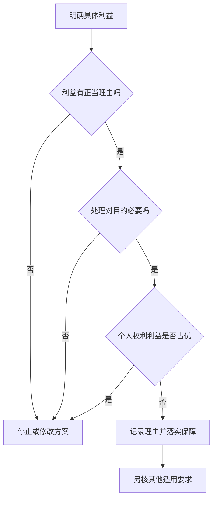
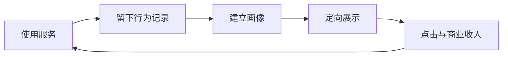

# M06 · 隐私与监控：从收集数据到影响选择

> **材料边界**：本篇依据同学提供的 19 页无时间戳转录；本人本周未到场。未取得对应讲义、前次隐私课完整转录或可核听音频。`v1.0 / merged` 只表示已把现有文字纳入笔记，不表示整堂课或整个主题已完整覆盖。

> **编号与定位**：Course Outline p.2 把 Privacy and Surveillance 列为 Week 6，因此归档为 M06；实际授课周次与日期未核。`U1 p.03 L012-L018` 指所供 PDF 的物理第 3 页及固定提取文本行号，绝非课堂时间。引文只归因于所提供转录，未独立确认说话人。

> **阅读方法**：🎙️ 表示所供第三方转录的内容；💡 表示笔记补充的解释或假设例；🔗 表示外部一手核对。以下“课件原例”均明确未取得本讲讲义，不把课堂文字冒充讲义。前次隐私课缺失的基础，由标明来源的最小解释补齐。

## 0. 三分钟速览

一句话：隐私问题贯穿采集、推断、使用和申诉，不能只问数据有没有泄露。

学完你能：

1. 追踪一条位置数据如何变成对人的预测及限制。
2. 判断勾选同意与真正可拒绝的选择有什么差别。
3. 为智慧城市项目提出有理由的接受、拒绝或附条件方案。
4. 区分 GDPR 的一般处理依据与敏感数据额外条件。
5. 分析免费服务中的信息与权力差距，并说明反方。

**🎙️ 所供文字的教学进程**：先从合规之外的伦理问题讲起，再讨论商业追踪、人脸识别与智慧城市。随后梳理数据保护原则、一般处理依据和敏感数据，最后用免费平台商业模式及历史案件收束。文本以 `where we left` 开始，并回顾前次课；不能据此恢复未提供的内容。（`U1 p.01 L006-L010`；`U1 p.12 L015-L019`；`U1 p.19 L004-L017`）

## 1. 开始之前 · 知识衔接

### 1.1 你已经见过的判断工具

先把“发生什么”“按什么标准评价”“谁来纠正”分开。本讲将这三件事应用到人的数据。

下面一行是一种旧工具，三列依次说明名称、眼下怎样用、去哪里复习。

| 工具 | 本讲怎样用 | 回看 |
|---|---|---|
| 功利主义 | 比较各方利益和损害 | [[M02-道德理论及其应用]] |
| 义务论 | 检查是否尊重人的知情选择 | [[M02-道德理论及其应用]] |
| 公平 | 检查错误和成本落在谁身上 | [[M03-偏见与公平]] |
| 透明 | 给当事人理解与质疑的理由 | [[M04-AI透明-从看得见到信得过]] |
| 问责 | 落实解释、复核和纠正的人 | [[M05-AI问责-责任链治理与救济]] |

读第一行：比较利益时，要同时看市民获得的安全与可能失去的自由；不能只计算采购者的收入。三列均为概念信息，没有数值单位。

**所以呢**：本讲会同时用利益、权利和程序判断，不靠一句“技术有效”结束分析。

### 1.2 新词先看它改变什么

遇到以下词时，先找对应动作，再记英文名称。

- **个人数据（personal data）**：能与一个可识别的人联系起来的信息，例如与账户绑定的位置记录。
- **处理（processing）**：对数据进行收集、储存、分析、共享或删除等操作；本篇不把处理缩成模型训练。
- **数据主体（data subject）**：数据所描述的人。例如医院记录中的病人。
- **控制者（controller）**：决定为什么以及怎样处理数据的一方；外包算法并不自动消除这种角色。
- **自主性（autonomy）**：当事人能理解选择并作出自己的决定。

以上为 💡 笔记最小先修；控制者等法律概念的实际角色须按具体事实核对。后面的 §2.2 讲选择，§2.9 讲处理依据，§2.11 讲额外保护。

本篇论证中的 P1、P2、P3 是逐条前提，C 是从前提推出的结论。ASR 指自动语音识别；GPS 是卫星定位，本篇只把它当位置记录的来源。ILO 是课程学习目标。

**所以呢**：先问谁处理谁的数据，再判断哪项要求适用。

### 1.3 为什么这样重排

所供转录先谈智慧城市，再回到 GDPR 基础。本篇保留这个问题导向，但先补齐数据链与实质同意，再进入项目取舍。法律部分按“原则 → 一般依据 → 正当利益 → 敏感数据”展开，避免把不同门槛混为一谈。

这是 💡 笔记重排。未取得讲义，因此 §8 是转录页码映射；取得讲义后仍需逐页核对，不能据本稿宣布讲义覆盖完成。

**所以呢**：读者可先理解风险怎样产生，再看每一道保障在链条中阻止什么。

## 2. 正文

### 2.1 合规为什么还要问伦理（U1 p.1–2）

城市依法安装摄像头，就已经回答了“应该装多少、保留多久、谁能查看”吗？法律问题与伦理问题有关联，但所需理由不完全相同。

**是什么**：合规是满足适用法律要求。伦理判断进一步问行为是否有充分理由，是否尊重受影响者，利益与损害是否合理分配。

**为什么需要它**：一项收集行为即使有法律依据，也可能范围过大、解释不足，或让某些人承担特别高的负担。只写“合法”无法说明为什么选这个方案。

**课件原例**：本次未取得讲义，不能确认课件原例。

**🎙️ 课堂补充**（所供转录，`U1 p.01 L009-L024`；`U1 p.02 L001-L016`）

转录把是否有必要收集、监控是否与风险相称、未来是否会滥用，列为合规之外的追问。

*"Law often established a minimum standard."*（`U1 p.02 L001-L002`）

意思是：所供文字把法律描述为最低标准。这是一种课堂解释框架，不是声称所有法律都低于所有伦理标准。

**💡 换个说法（笔记补充）**：假设车站为找回遗失物而保存视频。能保存某种视频，不直接推出应当无限期保存每个人的完整行程。

- P1〔规范〕：增加对人的限制，应有与目的相关的充分理由。
- P2〔事实假设〕：无限保存行程会增加被追踪和误用的机会。
- P3〔事实假设〕：找回遗失物通常不需要永久记录所有人的行程。
- 推理：由 P1–P3，永久保留比实现目的所需的侵入更大。
- C：应缩小保存范围并说明期限，而非只援引合法性。
- 最强反驳：攻击 P3；某类调查可能确实需要更长记录。
- 条件改变后：若能证明更长保留的必要性，应再比较较温和方案及监督条件。

**常见误解**：“法律允许，所以伦理分析已经完成。”合法性提供重要约束，但还要解释选择这个范围的理由。

**与其他概念的关系**：M05 的问责要求有关组织说明理由；本讲把理由落实到数据收集范围。

**所以呢**：接下来先问，被收集的人是否真正知道并能选择。

### 2.2 勾选框与有意义的同意（U1 p.1、5–6）

一个人点击“我同意”，却不知道应用会把轨迹交给广告合作方。这次点击提供了什么证据，又缺少什么？

**是什么**：有意义的同意（meaningful consent）要求当事人理解有关用途，并有实际可行的选择。它关注人的决定过程，而不只看系统存下了一个勾。

**为什么需要它**：用途藏在长条款里，当事人无法预见后果。若拒绝就失去必需服务，形式上的“可以拒绝”也可能缺乏实际自由。

**课件原例**：本次未取得讲义；长服务条款是转录中的讨论。

**🎙️ 课堂补充**（`U1 p.01 L025-L034`；`U1 p.05 L017-L031`）

转录提出两类难题：公众很难通过不进入城市来退出公共监控；用户可能勾选自己并不理解的条款。

*"you don't understand what you're taking."*（`U1 p.05 L020-L021`）

意思是：文字讨论的是勾选时缺乏理解，不能把这个动作自动当成充分知情。

**💡 换个说法（笔记补充）**：健身应用可以将“保存跑步路线”和“把路线用于广告画像”分开说明。用户接受前者，仍可拒绝后者。这样能看清用户究竟选择了哪项用途。

检查过程：

1. 写清收集什么，例如 GPS 路线，而非笼统写“改善体验”。
2. 写清目的、接收方和保留方式，让用户知道数据接下来去哪。
3. 检查拒绝的实际代价，尤其是基本服务与雇佣情境。
4. 给出能使用的撤回及询问渠道，并检验它是否容易找到。

🔗 **法律边界**：GDPR 是欧盟《通用数据保护条例》（General Data Protection Regulation）。若其适用，并以同意为处理依据，还须核自愿、知情、具体、明确行为及撤回要求。其适用时间为 2018-05-25 起；本篇按欧委会现行说明核对，不把“公共场所必须取得每个人同意”当通则。（来源见 §9.4）

**常见误解**：“同意是唯一合法依据。”§2.9 会列出其他依据；有其他依据也不会自动解决伦理上的选择困难。

**与其他概念的关系**：M02 的自主性关心人是否参与形成自己的决定，M04 的透明帮助人理解决定。

**所以呢**：理解采集条款之后，还要看数据能被推导出什么。

### 2.3 一条数据怎样变成对人的限制（U1 p.2–3、17）

用户只留下购买记录，平台却推测其健康状况，再用推测决定给他什么服务。风险在哪一步发生了变化？

**是什么**：推断隐私（inference privacy）关注从看似普通的记录推得敏感特征。推断可能正确，也可能错误；两种情况都可能影响个人。

**为什么需要它**：保护直接填写的病历仍不够。普通轨迹与交易可以组合成画像，画像再影响个人被看到的选择或机会。

**课件原例**：本次未取得讲义；位置、购物及社交信息的例子来自所供转录。

**🎙️ 课堂补充**（`U1 p.02 L018-L038`；`U1 p.03 L001-L007`；`U1 p.17 L004-L015`）

转录把个性化、劝说、操控、预测及预先限制串成风险递进，并举位置与购物模式可能暴露敏感倾向的例子。

*"AI may infer it"*（`U1 p.17 L008`）

意思是：AI 可能推断相关信息。前后语句的 ASR 有破损，因此这里只引清楚的短语；具体例子按相邻段内容转述，不把不完整句子补成原话。

**💡 换个说法（笔记补充）**：假设平台知道某人反复购买止咳药。它可能推测此人有长期疾病，但购买者也可能替别人买药。若保险方把推测当诊断，就把不确定画像变成了机会损失。

这张图帮助找出“观察”与“干预”的分界。箭头表示数据在系统中被加工和使用，不表示每个系统都会经过所有阶段。

按上面的假设走图：

1. 购药记录进入 A，B 把记录推断为“长期疾病”。
2. C 预测保险风险，D 据此改变报价。
3. E 让当事人指出代购事实，F 纠正错误画像及受影响决定。

缺少 E 时，错误容易一直影响人。

文字替代：记录与推断是两种信息，推断仍有不确定性。每次跨到下一阶段，都要增加相应证据与保护。此图是 💡 笔记补充的分析流程，不是原文系统架构。

**常见误解**：“没有采集敏感字段，就没有敏感隐私风险。”组合和推断会产生新信息，需同时检查输入与推断输出。

**与其他概念的关系**：M03 的公平检查错误落在谁身上；M05 的救济要求错误能被发现并纠正。

**所以呢**：风险来自用途及后果，不能用一个模型准确率概括。

### 2.4 人脸识别：先看任务，再看谁被误认（U1 p.3–5）

手机确认“是不是机主”，与街头摄像头判断“这是谁”，需要回答同一个问题吗？

**是什么**：验证（verification）比较一个人是否匹配已声称的身份；识别（identification）则在候选人中寻找身份。任务、环境和受影响群体不同，错误后果也不同。

**为什么需要它**：实验室图像上的指标，不能直接变成远距离、不同光线与角度下的表现。整体结果还可能掩盖某些群体承担更多错误。

**课件原例**：未取得讲义，无法核对源中提到的技术性能数字。

**🎙️ 课堂补充**（`U1 p.03 L030-L038`；`U1 p.04 L005-L035`；`U1 p.05 L001-L004`）

转录比较照片、移动环境、2D 与 3D，并讨论人口群体差异。数字、术语及比较分母混乱，本文不把 99%、98%、70% 等当已验证性能或考试数字。

*"Accuracy. Maybe 99%"*（`U1 p.04 L008-L009`）

意思是：原文自己有 “Maybe”。缺数据集、任务及错误定义，不能据此得出可靠性能结论。

**💡 换个说法（笔记补充）**：假设门禁误拒一次，用户还能请管理员核实；若同样的误认触发拘留，后果严重得多。分析应同时记录技术错误与制度如何处置错误。

建议依次检查：

1. 任务是验证还是识别，候选范围多大。
2. 真实环境是否接近测试环境。
3. 哪些群体被误认或漏认，谁承受后果。
4. 决定前是否复核，决定后能否申诉与纠正。

**常见误解**：“总体准确，所以对每个人都公平。”整体指标不说明错误分布，也不说明每次决定的证据是否充分。

**与其他概念的关系**：回看 M03 的群体影响与 M04 的个案解释；本节增加监控环境及识别后果。

**所以呢**：当技术扩展到整个城市，除了错误，还会改变权力与生活方式。

### 2.5 智慧城市的三种隐私风险（U1 p.6–8）

摄像头减少找路与应急调度的困难，也让居民很难避开被追踪。如何同时说明收益与损害？

**是什么**：监控（surveillance）是持续或有组织地观察人的活动。智慧城市把摄像头、车牌、交通及环境信息联结，用于管理公共空间。

**为什么需要它**：公共安全有价值，但持续观察还会改变人是否敢表达、数据未来会被怎样使用，以及谁掌握有关他人的信息。

**课件原例**：未取得讲义。智慧城市在本文仅作为转录中的讨论场景，不指定某个真实城市。

**🎙️ 课堂补充**（`U1 p.06 L008-L038`；`U1 p.07 L001-L038`；`U1 p.08 L001-L010`）

转录提出三组问题：

- 居民是否能实质退出。
- 被观察是否压缩自由。
- 原为防罪采集的数据会否改用于其他用途。

*"is surveillance ethical? When individuals cannot reasonably refuse it."*（`U1 p.07 L001-L002`）

意思是：当拒绝并不现实，不能只以居民没有提出反对来证明监控正当。

**💡 换个说法（笔记补充）**：假设人们担心合法集会会留下可检索身份记录，便不再参加。行为没有被直接禁止，但观察改变了选择。这叫寒蝉效应（chilling effect）。

再假设原为调度拥堵而收集的轨迹，被改成评价员工出勤。这种用途逐渐扩张称为用途扩张（function creep）。是否违法另查适用法律；伦理上先问新用途是否有独立理由。

完整分析链：

- P1〔规范〕：限制自由应有必要且相称的理由。
- P2〔事实假设〕：持续实名识别会形成个人活动记录。
- P3〔事实假设〕：匿名流量统计已能完成交通调度。
- 推理：由 P2 和 P3，实名持续识别增加了完成目的不需要的侵入。
- C：在这些事实下，应先选匿名统计。
- 最强反驳：攻击 P3；某种紧急事件可能需要定位具体人。
- 条件改变后：按事件启用受限查询，并核授权、期限和事后审查。

**常见误解**：“在公共场所，所以没有隐私问题。”单次被看见与长期跨地点联结成画像，影响不同。

**与其他概念的关系**：本节将 §2.1 的必要性落实到可替代方案，将 §2.2 的选择问题放进公共空间。

**所以呢**：选择方案前，必须先列出不同的人各自得到什么、失去什么。

### 2.6 利益相关者：收益不能抵消谁的损害（U1 p.8–9）

采购者说系统降低成本，但居民承担误识别风险。只把两项相加，能判断项目是否合理吗？

**是什么**：利益相关者（stakeholder）是会影响项目或承受其影响的人和组织。影响分析分别列每一方的收益、风险和能采取的行动。

**为什么需要它**：有能力签合同的人，未必是承受最多风险的人。把各方分开，才能看到利益和发言权的差距。

**课件原例**：未取得讲义；以下表依据转录归纳，具体保障为笔记建议。

**🎙️ 课堂补充**（`U1 p.08 L011-L038`；`U1 p.09 L001-L014`）

转录依次讨论市民、政府、执法者、商业机构及技术供应商。末一类风险表述不完整，不能补成老师给过的完整表。

*"benefits and risk"*（`U1 p.08 L016`）

意思是：每一方都要同时检查收益和风险，而不只问项目有没有总体好处。

下面一行是一类角色。列中“风险”表示可能损害，不是已发生的统计结果。

| 角色 | 可能收益 | 可能风险 | 💡 可检查的保障 |
|---|---|---|---|
| 市民 | 更快应急响应 | 误认与表达顾虑 | 申诉和错误纠正 |
| 政府 | 调度资源 | 信任受损 | 独立监督与公开说明 |
| 执法者 | 查找证据 | 过度依赖预测 | 个案证据复核 |
| 商家 | 更安全的经营环境 | 顾客抵触追踪 | 限制商用共享 |
| 供应商 | 合同和后续服务 | 参与有害用途 | 用途条款及停用条件 |

逐列读法：

- 角色是被分析者。
- 可能收益是其可能得到的改善。
- 可能风险是其可能承担的负担。
- 保障是需要核查的措施。

四列均为定性信息，不按金额相加。

读第一行：市民可能因应急响应变快而受益，也可能被系统误认；这时需要能改变决定的申诉渠道。

**💡 换个说法（笔记补充）**：即使多数居民觉得方便，也应单独询问更容易被误认的少数群体。多数受益不能直接证明给少数人的负担合理。

**常见误解**：“有商业收益，供应商就是唯一受益方。”市民也可能真实受益；完整分析必须保留这种有力理由。

**与其他概念的关系**：M03 检查分配是否公平；M05 检查谁能要求解释和纠正。

**所以呢**：有了角色分析，下一步才能形成可辩护的投标决定。

### 2.7 智慧城市投标：三个立场怎样论证（U1 p.9–12）

公司要决定是否供应监控系统。接受、拒绝、附条件接受，都需要说明能成立的理由与边界。

**是什么**：这是把伦理标准应用到具体选择的讨论。题目原始开场未完整提供；以下按转录中明确讨论的三立场整理，不补造合同金额、城市或采购者承诺。

**为什么需要它**：提出“平衡”仍不够。要写清哪项风险不能接受、哪项保障能改变决定，以及保障失效时怎么办。

**课件原例**：未取得讲义；三立场题目来源为所供转录。

**🎙️ 课堂补充**（`U1 p.09 L016-L036`；`U1 p.10 L001-L038`；`U1 p.11 L001-L033`）

转录讨论无条件接受、拒绝以及有保障才接受，并质疑“我不做别人也会做”是否足以免责。

*"strict safeguards are included."*（`U1 p.10 L019-L020`）

意思是：附条件接受需要能检验的保障，不能仅依靠采购者承诺善意。

**💡 换个说法：三立场参考解析（笔记补充，非官方答案）**

1. **接受**：理由可包括应急、安全与交通收益。前提是这些收益有证据、风险可以控制。最强反驳是供应商把治理责任全部推给客户，忽视自己的设计及供应选择。
2. **拒绝**：若大规模识别带来的权利风险无法控制，公司可以拒绝参与。最强反驳是项目可能转由保障更弱的供应商承接；回应应比较实际可行替代，不把拒绝自动当最有效方案。
3. **附条件接受**：把用途、访问权、保留期限、监督、申诉和停用写进可核的安排。最强反驳是合同存在但无人执行；若无法查验或执行，条件就没有真正改变风险。

**完整作答示范：选择附条件接受**

- P1〔规范〕：安全收益应与对个人的侵入及错误风险一同评估。
- P2〔事实限制〕：题目未证明持续实名识别是实现目标的必要手段。
- P3〔规范〕：无法退出的人应得到更强的监督与纠正保护。
- 推理：由 P1–P3，应把参与限制在经过必要性证明且有保障的用途。
- C：先要求可执行条件；条件达不到则拒绝该方案。
- 最强反驳：紧急风险可能要求快速部署，完整条件会延误收益。
- 条件改变后：可比较范围受限、可撤回的试点；紧急性不能使所有限制永久失效。

转录提出的保障包括：限制持续识别、独立监督、透明报告、数据最小化、限期保存、申诉及二次用途控制。（`U1 p.10 L021-L038`）

**“哪种城市更危险”怎样回答**

所供文字比较“看不见风险的城市”与“看见一切的城市”。安全不足会使权利难以行使；无限监控也会积累滥用能力。两种理由都应保留，再依据威胁证据和可控措施作条件判断。（`U1 p.11 L008-L033`）

**常见误解**：“别人会做，所以我做也没有额外责任。”这个预测没有证明参与本身正当，也没有证明公司不能改变设计与保障。

**与其他概念的关系**：这是 M02 利益与权利判断、M05 责任链及本讲数据控制的联合应用。

**所以呢**：下一步把“保障”拆成具体的数据处理要求，避免停在口号。

### 2.8 数据保护原则怎样约束全过程（U1 p.12–13）

组织取得一条记录以后，还需要对目的、内容、保存和使用承担什么要求？

**是什么**：数据保护原则约束整个处理过程，不只是数据库是否装了加密工具。

**为什么需要它**：加密可降低某些泄露风险，却不会让不必要收集、错误记录或无期限保留变得合理。

**课件原例**：未取得讲义；以下原则来自转录概述，并用欧委会说明核对基本边界。

**🎙️ 课堂补充**（`U1 p.12 L019-L038`；`U1 p.13 L001-L004`）

转录逐项提到合法、公平、透明、目的限制、最小化、准确、保留限制、安全及证明遵守原则的责任。

*"Don't collect more than we need"*（`U1 p.12 L023-L024`）

意思是：收集应围绕已说明的目的，不能先无限收集，再等将来发现用途。

**💡 换个说法（笔记补充）**：为预约门诊，只需联系与预约资料时，不应顺便索取全部通讯录。下面一行是一项检查，后列给出要查的证据。

| 检查 | 具体问法 | 预约例中的证据 |
|---|---|---|
| 合法、公平、透明 | 凭什么处理，是否说明清楚 | 依据及易懂告知 |
| 目的限制 | 为什么收集 | 门诊预约目的 |
| 最小化 | 这项字段是否必要 | 通讯录与预约无关 |
| 准确性 | 错了怎样改 | 联系号码更新入口 |
| 保留限制 | 何时删除或再评估 | 经说明的期限 |
| 安全 | 谁能接触和改变数据 | 权限、加密及日志 |
| 问责 | 怎样证明做到 | 决策和检查记录 |

逐列读法：

- 第一列是原则。
- 第二列把原则转成行动问题。
- 第三列是 💡 假设例的证据，不是已核医院做法。

读第三行：若通讯录对预约没有必要，就应删除这个收集要求。

🔗 **法律范围**：本节对应欧盟 GDPR 第 5 条，2018-05-25 起适用；还须先核具体处理是否落入其范围。目的改变要作兼容性或其他适用条件检查，不能把所有二次使用一概写成违法。（见 §9.4）

**常见误解**：“没有人证明我们违法，就算已经证明合规。”转录强调留下遵守原则的证据；这不能简化成所有法律程序都倒置举证责任。

**与其他概念的关系**：M05 的可追溯性让组织能还原决定，本节让它证明收集和保存的理由。

**所以呢**：原则说明怎样处理；下一节回答具体处理凭什么开始。

### 2.9 六种依据：不把同意当万能通行证（U1 p.13–14）

医院急救昏迷病人，无法先取得签字。不能签字，是否就一律不能查看必要病史？

**是什么**：合法处理依据（lawful basis）是法律认可某项处理可以进行的理由。适用 GDPR 时，第 6 条列出六类一般依据，不能按方便随意挑选。

**为什么需要它**：把所有处理都塞进“用户同意”，会忽略公共职责、必要合同或紧急生命保护，也会诱使组织以模糊勾选掩盖真实用途。

**课件原例**：未取得讲义；下表为对所供文字和一手说明的归纳。

**🎙️ 课堂补充**（`U1 p.13 L005-L025`；`U1 p.14 L001-L009`）

转录依次列出同意、合同、法律义务、重大利益、公共任务、正当利益，并要求组织记录所依赖的依据。

*"document and justify the choice"*（`U1 p.13 L023-L024`）

意思是：组织要说明为什么这项处理能依赖所选依据，而不是只在表格里勾一个名称。

**💡 换个说法（笔记补充）**：商店处理送货地址，可能为了履行送货合同。把地址长期用于另一个广告目的，不能仅靠前一个目的的合同解释。

以下一行是一类一般依据；第三列是理解用的小例，不是自动适用结论。

| 一般依据 | 核心条件 | 💡 小例 |
|---|---|---|
| 同意 | 针对具体用途有效同意 | 订阅可选推荐 |
| 合同 | 对履行合同必要 | 送货地址 |
| 法律义务 | 有适用法定义务 | 法定申报 |
| 重大利益 | 保护人的生命等重大利益 | 紧急救治 |
| 公共任务 | 有法律依据的公共职责 | 授权公共服务 |
| 正当利益 | 目的、必要性及权衡成立 | 适度防欺诈 |

逐列读法：

- 依据是理由类别。
- 条件限制何时能用。
- 小例帮助理解，不证明任何具体公司已合规。

读第二行：只有履行合同所必需的处理，才可据此解释，不能把所有营销都捆绑进去。

🔗 **法律范围**：欧盟 GDPR 第 6 条，2018-05-25 起适用。六依据由欧委会及欧洲数据保护委员会（EDPB）当前说明核对。若是特殊类别数据，还要叠加 §2.11 的门槛。

**常见误解**：“签过合同或同意过，就能处理全部数据。”依据针对具体目的和必要范围，其他原则继续适用。

**与其他概念的关系**：§2.8 仍约束每一种依据；取得一种依据不是跳过所有保护。

**所以呢**：最容易被扩大解释的正当利益，需要单独走完检验过程。

### 2.10 正当利益：有用为什么还不够（U1 p.14）

商场说保存每位访客的全年轨迹有助防盗。防盗是好事，就足以证明全年追踪必要吗？

**是什么**：正当利益（legitimate interests）在特定条件下可支持处理，但须证明具体目的、处理必要性，并权衡个人权利和利益。

**为什么需要它**：若“有用”就足够，几乎所有商业收集都能被解释成合理。必要性检查迫使组织比较更少侵入的方法。

**课件原例**：未取得讲义；防欺诈、网络安全等名称来自转录，商场轨迹例为笔记补充。

**🎙️ 课堂补充**（`U1 p.14 L006-L033`）

*"necessary, you know, not useful"*（`U1 p.14 L020-L021`）

意思是：转录强调处理须有必要性，而非仅带来便利。不能把口语“唯一方式”机械化为排除所有其他想象可能。

**💡 完整检验例（笔记补充，条件分析）**

1. **目的**：商场希望调查近期失窃。写清目的和利益，不能笼统写“改善运营”。
2. **必要性**：比较有限范围事件视频与全年实名轨迹。若前者足以调查，后者的额外侵入缺理由。
3. **权衡**：看访客合理预期、追踪规模、误用风险及拒绝能力。再评估限期、权限和监督能否降低风险。
4. **结果**：在替代方案足够且大范围追踪负担高的假设下，不应以该理由启动全年追踪。应缩小方案或停止该处理。

这张图解决“商业目的成立后，能不能直接开始收集”的误读。箭头是判断顺序；任何一步不满足，都应修改方案后重新检查。

走图：全年轨迹方案即使通过 B，也可能因有限事件视频足够而在 C 走“否”。若缩小到必要数据，再到 D 检查剩余负担。E 只是本项依据检查的结果，仍须到 F 核其他要求。

文字替代：目的合理、处理必要、权衡成立，是不同问题；任何一项缺口都不能靠前一项补足。图是 💡 分析框架，不是所有法定例外的完整决策树。

🔗 **法律范围**：欧盟 GDPR 第 6(1)(f) 条，2018-05-25 起适用；此依据用于公共机关履行任务等情形有限制，特殊数据还需另核。现实使用须核具体适用情境及现行指导。（来源见 §9.4）

**常见误解**：“防欺诈出现在例子里，所以任何防欺诈收集都合法。”名称不替代必要性和权衡，也不证明措施实际有效。

**与其他概念的关系**：§2.1 的相称理由，在此转成有记录的具体检查。

**所以呢**：某些数据后果更重，还需要额外的一道门槛。

### 2.11 医疗与敏感数据：两层依据都要核（U1 p.14–16）

医疗 AI 可能帮助诊断，但只说“有公共利益”，能否处理所有病历？

**是什么**：特殊类别个人数据（special categories of personal data）受到额外保护。健康、政治意见、宗教等信息可能造成严重歧视或其他权利损害。

**为什么需要它**：一般商业利益的理由，不能单独解决敏感数据的高风险。适用 GDPR 时，须同时处理一般合法依据和第 9 条的额外条件。

**课件原例**：未取得讲义；急救、医疗研究和敏感类别来自所供转录。

**🎙️ 课堂补充**（`U1 p.14 L034-L038`；`U1 p.15 L001-L038`；`U1 p.16 L001-L018`）

转录明确指出一般正当利益单独不够，并讨论明确同意、无法同意时的生命保护，以及依法开展的医疗或研究等条件。

*"no longer sufficient on its own"*（`U1 p.15 L001-L002`）

意思是：原本的一般依据仍需检查，但不能单独承担特殊数据的全部要求。原文的 “article 91/92” 按条文结构理解为 9(1)/9(2)，不写成第 91、92 条。

**💡 换个说法：两层检查（笔记补充）**

1. 先写处理目的、主体和适用范围。
2. 检查 GDPR 第 6 条的一般依据。
3. 若涉及第 9 条特殊类别，再核第 9(2) 条具体条件及其附带限制。
4. 落实目的、最小化、安全、透明、访问控制及其他适用要求。
5. 依据或保护无法满足时，停止该方案或修改后重判。

这里的“双层”用步骤清楚分开即可；它与 §2.10 的一般依据图相接，不画一张遗漏法定例外的万能通行图。

**讨论题一：改善医疗结果，就可以处理敏感数据吗？**

⚪ 参考作答：改善结果是支持理由，但不能单独替代依据和保障。假设某医院想用病历训练诊断工具，应分别核训练与临床使用的目的、一般依据、特殊数据条件和安全措施。不能因“用于医疗”就自动许可全部用途。

**讨论题二：病人不懂 AI，同意是否就没有意义？**

⚪ 参考作答：不必先懂模型每个参数，才可能理解数据用途。应以病人能懂的方式说明用途、接收方、风险、选择及撤回。若这些仍无法理解，不能把签名当充分知情；若依法适用其他依据，也不能假称已取得同意。

**💡 急救变式（笔记补充）**：昏迷者的必要病史可能关系生命保护。这个情境与为了优化商业产品长期保留全院病历不同，后者不能借用前者的紧急理由。

🔗 **法律范围**：欧盟 GDPR 第 9 条，2018-05-25 起适用。明确同意只是可能条件之一；研究、公共健康等条件常受法律基础和保障限制。不是所有照片都当然属于用于唯一识别的生物识别特殊数据。（欧委会一手说明见 §9.4）

**常见误解**：“有明确同意就一切没问题。”一般原则、适用限制及其他要求仍存在，原文口语的 “everything is fine” 不能照用为法律结论。

**与其他概念的关系**：本节叠加 §2.8–2.10，而不是以公益目的替代那些检查。

**所以呢**：数据的经济价值越大，组织越有动机扩大收集；接下来分析这种动机。

### 2.12 监控资本主义与免费交换（U1 p.16–17）

健身应用免费提供步数与路线，但用行为数据建立广告画像。用户得到服务，是否就说明交换公平？

**是什么**：监控资本主义（surveillance capitalism）在本讲指通过收集、分析行为信息，把预测或定向影响转为商业价值的模式。这里是伦理分析用语，不是给全部免费服务下违法结论。

**为什么需要它**：用户看见的是眼前服务，企业掌握的却可能是长期画像及推断能力。信息与控制权不对称，使“自愿交换”的说法需要进一步检查。

**课件原例**：未取得讲义。转录举免费平台、健身应用及广告画像；书名作者的 ASR 人名不清，本稿不凭发音补作者履历。

**🎙️ 课堂补充**（`U1 p.16 L019-L038`；`U1 p.17 L001-L034`）

转录描述收集行为、分析模式、预测兴趣、广告变现，再扩大收集的循环，并提出交换是否公平的问题。

*"the imbalance of information and power"*（`U1 p.17 L024-L025`）

意思是：分析要看谁知道什么、谁能决定用途，不能仅看用户是否付了钱。

**💡 从输入到结果（笔记补充）**

1. 用户使用健身服务，留下路线和使用时间。
2. 平台把这些记录转成活动习惯与兴趣画像。
3. 广告系统按画像选择展示内容，平台获得收入。
4. 新的点击又留下行为记录，进入下一轮分析。

下面的图帮助理解收入为何可能刺激进一步收集。箭头表示该假设商业流程；没有宣称更多数据必然提高预测或收入。

走图：用户打开跑步应用是 A，路线是 B，“经常夜跑”是 C，相关商品广告是 D，点击及可能的交易是 E。返回边表示继续使用后可再产生数据；它不是效果保证。

文字替代：服务产生数据，数据用于画像，画像影响展示；继续使用会产生新反馈。若只有无法关联个人的汇总统计，这条个人画像路径可能被削弱，但须核实技术与用途。

**讨论题：免费服务换数据，是公平交换吗？**

⚪ 参考作答：可能是，但需满足真实知情、可行选择、用途明确和风险相称。用户得到价值是支持理由；难以理解后续推断、无法拒绝或转移服务，是有力反对理由。

- P1〔规范〕：公平交换需要双方有足够信息与实际选择。
- P2〔事实假设〕：用户只知道路线用于运动记录，不知道用于第三方画像。
- 推理：由 P1 和 P2，当前交换缺少关键用途的信息。
- C：不能仅凭免费服务和一次勾选认定公平。
- 最强反驳：攻击 P2；用途可能已被清楚说明。
- 条件改变后：若用途易懂且可单独拒绝，公平交换的理由增强，仍需检查实际损害。

**常见误解**：“平台一定在直接出售每个人的原始数据。”定向广告机会、预测服务与直接出售数据是不同商业动作，要按事实区分。

**与其他概念的关系**：本节把 §2.2 的同意、§2.3 的推断及 §2.8 的最小化放到商业激励中。

**所以呢**：真实案件要分清数据流、被查行为与法律处理，不能只贴“侵犯隐私”的标签。

### 2.13 Facebook 与 Google：历史案能支持什么（U1 p.17–19）

两个平台都靠广告盈利，就说明它们在同一案件中犯了同一种错吗？

**是什么**：案例分析要把商业模式、具体行为、监管指控及处理结果分开。本节仅讨论转录提到的历史事件，不评价平台当前全部服务。

**为什么需要它**：如果把 Cambridge Analytica 事件、Facebook 的 FTC 和解及 Google 的法国处罚混成一件事，就无法解释哪项原则在什么行为上失效。

FTC 是美国联邦贸易委员会；CNIL 是法国的数据保护监管机构。这里分别核对它们发布的历史材料。

**课件原例**：本次未取得讲义。转录的年份、人数及案件细节有 ASR 混乱；下面将来源与外部补核分开。

**🎙️ 课堂补充**（`U1 p.17 L035-L038`；`U1 p.18 L001-L038`；`U1 p.19 L001-L013`）

转录讨论第三方应用及朋友数据、政治画像与定向广告，再以 Google 的透明和同意问题作对照。

*"strong incentives to collect more data."*（`U1 p.19 L005-L006`）

意思是：原文用两案说明商业收集激励与数据保护要求的张力；并非证明所有数据变现都违法。

**Facebook 案例卡**

下面一行是一项案例信息。内容明确区分转录归纳与 🔗 外部核对。

| 字段 | 内容 |
|---|---|
| 时间与地点 | 美国，2019 年 FTC 和解公告 |
| 当事方 | Facebook、FTC、第三方应用及用户 |
| 发生了什么 | 转录讨论应用及朋友数据进入画像用途 |
| 争议点 | 用户以为能控制的信息是否按承诺受保护 |
| 结果 | 🔗 FTC 公告：50 亿美元及治理限制 |
| 本讲用来说明 | 知情、共享控制和组织问责 |

读“结果”一行：50 亿美元是 FTC 公告的处罚金额，不是转录对损害的计算。FTC 2019 公告称和解解决违反 2012 年命令的指控；不能把金额说成针对 Cambridge Analytica 的单项罚款。

**Google 案例卡**

| 字段 | 内容 |
|---|---|
| 时间与地点 | 法国，2019-01-21 |
| 当事方 | Google LLC、CNIL、有关用户 |
| 发生了什么 | 转录概述广告个性化中的告知与同意问题 |
| 争议点 | 用户是否得到清楚信息并有效同意 |
| 结果 | 🔗 CNIL 名录：5,000 万欧元处罚 |
| 本讲用来说明 | 有隐私文件不保证有效透明 |

读“结果”一行：这里是欧元，不能与前案美元混算。CNIL 名录确认历史处罚及其理由；本文未据此宣称 Google 当前政策已充分整改。

**💡 换个说法：四步参考分析（笔记补充）**

1. 事实：先画清谁收集、谁共享、谁收到、用于什么；未知细节保留未知。
2. 标准：从用途、透明、同意、最小化和问责中选与事实有关的要求。
3. 套用：例如用户以为控制了共享，系统却允许朋友安装的应用取得数据，承诺与实际控制就出现落差。
4. 结论与边界：说明具体缺口和应修机制，不由历史处罚推出当前所有产品违法。

**常见误解**：“罚款说明只是数据安全问题。”安全防泄露与透明、用途及控制是不同要求；没有外部黑客，也可能存在隐私问题。

**与其他概念的关系**：两案把 §2.8 原则与 M05 的组织问责接起来；案情须分别回源。

**所以呢**：复习时按“行为 → 依据和原则 → 影响 → 纠正”作答，不背公司名称代替推理。

## 3. 一图看懂

这张表是全讲的定位图，一行是一层判断；它补充 §2 的局部图，不代替具体推理。

| 判断层 | 先问什么 | 本篇位置 |
|---|---|---|
| 数据路径 | 记录怎样变成对人的影响 | §2.3–2.4 |
| 人的选择 | 是否知情、能否拒绝 | §2.1–2.2 |
| 公共项目 | 谁受益、谁承担风险 | §2.5–2.7 |
| 处理门槛 | 依据、必要性、额外条件 | §2.8–2.11 |
| 商业激励 | 收益如何推动收集 | §2.12–2.13 |

逐列读法：

- 判断层是问题类别。
- 第二列是要回答的动作。
- 位置是学习入口，无数值单位。

读第一行：先追踪数据路径，才能知道后续保障应该限制哪一步。

## 4. 速查表

一行是一种容易混淆的判断，后一列写应补的检查。

| 看到的说法 | 应补的检查 |
|---|---|
| 已勾同意 | 用途是否清楚、拒绝是否现实 |
| 整体准确 | 任务、环境、群体及个案后果 |
| 为了安全 | 必要性、替代方案与期限 |
| 有正当利益 | 目的、必要性、权衡 |
| 医疗有公益 | 一般依据及特殊数据条件 |
| 服务免费 | 信息、选择和权力差距 |
| 已有隐私政策 | 实际告知、控制和执行 |

读第一行：保存勾选记录只记录一个动作，还要检查当事人理解什么、能拒绝什么。两列均为定性问法。

## 5. 双语术语卡

以下英文是 💡 笔记整理的答题用定义，不是讲义或教授原句。一行一个词，位置列指出本篇首次完整解释。

| 中文 | English | 考试用定义（笔记整理） | 位置 |
|---|---|---|---|
| 有意义的同意 | Meaningful consent | An informed choice with a realistic ability to refuse. | §2.2 |
| 推断隐私 | Inference privacy | Privacy risks arising from inferred personal characteristics. | §2.3 |
| 验证 | Verification | Checking a claimed identity against a reference. | §2.4 |
| 识别 | Identification | Finding an identity among candidates. | §2.4 |
| 寒蝉效应 | Chilling effect | Reduced lawful activity due to perceived observation. | §2.5 |
| 用途扩张 | Function creep | Expansion of data use beyond its original purpose. | §2.5 |
| 利益相关者 | Stakeholder | A party affecting or affected by an activity. | §2.6 |
| 合法处理依据 | Lawful basis | A legal ground supporting a specific processing purpose. | §2.9 |
| 正当利益 | Legitimate interests | Interests subject to necessity and rights balancing. | §2.10 |
| 特殊类别数据 | Special categories of personal data | Data subject to additional protection under GDPR Article 9. | §2.11 |
| 监控资本主义 | Surveillance capitalism | Monetising behavioural data and predictive insights. | §2.12 |

逐列读法：

- 中文是统一译名。
- English 便于查原文。
- 定义是简短作答提示。
- 位置用于返回机制解释。

读“正当利益”：英文定义提醒需要两项检查，不能替代 §2.10 的三步论证。

## 6. 考点预判与答题框架

### 6.1 可信度怎么用

本篇没有经过音频确认的“教授明示必考”条目。第三方转录中的学习强调单独登记，不能当本人听到的考试承诺。

下面一行是一种证据等级，最后一列限定如何使用。

| 等级 | 本篇依据 | 如何使用 |
|---|---|---|
| 第三方强调待核 | 原文要求了解原则 | 优先理解，不承诺必考 |
| 🟡 ILO 反推 | Outline ILO 2、5、6 | 练习隐私与治理应用 |
| ⚪ 笔记推断 | 本篇迁移题及框架 | 用于学习，不作教师要求 |

读第一行：“优先理解”是学习建议，不是确认考试会考。三列是来源与使用边界，不是概率或分值。

### 6.2 可回溯的学习强调

**🎙️ 第三方转录中的强调（待核）**：原文提醒需要知道数据保护原则，随后解释具体原则。它没有明确说明出题形式或分值。（`U1 p.12 L015-L024`）

*"you need to know this"*（`U1 p.12 L019`）

意思是：所供文字强调理解这一组内容，不等于已确认“教授说必考”。

🟡 可据 ILO 反推练习三类问题：

- 智慧城市如何设计保障。
- 一般依据与特殊数据条件如何区分。
- 免费服务换数据为何有公平争议。

### 6.3 四步英文作答骨架

先用中文列事实与条件，再组织英文；以下为 💡 笔记模板。

1. **Facts**: Identify the data, purpose, affected people and uncertainties.
2. **Standard**: State the relevant ethical principle and any applicable legal condition.
3. **Application**: Explain how the facts meet or fail that condition.
4. **Conclusion**: Give a conditional decision, safeguards and the strongest objection.

中文读法：先说明什么已知，再选标准，再把事实逐步套进标准，最后给有边界的结论。不要把结论里的“平衡”当作已经完成分析。

## 7. 自测

### 7.1 数据路径的哪一步出了问题

平台根据购药记录推测疾病，再自动提高保险报价。用户其实替家人买药。按 §2.3 的图，错误先出现在哪里，应纠正什么？

答案

💡 参考答案：B 把行为记录推成本人疾病，证据不足；D 又把推断变成报价。应允许当事人在 E 核实，纠正画像以及受其影响的决定。只删掉原始购药记录，不一定撤回已传播的推断。

### 7.2 “同意了”能回答哪一部分

应用把广告用途藏在长条款里，拒绝广告画像就不能使用必要的门诊预约功能。先给伦理判断，再说明法律分析还缺什么。

答案

💡 参考答案：知情和实际选择均有疑点，不能凭勾选认定交换正当。法律上先核 GDPR 是否适用、实际目的、依据及同意是否自愿；材料不足不能直接宣布违法。若预约与广告可以拆开，应允许分别选择。

### 7.3 读正当利益流程图

目的合理，但匿名人数统计已足以调度交通；方案仍要持续识别人脸。在 §2.10 哪个节点改走停止或修改？

答案

💡 参考答案：在 C 的必要性检查走“否”。B 通过只说明目的有理由，不说明采用侵入更大的处理有必要。修改方案后还须重新核范围和其他要求。

### 7.4 医疗研究改变了哪一步

原来为昏迷病人急救而查病史，现在改为用全院病历训练商业模型。原先理由能直接沿用吗？

答案

💡 参考答案：不能直接沿用。目的和处理范围已改变，须重新核一般依据与特殊类别条件，并检查用途、访问和保留保障。急救必要性没有自动证明长期商业训练必要。

### 7.5 城市供应商怎样回应“别人会做”

请同时写一条支持接受、一条支持拒绝的理由，再给条件性结论。

答案

💡 参考答案：接受可能带来更好的可执行保障与真实安全收益；拒绝可以避免参与无法控制的权利损害。“别人会做”只是后果预测，不能单独消除本公司的选择责任。若能落实必要范围、监督和停用，可考虑附条件参与；做不到则应拒绝或要求重设计。

### 7.6 免费服务循环的返回边意味着什么

§2.12 的收入返回服务使用，能否推出更多数据必然产生更高收入？若只有汇总且不可关联个人的统计，哪一段个人风险可能改变？

答案

💡 参考答案：返回边表示可能持续产生记录，不是效果保证。不可关联个人的汇总可能削弱 B 到个人画像 C 的路径；仍须核是否真的不能重新关联，以及用途和安全限制。不能只因名称叫“匿名”就结束检查。

### 7.7 历史案件的结论边界

Facebook 的 FTC 和解与 Google 的法国处罚，为什么不能合成“平台卖数据被罚了同一种款”？

答案

💡 参考答案：主体、法律机关、具体行为、币种及处置理由不同。前案涉及隐私承诺和旧命令的指控及和解；后案涉及历史透明、信息及同意问题。须分别追踪数据流，不能假定都直接出售原始数据，也不能由历史案推出当前所有服务违法。

## 8. 讲义页码映射

**本次讲义未取得，以下是转录页码映射，不是讲义覆盖表。** 一行是一段已读取的文字范围。没有出现的内容只能标材料缺口，不能标课堂略过。

| U1 物理页 | 内容与正文去向 | 本次证据范围 |
|---|---|---|
| p.1–2 | 合规、同意、预测与限制；§2.1–2.3 | 文字存在，时间未知 |
| p.3–4 | 商业追踪与人脸识别；§2.3–2.4 | 数字与专名存在误识别 |
| p.5 | 行为风险及 Canvas 提示；§2.2–2.4、§9.5 | 行政具体内容待核 |
| p.6–7 | 智慧城市及用途扩张；§2.5 | 场景讨论，非已核城市实况 |
| p.8–9 | 角色分析与三立场开头；§2.6–2.7 | 原题开场不完整 |
| p.10–11 | 条件、反方与安全自由取舍；§2.7 | 不使用犯罪率数字 |
| p.12–13 | 原则、依据与透明；§2.8–2.9 | 指向前次课，前次材料缺失 |
| p.14 | 正当利益及特殊数据；§2.10–2.11 | 条号按法源校正 |
| p.15 | 特殊数据与医疗讨论；§2.11 | 参考答案非官方答案 |
| p.16–17 | 医疗收束与商业循环；§2.11–2.12 | 作者人名不可靠，不猜 |
| p.18–19 | 历史案例与下次计划；§2.13、§9.5 | 有文本收束，不证明录音完整 |

逐列读法：页数属于 U1 PDF；去向是本篇位置；证据范围限定能确认什么。读最后一行：末页存在下课文字，但不能推得全文无删节。

**覆盖统计**：已读所供转录 19/19 页；讲义覆盖未核，前次隐私课覆盖未核。无可靠逐段时间戳，课堂总时长、各段停留、时间分配及空档均不计算。

## 9. 延伸与勘误

### 9.1 课件未取得与来源缺口

- ❓ 对应隐私讲义尚未在本次材料中取得；不能宣称讲义全部解释。
- ❓ 前次隐私课未提供；U1 p.1 与 p.12 明确回顾旧内容，基础解释以笔记补充标明。
- ❓ 无音频、无逐段时间戳、无可靠说话人标签；不补造课堂时长或“本人听到”。
- ❓ 未出现某页或某议题，不证明教师略过；M05 p.49–93 原缺口不据此升级。

### 9.2 所供文字的主要增量

下面一行是一项可用教学内容，不表示已证明“讲义没有”。

| 内容 | U1 定位 | 去向与用途 |
|---|---|---|
| 实际拒绝与形式同意 | p.1 L025–034；p.5 L017–031 | §2.2，解释选择困难 |
| 从数据到预先限制 | p.2 L018–038；p.3 L001–007 | §2.3，追踪后果 |
| 智慧城市多方影响 | p.6–9 | §2.5–2.7，讨论案例 |
| 正当利益必要性 | p.14 L020–031 | §2.10，避免只写有用 |
| 特殊数据额外条件 | p.15 L001–018 | §2.11，区分两层 |
| 画像与免费交换 | p.16–17 | §2.12，分析激励 |

### 9.3 ASR、法律和案例校正

| 原问题 | 本篇处理 |
|---|---|
| GDPR 被识为 CDBR、TDPR 等 | 解释用 GDPR；不润色公开原文 |
| article 91 / 92 | 说明为 9(1) / 9(2)，以法源结构校正 |
| consent 是默认且其他都是例外 | 分清六种一般依据，不能一概降为例外 |
| everything is fine | 明确同意仍不免其他适用要求 |
| 二次用途一律非法 | 改为核兼容性、依据及适用条件 |
| 人脸准确率与城市犯罪率 | 缺分母和可靠来源，不作实证数字 |
| 书作者、部分人名乱码 | 不猜人名或履历，不作为事实 |
| 87 million 等案例数 | 未以该数字构成教学结论，不据 ASR 放大 |
| 有政策就已整改有效 | 历史处罚与当前效果分别记录 |

### 9.4 外部一手资料与适用边界

核对日期：2026-10-15。以下资料用于限定法律概述及历史案件，不冒充课堂原话。

- [欧委会：合法处理依据](https://commission.europa.eu/law/law-topic/data-protection/information-business-and-organisations/legal-grounds-processing-data_en)：核六依据、同意、正当利益及特殊类别的额外要求；说明不是完整个案法律意见。
- [EDPB：Legal basis](https://www.edpb.europa.eu/topics/key-gdpr-concepts/legal-basis_en)：交叉核六类依据及须按情境识别依据。
- [欧委会：GDPR 原则](https://commission.europa.eu/law/law-topic/data-protection/information-business-and-organisations/principles-gdpr_en)：核原则、目的改变条件及证明遵守的责任。
- [FTC 2019 Facebook 公告](https://www.ftc.gov/news-events/news/press-releases/2019/07/ftc-imposes-5-billion-penalty-sweeping-new-privacy-restrictions-facebook)：核美国历史和解金额、旧命令指控及治理要求，不将其简写为 Cambridge Analytica 单项罚款。
- [CNIL 历史处罚名录](https://www.cnil.fr/fr/node/446)：核 2019-01-21、Google、5,000 万欧元及透明/信息/有效同意问题；未据此确认当前整改效果。

EUR-Lex 直接正文访问触发机器人验证，未绕过；本次未把法规全文逐条核验记作完成。CNIL 名录直接读取返回 503，历史日期、金额与理由使用其官方搜索索引记录，未核完整裁决。涉及第 3 条范围、特殊部门法及刑事执法规则的具体适用，仍须取得事实及相关法源。

### 9.5 来源登记、行政及待核

- U1 是同学提供的 19 页 PDF 转录；本人未到场，内容说话人未独立核实。
- 公开逐页文本保留原词与原行号，删去标题及三处导出日期/时长标识，不将其当课堂时间戳。原 PDF 保持原样。
- 日期行含 2026.10.13，但导出元数据不独立证明上课日期；frontmatter 的 date 与 week 保留空值。
- 开头 `where we left`（`U1 p.01 L006`）与前次课回顾（`U1 p.12 L018-L019`）说明材料从续讲开始。
- p.5 提到 Canvas 更新（`U1 p.05 L006-L010`），具体安排识别不清。未据此新增截止、分值、题面或提交要求；由发布者核 Canvas 四入口。
- p.19 有下课及下次案例/安全的文本计划（`U1 p.19 L013-L017`）；不能证明所供文字未删节，也不换算绝对上课日期。
- 三个局部 Mermaid 图的图义和具体走图例已在 §2.3、§2.10、§2.12 给出。本轮已实际查看同源浏览器的3个图及其正文；Obsidian阅读视图未直接查看。
- `transcript_check.py` 的常规时间戳 audit 不适配本源。使用无时间戳逐页局部引文核对；未伪造普通 audit PASS。
- 本稿不改变本人已通读、自测、复习或提交状态。材料融合、教学验收、正式写回、Notion 和 Git 分开登记。

**反方视角**：最弱之处是前次课与对应讲义缺失，不是正文应缩成摘要的理由。若问原讲义每页是否完整覆盖，或某句是否确为教授本人发言，当前不能回答。主题归 M06 有大纲依据，实际周次仍不可推定。

### 9.6 变更记录

| 日期 | 动作 |
|---|---|
| 2026-10-15 | 依据第三方无时间戳续讲新建完整自学笔记；13 个主题、7 道自测；保留缺讲义、缺前次课及说话人限制 |

### 9.7 本次完成范围

候选共 13 个正文单元，均有来源范围、解释、完整情境或论证、误解和收束。三类口头讨论已给参考解析：智慧城市三立场、安全与自由、医疗数据；免费服务公平交换另在 §2.12 完整作答。未获得任何本人学习行为证据。

2026-10-15按full范围完成一次集中教学、来源、R疑点与同源浏览器视觉核对：13主题、7自测、3图、56页行定位及14局部直引，L/R硬项0，旧strict E诊断FAIL保留。Obsidian未直接查看，声轨/说话人/前次课与讲义缺口保留；不代表本人已通读或自测通过。正式写回、Notion及Git状态分别记录。
