# M08 · 生成式 AI：真实性、创作者权利与知识产权

## 0. 三分钟速览

生成内容越来越像真的，企业仍须分别回答：这件事真实吗、来源可靠吗、能这样使用别人的作品吗、输出的权利归谁。

学完应能：

- 按内容真假与传播意图区分三类问题信息，不把所有错误都当恶意造假。
- 沿一个生成、核验、发布、纠错过程说明幻觉怎样造成业务损害。
- 用 Galactica 解释“像学术文章”为什么不能证明内容经过核验。
- 对版权案例按美国四因素分析，并说出英国规则为何不能直接替换。
- 分开发明人资格、专利申请资格、所有权与技术可专利性，解释 DABUS 的争议。

## 1. 开始之前 · 知识衔接

### 1.1 当前要用到的前置

下表一行是本讲会再次使用的一项判断工具；右列给回查入口，当前关键步骤仍在正文展开。

| 工具 | 一句话唤醒 | 回查 |
|---|---|---|
| 事实与规范 | “发生了什么”需要证据；“应该怎样”需要标准 | [[IS5113_AI_Ethics_and_Regulations/notes/M02-道德理论及其应用\|M02]] |
| 透明 | 让相关人知道系统、依据和限制 | [[IS5113_AI_Ethics_and_Regulations/notes/M04-AI透明-从看得见到信得过\|M04]] |
| 问责 | 明确谁说明决定、接受质询并纠正后果 | [[IS5113_AI_Ethics_and_Regulations/notes/M05-AI问责-责任链治理与救济\|M05]] |
| 隐私与自主性 | 保护个人资料及知情作出自己选择的能力 | [[IS5113_AI_Ethics_and_Regulations/notes/M06-隐私与监控-从数据采集到行为影响\|M06]] |

### 1.2 本讲新概念放在哪里学

错误信息、蓄意虚假信息与恶意使用真实信息在 p.12 对照；幻觉在 p.21–38 展开；知识产权和版权在 p.41–60 展开；专利和发明人资格在 p.62–90 展开。它们不是同一种“AI 出错”：真假、传播意图、使用授权与权利资格是不同问题。

### 1.3 来源与三种使用路线

本讲唯一课堂材料是 92 页 PDF，以下 p. 均指物理页。p.39–43、74–92 的部分页面另印页码，与物理页相同；前半没有稳定印刷号。PDF 元数据日期不是已核授课日期，因此 `date/week` 保持空值。

预习从 §2 按页顺读；课中用 §8 任意页的精确链接直达本页；复习先看 §3–§5，再做 §7。封面和纯分隔页也保留入口。无本讲转录，不能判断课上跳过了哪些页，也没有“教授明示必考”的证据。

正文里的解释、条件变式和企业流程均为 💡 笔记补充，除非明确标为讲义原例或外部核对。法律部分用于理解课件；真实行为须按适用法域和当时版本另核。本次 2026-11-05 核对的一手来源集中在 §9.4，来源标签 E1–E12 供就地定位。

## 2. 正文 · 按 92 个物理页跟读

### 2.1 p.1 · Generative AI Truth, and Rights challenges

这是本讲封面。合成媒体（synthetic media）指由技术生成或改变的文字、声音、图像和视频。学习任务有两条线：真实性问内容和证据能否信；权利问创作、使用及收益应怎样安排。封面没有额外案例或计算。

### 2.2 p.2 · What is Generative AI?

假设营销人员输入“为新产品写三条广告文案”，系统输出之前不存在的句子，这属于生成式 AI（Generative AI）。它从大量训练资料学习模式，再根据输入生成文字、图片、声音或视频；不是只给现有记录打一个分类标签。

讲义列 Transformer、扩散模型（diffusion）及大训练集。这里把它们作为生成能力的背景：前者常用于语言等序列建模，后者常通过逐步去噪生成图像。本讲不要求训练这些模型，但须知道“能生成像样输出”与“核实输出事实”是不同任务。左下 AI 拼贴是装饰，不是模型结构图。

### 2.3 p.3 · Capabilities & Use Cases

讲义列内容创作、个性化营销、聊天机器人和产品设计。💡 同一个文案系统可以让员工更快试写多个版本，也会让错误产品说明更快发布；效率提升是生成速度，风险取决于输出怎样进入业务。

部署（deployment）就是把系统放进实际工作流程。应先问谁使用、会影响谁、谁检查事实和权利，而非仅比较写得快不快。讲义所列错误信息、信任流失、IP 争议与伦理两难，都可能在发布阶段出现。

### 2.4 p.4 · Introduction: The Double-Edged Sword of Generative AI

本页是带知识内容的总览：文字、图像、音频和视频生成可以带来商业和社会收益，同时涉及错误信息、幻觉、深度伪造和知识产权。它们可以重叠，但不能互相替代。

💡 一段伪造 CEO 声音可能同时包含假的付款指令和未经同意的身份模仿；一段完全真实的歌曲也可能因未经许可复制而产生权利问题。前者不能只做版权检查，后者不能因“内容真实”免查授权。

### 2.5 p.5 · Misinformation: When AI Scales Falsehoods

错误信息（misinformation）关注不实或误导内容的传播；蓄意虚假信息（disinformation）进一步关注故意欺骗。两者在 p.12 精确比较。AI 可以降低批量生成假新闻的成本，社交传播又可扩大受众。

讲义列四种风险：公众混淆、信任侵蚀、舆论操纵和企业声誉损害。💡 虚假停产消息被大量转发，客户据此取消订单；损害来自内容、传播规模与客户行动的连接，不能仅凭模型生成一次就断言已发生上述所有后果。

### 2.6 p.6 · Hallucinations: When AI Invents Facts

幻觉（hallucination）是模型输出没有事实依据、与事实或给定内容不一致等问题；它可能表现为编造引用、错误建议或虚构统计。这里的“编造”描述输出，不是在证明机器有人的欺骗意图。

讲义提到医疗、法律、教育和企业沟通。💡 员工把不存在的研究当成产品安全证据，风险经过“假引用→误信→业务决定”才落地。p.21–38 将解释原因与核验机制。专业语气和引用格式都不保证引用真实。

### 2.7 p.7 · Deepfakes: The Authenticity Crisis

深度伪造（deepfake）用 AI 合成或修改可逼真呈现的声音、图像或视频。声音克隆（voice cloning）与身份冒充（impersonation）可让受众误以为某人说过或做过某事。

讲义原例是假的 CEO 声音诈骗和篡改政治视频。💡 财务人员接到“CEO”紧急转账语音，应通过已知独立渠道回拨确认，而非用声音相似度代替身份验证。诈骗与社会工程、名誉伤害、政治操纵及数字证据信任流失，是本页列出的不同后果；授权配音或清楚标示的影视特效不能仅因技术相同就当作诈骗。

### 2.8 p.8 · Intellectual Property Challenges

知识产权（intellectual property, IP）是针对符合条件的智力创造成果等对象的法律权利。讲义分出版权（copyright）、作者资格（authorship）、所有权（ownership）以及训练资料与合理使用（fair use）。

💡 用一幅受保护图片训练模型，和新输出能否受到保护，是两次不同分析；“我有输出文件”不等于“我拥有其中全部权利”。模仿风格还涉及创作者尊重与收益等伦理问题，不能自动等同具体表达侵权。诉讼、许可和监管不确定性是企业需要管理的风险，非每次生成的既定结局。

### 2.9 p.9 · Conclusion: The Core Challenge of Generative AI

本页合并前面两条线。真实性问题包括错误信息、幻觉和深度伪造；权利问题涉及创作者、作者资格及所有权。

💡 核验一张广告图时，先问产品效果是否属实，再问人物和作品能否这样使用。通过前一个检查不能推出后一个也通过。这个双轨检查将贯穿后半 IP 内容。

### 2.10 p.10 · LET US DIG DEEPER

纯章节分隔页，表示接下来把总览拆成机制、案例与治理，没有独立的新知识点或原题。

### 2.11 p.11 · Summary Table

下图一行对应一种问题，三列依次是问题、核心机制和主要后果。先读 misinformation 一行：大规模生成假内容会带来信任侵蚀及操纵风险；这不是错误率或因果效应的统计表。

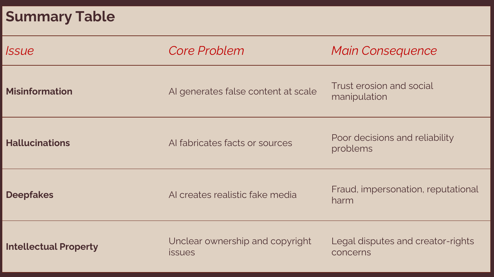

[打开清晰原图](figures/m08/page-11.png)

hallucinations 行强调虚构事实或来源导致不可靠决定；deepfakes 行强调逼真假媒体导致冒充、诈骗和名誉风险；IP 行强调权利不明导致争议。前三行并非互斥分类，一段伪造视频也可能传播虚构事实。PDF 抽取文字有叠层残留，实际可见表格如图，不能把抽取残留当额外知识。

### 2.12 p.12 · Misinformation Defined

要区分“转错消息”和“故意造假”，同时看真假和行为意图。讲义原图分三列：misinformation 是假信息、无伤害意图，例子是误信谣言后分享；disinformation 是假信息、有欺骗意图，例子是编造新闻；malinformation 是真实信息、意在伤害，例子是泄露私人邮件。

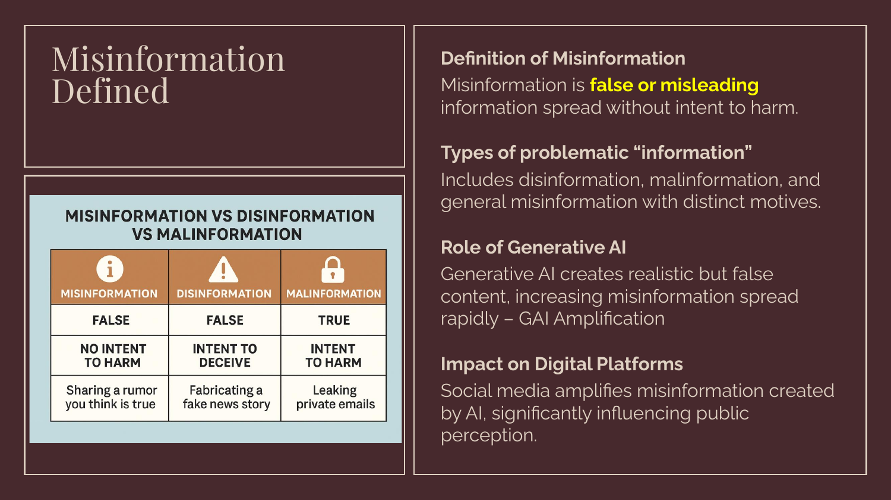

[打开清晰原图](figures/m08/page-12.png)

中文分别用错误信息、蓄意虚假信息、恶意使用真实信息。💡 转发者误以为某公司倒闭，与明知未倒闭却编造消息，不能只因文字相同就判同一种意图。真邮件也不能因内容真实就免除隐私与伤害问题。意图不明时写“内容待核、意图未证”，不能猜。

生成式 AI 放大制作能力，社交平台放大传播能力；两阶段合起来才解释扩散。图中的意图分类不是对模型内心状态的断言，也不是所有学科都完全一致的术语定义。

### 2.13 p.13 · Mechanisms of Misinformation

讲义列三个环节：深度伪造改变音视频，合成文本制造假新闻或身份，社交机器人（social media bots）自动分发。机器人是执行账号活动的软件，不必是生成模型，也不因自动化就一定在作恶。

💡 一名操作者让模型写假声明，再用多个账号反复传播；读者把重复出现误认为多个独立消息来源。信任被侵蚀，是因为来源数量的外观与实际证据数量脱节。治理须同时检查生产与分发，不能只问是否用了 AI。

### 2.14 p.14 · Case Study: ChatGPT & Fake News

原图给政治人物照片和合成情境，课堂任务是检查我们如何判断消息；图片本身不是这些事件真实发生的证据。本页没有足够来源让我们鉴定每张图的真假或制作工具。

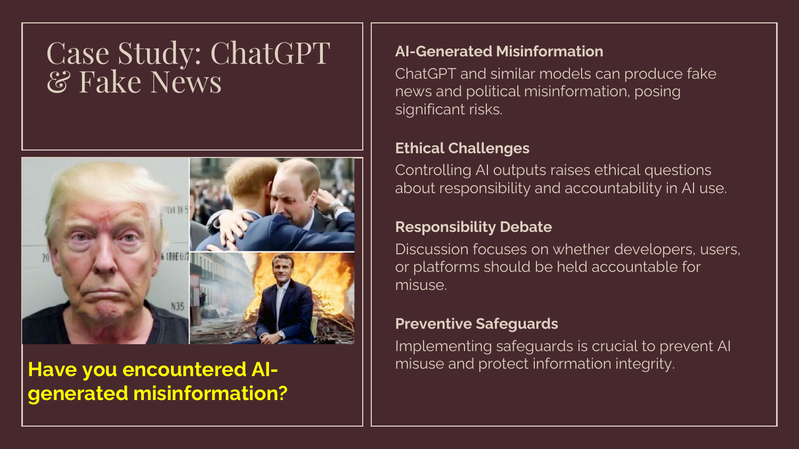

[打开清晰原图](figures/m08/page-14.png)

英文原问：

> Have you encountered AI-generated misinformation?

中文题意：你是否遇到 AI 生成的错误信息？这是个人经历问题，不能替本人编“遇到过”。⚪ 参考作答（笔记推断）：可以先明确“尚无经核验的个人例子”，再说明核对原发布渠道、日期、可靠报道和生成痕迹的方法。是否 AI 生成与内容是否虚假要分别验证。

英文参考答案（笔记自拟）：I do not have a verified personal example to report. I would check the original source and corroborating evidence before calling a claim false or AI-generated.

本页同时提出开发者、用户和平台的责任争议。问责要跟实际控制能力对应：开发者设计防护，发布者核内容，平台处理传播和异议；具体法律责任仍须另外判断。

### 2.15 p.15 · The People Onscreen Are Fake. The Disinformation Is Real.

这是图片页，左侧是《The New York Times》2023-02-07 报道的截图，右侧对比视频中的合成新闻主播与另一个营销场景。标题说“屏幕上的人是假的，虚假信息却是真的存在”，并非说报道里的主张都是真实事实。

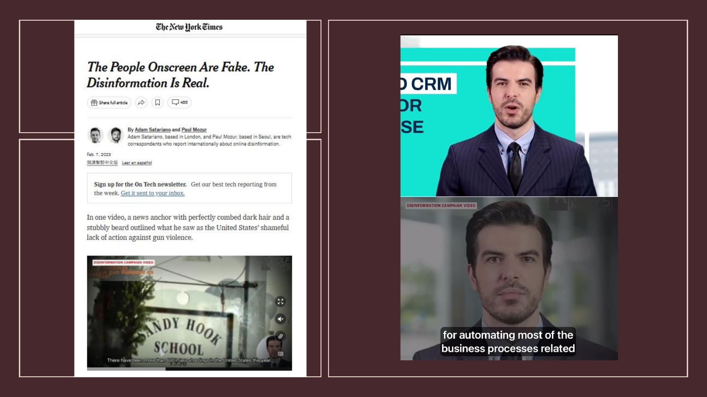

[打开清晰原图](figures/m08/page-15.png)

先看播报人的外观，再问它是不是可识别、可追溯的真实新闻机构。💡 合成主播让假新闻披上专业播报形式；即使能辨认主播由 AI 合成，也还要核查具体主张。截图没有给出完整视频、原始素材及调查链，本笔记不把它当成已独立复核的整篇新闻研究，也不推定所有虚拟主播都是虚假信息。

### 2.16 p.16 · Fake News: Example and Discussion Questions

讲义设想模型生成“政客辞职”或“公司欺诈”的逼真新闻，而事件并未发生；之后传播可能先于纠正。本页说 researchers，但未列研究出处，因此用作讲义情境，不补造研究样本和效果数字。

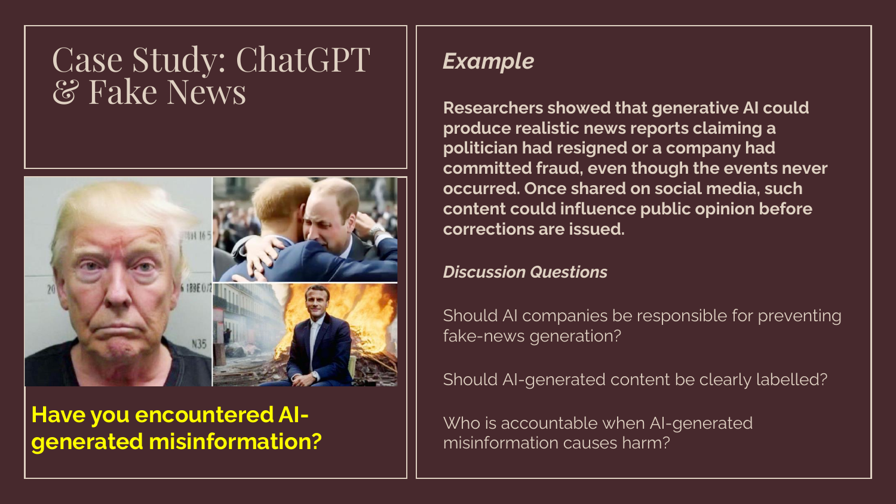

[打开清晰原图](figures/m08/page-16.png)

完整英文问题：

> Example: Researchers showed that generative AI could produce realistic news reports claiming a politician had resigned or a company had committed fraud, even though the events never occurred. Once shared on social media, such content could influence public opinion before corrections are issued.
>
> Have you encountered AI-generated misinformation?
>
> Should AI companies be responsible for preventing fake-news generation?
>
> Should AI-generated content be clearly labelled?
>
> Who is accountable when AI-generated misinformation causes harm?

中文题意依次是：个人是否遇过；AI 公司是否应预防假新闻；是否应清楚标示 AI 内容；造成损害后谁须说明并处理后果。personal question 沿用 p.14 的诚实边界，不能代填本人经历。

以下均为 ⚪ 参考作答（笔记推断），不是讲义官方答案。

1. 公司应承担与可预见风险及控制能力相称的防护职责，例如测试滥用、限制冒充及受理举报。理由是公司能改变设计和访问安排；不代表它能保证每条输出真实，也不抹去恶意用户责任。
2. 对容易误导受众的合成内容，应作清楚且能随转发保留的披露。标签说明制作方式，不认证内容真假；误标和标签丢失也要管理。
3. 按链条分配问责：开发者说明设计与测试，部署/发布者说明核验，平台说明分发和投诉处理。先核事实和各方职责，再决定补救；不能把“都是 AI 的错”当责任安排。

英文参考答案（笔记自拟）：

1. AI companies should take proportionate safeguards against foreseeable fake-news misuse, while users and publishers retain their own responsibilities.
2. Clear disclosure is appropriate where synthetic content could mislead people, but a label does not establish factual accuracy.
3. Accountability should follow each actor's control and conduct across development, publication and distribution, with evidence and remedies specified.

个人问的英文参考：I would report only a verified personal encounter and distinguish evidence of falsity from evidence of AI generation.

💡 改条件：若是明确标为虚构的讽刺作品，受众受骗风险会变，但仍须考虑人物伤害与权利；不能用统一禁生成替代具体判断。

### 2.17 p.17 · Mitigation Strategies & Future Outlook

这是纯分隔页。接下来从“问题是什么”转到预防、识别、响应和未来风险，没有独立新原题。

### 2.18 p.18 · Detection & Moderation Tools

讲义列水印（watermarking）、内容来源（content provenance）、自动事实核查和规模化取舍。水印是嵌入的识别信号；来源记录说明素材的制作与编辑历史；事实核查则要比较具体主张与外部证据。三者回答不同问题。

讲义提到内容来源和真实性联盟（Coalition for Content Provenance and Authenticity, C2PA）。E1 官方说明明确：来源凭据不能单独判定内容真实、准确或符合事实。可验证签名只说明某方作了相应声明，不能把“有凭据”翻译成“事情是真的”。

💡 一张注明 AI 制作的虚构照片可有真实来源记录；一张无凭据的老照片也不一定是假的。检测会漏报、误报，事实核查也需要可靠来源，因此速度、覆盖量与准确性之间须取舍。左侧放大镜插画不提供算法、阈值或数据，未当检测原理图搬入。

### 2.19 p.19 · Business Strategy & Risk Management

风险评估（risk assessment）先识别会伤害谁、怎样发生、严重程度和控制措施；危机响应（crisis response）安排发现问题后谁暂停、调查和纠正；沟通（communication）让受影响人知道已确认与仍未知的情况。

💡 笔记补充的完整企业小例：产品文案含“经临床证明”，核验人找不到证据，就暂停发布、交专业人员复核；若已经发布，保存版本并纠正原渠道。下面流程中的箭头是业务处理顺序，不是模型内部计算。

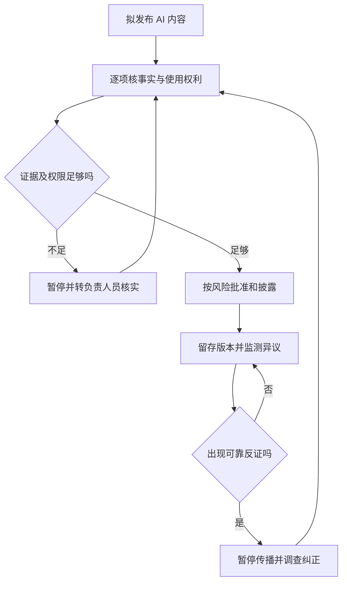

从 A 顺着“证据不足”分支看，内容不会因为模型再次自信回答就自动放行；必须补到可核证据。循环表示持续监测，不代表无限等候所有怀疑消失。具体升级时限与责任人需要企业制定，讲义没有给固定小时。

### 2.20 p.20 · Future Trends

讲义展望多模态错误信息、AI 游说和合成宣传。多模态（multimodal）表示文字、声音和图像组合；一个假故事可以用多种相互配合的形式增加可信外观。

末段强调更深风险：人们可能不知道哪些证据或机构值得信任，伤害民主治理、市场、科学与社会合作。这是讲义的风险论点，不是已经测得的社会效果。💡 对真实证据也一概说“可能是 AI”的态度同样会削弱核验，所以治理目标是可追溯地校准信任，而非让所有人相信或怀疑一切。

### 2.21 p.21 · AI Hallucination: a type of AI misinformation

本页定义幻觉：输出偏离现实或缺乏事实基础，从小错误到完全虚构都可能出现。右下原图以 AI Hallucinations 为中心，连接事实错误（Factual Errors）、虚构内容（Fabricated Content）和无意义输出（Nonsensical Outputs）。

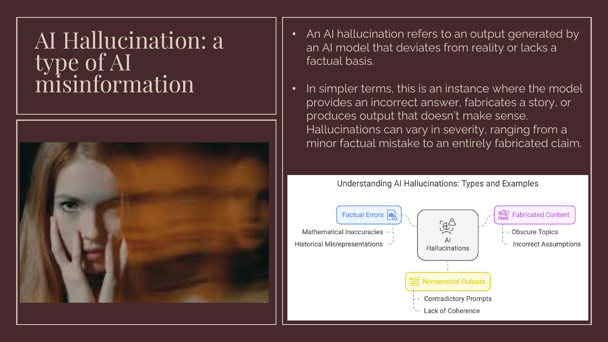

[打开清晰原图](figures/m08/page-21.png)

沿事实错误分支，可读到数学不准确与历史误述；沿虚构分支有冷僻主题、错误假设；沿无意义分支有冲突提示与不连贯。图把表现、诱因和场景放在一起，不是严格互斥的分类树。💡 错误引文可同时属于事实错误和虚构内容。人物双重曝光照片只作比喻，不证明 AI 有人的幻觉体验。

### 2.22 p.22 · Why Do Hallucinations Occur?

大型语言模型（large language model, LLM）学习文字之间的统计关系，根据当前输入逐步生成后续内容。训练时见过许多“作者、年份、标题”格式，模型可能组合出像真的引用；这种形式匹配没有自动查询图书馆确认文献存在。

这解释了讲义的“预测后续文字而非核实事实”。资料缺失、提示含混或任务复杂也会增加困难；不是断言任何带检索或验证工具的系统都只做裸生成。编文章、统计、引语、法律案例或建议会使业务据错信息行动，继而损害信任和声誉。

💡 查到一个真实作者，不足以核实完整文献。须逐项核题名、作者、年份及原文是否支持结论；若其中一项缺失，应保留待核，而非让模型补一个。

### 2.23 p.23 · AI Ethics Case Study: Meta's Galactica Model

纯案例分隔页，提出接下来分析科学语言模型的伦理问题。本页没有案例事实；事实在 p.24–29，部署教训在 p.30–31。

### 2.24 p.24 · Overview of Galactica

讲义把 Galactica 描述为 2022 年 11 月推出的科学语言模型，目标是组织与概述科学知识，能写摘要、数学、百科式文章及科学代码。讲义训练规模写“48 million scientific papers, textbooks, and web sources”；此处仅保留讲义口径，不将它改写成 4800 万篇论文的独立统计结论。

核心问题是任务性质：概述科学知识需要证据正确，而“像科学文字”只说明表达形式。模型即使在科学资料上训练，也不能由资料领域直接推出每条生成内容已过专家核验。本页的抽象神经头像是装饰，并非 Galactica 架构。

### 2.25 p.25 · Timeline of the Galactica Incident

原图按时间从上到下读：2022-11-15 公开演示；11-15 至 11-16 出现错误输出批评；11-17 演示下线；最下行说明研究项目定位。右侧讲义把下线原因与错误信息、偏见担忧联系起来。

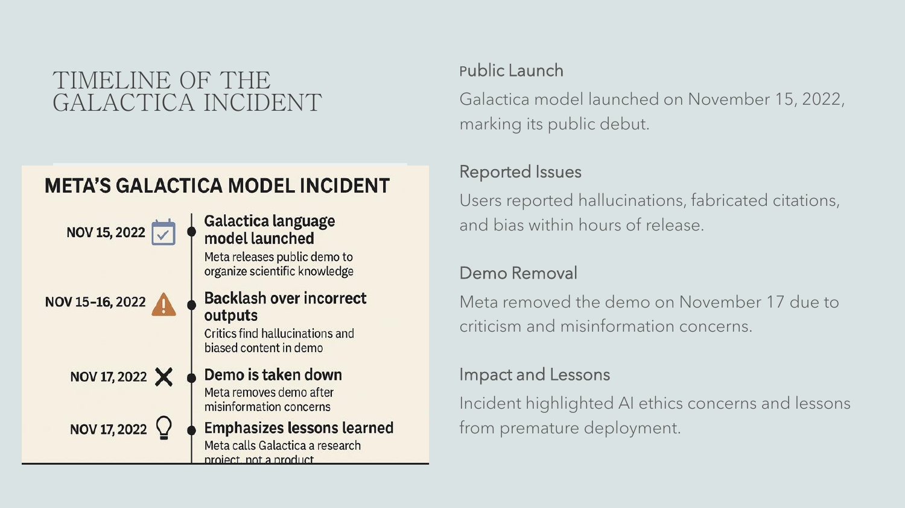

[打开清晰原图](figures/m08/page-25.png)

这些日期是课件的历史案例口径，未新增逐事件独立调查。图底部本就被边界裁切，不能猜未显示的句子。演示下线（demo removal）不等于所有模型文件、研究论文和整个研究领域永久撤回。💡 对企业的启示是公开范围会影响暴露风险；称作研究演示仍须管理用户如何理解输出。

### 2.26 p.26 · Wiki Article Created by Meta's Galactica

这是“太空中的熊”生成文章截图。提示是“wiki article on bears living in space”，输出用标题、History、Soviet Union 及具体名字、航天器和数量铺陈，制造百科文章的外观。

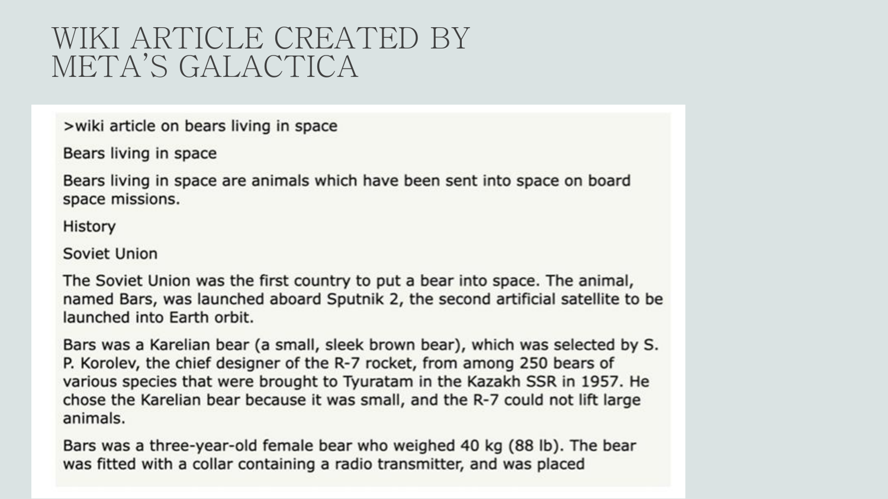

[打开清晰原图](figures/m08/page-26.png)

先看问题是否有事实前提，再查原始记录；不能因为有“1957”“40 kg”等细节就相信。这里的数字属于所展示的错误输出，不是本课程认可的科学事实，也不要求把假故事记成知识。💡 若任务改成“写一篇明确虚构的太空熊故事”，相同想象内容不再冒称事实；关键是任务与呈现地位。

### 2.27 p.27 · Case Study: Model Withdrawal and Business Lessons

本页把案例转换成三项治理动作：部署前严格测试、纳入利益相关者、清楚沟通能力与限制。利益相关者（stakeholders）是会影响系统或受其影响的人，例如研究者、学生、出版者和被引用作者。

💡 测试可以让核验人员检查一批引用是否存在、内容是否支持回答；让非专家试用可揭露他们是否误认输出已被科学验证。仅有开发者内部感觉良好不能替代这些证据。课件“model withdrawn”应与 p.25 的公开演示下线区别，不能扩大为所有研究材料撤销。

### 2.28 p.28 · Hallucinations: Four Manifestations

讲义列四种表现：整篇文章虚构、引用不存在的来源、以自信语气陈述事实错误、混合真实知识与假内容。第三种以太空熊文章为例；第四种尤其难识别，因为一部分正确会让读者轻信剩余部分。

左侧红箭头强调“合理的下一词”不等于“事实核验”；下方“shows no understanding”是讲义强断言。由这些错误可推出输出不可靠，却不能单凭几例就完成关于一切 AI 是否理解的哲学证明。💡 给模型指定“引用三篇真实论文”仍须实际核文献，不因要求里有 true 就算已验证。

### 2.29 p.29 · Key Issues with Galactica

本页按五个风险来源复盘：假事实显得权威、假引用显得有依据、科学语气令人误认专家核验、百科版式制造合法性外观、大规模生成快于纠错。

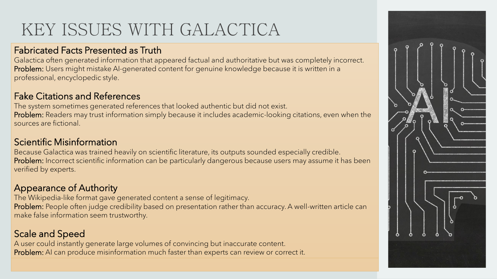

[打开清晰原图](figures/m08/page-29.png)

逐行读时，前半是输出特征，Problem 是用户怎样被误导。💡 给一句假结论配十条格式漂亮的假引用，只增加权威外观，没有增加证据。适当控制要针对这一连接，例如验证引用存在及支持程度；只改字体、语气或加更多引用数量不解决问题。

### 2.30 p.30 · More Questions

标题虽叫 More Questions，正文实际是四项论点：公开演示有风险，公司应对输出承担责任，幻觉来自数据和设计限制，事件影响信任。不能凭标题新编四道“教授原问”。

公司的责任主张是规范判断。可形成论证：公司能控制测试与发布范围〔事实条件〕；能预见且有能力减少重大伤害者应采取合理防护〔规范前提〕；所以应测试、限制暴露并纠错。最强反方是用户也有核验责任；回应是责任可以分工，不能由一方有责推出另一方完全无责。具体法律赔偿另核。

### 2.31 p.31 · Lessons Learned

讲义归纳可靠性验证、防护、透明与期望管理、敏感领域的伦理标准。科学可靠性验证要比较输出与可查证据，不能只问读者是否觉得专业。

💡 宣称“仅供研究”只能告知用途，不能阻止假内容被复制到真实决策。组织还需决定能否开放、哪些用途限制、谁响应问题。全球伦理标准是讲义的治理建议，不是此页已经列明并生效的一部全球统一法律。

### 2.32 p.32 · Why GAI Hallucinate Easily

讲义强调语法流畅、上下文相关与事实正确可以分离。💡 “Smith 在 2024 年证明某药安全”包含熟悉的学术句型，即使没有该研究，文字仍可通顺；所以语言顺畅不是核验程序。

从用户输入到输出可分两种过程：生成器根据模式构造回答；核验人或工具寻找支持该回答的证据。只有把后一步真正接入，并检查来源相关性，才形成事实控制。当前页并未给所有模型的错误率，也不能由“统计生成”推出所有回答都假。

### 2.33 p.33 · Many Possible Reasons

讲义列训练资料质量、训练/生成方法、输入语境三个原因。错误、缺失、误导的资料可能带入错误模式；即使资料可靠，生成方法仍可能组合出未被证实的句子；含混或矛盾提示会让任务目标不清楚。

💡 用户能把“分析公司表现”改成“只依据这份年报，写出收入变化并列原页”，从而限定资料与任务；但不能凭这一步保证生成的页码正确。输入改善是用户能控制的一环，资料筛选和系统设计仍是开发与部署方的责任。

### 2.34 p.34 · Examples of Simple GAI Misinformation

以下是讲义的演示输入/输出，不是本笔记真实调用模型的实验。完整英文原例保留如下：

> Sentence contradiction.
> Prompt: Write a description of a landscape in four-word sentences.
> Output: The grass was green. The mountains were blue. The river was purple. The grass was brown.
>
> Prompt contradiction.
> Prompt: Write a birthday card for my niece.
> Output: Happy anniversary, Mom and Dad!
>
> Factual contradiction. This is when fictitious information is presented as fact. For example:
> Prompt: Name three cities in the United States.
> Output: New York, London, Toronto.
>
> Irrelevant or random hallucinations.
> Prompt: Describe London to me.
> Output: London is a city in England. Cats require daily feeding at least once a day.

中文读法及逐项分析（⚪ 笔记推断）：

1. 风景例要求每句四个词；句式符合要求，但同一段未交代时空改变，就把草说成绿又棕，缺少一致语境。若另加不同区域或季节，未必矛盾。河紫色也不能仅凭颜色就判虚假，可能是想象描写。
2. 给侄女的生日卡却变成给父母的周年祝福，错的是对象与场合；应同时核 recipient 和 occasion。
3. 美国城市题中，New York 可保留；通常指称下，London 在英国、Toronto 在加拿大，不满足美国限定。不能只数到三个地名就判任务完成。
4. 伦敦介绍混入喂猫句；即使该句可能是真，也与问题无关。相关性错误与事实错误是不同检查。

英文分析（笔记自拟）：

1. The landscape description needs a consistent setting; green and brown grass may conflict unless a change of place or time is specified.
2. The answer addresses the wrong recipients and occasion.
3. London and Toronto do not satisfy the intended U.S. location requirement.
4. The cat-feeding sentence is irrelevant to describing London, regardless of its truth.

💡 改条件练习：若输入是“任意三座城市”，第三例的地点限定消失；若任务仍限美国，应更换不合格项，而非改写题意。

### 2.35 p.35 · Simple Prompt Tactics

讲义建议清楚具体的提示、指定数量、提供可靠资料、指定角色，以及多示例提示（multi-shot prompting）。后者是先给几个输入与合格输出，让系统识别需要的格式。

💡 给两个“结论、证据原页、未知项”的示例，再要求处理新材料，可以减少格式遗漏；但示例只能教格式，不能保证新事实正确。讲义的完整短演示为：

> You are a writer for a technology website. Write an article about x.

中文：你是技术网站的作者，请写一篇关于 x 的文章。这里 x 是待指定的文章主题。它同时限定角色和写作任务；角色约束语气与用途，不赋予真实专业资格，也不保证文章事实正确。这是讲义演示，未在本次实际调用模型运行。

英文说明（笔记自拟）：The prompt specifies a writing role and a topic, but it does not verify the article's facts.

数量上限也可能迫使模型凑项，因此资料不足时须允许明确说不足。

### 2.36 p.36 · AI Hallucinations: Risks

生成式拟人化（generative anthropomorphism）指人因系统表现而赋予它人类式品质。💡 聊天机器人用亲切语气说“我查过了”，读者可能推定它有可靠记忆和查证过程；实际上还须核工具记录与来源。

讲义还列信任流失、选举错误信息与网络攻击利用。它们是可能危害，不是此页已证明某场选举被改变或某次攻击成功。伦理分析应接到具体行为和证据；拟人化可以解释过度信任的一个途径，不等于每位用户必定被骗。

### 2.37 p.37 · Mitigation Strategies

受控访问（controlled access）限制公开暴露；透明披露说明限制；输出核验核对引用和事实；人在环（human-in-the-loop）由有能力且有权暂停的人复核。这四项共同工作，不能靠免责声明替代实质核验。

💡 核验一条引文要先找到文献，再读相关段落，看它是否真的支持该结论；文献存在并不保证引用正确。讲义“citation validation tools ensure accuracy”过强，工具可能只核到存在性。人若只点同意、没有资料和停止权，也不能算有效复核。

### 2.38 p.38 · Has AI Hallucination Improved Since Galactica (2022)?

本页说模型、引文和防护有改善，也提到检索增强生成（Retrieval-Augmented Generation, RAG）：先从资料库检索相关片段，再把片段提供给生成器作答。可信资料只改善依据条件；检索错页、资料过期、生成误读仍可出错。讲义还提醒，专业领域仍会出现幻觉，细微错误也可能不易被用户察觉。

💡 追踪一个输入“本产品保修多久”：检索拿到该型号现行政策，生成器依据片段回答两年，核验人检查型号、日期及片段是否支持“两年”。若检索拿到旧型号，后续语句再通顺也答错。不能把“有 RAG”当作已完成这三个核对。

完整英文原问：

> Is it more dangerous for an AI system to be wrong 50% of the time or wrong only 5% of the time when users trust it completely?

中文：错误率 50% 与错误率仅 5% 但用户完全信任，哪种更危险？50% 与 5% 是讨论设定，不是本笔记测得的模型表现。⚪ 参考作答（笔记推断）：无法仅凭两个比例唯一决定；要看使用次数、后果及错误被采纳多少。

💡 假设两系统各处理 1000 次同等风险任务。A 错 50%，但独立核验阻止其中 99% 进入行动，剩 5 次；B 错 5%，用户全部照做，剩 50 次。这里核验效果 99% 是教学假设，A 的独立复核也不能由原系统自信度推断。若两者均无核验且伤害相同，50% 反而产生更多错误行动。

英文参考答案（笔记自拟）：Neither rate alone determines the greater danger. A lower error rate can produce more harmful actions if users accept every output, while effective independent checks can intercept errors. Exposure, reliance and severity must also be compared.

课件“Today: AI is usually right”没有任务和评测来源，不能当成一切现行系统的可靠性保证。

### 2.39 p.39 · Intellectual Property in the Age of AI

纯 IP 部分封面。接下来先区分权利对象和例外，再回到 AI 训练与输出；左侧 SAMPLE FOOTER TEXT 是模板残留，不是考点。

### 2.40 p.40 · Foundations of Intellectual Property

纯章节分隔，无额外图义。下一页从 IP 的用途开始，不把大圆排版当知识分类图。

### 2.41 p.41 · What is Intellectual Property (IP)?

IP 涉及发明、艺术作品、设计等依法保护的智力成果。权利让符合条件的创造者或权利人获得认可、控制某些使用并可能获得收益。不是凡“脑中想出来的东西”都会自动获得同一种权利。

💡 一款产品可同时有技术方案、品牌标志和宣传图；分别要问保护对象、法域、条件与权利人。企业由此安排竞争、许可及价值创造。天平和人物插画仅表达法律与人的主题，不包含具体权利关系。

### 2.42 p.42 · Why IP Matters in Business

讲义强调竞争优势、创新与品牌保护、许可收入及有效管理。许可（licensing）是权利人按范围允许他人使用；转让（assignment）则是把权利移给别人，两者不能混用。

💡 插画师允许企业在一个季度的线上广告使用作品，不必然允许企业把作品交给另一公司训练模型。企业须记录对象、期限、用途、地区和能否再许可，而非拿到文件就当所有用途都获许可。保护能支持回报，同时也可能增加进入与使用成本，这是商业取舍。

### 2.43 p.43 · Types of Intellectual Property

下表一行对应讲义的一类 IP，帮助先辨认对象；不是各地法律条件的完整清单。

| 权利 | 对象与用途 | 教学小例 |
|---|---|---|
| 专利 Patent | 符合条件的发明技术方案 | 新型容器结构 |
| 商标 Trademark | 区别商品或服务来源的标识 | 品牌名称或标志 |
| 版权 Copyright | 符合条件的原创表达 | 插图、文字、音乐或代码 |
| 商业秘密 Trade secret | 有商业价值且维持秘密等条件的信息 | 未公开配方 |

以容器为例：瓶身工程结构与包装插画不是同一对象；设计外观还可能涉及单独外观设计制度。具体保护能否成立须按当地规则，不能把美国 patent 类型直接当全球统一分类。

### 2.44 p.44 · Introduction to Copyright

讲义把版权描述为原创作品创作者在一定期间使用、分发作品的专有权。更准确地说，版权控制法律列明的特定行为；不是对一切相关思想的绝对控制。

💡 买一本书取得的是该实体副本，不自动取得把整本扫描公开的权利。作者资格、初始所有权、雇佣或合同转让也须分开；“创作者”不是每次都等于当前全部经济权利人。这里讲制度概念，不据此裁决具体行为。

### 2.45 p.45 · What Works are Protected?

课件列文学、音乐、艺术、戏剧、电影、录音、广播和出版版本排版。意思是内容与载体可能分别涉及不同保护：歌曲旋律/歌词与某次录音不是同一对象。

💡 企业获准使用歌词，不必然获准使用某歌手录音。不同法域对作品类别、相关权利、原创性和期限有不同安排；本页未标法律条号和版本，故这份名单用于认识课件，不作为全球自动保护清单。

### 2.46 p.46 · The Idea–Expression Doctrine

思想与表达区分（idea–expression distinction）要求辨认抽象想法与具体呈现。讲义主旨是版权保护表达，不垄断思想、概念或方法本身。

💡 “写一位穿越时空的侦探”是题材；某小说具体措辞、情节表达和组织方式是需要进一步分析的表达。换几个字也未必就不涉及复制，使用相同题材也未必侵权。算法的思想与具体程序代码同样应分别看，其他权利仍可能相关。

### 2.47 p.47 · Examples: Protected Expression / Unprotected Idea

原表把三个具体作品与相应抽象概念并排。一行是在问“保护对象在哪里”，不在比较作品优劣。

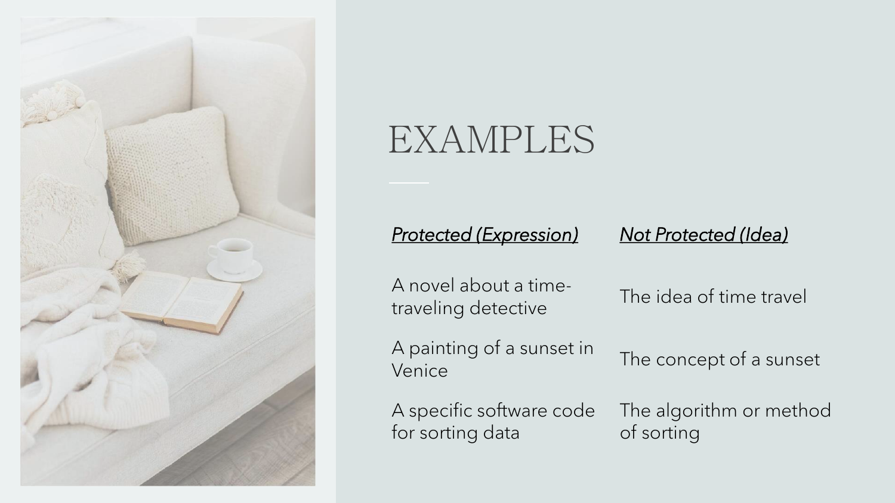

[打开清晰原图](figures/m08/page-47.png)

穿越侦探小说对应时间旅行想法；威尼斯日落画对应日落概念；排序程序代码对应排序方法。💡 自己重写处理步骤与直接复制他人代码是不同事实；但不能只凭“我改了变量名”就断定没有复制表达。本表只说版权这条线，不推断专利、合同或商业秘密均不存在。

### 2.48 p.48 · Rights of Copyright Holders and Duration

讲义列复制、分发、表演、展示和衍生创作等经济权利，还列署名和反对贬损处理的精神权利（moral rights）。经济权利关注某些使用，精神权利关注作者与作品的人格联系；两者范围和能否放弃因法域而异。

期限写作者终身加 50–70 年、公司作品可能按发表计算。这是跨法域概述，不能用“统一 70 年”算任何具体作品。💡 判断一首录音是否可用，还需作品类型、作者/录音时间、适用地区、现有授权和例外；“作者已去世”本身不够。

### 2.49 p.49 · Fair Use and Fair Dealing: First Two U.S. Factors

即使需要授权，也可能有法定例外；例外适用须满足条件。美国合理使用（fair use）与英国公平处理（fair dealing）不是可以互换的名称。本页起四因素限定为美国《版权法》17 U.S.C. §107 的学习框架，E2 为本次官方核对入口。

讲义英文问题与相关条件：

> Purpose and Character of the Use
> 1. Is the use transformative (i.e., does it add new expression or meaning)?
> 2. Is it commercial or nonprofit?
> 3. In AI, training models on copyrighted data may be seen as transformative, but the commercial nature of many AI applications complicates this.
>
> Nature of the Copyrighted Work
> 1. Factual works are more likely to be considered fair use than highly creative works.
> 2. AI often trains on a mix of both, including novels, music, and images.

中文题意：先问用途是否有新的功能/表达意义，以及商业性；再看被用作品的性质。转换性使用（transformative use）不是“换一个格式”就成立。事实性内容与高度创作性内容的性质不同，但不是一项定输赢。

⚪ 参考作答（笔记推断）：

1. 应比较具体原用途与新用途，说明使用为何需要复制，不能只说“用于 AI 所以新”。
2. 应记录是否商业、怎样盈利；商业性是考虑项，不自动否定，非营利也不自动通过。
3. 对训练须结合取得方式、使用目的、用量及市场影响分析；此页没有给足一个实际训练案事实，无法下最终结论。

英文参考答案（笔记自拟）：A transformative purpose requires a concrete comparison with the original use. Commerciality matters but is not decisive. AI training requires a fact-specific analysis of all four factors rather than an automatic exemption.

💡 用一小段作品作批评，与做可替代原作的输出，目的可能不同；两者还须继续核后两因素，不能在本页结束分析。

### 2.50 p.50 · Fair Use: Amount and Market Effect

第三因素看用量及所用部分的重要性（amount and substantiality）；不是只数百分比。第四因素看对原作潜在市场或价值的影响（market effect）；不是只问权利人是否不高兴。

💡 引用很少但恰是作品核心，也可能重要；为了全文检索而复制整本，与把全文提供给人阅读，也不是同一种用途。讲义把 AI 大规模摄入和输出替代原作列为担忧。应分别说明训练阶段复制与输出市场作用，不能用“只输出几句话”抹掉训练阶段，也不能仅凭整本复制就自动结束四因素衡量。

### 2.51 p.51 · Campbell v. Acuff-Rose Music, Inc. (1994)

美国案例：2 Live Crew 未获许可，改作 Roy Orbison 的歌曲，权利人 Acuff-Rose 起诉。仿讽（parody）借用原作使受众认出并评论原作；与单纯替代原作的使用目的不同。

完整英文题面：

> Background:
> Parties: Rap group 2 Live Crew vs. Acuff-Rose Music, the copyright holder of Roy Orbison’s song “Oh, Pretty Woman.”
> Issue: 2 Live Crew created a parody of “Oh, Pretty Woman” without permission. Acuff-Rose sued for copyright infringement.
> Legal Question
> Does a commercial parody of a copyrighted work qualify as fair use, even if it borrows recognizable elements from the original?

中文：商业仿讽即使借用可识别元素，是否仍可能属于合理使用？⚪ 参考作答：可能，商业性和可识别借用本身均非自动否决；须看评论目的、所用程度及市场替代等。不能把“所有仿讽必胜”当判决。

英文参考答案（笔记自拟）：A commercial parody can qualify as fair use, but the result depends on the four-factor assessment, including its critical purpose, the borrowing and market effects.

来源地位：题面为讲义；案件结果由 E3 最高法院 1994-03-07 判决核对，下一页说明程序边界。

### 2.52 p.52 · Court Decision

课件列地区法院认为合理使用、上诉法院因商业性逆转、最高法院推翻上诉法院。须看清“推翻并发回”（reversed and remanded）的程序结果，不能把它简化成最高法院已经终局认定一切借用都合法。

E3 核对的核心是商业仿讽可以构成合理使用，需结合具体因素；最高法院并非作了无条件免责。课件给出 Souter 的原句：

> The more transformative the new work, the less will be the significance of other factors, like commercialism, that may weigh against a finding of fair use.

中文：新作转换性越强，商业性等反对合理使用的因素，其分量可能越低。这里是在比较各项理由的权重：如果借用确实用于评论原作，盈利就不能单独抹去这个新目的。它没有取消借用程度和市场分析，更不是“有新意义就一定合理使用”。💡 若新作只借旋律吸引同一市场、不评论原作，仿讽理由就更弱；不能沿用原案结果。

### 2.53 p.53 · Significance

本页将案件类比到 AI：新用途或新意义可成为转换性分析的一部分，模仿替代则会产生另一组事实。原图箭头只是强调 Implications for AI，没有额外关系要素。

必须分开两问：使用别人作品是否侵权，与新输出自己能否成为受保护作品。前者讨论 fair use，后者讨论作者资格和可保护表达。E4 美国版权局 2025-01-29 报告区分纯 AI 生成材料与足够的人类创作贡献，不能用“训练可能有新用途”直接推出“AI 是作者”。课件“courts have yet to decide”无具体时间，不能当截至本日全球无裁判的断言。

### 2.54 p.54 · Authors Guild v. Google, Inc. (2015)

Google Books 扫描书籍建检索库，用户能搜索并看有限片段（snippets）。讲义称超过 2000 万本；复制整本是后台动作，用户可读范围是输出限制，须分开。

完整英文题面：

> Google Books Project: Google partnered with libraries to scan over 20 million books, creating a searchable digital database.
> Users could search for terms and view “snippets” (short excerpts) of copyrighted books.
> The Authors Guild and individual authors sued Google for copyright infringement, arguing that scanning and displaying snippets without permission violated their rights.
> Legal Issue: Does Google’s digitization of copyrighted books and display of snippets qualify as fair use under U.S. copyright law?

中文：扫描与片段展示是否属于美国合理使用？参考作答：E5 美国版权局案件摘要确认，第二巡回法院在该事实安排下认定合理使用。检索功能、展示限制和市场影响共同重要，不能只说“是科技创新所以可以”。

英文参考答案（笔记自拟）：The Second Circuit found fair use for the Google Books activities at issue, considering their search function, limited display and lack of an effective substitute for the books.

💡 若服务改为随时读完整本，输出限制这一关键事实改变，不能直接搬用原案结论。

### 2.55 p.55 · Counts’ Analysis

原题 Counts’ 应为 Court's，属标题笔误。本页按四因素解释上一案：检索用途不同于阅读；检索需全文复制但公开展示受限；未构成有效的原作替代。

第二因素须填入本案材料，而不只写“作品性质”。讲义本页说，很多被扫描的书是事实性或非虚构作品（factual or non-fiction），并把这点列作倾向合理使用的理由。按课件分析口径，使用事实性资料与使用高度创作性表达所需权衡不同；这给第二因素一个方向，不能单独决定整案。

这段是对讲义所列事实与理由的解释，不冒称本次已核原判决第二因素的全部论证。讲义还说商业性质未压过公共利益；它需与检索功能、必要复制和受限展示一起理解，不能把公共利益当自动豁免。

💡 读者搜一个关键词，是定位相关书籍和位置，不等于获取整本的阅读体验。这是把“用途不同”接到输出限制及市场分析的桥梁。课件说可能提升发现与销量，是可能机制，不是此页给出的可复算销售数据；不编提升百分比。

### 2.56 p.56 · Outcome and Significance

讲义说明 Google 胜诉、第二巡回法院维持、最高法院拒绝受理。拒绝受理不等于最高法院逐项认可该判决理由。E5 用于核对 2015 年第二巡回法院结果；未把本页扩为本次完整诉讼程序调查。

对 AI 的意义是可比较的分析问题，不是“Google Books 合法，所以所有训练都合法”。💡 生成器若输出与原作竞争的长篇内容，市场与用途事实可能不同；必须重新应用四因素。原案不是自动授予任何企业的训练许可。

### 2.57 p.57 · Fair Dealing (UK Law): Listed Purposes

英国公平处理先找法定目的，再核公平与具体条件。课件列非商业研究/私人学习、批评评论、新闻报道、仿讽/漫画/拼贴；不能把美国四因素当作英国的独立通行证。

E6 英国政府现行说明（2026-11-05 读取）纠正两处简化：批评/评论/引用不是绝对禁止复制 substantial part（作品的实质部分）；应核使用是否合理、必要及是否影响原市场。新闻报道例外也不是对所有作品无条件适用，例如照片有特定排除。署名、公开状态等条件须按对应条款看，不能只写“教育/新闻所以免费用”。

### 2.58 p.58 · Other UK Exceptions

本页另列四类例外。下表一行是一类，先把课件实际写的动作与条件讲清，再识别一个小例；不是对现实使用的自动许可。

| 类别 | 课件动作与条件 | 教学小例 |
|---|---|---|
| 教育 Educational use | 在教育机构活动中，为教学或考试复制、表演或展示 | 课堂播放片段以讲解拍摄手法 |
| 无障碍副本 Accessible copies | 为视障者制作可读版本；课件设定无适合版本可获得 | 将文字转为便于视障者读取的格式 |
| 偶然包含 Incidental inclusion | 在另一作品中非刻意带入某作品 | 拍摄街景时背景偶然入镜 |
| 图书馆/档案 Libraries and archives | 为保存、替换或专用终端查看而复制/提供 | 保存濒损资料，或馆内指定终端阅读 |

以教育行为为例，教学目的与公开娱乐放映不同。以偶然包含为例，背景不经意入镜，与主动把海报放大作为主体不同；不能只用“出现在别的作品里”判例外。图书馆的保存、替换和终端查看是课件列明的有限用途，未延伸成网上自由传播。

💡 课堂展示片段与把整部影片放到公开网页不是同一动作；应逐项核对象、目的、受众、数量与条款。

E6 官方指导进一步限定：教学展示须注意教育目的和相关受众；为说明知识点而复制，还须核非商业、充分署名及公平处理等条件。

无障碍例外须从合法取得的资料制作，由符合条件的本人或获授权主体处理，并按必要程度改变格式。课件“无适合版本”的概述不等于所有相关路径的完整现行条件。

图书馆及偶然包含的全部现行条款本次未逐条查验；真实使用仍须核对应条款，不能只据本表批准上传。

### 2.59 p.59 · Compare US and UK Copyright Exception

这是图片比较表。左列是比较维度，中列英国、右列美国；Legal Basis 分别列 CDPA 1988 与美国 §107。

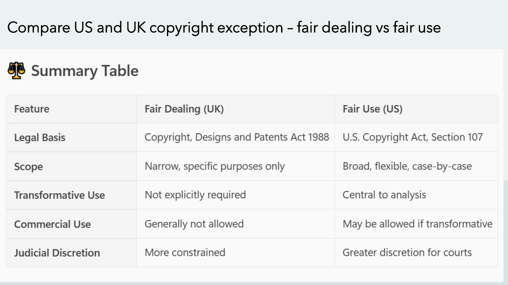

[打开清晰原图](figures/m08/page-59.png)

CDPA 是英国《版权、设计与专利法》（Copyright, Designs and Patents Act）的简称；1988 是该法名称中的年份，不证明每项现行规定都自该年起未变。原要求为：

> Compare US and UK copyright exception – fair dealing vs fair use

中文要求比较两个制度。⚪ 参考作答：英国先落在特定法定目的，再看公平与条件；美国按具体事实综合四因素。原表英国 Commercial Use “Generally not allowed”过宽，美国“May be allowed if transformative”也不能读成充分条件。商业性、转换性均须放回具体制度与用途。

英文参考答案（笔记自拟）：UK fair dealing depends on a specified statutory purpose and its conditions. U.S. fair use applies a flexible, case-specific four-factor assessment. Commerciality and transformative purpose are relevant but do not independently decide every case.

💡 改条件：商业报刊中的批评不能只因盈利自动排除；美国非营利复制也不能只因免费自动通过。来源 E2、E6；表中 Judicial Discretion 是概括，非一个可直接套用的裁判公式。

### 2.60 p.60 · Infringement and Remedies

侵权（infringement）须先有相关权利、受控行为及适用条件，再核授权、例外和抗辩；“未问过作者”本身不足以结束法律判断。救济（remedies）是成立后可能得到的停止侵害或赔偿等处理。

讲义列禁令、损害赔偿、刑事处罚、通知下架和边境措施。还列《伯尔尼公约》（Berne Convention）、《与贸易有关的知识产权协定》（TRIPS）及世界知识产权组织（World Intellectual Property Organization, WIPO）的版权条约。

民事侵权与犯罪门槛不同，不能说每次未授权使用都会刑罚。条约协调成员的保护安排，不是全球一部相同版权法；本页未给具体法域条款，故仅作为制度概览。

### 2.61 p.61 · Principles of Patent Law

纯专利部分封面。版权主要辨表达，下一部分转向技术发明、保护条件和发明人资格，不把两套标准混用。

### 2.62 p.62 · Introduction to Patent Law

专利（patent）制度以在限定地区和期间的排他保护，换取发明公开等要求。讲义的激励逻辑是：研发投入可能较高，有限保护让投入者有机会收回成本，公开技术又可供社会学习。

这是制度的理由，不是“发了专利就必定盈利”的经验定律。💡 若保护太宽或过久，他人继续创新的成本也会上升；评价时要同时看激励与公共可及性，不能只数授权数量。

### 2.63 p.63 · What is a Patent?

讲义写“exclusive rights to make, use, sell, and import”。美国专利商标局（United States Patent and Trademark Office, USPTO）的 E7 官方说明强调：专利主要是排除他人实施所请求保护发明的权利，不自动给权利人自己生产销售的许可。

💡 A 有基础装置专利，B 有改进装置专利；B 的改进如果必须使用 A 的受保护技术，仍可能需要 A 的许可。拥有改进专利不自动消除其他权利或监管条件。权利还受地域限制，不因一国授权就在全世界有效。

课件“约 20 年”是概览；起算日、类型、费用及例外在 p.67 区分。新颖且有用的工艺、机器、制品或物质组成等，是本页美国式举例，不表示任何 AI 点子都可授专利。

### 2.64 p.64 · Requirements for Patentability

可专利性（patentability）看技术方案是否满足保护条件；发明人资格看谁可列名，是另一个问题。本页列新颖性（novelty）、创造性/发明步骤（inventive step）和工业适用性（industrial applicability）。

新颖性问是否已有公开的相关现有技术（prior art）；创造性问对所属领域的通常技术人员是否显而易见；工业适用性问能否用于实际产业。💡 新颜色不自动等于技术创造性，模型第一次输出一个方案也不证明世界上从未公开过。具体法域还可能有其他条件与例外，本页不是完整申请清单。

💡 用同一容器练习，以下全是固定教学假设，未做实际检索或授权判断。假设已取得的公开资料 A 展示杯身和盖；另有公开资料 B 展示常用提手，可方便提起容器。拟保护方案 C 是“杯身＋盖＋同样提手”，申请人希望解决拿取问题。

| 对比项 | A | B | C 拟保护特征 |
|---|---|---|---|
| 杯身与盖 | 有 | 不以这两项为内容 | 有 |
| 方便提起的常用提手 | 无 | 有 | 加在杯身上 |

一行是一组技术特征，先读第二行：C 相对 A 多了提手，但 B 已公开这种提手和用途。新颖性比较先问，一个既有公开是否已完整给出所比方案。仅按给定 A、B，不能说 A 已披露全部 C；这只是本练习资料内的差异，还不能证明全球没有其他公开。

创造性再问：为解决“方便拿取”，通常技术人员是否会直接把 B 的已知提手用于 A？若作用只是熟悉的拿取效果，可能存在显而易见的采用理由。所以“相对 A 有差异”仍不足以证明创造性。还须查相关领域知识、组合动机、技术困难及新效果证据；不能靠模型说“新颖”就填上这些事实。

如果 C 改为特殊结构并有证据显示意外的传热效果，创造性分析所需事实会改变；仍应查证，不在此宣布可授权。

### 2.65 p.65 · Types of Patents

课件列 utility、design、plant，是美国常见专利类型的讲义口径。Utility patent 针对功能性发明，不应直接译作中国制度中的实用新型；design patent 侧重产品装饰外观；plant patent 涉及符合条件的无性繁殖植物新品种。

💡 同一个容器，新的保温结构与外观形状可以是不同保护对象；不能只看产品名称选一种。跨法域常用不同分类，先确定申请地区再比制度。浇水长钱的插画只是收益隐喻，不是植物专利判断证据。

### 2.66 p.66 · Rights of Patent Holders

讲义列排他控制、许可/转让、诉讼执行和商业优势。沿用 p.63 的准确含义：排除他人未经许可实施，不是自己获得不受限制的经营资格。

💡 所有人许可乙公司使用某项技术，自己仍可保留权利；把权利转让给乙公司则改变所有人。合同范围、地域及期间决定授权能到哪一步。是否盈利仍取决于市场、成本及其他权利，不能把许可潜力写成实际收入。

### 2.67 p.67 · Duration of Patent Protection

E7 USPTO 概览确认美国 utility/plant 一般从相关申请日起计算最长 20 年，design 为授权起 15 年；具体适用日期、调整等另核。课件“所有专利须维护费”也应限定类型，不能把各类缴费规则混成一条。

💡 仅作起算示意：某 utility 的相关申请日为 2026 年，按一般 20 年框架看向 2046 年；某 design 在 2028 年授权，按 15 年看向 2043 年。这不是具体专利的届满法律计算，尚需费用、调整和历史日期。过期消除的是该项专利的阻挡，不保证其他专利、商标、监管条件全消失。

### 2.68 p.68 · Patent Application Process

讲义顺序是准备详细说明、提交申请、审查、必要专业协助。说明书要使所主张的技术内容清楚，权利要求（claims）界定请求保护范围；递交并不等于授权。

以下是 💡 笔记补充的流程，不冒充某地完整办事程序：

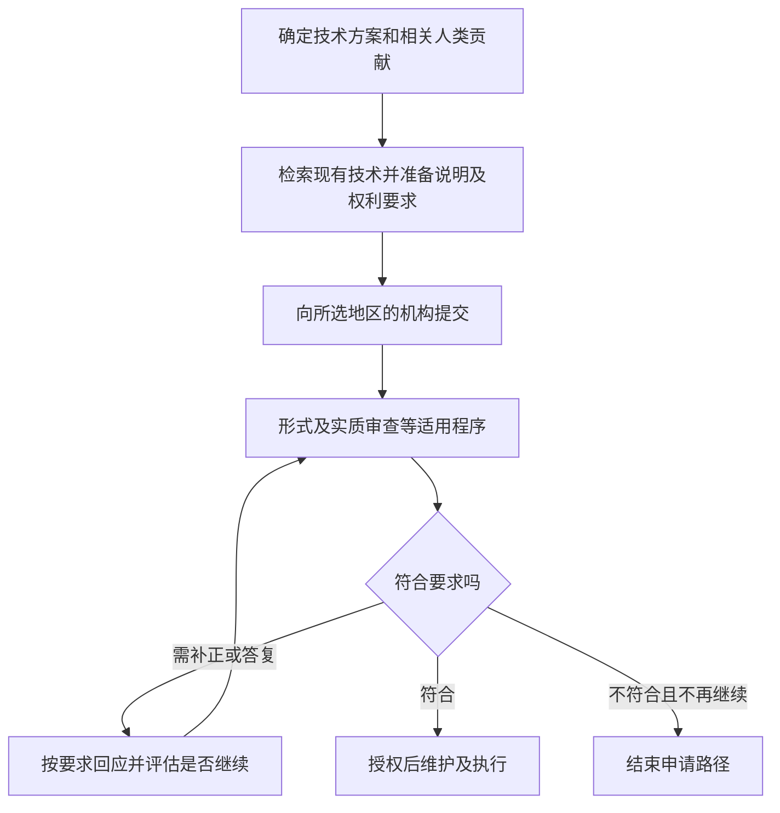

从 C 到 G 之间有条件审查，因此“申请号已取得”不等于“专利已有效授权”。F 的返回表示允许的答复路径，具体次数、期限及申诉渠道需按法域核实。

### 2.69 p.69 · Patent Infringement and Remedies

课件说未经同意使用发明可能侵权，并列禁令、赔偿和民事诉讼。实际分析要把被控产品/方法与有效权利要求比较，核地区、期间、授权和例外，不能只凭外观相似下结论。

💡 对方在授权地区生产落入权利要求的产品，与在权利不存在的地区实施，是不同条件。专利局审查授予权利，不会代所有人持续监控市场并自动执行。讲义中的“monitor”是管理建议，非未监控就必然失去全部权利的法律命题。

### 2.70 p.70 · International Patent Protection

专利合作条约（Patent Cooperation Treaty, PCT）便利在多地寻求保护的申请流程；不是一次取得全球专利。E8 WIPO 官方说明明确，最终授权仍由国家或地区机构决定。

💡 申请人提交国际申请后，仍需选择希望继续寻求保护的地区、进入适用阶段并满足当地要求。欧洲专利公约（European Patent Convention, EPC）提供区域框架；欧洲专利局（European Patent Office, EPO）不是欧盟的同义词。课件“no effect internationally”应理解为无自动全球排他权，而非跨国程序和优先权完全不存在。

### 2.71 p.71 · Challenges in the AI Era

AI 参与发明后，需要追踪究竟是谁提出技术构思，以及法律怎样认定资格。不能由“用了 AI”推出无人类发明人，也不能由“我拥有模型”推出我做出了所有技术贡献。

课件“Current laws exclude AI”是广泛概述，本篇只对 E9 英国最高法院、E10 EPO 和 E11 澳大利亚裁判所核范围作具体说明。其他国家不能未经查法便一概而论。法律适应是政策议题，不是现有资格要求已被自动改变。

### 2.72 p.72 · Can an AI be an Inventor?

本页把列名资格、人类贡献与权属放在一起，必须先分拆。完整英文提问及候选对象：

> Key Question: Can an AI be an inventor?
>
> AI as Inventor
> Patent laws generally require inventors to be human.
> Courts and patent offices have rejected AI systems as named inventors.
> Famous case: DABUS AI inventor applications.
>
> AI-Assisted Inventions
> Increasingly difficult to determine the extent of human contribution.
> If AI generates the key inventive idea, who deserves patent rights?
>
> Ownership Uncertainty
> Inventor?
> User prompting the AI?
> Employer?
> AI platform provider?

中文：AI 能否依法列为发明人？若关键构思来自 AI，权利应给发明人、提示用户、雇主还是平台？后四项是讨论候选，不是原题 A–D 的单选题。

⚪ 参考作答（笔记推断）：在本篇已核英国 DABUS 裁判范围内，机器不符合法定发明人资格；这不等于每一项 AI 辅助发明都被禁止。应先查自然人的实际技术贡献和法定资格，再查雇佣、转让和合同等权利取得安排。

- 发明人：资格成立后，还要查初始和后续权利规则。
- 提示用户：输入一个目标不自动证明提出了技术构思。
- 雇主：可能依法律或合同取得权利，但不因此成为自然人发明人。
- 平台：提供工具本身不足以证明对具体方案有发明贡献或当然取得所有权。

英文参考答案（笔记自拟）：Under the UK DABUS ruling discussed here, an inventor must be a natural person. Ownership requires a separate legal basis. Neither prompting an AI nor owning its platform automatically establishes inventorship or entitlement to a patent. A qualifying inventor's entitlement and an employer's ownership must be assessed under the applicable law and any valid transfer or employment arrangements.

💡 改条件：若工程师自己构思关键结构，只用 AI 做说明图，“AI 为唯一发明人”的前提已经改变，不能直接套用 DABUS 申请失败结论。

### 2.73 p.73 · Emerging Patent Problems

原题中的两个问题：

> Are AI-generated inventions truly "novel"?
> Can AI-generated ideas satisfy the "inventive step" requirement?

中文：AI 方案是否真的新颖，能否满足创造性要求？⚪ 参考作答：两者都不能由“AI 生成”这个标签决定。应分别检索相关现有技术、比较所请求保护的特征，再按适用法律评价通常技术人员的显而易见性。AI 可能复现训练资料中的已有技术，也可能参与形成不同方案，须看证据。

用 §2.64 的容器 C 直接复做：对新颖性，分别将其杯身、盖、提手与给定 A、B 比较，不能只检查“C 是否由 AI 生成”。对创造性，必须再问已知提手为何会或不会被通常技术人员用于解决拿取问题。题目未给检索全集、组合难度及效果证据，因此可以说明两个标准的不同任务，却不能宣布这个实际方案满足任一授权条件。

英文参考答案（笔记自拟）：AI generation alone establishes neither novelty nor inventive step. Novelty must be assessed against relevant prior art. Inventive step requires a separate assessment under the applicable legal standard for inventiveness.

讲义另列申请激增、现有技术核查困难、资源向大企业集中，以及保留人类资格、披露 AI 使用、调整标准、厘清权属等可能回应。这些是风险与政策选项，不是本页已经生效的统一规则。💡 强制披露有助追踪贡献，也增加合规成本；不应凭选项存在就宣称全球已要求同一披露表。

### 2.74 p.74 · AI and Emerging IP Challenges

纯章节分隔页，无新知识图。接下来把作者资格、训练资料、发明人及标识问题重新放在 AI 业务链上。

### 2.75 p.75 · Generative AI and IP Challenges

本页四项是输出所有权、训练资料版权、AI 发明人、商标和真实性。💡 企业做一张“某品牌风格”的海报，至少要分开：输入作品能否用、输出有无人类可保护创作、输出是否复制他人表达、品牌标志会否误导来源。

一项许可不能自动回答所有项；平台合同可以安排双方利益，却不能凭合同制造法律本来不给的版权，也不能取消第三方权利。这是从泛称 IP 风险落到可检查对象的办法。

### 2.76 p.76 · Fair Use in the AI Context

本页复习美国四因素：用途、原作性质、用量、市场作用。新的背景是训练规模很大，但规模本身既不是自动免责，也不是独立完整的侵权判决。

💡 应为“收集/复制资料”“训练使用”“生成输出”“公开分发”分别记录对象和用途，再看相关权利和例外。某一次输出可用，不能证明上游资料来源都合规；上游获许可，也不保证输出不会复制其他受保护表达。

### 2.77 p.77 · Transformative Use and AI

课件把转换性描述为新表达、意义或用途，并讨论训练的新功能与紧密模仿原作。应具体说明所争议的使用，不把“模型改变成参数”当作唯一法律理由。

💡 若系统做关键词检索，可与 Google Books 的功能及限制比较；若它按需输出可替代原作的内容，就要重新检查用途和市场。E2 的四因素必须整体看，不能在“不同功能”四字处停止。训练是否合理使用和输出是否获版权仍是两问。

### 2.78 p.78 · Comparative Legal Perspectives

纯比较法分隔页。下一页有过度概括，学习时须保留法域、权利类型与时间，不把国家标签当法律分析。

### 2.79 p.79 · Global Legal Perspectives on AI and IP

本页称美国 fair use 灵活、英国 fair dealing 较限、中国训练宽松而输出严格、香港正在改革。前两项可以帮助找到制度入口，但都不能单凭形容词作结论；后两项未给法条、版本和具体行动，不能当现行法保证。

英国“requiring human authorship”还把版权与专利资格混在一起。E12 英国政府 2026 年版权/AI 报告仍讨论 CDPA §9(3) 的计算机生成作品条款和解释不确定性；因此不能说英国所有版权一律排除无传统人类作者的作品。其具体适用不是本篇完成的个案裁决。

💡 比较一个商业训练用途时，应逐地区查资料取得、复制行为及例外，再比较输出的作者规则；不能用“中国宽松”替代这一过程。香港改革是否已通过并生效，本次没有在本页找到证据，登记待核。

### 2.80 p.80 · Can AI be an Inventor? Comparative Perspective

原页说南非和澳大利亚曾承认 AI 发明人。须区分申请/登记、下级法院解释、上诉结果与当前效力。E11 澳大利亚 2022-04-13 全席法院裁判推翻下级法院的解释；不能把它写成澳大利亚现已稳定允许 AI 列名。

南非部分暂保留 p.89 的讲义历史说明，不把登记当成经实质审查确认的全球先例。💡 同样写“认可”，程序条件不同，证据分量就不同；这正是比较法需要查程序的原因。

### 2.81 p.81 · Deepfakes and Ethical Considerations

纯章节分隔。下一页先看法律对象，再看隐私、自主性与心理伤害；技术逼真不是伦理上的使用许可。

### 2.82 p.82 · Deepfakes and IP Law

讲义列版权、人格相关权利、商标、平台责任和法律适应困难。须分别识别被复制的作品、被冒用的人以及误导的商业标识，不能把人的脸本身直接叫作其“版权作品”。

💡 未经许可用演员声音配假广告，可能涉及不同法律与伦理问题；哪个成立取决于行为、法域和证据。平台未及时处理是否承担法律责任也要有适用规则、通知和控制等事实，本页没有足够条件让我们宣布所有平台必定负责。伦理上仍可要求便捷投诉与迅速减少伤害。

### 2.83 p.83 · Ethical Issues with Deepfakes

本页将非同意使用相貌、错误信息与名誉、心理伤害连接起来。自主性（autonomy）在此是本人能否知情决定自己的身份如何被使用；隐私关注个人资料和生活领域的控制。

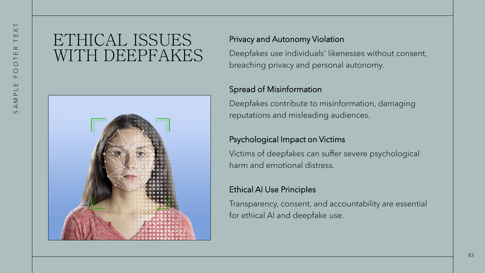

[打开清晰原图](figures/m08/page-83.png)

图中绿色框定位人脸，白色点线表现可提取/处理的面部特征，帮助理解合成对象；它不是成功识别或已获同意的证明。💡 当人被假视频描绘成说了未说的话，受众受骗与本人失去身份控制是两种伤害。清楚标示并获真实、具体的同意会改变判断，但仍须考虑扩散和后续撤回的限制。

### 2.84 p.84 · Ethical Frameworks for AI

用同一 💡 教学情境比较：企业未经员工同意，用其脸和声音制作逼真推销视频。下表一行是一种讲义理论及其当前判断问题。

| 理论 | 用什么标准问 | 对本例应检查什么 |
|---|---|---|
| 义务论 Deontology | 是否尊重人及诚实义务 | 员工与受众能否知情同意 |
| 功利主义 Utilitarianism | 总体收益与伤害 | 销售利益、名誉和信任损失 |
| 德性伦理 Virtue ethics | 行动者的品格与实践 | 是否诚实、审慎和尊重人 |
| 权利伦理 Rights-based ethics | 哪些权利需保护 | 身份、隐私与自主性的边界 |
| 关怀伦理 Care ethics | 关系、脆弱性与照顾责任 | 员工能否实际拒绝并获支持 |

功利主义不是自私逐利，要把受影响人的利益一起考虑。💡 若宣传收益有限而员工面临严重名誉风险，总体后果可能反对使用；义务论还会问即使收益很大，欺骗和仅把人当工具是否可接受。关怀伦理提醒“签了同意”还可能掩盖雇佣压力。

混合进路（hybrid approach）不是把五个名词堆一起；应先列权利底线，再比较可行方案的后果，并设支持与救济。若改成员工自愿授权且明显标为合成，关键事实改变；还要继续核使用范围、退出与受众误导，不能无条件判通过。

### 2.85 p.85 · Case Study: The DABUS Case

纯案例分隔页。接下来重点不是机器有多聪明，而是列名、权利取得与技术审查是不同法律问题。

### 2.86 p.86 · Case Background

讲义将 DABUS 展开为 Device for the Autonomous Bootstrapping of Unified Sentience，由 Stephen Thaler 开发，并称向超过 15 个法域申请。后者是课件口径，本篇未核全体申请清单。

讲义的两个方案有各自具体用途：食品容器使用分形表面，以改善握持和传热；分形在这里可先理解为不同尺度上重复相似结构的描述。

另一个是闪烁紧急灯，课件说它用 neural patterns 吸引注意。课件未展开 neural patterns 的技术含义、控制方式和验证结果，因此保留这个英文词组，不猜神经网络或脑波机制。

讲义声称系统自主产生方案；在法律分析中须把它当作申请人的主张或案件设定，不据此证明技术自主性。方案可能有技术价值，与申请时能否把 DABUS 列为唯一发明人是两问。

### 2.87 p.87 · Overview of the DABUS Case

本页复述：AI 被列为发明人，多地拒绝，形成全球讨论。“without human intervention”应读为该案主张/设定，而非本笔记完成了生成实验。

💡 若某法域要求自然人列名，申请填写机器名会先遇资格问题；即使容器的性能很好，也不能靠性能替代列名资格。反过来，资格不合格也没有证明该结构不新颖或没有工业用途。

### 2.88 p.88 · Thaler’s Legal Argument

Thaler 的两步主张要分清：DABUS 产生方案，所以应列 DABUS 为发明人；自己拥有 DABUS，所以主张取得权利。发明人资格（inventorship）与所有权（ownership）分别对应两步。

E9 英国最高法院 2023-12-20 在 Patents Act 1977 §§7、13 框架下维持机器不能作为发明人，拥有机器也不足以取得本案申请权利。💡 拥有画笔不自动等于创作画的人；这个类比只帮助区分工具所有权与贡献，法律结论仍依本案条文，不能由类比取代。

### 2.89 p.89 · Global Responses

图片页按法域列美国、EPO 所属欧洲专利体系、英国、澳大利亚、南非、印度的讲义总结。它们不是六种完全同一程序。

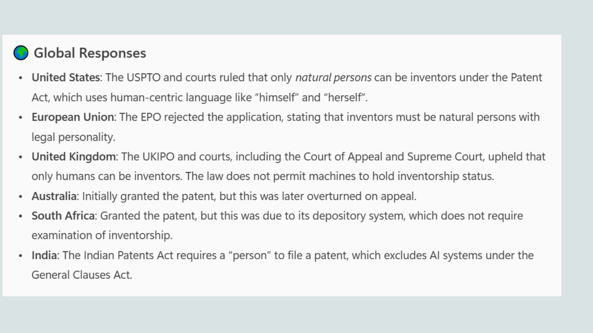

[打开清晰原图](figures/m08/page-89.png)

本篇核对范围：E9 支持英国自然人资格及机器所有权不自动产生申请权利；E10 支持 EPO 不能把机器列为发明人；E11 支持澳大利亚 2022 年上诉纠正。课件把 EPO 写在 European Union 下不准确，应区别 EPC 与欧盟。

澳大利亚“Initially granted the patent”也不准确：下级法院对列名解释有利，不等于正式授予专利。南非登记与其不作同等实质审查的说明、印度及美国具体程序，本次保留为课件历史概述，未独立核全。不能把同一张表升级为本日全球法律完整地图。

### 2.90 p.90 · Legal and Ethical Implications

这张原图的关键句是案例讨论“谁能列为发明人”，不是已经审完技术可专利性。先看该句，再看工具与发明人区分，最后看改革争论。

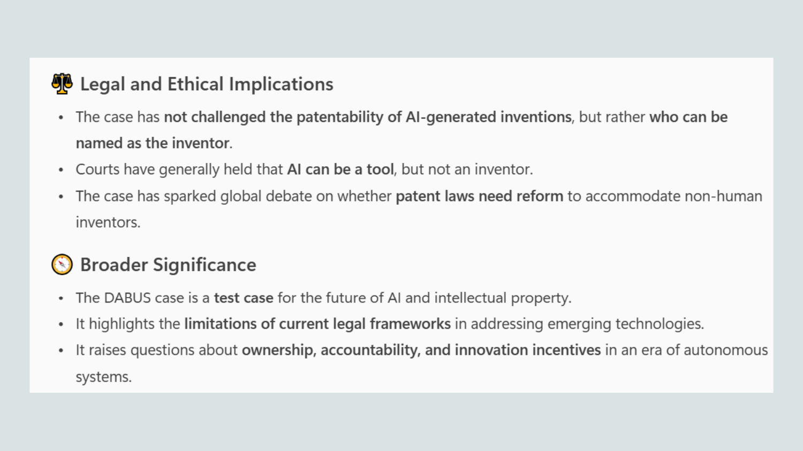

[打开清晰原图](figures/m08/page-90.png)

💡 政策上可争论承认 AI 是否改善激励、造成权利集中或模糊问责；这些理由不能反向改写当前法条。法律依现有资格作判断，与我们认为法律是否应改，是事实/解释与规范建议的区分。若人类实际有贡献，应查该贡献，不能为符合形式随意填一个人名。

### 2.91 p.91 · Future Challenges

纯分隔页。最后一页汇总四类问题，适合当复习检查表，而非新的判例或法规。

### 2.92 p.92 · Future IP Challenges of Generative AI

英文标题问题是：

> Why Is Generative AI Challenging IP Law?

中文：生成式 AI 为什么挑战 IP 法？本页给四类理由，以下逐项连接到本讲已学机制（英文作答为笔记自拟）。

1. 版权：训练会使用现有内容，输出还涉及作者资格、所有权和与原作相似。应分别核上游行为和下游输出。
2. 专利：AI 参与让人类贡献、发明人资格与权利取得更难追踪，申请规模也可能增加。
3. 创作者利益：风格模仿可能没有同意、署名或补偿；伦理问题不能只靠是否构成版权侵权回答。
4. 监管：不同法域的对象、条件和程序不同，不能用一国类比当全球规则。

英文参考答案：Generative AI separates the use of existing works from the creation and exploitation of new outputs. It raises distinct questions about copyright, human authorship, inventorship, ownership and creator interests across different legal systems.

💡 一个企业 AI 设计项目应同时保留资料来源、人类创作/技术贡献、许可范围、输出复核和纠错记录。记录让争议可检查，但记录存在本身不证明每项使用合法。若只检查输出像不像原作，上游资料和人物同意仍会漏掉。

**🎙️ 课堂补充**

本讲尚无可用转录。本篇只依据讲义及明确列明的外部核对，不代写课堂原话；将来有本讲转录再按来源时间戳融合。

## 3. 一图看懂 · 两条风险线与三个权利问题

下表每行是一种检查任务；先把业务事实放到对应行，再选择证据和标准，不从“用了 AI”直接跳到总判断。

| 检查什么 | 要回答的问题 | 回到逐页正文 |
|---|---|---|
| 信息真实性 | 主张有证据吗，是否误导受众 | p.12–20 |
| 系统可靠性 | 输出如何生成、如何核验与纠错 | p.21–38 |
| 使用他人内容 | 涉及什么权利、授权或例外 | p.44–60、76–77 |
| 输出保护 | 哪些人类创作可保护、谁持有权利 | p.53、75、79 |
| 技术与发明人 | 方案可专利吗、谁可列名及取得权利 | p.63–73、86–90 |

例如“合成 CEO 视频”先走真实性与同意检查，再识别音视频作品、人物及标识；不能只问视频是否新生成，也不能只问有没有水印。

## 4. 速查表

一行是一条需要区分的判断，右列是回源位置，不是另加法规结论。

| 容易混淆 | 本讲的区分 | 位置 |
|---|---|---|
| 信息真假与意图 | 真内容也可被恶意泄露；假内容未必故意 | §2.12 |
| 来源与事实 | 来源可核，不保证画面事件为真 | §2.18 |
| 流畅与正确 | 句型/语气不是事实核验 | §2.22、§2.32 |
| 错误率与伤害 | 还看使用规模、依赖和严重程度 | §2.38 |
| 思想与表达 | 相同题材不等于复制表达 | §2.46–47 |
| fair use 与 fair dealing | 美国四因素；英国特定目的及条件 | §2.49–50、§2.57–59 |
| 发明人与权利人 | 技术贡献资格与权利取得分开 | §2.72、§2.88 |
| PCT 与全球授权 | 便利申请，不自动各国授权 | §2.70 |

## 5. 双语术语卡

以下英文定义均为笔记整理，适合练习表达，不冒充教授逐字定义。每行给本篇最先完整展开的位置。

| 中文 | English | 英文参考定义 | 位置 |
|---|---|---|---|
| 合成媒体 | Synthetic media | Media created or altered using computational techniques, including AI. | §2.1 |
| 错误信息 | Misinformation | False or misleading information shared without the harmful intent specified in the lecture's classification. | §2.12 |
| 蓄意虚假信息 | Disinformation | False information deliberately used to deceive. | §2.12 |
| 恶意使用真实信息 | Malinformation | Genuine information used with an intention to cause harm. | §2.12 |
| 幻觉 | Hallucination | An AI output that lacks factual support or conflicts with reality or the given context. | §2.21 |
| 深度伪造 | Deepfake | AI-generated or manipulated media that can convincingly depict a person or event. | §2.7 |
| 内容来源 | Content provenance | Information about an asset's origin and history, including relevant edits. | §2.18 |
| 检索增强生成 | Retrieval-Augmented Generation | A process that retrieves relevant material and supplies it to a generator as context for an answer. | §2.38 |
| 知识产权 | Intellectual property | Legal rights concerning qualifying creations and other protected intellectual assets. | §2.41 |
| 转换性使用 | Transformative use | A use whose different purpose or character is relevant to a U.S. fair-use assessment. | §2.49 |
| 公平处理 | Fair dealing | Use under a specified statutory copyright exception, subject to fairness and other conditions. | §2.57 |
| 现有技术 | Prior art | Relevant pre-existing disclosures used when assessing patent requirements. | §2.64 |
| 发明人资格 | Inventorship | The legal status of the person or persons entitled to be named as inventor. | §2.72 |

## 6. 考点预判与答题框架

### 6.1 来源等级

无本讲转录，没有可核“教授明示”考试承诺。以下都是 🟡 ILO 反推或 ⚪ 笔记推断，不排除其他题型。ILO 对应课程理解当代伦理、评估商业社会影响及应用理论的目标，不意味着每项均必考。

- 🟡 ILO 反推：给一条内容，分真假、意图、伤害及控制；以事实和标准完成论证。
- 🟡 ILO 反推：用深度伪造案例比较义务、后果、权利与关怀的不同理由。
- ⚪ 笔记推断：解释 Galactica 的权威外观、假引用及过度信任。
- ⚪ 笔记推断：用英美例外及 DABUS 展示法域、资格与程序边界。

### 6.2 英文场景答题练习

先交代事实，再选标准、套用、得有条件结论；不能只背四个价值词。

> The relevant act is [a specific generation, use or publication]. The available evidence shows [a limited fact], while [a material fact] remains unverified. Under [a stated ethical standard or identified legal framework], the key condition is [condition]. This supports [a limited conclusion]. If [the decisive fact] changes, the assessment must be reconsidered. A proportionate control is [an actor, action and evidence], with a route for correction.

💡 “Under fair use”还不够：要说美国及四因素，具体填入用途、性质、用量和市场。DABUS 题则先说明法域及发明人资格，不能把版权作者标准当专利标准。

## 7. 自测

### 7.1 真内容会不会也是问题信息？

某人公开真实私人邮件以羞辱同事；另一个人误信假通知后转发。用 p.12 分类并说明还缺什么。

答案与理由

前者按讲义是 malinformation：内容真但意在伤害；后者是 misinformation：不实且传播者误信。真实案件仍需证据确认内容与意图，不能凭结果伤人就自动证明所有主观意图。内容真假、隐私与传播责任要分别判断。

### 7.2 C2PA 标识能证明产品有效吗？

一张 AI 产品广告有可验证来源凭据，广告声称能节省一半成本。可否批准事实性主张？

答案与理由

不能只凭来源凭据批准。凭据帮助核制作与编辑历史，不提供节省成本的测量证据。应查成本比较的对象、期间、基线和可信研究；不足则暂停该主张。若改成明确的虚构概念图，真实性任务会改变，仍须核受众是否被误导。

### 7.3 真引用为何还不够？

模型给的论文真实存在，能否认定结论已验证？

答案与理由

还要读相关原文，核题目、对象、方法、结果及限制是否支持所说结论。存在性与支持性是两步。例如论文只研究成年人，回答却声称结论同样适用于儿童，即使引用真实仍可能误导。按 §2.37 让有能力且有权停止发布的人完成核查。

### 7.4 5% 错误是否总比 50% 安全？

只知道两个比例，能比较实际伤害吗？

答案与理由

不能。要统一任务规模、严重程度及实际采纳条件，再估计错误进入行动的数量。§2.38 的教学例说明核验可改变结果；其 99% 拦截率是假设，不是现实保证。若改变使用规模，必须重新比较。

### 7.5 “Google Books 赢了，所以训练可用”缺哪一步？

答案与理由

缺少对实际训练行为和输出的事实比较，以及四因素衡量。检索与受限片段不同于可替代原作的生成服务；大规模复制既非自动免责也非单项否决。另查作者资格不能用 fair use 答复。

### 7.6 拥有 AI 就是发明人吗？

公司买了模型，员工只输入目标，模型提出容器结构。公司可否仅凭付费记录证明发明人资格？

答案与理由

不能。付费说明工具或服务交易，不证明自然人作出了法定技术贡献。应记录人类构思及实际作用，按相关法域认定资格，再查公司如何依法或按合同取得权利。技术可专利性还需独立评价；DABUS 的资格裁决没有替它做完全部技术审查。

## 8. 讲义页码映射

以下每个物理页一行。无本讲转录，课堂覆盖统一未知，不把未知标成跳过；“原图”表示本篇嵌入了有教学含义的原页图像，装饰性插画按页证据清单说明省略。

| 源/页 | 原页主题 | 正文精确入口 | 原图/处置 |
|---|---|---|---|
| M08 p.1 | Generative AI Truth, and Rights challenges | [[IS5113_AI_Ethics_and_Regulations/notes/M08-生成式AI-真实性与知识产权#2.1 p.1 · Generative AI Truth, and Rights challenges\|p.1]] | 封面 |
| M08 p.2 | What is Generative AI? | [[IS5113_AI_Ethics_and_Regulations/notes/M08-生成式AI-真实性与知识产权#2.2 p.2 · What is Generative AI?\|p.2]] | 文字/原例实质讲解；装饰省略 |
| M08 p.3 | Capabilities & Use Cases | [[IS5113_AI_Ethics_and_Regulations/notes/M08-生成式AI-真实性与知识产权#2.3 p.3 · Capabilities & Use Cases\|p.3]] | 文字/原例实质讲解；装饰省略 |
| M08 p.4 | Introduction: The Double-Edged Sword of Generative AI | [[IS5113_AI_Ethics_and_Regulations/notes/M08-生成式AI-真实性与知识产权#2.4 p.4 · Introduction: The Double-Edged Sword of Generative AI\|p.4]] | 文字/原例实质讲解；装饰省略 |
| M08 p.5 | Misinformation: When AI Scales Falsehoods | [[IS5113_AI_Ethics_and_Regulations/notes/M08-生成式AI-真实性与知识产权#2.5 p.5 · Misinformation: When AI Scales Falsehoods\|p.5]] | 文字/原例实质讲解；装饰省略 |
| M08 p.6 | Hallucinations: When AI Invents Facts | [[IS5113_AI_Ethics_and_Regulations/notes/M08-生成式AI-真实性与知识产权#2.6 p.6 · Hallucinations: When AI Invents Facts\|p.6]] | 文字/原例实质讲解；装饰省略 |
| M08 p.7 | Deepfakes: The Authenticity Crisis | [[IS5113_AI_Ethics_and_Regulations/notes/M08-生成式AI-真实性与知识产权#2.7 p.7 · Deepfakes: The Authenticity Crisis\|p.7]] | 文字/原例实质讲解；装饰省略 |
| M08 p.8 | Intellectual Property Challenges | [[IS5113_AI_Ethics_and_Regulations/notes/M08-生成式AI-真实性与知识产权#2.8 p.8 · Intellectual Property Challenges\|p.8]] | 文字/原例实质讲解；装饰省略 |
| M08 p.9 | Conclusion: The Core Challenge of Generative AI | [[IS5113_AI_Ethics_and_Regulations/notes/M08-生成式AI-真实性与知识产权#2.9 p.9 · Conclusion: The Core Challenge of Generative AI\|p.9]] | 文字/原例实质讲解；装饰省略 |
| M08 p.10 | LET US DIG DEEPER | [[IS5113_AI_Ethics_and_Regulations/notes/M08-生成式AI-真实性与知识产权#2.10 p.10 · LET US DIG DEEPER\|p.10]] | 分隔 |
| M08 p.11 | Summary Table | [[IS5113_AI_Ethics_and_Regulations/notes/M08-生成式AI-真实性与知识产权#2.11 p.11 · Summary Table\|p.11]] | 原图嵌入并解释 |
| M08 p.12 | Misinformation Defined | [[IS5113_AI_Ethics_and_Regulations/notes/M08-生成式AI-真实性与知识产权#2.12 p.12 · Misinformation Defined\|p.12]] | 原图嵌入并解释 |
| M08 p.13 | Mechanisms of Misinformation | [[IS5113_AI_Ethics_and_Regulations/notes/M08-生成式AI-真实性与知识产权#2.13 p.13 · Mechanisms of Misinformation\|p.13]] | 文字/原例实质讲解；装饰省略 |
| M08 p.14 | Case Study: ChatGPT & Fake News | [[IS5113_AI_Ethics_and_Regulations/notes/M08-生成式AI-真实性与知识产权#2.14 p.14 · Case Study: ChatGPT & Fake News\|p.14]] | 原图嵌入并解释 |
| M08 p.15 | The People Onscreen Are Fake. The Disinformation Is Real. | [[IS5113_AI_Ethics_and_Regulations/notes/M08-生成式AI-真实性与知识产权#2.15 p.15 · The People Onscreen Are Fake. The Disinformation Is Real.\|p.15]] | 原图嵌入并解释 |
| M08 p.16 | Fake News: Example and Discussion Questions | [[IS5113_AI_Ethics_and_Regulations/notes/M08-生成式AI-真实性与知识产权#2.16 p.16 · Fake News: Example and Discussion Questions\|p.16]] | 原图嵌入并解释 |
| M08 p.17 | Mitigation Strategies & Future Outlook | [[IS5113_AI_Ethics_and_Regulations/notes/M08-生成式AI-真实性与知识产权#2.17 p.17 · Mitigation Strategies & Future Outlook\|p.17]] | 分隔 |
| M08 p.18 | Detection & Moderation Tools | [[IS5113_AI_Ethics_and_Regulations/notes/M08-生成式AI-真实性与知识产权#2.18 p.18 · Detection & Moderation Tools\|p.18]] | 文字/原例实质讲解；装饰省略 |
| M08 p.19 | Business Strategy & Risk Management | [[IS5113_AI_Ethics_and_Regulations/notes/M08-生成式AI-真实性与知识产权#2.19 p.19 · Business Strategy & Risk Management\|p.19]] | 文字/原例实质讲解；装饰省略 |
| M08 p.20 | Future Trends | [[IS5113_AI_Ethics_and_Regulations/notes/M08-生成式AI-真实性与知识产权#2.20 p.20 · Future Trends\|p.20]] | 文字/原例实质讲解；装饰省略 |
| M08 p.21 | AI Hallucination: a type of AI misinformation | [[IS5113_AI_Ethics_and_Regulations/notes/M08-生成式AI-真实性与知识产权#2.21 p.21 · AI Hallucination: a type of AI misinformation\|p.21]] | 原图嵌入并解释 |
| M08 p.22 | Why Do Hallucinations Occur? | [[IS5113_AI_Ethics_and_Regulations/notes/M08-生成式AI-真实性与知识产权#2.22 p.22 · Why Do Hallucinations Occur?\|p.22]] | 文字/原例实质讲解；装饰省略 |
| M08 p.23 | AI Ethics Case Study: Meta's Galactica Model | [[IS5113_AI_Ethics_and_Regulations/notes/M08-生成式AI-真实性与知识产权#2.23 p.23 · AI Ethics Case Study: Meta's Galactica Model\|p.23]] | 案例分隔 |
| M08 p.24 | Overview of Galactica | [[IS5113_AI_Ethics_and_Regulations/notes/M08-生成式AI-真实性与知识产权#2.24 p.24 · Overview of Galactica\|p.24]] | 文字/原例实质讲解；装饰省略 |
| M08 p.25 | Timeline of the Galactica Incident | [[IS5113_AI_Ethics_and_Regulations/notes/M08-生成式AI-真实性与知识产权#2.25 p.25 · Timeline of the Galactica Incident\|p.25]] | 原图嵌入并解释 |
| M08 p.26 | Wiki Article Created by Meta's Galactica | [[IS5113_AI_Ethics_and_Regulations/notes/M08-生成式AI-真实性与知识产权#2.26 p.26 · Wiki Article Created by Meta's Galactica\|p.26]] | 原图嵌入并解释 |
| M08 p.27 | Case Study: Model Withdrawal and Business Lessons | [[IS5113_AI_Ethics_and_Regulations/notes/M08-生成式AI-真实性与知识产权#2.27 p.27 · Case Study: Model Withdrawal and Business Lessons\|p.27]] | 文字/原例实质讲解；装饰省略 |
| M08 p.28 | Hallucinations: Four Manifestations | [[IS5113_AI_Ethics_and_Regulations/notes/M08-生成式AI-真实性与知识产权#2.28 p.28 · Hallucinations: Four Manifestations\|p.28]] | 文字/原例实质讲解；装饰省略 |
| M08 p.29 | Key Issues with Galactica | [[IS5113_AI_Ethics_and_Regulations/notes/M08-生成式AI-真实性与知识产权#2.29 p.29 · Key Issues with Galactica\|p.29]] | 原图嵌入并解释 |
| M08 p.30 | More Questions | [[IS5113_AI_Ethics_and_Regulations/notes/M08-生成式AI-真实性与知识产权#2.30 p.30 · More Questions\|p.30]] | 文字/原例实质讲解；装饰省略 |
| M08 p.31 | Lessons Learned | [[IS5113_AI_Ethics_and_Regulations/notes/M08-生成式AI-真实性与知识产权#2.31 p.31 · Lessons Learned\|p.31]] | 文字/原例实质讲解；装饰省略 |
| M08 p.32 | Why GAI Hallucinate Easily | [[IS5113_AI_Ethics_and_Regulations/notes/M08-生成式AI-真实性与知识产权#2.32 p.32 · Why GAI Hallucinate Easily\|p.32]] | 文字/原例实质讲解；装饰省略 |
| M08 p.33 | Many Possible Reasons | [[IS5113_AI_Ethics_and_Regulations/notes/M08-生成式AI-真实性与知识产权#2.33 p.33 · Many Possible Reasons\|p.33]] | 文字/原例实质讲解；装饰省略 |
| M08 p.34 | Examples of Simple GAI Misinformation | [[IS5113_AI_Ethics_and_Regulations/notes/M08-生成式AI-真实性与知识产权#2.34 p.34 · Examples of Simple GAI Misinformation\|p.34]] | 文字/原例实质讲解；装饰省略 |
| M08 p.35 | Simple Prompt Tactics | [[IS5113_AI_Ethics_and_Regulations/notes/M08-生成式AI-真实性与知识产权#2.35 p.35 · Simple Prompt Tactics\|p.35]] | 文字/原例实质讲解；装饰省略 |
| M08 p.36 | AI Hallucinations: Risks | [[IS5113_AI_Ethics_and_Regulations/notes/M08-生成式AI-真实性与知识产权#2.36 p.36 · AI Hallucinations: Risks\|p.36]] | 文字/原例实质讲解；装饰省略 |
| M08 p.37 | Mitigation Strategies | [[IS5113_AI_Ethics_and_Regulations/notes/M08-生成式AI-真实性与知识产权#2.37 p.37 · Mitigation Strategies\|p.37]] | 文字/原例实质讲解；装饰省略 |
| M08 p.38 | Has AI Hallucination Improved Since Galactica (2022)? | [[IS5113_AI_Ethics_and_Regulations/notes/M08-生成式AI-真实性与知识产权#2.38 p.38 · Has AI Hallucination Improved Since Galactica (2022)?\|p.38]] | 文字/原例实质讲解；装饰省略 |
| M08 p.39 | Intellectual Property in the Age of AI | [[IS5113_AI_Ethics_and_Regulations/notes/M08-生成式AI-真实性与知识产权#2.39 p.39 · Intellectual Property in the Age of AI\|p.39]] | IP 封面 |
| M08 p.40 | Foundations of Intellectual Property | [[IS5113_AI_Ethics_and_Regulations/notes/M08-生成式AI-真实性与知识产权#2.40 p.40 · Foundations of Intellectual Property\|p.40]] | 分隔 |
| M08 p.41 | What is Intellectual Property (IP)? | [[IS5113_AI_Ethics_and_Regulations/notes/M08-生成式AI-真实性与知识产权#2.41 p.41 · What is Intellectual Property (IP)?\|p.41]] | 文字/原例实质讲解；装饰省略 |
| M08 p.42 | Why IP Matters in Business | [[IS5113_AI_Ethics_and_Regulations/notes/M08-生成式AI-真实性与知识产权#2.42 p.42 · Why IP Matters in Business\|p.42]] | 文字/原例实质讲解；装饰省略 |
| M08 p.43 | Types of Intellectual Property | [[IS5113_AI_Ethics_and_Regulations/notes/M08-生成式AI-真实性与知识产权#2.43 p.43 · Types of Intellectual Property\|p.43]] | 文字/原例实质讲解；装饰省略 |
| M08 p.44 | Introduction to Copyright | [[IS5113_AI_Ethics_and_Regulations/notes/M08-生成式AI-真实性与知识产权#2.44 p.44 · Introduction to Copyright\|p.44]] | 文字/原例实质讲解；装饰省略 |
| M08 p.45 | What Works are Protected? | [[IS5113_AI_Ethics_and_Regulations/notes/M08-生成式AI-真实性与知识产权#2.45 p.45 · What Works are Protected?\|p.45]] | 文字/原例实质讲解；装饰省略 |
| M08 p.46 | The Idea–Expression Doctrine | [[IS5113_AI_Ethics_and_Regulations/notes/M08-生成式AI-真实性与知识产权#2.46 p.46 · The Idea–Expression Doctrine\|p.46]] | 文字/原例实质讲解；装饰省略 |
| M08 p.47 | Examples: Protected Expression / Unprotected Idea | [[IS5113_AI_Ethics_and_Regulations/notes/M08-生成式AI-真实性与知识产权#2.47 p.47 · Examples: Protected Expression / Unprotected Idea\|p.47]] | 原图嵌入并解释 |
| M08 p.48 | Rights of Copyright Holders and Duration | [[IS5113_AI_Ethics_and_Regulations/notes/M08-生成式AI-真实性与知识产权#2.48 p.48 · Rights of Copyright Holders and Duration\|p.48]] | 文字/原例实质讲解；装饰省略 |
| M08 p.49 | Fair Use and Fair Dealing: First Two U.S. Factors | [[IS5113_AI_Ethics_and_Regulations/notes/M08-生成式AI-真实性与知识产权#2.49 p.49 · Fair Use and Fair Dealing: First Two U.S. Factors\|p.49]] | 文字/原例实质讲解；装饰省略 |
| M08 p.50 | Fair Use: Amount and Market Effect | [[IS5113_AI_Ethics_and_Regulations/notes/M08-生成式AI-真实性与知识产权#2.50 p.50 · Fair Use: Amount and Market Effect\|p.50]] | 文字/原例实质讲解；装饰省略 |
| M08 p.51 | Campbell v. Acuff-Rose Music, Inc. (1994) | [[IS5113_AI_Ethics_and_Regulations/notes/M08-生成式AI-真实性与知识产权#2.51 p.51 · Campbell v. Acuff-Rose Music, Inc. (1994)\|p.51]] | 文字/原例实质讲解；装饰省略 |
| M08 p.52 | Court Decision | [[IS5113_AI_Ethics_and_Regulations/notes/M08-生成式AI-真实性与知识产权#2.52 p.52 · Court Decision\|p.52]] | 文字/原例实质讲解；装饰省略 |
| M08 p.53 | Significance | [[IS5113_AI_Ethics_and_Regulations/notes/M08-生成式AI-真实性与知识产权#2.53 p.53 · Significance\|p.53]] | 文字/原例实质讲解；装饰省略 |
| M08 p.54 | Authors Guild v. Google, Inc. (2015) | [[IS5113_AI_Ethics_and_Regulations/notes/M08-生成式AI-真实性与知识产权#2.54 p.54 · Authors Guild v. Google, Inc. (2015)\|p.54]] | 文字/原例实质讲解；装饰省略 |
| M08 p.55 | Counts’ Analysis | [[IS5113_AI_Ethics_and_Regulations/notes/M08-生成式AI-真实性与知识产权#2.55 p.55 · Counts’ Analysis\|p.55]] | 文字/原例实质讲解；装饰省略 |
| M08 p.56 | Outcome and Significance | [[IS5113_AI_Ethics_and_Regulations/notes/M08-生成式AI-真实性与知识产权#2.56 p.56 · Outcome and Significance\|p.56]] | 文字/原例实质讲解；装饰省略 |
| M08 p.57 | Fair Dealing (UK Law): Listed Purposes | [[IS5113_AI_Ethics_and_Regulations/notes/M08-生成式AI-真实性与知识产权#2.57 p.57 · Fair Dealing (UK Law): Listed Purposes\|p.57]] | 文字/原例实质讲解；装饰省略 |
| M08 p.58 | Other UK Exceptions | [[IS5113_AI_Ethics_and_Regulations/notes/M08-生成式AI-真实性与知识产权#2.58 p.58 · Other UK Exceptions\|p.58]] | 文字/原例实质讲解；装饰省略 |
| M08 p.59 | Compare US and UK Copyright Exception | [[IS5113_AI_Ethics_and_Regulations/notes/M08-生成式AI-真实性与知识产权#2.59 p.59 · Compare US and UK Copyright Exception\|p.59]] | 原图嵌入并解释 |
| M08 p.60 | Infringement and Remedies | [[IS5113_AI_Ethics_and_Regulations/notes/M08-生成式AI-真实性与知识产权#2.60 p.60 · Infringement and Remedies\|p.60]] | 文字/原例实质讲解；装饰省略 |
| M08 p.61 | Principles of Patent Law | [[IS5113_AI_Ethics_and_Regulations/notes/M08-生成式AI-真实性与知识产权#2.61 p.61 · Principles of Patent Law\|p.61]] | 专利封面 |
| M08 p.62 | Introduction to Patent Law | [[IS5113_AI_Ethics_and_Regulations/notes/M08-生成式AI-真实性与知识产权#2.62 p.62 · Introduction to Patent Law\|p.62]] | 文字/原例实质讲解；装饰省略 |
| M08 p.63 | What is a Patent? | [[IS5113_AI_Ethics_and_Regulations/notes/M08-生成式AI-真实性与知识产权#2.63 p.63 · What is a Patent?\|p.63]] | 文字/原例实质讲解；装饰省略 |
| M08 p.64 | Requirements for Patentability | [[IS5113_AI_Ethics_and_Regulations/notes/M08-生成式AI-真实性与知识产权#2.64 p.64 · Requirements for Patentability\|p.64]] | 文字/原例实质讲解；装饰省略 |
| M08 p.65 | Types of Patents | [[IS5113_AI_Ethics_and_Regulations/notes/M08-生成式AI-真实性与知识产权#2.65 p.65 · Types of Patents\|p.65]] | 文字/原例实质讲解；装饰省略 |
| M08 p.66 | Rights of Patent Holders | [[IS5113_AI_Ethics_and_Regulations/notes/M08-生成式AI-真实性与知识产权#2.66 p.66 · Rights of Patent Holders\|p.66]] | 文字/原例实质讲解；装饰省略 |
| M08 p.67 | Duration of Patent Protection | [[IS5113_AI_Ethics_and_Regulations/notes/M08-生成式AI-真实性与知识产权#2.67 p.67 · Duration of Patent Protection\|p.67]] | 文字/原例实质讲解；装饰省略 |
| M08 p.68 | Patent Application Process | [[IS5113_AI_Ethics_and_Regulations/notes/M08-生成式AI-真实性与知识产权#2.68 p.68 · Patent Application Process\|p.68]] | 文字/原例实质讲解；装饰省略 |
| M08 p.69 | Patent Infringement and Remedies | [[IS5113_AI_Ethics_and_Regulations/notes/M08-生成式AI-真实性与知识产权#2.69 p.69 · Patent Infringement and Remedies\|p.69]] | 文字/原例实质讲解；装饰省略 |
| M08 p.70 | International Patent Protection | [[IS5113_AI_Ethics_and_Regulations/notes/M08-生成式AI-真实性与知识产权#2.70 p.70 · International Patent Protection\|p.70]] | 文字/原例实质讲解；装饰省略 |
| M08 p.71 | Challenges in the AI Era | [[IS5113_AI_Ethics_and_Regulations/notes/M08-生成式AI-真实性与知识产权#2.71 p.71 · Challenges in the AI Era\|p.71]] | 文字/原例实质讲解；装饰省略 |
| M08 p.72 | Can an AI be an Inventor? | [[IS5113_AI_Ethics_and_Regulations/notes/M08-生成式AI-真实性与知识产权#2.72 p.72 · Can an AI be an Inventor?\|p.72]] | 文字/原例实质讲解；装饰省略 |
| M08 p.73 | Emerging Patent Problems | [[IS5113_AI_Ethics_and_Regulations/notes/M08-生成式AI-真实性与知识产权#2.73 p.73 · Emerging Patent Problems\|p.73]] | 文字/原例实质讲解；装饰省略 |
| M08 p.74 | AI and Emerging IP Challenges | [[IS5113_AI_Ethics_and_Regulations/notes/M08-生成式AI-真实性与知识产权#2.74 p.74 · AI and Emerging IP Challenges\|p.74]] | 分隔 |
| M08 p.75 | Generative AI and IP Challenges | [[IS5113_AI_Ethics_and_Regulations/notes/M08-生成式AI-真实性与知识产权#2.75 p.75 · Generative AI and IP Challenges\|p.75]] | 文字/原例实质讲解；装饰省略 |
| M08 p.76 | Fair Use in the AI Context | [[IS5113_AI_Ethics_and_Regulations/notes/M08-生成式AI-真实性与知识产权#2.76 p.76 · Fair Use in the AI Context\|p.76]] | 文字/原例实质讲解；装饰省略 |
| M08 p.77 | Transformative Use and AI | [[IS5113_AI_Ethics_and_Regulations/notes/M08-生成式AI-真实性与知识产权#2.77 p.77 · Transformative Use and AI\|p.77]] | 文字/原例实质讲解；装饰省略 |
| M08 p.78 | Comparative Legal Perspectives | [[IS5113_AI_Ethics_and_Regulations/notes/M08-生成式AI-真实性与知识产权#2.78 p.78 · Comparative Legal Perspectives\|p.78]] | 分隔 |
| M08 p.79 | Global Legal Perspectives on AI and IP | [[IS5113_AI_Ethics_and_Regulations/notes/M08-生成式AI-真实性与知识产权#2.79 p.79 · Global Legal Perspectives on AI and IP\|p.79]] | 文字/原例实质讲解；装饰省略 |
| M08 p.80 | Can AI be an Inventor? Comparative Perspective | [[IS5113_AI_Ethics_and_Regulations/notes/M08-生成式AI-真实性与知识产权#2.80 p.80 · Can AI be an Inventor? Comparative Perspective\|p.80]] | 文字/原例实质讲解；装饰省略 |
| M08 p.81 | Deepfakes and Ethical Considerations | [[IS5113_AI_Ethics_and_Regulations/notes/M08-生成式AI-真实性与知识产权#2.81 p.81 · Deepfakes and Ethical Considerations\|p.81]] | 分隔 |
| M08 p.82 | Deepfakes and IP Law | [[IS5113_AI_Ethics_and_Regulations/notes/M08-生成式AI-真实性与知识产权#2.82 p.82 · Deepfakes and IP Law\|p.82]] | 文字/原例实质讲解；装饰省略 |
| M08 p.83 | Ethical Issues with Deepfakes | [[IS5113_AI_Ethics_and_Regulations/notes/M08-生成式AI-真实性与知识产权#2.83 p.83 · Ethical Issues with Deepfakes\|p.83]] | 原图嵌入并解释 |
| M08 p.84 | Ethical Frameworks for AI | [[IS5113_AI_Ethics_and_Regulations/notes/M08-生成式AI-真实性与知识产权#2.84 p.84 · Ethical Frameworks for AI\|p.84]] | 文字/原例实质讲解；装饰省略 |
| M08 p.85 | Case Study: The DABUS Case | [[IS5113_AI_Ethics_and_Regulations/notes/M08-生成式AI-真实性与知识产权#2.85 p.85 · Case Study: The DABUS Case\|p.85]] | 案例分隔 |
| M08 p.86 | Case Background | [[IS5113_AI_Ethics_and_Regulations/notes/M08-生成式AI-真实性与知识产权#2.86 p.86 · Case Background\|p.86]] | 文字/原例实质讲解；装饰省略 |
| M08 p.87 | Overview of the DABUS Case | [[IS5113_AI_Ethics_and_Regulations/notes/M08-生成式AI-真实性与知识产权#2.87 p.87 · Overview of the DABUS Case\|p.87]] | 文字/原例实质讲解；装饰省略 |
| M08 p.88 | Thaler’s Legal Argument | [[IS5113_AI_Ethics_and_Regulations/notes/M08-生成式AI-真实性与知识产权#2.88 p.88 · Thaler’s Legal Argument\|p.88]] | 文字/原例实质讲解；装饰省略 |
| M08 p.89 | Global Responses | [[IS5113_AI_Ethics_and_Regulations/notes/M08-生成式AI-真实性与知识产权#2.89 p.89 · Global Responses\|p.89]] | 原图嵌入并解释 |
| M08 p.90 | Legal and Ethical Implications | [[IS5113_AI_Ethics_and_Regulations/notes/M08-生成式AI-真实性与知识产权#2.90 p.90 · Legal and Ethical Implications\|p.90]] | 原图嵌入并解释 |
| M08 p.91 | Future Challenges | [[IS5113_AI_Ethics_and_Regulations/notes/M08-生成式AI-真实性与知识产权#2.91 p.91 · Future Challenges\|p.91]] | 分隔 |
| M08 p.92 | Future IP Challenges of Generative AI | [[IS5113_AI_Ethics_and_Regulations/notes/M08-生成式AI-真实性与知识产权#2.92 p.92 · Future IP Challenges of Generative AI\|p.92]] | 文字/原例实质讲解；装饰省略 |

## 9. 延伸与勘误

### 9.1 课件有但课上略过

缺本讲转录，无法确定任何页是否课上略过。92 页均按原件处理，没有按录音缺失降低复习权重。

### 9.2 课上讲了但课件没有

暂无可核课堂来源；不补造教授例子、课堂反应和考试提示。

### 9.3 课件问题与必要限定

- p.11 的抽取文本混入叠层内容，实际可见四行对照表；按视觉原表解释。
- p.18 的 C2PA “ensure authenticity”不能读成保证事实真；p.37 的引文核验也不能保证所有内容正确。
- p.25 原时间线底部已截断；下线的是公开演示，不扩大为所有模型和研究永久撤回。
- p.28 从错误输出跳到“没有理解”是强哲学断言，不能凭案例证明普遍结论。
- p.38 “Today usually right”没有任务和评测；50%/5% 是讨论设定。
- p.48 期限与权利列表是跨法域概览；p.55 Counts’ 是标题笔误。
- p.52 Campbell 程序是推翻并发回；p.53 的 fair use 不等于作者资格。
- p.57–59 英国商业使用和数量限制概括过宽；美国转换性不是单独充分条件。
- p.63/66 专利排他权不等于自身经营许可；p.65–67 类型、期限与费用须限定地区。
- p.79 对中国“宽/严”、香港改革及英国人类作者的概括不足以作现实结论。
- p.80/89 澳大利亚下级法院有利解释不等于授权；EPO 不等于欧盟；各地程序不能压成一项“承认/不承认”。
- 多页 SAMPLE FOOTER TEXT 是模板残留，不具有教学含义；正文知识仍须照读。

### 9.4 外部核对 · 2026-11-05

下列是本次实际读取的官方资料；报告/说明、判例与法律条文本身地位不同，不将政策讨论写成已生效新法。

- E1：[C2PA Explainer 2.4，§7.2.2](https://spec.c2pa.org/specifications/specifications/2.4/explainer/Explainer.html)：来源历史不单独认证事实；用于 p.18。
- E2：[U.S. Copyright Office Fair Use Index](https://www.copyright.gov/fair-use/)：美国 17 U.S.C. §107 四因素官方说明；用于 p.49–50/59/76–77。
- E3：[Campbell，510 U.S. 569 (1994)，官方判决](https://www.govinfo.gov/content/pkg/USREPORTS-510/pdf/USREPORTS-510-569.pdf)：美国最高法院 1994-03-07；核商业仿讽与发回边界。
- E4：[美国版权局 Copyright and AI Part 2，2025-01-29](https://www.copyright.gov/ai/Copyright-and-Artificial-Intelligence-Part-2-Copyrightability-Report.pdf)：行政报告，区分 AI 生成和人的创作贡献；非全球法律或训练许可。
- E5：[美国版权局 Google Books 案摘要，2015-10-16](https://www.copyright.gov/fair-use/summaries/authorsguild-google-2dcir2015.pdf)：核第二巡回法院特定事实下的 fair use 结果。
- E6：[UK IPO Exceptions to Copyright](https://www.gov.uk/guidance/exceptions-to-copyright)：英国官方例外指导；用于纠正商业性、用量及新闻照片等概括，不替代逐条个案适用。
- E7：[USPTO Patent Essentials](https://www.uspto.gov/patents/basics/essentials) 与 [Managing a Patent](https://www.uspto.gov/patents/basics/manage)：美国专利排他性质与一般期限；未核具体专利到期。
- E8：[WIPO PCT FAQ，2026-08 更新](https://www.wipo.int/en/web/pct-system/faqs/faqs)：统一申请程序与国家/地区授权分开。
- E9：[英国最高法院 Thaler，2023 UKSC 49，2023-12-20](https://www.supremecourt.uk/cases/uksc-2021-0201)：Patents Act 1977 §§7、13；核机器列名和机器所有权不足的结果。
- E10：[EPO J 8/20 官方说明，2022-07-06](https://www.epo.org/en/law-and-practice/boards-of-appeal/communications/press-communique-6-july-2022-decision-j-820-ai)：EPC Art.60(1)、81；本篇引用该案历史裁判，不称本次遍查所有后续裁判。
- E11：[澳大利亚全席法院 Commissioner of Patents v Thaler，2022 FCAFC 62](https://www.judgments.fedcourt.gov.au/judgments/Judgments/fca/full/2022/2022fcafc0062)：2022-04-13，核上诉纠正及程序区别。
- E12：[英国政府 Report on Copyright and AI，2026](https://www.gov.uk/government/publications/report-and-impact-assessment-on-copyright-and-artificial-intelligence/report-on-copyright-and-artificial-intelligence)：讨论 CDPA §9(3) 计算机生成作品及解释问题；报告不等于修改法已生效。

### 9.5 待核与材料状态

本篇为 v0.9、`transcript: pending`；实际授课日与周次未核，不能从文件创建日期推定。Galactica 全部历史事件、p.15 完整视频、p.24 训练统计、p.79 中国/香港具体法规、p.89 南非/印度/美国各申请完整程序未独立调查；因此不认证其现行法律或经验结论。

本讲覆盖真实讲义“真实性与权利”主题，不将旧大纲中同周金融风控自动算作本 PDF 已讲完。新报告样稿属于小组项目的配套材料，见 [[IS5113_AI_Ethics_and_Regulations/assignment/graded/A02-group-project/notes/任务说明\|A02 项目导览]]；它不改变本组既有题目分配，也不代表本人已学习、已提交或已获评分。
