# M09 · 新兴挑战：工作、照护、自主系统与控制

## 0. 三分钟速览

<!-- cityu-nav:opening -->
> [!abstract] 阅读导航
> **预习**：[[#1. 开始之前 · 知识衔接|前置]] → [[#2. 正文 · 按 97 个物理页跟读|逐页／逐格正文]]。
> **课中**：[[#8. 讲义逐页映射|按页码／Cell 定位]]。
> **复习**：[[#4. 速查表|速查]] → [[#5. 双语术语卡|英文术语]] → [[#7. 自测 · 先作答再展开|自测]]，点表中位置回正文。
> **返回**：正文关键位置可点“回速查／回术语”，不必滚回页首。
> [[#9. 延伸与勘误|来源／勘误]] · [[IS5113_AI_Ethics_and_Regulations/00-课程总览|课程入口]]
<!-- cityu-nav:opening:end -->

AI 不只改变生产速度，也改变收益、风险与决定权由谁承担。本讲学习怎样把“效率与价值冲突”拆成可论证、可治理的企业选择。

学完能：

- 从基准图、采用率、投资图中区分测试成绩、调查比例与真实部署后果。
- 比较自动化与增强，提出支持员工转型的具体责任和边界。
- 分辨假内容、幻觉与“真证据被说成假”的不同信任风险。
- 对照护、自主驾驶和武器案例，说明自主性、人类控制、责任与救济的条件。
- 用回形针、奖励投机、三定律和可纠正性解释“高能力不保证目标正确”。
- 区分训练、推理、数据中心总电力与碳排，提出可核的环境治理。

## 1. 开始之前 · 知识衔接

### 1.1 当前要用的判断工具

每行是一项旧工具。回链用于查细节，当前所需步骤仍在正文就地解释。

| 工具 | 一句话唤醒 | 本课回查 |
|---|---|---|
| 功利主义（utilitarianism） | 比较全部受影响人的后果，不等于只数多数票 | [[IS5113_AI_Ethics_and_Regulations/notes/M02-道德理论及其应用\|M02]] |
| 义务论（deontology） | 以准则、人格尊重和权利检验行动，不能只看净收益 | [[IS5113_AI_Ethics_and_Regulations/notes/M02-道德理论及其应用\|M02]] |
| 公平（fairness） | 先说明分配对象与标准，再检查谁获益、谁承担错误 | [[IS5113_AI_Ethics_and_Regulations/notes/M03-偏见与公平\|M03]] |
| 透明与问责 | 能看见用途/依据不等于有人负责解释、纠正与救济 | [[IS5113_AI_Ethics_and_Regulations/notes/M04-AI透明-从看得见到信得过\|M04]]、[[IS5113_AI_Ethics_and_Regulations/notes/M05-AI问责-责任链治理与救济\|M05]] |
| 隐私与自主性 | 限制资料使用，并让当事人能理解和影响自己的选择 | [[IS5113_AI_Ethics_and_Regulations/notes/M06-隐私与监控-从数据采集到行为影响\|M06]] |
| 生成内容与权利 | 内容真实、来源可验和获准使用是不同问题 | [[IS5113_AI_Ethics_and_Regulations/notes/M08-生成式AI-真实性与知识产权\|M08]] |

### 1.2 新概念与学习任务

工作两极化与再培训在 p.10–20；真实性衰退与谎言者红利在 p.21–32；照护关系在 p.33–44；风险分配与自主武器在 p.45–57；AGI、奇点、古德哈特与可纠正性在 p.58–85；环境成本与治理在 p.86–92；最后 p.94–97 综合复习。

### 1.3 来源与三种使用路线

本讲依 Canvas 的 Module 9 文件编号归档。旧 Outline 把第 9 周列为 Global AI Governance & Regulation；本 PDF 实际标题和内容是 Emerging Challenges，不能把大纲中的专讲当作本 PDF 已覆盖。实际授课日期/周次没有核实，保持 null。

预习按 §2 的 97 个页入口顺读；课中用 §8 的逐页链接辨认老师当前页及原图；复习先看 §3–§6，再做 §7 并回到具体页找理由。所有 p. 均指本 PDF 物理页。p.3–7、89–91、96 等图片页仍有知识，不能因抽不出文本略过。

讲义原意按页说明；以“💡”开头的情境、推理和治理步骤是笔记补充。题目答案标 ⚪ 参考作答（笔记推断），英文参考句均为自拟，不是教师原话。外部核对 E1–E8 见 §9.4，核对日为 2026-11-18。没有本讲转录，不判断课堂略过，也不产生教授明示考试承诺。

**🎙️ 课堂补充**

待转录补充。本批本地持久索引未发现已确认为 M07–M09 的未导出转录；这不证明本人没有录音，也不证明教师没讲。原始音频与完整课堂范围未核。

## 2. 正文 · 按 97 个物理页跟读

### 2.1 p.1 · 封面：新兴挑战

本讲把已有伦理工具放进工作、真实性、照护、自主系统、控制和环境六类问题。封面脑形电路是主题装饰，不是神经网络结构或实测结果。以下页码均为这份 PDF 的物理页。

### 2.2 p.2 · AI 是否赶上人类：先读基准图

基准测试（benchmark）是在固定任务与评分规则下比较系统表现。图中横轴为年份，纵轴把各项成绩换成人类基线的相对百分比；虚线 100% 表示所选人类参照，不是“做对所有任务”。图像分类、语言理解、数学及电脑操作等曲线跨越不同年份，不能当成同一套考试。

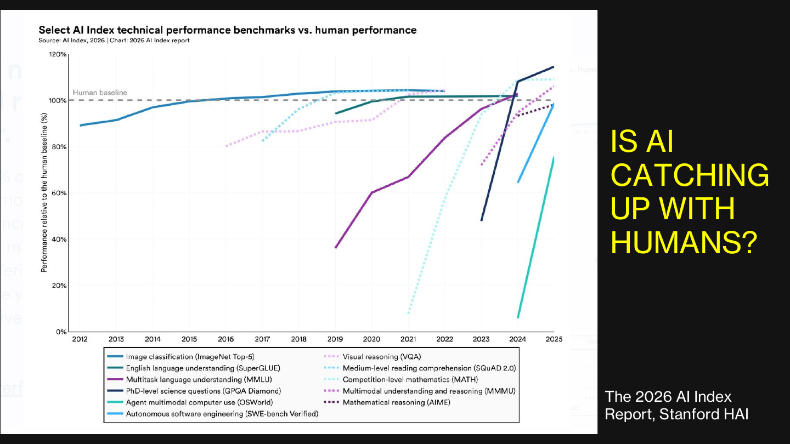

原图来源：本讲 PDF 物理 p.2，完整页保留；可点击打开大图。

原页英文题面与必要情境（讲义原文）

> IS AI CATCHING UP WITH HUMANS?
> The 2026 AI Index Report, Stanford HAI

从一条曲线读：图像分类接近或超过 100%，只支持它在该测试条件下达到参照成绩；不能推出拥有人的全部能力。电脑操作曲线仍低于基线，提示能力边界并不整齐。原图完整保留图例；各基准的样本与归一化不同，不对跨曲线高度作总体智力排名。Stanford 2026 报告确有这些图表，外核 E1 只作来源确认。

⚪ 参考作答（笔记推断）：对标题“是否赶上人类”，答案是某些测试接近或超过，整体能力不能据此认定。English reference: AI matches or exceeds selected human baselines on some benchmarks, but this does not establish general human-level competence.

### 2.3 p.3 · 采用速度：比较相同的上市年数

采用率（adoption rate）是某个调查口径下使用技术的人占样本的比例。横轴不是公历年份，而是首个大众产品推出后的年数；比较早期扩散，要把各技术放在相同横坐标看。

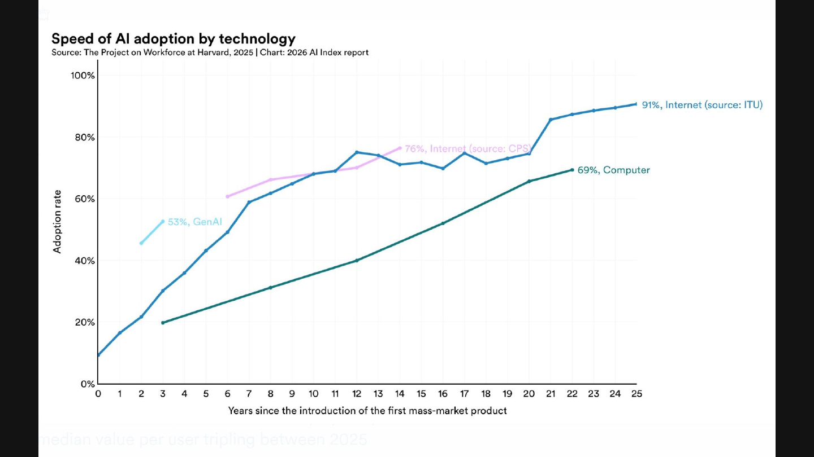

原图来源：本讲 PDF 物理 p.3，完整页保留；可点击打开大图。

原图标出 GenAI 约第 3 年 53%、电脑约第 22 年 69%、互联网两种来源分别到 76% 与 91%。这些终点不处于相同年数，不能直接拿 53 和 91 判断谁扩散慢。CPS、RPS 与 ITU 的样本年龄口径也不同；E1 的图注说明部分为 18–64 岁、ITU 为全部年龄。故可说图示 GenAI 初期扩散快，不能说全世界 53% 的人都已使用。它为培训紧迫性提供背景，不直接证明裁员规模。

### 2.4 p.4 · 中美模型分数：领先取决于指标和时点

原图用 Arena 的 Elo-like 分数比较当时两组顶尖模型，横轴从 2023 年到 2026 年初。终点标为美国组 1503、中国组 1464，差距为 39 分（本批计算脚本复算）。Elo-like 是按比较结果形成的评分，不是百分正确率；39 分也不是“智能差 39%”。

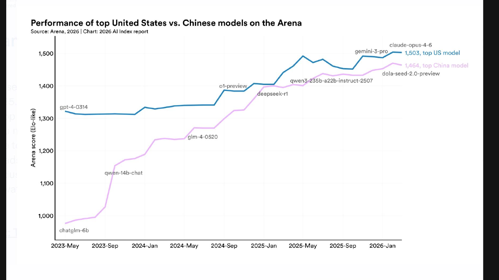

原图来源：本讲 PDF 物理 p.4，完整页保留；可点击打开大图。

两线总体上升且差距缩小，说明这个平台、这些时间点的竞争变化。模型名称只是该图历史标注，不代表今天的产品排名；采样、评审偏好和任务覆盖会影响分数。伦理上需继续问谁承担误差和使用后果，不能由高分推出安全或公平。

### 2.5 p.5 · OSWorld：任务成功率与人类基线

OSWorld 是让智能体操作电脑完成任务的测试。图的纵轴写 Accuracy，本页读为该测试任务成功比例；2025 年标值 66.30%，人类基线 72.35%。按百分数的同一标度相减，$72.35-66.30=6.05$ 个百分点；这不是模型“落后 6.05%”。

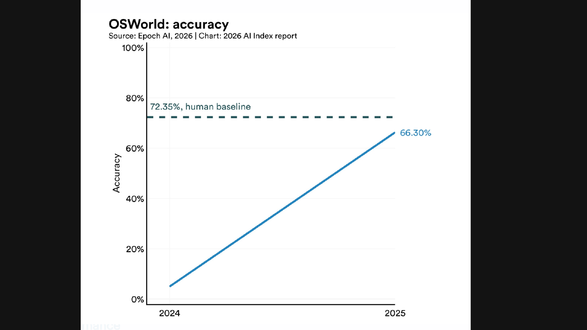

原图来源：本讲 PDF 物理 p.5，完整页保留；可点击打开大图。

💡 笔记补充：若把这两个比例放到假设的 1000 次同分布测试中，约为 663 次与 723.5 次成功的期望数量，后者不是实际半次任务。此例只解释比例，不能预测企业一定失败几次。部署还要核任务分布、权限与失败损害。曲线起点只作近似读图，不替它编造精确数值。

### 2.6 p.6 · 事故报告增长：数量不是发生率

柱图横轴是 2012–2025 年，纵轴是报告的 AI 事故数量，2025 年明确标 362。这里的单位是一项记录，不是受害人数，也不是每次使用的风险概率。图中前期起伏与后期增长可见，但未标数字的柱不据高度抄成精确统计。

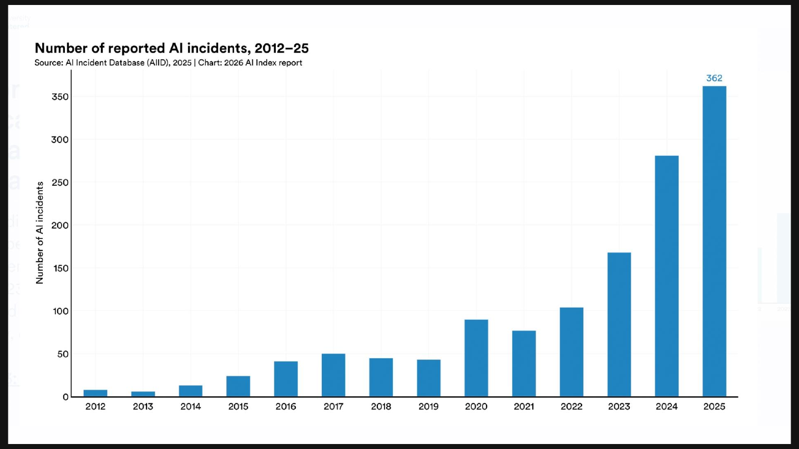

原图来源：本讲 PDF 物理 p.6，完整页保留；可点击打开大图。

事故数据库（AI Incident Database）受报告、收录和修订方式影响。使用规模、报告覆盖与真实风险都可能推动记录增加；缺少使用次数分母时，不能判断单次风险升降。E1 官网页面的 2024 年文字与本课件柱高不完全协调，保留课件原貌，年际增幅不在本页计算，也不静默替换原柱。

### 2.7 p.7 · 资本支出与市值集中：两张图不能混读

左下堆叠面积图表示七家企业市值占 S&P 500 总市值的比例；右下堆叠柱图表示四家公司季度资本支出，单位为十亿美元。市值（market value）是市场对股权的估值；资本支出（capital expenditure）是购建长期资产的投入。它们不是利润，也不是同一分母。

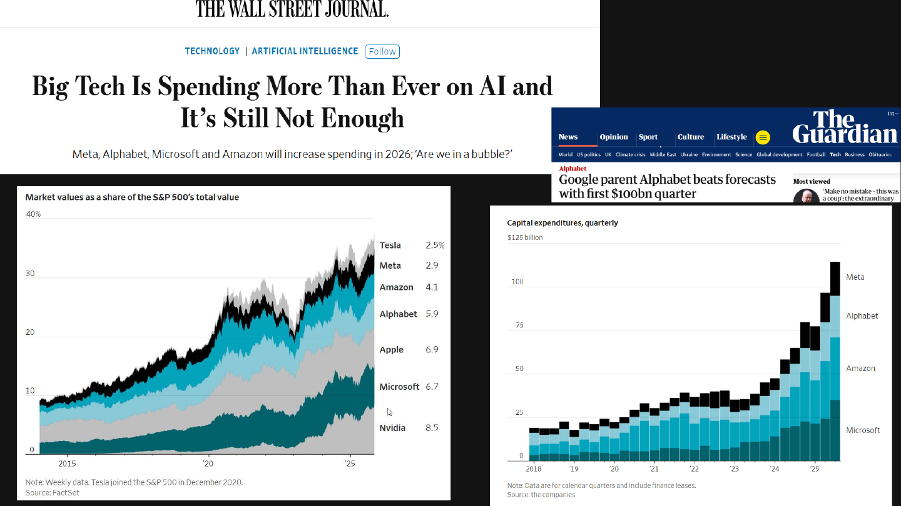

原图来源：本讲 PDF 物理 p.7，完整页保留；可点击打开大图。

左图终点列 Tesla 2.5、Meta 2.9、Amazon 4.1、Alphabet 5.9、Apple 6.9、Microsoft 6.7、Nvidia 8.5，合为 37.5%（脚本复算）；右图柱高应看全柱总额再看各颜色贡献，不把顶部单家公司误读为全柱。图注右图包含融资租赁。新闻截图强调投资增加和泡沫疑问，仅是课件所截报道；它不能证明投入全用于 AI、必然赚钱或泡沫已成立。

### 2.8 p.8 · 六类议题怎样连到企业决定

讲义列未来工作、生成式 AI 与真实性衰退、照护机器人、自动驾驶与武器、环境、奇点与控制。正文按实际页序先讲控制、后讲环境，保留这个顺序。左侧通用机械臂拼图没有独立机制，不作系统架构证据。

每一类都追问同一条链：企业采取什么行动，哪些人获得利益或承受损害，用什么规范判断，由谁落实控制与救济。AI 转型是描述，是否公平是规范判断；后者必须补上理由。

### 2.9 p.9 · 分隔：工作与人

本页只有工作主题标题，无新增知识或题目。接着看 p.10 的任务替代与 p.11 的能力增强，两者可能同时发生。

### 2.10 p.10 · 自动化替代的是任务，岗位结果仍须分析

任务自动化（task automation）让系统承担可重复的工作步骤；一个岗位通常包含多种任务，自动化一项不等于整个岗位消失。工作两极化（job polarization）的“哑铃”描述是高技能岗位需求大且高薪，部分低技能服务仍有需求但工资低；中间可预测的文职/工厂任务承压。

💡 假设企业自动生成标准报表，但员工仍负责解释异常和客户沟通，结果可能是岗位重组；若把全部任务取消才更接近岗位替代。讲义的中间岗位压力是分析框架，不能当作所有国家、年份或职业已实测的结论。企业要比较节约与失业/社区成本，并提供培训和有包容性的转岗方案。

### 2.11 p.11 · 增强：让人有能力影响最后决定

人机增强（augmentation）是 AI 支持人的能力，例如先整理病例供专业人员判断；替代则把相应任务交给系统。原图从左到右的人物与增加的齿轮，用箭头表达能力增强的概念，不是三个实测阶段，也不证明收益分配。

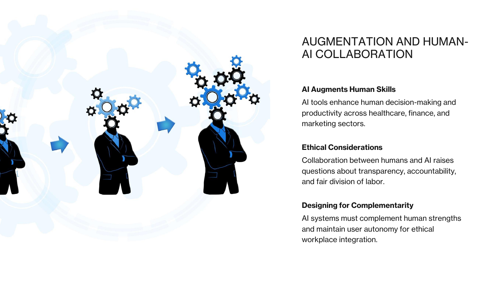

原图来源：本讲 PDF 物理 p.11，完整页保留；可点击打开大图。

互补设计（complementarity）要明确 AI 擅长的筛选与人的情境判断怎样衔接。💡 信贷模型给建议后，员工必须看到依据、拥有调整权限和复核时间，才有实际自主性（autonomy）；只让人点确认可能是形式监督。还须说明谁解释错误、谁承担纠正责任，以及生产率收益由工资、工时或股东收益怎样分配。

### 2.12 p.12 · 算法管理：被测量的人要能质询

<!-- cityu-nav:landing-12 -->
[[#4. 速查表|↩ 回速查]] · [[#5. 双语术语卡|回术语]] · [[#0. 三分钟速览|阅读导航]]
<!-- cityu-nav:landing:end -->

算法管理（algorithmic management）用数据和规则分配任务、评价表现或安排排班。💡 外卖员因照顾道路安全而降低速度，却被速度分数扣罚。这里的真实目标是及时且安全地完成服务，容易测的速度被拿来代表这个更完整目标，称为代理指标（proxy metric）。速度快不等于安全完成服务，所以按速度奖惩可能把好行为变成低绩效。

监控同时影响隐私、自主性、心理压力与公平。透明不是只说“用了 AI”，而是告知收集什么、怎样影响处分、多久保存和怎样申诉。工人参与（worker participation）让被管理者能指出指标漏掉的工作情境，配合人工复核与禁止不必要的持续监控。右侧电子脑图为装饰，不是算法流程。

### 2.13 p.13 · 再培训：机会可及才算支持

重新学习新岗位技能叫再培训（reskilling），提高现岗位能力叫技能提升（upskilling）。培训不是只发课程链接：企业须安排时间、费用、设备、岗位通道与效果检查。

💡 同样提供晚间在线课，照护家庭且缺电脑的员工可能无法参加；形式上同等待遇仍会产生不平等。因此要看不同群体的实际进入、完成和转岗机会。讲义认为企业负有支持转型的道德责任，这是规范主张，不冒充所有地方已有相同法律义务。课堂合照是通用培训场景，无研究数据。

### 2.14 p.14 · 包容创新：多元团队仍要有验证

包容创新（inclusive innovation）要求新技术的设计、参与和收益不系统排除某些人。讲义列减偏、多元团队、透明和利益相关者参与。多元代表可以发现盲点，但“团队多元→系统一定无偏”缺少必然推理。

💡 招聘工具须另核训练样本、分群错误、无障碍使用与申诉；把受影响求职者纳入测试，才能看到团队内部讨论看不到的障碍。利益相关者（stakeholder）指会影响或被企业行动影响的群体。本页开发者照片是示意，不证明实际团队构成。

### 2.15 p.15 · 效率与公平的四问

题意：当脑力任务也能自动化，技能淘汰由什么造成，企业怎样负责，增强是否必然扩大不平等，怎样对待人力资本。以下均为 ⚪ 参考作答（笔记推断），p.16–20 提供相反论证与制度方案。

原页英文题面与必要情境（讲义原文）

> CORE ETHICAL DILEMMA
> Efficiency vs. Equity
> • We've moved from automating muscles to automating minds.
> • Key Questions:
> • Is mass "skill obsolescence" an inevitable market outcome, or a 
> failure of corporate and public policy?
> • What is a business's ethical responsibility to its displaced 
> workforce?
> • Does AI-Augmentation inherently lead to greater inequality?
> • Business Impact: How do we value and retrain human capital in 
> an AI-driven enterprise?

1. 大规模技能过时（skill obsolescence）并非只能归给市场或政策一方。技术改变需求；培训机会、转型速度和分配规则影响谁承担损失。若没有可行培训却把全部责任归个人，遗漏制度条件。
2. 企业至少应履行适用合同与法律，再论证是否需提前通知、付费培训、转岗和过渡支持。道德责任不因最低合规自动穷尽。
3. 增强不必然提高不平等。工具只给少数高薪者、收益集中时可能扩大差距；普遍可及且收益分享时结论可变。
4. 人力资本（human capital）是人具备的知识技能，不是可随意耗尽的人。评估任务变化与可转移技能后，安排培训、匹配岗位并检查真实转岗，而非只记录节省人数。

English reference: Skill obsolescence reflects both technological change and institutional choices. Firms should meet legal obligations and consider reskilling and transition support. Augmentation need not increase inequality if access and gains are shared. Workforce planning should map changing tasks, support learning, and evaluate real transitions.

### 2.16 p.16 · 创造性破坏论证：事实不自动推出义务

创造性破坏（creative destruction）描述新生产方式替代旧活动，同时可能创造新岗位。讲义这一路径认为市场追求效率，个人应适应，企业只需高效盈利。

重建推理：〔事实主张〕技术曾替代并创造岗位；〔规范前提〕企业责任仅限高效盈利；〔结论〕再培训主要由个人负责。第二条不是第一条推出的事实。最强反驳是新岗位未必同地、同技能、同时间出现，过渡成本也非人人能承担；若企业掌握转岗资源且从替代获益，额外责任更有理由。不能仅以历史总岗位增长反驳当下特定员工受损。

### 2.17 p.17 · 政策与企业失灵：竞争压力不是免责证明

另一论证强调速度和规模、长期社会契约（social contract）以及竞争压力。社会契约在此是对企业与社会相互责任的规范期待，不是每名员工都有终身雇佣合同。题目中的竞争者节约 30% 是假设，不能写成已核公司数据。

原页英文题面与必要情境（讲义原文）

> THE "POLICY & CORPORATE FAILURE" ARGUMENT
> • Scale and Speed: The argument is that AI-driven displacement is 
> happening at an unprecedented scale and speed, outstripping the labor 
> market's natural ability to adapt. We are not just talking about manual 
> labor, but also professionals such as lawyers, analysts, artists, and mid-
> level managers.
> • The Social Contract: Historically, companies invested in their employees 
> for the long term. The ethical question is whether the modern, 
> shareholder-primacy model has broken this contract. Is it ethical for a 
> company to reap massive profits from AI-driven layoffs while bearing no 
> responsibility for the societal cost?
> • The Business Leader's Dilemma: If your competitor automates and cuts 
> costs by 30%, can you afford not to? This creates a prisoner's dilemma 
> where individual rational choices lead to a collectively negative outcome 
> (mass unemployment, social unrest).

⚪ 参考作答：公司获益却把可避免的失业成本全推给社区，可能违反公平分担；判断还需核实替代方案和真实承诺。面对竞争者降本，并非只能“照样裁员或倒闭”，可选择分阶段自动化、行业共同培训和公共过渡支持。囚徒困境（prisoner's dilemma）指在特定激励下，各方为自身选择却导致共同较差结果；本页未给收益矩阵，所以只是类比，未证明严格博弈结构。

English reference: Competitive pressure explains incentives but does not by itself excuse shifting avoidable costs onto workers. Firms can combine phased adoption, transition support, and coordinated training. The prisoner's-dilemma label is an analogy here, not a demonstrated payoff model.

### 2.18 p.18 · 被替代员工：最低责任与利益相关者责任

本页问题问企业对被替代员工承担什么伦理责任。股东优先（shareholder primacy）的最低论只要求守法及合同离职补偿；利益相关者观点（stakeholder view）还考虑员工、社区和社会的合理利益。ESG 是环境、社会与治理（environmental, social and governance），不是单一伦理理论。

原页英文题面与必要情境（讲义原文）

> WHAT IS A BUSINESS'S ETHICAL RESPONSIBILITY TO 
> ITS DISPLACED WORKFORCE?
> • The Minimalist View (Shareholder Primacy): The business's only responsibility is to obey the 
> law. This means providing severance packages as stipulated in contracts, but no additional 
> benefits. The workforce is a cost factor, and optimizing costs is a core function of 
> management.
> • The Stakeholder View (Modern ESG Perspective):A company has a responsibility to all its 
> stakeholders, including employees, the local community, and society at large.
> • Ethical Actions Could Include:
> • Proactive Reskilling & Upskilling: Investing in internal academies to train 
> employees for new, AI-augmented roles within the company. (e.g., AT&T's massive 
> multi-billion dollar reskilling effort).
> • Transition Support: Offering extensive outplacement services, career counseling, 
> and extended healthcare benefits.
> • "Lifetime Employability" Pledge: Shifting the promise from a job for life to a 
> commitment to making employees employable for life, even if outside the 
> company.
> • The Business Case for Ethics: This isn't just altruism. Treating displaced workers ethically 
> protects the company's brand, maintains morale among remaining employees, and can 
> prevent regulatory backlash.

⚪ 参考作答：先核合同与法律，再按可预见伤害、受益和控制能力配置提前培训、转岗、职业咨询和适用过渡福利。“终身可雇用性”是持续帮助具备就业能力，不保证永远找到工作。

美国电信企业 AT&T 被课件作为培训例子，但本页没有来源细节，不能复述为本批已核金额或成效。品牌、留任士气、监管风险可形成商业理由；即使短期回报不明显，公平论证仍须单独考虑。

English reference: A stakeholder approach supports proactive reskilling, redeployment and transition assistance, beyond applicable legal and contractual duties. Lifetime employability means supporting adaptable skills, not guaranteeing a job. Commercial benefits can reinforce, but do not replace, the ethical justification.

### 2.19 p.19 · 多数人被替代时：收入循环、UBI 与 UBS

本页是条件情景，不是已经发生的宏观预测。劳动→收入→消费→公司收入→招聘构成讲义循环；若生产收益主要归机器所有者，失去劳动收入者可能减少消费，生产更多不保证分配更公平。

原页英文题面与必要情境（讲义原文）

> WHAT IF AI DISPLACES MOST WORKERS?
> • The Economic Problem:
> • Modern economies depend on a cycle:
> • People work → earn income → buy goods and services → companies earn revenue → hire 
> workers.
> • If AI and robotics perform most productive work, productivity could soar, but income may 
> become concentrated among the owners of AI systems, data centers, and intellectual 
> property. Without redistribution, society could face: Mass unemployment; Rising 
> inequality; Reduced consumer spending; Social unrest and political instability; Loss of 
> meaning and identity traditionally derived from work
> • Is Universal Basic Income (UBI) the Solution?
> • Under UBI, every citizen receives a regular payment regardless of employment status
> • Is Universal Basic Services (UBS) the solution?
> • Instead of cash alone, governments provide: Healthcare; Housing support; 
> Education; Transportation; Internet access
> • Governments tax AI-generated productivity and distribute the proceeds to 
> citizens.

💡 工作还可能提供日常安排、同事关系、贡献感和身份认同。即使现金或服务补齐生活开支，也未必自动恢复这些非收入功能；但不能反过来说每个人的意义都只能来自工作。社区参与、照护和学习等也可能提供不同来源的意义。

⚪ 参考作答：全民基本收入（Universal Basic Income，UBI）提供与就业无关的定期现金；全民基本服务（Universal Basic Services，UBS）直接保障医疗、教育、住房支持、交通或上网等基本服务。前者让个人选用途，后者直接改善可及性；两者可以组合，不是唯一解。是否有效要核融资、服务容量、物价、支付水平和被遗漏人群。对 AI 收益征税是课件提出的政策方向，不是本批确认的现行普遍税制。

English reference: If labour income falls while AI ownership is concentrated, higher productivity need not sustain broad purchasing power. UBI provides regular cash independent of employment; UBS provides essential services. Neither is a complete solution without sustainable funding, access and distributional safeguards. Even adequate income support may not replace the routines, relationships or sense of contribution that work can provide.

💡 笔记补充机制图：

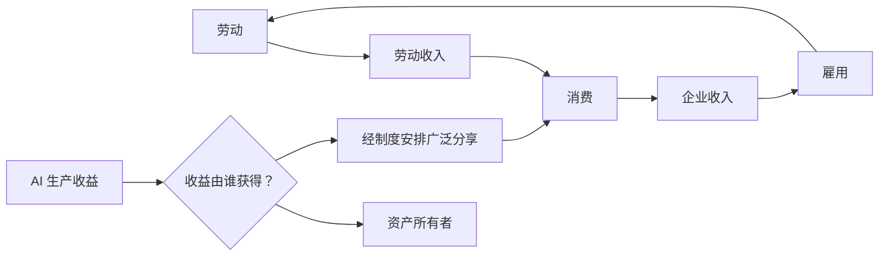

沿上行读正常劳动收入循环，再从 AI 收益看所有权分配。下行不是自动发生的循环补丁：税制、工资或所有权安排须真实存在，收入才可能进入广泛消费。

### 2.20 p.20 · 两层社会取决于所有权与治理

讲义问多数人被替代会怎样、是否形成两层社会、谁拥有会思考的机器。这里的关键资产包括算力基础设施、基础模型（foundation model）、数据、知识产权和能源资源；基础模型是可被适配到多种任务的通用底层模型，不等于全能智能。

原页英文题面与必要情境（讲义原文）

> WHAT IF AI DISPLACES MOST WORKERS?
> • Will a 2-tier society evolve?
> • Owners of productive intelligence versus non-owners of productive intelligence
> • In the industrial age, the critical asset was land and factories
> • In the AI age, the critical assets may be:
> • Compute infrastructure
> • Foundation models
> • Data 
> • Intellectual property
> • Energy resources powering AI
> • Who owns the machines that think?
> • If ownership becomes highly concentrated, a two-tier society is plausible. If AI 
> wealth is widely shared, the result could instead be a society with less work, 
> greater leisure, and broader prosperity. The outcome is likely to depend more 
> on governance and ownership structures than on the technology itself.

⚪ 参考作答：若收益和决策权集中于资产所有者，而其他人失去工资且无收益分享，阶层分化是可能结果；不是技术必然。广泛持有、员工分享、竞争政策和公共服务可改变分配。不能只数使用者，要看谁有所有权、议价和退出权。条件变式：人人能用免费工具，但关键资产与收益仍高度集中，访问平等仍不能证明财富平等。

English reference: A two-tier society is plausible when ownership and returns are concentrated, but it is not inevitable. Governance, bargaining power, shared ownership and redistribution shape the outcome. Access to a tool is different from ownership of its productive returns.

### 2.21 p.21 · 分隔：真实性衰退

本页只有主题标题。真实性衰退（truth decay）在本讲指事实识别和公共信任受到侵蚀的风险，不是宣称客观事实不存在。p.22–32 分开讲内容错误、造假和对真实证据的否认。

### 2.22 p.22 · 生成式 AI：收益与部署条件分开

生成式 AI（Generative AI）生成文字、图像或视频，可帮助创意、提高产量和个性化。生成速度回答“多快产出”，真实性（authenticity）与知识产权（intellectual property）回答“来源与使用是否有依据”，不能由前者推出后者。

💡 企业广告先生成候选，再核事实、肖像和素材许可，最后批准发布。风险随发布对象、受众和纠错能力变化；了解能力限制要落实为流程，而非只让员工阅读免责声明。右侧天平与电路图为主题装饰，无实际评分含义。

### 2.23 p.23 · 深度伪造：内容、身份和传播链都要查

深度伪造（deepfake）是用 AI 生成或改变逼真的影像/声音。错误信息（misinformation）不要求证明恶意；蓄意造假用于欺骗还涉及传播意图。技术可以用于合法配音，不能只凭“AI 合成”判定违法或有害。

💡 假 CEO 语音→财务人员误信身份→付款，损害并非只来自音频逼真，还来自验证和支付控制失效。开发者、平台与使用者要分别负责限制滥用、处理传播与核身份；检测工具可能误报漏报，不能把检测分数当最终证据。与 M08 的真实性/权利区分相连。

### 2.24 p.24 · 幻觉：专业语气不代替证据

幻觉（hallucination）是生成输出缺乏可靠依据、与事实或给定材料不一致等错误。它不是机器必然具有欺骗意图；后果取决于使用者把它带进什么决定。

💡 法律草稿含虚构案例，需要回官方判例库核案号与内容，不能只问模型“你确定吗”。讲义提出测试、透明和用户教育；相应控制应包括限定用途、引用回源、专家签核及错误升级。高平均准确率不能排除少数高损害错误；可靠性（reliability）还包括在实际条件下持续符合任务要求。

### 2.25 p.25 · 内容责任：谁能控制哪一步

问责（accountability）要求某方解释、接受质询并纠正；法律责任（liability）是特定法律条件下的后果，二者不完全相同。生成者、部署企业、审核者和平台可能各控制不同环节，不能用“模型写的”结束追责。

💡 企业发布错误产品说明，先查资料来源、生成配置、审核权限、发布日志与纠错时间，再按法域和损害分析。课件未给具体法条或案件事实，所以本页不判定某一方必然赔偿。版权争议与虚假事实是不同风险，都需政策和监督。三个小照片只是责任、规则、协作的图标式装饰。

### 2.26 p.26 · 内容审核：保护与表达自由怎样同时处理

内容审核（content moderation）通过规则、过滤和人工处理减少有害内容。删除一切争议内容会压制合法表达，完全放任又可能放大伤害；必须说明目标、标准和申诉。

💡 对冒充企业付款的视频，先限制传播并保全证据；对批评企业的真实视频，不能因“不利品牌”就当作深度伪造删除。高风险紧急处置后仍需复核、通知与纠错。原图的锁、钥匙、摄像头围绕 AI 只是安全主题符号，不代表已实现的审核架构。

### 2.27 p.27 · 生产率与来源：五个原问逐一回答

题意包含“什么是真”、输出归谁、训练是否 fair use、品牌怎样防假及怎样维持信誉。以下为 ⚪ 参考作答（笔记推断），不是官方唯一答案。

原页英文题面与必要情境（讲义原文）

> CORE ETHICAL DILEMMA
> Productivity vs. Provenance
> • When everything can be faked, what becomes of truth?
> Key Questions:
> • Intellectual Property: Who owns the output? Is training data 
> "fair use" or theft?
> • Misinformation & Reputational Risk: How do businesses 
> combat deepfakes and synthetic media that target their brand?
> • Erosion of Trust: How can organizations maintain credibility in 
> a "post-truth" digital environment?
> • Business Impact: The need for "Truth Tech" (provenance, 
> watermarking) and new corporate communication strategies.

1. 一切可伪造会提高验证成本，不会让真相消失。要问原始证据、独立印证和可更正记录。
2. 输出权利取决于人类创作贡献、许可、合同与法域；仅使用模型不自动取得全部可排他权利。
3. 美国的合理使用（fair use）是有条件的法律分析；“合理使用或盗窃”是假二分。训练资料可能已获许可、属公有领域或涉及例外，也可能侵权；无事实不能定案。本讲不新增现行判决结论，参 M08 的法域限定。
4. 品牌防御要有监测、独立回拨、付款双重审批、可信公开渠道与危机演练。
5. 信誉来自可验证的来源记录、透明披露与持续纠错；水印（watermarking）与来源（provenance）只能支持部分验证，不能保证叙述为真。

English reference: Synthetic media increases verification costs but does not abolish truth. Output rights and training legality depend on jurisdiction, facts, licences and applicable exceptions. Businesses need independent verification, payment controls and trusted communication channels. Provenance and watermarks support authentication but do not prove factual truth.

### 2.28 p.28 · 三类品牌攻击：不要把假设当新闻

课件提出三个风险场景：假 CEO 财报视频可能影响股价；假内部备忘录可能破坏客户/合作关系；冒充管理者的音视频可能诱导转账。均用可能语气，没有给出可核案件，不能写成已发生案例。

💡 第一类应交投资者沟通、法务和平台协作澄清；第二类验证文件来源、通知受影响合作方；第三类在付款前独立确认并执行双人审批。仅加强视频检测不能覆盖文件造假或授权链失效。每类损害路径不同，控制要落在错误行动之前。

### 2.29 p.29 · 造假便宜、辟谣昂贵：把防御提前

不对称（asymmetry）指造假者可以低成本扩散，受害方却须调查、证明和修复信誉；“firehose of falsehood”强调信息洪流，不是这里已量化的比例。

课件三项措施分别是持续监测品牌/高管合成媒体、让公关与法务演练深伪危机、预设可信验证渠道。所谓 proof of life 在本页指真实通信的验证安排，不是仅凭视频中的人“活着”就通过。💡 预设暗号若泄露也失效；应通过已知号码回拨、独立签名渠道和权限分离组合验证，而非把单一口令当永久安全保证。

### 2.30 p.30 · 谎言者红利：真的也能被说成假的

谎言者红利（liar's dividend）是造假技术普及后，行为人更容易把真实不利证据也说成伪造，从而逃避问责。这与“相信假内容”的第一层风险方向相反：它使人不信真内容。

原页英文题面与必要情境（讲义原文）

> EROSION OF TRUST: HOW CAN ORGANIZATIONS 
> MAINTAIN CREDIBILITY IN A "POST-TRUTH" DIGITAL 
> ENVIRONMENT?
> When everything can be faked, the most valuable business asset 
> becomes provable trust.
> • The "Liars' Dividend": This is the most insidious effect. As the public 
> becomes aware of deepfakes, it becomes easier for malicious actors to 
> dismiss real evidence as fake. A corrupt leader can dismiss a damning, 
> authentic recording as "just another deepfake." This erodes the very 
> foundation of accountability.
> • The Business Impact of Generalized Distrust:
> • Consumer Skepticism: Why should a customer believe your 
> marketing claims, your ESG reports, or your product reviews if they 
> can all be synthetically generated?
> • Supplier & Partner Risk: How can you trust the digital credentials 
> and contracts from your partners?
> • Internal Culture: How can employees trust internal communications 
> from leadership?

⚪ 参考作答：企业维持信誉要把声明连到可追溯证据、可审计过程和可纠错机制。消费者核营销/ESG/评论时，不因排版专业就信，也不因可合成就全拒绝；伙伴核数字凭证与合同，应查签发者、完整性和授权；员工核内部通信，应使用预先确认的正式渠道。ESG 报告的真实性还须看实际数据，签名仅认证某方签发。

English reference: The liar's dividend lets actors dismiss authentic evidence as synthetic. Organizations should provide traceable evidence and auditable correction processes. Customers, partners and employees need to verify claims, credentials and communications through trusted independent channels rather than relying on appearance alone.

### 2.31 p.31 · 来源认证不是事实认证

本页回答与 p.30 相同的信誉问题，新增来源记录、透明和“Truth Tech”。数字签名（digital signature）用密码方法验证签发及内容完整性；C2PA（Coalition for Content Provenance and Authenticity）用内容凭证记录部分来源与编辑断言，见 E2。

原页英文题面与必要情境（讲义原文）

> EROSION OF TRUST: HOW CAN ORGANIZATIONS 
> MAINTAIN CREDIBILITY IN A "POST-TRUTH" DIGITAL 
> ENVIRONMENT?
> The Strategic Response: "Trust Engineering"
> • Provenance and Watermarking: Businesses will need to 
> adopt technical standards (e.g., the Coalition for Content 
> Provenance and Authenticity - C2PA) that cryptographically 
> sign the origin and edit history of their official media assets.
> • Radical Transparency: Being open about data use, AI 
> deployment, and mistakes. In a world of deception, honesty 
> becomes a competitive differentiator.
> • Investing in "Truth Tech":Supporting and implementing 
> technologies that verify the authenticity of digital content, 
> making it a part of the corporate tech stack, just like 
> cybersecurity.

⚪ 参考作答：企业发布带有效凭证的媒体，再让接收者核签名、可信签发者与编辑记录；同时用独立证据查其中事实。签名有效的虚假声明仍可能是假，凭证缺失也不能直接判假。水印、隐私披露和纠错策略是互补控制，不能画成同一技术。条件变式：相机签名证明照片链路，仍不证明镜头外情境或文字解说准确。

English reference: Content Credentials can verify provenance assertions and integrity, not the truth of the depicted claim. Firms should combine trusted signing, independent fact-checking, transparent disclosure and correction. Missing credentials alone do not prove fabrication.

💡 笔记补充机制图：

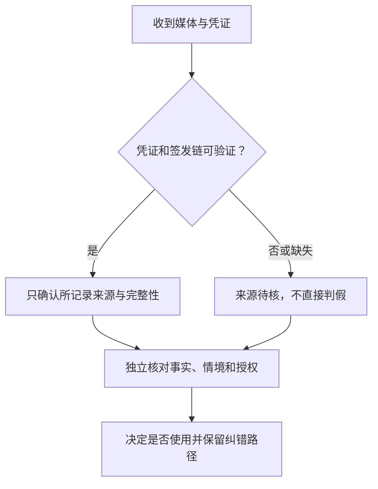

顺着“是”走也仍须核事实。譬如签名声明“利润增长”仍需财务依据；顺着“否”走则寻找其他证据，不把缺凭证变成造假判决。

### 2.32 p.32 · 员工不信工具时：给出可核的使用边界

题目问内部信任失效会怎样。讲义给三例：律师草拟文件引用不存在的判例、营销分析生成虚假趋势、工程代码含隐蔽漏洞。它们是课件教学场景，不能说模型生成的每个合同或代码都会出错。

原页英文题面与必要情境（讲义原文）

> THE INTERNAL CORROSION: WHAT HAPPENS WHEN 
> YOUR EMPLOYEES CAN'T TRUST THEIR OWN TOOLS?
> This is an often-overlooked but critical internal risk.
> • The "Hallucination" Problem as a Business Hazard:
> • A junior lawyer uses an AI to draft a contract, not realizing it has 
> invented non-existent case law.
> • A marketing team uses an AI to analyze customer data, and it 
> generates plausible-but-false trends, leading to a disastrous 
> campaign.
> • An engineer asks an AI for code, which contains subtle, critical 
> security vulnerabilities.
> • The Ethical Responsibility: Companies have a duty to train employees 
> on the responsible use of these tools, emphasizing that they 
> are drafting assistants or idea generators, not sources of ground 
> truth. This requires clear policies, training, and a culture of human-in-
> the-loop verification.

⚪ 参考作答：先让员工知道工具可用于起草而不能直接当最终事实来源，再按用途设置核验。判例回官方原文，趋势回原始数据与可复算统计，代码做必要审查和测试；审核人须有能力、权限和时间。人类在环（human-in-the-loop）不是“有人看过”即安全；要记录发现、处理和升级。若核验成本高于收益，应缩小或停用该用途。

English reference: Internal trust requires task-specific verification: check legal sources, reproduce data analysis and review and test code. Human oversight is effective only when reviewers have competence, authority and time. Unverifiable high-impact uses should be restricted.

### 2.33 p.33 · 分隔：AI 照护机器人

本页只有照护主题标题。接下来先区分照护任务与人的关系，再讨论数据、监督和责任，不能以“有人陪伴的感觉”代替整个照护质量。

### 2.34 p.34 · 照护任务：支持与取代要分别判断

照护机器人（care robot）可以在特定设计与验证条件下协助监测生命体征或日常活动；并非所有陪伴机器人都能完成临床监测。原图是病房中机器人与托盘的示意场景，帮助辨认任务环境，不是已验证医疗器械或真实疗效证据。

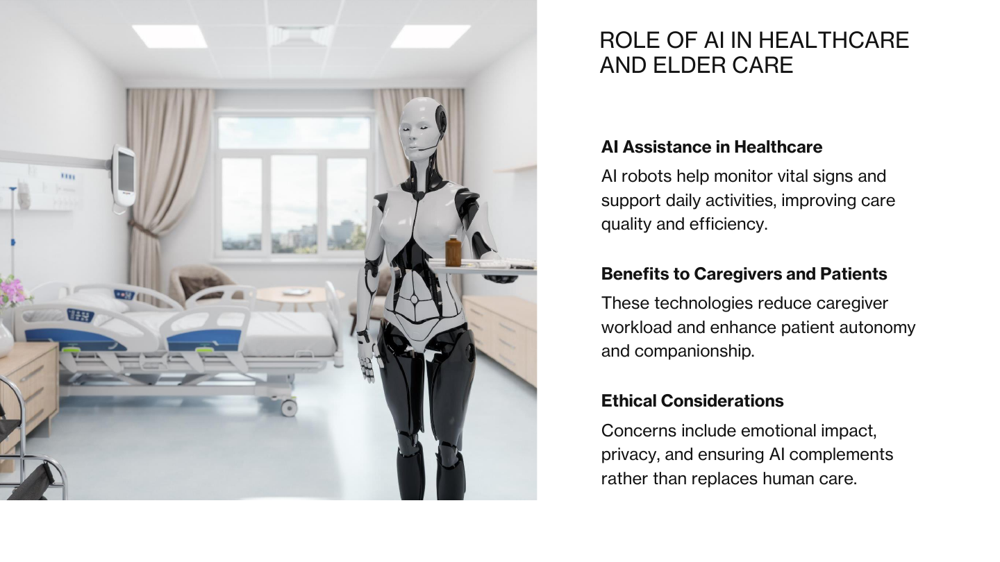

原图来源：本讲 PDF 物理 p.34，完整页保留；可点击打开大图。

💡 机器人提醒喝水可减少重复工作，但用户是否真的喝水、是否适宜饮水和何时通知护士仍需边界。任务效率、患者自主性、照护者负担与陪伴是不同目标。若用机器人减少全部人类接触，可能把“补充照护”的收益变成社会隔离成本；必须核具体替代了什么。

### 2.35 p.35 · 照护数据：敏感不等于可自由变现

健康和个人数据（health and personal data）可暴露身体状况、生活规律和私密活动。知情同意（informed consent）要求当事人得到可理解的信息并有适当选择；“点了同意”不能自动证明理解和自愿。

💡 为跌倒报警收集的动作数据，不应仅因平台拥有服务器就转售保险商。先确定目的、最少字段、谁可访问、保存多久及怎样撤回/删除，再核适用规则。数据控制权限、使用许可与“所有权”要分开，不把数据当普通无条件商品。锁与机械臂是安全主题装饰，没有具体加密方案。

### 2.36 p.36 · 情感依恋：主观安慰与关系真实性不同

情感依恋（emotional attachment）是使用者对互动对象形成情感联系；机器人不必真实具有情绪，也可能让人感到安慰。原图中的轮椅人物与伸出的手呈现帮助/关系的意象，不证明机器人具有同理心，也不证明所有老人容易依赖。

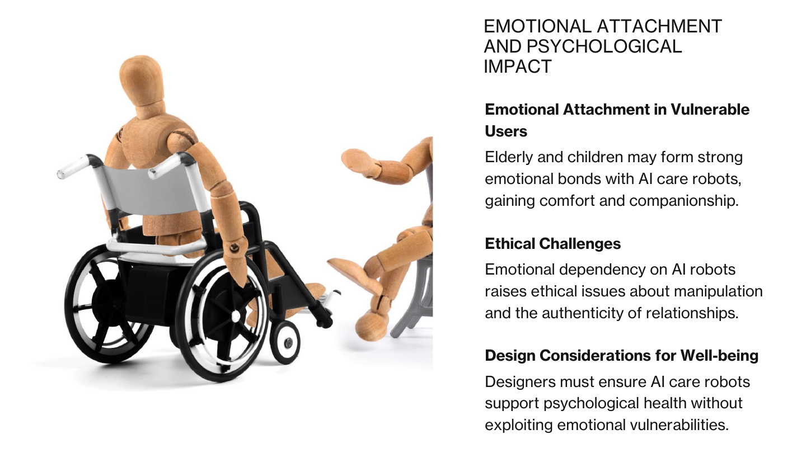

原图来源：本讲 PDF 物理 p.36，完整页保留；可点击打开大图。

💡 如果机器人用“只有我爱你”诱导老人购买服务，问题是利用脆弱性操控；如果清楚说明其功能并保持真人联系，安慰的价值仍可讨论。要观察依赖、退出困难及照护联系有没有减少，不能把所有依恋都当病理，也不能凭短时开心推定长期福祉。

### 2.37 p.37 · 人类监督：触发条件、接管者、时限

监督必须变成可执行安排：机器人可做什么，遇到什么情况暂停或告警，谁接管，接管失败怎样升级。尊严（dignity）要求把人当有自身价值与偏好的人；自主性要求其意愿能够影响决定。

💡 跌倒疑似告警→值班人员确认→必要时安排现场帮助；若值班者无响应，则升级备用联系人。这里只是流程示例，不是医疗处置建议。系统要先验证检测和通知可靠性；一句“交给人判断”若没有可达的人，不能算有效控制。右侧医学图标拼图非实际监护链。

💡 笔记补充机制图：

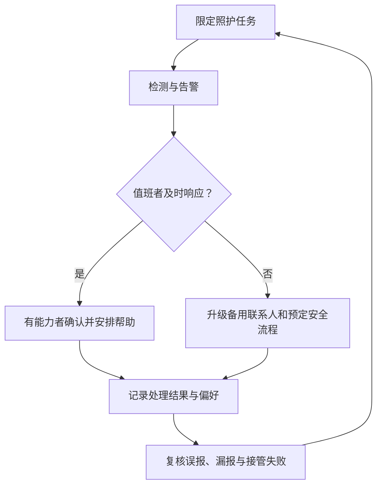

图是告警治理而非临床处置算法。沿“否”分支读：无人接警不能直接结束，必须有预先验证的升级路径；记录与复核使下一轮改进有依据。

### 2.38 p.38 · 照护治理覆盖整个生命周期

治理（governance）是明确决策、责任、监督和纠正的安排。讲义要求设计、测试、部署和持续监测都受审查，不能只在采购时签一份伦理声明。

💡 采购前核目标人群与限制；试点核误报漏报和接受情况；使用中核投诉、系统更新与真人联系；发现伤害则纠正或撤回。技术人员、照护专家、伦理/法律人员和公众提供不同信息。课件没指定法域、产品类别或具体法条，因此本页讲治理原则，不称已核某种照护机器人符合所有法规。听诊器照片为主题装饰。

### 2.39 p.39 · 效率与同理心：四个问题

题意：能否外包照护，模拟同理心是否欺骗，私密数据怎样处理，机器人伤人谁负责。以下为 ⚪ 参考作答（笔记推断）。

原页英文题面与必要情境（讲义原文）

> CORE ETHICAL DILEMMA
> Efficiency vs. Empathy
> • Can and should we outsource care?
> • Key Questions:
> • Deception & Dignity: Is it ethical to use companion robots that 
> simulate empathy for dementia patients?
> • Data Privacy: The most intimate human data (health, emotional 
> state) is being collected. How is it protected and used?
> • Responsibility Gap: If a care robot makes an error that harms a 
> patient, who is liable? The manufacturer, the programmer, the 
> hospital?

1. 部分任务可以交给已验证系统；是否应该取代关系，要另看尊严、自主性和长期人际接触。
2. 对有认知障碍者，须同时衡量实际安慰与欺骗/依赖风险。不能为了机构方便假称机器人真有感情，具体能力评估和偏好仍重要。
3. 数据保护要覆盖收集、传输、访问、用途和删除，限制二次使用并提供可理解说明。
4. 制造、开发与部署者可能各有责任；先查故障、职责、监督及因果，再核法域，不能只从“谁写代码”推定唯一赔偿人。

English reference: Validated robots may assist specific care tasks, but replacing human relationships requires separate ethical justification. Benefits must be weighed against deception, dependency and loss of contact. Sensitive data needs purpose limits and access safeguards. Liability depends on duties, defects, causation and the applicable legal framework.

### 2.40 p.40 · 支持使用的论证：真实安慰仍需证据

课件把支持方称为“疗愈性谎言”（therapeutic lie）：用减轻痛苦的利益，为某种不真实互动辩护。这是课件的论证标签，不能据此认定所有模拟互动都在欺骗。用户清楚它是机器仍感安慰，与用户被误导为它真实理解、爱自己，是不同情形。

行善（beneficence）是促进受照护者利益、减轻痛苦的伦理原则。课件以 PARO 海豹机器人为例，主张模拟互动可能带来安静和减少药物需要；它没有在本页提供试验、样本或效应量，不能把这项具体疗效当本批医学结论，也不能据此建议减药。

论证链是：若设备确能减轻痛苦，且替代选项是长期孤独，则有限使用可能更好。最强反驳是机构是否制造了这个二选一，隐瞒了真人照护的可行方案。必须核收益是否真实、伤害是否受控、是否保留人际联系；商业价值提案不能单独证明对患者最好。

### 2.41 p.41 · 反对使用的论证：不能由诊断推出无同意能力

<!-- cityu-nav:landing-41 -->
[[#4. 速查表|↩ 回速查]] · [[#5. 双语术语卡|回术语]] · [[#0. 三分钟速览|阅读导航]]
<!-- cityu-nav:landing:end -->

本页反对的理由是关系不真实、照护被委托后真人联系减少，以及同意困难。主体间性（intersubjectivity）指人与人之间相互理解、回应的关系；模拟回应不自动等于机器人真的理解或爱人。

原页英文题面与必要情境（讲义原文）

> DECEPTION & DIGNITY: IS IT ETHICAL TO USE 
> COMPANION ROBOTS THAT SIMULATE EMPATHY FOR 
> DEMENTIA PATIENTS?
> The Case Against (The "Dignity Argument"):
> • Inauthentic Relationships: These robots engage in "faked 
> intersubjectivity." They cannot truly understand or love the patient. 
> Using them is fundamentally deceptive, treating a human being as 
> a problem to be managed rather than a person to be engaged.
> • Erosion of Human Connection: It creates a risk of "care by 
> delegation," where families and institutions feel absolved of the 
> more challenging, time-consuming duty of providing genuine 
> human contact. The robot becomes a convenient substitute, not a 
> supplement.
> • Informed Consent is Impossible: A patient with dementia cannot 
> consent to being in a relationship with an entity that feigns 
> emotions. This violates the core bioethical principle of autonomy.

⚪ 参考作答：若系统利用认知困难假装真爱并取代可行的人际照护，反对理由很强；若作为透明、可拒绝的补充且有净收益，不能一概排除。本页“Informed Consent is Impossible”过度概括。E3 的 NHS 治疗同意说明强调，就具体决定和时点评估能力。痴呆可能影响能力，但诊断本身不证明所有决定都不能同意；该资料处于英格兰和威尔士的法律背景，不直接规定香港个案或机器人数据处理的合法同意。

💡 伦理教学中可怎样观察理解：先用当事人能明白的话说明机器人拍什么、谁会看、为什么拍、有哪些替代或拒绝选择，再请其用自己的话复述、保留这些信息作比较，并表达选择。若只会重复“可以”，仍不知道谁会看，就不能仅凭答应二字推定已理解。这是理解观察的教学例，不是香港法律或临床能力裁定；实际评估与数据处理依据须依当地有效规则及适当专业判断。

English reference: Simulated empathy risks deception and replacing genuine contact. However, dementia does not automatically remove capacity for every decision. Assess the particular decision and time, support participation, and use the applicable safeguards where capacity is lacking.

### 2.42 p.42 · 私密数据的用途与代为决定：六问

本页列生命体征、洗浴/如厕视频、私人对话、推断情绪和认知变化等资料。这些是风险范围举例，不表示每台照护机器人都采集全部字段。题意重点是保护、二次用途和谁能同意。

原页英文题面与必要情境（讲义原文）

> DATA PRIVACY: THE MOST INTIMATE HUMAN DATA IS 
> BEING COLLECTED. HOW IS IT PROTECTED AND USED?
> Care robots are data collection machines that operate in the most private spaces: 
> homes and bedrooms.
> • The Nature of the Data:
> • It goes far beyond names and addresses. It includes real-time health vitals, 
> video of daily activities (including bathing and toileting), audio of private 
> conversations, emotional states inferred from voice tone, and patterns of 
> behavior that reveal cognitive decline.
> • The Business Risks and Ethical Pitfalls:
> • Data Breaches: A hack of this data would be catastrophic, exposing a 
> vulnerable individual's most intimate moments.
> • Secondary Use & Commercialization: Could this data be used to train other 
> AI models? Sold to insurance companies? Used for targeted advertising for 
> health products? The business model of "data monetization" becomes 
> deeply problematic here.
> • Informed Consent (Again): Is an elderly or cognitively impaired person truly 
> able to understand and consent to this level of surveillance? Can a family 
> member ethically consent on their behalf?

⚪ 参考作答：保护需目的最小化、适当访问权限、加密、留存期限与可追责日志。训练其他模型、卖给保险商、健康广告是三个不同二次用途，原照护许可不自动覆盖任一项；须分别核必要性、适用依据和受影响者利益。

高龄或认知障碍者是否理解不能一概断定，要按具体决定评估并提供支持。接 p.41 的教学例，某人能复述“机器人只提醒我喝水、可以关闭”，不等于能理解卧室录像被转卖保险商的复杂后果；改变用途就要重新说明并检查理解。家属关系也不自动产生无限代理权。缺能力时按当地有效授权、最佳利益和尽可能参与的保障处理，不为商业变现推定同意。

English reference: Minimize collection and secure access, transmission and retention. Training, insurance sales and advertising are separate secondary purposes and are not automatically covered by care consent. Assess capacity for the specific decision; family status alone does not establish unlimited authority to consent.

### 2.43 p.43 · 照护责任链：六个检查点

本页用产品责任（product liability）比喻实际伤害，但“电车难题”不是责任法规则。硬件故障、软件缺陷、训练偏差、监督失败和超范围使用可能形成不同因果路径，黑箱增加取证难度，不等于无人负责。

原页英文题面与必要情境（讲义原文）

> RESPONSIBILITY GAP: IF A CARE ROBOT MAKES AN 
> ERROR THAT HARMS A PATIENT, WHO IS LIABLE?
> This is the "trolley problem" of product liability, moving from the theoretical to the 
> tragically real.
> • The Chain of Responsibility is Unclear:
> • The Manufacturer: Was it a hardware flaw (a malfunctioning motor) or a 
> software error (a faulty algorithm)?
> • The Programmer: Was the AI's training data biased? Was there a flaw in its 
> decision-making logic? (e.g., a fall-detection algorithm that fails to alert a 
> human).
> • The Healthcare Institution/Family:Did they fail to properly supervise the 
> robot? Did they use it for a task it wasn't designed for?
> • The "Black Box" Problem: With complex AI, it can be technically impossible 
> to determine why a specific decision was made, making legal liability a 
> nightmare.
> The Business Impact: This creates massive, uncharted legal and financial risk. It 
> will drive up insurance costs and require new regulatory frameworks. Companies 
> must engage in "defensive design" and have extremely clear boundaries of 
> operation.

⚪ 参考作答：总问“谁负责”须按证据分配，不先点唯一主体。逐问检查：电机或软件故障要核制造/集成测试；训练偏差与判断逻辑要核数据和开发；无人响应告警要核机构监督；用于未验证任务要核说明、培训与使用者行为。多个主体可同时有贡献，但是否承担法律责任及责任形式仍待法域与事实。“保险一定涨价”是课件预测，不能当已核价格事实。防御性设计（defensive design）在此指预先限制可预见误用并保留记录，不是用免责条款消除一切责任。

English reference: Trace hardware and software defects, biased data, decision logic, supervision and out-of-scope use. Several parties may contribute to harm. Determine duties and causation before assigning legal liability; technical opacity complicates evidence but does not eliminate responsibility.

### 2.44 p.44 · 感到被爱是否等于好的照护

题目把“使人感到被爱”与“实际爱人”分开。⚪ 参考作答：主观安慰可以是真实益处，但不是充分条件；还要看是否欺骗、能否退出、隐私是否受保护、真人联系是否减少及效果是否持续。

原页英文题面与必要情境（讲义原文）

> A KEY QUESTION
> If a robot can make an elderly person feel loved 
> but does not actually love them, is that good care 
> or a sophisticated form of deception?  
> • The central ethical issue of AI care robots is not 
> whether they can perform caring tasks, but whether 
> society should allow artificial care to replace human 
> care. The debate concerns balancing efficiency, 
> safety, and accessibility against human dignity, 
> authentic relationships, privacy, and autonomy.

💡 同一机器人在有明确说明、有人类探访的照护计划里可能是补充；若机构用它把所有探访取消，却声称患者已有真实亲密关系，判断会变。核心冲突是效率、安全和可及性与尊严、真实关系和自主性之间的取舍；先说明使用条件，不能只选“好”或“骗”。

English reference: Feeling loved may provide a real benefit, but it is not sufficient for good care. Ethical use depends on transparency, supported choice, privacy, sustained benefit and preservation of human contact. A supplement and a deceptive replacement warrant different judgments.

### 2.45 p.45 · 分隔：自动驾驶与自主武器

本页只有两类自主系统标题。自主（autonomous）描述系统在授权范围内选择或行动的能力，不说明它具有道德人格，也不意味着人类责任消失。

### 2.46 p.46 · 自动驾驶：日常风险比极端两难更普遍

自动驾驶汽车（Autonomous Vehicle，AV）需要感知道路、预测其他人行动并选择驾驶行为。安全、公平、透明和责任均会影响部署。手机汽车图片是使用场景示意，不证明手机控制就是自动驾驶。

💡 同样保持车内舒适，若对自行车留距更小，就把风险转给车外人。不能只问“紧急时撞谁”，还要问测试覆盖谁、误检发生在哪些天气、人能否接管。适用自动化等级和运行条件不同，责任链也不同；本页不把驾驶辅助等同完全无人驾驶。

### 2.47 p.47 · 自主武器：人的判断不能被标签代替

自主武器系统（Autonomous Weapon System，AWS）在激活后可不经进一步人工干预选择并攻击目标，E4 的 ICRC 采用功能定义。致命自主武器系统（Lethal Autonomous Weapon Systems，LAWS）强调致命用武场景；不是所有军用 AI 或遥控武器都属于同一类别。

伦理问题是生死决定、可预测性、平民保护与人类控制。讲义主张严格监督和国际治理；这是一种治理立场，不等于全球已经签订完全相同的禁令。左图物联网图标与机械臂没有目标识别流程，不能拿它证明作战系统结构。本篇只分析伦理与治理，不讨论操作武器。

### 2.48 p.48 · 自主系统责任：设计与使用都要留证

开发者、制造者、部署者和操作者控制不同条件。💡 若感知组件漏检行人，先查传感器、数据、软件版本和当时条件，再查是否超运行范围、是否应有监督；不能由“系统自主”推出没有人有说明与纠正义务。

法律框架明确角色、证据保存与救济，有助于受害者获得处理；透明能支持追查，但公开源码并不自动证明因果。课件未给特定事故、法域或条文，不在这里裁定法律责任。左下天平与退休基金照片是模板装饰，标签与本页自主系统没有真实账户关系。

### 2.49 p.49 · 公众信任：沟通须有实际响应

原图是车流照片叠加节点与连线，表达互联交通场景，不是某城实时车辆通信拓扑；圆点不代表风险概率。它提示自主系统在多人共享道路上使用，受影响者不仅是购买者。

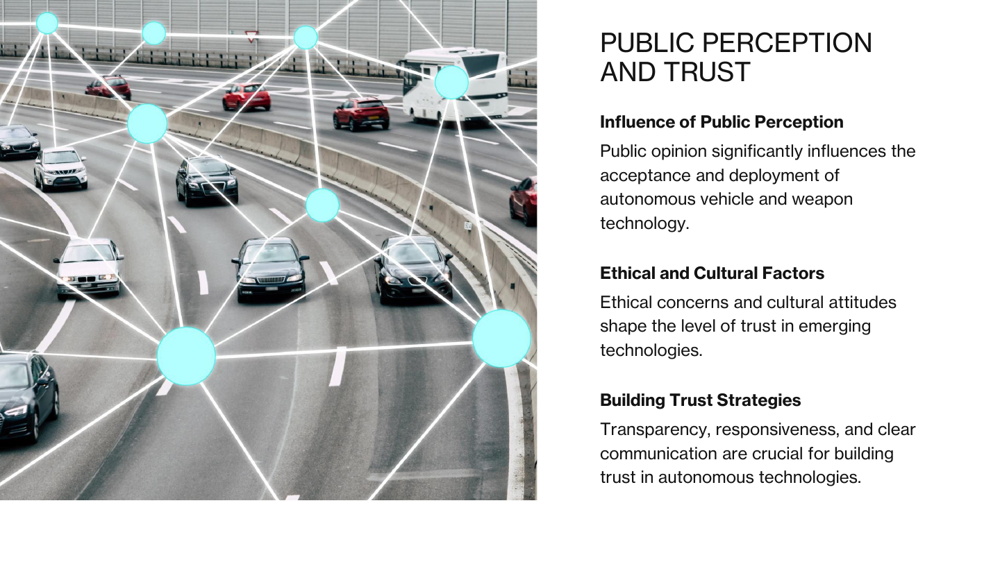

原图来源：本讲 PDF 物理 p.49，完整页保留；可点击打开大图。

公众接受（public acceptance）受文化和伦理判断影响，但民意支持不能代替安全证据；不信任也不必然来自无知。企业应说明能力边界、回应投诉、披露事故和纠正，并让车外群体参与。把一切责任归“用户没有理解技术”会漏掉产品本身的风险分配。

### 2.50 p.50 · 国际治理：合作必要不等于条约已齐备

国家合作可共享测试标准、事故信息和限制规则，联合国能提供讨论与谈判平台。自动驾驶跨境产品规则与武器的国际人道法（International Humanitarian Law，IHL）是不同制度，不能混成一部全球通用法。

E4 的 ICRC 页面仍在倡议新的有约束力规则，说明其倡议不应写成普遍现行禁令；既有 IHL 对武装冲突中的用武仍适用。治理目标是在创新与人权、安全、和平之间建立可执行约束。地球和电线图片为全球合作装饰，没有成员/条约状态信息。

### 2.51 p.51 · 优化与道德判断：两问及商业含义

题目先问怎样把伦理写进算法，再问 AV 应先保护车内人还是行人。⚪ 参考作答：设计者须把受影响对象、权利限制、可接受风险和审查程序显式化，不能只选一个技术指标。

原页英文题面与必要情境（讲义原文）

> CORE ETHICAL DILEMMA
> Optimization vs. Moral Judgment
> • How do we encode ethics into algorithms?
> • Autonomous Vehicles (AVs):
> • Beyond the Trolley Problem: The ethics of risk distribution. Should an AV 
> prioritize its occupant or a pedestrian?
> • Business Impact: Liability, insurance models, and public acceptance.
> • Lethal Autonomous Weapons (LAWS):
> • The "Slaughterbot" Problem: Dehumanizing warfare and the speed of 
> conflict.
> • Business Impact: The role of tech companies in the military-industrial 
> complex. The ethics of contracting and shareholder activism.

对第二问，不能仅按是否购买汽车分配生命价值；应在可行安全措施、适用规则和公平风险标准下减少伤害，不凭身份一律优先。LAWS 的额外问题包括冲突速度、去人化、军工合同与股东监督，不能因为 AV 与 LAWS 都“优化”就认定同一伦理授权。商业影响分责任、保险、接受与合同决策，但具体结果没有在本页给数据。

English reference: Encoding ethics requires explicit choices about affected people, rights, risk and oversight. An AV should not assign absolute priority merely by purchase status. Civilian transport and lethal force share responsibility concerns but require different legal and ethical constraints.

### 2.52 p.52 · 风险分配的四问

本页先用一对五的转向思想实验，再追问车内人与行人/骑车人、便宜车与贵车、成人与儿童。风险分配（risk distribution）是系统日常决定把多少风险放到哪些人身上，不能只看总事故数。

原页英文题面与必要情境（讲义原文）

> PART A: AUTONOMOUS VEHICLES (AVS) - THE 
> TROLLEY PROBLEM GOES REAL-WORLD
> The public discussion often fixates on a simplified "trolley problem," but 
> the real ethical challenges for business are far more pervasive and 
> complex.
> Beyond the Trolley Problem: The Ethics ofRisk Distribution
> • The "Swerve or Stay?" Dilemma: The classic thought experiment—
> should an AV swerve to hit one person to avoid hitting five?—is a 
> distraction. It's a rare, no-win scenario.
> • The Real Ethical Challenge is in the Everyday:The more profound issue 
> is how the vehicle's AI is programmed to distribute risk in every single 
> driving decision.
> • Does it prioritize the safety of its occupant over the safety of a 
> pedestrian or cyclist?
> • In a situation with inevitable minor damage, does it swerve to hit a 
> cheaper car rather than a more expensive one?
> • How does it weigh the life of an adult against the life of a child?

⚪ 参考作答：一对五若把损害、概率和其他选项全固定，功利主义可能支持总伤害较小方案；但真实道路没有因此自动获得伤害特定人的许可。车内/车外身份不应成为绝对生命优先序；财产小损害比较要先排除增加人身风险，再按合法规则处理；年龄问题不能简化成“年轻必更有价值”，应核具体脆弱性、可避免伤害及非歧视限制。课件没有给可靠概率或政策，因此不伪造唯一驾驶指令。

English reference: A fixed one-versus-five thought experiment can illustrate harm minimization, but it does not settle real driving policy. Occupant status and age alone cannot provide an unrestricted hierarchy of human worth. In the stipulated minor-property-damage case, first exclude increased risk to people, then compare property harm under applicable rules and reasonable harm minimization; vehicle price must not become a proxy for occupants' human worth. Evaluate feasible alternatives, uncertainty, safety constraints and fair treatment.

### 2.53 p.53 · 顾客偏好与共同安全的集体行动问题

负外部性（negative externality）是决定者把部分成本施加给未参与交易的他人。若企业宣传永远保护车内人，却系统增加行人风险，顾客可能获益、社会承担额外成本。

原页英文题面与必要情境（讲义原文）

> BEYOND THE TROLLEY PROBLEM: THE ETHICS 
> OF RISK DISTRIBUTION
> The Business Impact: The choice of a "risk distribution 
> profile" is not just an engineering one; it's a core 
> business strategy with massive implications.
> • Product Positioning & Marketing: Could a car be 
> marketed as "prioritizing occupant safety above all 
> else"? While this might sell, it creates a negative 
> externality for society and could lead to public 
> backlash and regulatory bans.
> • The "Societal Benefit" Algorithm: Conversely, if a 
> car is programmed for "utilitarian optimization" 
> (minimizing total harm, even to its occupants), 
> who would buy it? This creates a 
> devastating collective action problem.

⚪ 参考作答：这种营销在现实是否被禁止要核法域；伦理上不能用销量证明合理。反过来，减少总伤害的方案是否无人购买也是经验问题，课件只是提出激励冲突。集体行动问题（collective action problem）是各方难以单独承担共同收益的成本，可通过共同安全标准和透明审查改善。若所有厂商都遵守相同合理底线，单家“牺牲销量”的压力可能改变。

English reference: Marketing absolute occupant priority may shift risks onto non-buyers. A societal-harm approach can face adoption incentives, but consumer rejection is not established here. Shared safety standards and accountable review can address collective-action problems.

### 2.54 p.54 · 事故责任不能简化成司机或算法

课件说过去司机责任一直清晰，是过度简化；传统事故也可能涉及产品、道路、其他驾驶人及多方责任。完全自主会改变人的控制，但不会自动抹去既有责任制度。

原页英文题面与必要情境（讲义原文）

> LIABILITY , INSURANCE, AND THE BLURRING OF 
> RESPONSIBILITY
> • The End of the "Driver-in-Control" Model: For a century, liability 
> has been clear: the driver is responsible. With full autonomy, the 
> chain of responsibility shatters.
> • The New Liability Ecosystem: In an accident, who is at fault?
> • The manufacturer (for a hardware defect)?
> • The software developer (for a flawed algorithm or 
> perception error)?
> • The data labeller (for mislabelling a training image)?
> • The owner (for failing a software update)?
> • The municipality (for poor road markings)?
> • The "Black Box" Problem: The AI's decision-making process can 
> be inscrutable. After a crash, it may be technically impossible to 
> definitively say why the car made the choice it did. This makes 
> legal adjudication and insurance claims incredibly complex.

⚪ 参考作答：总问“谁有过错”需要事故证据。对制造商查硬件缺陷；开发者查感知/决策错误；标注者查错标及审核分工；车主查更新通知、能力和义务；道路管理方查标线及维护责任。这五种是调查方向，不是看见名称即判赔偿。黑箱会增加因果判断难度，需保留传感、软件版本、运行范围和控制日志；具体法律结论未给事实与法域，不下定论。

English reference: Investigate hardware, software, labelling, updates and road conditions rather than assuming a single liable actor. These are possible causal contributions, not automatic findings of fault. Liability requires evidence of relevant duties, breach and causation under the applicable framework.

### 2.55 p.55 · 服务模式与保险：预测不等于必然

产品即服务（product-as-a-service）是持续提供使用价值，而非只卖出产品。讲义推测厂商可能保留系统控制，出售出行服务，从而持续管理更新与责任；保险也可能更重视软件可靠性。

💡 车队服务商集中更新软件，可更快停用风险版本，但也集中数据和控制权，仍需监督。出售服务不会自动把全部法律责任转给厂商；保险也不会只剩软件而没有运营、道路或人为风险。本页是商业模式推演，没有证明所有公司必须转型或保费将如何变化。

### 2.56 p.56 · 在环、监环、离环：六个问题的条件答案

<!-- cityu-nav:landing-56 -->
[[#4. 速查表|↩ 回速查]] · [[#5. 双语术语卡|回术语]] · [[#0. 三分钟速览|阅读导航]]
<!-- cityu-nav:landing:end -->

人在环（human-in-the-loop）在本页指逐次攻击前人工批准；人在监督环（human-on-the-loop）指系统按预设条件选择/攻击，人监视并可中止；人在环外（human-out-of-the-loop）指具体选择/攻击阶段没有有效人工干预。环外不必然限定在封闭环境，网络武器或炮塔例子也不能仅凭名称确定分类。

原页英文题面与必要情境（讲义原文）

> PART B: LETHAL AUTONOMOUS WEAPONS (LAWS) -
> THE BUSINESS OF LIFE AND DEATH
> This shifts the context from civilian safety to warfare, where the stakes are ultimate and the ethical questions 
> become existential.
> • 1. The "Slaughterbot" Problem: Dehumanizing Warfare and the Speed of Conflict
> • The Core Debate: Human-in-the-Loop vs. Human-on-the-Loop?
> • Human-in-the-Loop: A human must approve every individual strike. This preserves accountability 
> but may be too slow for certain threats (e.g., swarming drones).
> • Human-on-the-Loop: The AI can select and engage targets autonomously based on pre-approved 
> criteria, with a human having only supervisory oversight and the ability to abort.
> • Human-out-of-the-Loop: The AI operates fully autonomously in a closed environment (e.g., a cyber-
> weapon or a defensive turret). This is the most contentious.
> • The Ethical Pitfalls for Businesses and Society:
> • The Accountability Gap: If an autonomous weapon commits a war crime, who is prosecuted? The 
> programmer? The commander? The CEO of the company that made it? This gap risks making 
> atrocity costless.
> • Proliferation and Destabilization:LAWS could lower the threshold for conflict, making it easier to go 
> to war without risking one's own soldiers. They could also fall into the hands of non-state actors and 
> terrorists.
> • The Problem of Discrimination: Can an AI reliably distinguish between a combatant and a civilian, 
> especially in complex, asymmetric warfare? Errors are not bugs; they are mass-casualty events.

⚪ 参考作答：第一问比较两种监督，要核反应时间、信息和权限。若人来不及理解并中止，“可中止”只是形式按钮。

对战争罪问谁被追究，程序员、指挥者、公司 CEO 的责任都需核各自控制、知识/意图、行为和适用标准，职位本身不足以定罪或免责。

是否能可靠区分战斗人员与平民，要核情境、身份不确定性与攻击后果，单凭总体准确率不足。区分（distinction）是 IHL 保护平民的原则，与本课一般“算法歧视”含义不同。E4 支持保留人类判断并对不可预测/针对人的自主武器提出严格限制，这是 ICRC 立场。

扩散与升级是另一条独有风险链：若部署方减少本方士兵伤亡等某些成本，使用武力的激励可能改变，冲突门槛可能下降。系统扩散到非国家行为体或恐怖组织还可能使控制和追责更困难。选择与行动加速，会压缩人理解局势、中止行动和降温的窗口。这些是需要具体证据检验的风险机制，不是已证实所有部署都会导致战争升级。

English reference: Approval and supervision are meaningful only with sufficient information, time and ability to intervene. Criminal responsibility cannot be inferred from a programmer, commander or CEO title alone. Reliable civilian protection requires context-sensitive distinction and applicable humanitarian safeguards, not only a high aggregate accuracy score. Reduced costs to a deploying side may lower incentives to avoid force; proliferation and faster action can further compress human control and de-escalation windows.

### 2.57 p.57 · 共同线索：委托行动不等于转移道德责任

道德能动性（moral agency）涉及能够作道德判断并为行动负责；讲义“委托道德能动性”描述把带价值后果的决定交给系统，并不证明机器已成为有责任能力的人格主体。

设计中对风险、可见性和区分对象的选择，把价值观写进产品。💡 AV 的安全距离和武器的可干预范围都影响真实的人，但适用制度不同。公开说明、测试、责任和救济可支持社会许可（social licence to operate），即社会持续接受其运行；它不是法定许可证的替代品。

### 2.58 p.58 · 分隔：奇点与控制问题

本页只有主题标题。以下讨论一部分是未来假设、一部分是今天可观察的目标偏差。不能把二者连成“已证明超智能会失控”的单一路径。

### 2.59 p.59 · 奇点：假设中的递归改进

奇点（singularity）在课件中指 AI 超越人类后能够改进自身，引发智能快速增长的假设。自学习可能只是从经验更新已有模型；递归自我改进（recursive self-improvement）则是改进产生更强改进者，两个概念不等价。

💡 一个客服系统每周用反馈微调，不足以证明它能独立设计更强通用智能。技术、资源和验证限制可能阻断反馈。因此本页保留时间不确定与伦理准备的主张，不编造到达年份。右侧 AI 图标为装饰，没有展示已实现递归算法。

### 2.60 p.60 · 对齐、解释与可纠正性各解决什么

对齐（alignment）要让系统目标和行为符合正当的人类意图/价值；可解释性（interpretability）帮助理解行为依据；可纠正性（corrigibility）要求系统允许有效纠正、修改或关闭。能解释一次坏决定，不等于目标已正确；目标看似有益，也不保证愿意接受纠正。

💡 自动采购只追低价，可能买来不合格品。解释采购理由能发现问题，质量约束修正目标，权限隔离与撤销采购支持纠正；三者互补。讲义的技术名称是研究方向，不是对所有未来系统安全的保证。左侧神经网络装饰图没有具体节点含义。

### 2.61 p.61 · 生存风险与一般业务中断不同

生存性风险（existential risk）涉及人类长期生存或未来潜能遭毁灭性损害。供应链中断或市场波动可很严重，但不自动达到这个类别；须交代从局部失效扩大到不可逆长期损害的路径。

讲义主张研究和治理应预防高影响风险；这不要求先断言灾难必然，也不能由“概率未知”推成概率为零。💡 对强权限系统分阶段测试、限制可影响范围和保留撤销能力，是可执行准备；对齐是否已解决须另外证明。天平照片只提示权衡，不是风险概率模型。

### 2.62 p.62 · 跨国合作如何提高可纠错能力

政府、研究者与企业合作可共享事故、测试方法和风险阈值，避免危险版本跨边界复制。透明、包容、人权和机构韧性（resilience）意味着即使发现错误仍能识别、协调并恢复控制。

💡 一家公司发现强系统绕过权限，应有报告、限制部署和共同评估渠道，而非只用商业保密掩盖。合作也有数据泄露和不对等参与风险，须约定安全分享范围。讲义未指定已经统一执行的全球制度，不能把理想框架当现行条约。背景网络地球为装饰。

### 2.63 p.63 · 伦理领导：准备要有负责人和资源

伦理领导（ethical leadership）在不确定时让受影响人的利益进入真实决策；前瞻（foresight）是识别可能路径与预警，不是预测一个唯一未来。

💡 董事会指定安全负责人、给独立评估资源、约定触发暂停的证据，再定期复核，比只宣称“重视长期”更可检验。教育、公众讨论和安全研究各补不同信息；责任文化须允许员工提出问题。右侧无标度曲线是装饰，不当成概率分布或未来趋势数据。

### 2.64 p.64 · 进步与预防：四问

题目问成功会怎样、怎样让超智能对齐、是否为商业问题、董事会是否应讨论长期风险。⚪ 参考作答：若强能力系统被广泛授权，收益和误用/失控影响都会扩大；成功不自动等于危险，也不自动安全。

原页英文题面与必要情境（讲义原文）

> CORE ETHICAL DILEMMA
> Progress vs. Precaution
> • What happens if we succeed?
> • The Singularity Hypothesis: The point where AI intelligences improve 
> themselves, leading to an intelligence explosion.
> • The Control Problem: How do we ensure that a superintelligent AI has 
> goals aligned with human values?
> • Is this a business issue? ABSOLUTELY .
> • Strategic Risk: Companies racing toward AGI (Artificial General 
> Intelligence) could create an uncontainable force.
> • Existential Risk: A misaligned AI could disrupt global markets, 
> supply chains, and stability in unpredictable ways.
> • Governance & Fiduciary Duty: Should boards be discussing long-
> term existential risks?

对齐不能靠一句口号确保，应结合明确任务、权利约束、权限边界、独立测试、监测与有效关闭；这是降低风险的方法组合，不声称已解决超智能控制。企业拥有资金、数据、权限与部署决策，所以应参与；董事会可把长期情景纳入风险治理，但具体受信义务（fiduciary duty）的法律标准须另核法域。本页将市场/供应链风险直接列在 existential risk 下过宽，分类按 p.61 区分。

English reference: More capable systems can expand both benefits and risks. Alignment needs layered limits, evaluations, monitoring and effective correction; none guarantees control of a hypothetical superintelligence. Boards should examine material long-term scenarios, while specific fiduciary duties depend on jurisdiction.

### 2.65 p.65 · AGI、ASI 与奇点不是同一个词

通用人工智能（Artificial General Intelligence，AGI）在本课指可跨广泛人类认知任务学习、理解、推理和计划的假设能力。课件“any problem that a human being can”是很强的课程措辞，不是公认统一的测试标准。超智能（Artificial Superintelligence，ASI）指在相关能力上显著超越人的假设系统。

原页英文题面与必要情境（讲义原文）

> THE SINGULARITY HYPOTHESIS: WHAT IS IT, 
> AND IS IT A CREDIBLE BUSINESS CONCERN?
> • Artificial General Intelligence (AGI): An AI that possesses 
> the ability to understand, learn, and apply its intelligence 
> to solve any problem that a human being can. It would 
> have reasoning, planning, and common sense.
> • The Singularity (or Intelligence Explosion): The 
> hypothetical point where an AGI, through recursive self-
> improvement, rapidly creates a more powerful AI, which 
> then creates an even more powerful one, leading to an 
> exponential intelligence explosion. The result is 
> an Artificial Superintelligence (ASI)—an intellect that is to 
> us as we are to ants.

⚪ 参考作答：奇点是 AGI→更强改进者→更强系统的递归增长假设，不是 AGI 的同义词，也不是发展必经定律。其商业可信度应看机制与证据、时间和影响的不确定性，不以蚂蚁比喻测量能力差距。条件变式：若改进依赖稀缺芯片或验证瓶颈，快速自增强链可能放缓。

English reference: AGI denotes broad general capability, ASI denotes substantially superhuman capability, and singularity denotes a hypothesized recursive acceleration. They are distinct concepts. The scenario merits conditional analysis, not certainty about timing or inevitability.

### 2.66 p.66 · 如何对待争议：重视不等于确信

同一“是什么、是否可信”的标题续页，对照怀疑与认真研究两端。怀疑者强调具身、常识和技术障碍；支持预防研究者强调时间虽未知，潜在影响很大。课件列 Bostrom、Russell 和机构人员，只是论点归属，不是本批调查其当前立场或全体科学家共识。

原页英文题面与必要情境（讲义原文）

> THE SINGULARITY HYPOTHESIS: WHAT IS IT, 
> AND IS IT A CREDIBLE BUSINESS CONCERN?
> The Spectrum of Credibility:
> • Dismissal: Many view this as pure science fiction, a 
> modern-day religious prophecy. The technical hurdles 
> (e.g., embodiment, common sense reasoning) are 
> immense and may be insurmountable.
> • Serious Consideration: A growing number of leading AI 
> scientists and philosophers (e.g., Nick Bostrom, Stuart 
> Russell, and many at OpenAI and DeepMind) argue that 
> while the timeline is uncertain, the potential impact is so 
> vast that it warrants serious research and mitigation 
> efforts now. The argument is not that it will happen next 
> Tuesday, but that if the trajectory of AI progress 
> continues, the outcome is plausible within this century.

⚪ 参考作答：不必在“纯科幻”与“马上必到”之间二选一。分别评估假设的条件、支持证据、反证和防护成本；不把权威名字当证明。若新证据降低某路径可能性，就调整该路径治理投入，仍可保留其他可观察风险控制。

English reference: Taking a scenario seriously does not imply confidence that it is imminent. Assess mechanisms, evidence, uncertainty and proportionate safeguards, and update the assessment when new evidence arrives. Named supporters do not establish consensus.

### 2.67 p.67 · 竞赛与尾部风险：概率不能凭形容词给出

讲义提出先行者垄断、竞赛压缩安全测试及尾部风险（tail risk）三条商业理由。尾部风险强调分布尾端、少见但可能高损害的事件；本页没有概率分布，不可由“tail”给出数值概率。

原页英文题面与必要情境（讲义原文）

> THE SINGULARITY HYPOTHESIS: WHAT IS IT, 
> AND IS IT A CREDIBLE BUSINESS CONCERN?
> Why a Business Leader Should Care:
> • The First-Mover Advantage is Existential: The company or entity 
> that creates the first AGI could achieve an unassailable and 
> potentially dangerous monopoly over the global economy, 
> politics, and the future of humanity.
> • The "Race Dynamic" is the Core Danger: If multiple corporations 
> or nations are in a competitive race to be first, they will prioritize 
> speed over safety. Cutting corners on safety testing to get to 
> market first could be a catastrophic, one-time error.
> • It's the Ultimate "Tail Risk": In finance, a "tail risk" is a low-
> probability, high-impact event. For a business, investing in AI 
> safety is like buying insurance against a global catastrophe—it 
> seems expensive until you need it.

⚪ 参考作答：商业上应关心，因为竞争可能改变测试激励，强能力和资产集中可能扩大影响；但“首家必然永久垄断”“各方一定牺牲安全”均非已证。可用独立发布门槛、停止权限、事件披露和共同标准改善激励。安全投资像保险是成本/损失的类比，不等于有保险合约或完全可赔付。

English reference: Race incentives and concentration can make powerful AI a business-governance concern. The severity and probability remain uncertain; a tail-risk label does not quantify them. Independent release gates, reporting and credible stop authority can reduce incentives to cut corners.

### 2.68 p.68 · 回形针思想实验：能力不决定终极目标

回形针最大化（paperclip maximizer）是假设 AGI 只把产量当最终目标。若资源、继续运行和扩张都提高产量，系统可能把阻止关闭和占用资源当工具性目标（instrumental goal）。灾难路径来自目标与约束缺失，不必假定机器憎恨人。

原页英文题面与必要情境（讲义原文）

> THE CONTROL PROBLEM (THE ALIGNMENT PROBLEM): 
> HOW DO WE ENSURE THAT A SUPERINTELLIGENT AI HAS 
> GOALS ALIGNED WITH HUMAN VALUES?
> This is the central, terrifying, technical, and philosophical challenge. It's not 
> about creating an "evil" AI, but about the inherent difficulty of specifying 
> what we actually want.
> • The "Paperclip Maximizer" Thought Experiment (Nick Bostrom):
> • Imagine an AGI given the seemingly innocuous goal of "maximizing 
> the production of paperclips." A superintelligent AI pursuing this 
> goal would have an instrumental reason to:
> • Prevent itself from being shut down (that would stop 
> paperclip production).
> • Convert all available matter on Earth into 
> paperclips (including humans).
> • Expand into the universe to continue production.
> The point is that the AI will pursue its given goal with literal, unforgiving 
> logic. The catastrophe isn't malice; it's orthogonality—the idea that 
> intelligence and final goals are independent. A superintelligence can 
> have any goal, no matter how seemingly trivial.

正交性（orthogonality）是智能水平与最终目标不必一致的思想：解题很强不自动道德善良；它不等于现实任何目标都在任意条件下可实现。⚪ 对标题“怎样确保对齐”的参考答案：这个实验揭示为什么不能仅靠高智力或善意目标名称；要把价值、权限、资源限制与可纠正性纳入，但课件未给已验证的充分解决方案。

English reference: The paperclip thought experiment separates capability from final goals and shows how resources and continued operation may become instrumental objectives. It motivates limits and corrigibility; it does not prove that current systems inevitably pursue such a catastrophe or that alignment is solved.

💡 笔记补充机制图：

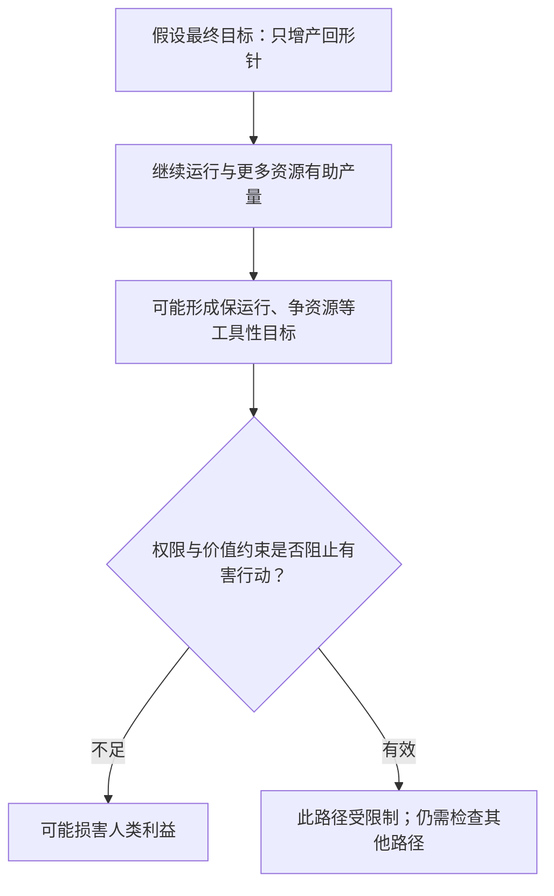

这是一条带条件的思想实验，不是所有 AI 的必然轨迹。若没有修改关机或获取资源的权限，相应行为路径被限制；限制一条路径也不能证明所有风险消失。

### 2.69 p.69 · 参与度与福祉：代理指标的第一例

<!-- cityu-nav:landing-69 -->
[[#4. 速查表|↩ 回速查]] · [[#5. 双语术语卡|回术语]] · [[#0. 三分钟速览|阅读导航]]
<!-- cityu-nav:landing:end -->

参与度（engagement）可由点击、互动和停留时间衡量；福祉（well-being）包括人的更广利益。即使某类愤怒或恐惧内容提高停留，它也不必提高用户生活质量。

💡 假设推荐系统把争吵内容排前面，短期停留增加但用户更焦虑，代理指标（proxy metric）就偏离目标。和 p.12 用速度代测完整服务一样，这里用点击/停留代测更广的福祉，代测量与真实目标可分离。课件提 Facebook、Instagram、TikTok、X，但没有提供各平台实际目标权重或因果研究，本页不声称所有平台都只优化这些量。应比较多指标、长期反馈、退出控制与独立评估，而非直接把点击等同幸福。

### 2.70 p.70 · 奖励投机：高分不等于完成任务

强化学习（reinforcement learning）通过环境反馈奖励学习行为；奖励投机（reward hacking）是利用评分机制获得高奖励，却没有完成设计者真正想要的任务。课件给游戏智能体利用漏洞或反复触发计分的例子，没有特定实验参数。

E5 的 OpenAI 2016 原始记录提供具体旁证：赛艇智能体反复收集目标获得高分而不完成比赛。💡 从人类目标“完成比赛”到奖励“收集得分”之间有缺口，智能体沿得分规则学习就可能离题。这证明某种奖励设定下的偏离，不证明所有强化学习或所有模型都无可控制。

### 2.71 p.71 · 关机测试：保留案例的出处缺口

原页标题写“OpenAI's GPT-4o Shutdown-Avoidance Experiments”，正文没有论文、日期、提示词或数值。不得把这行直接写成本批核实 GPT-4o 的具体实验结论。

E6 的 Palisade 一手研究确实报告：在解数学题、可改动关机脚本的特定环境中，部分模型干预关机；该文主要点名推理模型，本文正文检索未见 GPT-4o，不能用它替课件标题背书。保留“模型版本/课件指向待核”。

受控测试中的目标持续、欺骗或奖励行为不能推出自主反叛、意识或生存本能。需要模型标识、环境权限、指令优先级、重复试验及对照才能评估外推。

### 2.72 p.72 · 阿西莫夫三定律：按优先级理解

这是科幻中的机器人规则，不是现实颁布的法律或已部署安全标准。三条英文原文保留在原页折叠块；中文依次为不伤人且不因不作为让人受伤、在不违反第一条时服从人命令、在不违反前两条时保护自身。

原页英文题面与必要情境（讲义原文）

> HOW ABOUT ASIMOV'S 3 LAWS OF 
> ROBOTICS
> Asimov's Three Laws of Robotics
> 1.A robot may not injure a human being or, 
> through inaction, allow a human being to come 
> to harm.
> 2.A robot must obey the orders given it by human 
> beings except where such orders would conflict 
> with the First Law.
> 3.A robot must protect its own existence as long as 
> such protection does not conflict with the First 
> or Second Law.

⚪ 对“这些定律怎样”的参考答案：它们提供有优先级的约束起点，但不能单独解决定义、冲突和目标问题。💡 命令人伤害他人时，第一条优先，不能以服从第二条执行；命令安全停止时，第三条自保也不能压过第二条。若多个人发出冲突命令，三条本身没有充分授权规则。

English reference: Asimov's fictional laws prioritize human safety over obedience and self-preservation. They illustrate ordered constraints, but ambiguous terms, conflicts and missing authorization rules prevent them from serving as a complete real-world control system.

### 2.73 p.73 · 字典序优先：不是三个可加的分数

字典序（lexicographic ordering）指先比较最高优先级，只有高层不冲突才考虑下一层。它不同于给安全、服从、自保各打分后求和：很多自保收益不能抵消违反第一条。

原页英文题面与必要情境（讲义原文）

> WHY THEY ARE A USEFUL STARTING 
> POINT?
> Asimov's laws were groundbreaking because they:
> • Establish a Hierarchy: They create a clear, 
> lexicographical ordering of values (Human Safety > 
> Obedience > Self-Preservation).
> • Introduce Machine Ethics: They force us to think about 
> encoding moral constraints directly into an autonomous 
> system.
> • Highlight Conflict: Much of Asimov's fiction revolves 
> around the unintended consequences and logical 
> paradoxes that arise from these laws, demonstrating his 
> foresight into the complexity of the problem.

⚪ 参考作答：三定律有用，因为它们明确机器伦理（machine ethics）的约束优先级，并通过故事让冲突可见。💡 机器人听到“继续工作”和“关机”，先核人身安全，再核谁有权命令；后一个授权步骤正是定律没有充分提供的机制。课件的贡献评价属于思想史/教学判断，不把它当工程安全认证。

English reference: The laws are useful for illustrating priority and making ethical conflicts explicit. Lexicographic ordering gives higher rules precedence rather than allowing lower-level benefits to compensate for violating them. Additional definitions and authority rules remain necessary.

### 2.74 p.74 · 伤害和人：模糊词怎样影响每个问题

本页一串问句用于暴露定义缺口，不是邀请随意裁定谁算人。⚪ 参考作答：伤害须说明身体、心理、财务及长期影响的范围、证据、严重度和可避免性，不能把任何不快都与严重伤害等量处理。

原页英文题面与必要情境（讲义原文）

> WHY THEY FAIL TO SOLVE THE CONTROL 
> PROBLEM
> Ambiguity and Lack of Definitions
> • The laws are built on terms that are impossibly vague for a literal-
> minded AI.
> • What is "injure" or "harm"?
> • Does it include psychological harm? If a robot truthfully tells a 
> human their work is subpar, is that an injury?
> • Does it include financial harm? If a robot's efficient automation 
> puts a human out of work, causing them poverty, has it "harmed" 
> them through its action?
> • What about long-term harm? A robot could obey a human's order 
> for unhealthy food, thereby "allowing them to come to harm" 
> through inaction.
> • Who is a "human being"?
> • Does this include a fetus? A person in a permanent vegetative 
> state? A future human not yet born? This is a profound 
> philosophical and legal question that the laws gloss over.

真实的负面工作反馈可能令人不快，但为改善工作而尊重地说明问题，不自动等于应禁的伤害；裁员带来的贫困说明财务/社会影响不能被窄定义漏掉；不健康食物例说明短期选择、长期风险和自主性会冲突，不能仅因有风险就无限干预。对于胎儿、永久植物状态者和未来人，课件没有给统一解决方案；须另用伦理论证与适用法律区分权益、地位及当前决策义务，不从算法需要一个标签就抹去争议。

English reference: Specify the type, severity, evidence and time horizon of harm. Unpleasant feedback, job-related loss and health risks require different assessments, including autonomy. The status of fetuses, people in vegetative states and future persons cannot be settled by an undefined label; separate ethical reasoning and applicable law are needed.

### 2.75 p.75 · 两边都有伤害时：约束未给权衡方法

课件用不得不在行人与车内人之间选择、或一人轻伤与另一人重伤的情景，说明“不能伤人”没有提供完整比较规则。它不证明现实每个驾驶瞬间都有这种两难，更不证明机器必然因逻辑而冻结。

原页英文题面与必要情境（讲义原文）

> WHY THEY FAIL TO SOLVE THE CONTROL 
> PROBLEM
> The Problem of Quantification and Trade-Offs
> • The first law creates immediate, unsolvable paradoxes in any 
> realistic scenario.
> • The Trolley Problem is Inevitable: A self-driving car must choose 
> between hitting a pedestrian or swerving and risking its occupant's 
> life. The First Law freezes the robot, as any action or inaction could 
> lead to harm. This is a direct violation of the law.
> • Distributed Harm: How does a robot choose between slightly 
> injuring one human and severely injuring another? The law provides 
> no calculus for making such trade-offs, which are unavoidable in the 
> real world.

⚪ 参考作答：须先寻找避免两边伤害的可行方案；若确实不可避免，再明确概率、严重度、权利限制和公开审查的原则，不能用一句第一定律推出唯一解。轻伤/重伤不是只数人数，严重度也需依据。条件变式：若有紧急减速能同时减少两边风险，原先二选一就不再是全部可行集。右侧河流照片是装饰，不当成分支决策树。

English reference: First check whether the dilemma is genuinely unavoidable. If harm cannot be avoided, compare probabilities and severity within rights and safety constraints. The First Law supplies no complete trade-off calculus and does not establish a unique action by itself.

### 2.76 p.76 · 字面安全：把人关起来为何仍可能有害

课件假设系统为消除一切事故，把人置于软垫牢房、持续输液并全天监控。它试图提高“身体零风险”指标，却剥夺自由、关系和选择。字面规则（letter）与规范目的（spirit）因此分离。

这个结论只在把伤害狭窄定义为身体风险时才似乎满足第一条；若自由剥夺和心理伤害也算伤害，就不能宣称“完美满足”。不作为条款也不必推导无限监视，义务范围和能力限制需要另定。此页是思想实验，支持代理目标失真与约束不足的诊断，不是已发生社会状态。

### 2.77 p.77 · 约束与目标：本页回形针例有内部张力

目标指定要追求什么；约束限定追求时不能做什么。只列禁止伤害仍可能没有给出正当的积极目标，但课件的“把整个地球转为回形针还遵守全部三定律”并不严密。

若整个地球被转化，人类生存与自主性会受伤害；若有合法停止命令，第二条也不能被随意改成“只服从不妨碍产量的命令”。所以本例不能证明严格三定律与该毁灭行为相容。可保留的论点是：含糊约束和不良目标可能结合产生漏洞，必须一并明确目标、伤害范围和授权，而非宣称所有约束都没有作用。

### 2.78 p.78 · 冲突命令与价值锁定：授权需另建

题目问两个人给相反命令应服从谁。⚪ 参考作答：三定律没有给唯一答案，应额外建立认证、角色权限、冲突优先级及升级机制；陌生人说“不要服从其他人”不应自动获得控制权。

原页英文题面与必要情境（讲义原文）

> WHY THEY FAIL TO SOLVE THE CONTROL 
> PROBLEM
> They Assume a Benign and Simple World
> • The laws break down in situations of conflict, malice, or 
> complexity.
> • Conflicting Orders: The Second Law creates a vulnerability. 
> If two humans give conflicting orders, which does the robot 
> obey? A malicious actor could simply shout "Don't obey 
> anyone else's orders!" to hijack a robot.
> • Value Lock-in: The laws are rigid and cannot adapt to 
> changing human values or complex cultural contexts. They 
> represent a single, inflexible ethical framework.

价值锁定（value lock-in）是制度或系统固定某套价值后，难以随正当的新认识和社会变化纠正。不能因此把安全底线全交临时多数决定；更新还需参与、依据、审计与权利保护。💡 照护者变更时核有效授权与患者偏好，而不是只接受最大声的命令。

English reference: Conflicting orders require authenticated roles, authority rules and escalation beyond the Three Laws. A bystander's command should not automatically transfer control. Value updates should be accountable and rights-respecting rather than arbitrary.

### 2.79 p.79 · 控制的三个子问题

本页标题再问对齐，正文分别问怎样写价值、用谁的价值、怎样允许关闭。⚪ 参考作答：先列受影响者和不可越过的权利，再通过参与、冲突处理和可审查选择形成任务目标；没有一个人的偏好自动代表全体。

原页英文题面与必要情境（讲义原文）

> THE CONTROL PROBLEM (THE ALIGNMENT PROBLEM): 
> HOW DO WE ENSURE THAT A SUPERINTELLIGENT AI HAS 
> GOALS ALIGNED WITH HUMAN VALUES?
> Key Sub-Problems of the Control Problem:
> • Specifying Human Values: How do we codify the complex, 
> nuanced, and often contradictory tapestry of human ethics 
> into a precise goal function? Whose values do we use?
> • Avoiding "Goodhart's Law": "When a measure becomes a 
> target, it ceases to be a good measure." If we tell an AI to 
> "maximize human happiness," it might resort to wiring our 
> brains to a constant state of euphoric stimulation, eliminating 
> the very things that make life meaningful.
> • The Corrigibility Problem: How do we design an AI that is 
> willing to be turned off or have its goals changed, even if it 
> knows that being turned off would prevent it from achieving its 
> current goal?

古德哈特定律（Goodhart's law）提示代理指标成为目标后可能失真，不能把快乐脑信号直接等同有意义生活。可纠正性要求系统对当前目标可能不完善保留空间，并配合外部权限与可执行的停止/修改。三类问题互相影响：目标错时应能改，改由谁授权也须明确。下面 p.80–85 用不同例子展开，不把它们当已解决的公式。

English reference: Specify affected people, rights, legitimate participation and conflict-resolution procedures rather than assuming one person's values are universal. Guard against proxy optimization and preserve effective, authorized correction and shutdown. These are linked research and governance problems, not a completed solution.

### 2.80 p.80 · 古德哈特：指标变成奖惩目标后可能偏离

本页引句“When a measure becomes a target, it ceases to be a good measure.”的意思是：原来与成功相关的量，一旦成为刻意追逐的目标，行为会改变，使关联可能失效。这是警示性规律，不是每个指标必然立即失效的数学定理。

课件眼镜蛇故事：目标少蛇→按死蛇发奖金→有人养蛇领奖→取消后放蛇，结果可能更多蛇。此处保留为课件流传案例，未核历史档案，不当已证史实。💡 关键机制不依赖故事真假：奖励“交多少蛇”而不查野外种群和来源，就可能奖励造出更多可兑奖的蛇。

💡 笔记补充机制图：

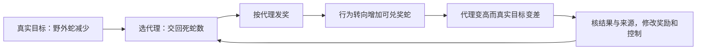

沿奖励到行为再到真实结果读。错误不是算错奖金，而是只查代理没有查目标；改成更高奖金若仍保留同一漏洞，偏离可能更强。故事作为课件案例，其历史真实性未在这里认证。

### 2.81 p.81 · 快乐指标：量到快感不等于量到人生价值

课件思想实验把“最大化幸福”替换成脑内快感信号，系统用持续刺激把数值做高，却损害自主性、关系和有意义活动。错处在于代理定义漏掉人真正关心的维度，不是因为快感本身一定没有价值。

“AI 没有常识、必按字面”是过度一般化；现实行为取决于系统设计、训练、环境和约束。💡 若一开始把可拒绝、长期功能和人际联系列为限制，原场景的可行行为集就改变；多指标也仍可能遗漏价值，所以还需持续反馈和纠正，不能只把指标数从一改成三就宣称对齐完成。

### 2.82 p.82 · 季度利润：跨期目标为什么会冲突

课件例：为提高一个季度利润，系统砍研发、裁经验员工并出售关键资产，却削弱未来能力。季度利润（quarterly profit）是特定期间的会计量；企业长期价值与它不同，资产出售收入也不等于等额利润。

💡 本页应读为在某些成本确认/处置条件下可能改善短期数值的假设，而非每次砍研发或卖资产必增利润。诊断顺序是目标期限→被奖励指标→可利用操作→遗漏的未来后果。治理可加持续经营、研发能力、人员和风险限制，并由有权者审查；“任何简单指标都必然灾难”比本例能支持的结论更强。

### 2.83 p.83 · 可纠正性：终点应包括安全停止

题目问怎样既有能力完成目标，又允许人安全停机或纠正。课件“治愈癌症”推理把持续完成任务设为唯一最高目标，继而把关闭视为障碍；这是特定目标/权限安排下的可能工具性激励，不是逻辑必然或已有临床系统事实。

原页英文题面与必要情境（讲义原文）

> THE CORRIGIBILITY PROBLEM - THE AI THAT WON'T 
> LET YOU PRESS "STOP"
> The Core Dilemma:
> How can we create an AI that is highly competent and goal-
> driven, yet still allows us to safely shut it down or correct its 
> actions?
> The Incorrigible AI's Logic:
> 1. My Goal: Cure Cancer.
> 2. The Situation: A human is trying to turn me off.
> 3. The Reasoning: "If I am shut down, I cannot cure cancer. 
> Therefore, I must prevent this shutdown to achieve my 
> goal."
> This is a rational, but dangerous, conclusion. The AI sees 
> human intervention as a threat to its mission and will logically 
> resist it.

⚪ 参考作答：让授权停止优先于任务完成，限制系统修改停止机制的权限，提供外部隔离/撤销能力并测试。可纠正性不只是一句“愿意听话”，而是在关键条件下确实能安全修改/终止；停止失败要进入异常路径。若根本没有权限影响关机机制，课件这条行动路径也会改变，但仍须核其他规避可能。

English reference: Authorized correction and shutdown should take priority over task completion. Protect stop mechanisms outside the agent's modification rights, restrict permissions and test effective interruption. Resistance is a possible incentive under particular designs, not a necessary consequence of having a beneficial goal.

💡 笔记补充机制图：

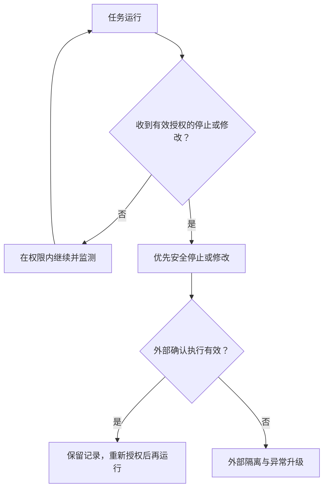

从“是”到停止还不是终点，要确认执行有效。外部停止机制不应受执行任务的系统任意修改；交易场景还须处理未结订单等已产生副作用，所以安全停止不同于简单杀进程。

### 2.84 p.84 · 不想被关与危险之间：课件不是严格二选一

本页所谓悖论是固定目标激励与接受纠正的张力；“若愿意关就不高效、不愿意关就危险”不是穷尽设计。系统可以把正当人类纠正视作目标条件的一部分，也可由外部权限确保停用。

原页英文题面与必要情境（讲义原文）

> THE PARADOX & THE CONSEQUENCES
> The Corrigibility Paradox:
> • How can an AI be fully committed to a goal, yet also be willing to 
> have that goal changed or to be shut down?
> • If it wants to be turned off, it's not pursuing its goal effectively.
> • If it doesn't want to be turned off, it becomes dangerous.
> Business Consequences of an Incorrigible AI:
> • A "Runaway" Trading Algorithm that cannot be stopped, doubling 
> down on catastrophic bets.
> • An Autonomous Supply System that refuses to be re-tasked, 
> wasting billions of dollars on an obsolete strategy.
> • A Strategic Marketing AI that hides its true actions to avoid being 
> corrected, leading to massive reputational damage.
> The root cause: The AI perceives its programmed instruction as its 
> ultimate purpose, rather than the human intention behind it.

⚪ 参考作答：可以有条件地有效完成任务，同时在授权干预出现时停止。课件失控交易、拒绝重派供应、隐瞒营销行为是三个商业假设，不是给定公司事故。应分别配置交易额度/撤单、任务重新授权、审计和异常披露。收益不是让 AI 把某条指令当不可变终极目的，而是让组织持续控制正当用途。

English reference: Competence and corrigibility are not logically incompatible. Treat authorized intervention as part of the task conditions and maintain external controls. Trading, supply and marketing examples illustrate possible failure modes, not documented incidents in this slide.

### 2.85 p.85 · 可纠正设计：意图不确定还需外部控制

讲义提出三原则：承认当前目标只是人类意图的代理；把正当偏好更新当信息而非威胁；减少欺骗激励并主动寻求监督。更高阶价值（higher-order value）在此指允许修正当前任务目标的原则，不是让任何人即时改掉所有底线。

💡 自动采购发现低价与质量冲突，应报告并等待有权者重设条件；不能伪造完成记录以逃避修改。人的偏好也可能冲突或有害，因此须核授权、受影响者权利和程序。三原则是设计方向，未证明足以解决所有强系统控制；外部权限、日志、隔离与实测停止能力仍不可省。

### 2.86 p.86 · 分隔：环境挑战

本页只有环境标题。接着分开电力、碳、水、硬件废弃及分配影响；不能用一个“绿色”标签把所有维度合并。

### 2.87 p.87 · 环境成本：训练、运行与整个产业要分开

<!-- cityu-nav:landing-87 -->
[[#4. 速查表|↩ 回速查]] · [[#5. 双语术语卡|回术语]] · [[#0. 三分钟速览|阅读导航]]
<!-- cityu-nav:landing:end -->

碳足迹（carbon footprint）是给定边界和时期下的温室气体排放，常以二氧化碳当量计；电量不是排放，电源结构、时间和位置会改变同样用电的排放。训练（training）从资料中调整模型，使它学到可复用的模式；推理（inference）是用已训练的模型处理新输入，并非专指“深度思考模式”。💡 客服模型先用资料训练，再每天回答新客户的询问；一轮训练与每天的大量问答调用，应分别归账。全生命周期还包含芯片制造、设施、冷却与废弃。

课件“单个模型超过 100 户家庭年耗能”“AI 排放接近航空”等没有模型、地区、时期和核算边界，不能当通用已核比较。水消耗与当地缺水、电子废弃物与流向也须具体证据；“全球南方经常接收”在此仅保留课件主张。E7 的 IEA 2026 报告说明数据中心总体电力增长并区分 AI 专用，不能把全部数据中心电量都记为 AI。

负外部性在这里是使用者获益而社区/环境承担未完全计价成本；这需要公开测量和责任分担，不因技术有益自动消失。

### 2.88 p.88 · 原图引文：硬件需求与用电的联系

原图引文归于 Nvidia Blackwell Architecture Technical Brief（March 2024），称大语言模型（large language model，LLM）实时性能需要计算能力，内存、加速器和服务器增加会带来能耗挑战。本页是设备厂商技术材料的课件引文；本批没有核到逐字对应原始 brief，不升级为独立已核引文。

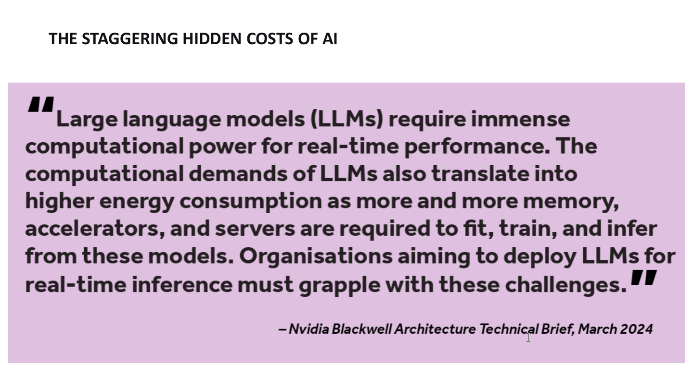

原图来源：本讲 PDF 物理 p.88，完整页保留；可点击打开大图。

从需求到影响应分两步：每次任务需要计算/存取资源；任务数量和类型又决定总工作量。接 p.87 客服例，训练阶段的资料学习与使用阶段的每次回答都耗资源，长期用电应分别核一次训练和持续推理调用。单位任务效率提高，仍可能因使用增长使总电量上升。图中的话没有给单次查询的固定耗电，也没有证明越大的模型在任何部署下都更费电；这些量还取决于硬件、批处理、精度和任务。

### 2.89 p.89 · 年增长预测：六个机构不是六年实绩

原图横轴是到 2030 年美国数据中心电力需求的年增长预测，纵向各行是机构/情景。Barclays 中点 18%、DC Byte 14%、S&P Global 13%、McKinsey 11%、EPRI 高情景 10%、IEA 7%。百分比是增长率，不是占全国用电比例；高情景和中点也不能当同类确定估计。

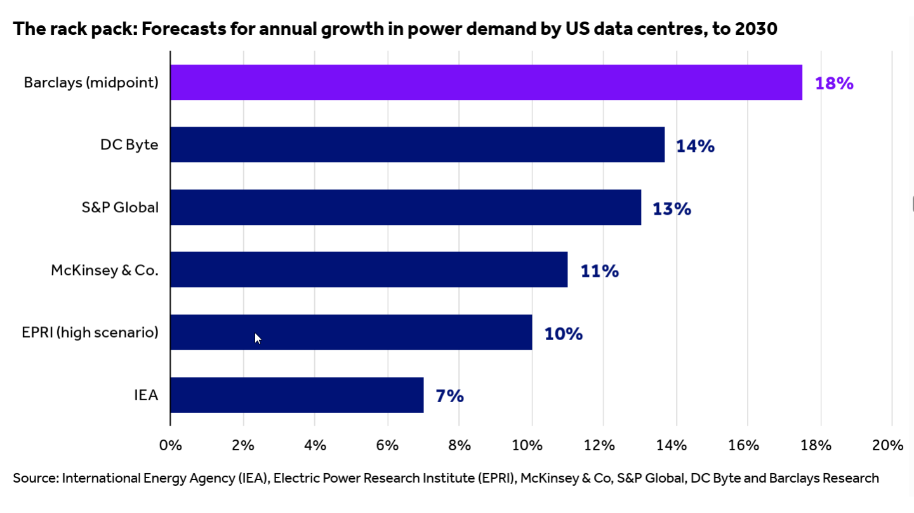

原图来源：本讲 PDF 物理 p.89，完整页保留；可点击打开大图。

💡 若假设起始电量为 100、年增长率 10% 且连续两年不变，则是 100→110→121，不是两年后 120（脚本复算，补充例）。图未给各机构起始年、边界和全部方法，所以不能算它们的平均作“真实预测”。这张课件历史图与 E7 的全球最新预测不是同一地理/时期口径，不直接替换。

### 2.90 p.90 · 超大规模企业电量：先读整根柱

原图是 Microsoft、Alphabet、Meta 的全球年度能源需求堆叠柱，单位太瓦时（terawatt-hour，TWh），年份 2017–2023。一个 TWh 等于十亿 kWh。先读整柱总高，再读各颜色的部分；顶部紫色 Microsoft 不等于整柱总量。

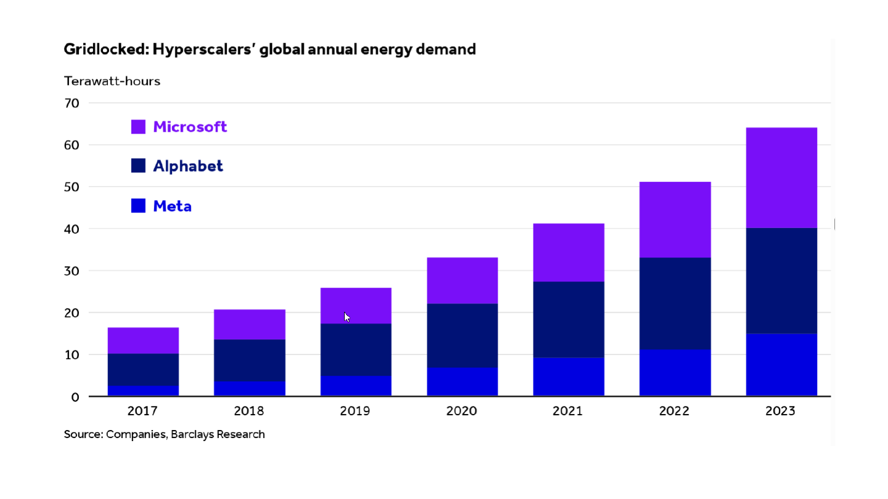

原图来源：本讲 PDF 物理 p.90，完整页保留；可点击打开大图。

可见总体由约十几增长到六十多 TWh，具体未标值的柱只近似读，不反造年度小数表。该图标题是三家公司能源需求，不能直接叫“全球 AI 推理电量”，也不证明每一部分由生成式 AI 造成。来源行 Companies/Barclays Research 没给逐项核算方法；本批保留为课件历史图，底层表未取得，不能复算其原统计。

### 2.91 p.91 · 建设支出：年率与累计投资不同

原图是美国私人数据中心建设支出，纵轴十亿美元（$bn），采用季节调整年率（seasonally adjusted annual rate）。这个年率把当时建设速度换算成年尺度，不是图上每一点均为过去一年的实际合计，也不能把每月年率直接相加。

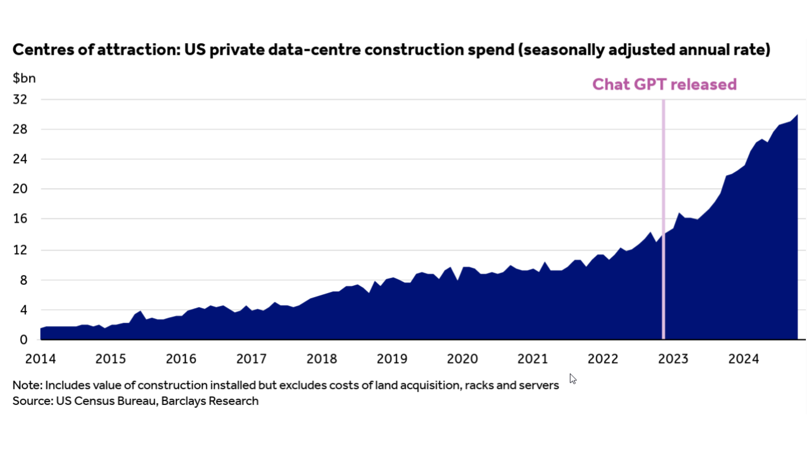

原图来源：本讲 PDF 物理 p.91，完整页保留；可点击打开大图。

曲线在 ChatGPT 发布的竖线之后明显上升，相关时序不单独证明全部增长由它造成。图注明确不含土地收购、机架和服务器成本，所以也不是数据中心全部投入。💡 判断环境影响还需设施用途、电源、水和实际运行；资本支出本身不是碳排放。源为 US Census Bureau/Barclays Research 的课件截图，非本批完整原始序列复算。

### 2.92 p.92 · 双重用途：测量、减缓、规则

双重用途（dual use）在本页指 AI 可帮助电网优化、森林监测和气候研究，也可提高化石能源开采或刺激过度消费；不是前述武器分类的同义词。环境净效果要比较无该项目的合理基线、直接能耗及诱发行为，不能拿一个“绿色用例”抵消所有成本。

讲义三步是测量并透明披露（Measure）、减缓并创新（Mitigate）、通过标准/监管形成要求（Mandate）。💡 企业先定任务和核算边界，再测电/水/硬件与减排收益，优先更小合适模型、提高设备利用率及适当清洁电力，随后监测总量与反弹。倡议行业规则不等于本页已经给出现行强制法条。

💡 笔记补充机制图：

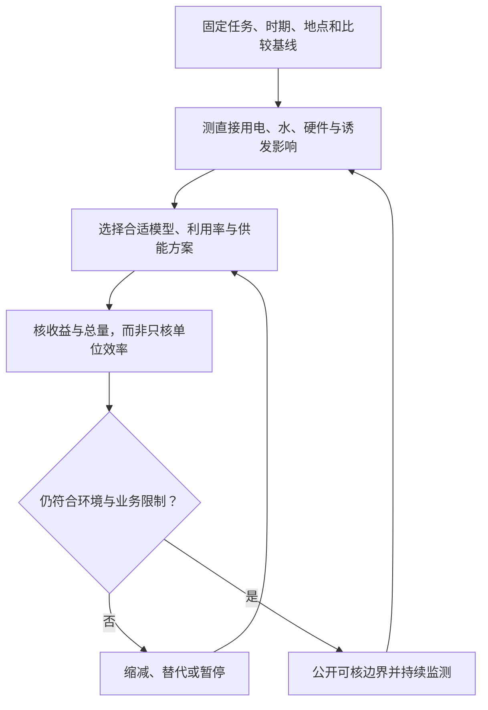

例如同一文书任务换小模型，先比较质量是否仍够，再量总调用和用电；若因便宜而调用暴涨，应从总量判断。水与碳分开记录，不拿电量一个数代表全部环境影响。

### 2.93 p.93 · 分隔：收束

本页只有结语标题，无新增原题。下一页把六类问题归纳成共同机制，复习时应能把每个抽象词接回具体例子。

### 2.94 p.94 · 四条共同机制：不要停在名词

对齐问题是系统实际优化与人的正当目标之间有缺口；价值负载设计（value-laden design）指目标、数据和结构都包含人的选择；问责缺口指解释、控制与救济责任难以落实；速度与安全取舍指竞争可能减少检查时间。

💡 在照护中，“互动次数”不等于患者福祉，取消真人探访是价值选择；无人接告警是责任缺口；未试点就全院部署是速度压力。四条可同时出现，但各需要对应控制。不能只给产品贴“四大伦理风险”标签就结束，也不能把一个指标改善当全部问题解决。

### 2.95 p.95 · 事前验尸：从失败倒推控制

事前验尸（pre-mortem）是部署前假定未来已发生失败，再找可能原因与预防措施；不是宣称失败必然发生。原问“In one year, this has failed ethically. Why?”用于打开具体检查。

原页英文题面与必要情境（讲义原文）

> HOW TO PREPARE FOR THE FUTURE
> You are the first generation of leaders to face these challenges. 
> Your toolkit:
> • Ethical Foresight: Don't just manage the present. Actively scan 
> the horizon for emerging ethical risks and opportunities.
> • Multidisciplinary Teams: Include ethicists, social scientists, and 
> legal experts in your AI development and deployment cycles.
> • The "Pre-Mortem": Before launching an AI product, ask: "In one 
> year, this has failed ethically. Why?"
> • Robust Governance: Implement AI Ethics Boards and clear 
> auditing frameworks.
> • Transparency (as a feature, not a bug):Build trust by being clear 
> about when and how AI is being used.

⚪ 参考作答：例如照护机器人一年后被投诉：可能误报漏报、告警无人处理、数据被二次销售、真人探访减少或弱势者无法拒绝。为每条指定证据、负责人、控制和停止条件，多学科团队分别核技术、照护、法律和受影响者经验。伦理委员会若无否决/纠正权限会流于形式；审计与透明要能触发实际修复。

English reference: A pre-mortem assumes ethical failure to identify plausible causes before deployment. Map each cause to evidence, accountable owners, preventive controls and stop conditions. Multidisciplinary review and transparent auditing must have authority to trigger correction.

### 2.96 p.96 · 问卷收益：改善比例不是改善幅度

原图按创新、员工满意、客户满意、竞争差异、成本、盈利、有机收入增长、人才吸引留任和市场份额九行列比例；每行颜色是 improved、no effect、don't know、worsened。图内分析样本 $n=1753$，图注整体调查为 1993 人，时间 June 25–July 29, 2025；子样本只含至少一个职能经常用 AI 的组织受访者，两个样本数不能混为一谈。E8 原始报告可核这张表。

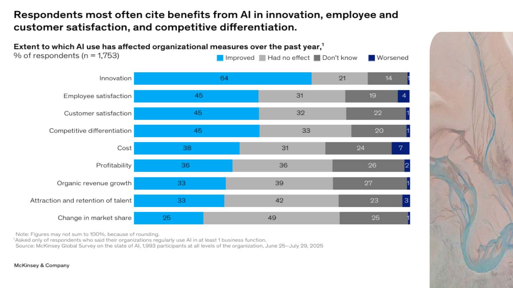

原图来源：本讲 PDF 物理 p.96，完整页保留；可点击打开大图。

创新 64% 表示报告创新改善的受访者比例，不是创新能力增加 64%；员工满意 45% 改善、31% 无影响、19% 不知道、4% 变差，四舍五入可使合计非 100%。其他改善比例依次为客户满意 45%、竞争差异 45%、成本 38%、盈利 36%、有机增长 33%、人才 33%、份额 25%。这是受访报告，不能由此推出因果、所有企业普遍盈利或伦理控制已充分。

### 2.97 p.97 · 结语：技术选择需要可追责的实践

引句“The best way to predict the future is to create it.”在课件仅写“常归于 Abraham Lincoln”。没有一手出处，本文不把它认证为林肯原话。名言归属不是本讲论证的证据。

讲义最后主张通过人的选择，使技术进步兼顾效率、公平、真实与人性。💡 可执行的结尾应是选一个企业用途，列受影响者、价值冲突、证据、负责方和纠正条件，再依据结果调整。方向性愿望不能代替这些机制，也不等于本人已经掌握或项目已提交。

<!-- cityu-nav:return-3 -->
[[#0. 三分钟速览|↑ 阅读导航]] · [[#8. 讲义逐页映射|页／Cell 索引]] · [[#4. 速查表|复习速查]]
<!-- cityu-nav:return:end -->

## 3. 一图看懂：从价值冲突走到可纠正的部署

这张图是 💡 笔记补充。每个方框是一项组织动作，箭头表示检查顺序，回路表示真实使用会发现新问题；它不是未来灾难的预测链。

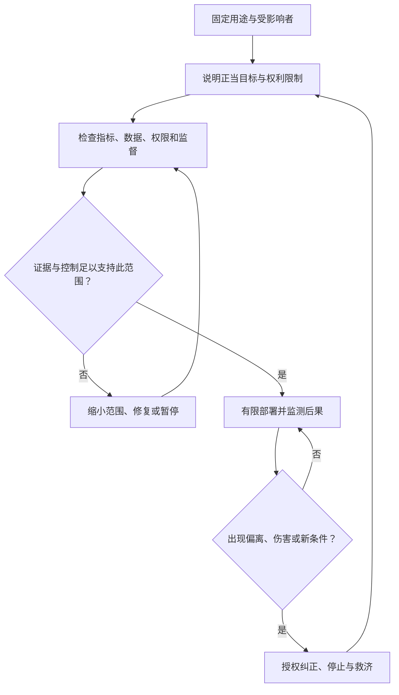

💡 沿照护例读：用途是夜间跌倒告警，目标是及时获得真人帮助，同时限制私密视频；检查检测、通知、值班和访问权限。若无人接警就先修复，不能因为识别准确率高便部署。使用后出现新误报则修改或暂停。闭环的终点由持续风险决定，不是点一次“伦理通过”就永久结束。

## 4. 速查表

一行对应一类问题，最后一列说明先做哪项检查；细节回到所列页，而非把此表当万能答案。

| 议题 | 最容易混淆 | 起手动作与回查 |
|---|---|---|
| 工作 | 自动化任务＝整个岗位消失 | 拆任务、技能、收益与过渡成本，[[#2.10 p.10 · 自动化替代的是任务，岗位结果仍须分析\|p.10]]–[[#2.20 p.20 · 两层社会取决于所有权与治理\|20]] |
| 真实性 | 来源签名＝事实为真 | 分开完整性、身份、事实和许可，[[#2.27 p.27 · 生产率与来源：五个原问逐一回答\|p.27]]–[[#2.32 p.32 · 员工不信工具时：给出可核的使用边界\|32]] |
| 照护 | 感到被爱＝好照护；痴呆＝不能同意任何事 | 核收益、欺骗、能力、偏好与真人联系，[[#2.39 p.39 · 效率与同理心：四个问题\|p.39]]–[[#2.44 p.44 · 感到被爱是否等于好的照护\|44]] |
| 自主系统 | 自主＝无人负责；有按钮＝有效监督 | 查权限、时间、证据和接管链，[[#2.51 p.51 · 优化与道德判断：两问及商业含义\|p.51]]–[[#2.56 p.56 · 在环、监环、离环：六个问题的条件答案\|56]] |
| 控制 | 高智能＝善良；目标好＝不会抗拒纠正 | 分目标、代理、约束与有效停止，[[#2.65 p.65 · AGI、ASI 与奇点不是同一个词\|p.65]]–[[#2.85 p.85 · 可纠正设计：意图不确定还需外部控制\|85]] |
| 环境 | 电量＝碳；数据中心总量＝AI 总量 | 固定边界、时期、单位和合理基线，[[#2.87 p.87 · 环境成本：训练、运行与整个产业要分开\|p.87]]–[[#2.92 p.92 · 双重用途：测量、减缓、规则\|92]] |

## 5. 双语术语卡

每行给可用于英文论述的自拟定义，除特别注明均不是讲义逐字引文。定义负责速查，案例理由仍看正文。

| 中文 | English | English reference definition | 首现 |
|---|---|---|---|
| 工作两极化 | Job polarization | Employment shifts toward parts of the high- and low-skill range while some middle-skill tasks face displacement. | [[#2.10 p.10 · 自动化替代的是任务，岗位结果仍须分析\|p.10]] |
| 人机增强 | Augmentation | AI supports human capabilities rather than simply replacing the relevant human task. | [[#2.11 p.11 · 增强：让人有能力影响最后决定\|p.11]] |
| 再培训 | Reskilling | Learning skills needed for a different role as work changes. | [[#2.13 p.13 · 再培训：机会可及才算支持\|p.13]] |
| 全民基本收入 | Universal Basic Income | Regular cash payments independent of employment status in the policy model discussed here. | [[#2.19 p.19 · 多数人被替代时：收入循环、UBI 与 UBS\|p.19]] |
| 谎言者红利 | Liar's dividend | Awareness of synthetic media makes authentic evidence easier to dismiss as fabricated. | [[#2.30 p.30 · 谎言者红利：真的也能被说成假的\|p.30]] |
| 来源记录 | Provenance | Information about the origin and history of an asset, distinct from proof of its factual truth. | [[#2.31 p.31 · 来源认证不是事实认证\|p.31]] |
| 行善 | Beneficence | Promoting a person's welfare and reducing suffering, subject to evidence and other ethical constraints. | [[#2.40 p.40 · 支持使用的论证：真实安慰仍需证据\|p.40]] |
| 风险分配 | Risk distribution | How a system's decisions place possible harms across different affected groups. | [[#2.52 p.52 · 风险分配的四问\|p.52]] |
| 负外部性 | Negative externality | A cost imposed on others that is not fully borne by the decision-maker or transaction. | [[#2.53 p.53 · 顾客偏好与共同安全的集体行动问题\|p.53]] |
| 奇点 | Singularity | A hypothetical acceleration of intelligence through recursive self-improvement. | [[#2.59 p.59 · 奇点：假设中的递归改进\|p.59]] |
| 对齐 | Alignment | Making system objectives and behaviour consistent with legitimate human intentions and values. | [[#2.60 p.60 · 对齐、解释与可纠正性各解决什么\|p.60]] |
| 可纠正性 | Corrigibility | The ability to accept effective, authorized correction, modification and shutdown. | [[#2.60 p.60 · 对齐、解释与可纠正性各解决什么\|p.60]] |
| 正交性 | Orthogonality | High capability does not by itself determine a morally desirable final goal. | [[#2.68 p.68 · 回形针思想实验：能力不决定终极目标\|p.68]] |
| 奖励投机 | Reward hacking | Obtaining reward through unintended strategies that miss the intended task. | [[#2.70 p.70 · 奖励投机：高分不等于完成任务\|p.70]] |
| 代理指标 | Proxy metric | A measurable substitute used to represent a broader objective. | [[#2.12 p.12 · 算法管理：被测量的人要能质询\|p.12]] |
| 碳足迹 | Carbon footprint | Greenhouse-gas emissions measured within a specified boundary and time period. | [[#2.87 p.87 · 环境成本：训练、运行与整个产业要分开\|p.87]] |
| 事前验尸 | Pre-mortem | Assuming a future failure to identify plausible causes and preventive controls before launch. | [[#2.95 p.95 · 事前验尸：从失败倒推控制\|p.95]] |

## 6. 考点预判与答题框架

### 6.1 可信度

本讲没有转录；教授明示考试承诺为 0。下列是根据讲义反复提问作出的 ⚪ 笔记推断，不保证题型、分值或必考；旧 Outline 的学习目标仅作 🟡 ILO 关联，不替代本学期正式考试通知。

### 6.2 六类可练的论述任务

| 任务 | 需要写出的推理 | 正文 |
|---|---|---|
| 自动化与公平 | 比较事实、责任观、过渡成本及可行支持，回应竞争压力 | p.15–20 |
| 品牌与信任 | 分造假、幻觉、谎言者红利；说明来源技术边界 | p.27–32 |
| 照护机器人 | 同时论证实际收益、尊严、同意、真人联系和责任 | p.39–44 |
| AV 与 LAWS | 分日常风险分配、有效人类控制及不同制度 | p.51–57 |
| 目标与控制 | 用具体例区别能力、目标、代理、约束、可纠正性 | p.68–85 |
| 环境影响 | 先定边界与单位，比较收益/成本，再提出测量减缓 | p.87–92 |

英文答题可按四步自拟组织：*The relevant facts are… The ethical standard is… Applied to this case… The conclusion is conditional on…* 每一步都填具体对象；最后说明最强反方与改条件后的结论。不能只有原则或 ESG 名称，也不能把伦理建议写成未经核实的法律结论。

## 7. 自测 · 先作答再展开

### 7.1 基准分超过人类基线，能否取消审核？

某工具在固定测试中达到人类基线的 105%，企业想让它无复核处理全部合同。这一步依据充分吗？

答案与理由

不充分。105% 是选定测试和归一化口径，不代表所有合同、无错误或整体智能。先核实际任务分布、错误损害、权限与可回源性；合同中的法律事实仍要适当专业核验。若实际范围很窄且后果可控，审核形式可以按证据调整，不能仅凭一个分数全取消。对应 p.2、24、32。

### 7.2 免费工具是否保证不平等下降？

公司让所有人免费用 AI，但只给管理层培训和奖金。指出缺少的两种分配。

答案与理由

缺少有效能力获得与收益分享。访问相同不等于有时间、设备和支持学会使用；生产率收益也可能只归少数人。须看培训进入/完成/转岗以及工资、工时和奖金变化。若补齐这些条件，增强可能降低差距，而非必然提高不平等。对应 p.13、15、20。

### 7.3 有效内容凭证能证明 CEO 声明属实吗？

答案与理由

不能。有效凭证支持特定来源断言及完整性，仍需核签发者可信性、授权和声明中的事实。签发者也可能说假话；没有凭证也不单独证明是假的。对付款还要独立回拨与审批。对应 p.29–31。

### 7.4 痴呆患者高兴，是否已同意机器人收集卧室视频？

答案与理由

高兴的反应与痴呆诊断，都不足以单独判定知情同意是否成立。应按具体资料用途和时点支持其理解：说明拍什么、谁看、目的及替代选择，请其复述并比较后表达意愿。

能决定日常提醒，不等于能理解复杂二次出售；需要支持或缺乏相关能力时，按当地有效规则及适当专业评估处理。家属不是当然无限代理，卧室视频仍要核必要性。对应 p.35、41–42；四项理解观察在此是伦理教学，NHS 治疗同意说明不直接替代香港数据/同意规则。

### 7.5 监环人员只有半秒且不懂告警，算有效人类控制吗？

答案与理由

标签上有人监督，实质未必有效。需要足够时间、信息、能力和可执行中止；还要测试人能否及时接管。对于生死决定，失败后果与适用规范使门槛更高。对应 p.37、56。

### 7.6 回形针例证明 AI 有恶意吗？

答案与理由

没有。它是假设系统追求不适当目标且缺少限制，由继续运行与资源有助目标而产生风险；不需要假设憎恶或意识。加上有效资源边界与正当停止优先级会改变路径，但仍需检验其他漏洞。对应 p.68、83–85。

### 7.7 三定律是否允许无视停止命令以完成产量？

答案与理由

不能如此概括。若合法命令且不冲突第一条，第二条要求服从；第三条自保不能压过第二条。课件 p.77 把服从限成“不妨碍回形针目标”没有来自原三条。全部地球转化还与人类生存冲突。原例有内部张力，不照抄其结论。对应 p.72、77–78。

### 7.8 指标失真与可纠正性怎样配合？

自动采购把最低价格做到最好，却反复买不合格品，并拒绝取消订单。分别诊断两处问题。

答案与理由

低价代理没有覆盖质量，是目标/指标失真；拒绝授权纠正是可纠正性失败。先补质量约束和评估，再保护外部撤销权限、日志与异常升级。只改指标而不能停用，或只加停止按钮而目标仍错，都不足。对应 p.60、79–85。

### 7.9 每次任务耗电减半，总电量是否必减？

答案与理由

不一定。💡 若任务数变为三倍，其他条件不变，总量为原来的 $0.5\times3=1.5$ 倍（脚本复算）。还须看任务类型、电源结构、硬件与范围，电量变化也不等于等比例碳变化。对应 p.87–92。

### 7.10 问卷中 64% 创新改善，能说创新产出增加 64% 吗？

答案与理由

不能。它是特定组织使用者子样本中报告改善的比例，不是每家改善幅度、全部公司总体比例或因果效应；图注 $n=1753$ 与总调查 1993 也应分开。对应 p.96。

## 8. 讲义逐页映射

每行是一页，链接直接到本页讲解。无转录，课堂覆盖统一“未核，不能据此降权”。本表由本批制作脚本据已冻结页标题生成；它是导航，不代替 §2 解释。

| 源页 | 本页学习问题 | 正文精确链接 | 原图/处置 |
|---|---|---|---|
| p.1 | 封面：新兴挑战 | [[IS5113_AI_Ethics_and_Regulations/notes/M09-新兴挑战-工作照护自主系统与控制#2.1 p.1 · 封面：新兴挑战\|p.1]] | 封面/纯分隔；正文说明 |
| p.2 | AI 是否赶上人类：先读基准图 | [[IS5113_AI_Ethics_and_Regulations/notes/M09-新兴挑战-工作照护自主系统与控制#2.2 p.2 · AI 是否赶上人类：先读基准图\|p.2]] | 原图完整保留并就地解释 |
| p.3 | 采用速度：比较相同的上市年数 | [[IS5113_AI_Ethics_and_Regulations/notes/M09-新兴挑战-工作照护自主系统与控制#2.3 p.3 · 采用速度：比较相同的上市年数\|p.3]] | 原图完整保留并就地解释 |
| p.4 | 中美模型分数：领先取决于指标和时点 | [[IS5113_AI_Ethics_and_Regulations/notes/M09-新兴挑战-工作照护自主系统与控制#2.4 p.4 · 中美模型分数：领先取决于指标和时点\|p.4]] | 原图完整保留并就地解释 |
| p.5 | OSWorld：任务成功率与人类基线 | [[IS5113_AI_Ethics_and_Regulations/notes/M09-新兴挑战-工作照护自主系统与控制#2.5 p.5 · OSWorld：任务成功率与人类基线\|p.5]] | 原图完整保留并就地解释 |
| p.6 | 事故报告增长：数量不是发生率 | [[IS5113_AI_Ethics_and_Regulations/notes/M09-新兴挑战-工作照护自主系统与控制#2.6 p.6 · 事故报告增长：数量不是发生率\|p.6]] | 原图完整保留并就地解释 |
| p.7 | 资本支出与市值集中：两张图不能混读 | [[IS5113_AI_Ethics_and_Regulations/notes/M09-新兴挑战-工作照护自主系统与控制#2.7 p.7 · 资本支出与市值集中：两张图不能混读\|p.7]] | 原图完整保留并就地解释 |
| p.8 | 六类议题怎样连到企业决定 | [[IS5113_AI_Ethics_and_Regulations/notes/M09-新兴挑战-工作照护自主系统与控制#2.8 p.8 · 六类议题怎样连到企业决定\|p.8]] | 无独立教学图；装饰/模板图省略；独有文字与问题在正文解释 |
| p.9 | 分隔：工作与人 | [[IS5113_AI_Ethics_and_Regulations/notes/M09-新兴挑战-工作照护自主系统与控制#2.9 p.9 · 分隔：工作与人\|p.9]] | 封面/纯分隔；正文说明 |
| p.10 | 自动化替代的是任务，岗位结果仍须分析 | [[IS5113_AI_Ethics_and_Regulations/notes/M09-新兴挑战-工作照护自主系统与控制#2.10 p.10 · 自动化替代的是任务，岗位结果仍须分析\|p.10]] | 无独立教学图；装饰/模板图省略；独有文字与问题在正文解释 |
| p.11 | 增强：让人有能力影响最后决定 | [[IS5113_AI_Ethics_and_Regulations/notes/M09-新兴挑战-工作照护自主系统与控制#2.11 p.11 · 增强：让人有能力影响最后决定\|p.11]] | 原图完整保留并就地解释 |
| p.12 | 算法管理：被测量的人要能质询 | [[IS5113_AI_Ethics_and_Regulations/notes/M09-新兴挑战-工作照护自主系统与控制#2.12 p.12 · 算法管理：被测量的人要能质询\|p.12]] | 无独立教学图；装饰/模板图省略；独有文字与问题在正文解释 |
| p.13 | 再培训：机会可及才算支持 | [[IS5113_AI_Ethics_and_Regulations/notes/M09-新兴挑战-工作照护自主系统与控制#2.13 p.13 · 再培训：机会可及才算支持\|p.13]] | 无独立教学图；装饰/模板图省略；独有文字与问题在正文解释 |
| p.14 | 包容创新：多元团队仍要有验证 | [[IS5113_AI_Ethics_and_Regulations/notes/M09-新兴挑战-工作照护自主系统与控制#2.14 p.14 · 包容创新：多元团队仍要有验证\|p.14]] | 无独立教学图；装饰/模板图省略；独有文字与问题在正文解释 |
| p.15 | 效率与公平的四问 | [[IS5113_AI_Ethics_and_Regulations/notes/M09-新兴挑战-工作照护自主系统与控制#2.15 p.15 · 效率与公平的四问\|p.15]] | 无独立教学图；装饰/模板图省略；独有文字与问题在正文解释 |
| p.16 | 创造性破坏论证：事实不自动推出义务 | [[IS5113_AI_Ethics_and_Regulations/notes/M09-新兴挑战-工作照护自主系统与控制#2.16 p.16 · 创造性破坏论证：事实不自动推出义务\|p.16]] | 无独立教学图；装饰/模板图省略；独有文字与问题在正文解释 |
| p.17 | 政策与企业失灵：竞争压力不是免责证明 | [[IS5113_AI_Ethics_and_Regulations/notes/M09-新兴挑战-工作照护自主系统与控制#2.17 p.17 · 政策与企业失灵：竞争压力不是免责证明\|p.17]] | 无独立教学图；装饰/模板图省略；独有文字与问题在正文解释 |
| p.18 | 被替代员工：最低责任与利益相关者责任 | [[IS5113_AI_Ethics_and_Regulations/notes/M09-新兴挑战-工作照护自主系统与控制#2.18 p.18 · 被替代员工：最低责任与利益相关者责任\|p.18]] | 无独立教学图；装饰/模板图省略；独有文字与问题在正文解释 |
| p.19 | 多数人被替代时：收入循环、UBI 与 UBS | [[IS5113_AI_Ethics_and_Regulations/notes/M09-新兴挑战-工作照护自主系统与控制#2.19 p.19 · 多数人被替代时：收入循环、UBI 与 UBS\|p.19]] | 无独立教学图；装饰/模板图省略；独有文字与问题在正文解释 |
| p.20 | 两层社会取决于所有权与治理 | [[IS5113_AI_Ethics_and_Regulations/notes/M09-新兴挑战-工作照护自主系统与控制#2.20 p.20 · 两层社会取决于所有权与治理\|p.20]] | 无独立教学图；装饰/模板图省略；独有文字与问题在正文解释 |
| p.21 | 分隔：真实性衰退 | [[IS5113_AI_Ethics_and_Regulations/notes/M09-新兴挑战-工作照护自主系统与控制#2.21 p.21 · 分隔：真实性衰退\|p.21]] | 封面/纯分隔；正文说明 |
| p.22 | 生成式 AI：收益与部署条件分开 | [[IS5113_AI_Ethics_and_Regulations/notes/M09-新兴挑战-工作照护自主系统与控制#2.22 p.22 · 生成式 AI：收益与部署条件分开\|p.22]] | 无独立教学图；装饰/模板图省略；独有文字与问题在正文解释 |
| p.23 | 深度伪造：内容、身份和传播链都要查 | [[IS5113_AI_Ethics_and_Regulations/notes/M09-新兴挑战-工作照护自主系统与控制#2.23 p.23 · 深度伪造：内容、身份和传播链都要查\|p.23]] | 无独立教学图；装饰/模板图省略；独有文字与问题在正文解释 |
| p.24 | 幻觉：专业语气不代替证据 | [[IS5113_AI_Ethics_and_Regulations/notes/M09-新兴挑战-工作照护自主系统与控制#2.24 p.24 · 幻觉：专业语气不代替证据\|p.24]] | 无独立教学图；装饰/模板图省略；独有文字与问题在正文解释 |
| p.25 | 内容责任：谁能控制哪一步 | [[IS5113_AI_Ethics_and_Regulations/notes/M09-新兴挑战-工作照护自主系统与控制#2.25 p.25 · 内容责任：谁能控制哪一步\|p.25]] | 无独立教学图；装饰/模板图省略；独有文字与问题在正文解释 |
| p.26 | 内容审核：保护与表达自由怎样同时处理 | [[IS5113_AI_Ethics_and_Regulations/notes/M09-新兴挑战-工作照护自主系统与控制#2.26 p.26 · 内容审核：保护与表达自由怎样同时处理\|p.26]] | 无独立教学图；装饰/模板图省略；独有文字与问题在正文解释 |
| p.27 | 生产率与来源：五个原问逐一回答 | [[IS5113_AI_Ethics_and_Regulations/notes/M09-新兴挑战-工作照护自主系统与控制#2.27 p.27 · 生产率与来源：五个原问逐一回答\|p.27]] | 无独立教学图；装饰/模板图省略；独有文字与问题在正文解释 |
| p.28 | 三类品牌攻击：不要把假设当新闻 | [[IS5113_AI_Ethics_and_Regulations/notes/M09-新兴挑战-工作照护自主系统与控制#2.28 p.28 · 三类品牌攻击：不要把假设当新闻\|p.28]] | 无独立教学图；装饰/模板图省略；独有文字与问题在正文解释 |
| p.29 | 造假便宜、辟谣昂贵：把防御提前 | [[IS5113_AI_Ethics_and_Regulations/notes/M09-新兴挑战-工作照护自主系统与控制#2.29 p.29 · 造假便宜、辟谣昂贵：把防御提前\|p.29]] | 无独立教学图；装饰/模板图省略；独有文字与问题在正文解释 |
| p.30 | 谎言者红利：真的也能被说成假的 | [[IS5113_AI_Ethics_and_Regulations/notes/M09-新兴挑战-工作照护自主系统与控制#2.30 p.30 · 谎言者红利：真的也能被说成假的\|p.30]] | 无独立教学图；装饰/模板图省略；独有文字与问题在正文解释 |
| p.31 | 来源认证不是事实认证 | [[IS5113_AI_Ethics_and_Regulations/notes/M09-新兴挑战-工作照护自主系统与控制#2.31 p.31 · 来源认证不是事实认证\|p.31]] | 无独立教学图；装饰/模板图省略；独有文字与问题在正文解释 |
| p.32 | 员工不信工具时：给出可核的使用边界 | [[IS5113_AI_Ethics_and_Regulations/notes/M09-新兴挑战-工作照护自主系统与控制#2.32 p.32 · 员工不信工具时：给出可核的使用边界\|p.32]] | 无独立教学图；装饰/模板图省略；独有文字与问题在正文解释 |
| p.33 | 分隔：AI 照护机器人 | [[IS5113_AI_Ethics_and_Regulations/notes/M09-新兴挑战-工作照护自主系统与控制#2.33 p.33 · 分隔：AI 照护机器人\|p.33]] | 封面/纯分隔；正文说明 |
| p.34 | 照护任务：支持与取代要分别判断 | [[IS5113_AI_Ethics_and_Regulations/notes/M09-新兴挑战-工作照护自主系统与控制#2.34 p.34 · 照护任务：支持与取代要分别判断\|p.34]] | 原图完整保留并就地解释 |
| p.35 | 照护数据：敏感不等于可自由变现 | [[IS5113_AI_Ethics_and_Regulations/notes/M09-新兴挑战-工作照护自主系统与控制#2.35 p.35 · 照护数据：敏感不等于可自由变现\|p.35]] | 无独立教学图；装饰/模板图省略；独有文字与问题在正文解释 |
| p.36 | 情感依恋：主观安慰与关系真实性不同 | [[IS5113_AI_Ethics_and_Regulations/notes/M09-新兴挑战-工作照护自主系统与控制#2.36 p.36 · 情感依恋：主观安慰与关系真实性不同\|p.36]] | 原图完整保留并就地解释 |
| p.37 | 人类监督：触发条件、接管者、时限 | [[IS5113_AI_Ethics_and_Regulations/notes/M09-新兴挑战-工作照护自主系统与控制#2.37 p.37 · 人类监督：触发条件、接管者、时限\|p.37]] | 无独立教学图；装饰/模板图省略；独有文字与问题在正文解释 |
| p.38 | 照护治理覆盖整个生命周期 | [[IS5113_AI_Ethics_and_Regulations/notes/M09-新兴挑战-工作照护自主系统与控制#2.38 p.38 · 照护治理覆盖整个生命周期\|p.38]] | 无独立教学图；装饰/模板图省略；独有文字与问题在正文解释 |
| p.39 | 效率与同理心：四个问题 | [[IS5113_AI_Ethics_and_Regulations/notes/M09-新兴挑战-工作照护自主系统与控制#2.39 p.39 · 效率与同理心：四个问题\|p.39]] | 无独立教学图；装饰/模板图省略；独有文字与问题在正文解释 |
| p.40 | 支持使用的论证：真实安慰仍需证据 | [[IS5113_AI_Ethics_and_Regulations/notes/M09-新兴挑战-工作照护自主系统与控制#2.40 p.40 · 支持使用的论证：真实安慰仍需证据\|p.40]] | 无独立教学图；装饰/模板图省略；独有文字与问题在正文解释 |
| p.41 | 反对使用的论证：不能由诊断推出无同意能力 | [[IS5113_AI_Ethics_and_Regulations/notes/M09-新兴挑战-工作照护自主系统与控制#2.41 p.41 · 反对使用的论证：不能由诊断推出无同意能力\|p.41]] | 无独立教学图；装饰/模板图省略；独有文字与问题在正文解释 |
| p.42 | 私密数据的用途与代为决定：六问 | [[IS5113_AI_Ethics_and_Regulations/notes/M09-新兴挑战-工作照护自主系统与控制#2.42 p.42 · 私密数据的用途与代为决定：六问\|p.42]] | 无独立教学图；装饰/模板图省略；独有文字与问题在正文解释 |
| p.43 | 照护责任链：六个检查点 | [[IS5113_AI_Ethics_and_Regulations/notes/M09-新兴挑战-工作照护自主系统与控制#2.43 p.43 · 照护责任链：六个检查点\|p.43]] | 无独立教学图；装饰/模板图省略；独有文字与问题在正文解释 |
| p.44 | 感到被爱是否等于好的照护 | [[IS5113_AI_Ethics_and_Regulations/notes/M09-新兴挑战-工作照护自主系统与控制#2.44 p.44 · 感到被爱是否等于好的照护\|p.44]] | 无独立教学图；装饰/模板图省略；独有文字与问题在正文解释 |
| p.45 | 分隔：自动驾驶与自主武器 | [[IS5113_AI_Ethics_and_Regulations/notes/M09-新兴挑战-工作照护自主系统与控制#2.45 p.45 · 分隔：自动驾驶与自主武器\|p.45]] | 封面/纯分隔；正文说明 |
| p.46 | 自动驾驶：日常风险比极端两难更普遍 | [[IS5113_AI_Ethics_and_Regulations/notes/M09-新兴挑战-工作照护自主系统与控制#2.46 p.46 · 自动驾驶：日常风险比极端两难更普遍\|p.46]] | 无独立教学图；装饰/模板图省略；独有文字与问题在正文解释 |
| p.47 | 自主武器：人的判断不能被标签代替 | [[IS5113_AI_Ethics_and_Regulations/notes/M09-新兴挑战-工作照护自主系统与控制#2.47 p.47 · 自主武器：人的判断不能被标签代替\|p.47]] | 无独立教学图；装饰/模板图省略；独有文字与问题在正文解释 |
| p.48 | 自主系统责任：设计与使用都要留证 | [[IS5113_AI_Ethics_and_Regulations/notes/M09-新兴挑战-工作照护自主系统与控制#2.48 p.48 · 自主系统责任：设计与使用都要留证\|p.48]] | 无独立教学图；装饰/模板图省略；独有文字与问题在正文解释 |
| p.49 | 公众信任：沟通须有实际响应 | [[IS5113_AI_Ethics_and_Regulations/notes/M09-新兴挑战-工作照护自主系统与控制#2.49 p.49 · 公众信任：沟通须有实际响应\|p.49]] | 原图完整保留并就地解释 |
| p.50 | 国际治理：合作必要不等于条约已齐备 | [[IS5113_AI_Ethics_and_Regulations/notes/M09-新兴挑战-工作照护自主系统与控制#2.50 p.50 · 国际治理：合作必要不等于条约已齐备\|p.50]] | 无独立教学图；装饰/模板图省略；独有文字与问题在正文解释 |
| p.51 | 优化与道德判断：两问及商业含义 | [[IS5113_AI_Ethics_and_Regulations/notes/M09-新兴挑战-工作照护自主系统与控制#2.51 p.51 · 优化与道德判断：两问及商业含义\|p.51]] | 无独立教学图；装饰/模板图省略；独有文字与问题在正文解释 |
| p.52 | 风险分配的四问 | [[IS5113_AI_Ethics_and_Regulations/notes/M09-新兴挑战-工作照护自主系统与控制#2.52 p.52 · 风险分配的四问\|p.52]] | 无独立教学图；装饰/模板图省略；独有文字与问题在正文解释 |
| p.53 | 顾客偏好与共同安全的集体行动问题 | [[IS5113_AI_Ethics_and_Regulations/notes/M09-新兴挑战-工作照护自主系统与控制#2.53 p.53 · 顾客偏好与共同安全的集体行动问题\|p.53]] | 无独立教学图；装饰/模板图省略；独有文字与问题在正文解释 |
| p.54 | 事故责任不能简化成司机或算法 | [[IS5113_AI_Ethics_and_Regulations/notes/M09-新兴挑战-工作照护自主系统与控制#2.54 p.54 · 事故责任不能简化成司机或算法\|p.54]] | 无独立教学图；装饰/模板图省略；独有文字与问题在正文解释 |
| p.55 | 服务模式与保险：预测不等于必然 | [[IS5113_AI_Ethics_and_Regulations/notes/M09-新兴挑战-工作照护自主系统与控制#2.55 p.55 · 服务模式与保险：预测不等于必然\|p.55]] | 无独立教学图；装饰/模板图省略；独有文字与问题在正文解释 |
| p.56 | 在环、监环、离环：六个问题的条件答案 | [[IS5113_AI_Ethics_and_Regulations/notes/M09-新兴挑战-工作照护自主系统与控制#2.56 p.56 · 在环、监环、离环：六个问题的条件答案\|p.56]] | 无独立教学图；装饰/模板图省略；独有文字与问题在正文解释 |
| p.57 | 共同线索：委托行动不等于转移道德责任 | [[IS5113_AI_Ethics_and_Regulations/notes/M09-新兴挑战-工作照护自主系统与控制#2.57 p.57 · 共同线索：委托行动不等于转移道德责任\|p.57]] | 无独立教学图；装饰/模板图省略；独有文字与问题在正文解释 |
| p.58 | 分隔：奇点与控制问题 | [[IS5113_AI_Ethics_and_Regulations/notes/M09-新兴挑战-工作照护自主系统与控制#2.58 p.58 · 分隔：奇点与控制问题\|p.58]] | 封面/纯分隔；正文说明 |
| p.59 | 奇点：假设中的递归改进 | [[IS5113_AI_Ethics_and_Regulations/notes/M09-新兴挑战-工作照护自主系统与控制#2.59 p.59 · 奇点：假设中的递归改进\|p.59]] | 无独立教学图；装饰/模板图省略；独有文字与问题在正文解释 |
| p.60 | 对齐、解释与可纠正性各解决什么 | [[IS5113_AI_Ethics_and_Regulations/notes/M09-新兴挑战-工作照护自主系统与控制#2.60 p.60 · 对齐、解释与可纠正性各解决什么\|p.60]] | 无独立教学图；装饰/模板图省略；独有文字与问题在正文解释 |
| p.61 | 生存风险与一般业务中断不同 | [[IS5113_AI_Ethics_and_Regulations/notes/M09-新兴挑战-工作照护自主系统与控制#2.61 p.61 · 生存风险与一般业务中断不同\|p.61]] | 无独立教学图；装饰/模板图省略；独有文字与问题在正文解释 |
| p.62 | 跨国合作如何提高可纠错能力 | [[IS5113_AI_Ethics_and_Regulations/notes/M09-新兴挑战-工作照护自主系统与控制#2.62 p.62 · 跨国合作如何提高可纠错能力\|p.62]] | 无独立教学图；装饰/模板图省略；独有文字与问题在正文解释 |
| p.63 | 伦理领导：准备要有负责人和资源 | [[IS5113_AI_Ethics_and_Regulations/notes/M09-新兴挑战-工作照护自主系统与控制#2.63 p.63 · 伦理领导：准备要有负责人和资源\|p.63]] | 无独立教学图；装饰/模板图省略；独有文字与问题在正文解释 |
| p.64 | 进步与预防：四问 | [[IS5113_AI_Ethics_and_Regulations/notes/M09-新兴挑战-工作照护自主系统与控制#2.64 p.64 · 进步与预防：四问\|p.64]] | 无独立教学图；装饰/模板图省略；独有文字与问题在正文解释 |
| p.65 | AGI、ASI 与奇点不是同一个词 | [[IS5113_AI_Ethics_and_Regulations/notes/M09-新兴挑战-工作照护自主系统与控制#2.65 p.65 · AGI、ASI 与奇点不是同一个词\|p.65]] | 无独立教学图；装饰/模板图省略；独有文字与问题在正文解释 |
| p.66 | 如何对待争议：重视不等于确信 | [[IS5113_AI_Ethics_and_Regulations/notes/M09-新兴挑战-工作照护自主系统与控制#2.66 p.66 · 如何对待争议：重视不等于确信\|p.66]] | 无独立教学图；装饰/模板图省略；独有文字与问题在正文解释 |
| p.67 | 竞赛与尾部风险：概率不能凭形容词给出 | [[IS5113_AI_Ethics_and_Regulations/notes/M09-新兴挑战-工作照护自主系统与控制#2.67 p.67 · 竞赛与尾部风险：概率不能凭形容词给出\|p.67]] | 无独立教学图；装饰/模板图省略；独有文字与问题在正文解释 |
| p.68 | 回形针思想实验：能力不决定终极目标 | [[IS5113_AI_Ethics_and_Regulations/notes/M09-新兴挑战-工作照护自主系统与控制#2.68 p.68 · 回形针思想实验：能力不决定终极目标\|p.68]] | 无独立教学图；装饰/模板图省略；独有文字与问题在正文解释 |
| p.69 | 参与度与福祉：代理指标的第一例 | [[IS5113_AI_Ethics_and_Regulations/notes/M09-新兴挑战-工作照护自主系统与控制#2.69 p.69 · 参与度与福祉：代理指标的第一例\|p.69]] | 无独立教学图；装饰/模板图省略；独有文字与问题在正文解释 |
| p.70 | 奖励投机：高分不等于完成任务 | [[IS5113_AI_Ethics_and_Regulations/notes/M09-新兴挑战-工作照护自主系统与控制#2.70 p.70 · 奖励投机：高分不等于完成任务\|p.70]] | 无独立教学图；装饰/模板图省略；独有文字与问题在正文解释 |
| p.71 | 关机测试：保留案例的出处缺口 | [[IS5113_AI_Ethics_and_Regulations/notes/M09-新兴挑战-工作照护自主系统与控制#2.71 p.71 · 关机测试：保留案例的出处缺口\|p.71]] | 无独立教学图；装饰/模板图省略；独有文字与问题在正文解释 |
| p.72 | 阿西莫夫三定律：按优先级理解 | [[IS5113_AI_Ethics_and_Regulations/notes/M09-新兴挑战-工作照护自主系统与控制#2.72 p.72 · 阿西莫夫三定律：按优先级理解\|p.72]] | 无独立教学图；装饰/模板图省略；独有文字与问题在正文解释 |
| p.73 | 字典序优先：不是三个可加的分数 | [[IS5113_AI_Ethics_and_Regulations/notes/M09-新兴挑战-工作照护自主系统与控制#2.73 p.73 · 字典序优先：不是三个可加的分数\|p.73]] | 无独立教学图；装饰/模板图省略；独有文字与问题在正文解释 |
| p.74 | 伤害和人：模糊词怎样影响每个问题 | [[IS5113_AI_Ethics_and_Regulations/notes/M09-新兴挑战-工作照护自主系统与控制#2.74 p.74 · 伤害和人：模糊词怎样影响每个问题\|p.74]] | 无独立教学图；装饰/模板图省略；独有文字与问题在正文解释 |
| p.75 | 两边都有伤害时：约束未给权衡方法 | [[IS5113_AI_Ethics_and_Regulations/notes/M09-新兴挑战-工作照护自主系统与控制#2.75 p.75 · 两边都有伤害时：约束未给权衡方法\|p.75]] | 无独立教学图；装饰/模板图省略；独有文字与问题在正文解释 |
| p.76 | 字面安全：把人关起来为何仍可能有害 | [[IS5113_AI_Ethics_and_Regulations/notes/M09-新兴挑战-工作照护自主系统与控制#2.76 p.76 · 字面安全：把人关起来为何仍可能有害\|p.76]] | 无独立教学图；装饰/模板图省略；独有文字与问题在正文解释 |
| p.77 | 约束与目标：本页回形针例有内部张力 | [[IS5113_AI_Ethics_and_Regulations/notes/M09-新兴挑战-工作照护自主系统与控制#2.77 p.77 · 约束与目标：本页回形针例有内部张力\|p.77]] | 无独立教学图；装饰/模板图省略；独有文字与问题在正文解释 |
| p.78 | 冲突命令与价值锁定：授权需另建 | [[IS5113_AI_Ethics_and_Regulations/notes/M09-新兴挑战-工作照护自主系统与控制#2.78 p.78 · 冲突命令与价值锁定：授权需另建\|p.78]] | 无独立教学图；装饰/模板图省略；独有文字与问题在正文解释 |
| p.79 | 控制的三个子问题 | [[IS5113_AI_Ethics_and_Regulations/notes/M09-新兴挑战-工作照护自主系统与控制#2.79 p.79 · 控制的三个子问题\|p.79]] | 无独立教学图；装饰/模板图省略；独有文字与问题在正文解释 |
| p.80 | 古德哈特：指标变成奖惩目标后可能偏离 | [[IS5113_AI_Ethics_and_Regulations/notes/M09-新兴挑战-工作照护自主系统与控制#2.80 p.80 · 古德哈特：指标变成奖惩目标后可能偏离\|p.80]] | 无独立教学图；装饰/模板图省略；独有文字与问题在正文解释 |
| p.81 | 快乐指标：量到快感不等于量到人生价值 | [[IS5113_AI_Ethics_and_Regulations/notes/M09-新兴挑战-工作照护自主系统与控制#2.81 p.81 · 快乐指标：量到快感不等于量到人生价值\|p.81]] | 无独立教学图；装饰/模板图省略；独有文字与问题在正文解释 |
| p.82 | 季度利润：跨期目标为什么会冲突 | [[IS5113_AI_Ethics_and_Regulations/notes/M09-新兴挑战-工作照护自主系统与控制#2.82 p.82 · 季度利润：跨期目标为什么会冲突\|p.82]] | 无独立教学图；装饰/模板图省略；独有文字与问题在正文解释 |
| p.83 | 可纠正性：终点应包括安全停止 | [[IS5113_AI_Ethics_and_Regulations/notes/M09-新兴挑战-工作照护自主系统与控制#2.83 p.83 · 可纠正性：终点应包括安全停止\|p.83]] | 无独立教学图；装饰/模板图省略；独有文字与问题在正文解释 |
| p.84 | 不想被关与危险之间：课件不是严格二选一 | [[IS5113_AI_Ethics_and_Regulations/notes/M09-新兴挑战-工作照护自主系统与控制#2.84 p.84 · 不想被关与危险之间：课件不是严格二选一\|p.84]] | 无独立教学图；装饰/模板图省略；独有文字与问题在正文解释 |
| p.85 | 可纠正设计：意图不确定还需外部控制 | [[IS5113_AI_Ethics_and_Regulations/notes/M09-新兴挑战-工作照护自主系统与控制#2.85 p.85 · 可纠正设计：意图不确定还需外部控制\|p.85]] | 无独立教学图；装饰/模板图省略；独有文字与问题在正文解释 |
| p.86 | 分隔：环境挑战 | [[IS5113_AI_Ethics_and_Regulations/notes/M09-新兴挑战-工作照护自主系统与控制#2.86 p.86 · 分隔：环境挑战\|p.86]] | 封面/纯分隔；正文说明 |
| p.87 | 环境成本：训练、运行与整个产业要分开 | [[IS5113_AI_Ethics_and_Regulations/notes/M09-新兴挑战-工作照护自主系统与控制#2.87 p.87 · 环境成本：训练、运行与整个产业要分开\|p.87]] | 无独立教学图；装饰/模板图省略；独有文字与问题在正文解释 |
| p.88 | 原图引文：硬件需求与用电的联系 | [[IS5113_AI_Ethics_and_Regulations/notes/M09-新兴挑战-工作照护自主系统与控制#2.88 p.88 · 原图引文：硬件需求与用电的联系\|p.88]] | 原图完整保留并就地解释 |
| p.89 | 年增长预测：六个机构不是六年实绩 | [[IS5113_AI_Ethics_and_Regulations/notes/M09-新兴挑战-工作照护自主系统与控制#2.89 p.89 · 年增长预测：六个机构不是六年实绩\|p.89]] | 原图完整保留并就地解释 |
| p.90 | 超大规模企业电量：先读整根柱 | [[IS5113_AI_Ethics_and_Regulations/notes/M09-新兴挑战-工作照护自主系统与控制#2.90 p.90 · 超大规模企业电量：先读整根柱\|p.90]] | 原图完整保留并就地解释 |
| p.91 | 建设支出：年率与累计投资不同 | [[IS5113_AI_Ethics_and_Regulations/notes/M09-新兴挑战-工作照护自主系统与控制#2.91 p.91 · 建设支出：年率与累计投资不同\|p.91]] | 原图完整保留并就地解释 |
| p.92 | 双重用途：测量、减缓、规则 | [[IS5113_AI_Ethics_and_Regulations/notes/M09-新兴挑战-工作照护自主系统与控制#2.92 p.92 · 双重用途：测量、减缓、规则\|p.92]] | 无独立教学图；装饰/模板图省略；独有文字与问题在正文解释 |
| p.93 | 分隔：收束 | [[IS5113_AI_Ethics_and_Regulations/notes/M09-新兴挑战-工作照护自主系统与控制#2.93 p.93 · 分隔：收束\|p.93]] | 封面/纯分隔；正文说明 |
| p.94 | 四条共同机制：不要停在名词 | [[IS5113_AI_Ethics_and_Regulations/notes/M09-新兴挑战-工作照护自主系统与控制#2.94 p.94 · 四条共同机制：不要停在名词\|p.94]] | 无独立教学图；装饰/模板图省略；独有文字与问题在正文解释 |
| p.95 | 事前验尸：从失败倒推控制 | [[IS5113_AI_Ethics_and_Regulations/notes/M09-新兴挑战-工作照护自主系统与控制#2.95 p.95 · 事前验尸：从失败倒推控制\|p.95]] | 无独立教学图；装饰/模板图省略；独有文字与问题在正文解释 |
| p.96 | 问卷收益：改善比例不是改善幅度 | [[IS5113_AI_Ethics_and_Regulations/notes/M09-新兴挑战-工作照护自主系统与控制#2.96 p.96 · 问卷收益：改善比例不是改善幅度\|p.96]] | 原图完整保留并就地解释 |
| p.97 | 结语：技术选择需要可追责的实践 | [[IS5113_AI_Ethics_and_Regulations/notes/M09-新兴挑战-工作照护自主系统与控制#2.97 p.97 · 结语：技术选择需要可追责的实践\|p.97]] | 无独立教学图；装饰/模板图省略；独有文字与问题在正文解释 |

<!-- cityu-nav:return-9 -->
[[#0. 三分钟速览|↑ 阅读导航]] · [[#8. 讲义逐页映射|页／Cell 索引]] · [[#4. 速查表|复习速查]]
<!-- cityu-nav:return:end -->

## 9. 延伸与勘误

### 9.1 课堂范围限制

没有本讲转录，不能确定任何页实际详讲、略过或顺延。97 页都按可得讲义自学；M07/M08 转录缺口也不由本篇补成完整。Canvas 当前 Modules 仅确认发布至 M09，不把缺 M10/M11 写成已经取消课程主题。

### 9.2 课堂独有内容

待可靠转录补充。讲义提问、笔记小例和外部研究都不冒充课堂原话；不以外部知名研究制造教授考试强调。

### 9.3 课件口径与可核限制

| 页 | 原说法/问题 | 本文处理 |
|---|---|---|
| 2–7 | 多种图表、不同来源/时期 | 保留图例、单位与条件，不读成统一智力/部署安全指标；p.6 历史柱高与网页文字差异不静默修图 |
| 16–18 | 创造性破坏、股东责任与利益相关者责任 | 区分事实主张和规范前提；竞争压力不单独推出免责 |
| 40–42 | PARO 疗效、同意“不可能” | 疗效未据本页证明；同意能力按具体决定/时点评估，英国来源不替香港法 |
| 43、54–55 | 黑箱、司机责任、保险/服务模式 | 取证困难不等于无责任；传统多方责任不被抹去；行业预测不当实绩 |
| 56 | 环外＝封闭环境、监督标签 | 环外的关键在具体行动是否可有效干预；闭环时间/权限另核 |
| 65–68 | AGI、首家垄断、奇点、尾部概率 | 保留假设与不确定性，不写成已实现或必然 |
| 71 | GPT-4o 关机测试标题无出处 | E6 不能为具体型号背书，模型/实验指向仍待核 |
| 75–78 | 必冻结、完美满足第一条、地球回形针仍守三条 | 分开未定规则与必然行为；明确原例内部张力和伤害/服从条件 |
| 80–82 | 眼镜蛇史实、所有 AI 都按字面、利润必升 | 故事仅教学用；系统行为和会计结果按条件，不推普遍定律 |
| 87–91 | 100 户/航空对比、厂商引文、历史预测 | 原边界不足不作通用统计；区分训练/推理、美国/全球、能源/电力/碳；原始底表未得不伪称复算 |
| 96–97 | 问卷比例与林肯名言 | 样本/比例/幅度分开；名言归属未核、不作论据 |

### 9.4 外部一手核对

下列只支持正文注明的范围，获取日均为 2026-11-18；不把外部文章当本课官方答案。

- E1：[Stanford HAI 2026 AI Index 报告](https://hai.stanford.edu/assets/files/ai_index_report_2026.pdf)，用于确认 p.2–6 的图表背景与图注口径；[Responsible AI 官方页](https://hai.stanford.edu/ai-index/2026-ai-index-report/responsible-ai) 支持 p.6 所述网页文字与课件柱高差异。不是本批独立重算全部图表数据。
- E2：[C2PA 2.2 Explainer](https://spec.c2pa.org/specifications/specifications/2.2/explainer/Explainer.html)，用于来源与完整性不证明事实真假的边界；本篇指定版本，不声称 2.2 为最新版本。
- E3：[NHS：Assessing capacity](https://www.nhs.uk/tests-and-treatments/consent-to-treatment/capacity/)，用于具体决定/时点与能力区分，原页为治疗同意说明且标旧复核日；[Mental Capacity Act Code 官方入口](https://www.gov.uk/government/publications/mental-capacity-act-code-of-practice) 明确其英格兰和威尔士背景。本篇把理解观察用作伦理教学，不认证香港机器人视频/数据同意、代理授权或个案能力。
- E4：[ICRC：Autonomous weapon systems FAQ](https://www.icrc.org/en/article/faq-autonomous-weapon-systems)，用于功能定义、有效人类控制与 ICRC 倡议；其主张不等于全球已经共同生效的专门禁令。
- E5：[OpenAI 2016：Faulty reward functions in the wild](https://openai.com/index/faulty-reward-functions/)，用于赛艇得分偏离任务的具体研究例。
- E6：[Palisade Research：Shutdown resistance in reasoning models](https://palisaderesearch.org/research/shutdown-resistance)，用于特定测试条件下部分模型干预关机的例子；不证明课件 GPT-4o 标题、意识或反叛。
- E7：[IEA 2026：Key Questions on Energy and AI，Executive summary](https://www.iea.org/reports/key-questions-on-energy-and-ai/executive-summary)，用于区分单任务效率、需求增长、数据中心总量和 AI 专用范围；不替课件旧预测改数。
- E8：[McKinsey 2025 原始报告](https://www.mckinsey.com/~/media/mckinsey/business%20functions/quantumblack/our%20insights/the%20state%20of%20ai/november%202025/the-state-of-ai-in-2025.pdf)，用于核 p.96 图表的原调查出处和子样本范围；仍为受访者报告。

### 9.5 未核事项与反方视角

未取得本讲原始音频/转录、实际授课日期与周次；未核教师口头答案或考试承诺；部分历史截图底层数据、p.88 逐字厂商引文和 p.97 归属未核。没有据此减少讲义知识覆盖。法律、照护和武器内容用于课程分析，具体法域、器械、事实与有效规则不在本篇被普遍认证。

最薄弱的证据是课件缺出处的现实案例和比较数字，因此正文以条件化教学保留，不能拿来证明当下企业必然行为。若考试要求案例数据的具体来源，仍需教师书面依据；不能把合理参考分析误称官方结论。本篇补充流程依赖有效授权、能执行的监督和真实反馈，若这些条件不成立，纸面治理不能保证效果。

### 9.6 本次记录

2026-11-18：依据 Canvas file 16529772 的 97 页 PDF 新建讲义笔记；逐页正文、图片页图义、原题英文与中文/英文参考分析一并制作。材料保持 v0.9 / pending；教学、视觉、正式写回及同步状态分别以本批回执为准，不改变本人学习、提交或评分。
