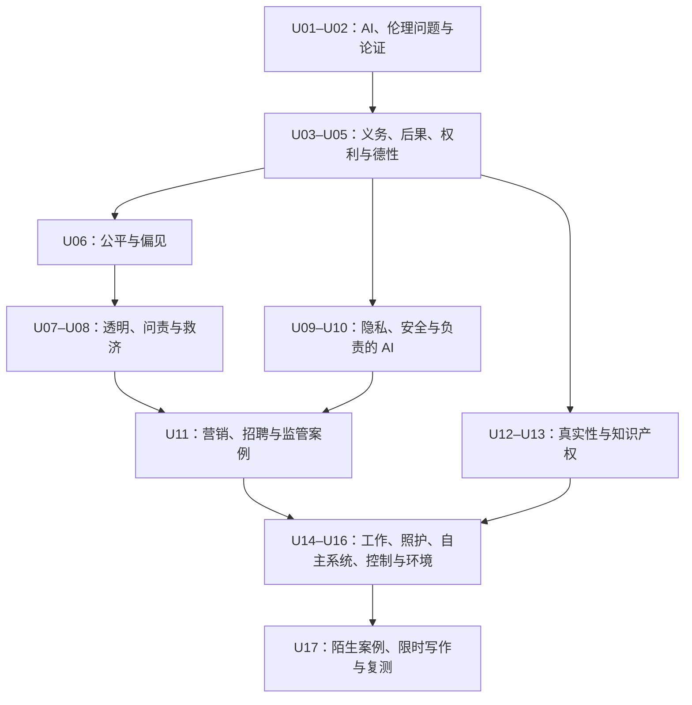

# IS5113 期末复习：从判断理由到完整案例答案

更新：2026-11-23（香港时间）。这是第一阶段复习框架，尚未开始授课或诊断。所有个人学习状态均为未开始／未知。框架覆盖现有 M01–M09；最新 Canvas 公告、最后复习课及教师 mock exam 仍待登录核查。

## 先按什么考试来准备

本次直接回读了 M09 局部转录 S31 的 `01:00:46–01:06:59`。手机来源日期为 11 月 10 日，实际授课日期未独立核定；本次没有重新听原音。以下是教师口头说明，不冒充最新书面考务：

| 项目 | 已读到的说明 | 定位与限制 |
|---|---|---|
| 形式 | 闭卷，2 小时，4 题 | T09，01:01:41–01:02:18 |
| Q1 | 基础事实类短题 | T09，01:02:36–01:02:50；没有证据称它是选择题 |
| Q2、Q3 | 情境短题 | T09，01:02:53–01:03:19 |
| 前三题 | 合计占试卷 25% | T09，01:02:25；各题单独分值未核 |
| Q4 | 长案例题，占试卷 75% | T09，01:03:26–01:04:04；“约一页”指案例材料，不是答卷限长 |
| 作答 | 读清问题，先列计划，英文手写须可读 | T09，01:03:45–01:05:36；教师提及读题 5–10 分钟、计划约 3 分钟，是建议 |
| 阅读范围 | 课堂所教足以支持满意水平作答 | T09，01:06:41–01:06:59；不是官方逐章排除表，也不是通过保证 |

期末占课程 50% 见本学期 Outline p.2（O01）。上表的 25%／75% 是试卷内部配分，分母不同。12 月 10 日 18:30–20:30、YEUNG LT13 沿用 11 月 5 日考试计划快照 E01，本轮未重开 AIMS。可带物品、具体考场要求、最终章节范围、各小问分值及现行考试 AI 规则均待核；不能从课堂“只带脑子”的口语推出完整物品清单。

当前复习优先级因此是：把概念记准确，再用案例事实解释为什么，最后提出有责任人、执行动作和检查办法的方案。没有 mock exam 时，训练题型可依据上述口头说明和真实课堂题；不能据此预测具体考题。

## 全课的知识关系

先区分事实与价值判断，才能知道一段答案缺的是证据还是判断标准。接着比较伦理理论，再把理论用于 AI 系统的具体问题，最后整合成企业决策。

这张图表示学习依赖，不表示教师课时或考试分值。默认从 U01 按编号推进；诊断后可压缩已经能独立解释并迁移的部分，但仍保留全部内容的核对入口。

## 每个单元学什么、练什么

P01–P09 是教师讲义，T 开头是课堂转录，N 开头是既有笔记；完整文件路径、版本和阅读边界见 [来源清单](sources.json)。页码统一用 PDF 物理页。下面的练习动作是复习设计，不是教师承诺的出题清单。

| 单元 | 学什么与可检验的终点 | 先修 | 材料与题型训练 | 最容易卡住的地方 |
|---|---|---|---|---|
| U01 AI 与伦理判断的起点 | 区分 AI 的行为表现、智能与心灵问题；区分事实、法律与伦理；知道公平、问责、透明、隐私在问什么 | 无；不假定已会 ML | P01 p.1–60；N01。基础短答；辨认自动驾驶例中的价值冲突 | 技术能做到不等于应该做；测试成绩不证明有心灵；课件模板数字不当事实背 |
| U02 怎样给出可讨论的理由 | 用前提支持结论；比较主观／文化相对主义、神命论和伦理利己主义；说明课程为何讨论其可用性限制 | U01 | P02 p.1–27；T02A–C；N02。理论辨认、批评及短情境题 | “我喜欢”与可供他人检验的理由不同；课程的 workable 分类不是否认文化差异 |
| U03 义务论与康德 | 会写行动准则，分别用普遍化和尊重人为目的分析；区分善良意志、完全与不完全义务 | U02 | P02 p.28–41；N02。抄袭例与条件变式；短情境题 | 普遍化不是简单多数投票；不能只写“违反自主性”而不指出怎样影响选择 |
| U04 行为与规则功利主义 | 比较行动的后果与规则普遍遵守的后果；交代受影响人、利益／伤害及不确定性 | U02 | P02 p.42–56；N02。公路改线例、理论比较与情境题 | 功利主义不等于自私自利；规则功利主义不等于遵守现有法律；不给未知损害编数字 |
| U05 权利、社会契约与德性 | 用权利和公平合作检验制度；理解 Rawls；用德性说明行动者应形成什么品格；比较五种可用理论 | U03、U04 | P02 p.57–86；P03 p.5–20；N02、N03。权利辨析、多理论同案比较 | 无知之幕属于 Rawls；不能把德性写成“人好所以做得对”的循环 |
| U06 公平、认知偏差与 AI 偏见 | 区分结果／程序／互动公平；沿数据、标签、模型、部署和反馈定位偏见；选择缓解方法 | U05 | P03 p.1–89；N03。招聘案例、机制链、简单公平指标读数 | 把不同公平标准混为一谈；把删除敏感属性当作消除偏见；两套偏见分类不能重复机械背诵 |
| U07 透明、解释与信任 | 按受众选择应披露什么；区分数据、模型、决定可追溯性与局限；比较四个案例 | U06 | 新版 P04 p.1–79；N04。Amazon、COMPAS、Apple Card、Air Canada 的对比与改进题 | 公开更多不保证更信任；不把质疑、调查、判决当同一证据地位 |
| U08 问责与治理责任链 | 区分责任、问责与法律责任；明确谁解释、谁监控、谁处理申诉和损害；把治理落到动作 | U06、U07 | P05 p.7–93；N05。p.40 五问、p.49–51 三案例、p.58 治理设计 | 把“AI 决定的”当终点；只列伦理委员会而没有权限、记录和救济 |
| U09 隐私、监控与数据使用 | 画清数据从谁到谁、为何处理；区分隐私与安全；分析同意、目的、必要性、权利及监控影响 | U05、U08 | P06 p.2–78；N06。SocialConnect、大学人脸识别、Clearview、智慧城市、Target | 有同意不自动解决全部问题；数据匿名化不能口头保证；法律判断先核法域、主体、行为和时间 |
| U10 安全风险与负责的 AI | 识别攻击作用于训练数据、模型还是使用过程；将风险对应到治理、技术、人员、监控四支柱 | U08、U09 | P06 p.79–111；N06。对抗输入、数据投毒、模型窃取／反演、成员推断、提示注入；交易机器人讨论 | 把所有攻击都叫数据泄露；把实验中的模型行为当现实部署事件；人类在环不自动保证有效监督 |
| U11 营销、HR 与监管应用 | 将伦理理论、利益相关者、商业目标、风险分类和治理要求合在一案中 | U03–U10 | P07 p.1–59；N07。LuxeStay p.35–41、OptiMax p.52–56；情境题与长案例 | 把讲义风险分类简表当完整法律；“低风险”不推出其他法律失效；要把对策对应具体伤害 |
| U12 生成式 AI 与真实性 | 区分错误信息、幻觉、深伪及传播后果；解释验证、溯源、披露、人工复核各解决什么 | U07、U08、U10 | P08 p.1–38；P09 p.21–32；N08、N09。Galactica 与企业信誉案例 | 模型说得流畅不等于事实可靠；检测／水印／检索不是零错误保证 |
| U13 知识产权与 AI 创作 | 区分想法／表达、版权／专利、作者／发明人／权利人；按法域和具体用途讨论争议 | U02、U12 | P08 p.39–92；N08。Campbell、Google Books、DABUS；法律与伦理分开论证 | 不能把美国 fair use 和英国 fair dealing 混用；DABUS 的发明人资格不等于所有 AI 辅助发明不可专利 |
| U14 工作、照护与人的自主性 | 比较替代与增强、员工转型责任；分析照护机器人的安慰、欺骗、尊严、隐私与人类关系 | U03–U05、U08–U10 | P09 p.1–20、p.33–44；T09、N09。两面论证与企业责任方案 | 将个人短期舒适直接推成社会长期善；把预测或假说当已发生事实 |
| U15 自主系统、目标与控制 | 把自动驾驶／武器的风险分配连到责任；区分能力、目标、代理指标、可纠正性与控制问题 | U04、U08、U10、U14 | P09 p.45–85；N09。电车变式、奖励投机、三定律局限、停止机制 | 三条规则不保证目标对齐；AV／武器本堂未讲不等于正式免考；不把影片情节当证据 |
| U16 环境与社会影响的整合 | 读懂能耗／投资／调查图的对象和单位；衡量收益、资源成本、外部性与可核的治理措施 | U04、U08、U14、U15 | P09 p.86–97；P01 p.58；N09。图表辨析和多方权衡 | 数据中心总用电不等于 AI 单独用电；支出不等于碳排；预测与观测分开 |
| U17 陌生案例与限时检测 | 独立读题、识别概念、筛选事实、英文组织答案；复盘错因再做不同情境的复测 | U01–U16 | E02＋课堂题库；教师卷取得后优先。训练安排见后文 | 练过原题的高分不能证明陌生题迁移；字数多不等于切中小问 |

U03–U05 是后面案例共同使用的工具，不能只背理论名。U11 的两份长案例有教师课件内的示范分析，可以用来校对论证方向；它们不是期末官方评分细则。完整解题时仍保留全部原题和小问，再区分教师给定内容与参考作答。

## 建议顺序与每轮怎样进行

第一段 U01–U05：先会用中文讲清理由，再练关键英文术语和短答案。第二段 U06–U10：每次只处理一个系统、一个争议，把伤害怎样发生、标准怎样适用、方案怎样缓解连起来。第三段 U11–U16：转入多议题案例、反方观点和条件变化。最后 U17：才做未讲过的整套检测。

每个学习回合按实际回答推进：

1. 先问一个小问题，判断从哪里讲；没回答就等待，不替用户作答。
2. 短讲一个方法，用一个有来源的例子演示。
3. 给用户一个同型小问。卡住时只提示当前缺的一步，并记录是否用了提示。
4. 换一个关键条件，检查是否能迁移，而不是复述上例。
5. 用反馈收束，保存关键原问、原答、纠错和下一步。

长案例的练习骨架是“题面事实 → 适用标准 → 把事实逐项放入标准 → 结论、反方与边界 → 对应的治理行动”。这是本次教学建议，不是所有题都必须写五段的教师模板；答题动词和小问决定组织方式。

## 首轮诊断方案（尚未出题、尚未实施）

先用约 20–30 分钟了解起点，允许先中文解释；英文表达单独记录，不把语言卡点直接判成概念不懂。诊断不计入模拟考试成绩，也不要求先读整本笔记。

| 顺序 | 诊断动作 | 要区分的卡点 | 后续去向 |
|---|---|---|---|
| D1 | 分辨一条事实陈述和一条“应该”判断，并说理由 | 不知道怎样论证，还是只不认识术语 | U01–U02 |
| D2 | 对同一个小情境分别按义务与后果提问 | 理论不会选、标准不会用、事实漏读 | U03–U05 |
| D3 | 对招聘或监控情境指出主要受影响方、两项风险及一项对策 | 只列名词、缺因果链、对策不对应风险 | U06–U11 |
| D4 | 读一个短英文题干，划出题目要求的动作，列简短答案计划 | 概念、读题或英文输出的独立问题 | 所需单元及 U17 |

实际开始时一次只给一题，不提前展示答案；诊断题会注明“自编”，正式题面与评分锚点在当轮冻结。诊断只决定讲解速度和起点，不删掉全课覆盖。若用户不想诊断，可以从 U01 开始，状态仍按真实互动更新。

## 题库怎样用，怎样留下独立检测

| 层次 | 已有或待补材料 | 用法与答案地位 |
|---|---|---|
| 最高优先 | 当前最后复习课、教师 mock exam、官方答案 | 尚未取得／核实。取得后先核课程、学期、版本、全部题页与答案身份；再更新路线和检测保留题 |
| 已可用 | M02 摄像头／抄袭／公路题，M05 招聘／医疗／自动驾驶／治理设计，M06 监控／智慧城市，M07 酒店／员工监控 | 课堂原题或历史作业题。已看题面或示范解答的，不算独立留出题；无教师答案时只给参考作答 |
| 往年卷 | 图书馆 IS5113 2025/26、2024/25 查询 | 未登录结果均为 No records found，并提示登录可得完整结果；没有取得试卷，不能说“不存在” |
| 外部 | 小红书等公开线索、同主题样题 | 本轮没有找到可核课程／年份的 IS5113 小红书试卷。Scribd 样题未认证且结构不同，不纳入官方题库；Tableau 同码题不属于本课 |
| 自编 | 首轮诊断、同型练习、迁移题和终测 | 各自标明用途。终测用新情境，出卷后冻结题面／参考评分，不在授课前泄露答案 |

尚未预留任何“真实教师卷”。U17 的安排是待执行方案：若取得足量教师题，先按知识映射分出教学题和未讲题；不足则编两组不同情境，A 组限时检测，B 组针对性复测，不能把它们叫历年真题。基于口头结构，完整模拟可暂按 120 分钟、4 题、25%／75% 两块配分，Q1–Q3 内部分值由自编卷明确标示，不能冒充教师实际分值。

## 全课覆盖核对与待补范围

本轮对 9 份当前讲义共 766 个物理页做了文本提取与结构检查，回读关键题面和考试转录；实际查看了 24 个高风险图片页。没有逐页重审 766 页教学，也没有逐字回听录音。全文提取、结构定位、抽样视觉和用户学会是四种不同状态。

| 讲义 | 页码覆盖到哪里 | 版本与处置 |
|---|---|---|
| P01，60 页 | p.1–13 课程信息；14–23 AI／心灵；24–35 伦理；36–59 技术商业背景；60 自动驾驶题 | 全部有入口；模板残留与示例数字按 N01 勘误核对，背景不能擅自宣布免考 |
| P02，86 页 | p.1–27 U02；28–41 U03；42–56 U04；57–86 U05 | p.85–86 历史作业仅作复习材料，不改提交状态 |
| P03，89 页 | p.1–44 正义／认知／组织公平；45–65 AI 偏见；66–89 缓解与治理 | 全归 U06；p.5–20 同时接 U05。纯图片偏差卡已抽看，不照抄错误归属 |
| P04，79 页 | p.1–23 概念／研究／解释；24–52 四案例；53–72 实践；73–79 影响与策略 | 采用 canvas-20261020 新版；50 页 P04OLD 仅保留版本来源 |
| P05，93 页 | p.1–6 项目背景；7–41 基础／监管；42–58 讨论案例；59–79 实施；80–93 困难 | 项目信息单列，不混入个人展示待办；其余进入 U08，监管跨接 U11 |
| P06，111 页 | p.1 行政；2–33 隐私；34–78 监控；79–96 安全；97–111 负责的 AI | U09、U10；p.1 不当教学知识点，原件保留 |
| P07，59 页 | p.1–34 营销与监管；35–43 酒店；44–56 HR；57–59 策略 | 全归 U11；课件示范答案与官方考试答案分开 |
| P08，92 页 | p.1–38 真实性／幻觉；39–60 版权；61–73 专利；74–92 AI 与 IP | U12、U13；图像页与跨法域限定保留 |
| P09，97 页 | p.1–20 能力／工作；21–32 真实性；33–44 照护；45–57 自主系统；58–85 控制；86–97 环境／整合 | U12、U14–U16；不能把本堂略过部分当免考 |

旧 Outline 规划的 W9 治理、W10 环境、W11 新兴风险，已经有内容分散在现有 M05–M09 中。不能按旧周次另编三份不存在的新课件，也不能保证现有 9 份就是最终考试全部范围。法律题将先区分讲义口径与现行法律；本轮没有重查所有法律条文、判例和生效阶段，不把课堂简表认证成当前完整法规。

下一步优先补 Canvas 的 Modules、Files、Announcements 和考试相关页面／附件，核最后复习课、mock exam 和答案；登录尚未完成时，现有框架仍可支持 D1 起点诊断。全部学习单元初始为 `not_started`，掌握程度为 `unknown`。

未来更新以可观察的表现区分：看过讲解（`explanation_seen`）、提示后会做（`solved_with_hint`）、独立做对（`independent_correct`）、换题复测通过（`retest_passed`）。一轮知识点结束才更新一次；保留关键原话，不按笔记数或聊天次数估算掌握。
