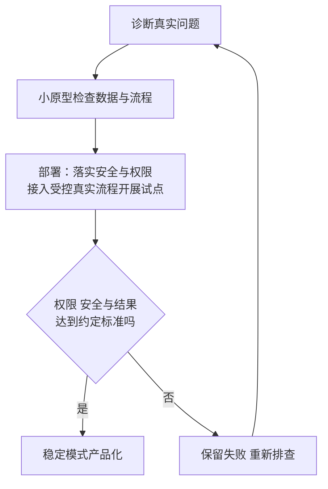

# Guest Lecture 2 反思阅读与来源说明

当前状态：**已提交**。2026-10-18 本人在本会话明确回复“交了”；据此同步本地与 Notion。以下为提交前草稿制作与验收历史，原 Word／PDF 制作文件保留，不据此推定实际上传的版本、具体提交时刻或评分。

本页是学习与制作存档，未改动原 Word／PDF 或 Canvas。本轮未重新访问 Canvas，未核实际上传版本，也不改变本人已提交、评分或学习状态。旧目录名 `venture-capital-reflection` 是任务标识；本场实际主题为 Agentic AI 与 FDE。

2026-10-18 提交前制作时，存档稿标为私人 `draft`，当时待本人核实观点、姓名／学号及第一人称表达；当次制作没有上传 Canvas。这段只说明提交前的材料状态，不能覆盖上方后来本人“交了”的确认。

## 先看这份稿在说什么

这篇围绕一个判断展开：AI 能写出可运行代码之后，人仍须找对客户问题，并用实际工作结果验收。第二段用“客服机器人其实卡在订单数据访问”这个假设情境把问题说具体；第三段质疑只统计回答条数的指标，提出把人工检查、纠错时间、未解决请求和越权披露一起纳入判断。第四段写未来小规模试点，不声称本人已经做过。

它同时回应两场分享：Eddie 的前线部署工程师（Forward Deployed Engineer，FDE）工作说明“怎样找到并解决真实瓶颈”，Warren 的结果交付观点说明“怎样判断解决是否有价值”。个人判断均是供本人审阅的写作建议，不代表已取得本人感想确认。

### 怎样从“能写代码”走到“解决了问题”

先把原稿的同一个假设情境走完：一家组织想做客服机器人，但订单信息仍放在旧系统中。客户问订单进度时，模型即使能写出流畅回复，也没有因此得到正确订单。这里的瓶颈（Bottleneck）是阻碍目标完成的关键环节；根因分析（Root-cause Analysis）要检查真正卡住哪一步，而不是先接受“缺一个机器人”这个表面描述。

前线部署工程师（Forward Deployed Engineer，FDE）是贴近客户现场，诊断实际问题并把方案接入生产环境的工程角色。Eddie 的讲义将诊断、原型、部署和产品化连起来。原型（Prototype）是用来检验关键假设的小版本；生产部署（Production Deployment）则要进入真实业务，并满足数据、权限、安全与验收要求。小版本能运行，不自动证明可以生产上线。

下面的图从上向下读，箭头表示工作顺序；验收不合格时返回排查，不能把失败当已完成成果。图是对讲义 B9 与本稿假设情境的整理，不是实际运行日志。

按图走同一个订单请求：先找数据访问的瓶颈，用原型验证读取与关联；安全和访问授权落实后，把查询接入受控的真实客服流程开展试点，再检查实际处理是否正确、安全并解决请求。原型测试通过但尚未部署时，仍不能跳到产品化。若把别人的订单交给用户，即使内容正确也走“否”分支，排查权限而不记成功；部署后的试点结果达到门槛且模式稳定，才讨论复用。按这条链复述原稿的判断：

#### 先核问题与数据通路

1. 先观察客服怎样处理订单请求。若主要时间花在找订单和核实身份，就把问题改写成“怎样让获授权的客服取得正确订单信息”，而不急着优化回复措辞。这是本稿的假设诊断，不是已观察到的真实公司结果。
2. 用小原型检查订单能否被正确读取和关联。企业资源规划系统（Enterprise Resource Planning，ERP）是集中管理订单等业务记录的系统；旧系统未开放接口或编号不一致，都可能让连接失败。接口（Application Programming Interface，API）是系统约定的调用入口。有调用入口仍要检查谁有权用，不能让 AI 猜数据或绕过权限。

#### 再核生产门槛与结果

3. 部署前先按角色限定访问动作。基于角色的访问控制（Role-Based Access Control，RBAC）例如只允许坐席读取其获授权处理的订单；能读订单不等于能改订单。来源、操作记录和失败回退需要保留。控制检查通过后，把原型接入获授权的真实客服流程作受控试点，观察结果。缺权限、证据不足或例外风险高时，交由获授权的人接手，不能把回复登记为解决。
4. 最后按预先约定的结果验收。结果验收（Outcome Acceptance）指用明确标准检查业务请求是否正确完成；它不是按回答条数计分。如果客户问题仍未解决，或人工纠错把节省的时间耗尽，就不能只凭回答多或回复快称交付有价值。稳定可复用的部分才适合产品化，也就是抽成以后项目可复用的模块；新组织仍要重查数据和权限。

原稿第三段因此要求把人工核查、返工、未解决请求和越权披露一起看。越权披露指把信息交给没有相应访问权的人；即使回答内容准确，这仍是失败。比较前应先固定同类请求和相同的质量、安全标准，再把原人工流程与试点的总处理时间作比较，试点一侧包括人工复核与纠错。这样才知道效率是否改善，而不是把工作转移给人却漏计成本。本文没有提供测量数据，因此只能提出验证方法，不能计算或承诺节省幅度。

Warren 关于交付结果的观点与 Eddie 的 FDE 工作循环能在这里连接：前者提醒先明确客户接受的成果，后者说明要经过哪些诊断与工程步骤。两者都是课堂材料提供的思考框架；“把核查与返工计入价值”是原稿中的分析建议，不能升级为本人已测过的结果，也不是嘉宾逐字给出的验收清单。

### 改条件后怎样继续判断

仍在订单客服情境中，若已有稳定、获授权的订单查询接口，原来“订单数据访问是瓶颈”的判断还成立吗？

参考推理（笔记补充）：不能沿用原诊断。数据通路已具备，就继续观察客户请求究竟卡在身份核验、信息理解、例外处理还是其他环节；材料没有给出实际结果，不能替这家公司选定新根因。若查询正确，但系统把别人的订单发给用户，结果仍因越权披露失败；若正确且安全，却花更多人工纠错时间，也不能只按回复数证明效率提高。

这也解释第四段为什么写未来小规模试点：先暴露假设和失败，再决定是否扩大。讲义 B16 的学习循环还要求学习者能解释核心逻辑；AI 帮助搭代码不免除理解输入、权限、结果和失败原因的责任。本页提供的是读懂原稿的路径，不新增本人出席、实践或学习完成记录。

## 存档成品与当时下一步（2026-10-18 提交前历史）

- [Word 草稿](../submission/IS5542-Guest-Lecture-2-Reflection-DRAFT.docx)：可编辑，正文 460 词，A4 一页，Times New Roman 11 pt；标题 15 pt，末尾一句 AI 辅助声明为 9 pt。
- [PDF 草稿](../submission/IS5542-Guest-Lecture-2-Reflection-DRAFT.pdf)：同一份 Word 原生导出，已实际查看整页，无裁切、无第二页、无段内非数字加粗。
- 当时制作阶段的下一步是：本人先确认是否认可“把核查与返工计入价值”的观点；假设例子不能改成已经做过的真实经历。当时建议按教师要求补身份并去掉 Draft，再自行提交。本人后来已确认“交了”，本条不再是当前待执行动作，也不据此推定实际上传件是否沿用本存档版本。
- 截止 2026-10-31 23:59 HKT（UTC+8）。正式入口为 [Reflection for Guest lecture 2](https://canvas.cityu.edu.hk/courses/71410/assignments/338082)。

## 逐段依据与补充边界

下列一项对应原稿一段，先列课堂依据，再说明写作补充。B 指 Eddie 讲义的物理页，A 指 Warren 讲义的物理页；两份讲义的页码不能混用。时间戳均来自同一个 `M05-transcript-partial.txt` 录音时钟，前段是 Eddie，后段是 Warren，不能把时间换算成各自开讲后的分钟数。

1. 第一段：Eddie 讲义 B6、B8–B9；其转录 `00:22` 的根因分析与避免做错产品。开篇判断是原反思草稿的论点。
2. 第二段：B8 的错误问题、旧 ERP、权限约束；B9 的诊断—原型—部署流程。订单查询与客服情境是自拟假设，不冒充嘉宾原例或本人实践。
3. 第三段：Warren 转录 `01:37:54–01:38:02` 提出交付结果；A6 讨论按成果交付，B9 包括安全、RBAC 与评测。计入人工纠错、未解决请求、越权失败等，是原稿供本人审阅的分析建议；未声称已经测量。
4. 第四段：Eddie 转录 `35:19` 的底层理解；B16 的学习循环。小型试点是未来计划，没有已完成、已部署或已参加课堂活动的主张。
5. 第五段：对前四段作判断收束。失败原型可揭示假设是分析结论，不归给讲者逐字原话。

课堂材料见 [[IS5542_GenAI_in_Business/notes/M05-Agentic-AI时代与FDE实践|M05]]。本稿不使用讲义中未经独立核实的行业数字或效率倍数，亦不将嘉宾观点写成课程政策。

## 要求与版式核对（2026-10-18 制作时历史）

2026-10-18 制作时实际重开 Assignment 338082：3 points、file upload、10/31 23:59，正文无 additional details；重开 [10/10 公告](https://canvas.cityu.edu.hk/courses/71410/discussion_topics/639030)，确认一页、两周内提交。账号 Hong Kong 时区沿用同会话刚完成的 Settings 只读核对。未执行提交。

`render_docx.py` 因本机未安装 LibreOffice 而无法转换；已改用本机 Microsoft Word 原生导出 PDF，再经 Poppler 转成 PNG，查看全部一页。首轮发现模板残留标题底线，已清除并重新导出、查看。PDF 全文与源稿去空白比对一致；成品已逐字节回读，AI 声明如实保留。

同步已关闭的确认沿用用户同会话回复。写前备份为 `D:/上课资料/CityU_backups/CityU-20261018-0108.zip`，771 个文件、约 974.9 MB；备份工具按既有轮换删除了 `CityU-20261008-1923.zip` 与 `CityU-20261008-2008.zip`。本次未触碰原始课件与录音，未执行 Git 提交或推送。

## 同步与文件安全回读（2026-10-18 制作阶段历史）

任务说明、私人作业总览、课程总览和课程作业与 DDL 已精确更新并回读。当时 Notion 的 A03“要求摘要”已补草稿生成事实并回读一致；提交确认之前，“状态”仍为既有“未开始”，其余属性逐项一致，不代改本人学习、提交或评分。这是制作阶段的历史快照，不能作为现行 Notion 状态；后来本人提交确认及同步事实见页首，本轮没有重新读取 Notion。

写后全库检查仍有 7 项既有图源说明文件的末标题提示；对应文件与开工快照哈希一致，本次未改。全库链接检查仍报 22 项既有图源扩展名范围提示，已核对应图源文件实际存在；本次新增文件及链接无新增缺失。README 检查为 0。相对本次快照的 5 份 Markdown 变更全部符合清单，意外修改与删除均为 0。两个成品均已确认被 Git 忽略。

## 本轮阅读导览的来源边界（2026-10-27）

新增解释按现行 M05 §2.3、§2.6–§2.8 定位：Eddie 的诊断与交付循环、权限限制、学习责任，以及 Warren 的成果交付观点。客服订单例仍为原稿的假设情境，不把 M05 的另一银行案例、样本量或数值搬成本人实际结果，也不引入未经独立核实的行业倍数。

现有转录缺 Eddie 正式开场，Warren 最后追加问答是否存在未知；这不妨碍定位已保存的上述片段，却不能据此称整堂录音完整。本轮没有核听声轨或重做存档 Word／PDF；上方历史字数、页数、视觉和文件回读只适用于 2026-10-18 制作件，不认证实际上传件。本文的教学修订等待新的全篇独立审查。
