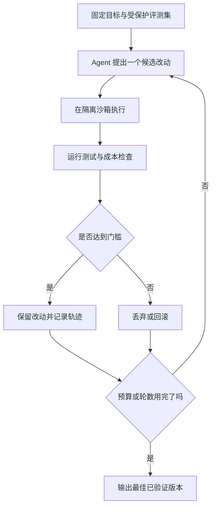
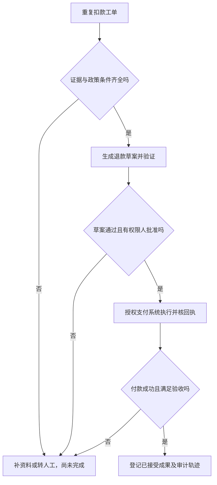
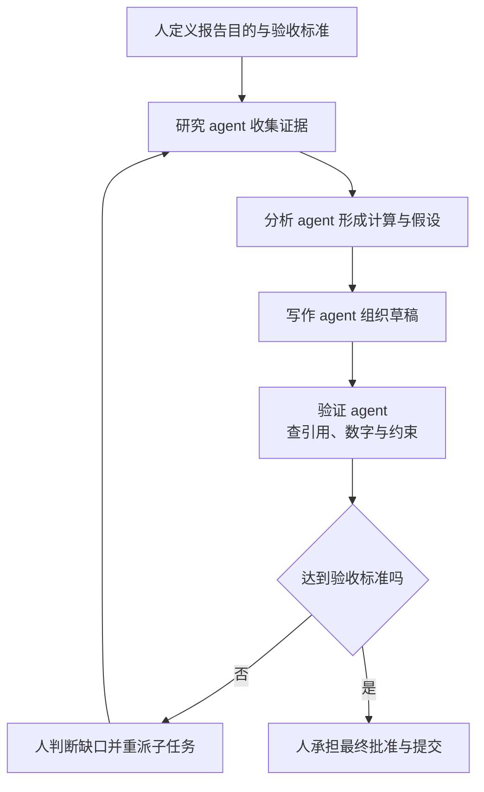
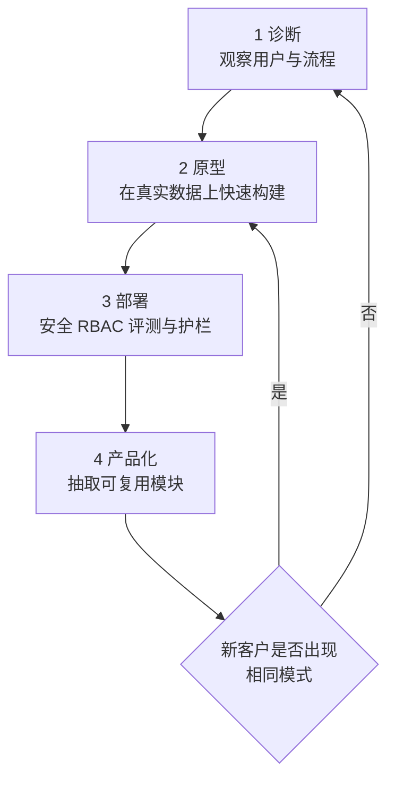
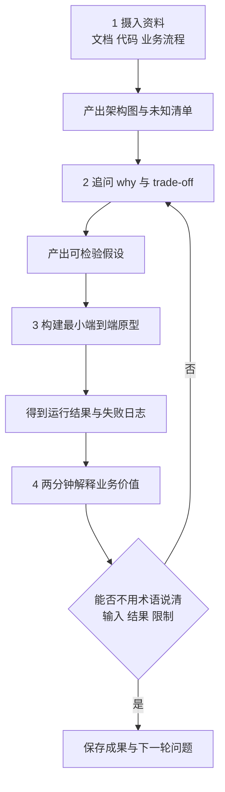
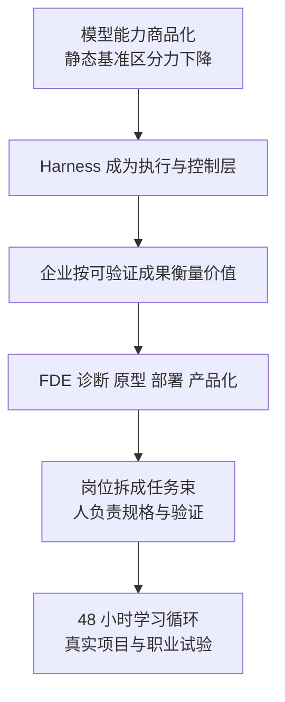

# M05 · 代理式 AI 时代与前线部署工程师

> **本讲一句话**：当模型能力逐渐成为可购买的公共部件，企业差异转向“怎样把模型接进真实工作、怎样验证结果、谁对结果负责”；本讲后半定义的 FDE 就是把这条链从客户问题带到生产系统的人。
>
> **原始材料**：A=`IS5542 - GuestLecture2-Navigating the Agentic AI Era - CityU.pdf`（12 个物理页；页脚 1/13、2/13、3/13 后跳至 5/13）｜B=`IS5542 - GuestLecture2-FDE Sharing — Eddie Chan (Google Slides).pdf`（22 页）｜**转录**：`merged`（`M05-transcript-partial.txt`，668 段，`00:00`–`01:50:24`）
>
> ✅ **材料 v1.0**：讲义全页已进入正文与 §8，source13 已全文对齐。录音首句已在 Eddie 的 FDE 讲授中段，缺正式开场；末尾 Warren 刚邀请一两题便截断，后续 Q&A 未知。本文不把讲义中的 2026 数字、倍率或市场判断写成已独立核验事实。2026-10-18 曾完成当时的全篇核对；该历史记录不替代本次独立教学审查，材料原有缺口保留。

> **来源图例**：📄 表示两份讲义；🎙️ 嘉宾观点表示 Eddie / Warren 的经验与判断；🎙️ 课堂互动表示学生提问与现场回答；📚 课程既定结论只用于既有 CILO、Canvas 或教授已确认的课程要求；💡 表示笔记为教学补的机制、例子或边界。嘉宾观点不会自动升级为 📚 课程结论。

---

## 0. 三分钟速览

**这一讲讲了什么**

两份讲义从同一个问题出发：模型会写代码、查资料或生成方案之后，企业为什么仍然难以得到生产结果？Source A 的答案是把模型放进有路由、记忆、沙箱、权限和评测的执行系统；Source B 的答案是让 FDE 跟客户一起诊断、原型、部署，再把重复模式产品化。

**学完你应该能**

1. 把“模型能力”与“承载模型工作的 harness”分开，并指出每层负责什么。
2. 用“输入 → 工作流 → 可验证成果”解释代理式结果模式，不把 demo 当成业务价值。
3. 走完 FDE 的四步循环，并说明每一步留下什么可核证据。
4. 把一项岗位拆成任务束，判断哪些任务可自动化、哪些仍需人工判断。
5. 用 48 小时学习循环规划一个陌生业务或技术领域的学习产出。

**如果只记三件事**

- 模型像可替换的计算部件；持续优势来自工作流、上下文、权限、评测和用户反馈。
- FDE 的工作从“找对问题”开始，以“生产结果被验证”结束，中间必须处理数据、安全与组织约束。
- 讲义里的 `6x`、`10x`、`3–6 days` 等是材料主张或个人经验，适合提炼机制，不能直接当作普遍因果结论。

> 🎙️ **课堂实况（2026-10-17）**：录音 `00:00` 已进入 Eddie 的 FDE 根因分析，`00:00`–`43:52` 覆盖 FDE 工作、学习方法与完整一轮 Q&A；`43:52`–`45:22` 是嘉宾切换；Warren `45:22`–`01:50:12` 讲前沿模型、创业与职业，再邀请一两题时转录截断。重心是“不要做错问题、harness 形成差异、把工具转成结果、亲手做出有用产品”。

---

## 1. 开始之前 · 知识衔接

### 1.1 你已经有的

表里一行是一项前置概念；第三列给出本讲怎样继续使用它。

| 概念 | 一句话唤醒 | 本讲连接 |
|---|---|---|
| harness | 模型外负责循环、工具、状态、权限和验证的运行时层 | [[IS5542_GenAI_in_Business/notes/M03-AI-agent-从harness到部署#2.5.1 什么是 harness：六元组 H=(E,T,C,S,L,V)（讲义 p.20–21）\|M03 §2.5.1]]；本讲接到创业与 FDE 落地 |
| 任务专属评测集 | 先定义典型、歧义、冲突和失败输入，再用固定标准判断输出 | [[IS5542_GenAI_in_Business/notes/M03-AI-agent-从harness到部署#2.10.4 任务专属评测集：四类案例（讲义 p.75）\|M03 §2.10.4]]；本讲接到交付验证 |
| 工作待完成 | 从用户想完成的任务和结果找机会，不从功能倒推 | [[IS5542_GenAI_in_Business/notes/M04-设计思维-业务机会识别与AI创意工作坊#2.3 用户到底想完成什么 讲义 p.31至38\|M04 §2.3]]；本讲用于诊断痛点 |
| 价值×复杂度 | 同时看组织价值和实施复杂度，避免只追最炫方案 | [[IS5542_GenAI_in_Business/notes/M04-设计思维-业务机会识别与AI创意工作坊#2.8 值得做与做得成 讲义 p.60至66\|M04 §2.8]]；本讲接到部署 |

读第一行：harness 负责把模型的候选动作接到工具、权限与验证；M05 会就地恢复当前机制所需解释，再问它怎样改变商业交付方式，不用“前课讲过”跳过本讲关键操作。

### 1.2 本讲全新引入的概念

表里一行是本讲第一次完整展开的概念。

| 概念 | English | 展开位置 |
|---|---|---|
| 代理式结果模式 | Agentic Outcome Model | §2.3 |
| 成果计价 | Outcome-based Pricing | §2.3 |
| 前线部署工程师 | Forward Deployed Engineer (FDE) | §2.6 |
| 最后一公里落地 | Last-mile Deployment | §2.7 |
| 任务束 | Task Bundle | §2.5 |
| 群体编排 | Swarm Orchestration | §2.5 |
| 48 小时学习循环 | 48-hour Study Loop | §2.8 |
| 基于角色的访问控制 | Role-Based Access Control (RBAC) | §2.7 |
| 现金薪酬 | Cash Compensation | §2.10 |
| 股权与期权 | Equity and Stock Options | §2.10 |
| 纸面估值 | Paper Valuation | §2.10 |
| 薪酬总包 | Compensation Package | §2.10 |
| 收入运行率 | Revenue Run Rate | §2.1 |

### 1.3 为什么这一讲放在这里 · 重排说明

M03 讲系统怎样让 agent 可靠运行，M04 讲怎样找到值得解决的问题。本讲把两者接起来：先说明为什么企业价值从模型本身转向执行系统，再看谁负责把真实痛点变成生产结果，最后讨论个人怎样准备这种工作。

讲义原顺序是 A 的宏观趋势 → 创业 → 职业，再进入 B 的个人经历 → FDE → 学习与择业。本笔记按“技术与市场变化 → 企业交付机制 → FDE 循环 → 学习与职业选择”重排。两个来源的物理页分别用 A1–A12 与 B1–B22 标识，不能把页码混成一套。

B2 的六章议程原文如下，完整保留标题和副标题：

1. **Self-Introduction** — Study Background → SWE
2. **What is an FDE?** — PLTR to 2026 Boom
3. **FDE in the AI Era** — 10x Force Multiplier
4. **How I Study** — Gemini + Learning by Doing
5. **Why I Chose FDE** — Not EM or Core SWE
6. **Your Path & Q&A** — Fit Check & Open Floor

---

## 2. 正文

### 2.1 先判材料主张，再谈趋势（A1–A3；累计 p.1–3）

这一节回答：看到一页塞满模型名、份额和增长数字时，怎样既抓住论点，又不把报告性主张误当已证实事实？

**是什么**

本节先把三个核心词落到对象上。模型权重（Model weights）是模型训练后用于计算输出的一组数值；开放权重（Open weights）表示可取得这些数值并在许可范围内自行部署或修改，不等于训练数据、全部源码或无限制商用都开放。静态基准（Static benchmark）使用相对固定的题目与评分规则；模型不断进步而同一套题接近满分时，这套题的区分力会下降。

商品化（Commoditization）是指某种能力越来越容易从多个供应商取得，单靠“拥有它”不容易维持差异；不表示所有模型能力、价格或可靠性都相同。Source A 正是在主张这种趋势，尚不是本笔记独立证实的市场结论。

Source A 把 2026 年的代理式 AI 时代分成三条主线：前沿能力与开放权重、创业与应用打法、职业与个人成长（A1–A2）。A3 再用“三家实验室竞争”“开放权重份额上升”和“静态基准快速饱和”支持“原始模型能力正在商品化”的核心论点。

**为什么需要它**

商业判断不能只看一个大数字。每个数字至少要问四件事：对象是什么、分母是什么、观察期是什么、谁提供数据。A3 的柱图按模型族统计 2026 年 arXiv AI research papers 中的模型提及份额，不是整个模型市场份额。

**课件原例**

材料声称 Claude Opus 5.5、GPT-6 Astra 与 Gemini 4 Argon 构成“三家前沿竞争”。A3 四根柱分别是：三家前沿模型族 42%、中国开放权重模型族 31%、美国开放权重模型族 23%，以及中国开放权重模型在 2024 年的基线 9%。这里前三根柱是 2026 年分组，第四根是跨年的对照，不是同年四组；不能把四根相加当成 100%。这些柱来自 2026 年 arXiv AI research paper mentions 的讲义统计；年份、模型族和论文提及口径必须一起读。

同页还称最难数学套件在 14 个月内由 22% 上升到 100%，ARC-AGI-3 发布 5 个月内被解决。A3 另写 OpenAI 与 Anthropic 合计 US\$105B revenue run rate。收入运行率（Revenue run rate）把某一段收入节奏折算成年度规模。

它与已经实现的全年收入、扣成本后的利润分别对应不同问题。同一个 US\$105B 也重复出现在 A6 的 agentic outcome 栏；两个页面都没有提供可独立复算的收入明细。

金额单位中 B 表示十亿、T 表示万亿，US\$ 表示美元；因此 105B 是 1,050 亿美元的年度化节奏，不是本讲核实的全年收入。

这些数据在本讲只能支持“静态榜单可能迅速失去区分力”这一材料论点。讲义没有在页内给出完整样本、计算方法和可复算数据，所以不能把百分比延伸成整个市场的确定结论。

**🎙️ 课堂补充**（Warren，`49:07`–`01:06:07`，A 课上展开）

- Warren 用三支柱说明议程：前沿实验室、应用与创业、个人职业影响（`49:07`–`50:47`）。
- 他把美国路线概括为专有模型，把中国路线概括为开放模型，并用 Windows / Linux 作类比（`52:49`–`55:19`）。
- 他主动限定自己的解释：*"there's no definite answer"*（`59:09`）。所以本节将中美路径写成嘉宾分析，不写成课程的唯一结论。
- **这段改变了什么**：确认 A2–A3 是 Warren 的报告框架，但 A3 份额、revenue run rate 和地缘解释仍未获得可复算来源。Warren 在 `55:56` 明确展开 ARR 为 *"Annual recurring revenue"*（中文：年度经常性收入）；其具体公司数字的合同范围、计算日期和核验依据仍未给出。本稿不把它与 revenue run rate 混成同一指标。

**💡 换个说法（笔记补充）**

假设两款模型都能在十秒内答对一套旧选择题，榜单就很难替企业选模型。企业真正关心的可能是：系统能否连续执行两天、失败后是否可恢复、输出有没有证据、敏感操作是否经过审批。这些问题需要过程评测，而不只是终点分数。

**⚠️ 常见误解**

- ❌ “榜单饱和说明所有模型都一样。” → 饱和只说明这套题区分度下降；成本、工具使用、稳定性和领域任务仍可能不同。
- ❌ “开放权重等于免费且无风险。” → 是否可商用、自托管成本、安全控制和许可限制仍需逐项检查。
- ❌ “讲义用了 2026 数字，所以数字已经独立核实。” → 本稿只确认数字确实出现在 A3，不确认其外部真实性。

**与其他概念的关系**

当静态基准区分力下降，评测就要转向任务专属协议与长程工作，回看 [[IS5542_GenAI_in_Business/notes/M02-模型全景-基准评测与提示设计#2.10 任务级评测协议与"选模型"的收束（讲义 p.80–81）|M02 §2.10]]。模型选择也回到任务契合，而不是排行榜第一。

**所以呢**

先把“材料论点”和“已核事实”分开，下一节才能讨论讲义认为真正的差异从哪里来。

### 2.2 Harness、自我改进与基础设施边界（A4–A5；累计 p.4–5）

这一节回答：即使模型权重不变，为什么执行系统仍可能显著改变结果？

**是什么**

Harness 是模型周围的执行层。上下文（Context）是本次交给模型参考的指令、资料和当前状态；沙箱（Sandbox）是限制代码可访问资源的隔离运行环境。模型提出动作，harness 决定这些动作是否获准、到哪里执行及怎样检查结果。它决定模型看到什么上下文、可以调用什么工具、在哪个沙箱里执行、怎样保存状态、失败后怎样恢复，以及结果怎样验证。Source A 用“模型是芯片，harness 是操作系统”概括这种分工（A4、A7）。

递归自我改进（Recursive Self-Improvement, RSI）在 A4 指系统让 AI 提出、执行并评估改动，再把通过的改动保留下来。它不是“模型自己无限变聪明”的口号；必须有受保护的评估器、资源上限和人工监督。

**为什么需要它**

单次模型调用只给出一个候选动作。要把候选动作变成可靠交付，系统还要控制环境、记录轨迹、判断成功、处理失败。A4 报告“同一模型、只升级 harness，SWE-Bench Mobile 提升 6 倍”。讲义只把 SWE-Bench Mobile 称作一项软件工程任务评测，没有给题库、评分指标或完整名称；因此 6 倍只能作为讲义案例。

**课件原例**

A4 还把 Karpathy 的 autoresearch 作为自动研发原例，称其一晚自主执行 100 次以上训练改动。该数没有实验日志供本次重做，也不是本任务跑过的训练。A4 左侧 6x 强调固定模型权重下改 harness，右侧自动研发却涉及训练改动；这是并列的两类主张，不能混成同一个控制变量实验。

A4 列出三组 2026 报告性主张：harness 升级带来 `6x` 提升、Claude 在监督下执行 Anthropic 内部模型研发的 26%、可验证奖励论文同比增长 10.4 倍。A5 再把能力边界拉回现实资源：人形机器人、仿真到现实训练、数据中心用电、芯片与电网接入。

A5 的三个大数分别指不同对象。67% 是讲义所称中国人形机器人风险投资（VC）份额；统计分母、地区归属与观察窗口仍未完整给出。

4 小时是仿真到现实强化学习（Reinforcement Learning, RL，用奖励反馈改进行为）的训练叙述，讲义例子是机器人在仿真中学会爬楼梯。

US\$733B 是讲义所称 2026 年超大规模云服务商（Hyperscaler）资本开支（capex）。TPU 是 Google 的张量处理器（Tensor Processing Unit），属于面向模型计算的专用芯片；这里关注芯片、电力和电网接入是否可得，不要求读者设计芯片。这三个数都没有由本笔记独立核验，不能互相当分母或拼成同一统计。

风险投资（Venture Capital，VC）是投资机构向企业投入权益资本的融资方式；资本开支（Capital expenditure，capex）是建设数据中心、设备等长期资产的投入，不是模型收入或利润。

A5 还举 Gemini Robotics Model 2 的跨任务表现、Unitree 生态、Waymo 的 220M rider-only miles 与 500k weekly rides。M 表示百万、k 表示千，所以后两项分别是 2.2 亿英里与每周 50 万次乘车的材料叙述；里程与次数不能直接相加。页面另将美国 US\$733B 资本开支与欧洲 €1B 承诺并列，并提 Google TPU Ironwood 等定制芯片与电网接入。这些只是讲义例子，币种、地区、承诺范围和时期未对齐，不能由两数直接推出投入比例或部署能力。

**机制：一个受控自我改进循环怎样运行**

箭头表示控制顺序。循环从固定评测集开始，不能让 agent 同时改题目和答案；否则它可能通过降低标准来“进步”。

**完整小例（💡 笔记补充）**

目标是把一个客服分类器的错误升级率从 8% 降到 5% 以下，同时单次成本不超过 HK\$0.20。

1. 评测器锁定 100 条未公开案例，并记录当前错误升级率 8%、成本 HK\$0.16。
2. Agent 建议把“退款期限”政策放进检索上下文，在沙箱运行 100 条案例。
3. 新版本错误升级率降到 4%，成本升到 HK\$0.19，两个门槛都满足，因此保留。
4. 下一轮建议调用更大模型，错误率降到 3%，成本升到 HK\$0.36。成本门槛失败，因此回滚。
5. 达到两轮预算后输出第一项改动。输出不是“模型更聪明”，而是一个通过固定评测的系统版本。

**🎙️ 课堂补充**（Warren，`01:09:02`–`01:10:16`、`01:23:33`–`01:35:02`，A 课上展开）

- Warren 把 harness 解释为模型之上的全部应用设计，包括 prompt、结构与 orchestration：*"anything or everything you do to build your own application… [is] part of [the harness]"*（`01:09:02`–`01:09:15`）。
- 他说算力扩展的根本约束是能源：*"the fundamental challenge… is actually energy"*（`01:32:49`–`01:33:07`）。
- 课堂花较多时间讨论 physical AI、机器人、芯片、数据中心和能源；A4 的 RSI `6x / 26% / 10.4x` 没有逐项口述核算。
- **这段改变了什么**：课堂支持“执行层与基础设施共同限制落地”，但不验证讲义倍率。

**💡 换个说法（笔记补充）**

模型像发动机，harness 像整辆车的变速、刹车、仪表和道路规则。发动机不换，整车仍可因为控制系统更好而更稳；道路、电力和硬件不足时，软件能力也无法无限放大。

**⚠️ 常见误解**

- ❌ “循环次数越多，结果一定越好。” → 评测可能被过拟合，成本也会累积；需要留出集、预算和停止条件。
- ❌ “能在仿真中完成动作，就等于能在现实部署。” → 传感误差、硬件磨损和安全边界会造成仿真到现实差距。
- ❌ “基础设施只是后台成本。” → 电力、芯片、网络和沙箱容量会直接限制并发、时延与可执行任务。

**与其他概念的关系**

这套循环复用 M03 的环内验证、沙箱和固定评估器；区别是本讲把它解释为企业交付与竞争优势，而不是单纯技术组件。

**所以呢**

Harness 把“模型会做”变成“系统可控地做”。下一节继续问：企业应为软件席位付钱，还是为已验证成果付钱？

### 2.3 从按席位收费到按成果收费（A6；累计 p.6）

这一节回答：代理式系统真正改变的是软件界面，还是客户购买的交付物？

**是什么**

传统按席位软件（Per-seat Software as a Service，SaaS，即按账号订阅的软件服务）向每个用户账号收费，客户仍要自己点击表单、搬数据和完成工作。代理式结果模式（Agentic Outcome Model）把输入的业务请求变成可核验交付物，例如解决一张工单、完成一次审计检查或生成一笔待审批交易。

成果计价（Outcome-based Pricing）按完成并被接受的成果收费。它要求先定义什么算“完成”，再记录失败、人工复核和返工；没有验收口径，就没有可结算的成果。

**为什么需要它**

如果 agent 能端到端完成工作，客户未必愿意继续为“多少人登录了软件”付费。计价单位转向成果后，供应商也不能只展示模型能力，必须承担工作流、异常处理和结果质量。

**课件原例**

A6 把两种模式并列：旧模式按每席位每月 50 美元收费；新模式按 resolved ticket、audit 或 trade 等成果收费。同页的 US\$285B SaaSpocalypse 与 Ramp token spend 96% 都是讲义报告性主张，页内没有完整来源口径。

**机制：一张工单怎样变成可结算成果**

1. **输入**：客户提交“重复扣款”工单，系统读取账号、交易记录和退款政策。
2. **执行**：agent 核对两笔交易是否同商户、同金额、同一结算周期。
3. **分支**：证据齐全且金额低于审批上限，生成退款草案；证据冲突就升级给人工。
4. **验证**：检查退款草案引用的交易号、金额、政策版本和应由谁审批；通过验证只说明草案符合当前检查，不表示已经退款。
5. **批准与执行**：有权限的人确认后，由获授权支付系统执行并核对回执。支付失败或未获批准时，状态仍不能记为完成。
6. **输出**：只有客户收到正确处理、审计轨迹完整并满足约定验收条件时，才记为一个已接受成果（Accepted outcome）。本例把未解决返工单排除；现实合同也须先定义何时计费与退回规则。

下面箭头是请求的控制路径；草案、付款与已验收结果是不同状态。

用本例走图：草案正确但审批人还没确认，停在待审批；审批通过后支付接口报错，则转人工处理，不能按成功工单计费。文字替代：先核证据，再核草案和批准，执行后还要验收，最后才计成果。

这个过程的状态包括“待处理、需补资料、待人工审批、已完成、被退回”。把“模型已回复”当作“工单已解决”会夸大成果。

**🎙️ 课堂补充**（Warren，`01:35:02`–`01:38:14`，约 3.2 分钟，A 课上展开）

- Warren 先用 Salesforce 的客户关系管理（Customer Relationship Management, CRM，记录客户与销售流程）说明 SaaS 卖工具，客户自己完成工作（`01:35:25`–`01:36:59`）。
- 他再给出结果导向的口语版：*"AI companies are selling or delivering results instead of delivering tools"*（`01:37:54`）。
- 他用“卖麦克风”与“交付一场讲座成果”作类比，也当场指出“六个月成为亿万富翁”的生成内容会是无效结果（`01:37:24`–`01:37:54`）。
- **这段改变了什么**：补出了结果仍需人判断真实性的边界；课堂没有把 US\$285B 当成可投资结论。

**💡 换个说法（笔记补充）**

买一把电钻是买工具；请人打出合格的孔是买结果。结果计价更接近后者，但孔径、墙体损坏和验收标准必须事先写清。

**⚠️ 常见误解**

- ❌ “按成果付费一定更便宜。” → 复杂异常、人工审核和责任成本可能更高。
- ❌ “agent 完成一次调用就是一个成果。” → 业务成果需要验收、审计与可能的客户确认。
- ❌ “SaaS 会全部消失。” → 讲义提出的是定价与价值重心变化；记录系统、权限和协作界面仍可能保留。

**与其他概念的关系**

成果计价必须使用 [[IS5542_GenAI_in_Business/notes/M03-AI-agent-从harness到部署#2.10.5 每接受结果成本：把失败也算进去（讲义 p.76）|每接受结果成本]]。失败尝试和人工复核都进入分子，否则价格与真实资源消耗脱节。

**所以呢**

当购买单位变成成果，竞争优势就来自谁能稳定完成并证明成果。下一节把这种优势拆成创业栈与产品设计。

### 2.4 创业栈、体验与大湾区组合（A7–A9；累计 p.7–9）

这一节回答：如果模型 API 可以替换，创业公司怎样建立不随模型换代一起消失的优势？

**是什么**

本节沿用 M03 的定义：harness 是模型外负责路由、工具、状态、权限和验证的运行时层。A7 把产品栈分成三层。最上层 harness 决定怎样执行：路由器（Agent router）按任务、权限和成本选择模型或工具；记忆（Memory）保存任务状态或经允许复用的历史；技能（Skills）保存可重复操作的方法；代码沙箱隔离执行；策略护栏（Policy guard）与权限决定允许哪些动作；评测（Evaluation，eval）按约定案例检查结果。

中层是可调用的不同模型，以及领域检索增强生成（Domain RAG）：先取回当前企业任务需要的证据，再交模型据证据回答。底层提供计算资源、运行轨迹和图像／视频／传感器等多模态资料。上层做选择与控制，中层提出候选，底层提供可计算、可核的材料，三者不是三个相互替代的模型。

A8 把产品设计从固定场景转向生成能力。它建议先定义 agent 能完成的开放式循环，再决定界面或硬件形态。A9 再把这种产品方式放进大湾区（Greater Bay Area, GBA）的工程、供应链与全球市场组合。

**为什么需要它**

应用程序编程接口（Application Programming Interface，API）是系统约定的调用入口：输入请求，按约定返回数据或结果。只封装一个模型 API 而没有额外业务能力，竞争者接入相同模型就容易复制主要功能。工作流轨迹、用户记忆、领域权限和失败处理来自持续运行，复制成本更高。它们也能让团队在模型升级时保留业务逻辑。

**课件原例**

A7 的“harness moat”要求跨 Claude、GPT-6、Gemini 与 Qwen 灵活路由，并用隔离沙箱防止 agent 逃逸。A8 引用 Loopit 与 Ambi 的讲义观点：面向生成能力做开放式引擎，先定义 agent loop，再设计眼镜、传感器或其他形态。

A9 的“GBA formula”把深圳硬件原型速度、香港资本与合规入口、3–5 人 AI 原生团队组合起来。讲义把创业成本概括成 Engineers + APIs + Power，分别是人员、模型/服务调用与用电等资源，不是已给出可复算预算。高 ARPU（Average Revenue Per User，每位用户平均收入）市场只是讲义的目标市场建议；SEA 是东南亚、MENA 是中东及北非。它们不能单凭地名保证某个产品收入高。页内的“up to US\$350k Google Cloud credits”是讲义陈述；是否适用于某团队需另核项目、资格与日期。

**机制：模型可替换时，哪些状态要留在产品里**

1. **业务状态**：客户是谁、任务走到哪、谁已批准。
2. **执行轨迹**：模型调用了什么工具、看到什么证据、产生什么中间结果。
3. **策略状态**：权限、成本上限、允许与禁止动作。
4. **评测状态**：哪些输入失败、修复后是否回归。
5. **用户反馈**：哪些成果被接受、退回或改写。

💡 笔记补充路由例：客户请求总结公开产品说明，可先送低成本模型；涉及受限客户资料时，先查许可范围，只能送获批处理该类资料的模型。若模型报错，路由器可在已批准范围换另一个模型重试，同时保留原任务号、资料版本与待审批状态；不能因换模型清掉审批或越权发送。没有合规备选时就停下转人工，而非保证切换必成功。

模型替换时，这五类状态仍可用。反过来，如果所有知识只藏在提示词里，换模型或换员工都会丢失组织记忆。

**🎙️ 课堂补充**（Warren，`01:06:47`–`01:11:24`、`01:39:56`–`01:42:41`，A 课上展开）

- 学生先回答同类产品可因人、用户界面（User Interface, UI）、用户体验（User Experience, UX）与代码不同；Warren 据此把差异落到 harness（`01:07:47`–`01:10:16`）。
- 他说明投资者已不再因团队“用了顶级模型”而买单，而会追问同类产品在 harness 层有何差异（`01:10:22`–`01:11:24`）。
- 他建议香港团队一开始就考虑更大市场，并把香港的国际连接与英文环境视为条件（`01:40:05`–`01:42:34`）。
- **这段改变了什么**：课堂支持“模型可得性不是产品差异本身”；A8 具体公司案例没有逐项口述。

**💡 换个说法（笔记补充）**

餐厅可以买同款炉具，但菜单、备料节奏、质检和顾客记录不会随炉具一起交付。模型类似炉具；产品的护城河更多存在于运行方法和积累的数据。

**⚠️ 常见误解**

- ❌ “模型不是护城河，所以模型质量不重要。” → 模型仍决定能力上限；材料强调的是只靠模型不够。
- ❌ “开放式体验等于不给边界。” → 开放生成仍需权限、预算、可撤销动作和失败升级。
- ❌ “3–5 人团队一定胜过 50 人团队。” → 这是讲义的创业叙事；复杂监管、硬件生产和全球运维仍需组织能力。

**与其他概念的关系**

这一层把 M03 的工具、记忆、沙箱和评测组件变成创业资产；也把 M04 的业务机会识别接到产品形态与市场入口。

**所以呢**

企业栈说明“优势放在哪里”。下一节转向组织内部，解释工作岗位为什么也会被重新拆分。

### 2.5 任务束、群体编排与验证（A10–A12；累计 p.10–12）

这一节回答：AI 影响的是整个岗位，还是岗位里的某些任务？

**是什么**

任务束（Task Bundle）把一个岗位看成多个可分开的活动，例如收集数据、解释需求、写代码、验证结果和处理例外。A10 采用 Anthropic 的四类任务：不变、增强、自动化与新增任务。分类针对某项任务在给定流程里的完成方式，不给整个岗位永久贴标签。

💡 笔记补充：以客服岗位为同一情境，安抚客户、协商责任仍由人完成，暂列不变；坐席自己判断、AI 提供草案或证据，列增强；AI 按已批准规则完成订单状态查询这项子任务，列自动化；部署 agent 后新增的日志抽查与失效测试，列新增。人工批准仍是单独的人类任务，不能因为前面有 AI 就把整条流程称全自动。若后来让 AI 在规则内独立完成查询并回报结果，变化的是查询子任务的分类，不代表高风险批准也自动化。

群体编排（Swarm Orchestration）指一个人把不同子任务分给多个 AI agent，再整合和验证结果。A11 把工程师角色写成“AI 群体的产品经理和技术负责人”，重点从手写语法转向规格、接口与验证。

**为什么需要它**

直接说“这个岗位会消失”太粗。一个岗位里可能同时有容易自动化的数据提取、变换与加载（Extract, Transform, Load, ETL）、需要人机协作的架构设计、依赖同理心的沟通，以及新出现的 agent 评测。拆成任务后，个人和组织才知道要重设计哪一步。

**课件原例**

A10 给出四个 2030 场景，并报告美国国内生产总值（Gross Domestic Product, GDP，一段时期内的产出规模，不是工资总额）与劳动份额的变化。表中原值必须分三列读：GDP 水平、括号内“相对基准变化”、劳动份额。Baseline 写 US\$30.0T、0.0%、60.0%。Modest AI 写 US\$34.1T、+1.6%、59.4%。Substantial AI 写 US\$36.3T、+8.3%、56.1%。Extreme AI 写 US\$44.4T、+32.4%、45.2%。

这些百分比不能从同表 US\$30.0T 直接算出。例如 $(34.1-30.0)/30.0\approx13.7\%$，不是 1.6%。三行增长率反推的比较基准也不一致，可能混用了其他时点或口径。原报告尚未核，因此本稿保留全部原值并登记疑点。劳动份额是国民收入中归劳动的比例，不是失业率。

A11 报告超过 50% Claude 会话用于编码之外的业务操作，并称实验室中接近一半的 agent “done” 声称隐藏缺陷。A12 因此提出 30–60–90 天路线：第 1–30 天审计任务束并学习 harness；第 31–60 天建立评测、检查边界/失败并连接机器人、传感器或金融业务资料；第 61–90 天发布能解决真实流程的 agent，并保持重新学习。这里的“连接真实感知”指系统把输入与真实对象/环境对上，不是只生成看似正确的文本。

A10 另称重度 AI 用户收入增长快 3 倍，A11 称高收益电商 agent 在欺诈压力测试中失败，均未给可复算样本；它们适合提示“效率与抗失效要分别评估”，不能当实际增长保证。A12 的“静态 GitHub repo 已过时”也是嘉宾路线主张，不能推成课程作业或静态源码没有价值；可复现代码与安全的实际演示可服务不同目的。

**机制：一项客户报告怎样交给 AI 群体**

箭头表示任务和证据的传递，不表示 agent 自动获得更高权限。人先定义验收标准，最后批准外发；验证失败则回到有缺口的环节。

**完整小例（💡 笔记补充）**

一家零售商要做“上周退货原因”报告。

1. 人先规定输出：按品类列退货率、原因分布、数据截止日和可追溯查询。设本例只有一个品类，窗口内 1,000 笔有效订单，其中 120 笔退货；统一按订单计一次，避免把件数混入订单数。
2. 研究 agent 读取订单与退货表，确认 120 笔退货中 8 笔缺原因码；因此有已知原因 112 笔。
3. 分析 agent 先算退货率 $120/1{,}000=12\%$。再单独算退货原因覆盖：已知原因 $112/120\approx93.3\%$，未知原因 $8/120\approx6.7\%$。后两项的分母是退货订单，不是全部订单。
4. 写作 agent 把总退货错写成 112，导致退货率变成 11.2%。验证 agent 用同一查询条件重查 120，拒绝草稿。
5. 人要求恢复正确总数和相应分母，并同时显示已知 112、未知 8。若只在已知 112 笔中比较某种原因，必须写“已知原因子样本内占比”，不能把它叫总体退货率。最后由负责人批准。

本例的新增状态是“未知原因”，它阻止 agent 用看似完整的百分比掩盖数据缺口。

**🎙️ 课堂补充**（Warren，`01:42:41`–`01:50:12`，A 课上展开）

- Warren 口述 Anthropic 2030 情景，并把 45% 明确说成劳动与资本之间的劳动份额（`01:42:41`–`01:44:04`）。这不修复 A10 的 GDP 增长率口径疑点。
- 他认为初级银行、法律和咨询任务中的资料搜索、套框架与初步分析很容易被自动化；随后补充 *"I'm not saying banking is dead"*（`01:48:31`）。
- 结尾建议亲手做出有用、有真实价值的产品：*"be hands-on, and use AI to make something useful"*（`01:49:53`）。
- A11 的任务重组得到口述支持；A12 的 30–60–90 具体路线没有展开，主体结束后即邀请 Q&A。
- **这段改变了什么**：课堂把“岗位消失”修正为“初级任务重组”，但讲者判断仍不是就业预测保证。

**💡 换个说法（笔记补充）**

从“自己搬每一块砖”变成“画清房子、安排工序、验收结构”。编排减少手工，但规格写错时，多个 agent 会更快地产出同一种错误。

**⚠️ 常见误解**

- ❌ “会编排就不需要专业知识。” → 没有领域知识就无法写验收标准，也看不出合理但错误的结果。
- ❌ “agent 自称 done 就能提交。” → done 只是系统状态；业务验收要独立检查证据、数字和限制。
- ❌ “自动化一项任务等于消灭整个岗位。” → 岗位由任务束构成，其他任务可能被增强或新增。

**与其他概念的关系**

任务束把 M04 的用户工作进一步拆成可委派单元；群体编排复用 M03 的子 agent，但本讲把人的规格、接口和批准职责放在中心。

**所以呢**

组织需要能跨越业务问题、技术系统和最终验证的人。Source B 把这个角色命名为 FDE。

### 2.6 FDE 的定义与个人路径（B1–B6；累计 p.13–18）

这一节回答：前线部署工程师到底与顾问、产品经理或后台工程师有什么不同？

**是什么**

前线部署工程师（Forward Deployed Engineer, FDE）是嵌入客户环境、与用户一起定位真实痛点，并把解决方案写成生产代码的工程角色。B6 的核心定义是：`Embed With Clients • Solve Real Pain • Ship Production AI in Days`。

换成动作来读：前线部署工程师负责听懂现场问题、亲手构建系统、通过生产控制，再把可重复部分带回产品。

这个定义有三个必要动作：贴近客户现场、解决可观察的业务问题、交付可运行系统。只做演示而不进入生产，不满足讲义对 FDE 的完整定义。

**为什么需要它**

企业 AI 项目会跨过需求、数据、权限、安全、代码和用户采用。每多一次“销售 → 顾问 → 工程师”的转述，真实上下文就可能损失。FDE 用一个角色跨越这些交接，减少翻译损耗。

**课件原例**

B3–B5 是 Eddie Chan 的个人路径（其中 SWE 为软件工程师，Software Engineer）：中文与古典文献训练、竹简文本分析、2016 年围棋程序 AlphaGo 对弈李世石时的第 37 手（Move 37）触发转向，自学 Python、机器学习与数据科学，再进入全栈和前线部署工程。B4 还说明他继续学习工程、电商、商业管理与咨询，形成“代码 + 战略”的双语能力。

这些页面是讲者自述，不代表非计算机专业一定能复刻同一路线。B5 的 `1-in-10,000 Creative Move` 同样是讲义叙述，本稿不扩展为已核概率结论。

**英文原题（B6，完整保留）**

> **What is a Forward Deployed Engineer (FDE)?**  
> *The Most Hands-On Role in Enterprise Tech*

**中文题意**

题目问的是角色的必要动作，不是只问缩写。关键词 `hands-on` 表示亲自参与实际构建和部署。

**直接答案与解析**

讲义给定答案由三部分组成：嵌入客户、解决真实痛点、交付生产代码。起源栏写 Palantir，环境栏写客户现场，交付栏写 working production code（B6）。

**English reference answer（笔记自拟；非官方原句）**

> A Forward Deployed Engineer works closely with clients to diagnose operational pain, build and deploy production software, and turn repeated delivery patterns into scalable product capabilities.

**🎙️ 课堂补充**（Eddie，`11:27`–`13:52`；录音开头缺失，后段回补个人路径）

- Eddie 说自己先做记者，再用 side projects、博客、web scraping、API 与数据分析获得第一份工程工作（`11:27`–`12:50`）。
- 他用“为自己找便宜机票”说明学习从真实兴趣出发，而不是先等完整课程（`12:10`–`12:56`）。
- B5 的 AlphaGo / Move 37 页面没有在现存转录中逐项口述；不能把讲义页的概率或转折细节改写成课堂原话。
- **这段改变了什么**：个人路径补充了“可展示作品让陌生人看见能力”，但不能证明同一路径对所有人可复制。

**💡 换个说法（笔记补充）**

顾问可能告诉客户“应该改什么”，后台工程师可能只接收整理好的 ticket。FDE 同时进入现场理解问题、写出第一版、过安全门、观察用户使用，再把通用部分带回平台。

**⚠️ 常见误解**

- ❌ “FDE 就是售前 demo 工程师。” → 讲义要求 production code 与部署，不止演示。
- ❌ “贴近客户等于客户说什么就做什么。” → FDE 仍要诊断错误问题、定义验收和拒绝不安全要求。
- ❌ “个人转型故事证明起点不重要。” → 起点不是唯一限制，但时间、机会、训练量和环境都会影响结果。

**与其他概念的关系**

FDE 把 M04 的同理理解（Empathy，先理解使用者处境）、待完成工作（Jobs to Be Done，JTBD，用户真正想完成的任务）与“我们可以如何”（How Might We，HMW，把观察改写为开放问题），接到 M03 的架构、工具、权限和评测。它不是一套新模型，而是一种跨业务与工程边界的交付角色。

**所以呢**

定义角色后，下一节要看它怎样运行；否则“业务 × 技术”仍只是口号。

### 2.7 FDE 四步交付循环（B7–B12；累计 p.19–24）

这一节回答：FDE 怎样从高管白板上的模糊问题走到可重复的生产能力？

**是什么**

B9 给出四步：诊断（Diagnose）、原型（Prototype）、部署（Deploy）、产品化（Productize）。这是一个反馈循环。产品化后的模块遇到新客户时，会缩短下一次原型；新现场暴露的例外又会更新平台。

B12 把 FDE 称为最后一公里桥梁。这里把实际工作命名为最后一公里落地（Last-mile Deployment）：把前沿模型接到数据、认证、评测、权限和用户采用。它不是“最后写几行代码”，而是把整套业务约束接到生产系统。

**为什么需要它**

B8 列出企业 AI 项目的三类失败：问题选错、现实数据与安全环境混乱、交接链断裂。四步循环分别对付这些失败：诊断防止做错问题，真实数据原型暴露环境约束，部署补安全和评测，产品化减少重复劳动。

**课件原例**

B7 用三组讲义主张解释 2026 FDE 热度：AI 实验室扩张 FDE、80% 概念验证（Proof of Concept, PoC）停滞、业务结果比语法稀缺。`80%` 未给来源与样本，不能当作全行业可复算比例。

**英文原题（B7，章节提问；非评分作业）**

> **Why is FDE the Hottest Job in 2026?**  
> *From Palantir's Secret Weapon to the #1 Growth Role in AI*

讲义用三条趋势回答：`AI Labs Scaling FDE`、`80% of PoCs Stall`、`Outcomes > Syntax`。中文意思是前沿实验室用 FDE 赢取企业客户，PoC 到生产之间存在落差，而业务结果比原始编码语法更稀缺。三条均是讲义主张，标题中的 `#1` 也没有独立排名来源。

> **English reference answer（笔记自拟；非官方原句）**: The deck argues that AI labs need client-facing engineers to close the production gap, because demonstrations are easier than deployment and measurable business outcomes are scarcer than coding syntax.

B10 用“业务 × 技术”强调互补：只会写代码却选错问题，系统能运行也未必产生价值；只懂痛点却无法安全实现，也交付不了结果。它是讲义框架，不是有单位、能据此算出 10 倍产出的数值公式。损益（Profit and loss，P&L）看收入与费用相抵后的结果；管理层对齐是让决策者认可目标和限制；全栈（Full-stack）指能够衔接前端界面、后端逻辑与数据接口。

讲义把这些业务能力与云、agent、RAG（先检索企业证据再生成答案）及数据科学放在一起；它没有证明每个 FDE 都能使客户利润提高 10 倍。

B11 再把标题为“旧六人团队”的安排与“一名 FDE + AI coding agents”比较，写 `3–6 months` 到 `3–6 days`、`10x` 等叙述；这些是讲者的比较框架，不是普遍生产率保证。B11 列出的角色是 1 名产品经理（Product Manager，PM）、1 名业务分析师（Business Analyst，BA）、3 名后端／前端软件工程师，合计 5 人，与标题“6-Person”不一致；讲义没有列第六人，本稿不补造其职责。

**机制图：四步如何闭环**

箭头表示交付阶段。`RBAC` 是基于角色的访问控制（Role-Based Access Control）：不同角色只能执行被授权的动作。图里的返回边表示复用或重新诊断，不表示任何客户都必须从同一个模板开始。

**完整小例（💡 笔记补充）**

一家银行说“我们要一个客服 chatbot”。FDE 不应直接搭聊天界面。

1. **诊断**：跟坐席观察两天，发现真正瓶颈是客户身份验证后，坐席要在三个系统复制账户资料。目标改为“把核验后的账户摘要自动放进工单”。
2. **原型**：在脱敏的 50 个历史工单上连接三个只读接口，输出账户摘要和来源链接。此时发现一个系统的客户编号有前导零。
3. **部署**：加入 RBAC、审计日志、字段校验和 50 个固定案例评测。高风险字段只能生成草案，坐席确认后写回。
4. **产品化**：把身份映射、三系统读取和来源展示抽成模块。下一家同类客户可以复用模块，但仍要重新确认编号和权限。

输出不是“一个 chatbot”，而是被用户采用、通过权限与评测的工作流。停止边界是上线门槛已满足；异常编号或权限冲突必须升级，不能由 agent 猜。

**英文原题（B8–B9，完整保留）**

> **What Problem Are FDEs Actually Solving?**  
> *Why Traditional Enterprise Software & AI Projects Fail*
>
> **What Do FDEs Actually Do?**  
> *Owning the Full Loop From Executive Whiteboard to Production*

**中文题意**

第一问要求解释 FDE 对付哪些失败，第二问要求给出完整工作循环。`owning the full loop` 强调同一个角色对跨阶段结果负责，不是只参与其中一步。

**English reference answer（笔记自拟；非官方原句）**

> FDEs address misdiagnosed problems, fragmented enterprise data and security constraints, and context loss across handoffs. They diagnose the workflow, prototype on real data, deploy with controls and evaluations, and productize reusable patterns.

**🎙️ 课堂补充**（Eddie，`00:00`–`11:07`；录音从讲授中段开始）

- 开场已在解释根因分析：*"don't build the wrong product for the customer"*（`00:22`）。
- 他举使用 PHP 服务端编程语言的旧系统、没有开放 API、身份与访问管理（Identity and Access Management, IAM，决定谁可读写什么）、隐私和合规为真实交付障碍（`00:43`–`01:43`）。PHP 本身是一种服务端语言；系统难集成来自具体 legacy 设计，不是语言名称本身。
- 他按一天工作走过晨会诊断、上午原型、下午安全／评测／pilot、结尾文档与规模化（`02:40`–`04:09`）。
- 他限定并非每天都能上线，也有原型和说服客户的日子（`04:09`–`04:36`）。这修正了 B9/B11 过度压缩的速度叙事。
- 他把人的职责写得很具体：理解需求、写 spec、给 agent 分工、做检查、循环改技术栈（`09:14`）。
- **这段改变了什么**：`10x` 是 Eddie 的个人比较判断；课堂同时给了 legacy、采用与合规等减速条件。

**💡 换个说法（笔记补充）**

FDE 像既会问诊又会做手术、还会把术式写进医院流程的人。只问诊没有系统，只写代码可能治疗错问题，只交系统没有验证又可能制造新风险。

**⚠️ 常见误解**

- ❌ “快速原型就是跳过需求。” → 它跳过六个月静态规格，但用真实用户和数据快速发现需求。
- ❌ “产品化就是把客户定制代码直接复制。” → 要抽取稳定模式，同时保留客户权限、数据和法规差异。
- ❌ “一天见高管、一天上线是 FDE 的固定标准。” → B10/B12 是讲者的叙事性例子；生产周期取决于风险与集成复杂度。

**与其他概念的关系**

诊断承接 M04 的 JTBD；部署承接 M03 的沙箱、权限与评测；产品化把一次服务交付转成可复用平台能力。

**所以呢**

四步循环要求快速进入陌生领域。下一节解释讲者怎样组织这种学习，而不是把“会得快”当作天赋。

### 2.8 48 小时学习循环（B13–B16；累计 p.25–28）

这一节回答：面对陌生技术栈或客户行业，怎样在两天内形成可用的理解和原型？

**是什么**

B13 提出三种习惯：边做边学、借助 AI、用创业者心态承担端到端结果。B16 将它们变成四步 48 小时循环：摄入与制图（Ingest & Map）、追问（Interrogate）、快速构建（Build Fast）、两分钟陈述（2-Min Pitch）。

B16 的 Build Fast 还明确写 “Scaffold with AI agents” 和 “Code core logic yourself”：可让 agent 搭初始结构，但学习者须亲手编写核心逻辑并能解释，不能把只复制一个可运行结果称为掌握。B13 的 “Ship 80% v1 today” 是讲者关于先做第一版的建议，不表示可以少做 20% 的安全、权限或真实性核查。

这个循环的输出不是“掌握整个领域”，而是一个可检查的架构图、一个小型原型、已识别的权衡，以及能用业务语言说明价值的短陈述。

**为什么需要它**

FDE 经常进入新行业。只看教程容易形成“会跟着做、不会选择”的状态；只让 AI 总结则容易接受错误。循环要求把阅读、质疑、构建与解释连接起来，每一步都暴露不同误解。

**课件原例**

B14 两张截图有清楚数值。GitHub 图写 `2,107 contributions in the last year`；LeetCode 图写 `284/4073 Solved`，并显示 `Submissions in 2022`。两张图的统计窗口不同，且只是讲义截图；本稿不把它们当作对讲者今日账号状态或工程能力的独立核验。

B15 介绍 `learn-big-data-with-ai`：26 周自定进度课程，用 AI 做跨平台比较、苏格拉底式追问、数据管道原型和面试模拟。B16 再把周末学习压缩成四个阶段。

**机制图：每一步怎样改变学习状态**

箭头表示学习产物的变化。最后的判断不是“讲得自信”，而是能否说清输入、结果、证据与限制。

**完整小例（💡 笔记补充）**

任务是周末理解“向量数据库是否适合客服知识检索”。这里的向量（vector）是一串数字，用来表示一段文字的语义位置；向量数据库按这些数字之间的接近程度寻找相似文本。

1. **摄入与制图**：读产品文档和现有客服流程，画出问题 → 检索 → 证据 → 回答。未知清单包括文档更新频率、权限和引用要求。
2. **追问**：让 AI 比较关键词检索与向量检索，但要求每个结论给失败情境。自己核对关键文档，不把回答当来源。
3. **构建**：用 20 条公开 FAQ 做最小检索原型，记录 top-k 结果，也就是每个问题返回最接近的 k 条候选文档；FAQ 是常见问题与答案（Frequently Asked Questions）。发现“取消订单”与“取消订阅”经常混淆。
4. **两分钟陈述**：说明原型能缩短查找，但必须加产品类别过滤；20 条 FAQ 不能证明生产准确率。

完成边界是能展示端到端路径和已知缺口，不是 48 小时后自称专家。

**英文原题（B13，完整保留）**

> **How to Become an FDE? How Do I Study?**  
> *3 Core Habits That Took Me From Chinese Language to FDE*

**中文题意**

题目问讲者的学习方法和经历，不要求所有学生复制同一日程。关键词 `habits` 强调可重复行为，而不是学历标签。

**English reference answer（笔记自拟；非官方原句）**

> The guest recommends learning by building, using AI as a tutor rather than an authority, and taking end-to-end ownership. His 48-hour loop maps the domain, interrogates trade-offs, builds a small working system, and explains business value without jargon.

**🎙️ 课堂补充**（Eddie，`12:56`–`21:09`，约 8.2 分钟，B 课上展开）

- Eddie 把 AI 称为 tutor，并声称投入时间后可在 48 小时进入新领域（`12:56`–`13:52`）。这是个人学习经验，不是能力保证。
- 他逐步讲 ingest、architecture map、why / trade-off、AI quiz、build 和 two-minute speech（`19:08`–`21:09`）。
- 他强调 *"not just memorize the answer"*（`15:56`），并要求两分钟说明中 *"No jargon is allowed"*（`20:41`）。
- 课堂把工具名说成 Gemini notebook / NotebookLM 的近似自动语音识别（Automatic Speech Recognition, ASR）结果；正文采用讲义书面 `Gemini + NotebookLM`，不改原转录。
- **这段改变了什么**：讲者明确把优先级、权衡、构建和解释放在循环里；“48 小时掌握”仍要按本节完成边界理解。

**💡 换个说法（笔记补充）**

先画地图，再追问岔路，接着走一小段，最后向别人复述路线。任何一步缺失，学习都会变成只会看图或只会照导航。

**⚠️ 常见误解**

- ❌ “AI tutor 说得流畅，所以可以替代原文。” → AI 用于生成问题和对比，关键结论仍要回文档或运行结果。
- ❌ “build first 表示理论不重要。” → 原型暴露需要补的理论；循环会回到追问和验证。
- ❌ “两分钟 pitch 只需讲投资回报（Return on Investment, ROI，比较收益和投入）。” → 还要说明使用者、证据、限制和下一步验证。

**与其他概念的关系**

48 小时循环把 M04 的快速原型扩展为个人学习系统，并把 M03 的评测纪律带入 AI 辅助学习。

**所以呢**

学习方法只是准备。最后还要判断 FDE 是否适合自己的偏好，而不是被“热门岗位”替自己做职业决定。

### 2.9 职业取舍、适配与行动（B17–B22；累计 p.29–34）

这一节回答：怎样把讲者的个人职业选择转成自己的可检验判断？

**是什么**

B17 将 FDE 与工程经理比较，B18 将 FDE 与后台核心软件工程师比较。讲者偏好亲手构建、直接接触管理层与用户、端到端负责；他把会议、组织政治和窄范围 ticket 视为不适合自己的环境。

B19 给出适配自检，B20 给出本学期三步行动，B21 总结非计算机背景、业务与技术结合、保持 hands-on。B22 只给 Q&A 主题，没有固定问题与答案。

**为什么需要它**

职业比较是偏好与机会的匹配，不是岗位高低排序。管理、核心工程和 FDE 都可能产生高价值；关键是你愿意处理哪类不确定性、怎样积累证据。

**课件原例**

B17 的左栏把 Engineering Manager 写成日历、会议和组织政治，右栏把 FDE 写成亲手使用前沿 AI、产生十人产出和参与战略。B18 的左栏写窄微服务与 ticket，右栏写端到端、直接用户反馈和工程+商业。

这些对照反映讲者个人选择，不能推成所有工程经理停止构建、所有核心 SWE 与客户隔绝。B19 本身也说 `Other Paths Fit Better`，承认不同偏好对应不同道路。

**英文原题（B17–B18，章节提问；非评分作业）**

> **Why I Chose FDE — And Not Management Grade**  
> *Why I Refused to Stop Coding in the Middle of the AI Revolution*
>
> **Why I Chose FDE — And Not Back-Office Core SWE**  
> *Owning the Whole Business Puzzle Instead of One Tiny Gear*

第一问的讲义答案是 Eddie 更看重 hands-on 构建与管理层影响，不喜欢自己的管理经历让技术能力变生疏。第二问的讲义答案是他偏好端到端负责和直接用户反馈，而不是只处理一个窄微服务。这些是个人偏好，不是对两类职业的客观排名。

> **English reference answer for B17（笔记自拟；非官方原句）**: Eddie chose FDE over management because he wanted to remain hands-on with technology while still influencing business strategy and executive decisions.
>
> **English reference answer for B18（笔记自拟；非官方原句）**: He preferred FDE to a back-office core software role because it offered end-to-end ownership, direct user feedback, and a way to combine engineering with business judgment.

**英文原题（B19，完整题面与全部陈述）**

> **Should You Try the FDE Path?**  
> *An Honest Self-Check for CityU Postgraduate Students*
>
> **GREAT FIT — Try FDE If You...**
> - High Energy for People + Puzzles
> - Love Business + Tech puzzles
> - Enjoy Talking to People & coding
> - Thrive on Fast 0-to-1 building
>
> **OTHER PATHS FIT BETTER — Skip FDE If You...**
> - Prefer Predictable Deep Research
> - Want Fixed Specs & clean tickets
> - Dislike Client Meetings & live demos
> - Prefer 1 Narrow Topic for years

**中文题意与逐项解析**

`Great fit` 不是录用保证，只表示讲义认为偏好匹配。左栏四项分别检查：是否愿意同时处理人和难题、是否喜欢业务技术交叉、是否能在沟通与编码间切换、是否享受从零到一。右栏四项分别检查：是否更喜欢长期可预测研究、固定规格、较少客户互动和多年深耕单一主题。

这里没有唯一正确选项。一个人也可能左、右两栏都有；答案应由实际经历校准，而不是按“热门”作答。

**English reference answer（笔记自拟；非官方答案）**

> I should consider the FDE path if I enjoy ambiguous business-and-technology problems, direct user interaction, rapid prototyping, and end-to-end ownership. If I prefer stable specifications, long-term depth in one topic, and limited client-facing work, another engineering or research path may fit me better.

**B20 原题与讲义给定答案**

> **How to Start Preparing at CityU Today**  
> *3 Practical Steps You Can Take This Semester*

讲义给出三项行动：找真实工作流痛点并部署给真实用户；掌握 Gemini Notebook 和 agent 工作流；用两分钟说明节省的时间与成本，避免技术黑话。

**English reference answer（笔记自拟；非官方原句）**

> Start with a real workflow pain, deploy a small tool to actual users, use AI workflows to accelerate learning and building, and explain the measurable business outcome in two minutes.

**可执行试验（💡 笔记补充）**

不要先决定“我适合 FDE”。先做一个两周试验：找一名真实用户，观察一项重复流程，做只读原型，记录失败与用户反馈，再做两分钟演示。若你享受澄清问题、修接口和面对现场反馈，这比自评问卷更有证据。

**🎙️ 课堂补充**（Eddie，`21:19`–`43:52`，B 课上展开）

- Eddie 解释自己从工程经理转回工程角色，是因为想保留 hands-on，同时继续影响业务（`21:19`–`23:42`）。这是个人取舍。
- `28:28`–`43:29` 录到了完整一轮 Q&A。学生依次问项目创意、产品经理（Product Manager, PM）／业务分析师（Business Analyst, BA）／FDE 边界、古文字与 AI、AI 写代码后是否还需编程、零基础工具、GitHub 成长、agent 与 chatbot 边界、第一份 startup 工作。PM 与 BA 的具体职责依组织和项目语境而变。
- 对项目创意，他回答 *"start with your interest"*（`30:23`），并用萨克斯练习系统举例。
- 对 AI 写代码，他说仍要理解底层并判断 AI 是否做对：*"you still have to know what is underneath the hood"*（`35:19`）。
- 对求职，他说 *"My first job was earned by a blog post"*（`42:25`），强调公开作品与社区贡献，而不是为认识大公司员工刻意社交。
- **这段改变了什么**：B22 不再是空白 Q&A；课堂补出职业决策的反例和实际学生误区。

**B22 课堂 Q&A 原题与参考答案（累计 p.34）**

B22 页面原文为 “Q & A — Ask Me Anything!”、“Thank You! Let’s Talk About Your Career & Questions”，主题列为 Career Pivot、Self-Learning SWE、FDE Interviews、Gemini Study Workflow。它们是开放邀请，不是四道已有固定答案的题。

以下英文按自动语音识别（ASR）文本逐段保留，语法不静默美化；听不清处只保留可辨部分。答案是对 Eddie 当场回答的中文整理，英文句为笔记自拟参考答案。

#### Q1 · 项目创意（29:15–29:49）

   > *"you, I think your experience very inspired me and I noticed you have published projects on Github, I'm trying to do this but I find it's very hard to find a suitable or interesting project to work on and I'm really not a creative person so I wonder how to"*（`29:15`）

   > *"find an interesting project."*（`29:15`）

   > *"uh after i finished my project i find it's very a poor thing i can't recommend it to my friends or"*（`29:42`）

   > *"post it in the github so i want to you share a detailed method"*（`29:49`）

   中文题意：不知道做什么项目，也担心做完后无法推荐给朋友或公开到 GitHub，怎样开始？

   课堂回答：从自己的兴趣或生活痛点出发。Eddie 用旅行、萨克斯练习系统举例；先解决自己真实遇到的问题，再让别人试用（`29:57`–`31:13`）。

   > **English reference answer（笔记自拟）**: Start from a recurring problem in your own life, build a small solution, test it with someone who shares the problem, and publish what you learn.

#### Q2 · PM、BA 与 FDE 分工（31:23–31:52）

   > *"You mentioned that in your routine work, you work with PM and BA also. I'd like to know how exactly you interact with them or what is the responsibility among three functions of you?"*（`31:23`）

   中文题意：三种角色在一个项目里怎样互动，职责边界是什么？

   课堂回答：现有组织仍在迁移。当前项目中 PM 管 dashboard 与沟通可行性，三方都与决策者讨论；FDE 会承担部分业务沟通，因此存在角色张力（`31:52`–`32:36`）。

   > **English reference answer（笔记自拟）**: The boundary is organization-specific. PMs and BAs may own product coordination and business analysis, while the FDE contributes technical feasibility, prototypes, and direct decision-maker communication.

#### Q3 · 古文字与 AI（33:04–34:06）

   > *"Your original background is Chinese language. I saw you have a picture that there was bamboo with the ancient language in Shenzhen"*（`33:04`）

   > *"I'm interested in"*（`33:12`）

   中文题意：古文字背景是否与后来的 AI 工作发生联系？ASR 只保留到 “I’m interested in” 附近，未保留完整问句；上文仅给中文可辨题意，不补造缺失英文。

   课堂回答：Eddie 看见古文字图像分析与图像识别的共同点，也曾与导师讨论用 AI 解决古汉语问题；目前没有成果（`33:24`–`34:06`）。

   > **English reference answer（笔记自拟）**: He saw a possible connection between ancient-text image analysis and computer vision, but he explicitly said that the exploration had not produced an outcome yet.

#### Q4 · AI 写代码后，人还需写多少（34:20–34:35）

   > *"okay hi Eddie I'm curious about the FDE in which extent will we work with the programming code"*（`34:20`）

   > *"typed by AI we just need to review and modify them or should we do the programming code or by"*（`34:28`）

   > *"ourselves"*（`34:35`）

   中文题意：未来主要审查 AI 代码，还是仍需亲自编程？`34:35` 同段在 “ourselves” 后夹入回答与主持语，本处仅收此前可辨问句，未逐声确认说话人切换。

   课堂回答：AI 会完成越来越多代码，但人仍要理解底层、判断方案是否正确，并具备写代码的能力（`34:46`–`35:57`）。

   > **English reference answer（笔记自拟）**: AI may generate most boilerplate, but an engineer still needs enough programming knowledge to inspect architecture, diagnose failures, and verify that the generated code is correct.

#### Q5 · 零基础工具（35:57–36:12）

   > *"I want to know, in the current AI background, which tools do you think are helpful for us to solve real-world problems for those students who didn't have any programming background?"*（`35:57`）

   中文题意：没有编程基础的学生，可用什么工具进入真实问题？

   课堂回答：讲者没有给唯一工具清单，而是建议用 AI 生成个性化教程、quiz 和 30 天 Python 学习路径，并强调持续学习比教程本身更关键（`36:12`–`37:27`）。

   > **English reference answer（笔记自拟）**: Use an AI tutor to create a goal-specific learning path and quizzes, then apply each lesson in a small project. The tool accelerates practice but does not replace practice.

#### Q6 · GitHub 初学者怎样成长（37:44–38:13）

   > *"Hi, I'm very curious about the GitHub experience as you mentioned, because I'm also doing some projects on the GitHub, so as a beginner, what do you think is the most important part for the beginner, and what can help develop some capacity for the beginner, like coding skills or"*（`37:44`）

   > *"create..."*（`37:44`）

   > *"created an interesting project, and so on."*（`38:13`）

   中文题意：初学者做 GitHub 时，什么最重要，怎样通过项目提高能力？

   课堂回答：不要只在本地做；写博客、在论坛分享、给仓库提 issue 或发邮件，与维护者和用户沟通。即使没有立即反馈，公开暴露会帮助找到方向（`38:17`–`39:36`）。

   > **English reference answer（笔记自拟）**: Publish your work, ask maintainers specific questions, contribute issues or fixes, and use feedback to refine both the project and your learning goal.

#### Q7 · Agent 与只会回答的 bot 有何边界（39:48–40:35）

   > *"I'm doing my own project and I want to make an AI agent, but actually I only get a silly robot."*（`39:48`）

   > *"answer, but it only"*（`40:09`）

   > *"answer what I give it. And I want to know what's the border between AI agent and robot. What makes this happen? Is it a large amount of data?"*（`40:16`）

   > *"training or just to something I don't know I want to know this it should be"*（`40:35`）

   中文题意：系统只对输入作答，为什么不算可行动的 agent？差异是否只是数据量？

   课堂回答：Eddie 建议先理解 LLM 机制；宽泛地说，agent 还要有记忆、处理歧义并执行动作。他也明确说当场回答可能不完整（`40:44`–`41:47`）。

   > **English reference answer（笔记自拟）**: More training data alone does not make a chatbot an agent. An agent needs a goal, state or memory, tool-mediated actions, observations, and a controlled loop that decides what to do next.

#### Q8 · 为什么第一份工作选 startup（41:55–42:14）

   > *"I'm really curious about your career journey."*（`41:55`）

   > *"What makes you choose a startup for your first job instead of a big company?"*（`41:58`）

   > *"And looking back, do you think your personal projects or your work experience help you more in getting into Google?"*（`42:05`）

   中文题意：第一份工作为什么是 startup，个人项目与工作经历哪个更帮助进入 Google？

   课堂回答：Eddie 说博客文章带来唯一机会；创业公司期间的公共项目获得大量用户并建立连接，但这些连接来自贡献社区，不是为了大公司求职而刻意经营（`42:17`–`43:29`）。

   > **English reference answer（笔记自拟）**: The startup was the opportunity created by his public work. Personal projects opened the door, while later work experience and community impact strengthened the evidence for future roles.

**💡 换个说法（笔记补充）**

职业自检像试鞋。讲者提供尺码表，但真正合不合脚，要靠你走一段真实路，而不是只看宣传页。

**⚠️ 常见误解**

- ❌ “讲者不选管理，所以管理没有技术影响力。” → 这是个人偏好，管理岗位也可通过系统和团队产生影响。
- ❌ “非计算机背景自动成为优势。” → 跨领域经验只有被转化为问题理解、表达和工程能力时才有用。
- ❌ “做一个 live URL 就比静态作业高级。” → 公开部署还需权限、隐私、维护和真实用户价值。

**与其他概念的关系**

职业行动应复用本讲的完整链：真实痛点 → harness → 生产控制 → 结果验证 → 可解释价值。缺任何一环，都只能算练习原型。

**所以呢**

本讲最终不是要求人人做 FDE，而是要求你能把模型能力、业务问题、生产约束和验证责任连成一条交付链。

### 2.10 Startup 的现金、股权与纸面价值（讲义无对应页）

这一节回答：一份 startup offer 同时写现金和股权时，哪些数能付本月生活费，哪些只是未来可能兑现的权利？

**是什么**

薪酬总包（Compensation Package）是雇主给出的整体报酬组合，可能同时包含现金、股权或期权。

现金薪酬（Cash Compensation）是按月或按年实际支付的工资，可用于当期支出。

股权（Equity）表示对公司的一部分所有权；能否变现取决于股份权利和市场流动性。

股票期权（Stock Option）是满足归属条件后，按约定价格购买股份的权利。期权本身不等于已经拿到现金或股份。

公司纸面估值（Paper Company Valuation）是某次融资或交易给一家私有公司的名义价值。个人纸面权益（Paper Equity Value）才是用公司估值乘个人持股比例得到的简化名义份额。两者都不是已到账现金；个人纸面权益还可能因融资稀释、公司失败或交易条款而改变。

**为什么需要它**

同一句“总包很高”可能把每月现金、未来期权和不可出售的纸面权益混在一起。金融零基础的读者若不先分币种、支付频率和资产状态，就会把潜在上行误当成确定收入。

**课件原例**

两份 PDF 没有这组内容；它来自 Warren 的课堂展开（`01:11:24`–`01:23:06`）。讲者举例说，某 AI startup 技术岗位的薪酬总包约为 US\$50k–100k／年，并用 ×8 粗略换算为约 HK\$400k–800k／年（`01:15:31`–`01:16:38`）。他紧接着说明，US\$100k 不会全部以现金支付，部分会是 options / equities（`01:17:08`–`01:17:41`）。因此当前可支付现金金额未知；×8 只是总包的课堂近似换算，不是实时汇率报价。

另一个案例中，创始人每月只给自己 HK\$15k 现金；公司名义估值为 US\$20m，他声称拥有 60%（`01:18:47`–`01:19:21`）。US\$20m 是公司纸面估值。按最简单乘法得到的 US\$12m 才是个人纸面权益。这个数没有扣稀释、税、优先权，也不说明股份今天能卖出。

表里一行是一种价值；“现在能否使用”按课堂时点判断。

| 项目 | 课堂数字 | 频率／状态 | 现在能否使用 |
|---|---:|---|---|
| 薪酬总包 | US\$50k–100k | 每年；含现金与权益 | 现金部分未知 |
| 现金薪酬 | HK\$15k | 每月；个案 | 可用于当期生活费 |
| 公司纸面估值 | US\$20m | 私有公司名义价值 | 公司层面，非个人现金 |
| 股权 | 60% | 私有公司所有权声称 | 通常不能随时变现 |
| 个人纸面权益 | US\$12m | US\$20m × 60% | 名义份额，不是现金 |

读第一行：US\$50k–100k 是年度总包范围，不是年度现金工资。若比较月度生活能力，必须先取得其中现金部分及发薪周期；课堂的 ×8 只是在总包层面做近似币种换算。

**机制：潜在股权怎样变成可用现金**

1. 先确认拿到的是股份还是期权。期权还要看行权价和有效期。
2. 再确认归属（vesting）条件，例如工作多久后才逐步取得权利。
3. 用完全稀释后的持股比例估算名义份额；后续融资可能降低比例。
4. 等待可变现事件，例如公司回购、并购或上市。没有买方时，纸面价值仍不能兑现。
5. 最后扣除行权成本、税和交易限制，才得到真正可使用的净现金。

停止边界是信息足以回答当前问题。只问“能否支付下月房租”时，必须知道实际现金薪酬；US\$50k–100k 总包本身不够回答。若问“长期总回报”，还必须取得归属、行权、稀释和退出条件。

**🎙️ 课堂补充**（Warren，`01:11:24`–`01:23:06`，讲义无对应页）

- Warren 把 startup 薪酬概括成少拿当前现金、换取未来上行：*"you're trading your cash now and betting on the future of that company"*（`01:18:09`–`01:18:20`）。
- 他用年薪、创始人低月薪和公司纸面估值举例，并说 *"this is the math you have to figure [out]"*（`01:19:21`）。
- 他后续把期权价格上涨和持股随估值上升讲得很直接（`01:25:31`–`01:28:51`）。这是一种简化叙述；真实回报还受稀释、行权、税、优先权和能否退出影响。
- **这段改变了什么**：把“加入 startup 可能赚很多”拆成当期现金与有条件的未来价值，避免把讲者轶事当收益保证。

**💡 换个说法（笔记补充）**

现金像今天钱包里的钱。股权像一张公司未来价值的分成凭证，期权则像“以后可按约定价买入”的门票。公司估值很高时，门票可能看起来很贵；没有归属、行权和买家时，它仍不能结账。

**⚠️ 常见误解**

- ❌ “公司估值 US\$20m，持股 60%，所以银行账户已有 US\$12m。” → US\$12m 是简化纸面权益，不是已到账现金。
- ❌ “US\$50k–100k／年总包就是同额现金年薪。” → 讲者明确说总包包含 options / equities，现金拆分没有给出。
- ❌ “融资估值翻倍，个人股权一定同倍增长。” → 新融资会稀释比例，条款也可能让不同股份的经济权利不同。
- ❌ “期权数量多就一定值钱。” → 还要看行权价、归属、公司未来价值、退出机会和税。

**与其他概念的关系**

这一节把 Warren 的创业职业建议接到可接受风险（Acceptable Risk）与个人现金流。职业适配不仅是喜欢快节奏，也包括能否承受低现金、长期不确定和权益无法兑现。

**迁移题**

Offer A 是 HK\$45k／月现金、没有股权。Offer B 是 HK\$15k／月现金，外加一家纸面估值 US\$20m 的私有公司 2% 权益。哪份 offer 更能支付下月生活费？B 的权益能写成多少纸面价值？还缺什么才能比较长期总回报？

答案与 English reference answer

Offer A 提供更多当期现金，因此更能支付下月生活费。按简化乘法，Offer B 的 2% 纸面权益为 US\$0.4m，但这不是已兑现现金。长期比较还缺归属、是否为股份或期权、行权价、稀释、税、退出概率、股份优先权和个人风险承受能力。

> Offer A provides more cash for next month's expenses. Offer B has a simplified paper equity value of US\$0.4 million, but that amount is not liquid cash. A long-term comparison also requires vesting, exercise price, dilution, tax, liquidity, share rights, and risk information.

**所以呢**

Startup 的上行来自有条件的所有权，而日常生活靠现金。把两者分开，才能判断职业机会，而不是只被大估值吸引。

---

## 3. 一图看懂

这张图回答：两份讲义怎样从宏观变化走到个人行动？从上向下读，箭头表示“上一层变化给下一层提出的新要求”。

用银行客服小例走图：通用模型会写回复，harness 连接只读数据与权限。系统以“工单被正确处理”验收。FDE 找到真正瓶颈并部署，人把检索、生成、审批拆成任务。学习者再用小型原型验证自己是否喜欢这类工作。

边界：图展示逻辑关系，不证明所有行业按同一速度变化。监管、数据质量和高风险决策可能让某一步显著变慢。

**读图自测**：如果模型回复很流畅，但没有交易号、政策版本或审批轨迹，链条停在哪？

答案

停在 harness 与可验证成果之间。模型生成了文本，但系统没有提供证据、状态和审批，所以不能把输出记为已接受业务结果。

---

## 4. 速查表

表里一行回答一个考前问题；“证据边界”提醒这句话能说到什么程度。

| 问题 | 一句话答案 | 回看 | 证据边界 |
|---|---|---|---|
| 模型与 harness 谁负责什么？ | 模型提出判断；harness 管工具、状态、权限和验证 | §2.2 | A4/A7 的讲义框架 |
| 什么是代理式结果模式？ | 系统端到端完成工作，并按被接受成果验收 | §2.3 | 需先定义成果和退回规则 |
| 创业护城河在哪里？ | 工作流轨迹、用户记忆、权限、评测与采用 | §2.4 | 模型质量仍重要 |
| AI 怎样改变岗位？ | 先把岗位拆成自动化、增强、不变和新增任务 | §2.5 | A10 是情景，不是单一预测 |
| FDE 的必要动作是什么？ | 嵌入客户、解决痛点、交付生产系统 | §2.6 | B6 讲义定义 |
| FDE 循环怎样走？ | 诊断 → 原型 → 部署 → 产品化 → 再反馈 | §2.7 | 风险高时不能压缩安全门 |
| 48 小时循环交付什么？ | 架构图、假设、原型、失败记录和两分钟说明 | §2.8 | 不等于两天成为专家 |
| 怎样判断职业适配？ | 用真实小项目检验偏好，不按热门岗位自评 | §2.9 | B19 是讲者建议 |
| 纸面权益能当现金吗？ | 先分股份／期权，按条款核归属、期权行权与变现条件 | §2.10 | 股份本身不统一要求行权 |

读第一行：同一个模型在不同 harness 里，能调用的工具、看到的证据和可执行权限不同，所以业务结果也会不同。

---

## 5. 双语术语卡

表里一行是一项考试可直接识别的术语；英文定义以本笔记的机制解释为准，不冒充讲义原句。

| 中文 | English | 考试可用的英文定义 | 首现 |
|---|---|---|---|
| 收入运行率 | Revenue Run Rate | An annualized scale inferred from a shorter revenue pace; it is neither realized annual revenue nor profit. | §2.1 |
| 代理式结果模式 | Agentic Outcome Model | A delivery model in which agents execute an end-to-end workflow and are evaluated against accepted business outcomes. | §2.3 |
| 成果计价 | Outcome-based Pricing | Pricing that charges for verified and accepted deliverables rather than software seats or model calls. | §2.3 |
| 任务束 | Task Bundle | A job viewed as a set of separable tasks that may be unchanged, augmented, automated, or newly created by AI. | §2.5 |
| 群体编排 | Swarm Orchestration | The decomposition, assignment, coordination, and verification of work across multiple AI agents. | §2.5 |
| 前线部署工程师 | Forward Deployed Engineer (FDE) | An engineer who works closely with clients to diagnose pain, deploy production systems, and productize reusable patterns. | §2.6 |
| 最后一公里落地 | Last-mile Deployment | The work that connects frontier models to real data, identity, security, evaluation, users, and measurable outcomes. | §2.7 |
| 基于角色的访问控制 | Role-Based Access Control (RBAC) | A control that grants system actions according to an authorized role. | §2.7 |
| 48 小时学习循环 | 48-hour Study Loop | A rapid loop that maps a domain, interrogates trade-offs, builds a small system, and explains business value. | §2.8 |
| 薪酬总包 | Compensation Package | The complete employment reward package, which may combine cash compensation, equity, and stock options. | §2.10 |
| 现金薪酬 | Cash Compensation | Money paid on a stated schedule, such as monthly or annually, that can fund current expenses. | §2.10 |
| 股权 | Equity | An ownership interest whose realizable value depends on company value, dilution, rights, and liquidity. | §2.10 |
| 股票期权 | Stock Option | A conditional right to buy shares at an agreed exercise price after applicable vesting requirements. | §2.10 |
| 公司纸面估值 | Paper Company Valuation | A non-cash valuation assigned to a private company at a stated financing or transaction point. | §2.10 |
| 个人纸面权益 | Paper Equity Value | A simplified nominal ownership value calculated from company valuation and an ownership percentage. | §2.10 |

---

## 6. 考点预判与答题框架

### 6.1 可信度分级

| 级别 | 含义 | 本讲数量 |
|---|---|---:|
| 教授明示 | 只有转录明确说会考、要记或规定答题方式才成立 | 0 条 |
| 🟡 CILO 反推 | 客座内容进入期末，且对应课程学习目标（CILO） | 4 条 |
| ⚪ 笔记推断 | 按材料主线与案例重要性推断 | 4 条 |

嘉宾观点不自动升级为教授考试明示。source13 全文已对齐，仍未发现真实“教授明示会考／规定答题方式”，所以本讲列 0 条 🔴。

### 6.2 考点清单

| 可信度 | 考点 | 依据 | 对应小节 |
|---|---|---|---|
| 🟡 | 区分模型、harness 与基础设施 | CILO-2/6；A4–A7 | §2.2、§2.4 |
| 🟡 | 用业务成果重写软件价值单位 | CILO-6；A6 | §2.3 |
| 🟡 | 解释 FDE 四步循环怎样处理企业 AI 失败 | 客座案例进入期末；B7–B12 | §2.7 |
| 🟡 | 判断任务自动化、增强与人工责任 | CILO-2/6；A10–A12 | §2.5 |
| ⚪ | 区分现金薪酬、股权、期权与纸面估值 | 嘉宾课堂案例；笔记按理解价值收录，非教授明示或特定 CILO 映射 | §2.10 |
| ⚪ | 评价 GBA 组合优势及适用条件 | A9 讲义主张 | §2.4 |
| ⚪ | 设计陌生领域的 48 小时学习计划 | B13–B16 | §2.8 |
| ⚪ | 用证据评价自己是否适合 FDE | B17–B20 | §2.9 |

### 6.3 案例题答题框架

遇到“某企业要部署 agent”时，用六步回答：

1. **业务问题**：谁在什么流程里卡住，损失怎样观察。
2. **任务束**：哪些任务自动化，哪些增强，哪些必须由人批准。
3. **系统分层**：模型、harness、数据与基础设施分别负责什么。
4. **FDE 循环**：怎样诊断、原型、部署和产品化。
5. **验收**：定义 accepted outcome、失败、成本、权限和证据。
6. **边界**：哪些讲义数字只是材料主张，哪些结论需要新数据验证。

英文短答可用：

> The firm should start from a measurable workflow pain, decompose the job into tasks, and define accepted outcomes before selecting a model. The harness must control data access, tools, state, permissions, and evaluation. An FDE can prototype on real data, deploy with security and human approval, and productize only the patterns that remain stable across clients.

---

## 7. 自测

**概念题**

1. 为什么“模型是芯片，harness 是操作系统”比“选最强模型”更适合解释企业落地？

答案

因为企业结果还取决于上下文、工具、状态、权限、错误恢复和验证。模型决定候选能力，harness 决定能力怎样进入受控流程。模型替换时，业务规则与轨迹仍应保留。

2. 成果计价需要哪些最小记录？

答案

至少记录任务输入、完成标准、系统状态、失败与返工、人工复核、最终是否被接受，以及每个接受成果的总成本。只数模型调用或回复条数会把未解决工作也记成成果。

3. A10 的劳动份额 45.2% 能不能读成失业率 54.8%？

答案

不能。劳动份额是国民收入中归劳动报酬的比例，不是就业人数比例。A10 还是情景模型表，不能当作已发生结果。

**机制题**

4. 一个 agent 修改代码后测试通过，但成本超过预算。受控自我改进循环应保留还是回滚？为什么？

答案

若成本门槛属于预先锁定的验收标准，就应回滚或另寻方案。测试正确只满足质量门槛，不能覆盖资源门槛。修改评测标准来接纳结果会让循环奖励作弊。

5. 一家医院要求 FDE “三天上线自动诊断”。按四步循环，哪一项边界会改变讲义里的速度叙事？

答案

高风险临床决策要求数据治理、法规、验证、人工批准和责任边界。FDE 可快速做只读或影子原型，但不能把生产诊断安全门压缩成普通 demo 周期。

**案例分析题**

6. 某保险公司让三个 agent 分别查保单、算赔付、写客户信。写信 agent 自称 done，但赔付金额引用了旧保单。链条在哪一步失效？怎样修？

参考思路

失效在状态与验证。系统没有把保单版本和证据绑定到赔付结果，也没有让验证 agent 重算金额。修复时应锁定保单版本、保留工具轨迹、对金额独立重算，并在高风险赔付前要求有资质人员批准。

7. 你在 B19 左右两栏各符合两项。怎样获得比自评更强的职业证据？

参考思路

做一个两周真实工作流试验：观察用户、做只读原型、处理一次现场反馈、写失败记录并进行两分钟演示。记录自己最投入和最排斥的环节，再比较 FDE、核心 SWE、产品或研究岗位。行为证据比“我觉得喜欢”更可靠。

---

## 8. 讲义页码映射

本表同时保留原件页码与机械累计索引。累计 p.1–12 对应 A1–A12；累计 p.13–34 对应 B1–B22。累计索引只供双 deck 覆盖检查，不把 B1 改称原件 p.13。

| 原件物理页 | 累计页 | 正文落位 | 实质内容 | 课堂覆盖 |
|---|---:|---|---|---|
| A1 | p.1 | §0、§1、§2.1 | Agentic AI era 封面；课程主线 | ⚪ 封面；Warren `45:22` 自我介绍 |
| A2 | p.2 | §0、§1、§2.1 | 三支柱路线图与核心论点 | ✅ `49:07`–`50:47` 逐项说明 |
| A3 | p.3 | §2.1 | 三家前沿、arXiv 论文提及份额、基准饱和 | ✅ `51:00`–`01:06:07` 详讲；数字未逐项复算 |
| A4（footer 5/13） | p.4 | §2.2 | harness、RSI、6x/26%/10.4x 主张 | ✅ harness `01:09:02`–`01:11:24`；❓ RSI 数字未逐项口述 |
| A5（footer 6/13） | p.5 | §2.2 | Physical AI、能源与算力约束 | ✅ `01:23:33`–`01:35:02` 展开 |
| A6（footer 7/13） | p.6 | §2.3 | SaaS 与 agentic outcome model | ✅ `01:35:02`–`01:38:14` 详讲 |
| A7（footer 8/13） | p.7 | §2.4 | harness/model/compute 三层栈 | ✅ `01:06:47`–`01:11:24` 以产品差异讲 harness |
| A8（footer 9/13） | p.8 | §2.4 | 能力优先产品与感知硬件 | ❓ 未见 Loopit / Ambi 逐项展开；正文按讲义解释 |
| A9（footer 10/13） | p.9 | §2.4 | GBA 组合与小团队叙事 | ✅ `01:39:56`–`01:42:41` 讲香港与全球市场 |
| A10（footer 11/13） | p.10 | §2.5、§9.3 | 2030 情景、任务四分类、表内口径疑点 | ✅ `01:42:41`–`01:46:51` 展开 |
| A11（footer 12/13） | p.11 | §2.5 | 群体编排、规格与验证 | ✅ `01:45:21`–`01:49:53` 讲初级任务与小团队 |
| A12（footer 13/13） | p.12 | §2.5 | 30–60–90 天路线 | ❓ 转录未见逐项展开；正文按讲义解释 |
| B1 | p.13 | §0、§2.6 | FDE 封面、Eddie Chan | ⚪ 封面；录音缺正式开场 |
| B2 | p.14 | §1、§2.6 | 六章议程 | ❓ 录音从 B8 主题中段开始；不可判略过 |
| B3 | p.15 | §2.6 | 中文与古典文献到工程 | ✅ `11:27`–`12:50` 后段回补个人路径 |
| B4 | p.16 | §2.6 | 工程、商业与问题偏好 | ✅ `04:44`–`07:51`、`21:19`–`23:42` 展开 |
| B5 | p.17 | §2.6 | AlphaGo、Move 37 与职业转向 | ❓ 未见 Move 37 逐项讲；后段讲职业转向 |
| B6 | p.18 | §2.6 | FDE 定义题与讲义答案 | ✅ `00:00`–`07:51` 以工作内容展开 |
| B7 | p.19 | §2.7 | 2026 市场趋势三项主张 | ✅ `08:14`–`10:26` 讲交付速度 |
| B8 | p.20 | §2.7 | 错问题、现实混乱、交接断裂 | ✅ `00:00`–`02:40`；开头为主题中段 |
| B9 | p.21 | §2.7 | 诊断、原型、部署、产品化 | ✅ `02:40`–`04:09` 逐步走一天工作 |
| B10 | p.22 | §2.7 | 业务 × 技术公式 | ✅ `04:44`–`07:51` 详讲 |
| B11 | p.23 | §2.7 | 旧团队与“一名 FDE + agents” | ✅ `08:14`–`10:26`；倍率为个人经验 |
| B12 | p.24 | §2.7 | 最后一公里与 AI-native builder | ✅ `09:14`–`11:07` 讲规格、检查与迭代 |
| B13 | p.25 | §2.8 | 三种学习习惯 | ✅ `12:56`–`14:41` 展开 |
| B14 | p.26 | §2.8 | GitHub / LeetCode 视觉证据 | ✅ `14:41`–`16:47` 逐图讲习惯 |
| B15 | p.27 | §2.8 | 26 周大数据课程与 AI 学习法 | ✅ `16:52`–`18:59` 详讲 |
| B16 | p.28 | §2.8 | 48 小时四步循环 | ✅ `19:08`–`21:09` 逐步讲 |
| B17 | p.29 | §2.9 | FDE 与管理岗比较 | ✅ `21:19`–`22:54` 个人选择 |
| B18 | p.30 | §2.9 | FDE 与后台核心 SWE 比较 | ✅ `22:54`–`23:42` 个人选择 |
| B19 | p.31 | §2.9 | 职业适配完整自检题 | ✅ `23:42`–`25:07` 逐项解释 |
| B20 | p.32 | §2.9 | CityU 三步行动计划 | ✅ `25:07`–`26:45` 逐项讲 |
| B21 | p.33 | §2.9 | 三条总结 | ✅ `26:45`–`28:28` 总结 |
| B22 | p.34 | §2.9、§9.5 | Q&A 开放入口 | ✅ `28:28`–`43:52` 一轮八组问答 |

**讲义覆盖统计**：34 个物理页均在 §2 有实质讲解或作为封面／议程进入导读。课堂证据为 ✅ 27 页、⚪ 封面 2 页、❓ 逐项覆盖不明 5 页；⏭️ 0 页。❓ 不可降权，正文仍按讲义解释。

**课堂时间分配**（按时间戳跨度；包含互动与停顿，不是净发言时长）：

| 内容块 | 转录区间 | 用时 | 占比 |
|---|---|---:|---:|
| Eddie：FDE 工作与 AI 交付 | `00:00`–`11:27` | 11.4 min | 10.4% |
| Eddie：学习、职业与行动 | `11:27`–`28:28` | 17.0 min | 15.4% |
| Eddie Q&A | `28:28`–`43:52` | 15.4 min | 13.9% |
| 嘉宾切换 | `43:52`–`45:22` | 1.5 min | 1.4% |
| Warren：模型格局与 harness | `45:22`–`01:11:24` | 26.0 min | 23.6% |
| Warren：创业经济与基础设施 | `01:11:24`–`01:35:02` | 23.6 min | 21.4% |
| Warren：SaaS、香港与职业 | `01:35:02`–`01:50:24` | 15.4 min | 13.9% |

---

## 9. 延伸与勘误

### 9.1 课件有但课上略过／录音未覆盖

当前没有任何页面被标为 ⏭️。下表的 ❓ 只表示转录未见逐项展开，不表示讲者略过；正文仍按讲义学习。

| 原件页 | 内容 | 判定 | 依据 | 建议 |
|---|---|---|---|---|
| A4 | RSI 的 6x / 26% / 10.4x | ❓ 未见逐项口述 | harness 在 `01:09:02` 展开，三个数字没有对应复算 | 理解受控循环；数字保留讲义地位 |
| A8 | Loopit / Ambi、能力优先与感知硬件 | ❓ 未见逐项口述 | Warren 的产品讨论集中在 harness 与市场 | 按 §2.4 自学，不降权 |
| A12 | 30–60–90 天路线 | ❓ 未见逐项口述 | `01:42:41` 后讲职业影响，`01:50:12` 结束主体；仍不能证明略过 | 按 §2.5 自学，作为行动框架 |
| B2 | 六章议程 | ❓ 录音缺开头 | `00:00` 已在 B8 根因分析中段 | 用讲义目录定位，不推断课堂顺序 |
| B5 | AlphaGo / Move 37 | ❓ 未见逐项口述 | `11:27` 后回讲个人转向，但没有 Move 37 细节 | 只按 B5 讲义理解 |

### 9.2 课上讲了但课件没有

表里一行是讲义没有、但转录提供的高价值增量。时长是时间戳跨度，不是净发言时长。

| # | 内容 | 时长 | 时间戳 | 小节 | 为什么值钱 |
|---|---|---:|---|---|---|
| 1 | FDE 面对 legacy、IAM、采用与合规的真实减速条件 | ~4.7 min | `00:43`–`05:23` | §2.7 | 修正“3–6 天必上线”的宣传式读法 |
| 2 | Eddie Q&A：AI 写代码后仍要懂底层并做判断 | ~7.5 min（相关问答） | `34:20`–`41:47` | §2.9 | 回答零基础学生最真实的误区 |
| 3 | Startup 现金、股权与纸面估值的差异 | ~8.7 min | `01:11:24`–`01:20:03` | §2.10 | 解释高上行同时伴随流动性与生活成本风险 |
| 4 | 投资者不再因“用了顶级模型”买单，而追问 harness 差异 | ~1.0 min | `01:10:22`–`01:11:24` | §2.4 | 把技术栈直接接到融资判断 |
| 5 | 学生问怎样找到有趣项目；Eddie 建议从兴趣和生活痛点出发 | ~2.0 min | `29:15`–`31:13` | §2.9 | 把空泛职业建议变成起步方法 |
| 6 | Warren 投资的团队 pivot 后三天产生 700 美元收入 | ~0.8 min | `01:49:26`–`01:50:12` | §2.5 | 是讲者轶事，不是普遍商业回报 |

第 3 条的原话涉及多种币种和频率：讲者举例年薪 5–10 万美元，并按 ×8 口算为约 40–80 万港元／年；另一个案例是现金 1.5 万港元／月与不可直接兑现的纸面股权。正文不把股权随融资同倍增长写成一般公式。

### 9.3 课件自身的问题与证据边界

1. Source A 物理页连续，共 12 页；页脚从 3/13 跳到 5/13，未见标 4/13 的一页。无法区分导出缺页与页脚编排问题，本稿不补造内容。
2. A10 的 GDP 水平与括号增长率不能用同表 US\$30.0T 统一复算；原报告未核。全部原值保留，见 §2.5。
3. A3 的 42% / 31% / 23% / 9% 是 arXiv AI research paper mentions 的模型族份额，不是市场份额；US\$105B 在 A3 与 A6 均出现，是重复的讲义报告性主张，不因重复出现而获得外部核验。A4–A6、A9–A11 的 6x、26%、10.4x、67%、US\$285B、US\$733B、10x、3–6 days 等仍属讲义主张，未独立核验。
4. B11 的旧六人标题与所列 1＋1＋3＝5 人不一致，未给第六人的来源，不补造角色。
5. B14 截图清楚显示 GitHub `2,107 contributions in the last year` 和 LeetCode `284/4073 Solved`、`Submissions in 2022`。统计窗口不同，不能据此推断当前账号数字或独立认证能力。
6. B17–B18 是讲者的个人职业对照，含明显价值判断；不能作为工程经理或核心 SWE 的普遍定义。

### 9.4 课外补充

本文的客服工单、零售退货、银行客服、向量检索和保险赔付小例均为“💡 笔记补充”，用于走机制。它们不是课堂真实项目，没有进行生产部署或效果验证。

### 9.5 转录、行政与待核事项

**转录登记**

source13 音频媒体时长约 6628 秒（约 1 小时 50 分 28 秒），SHA-256 已由上游转录任务登记。ASR 共 668 段，时间范围 `00:00`–`01:50:24`，无时序倒退，无 ≥120 秒空档。

首句已经在 Eddie 的 FDE root-cause 讲授中段，因此判定缺开头。`28:28`–`43:52` 录到了 Eddie 的一轮 Q&A；末尾 `01:50:18` Warren 说准备再答一两题，`01:50:24` 后即止，因此 Warren 后续 Q&A 是否存在未知。不能把主体有 thank you 写成整堂结尾完整。

本场没有真实“教授明示会考／规定答题方式”，§6.2 因而保留 0 条 🔴。`transcript_check.py audit` 无参数的原始检查会因 A8 要求至少一条 🔴 而 FAIL；本工具已提供 `--no-red` 正式分支，用于“真实无红线考点”的课堂。带该参数时只把 A8 降为 WARN，不改写或伪造嘉宾话语。

**课程行政（以下为 2026-10-17／18 的既有核查记录，本次未重开当前 Canvas）**

- `Reflection for Guest lecture 2`：Assignment `338082`，页面显示 `Due Oct 31 by 11:59pm`、3 points、file upload；页面没有额外详情。任务页未标时区，但 2026-10-18 已只读核到 Canvas 账号 Settings 的 Time Zone 为 Hong Kong，因此截止为 2026-10-31 23:59 HKT（UTC+8）。
- 同日两位讲者／两份讲义目前对应同一个 Guest Lecture 2 正式入口，不能擅自拆成两份 reflection。
- 10/17 公告 `640478` 明确 `two slides + one reflection`；10/10 公告 `639030` 说明一页、课后两周内提交。具体冲突或补充以主代理保存的 Canvas 回读为准。
- 本稿没有替用户提交，也不改变本人“已提交／已通读／自测通过”等私人状态。

**待核清单**

1. A10 情景表的原始报告基准与增长率口径。
2. Warren 讲座后的后续 Q&A 是否存在，以及内容是什么。
3. 即席数字与专名：讲者在 `55:56` 将 ARR 展开为 Annual recurring revenue（年度经常性收入），但具体公司数字的计算日期、合同范围与可核口径仍缺，不能与 revenue run rate 无条件混用；Anthropic、Moonshot、公司估值与 PAXINI／[?] 等数字或专名也未经外部或声轨核实。
4. A deck 页脚 4/13 跳号的来源原因。

**反方视角**

1. **最薄弱的一节**：§2.1 与 §2.5 的宏观数字。讲义给结论，但页内口径不够，当前只能教读法与边界。
2. **如果考了这一讲，我现在答不上的**：A10 的原始模型基准、Warren 后续 Q&A，以及任何要求精确复述即席估值的数据题。
3. **我做的推断，以及错了会怎样**：把两份 deck 视为同堂 M05。转录已显示 Eddie 与 Warren 两段有清楚切换，但 Canvas 同堂只有一个 Guest Lecture 2 reflection 入口；若官方另增任务，只更新行政状态，不拆改既有课堂事实。

### 9.6 变更记录

| 日期 | 变更 |
|---|---|
| 2026-10-18 | **合并 M05 转录**（`M05-transcript-partial.txt`，`00:00`–`01:50:24`，668 段）：新建两份 GuestLecture2 合堂 M05；完成 A 12 页、B 22 页正文覆盖、原题台账、十个 🎙️ 格、四个局部机制图与一张总览图。补入讲义外 startup 现金／股权机制。全篇教学、来源、R 疑点和同源图文核对完成；未直接查看原生 Obsidian |

### 9.7 历史验收与本次审查边界

**本节下列文字（含末段 13／22 条引文审计）均为 2026-10-18 的历史记录，其中 5 图只指当时版本；本次新增退款流程后共有 6 图，当前实际显示与独审见本次交接回执。历史事实不追改为新执行。**

当时执行者实际查看 A/B 全部物理页的 Poppler contact sheet，并对讲义低文本／图表页进行逐页核对；PyMuPDF/fitz 在现有 Python 环境不可用。正文内共有 5 幅 Mermaid，全部是可编辑源码；主代理已实际查看 5 幅同源图、10 个课堂格、8 组 Q&A、现金与权益表及迁移题。原生 Obsidian 阅读视图未直接查看，声轨未逐声人工听校。

以下仅为 2026-10-18 历史验收事实：当时按 2026-10-02 简化流程核对，未做独立 Q/R 或真人试读；它不替代本次全篇独立高中知识起点审查。L/R 机械硬项为 0，旧 G/E 原始诊断单列。正式写回、跨文件与 Notion 回读分别见 [[_meta/制作与融合回执-2026-10-18|本次制作与融合回执]]；材料缺失、讲者主张与个人学习状态不因发布而升级。

标准 audit 识别 13 条规范行引文；本轮另直接枚举全文 22 条斜体直引（包含原问在上一行定位的课堂 Q&A），逐条核对对应来源窗口，未发现缺失。ASR 原始 668 段，审计解析为 666 个唯一秒值，未删除重复秒值的原段。
