# M07 · 银行 AI 转型与多 agent 实践

> 本稿将 62 页复习网页与既有部分录音并读。网页题为 *Manager of Intelligence*，页脚明确 **Review edition · results from the lecture**；访问于 2026-11-27。§2.1–§2.62 按网页物理页序，§2.63–§2.73 保留原录音专题与课堂时间块。网页书面信息能补齐复习范围，不认证它是课堂原始 PPT，也不证明是谁何时转发。
>
> A = S26，B = S27；两源各自从零计时，不能相加成为课堂时钟。既有材料记录为 782 + 96 个主段及 4 + 1 个过滤片段；本次没有新转录，也未新增逐声核听。A 缺开头，A/B 接缝连续性与缺口长度未知，B 缺结尾；所以继续 `transcript: partial`、`status: draft`。网页所写 10 月 31 日场次不能单独认证录音实际日期，`date: null` 保留。
>
> 新增核读包括 62 页网页、教学互动展开、12 个演示输出的默认可见视图与静态载荷、10 份去重输入。完整链接影片未新增逐帧核验；演示输入/输出与外部研究的可复算范围分别说明。涉及家庭/儿童的旧录音细节继续脱敏；具名 PMO 原文与 cohort 名册不在公开笔记复刻。

## 0. 三分钟速览

本讲的主线是：让 AI 真正进入业务，要把“能生成内容”变成“有证据、可检查、有人决定、能控制后果”的过程。

学完你应能：

- 用一个银行请求说明模型、人和业务系统各负责哪一步。
- 解释为什么“每项都由人重做一遍”和“再加一个 AI 评审”都有成本与盲点。
- 按用途和影响区分个人生产率工具与核心业务流程，而不是只看软件名称。
- 追踪会议文字如何成为可编辑的流程、任务和日历，并处理冲突。
- 追踪 CHO 如何从聊天提取有时间和来源的事实，再把少量决定交回本人。

**🎙️ 课堂实况**：A `00:00`–`07:50` 承接未录到的就业讨论；`08:07` 起转向银行治理，期间穿插嘉宾自制影片；`43:17` 起谈业务价值、风险分类和三个技能演示；A 末引出个人 agent。B `00:00`–`04:04` 已在 CHO 演示影片中，`04:12` 起嘉宾解释与展望，`08:55` 引出下一轮互动但后续未录到。影片中的统计、法规和产品效果是影片/嘉宾说法，不能当作本笔记独立验证的现实结论。

## 1. 开始之前 · 知识衔接

### 1.1 当前要用到的前置

下面一行是一项旧概念，以及本讲怎样继续使用它。回链用于查细节；当前动作仍在正文展开。

| 概念 | 一句话唤醒 | 本讲用途 |
|---|---|---|
| 大语言模型（Large Language Model, LLM） | 根据输入生成后续内容，流畅不保证有事实根据 | 区分写答案与实际执行业务 |
| agent | 模型接上工具、状态与执行控制后，可以完成多步任务 | 追踪谁读数据、谁改任务、谁签字 |
| 运行程序（harness） | 组织模型、工具、状态和执行规则的程序 | 解释权限、日志、审批为何不能只靠一句提示 |
| 技能（skill） | 可复用的指令与任务资源 | 让不同人员按共同程序产出可检查的结果 |
| 验证（verification） | 用证据或约定规则检查一个结果 | 分清生成者与检查者各自的盲点 |

前四项详见 [[IS5542_GenAI_in_Business/notes/M03-AI-agent-从harness到部署|M03：从 harness 到部署]]。业务结果与部署边界可回看 [[IS5542_GenAI_in_Business/notes/M05-Agentic-AI时代与FDE实践|M05]]。

### 1.2 本讲新增的学习任务

§2.65 解释银行治理及审核成本；§2.67 解释了解 agent（Know Your Agent, KYA）；§2.68 用用途区分两类风险；§2.70–2.71 解释三种技能；§2.72 解释带来源和时间的知识图谱（knowledge graph）怎样支撑多 agent 协作。

### 1.3 三条阅读路线与来源编号

本篇网页源 W01 的物理页 p.01–p.62 是本次页码；不是 PDF 原讲义页码。原站跳过普通导航的 p.12、31、34、35、39、43、44、45 仍逐页纳入。片段影片有自己的播放时钟，不能当 A/B 时钟。

预习按 §2.1–§2.62 顺读：职业阶梯→银行治理→两门与工具→四能力和行动建议。要深入看一次请求怎样走完，可接 §2.63–§2.73 保留的录音专题和补充例。

课中/网页跟读从 [[#8. 网页逐页映射与录音双时钟索引|§8]] 按精确物理页直达正文；看录音先选 A 或 B，再按独立时间定位。每张原图在对应页旁保留并解释；只读衍生截图不是另一份课堂原稿。

课后先用 [[#4. 速查表|§4]] 选择概念，再走回正文；用 [[#7. 自测|§7]] 检查能否解释条件变化。新增网页不把本人已读、已会或已提交状态改成完成。

## 2. 正文

### 2.1 本场要回答什么（Review p.01）

网页题为 *Manager of Intelligence*，把三个问题连起来：初级岗位怎样改变、银行怎样实际采用 AI、学生怎样培养判断力。这里的“管理智能”是嘉宾提出的职业角色：人定义目标、组织 AI 的工作并对结果负责。

封面写 Lok · SVP, Citi、Global Head of AI & Innovation, VCG · HK AI Solution Lab，Guest of Prof Andy Chow；场次标为 2026 年 10 月 31 日 10:00–12:00。这些是网页自述的身份与场次信息；网页为复习版，不据封面补定 A/B 原录音日期。

### 2.2 暖场调查问的是使用频率（Review p.02）

本页要求打开互动页面。复习时只读历史结果，不需要重新加入房间或提交答案。

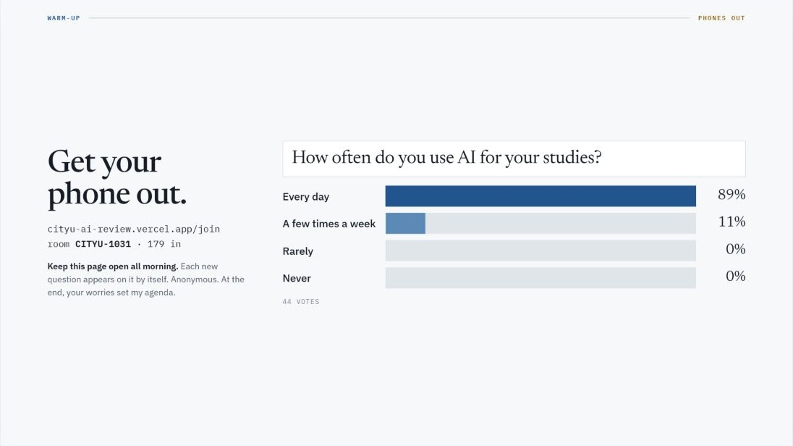

[打开本页原图](figures/m07-web-review-20261127/p02.jpg)。图中来源说法与限制按本节正文读取。

**英文原题**：*How often do you use AI for your studies?* 全部选项为 *Every day; A few times a week; Rarely; Never.* 中文分别是每天、每周几次、很少、从不。它询问个人学习使用频率，没有统一正确选项。

本次页面展示 44 votes，89% 每天、11% 每周几次，后两项 0%。这是该网页保存的调查展示，不能称全校调查，也不能把房间人数当有效答卷数。⚪ 参考作答：按本人真实频率选择；仅凭频率不能判断是否理解、是否核查或是否获准使用。

英文参考答案（笔记自拟）：“I would choose the option that matches my actual study use. Frequency alone does not show whether I check the output or follow assessment rules.”

### 2.3 技术能做什么与企业准许做什么（Review p.03）

同一个模型可以生成回复，但银行还要判断能否接客户资料、能否对外发送，以及由谁批准。这是页面中技术提供方与企业采用方的分工：前者谈云、模型与架构；后者谈规则、审批与人员。

网页还介绍嘉宾的 HKUST MSc Business Analytics 背景、顾问工作和个人 agent 项目。这些是人物介绍，不是项目效果证据。页脚明确“Public sources and my own builds only · nothing Citi-confidential · views are my own”：后面的个人演示与观点不能写成 Citi 的部署证明。

### 2.4 四部分怎样连起来（Review p.04）

目录将讲座分为四段：职业阶梯（10:05，25 分钟）、银行内部治理（10:30，35 分钟、四段影片）、两道门与 agent（11:05，30 分钟）、生存工具包（11:35，25 分钟）。这些是网页排程，不是由录音复原的实际堂长。

学习路线也按这四段走：先理解为什么初级任务改变，再理解银行为何需要控制；接着看系统怎样把控制落到工具里，最后把这些要求转成自己的练习。p.31 的休息时间与本页排程有不一致，见 §9.3，不自行拼成准确时间表。

### 2.5 香港毕业生职位减少多少：先固定分母（Review p.05）

题目要求比较两个年份的职位空缺数量，而不是比较失业人数。

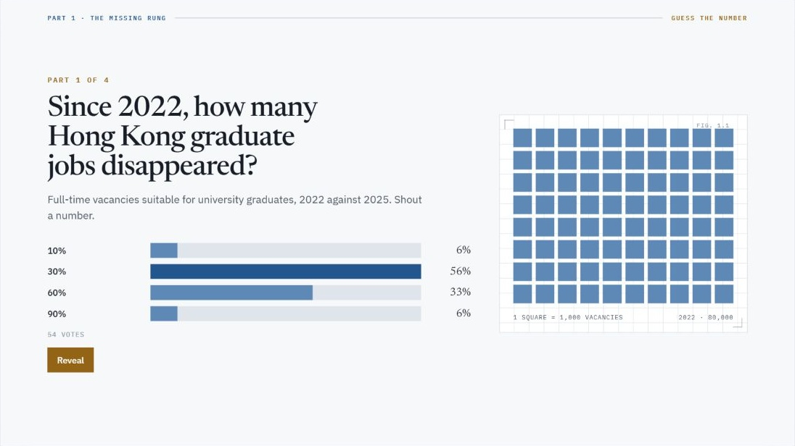

[打开本页原图](figures/m07-web-review-20261127/p05.jpg)。图中来源说法与限制按本节正文读取。

**英文原题**：*Since 2022, how many Hong Kong graduate jobs disappeared? Full-time vacancies suitable for university graduates, 2022 against 2025.* 选项：*10%; 30%; 60%; 90%.* 中文题意：适合大学毕业生的全职空缺，从 2022 年到 2025 年约减少多少比例？

✅ 网页给定答案：*About 60%.* 页面列约 80,000 降到约 31,000〔网页转引 HKUST / C&SD 经媒体，所列数据截至 2025–2026；本次未重核底表〕。先求少了多少，再除原来的空缺数：

$$\text{减少比例}=\frac{80{,}000-31{,}000}{80{,}000}=61.25\%\approx60\%.$$

因此 60% 最接近；10%、30% 太低，90% 太高。分母必须是 2022 年的约 80,000，而不是 2025 年的约 31,000。图中每格代表 1,000 个空缺：原来 80 格，揭示后留下约 31 格；被淡化的格子表示减少，不是失业个体。

页面另列 20–29 岁失业率 6.8%、整体 3.7%。这两个百分数的分母是各自劳动力群体，不能与“空缺减少约 60%”直接相减。本页历史投票 54 votes 与这些劳动力数字也不是同一种数据。

英文参考答案（笔记自拟）：“About 60%. Using the rounded counts, the decline is 49,000 out of 80,000 vacancies, or about 61%. This is a vacancy comparison, not a count of unemployed graduates.”

💡 改条件练习（笔记补充）：若末期改为 40,000，减少比例为 50%；判断顺序仍是“差额÷原数量”。

### 2.6 四轮技术改变了哪些入门任务（Review p.06）

图从左到右排列大型机、PC 与互联网、移动与云、agentic AI。连线表示页面选择的历史顺序，不证明每轮技术单独造成全部就业变化。

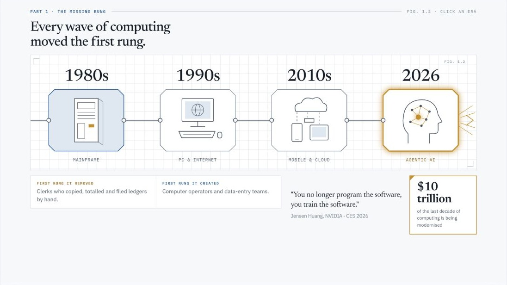

[打开本页原图](figures/m07-web-review-20261127/p06.jpg)。图中来源说法与限制按本节正文读取。

逐列比较页面称为“移走”和“产生”的任务：

- 大型机减少手工抄录、加总、归档，出现计算机操作与数据输入。
- PC 时代减少打字与文件整理，出现会用电子表格建模的分析员。
- 移动与云减少部分柜台和订票工作，出现数据分析、数字营销及应用岗位。
- Agentic AI 把研究摘要、初稿代码和演示初稿交工具，人更常需要指挥、检查与批准。

本页引用 Jensen Huang 的 “You no longer program the software, you train the software”，并标 CES 2026、\$10 trillion。它们是网页转引的行业表述与规模说法，本次未核原演讲或统计；不能由此推出所有软件都不需要编程。当前学习重点是比较任务构成，而不是背成“旧岗位全部消失”的定律。

### 2.7 描述结果为何变得重要（Review p.07）

页面左侧是未写完的 C++ 学习记录器示意：`minutes` 保存分钟数，`add` 把新值加入，`average` 的实现和界面仍省略。它不是可运行完整程序，当前也不要求读者补完 C++。

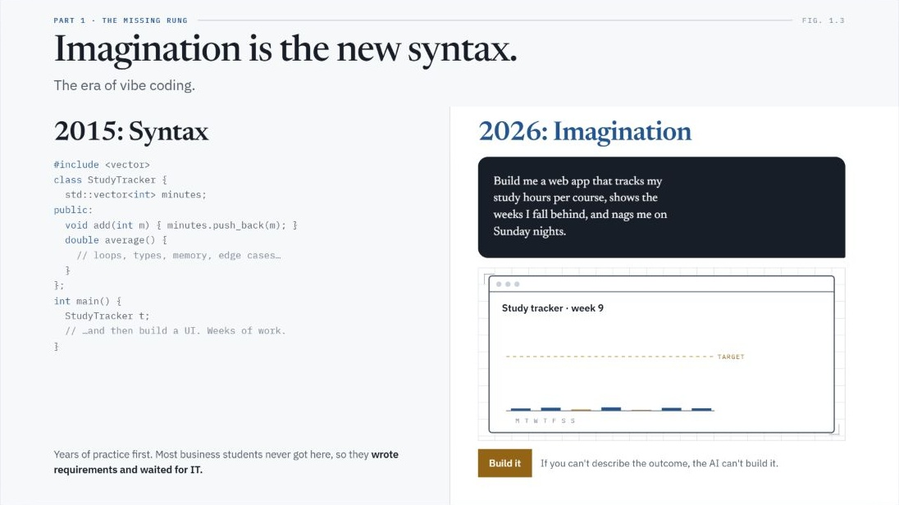

[打开本页原图](figures/m07-web-review-20261127/p07.jpg)。图中来源说法与限制按本节正文读取。

右侧保留了自然语言需求：

```text
Build me a web app that tracks my study hours per course, shows the weeks I fall behind, and nags me on Sunday nights.
```

这句话依次指定记录对象（每门课的学习时间）、判断用途（哪些周落后）、提醒时点（周日晚上）。下方图把课程与每日记录画出来；虚线 TARGET 是目标，柱条是实际量。单靠“做个好看的应用”没有这些可检查条件。

“Build it”显示的是网页预设的应用示意变化，不证明现场完成、部署或测试了一个新应用。💡 笔记补充：继续追问“落后相对哪个每周目标、按哪种时区提醒”，会把模糊愿望变成可验收需求。自然语言降低输入门槛，仍需要检查正确性和边界。

### 2.8 就业差距图怎样读（Review p.08）

本图横向是不同论文/更新的时间，纵向是 22–25 岁 AI 暴露较高岗位相对较低暴露同龄岗位的就业差距。图中 2022 年末为基线，随后展示 −13%、−16%、−19%。向下表示相对差距更负，不能读成“每次再少同样比例”。

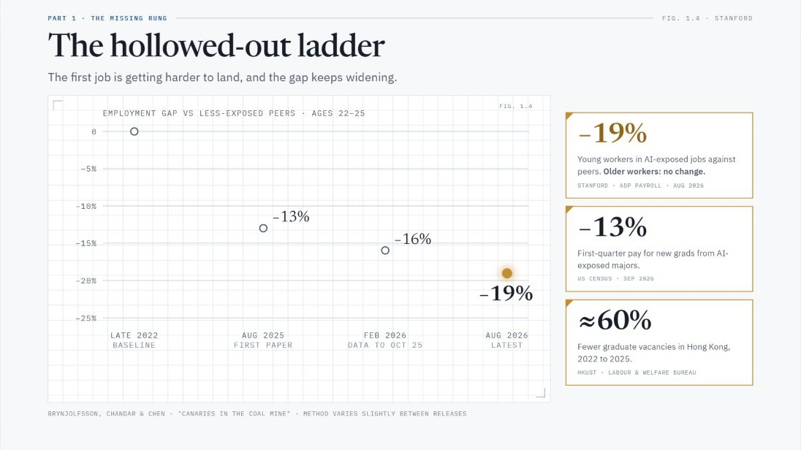

[打开本页原图](figures/m07-web-review-20261127/p08.jpg)。图中来源说法与限制按本节正文读取。

网页把这些点归于 Stanford / ADP 的 *Canaries in the Coal Mine?* 多次更新，并提醒各版方法略有不同〔网页转引学术研究，2025–2026；本次未重跑数据〕。因此把点相连可看网页强调的变化，但不能把版本差直接当作同一固定样本的精确累计下降。

右侧另外两项是不同对象：新毕业生 AI 暴露专业的首季度薪酬 −13%（网页转引 US Census，2026-09），香港毕业生职位空缺约 −60%（网页转引 HKUST / 劳福局）。它们不是同一年龄、地区、指标或分母，不能合成“AI 造成总损失”的一个数。

### 2.9 阶梯比喻的结论与限制（Review p.09）

阶梯下三项是 data entry、basic coding、research summaries，上面连接 checking & judging。网页用断开的梯子表示：只会执行常规初稿任务，可能不足以满足新的入门要求；人要更早学会检查与判断。

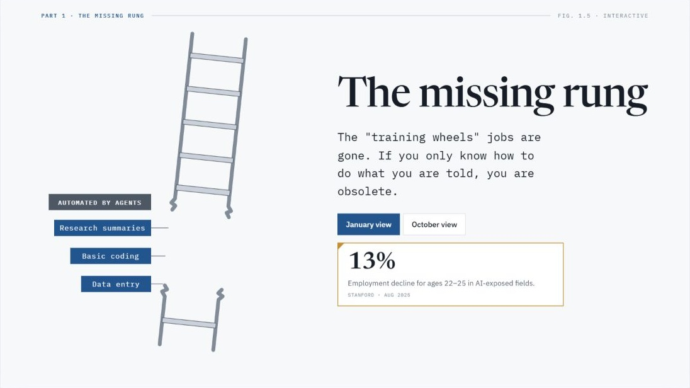

[打开本页原图](figures/m07-web-review-20261127/p09.jpg)。图中来源说法与限制按本节正文读取。

January view 展示 13%，October view 展示 19% 与 7×。19% 承接 p.08 的就业差距；7× 是网页转引 PwC 2026 报告所称 AI 暴露入门岗位更可能要求资深技能的比较。7 倍描述要求出现的相对可能性，不是薪酬倍数，也不是每个申请人须有七年经验。

页面 “you are obsolete” 是演讲式警告，不是对个人就业结果的统计判定。下一页恰好提出：若删掉训练新人的工作，组织还要处理人才接续问题。

### 2.10 银行为何不能只保留资深人员（Review p.10）

金字塔从底部 analyst class 到 associates、VP、directors，顶层 MD。底层的 16 个方块逐层变为 8、4、2、1；这些是示意人数，不是某银行真实编制或晋升概率。“Cut the analyst class by ⅔” 会让后续层级也减少，顶层出现问号：今天减少入门训练，未来可能缺少具经验的负责人。

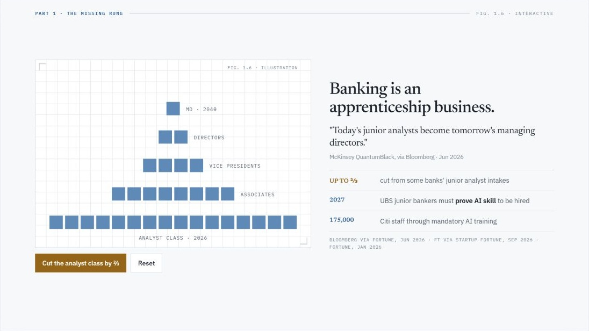

[打开本页原图](figures/m07-web-review-20261127/p10.jpg)。图中来源说法与限制按本节正文读取。

网页并列三项来源说法：部分银行初级分析员招聘最多缩减三分之二（Bloomberg 经 Fortune，2026-06）；UBS 从 2027 年要求初级银行家证明 AI 能力（FT 经二次媒体，2026-09）；Citi 有 175,000 名员工接受强制 AI 培训（Fortune，2026-01）。这些是网页转引且对象不同，本次没有核招聘制度或完成率。

学习结论是人才培养与短期节省之间的取舍。不能由模拟里的人数减少，断言银行已经发生同样的长期管理层短缺。A `00:22`–`00:43` 可证嘉宾讨论了这项接续问题。

### 2.11 嘉宾怎样修正自己较早的说法（Review p.11）

四张卡先给 January 2026 的强说法，展开后给 October 2026 的修正。每组都要一起读：

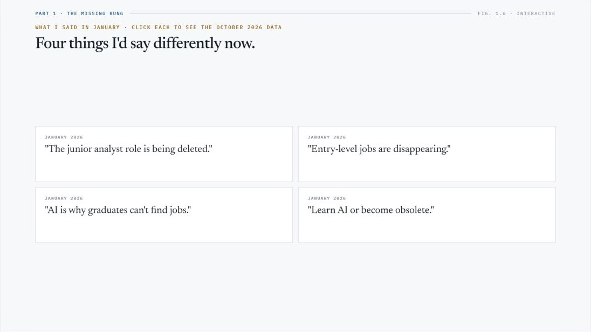

[打开本页原图](figures/m07-web-review-20261127/p11.jpg)。图中来源说法与限制按本节正文读取。

1. “The junior analyst role is being deleted.” → *Hiring, not firing.* 页面改为较少招聘新人，不是年轻员工都被解雇；“入口变窄”也不等于完全关闭。
2. “Entry-level jobs are disappearing.” → *The rung moved up.* 页面引 PwC：自 2019 年 AI 暴露入门岗位增加 35%，其他入门岗位减少 10%，但前者更常要求资深技能。岗位数量与技能门槛可以同时上升。
3. “AI is why graduates can't find jobs.” → *Partly, and disputed.* 页面提美国新毕业生失业率 7.3% 仍在 2022–2026 波动范围，并列香港研究者更强调经济因素。相关变化不自动确定单一原因。
4. “Learn AI or become obsolete.” → *Learn AI and get paid for it.* 页面引 PwC 的 AI 技能岗位薪酬溢价 62%，上一年 57%；AI 技能招聘增加 69%，整体增加 9%。薪酬比较不是给个人的加薪承诺。

以上数字均为网页转引、所列版本截至 2026，未在本次核原始样本或控制条件。修正的示范价值是：看到新证据后缩小结论，而不是只挑最吓人的一句。A `01:10`–`03:17` 与这类修正强匹配，但不能据此证明录音逐字覆盖四张卡。

### 2.12 “主要因为 AI 吗”不能只凭一张图决定（Review p.12）

**英文原题**：*Is AI the main reason graduate jobs fell?* 选项：*Yes, mainly AI; Partly; No, it's the economy.* 中文分别是主要因为 AI、部分因为 AI、主要是经济。页面没有将投票多数标为科学正确答案。

展开证据分两边。支持侧说 Stanford 检验了利率解释，AI 暴露工作对利率较不敏感，年轻人就业却下降更多；反对侧说美国毕业生失业仍在常态范围、统计联系不显著，并指出香港后台业务转移。两边的地区、指标和研究问题不同。

⚪ 参考作答（笔记推断）：*Partly* 比单一归因更符合本页呈现的争议，但仍不能量化 AI 的份额。需要同口径对照、控制其他原因和研究方法，才判断“main reason”。“有 AI 同时有失业”不足以推出因果。

英文参考答案（笔记自拟）：“AI may be part of the explanation, but the slide presents disputed evidence across different labour markets. It does not establish that AI is the main cause of every decline.”

💡 改条件（笔记补充）：即使某公司减少毕业生招聘，也要再问它的业务量、岗位转移和组织调整；不能只因公司采用 AI 就排除其他解释。

### 2.13 四类 agent 的产出怎样交回人（Review p.13）

图中央是 YOU / THE MANAGER，四周是研究、代码、审计、设计角色。连线指人分派任务并接收产出，不表示四个角色都自动有批准权。

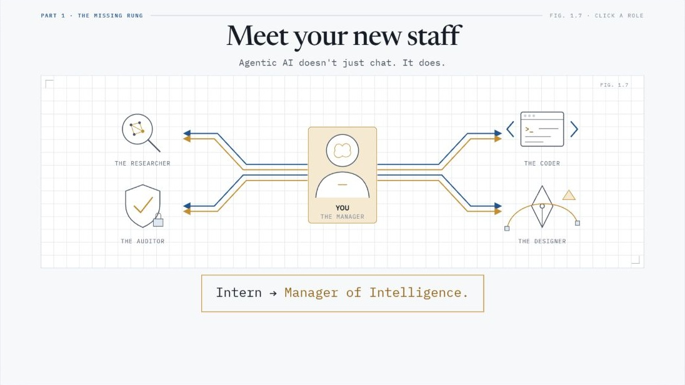

[打开本页原图](figures/m07-web-review-20261127/p13.jpg)。图中来源说法与限制按本节正文读取。

研究角色读报告并写摘要，人挑关键事实；代码角色把描述变为仪表板，人检查是否回答业务问题；审计角色对照来源核数字，人处理不匹配；设计角色把结果变成图和幻灯片，人核故事是否真实。“读取 40 份报告”是页面角色示例，不是实测吞吐量。

💡 笔记补充：客户会议材料可以依次经过研究→图表→检查，但若检查者也使用同一过期资料，多角色的一致仍不证明事实正确。具体权限及输入输出见 [[#2.63 录音专题：先把工作拆开：AI 做草稿，人管理什么|录音专题]]。

### 2.14 认知债务指向哪种学习问题（Review p.14）

页面用模糊镜面表示认知债务（cognitive debt）：为了眼前方便，把理解和练习长期交给工具，自己逐渐失去检查所需能力。镜面变清只是视觉比喻，不是认知能力测试。

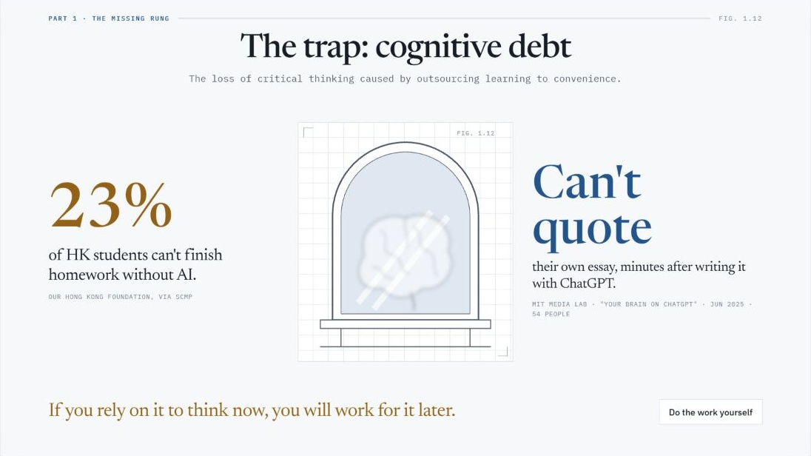

[打开本页原图](figures/m07-web-review-20261127/p14.jpg)。图中来源说法与限制按本节正文读取。

页面列 23% 香港学生“无 AI 不能完成作业”（Our Hong Kong Foundation 经 SCMP），并引用 MIT Media Lab 2025 年 *Your Brain on ChatGPT*、54 人及不能立即复述自己文章的观察。前者为调查说法，后者为特定研究；本次未重核题目、样本与因果设计，不能推出所有 AI 使用都会使人能力下降。

可执行的学习办法是先自己做一个关键步骤，再用 AI 对照，说明差异与理由。例如先判断一条日期是提议还是已确认，再查 AI 抽取是否保留了语气；直接复制结果则没有练这项判断。此例为笔记补充，连接 p.56 的“保留必要练习”。

### 2.15 初级判断力从哪里来（Review p.15）

**英文原问**：*You can only check work you once knew how to do. So if agents do the junior work, where does a junior's judgement come from?* 中文题意：如果初级练习被 agent 承担，新人怎样获得检查它所需的经验？页面明说没有完成的答案，不能替嘉宾写成已解决的人才培养方案。

⚪ 参考作答（笔记推断）：保留能够自己推理的关键练习；让 AI 提供候选，再按来源解释接受或拒绝；在真实任务中逐步接受反馈。p.52–p.59 的项目、检查日志与导师建议提供方向，但没有证明某种训练一定有效。

英文参考答案（笔记自拟）：“A junior still needs deliberate practice, source-based checking and feedback. Agents can provide drafts, while the learner must explain and test the important decisions. The lecture does not offer a finished solution to the apprenticeship problem.”

### 2.16 银行采用 AI 多出的五个问题（Review p.16）

原图左边是个人随手使用工具，右边是须 approved、classified、signed 的银行；中间 governance 箭头表示要补齐治理安排，不能只把个人账户复制给整个机构。

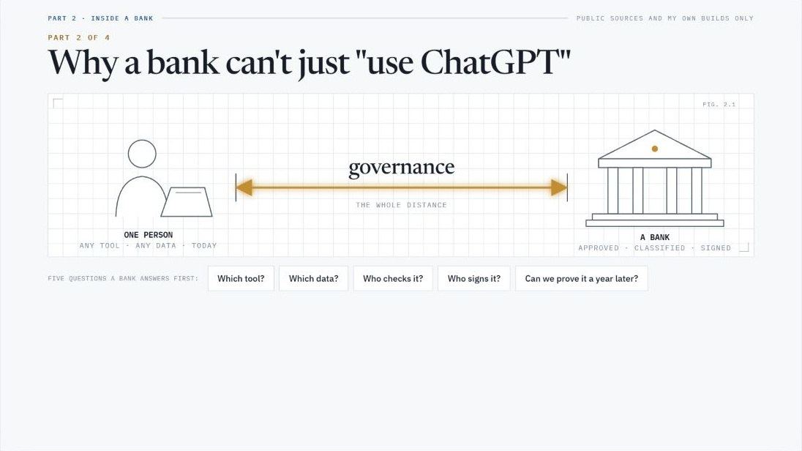

[打开本页原图](figures/m07-web-review-20261127/p16.jpg)。图中来源说法与限制按本节正文读取。

五个英文问题是 *Which tool? Which data? Who checks it? Who signs it? Can we prove it a year later?* 中文分别问工具、资料、检查者、批准者与事后证据。⚪ 参考作答：先确定允许的模型与数据分类，再定义核查标准、指定批准职责，保存当时的输入、来源版本、结果和决定。不能用“我们有一份政策”代替实际执行证据。

英文参考答案（笔记自拟）：“A bank needs approved tools and data, competent checks, a named approver and retained evidence. A generated answer is only one step in that controlled process.”

💡 例（笔记补充）：费用回复必须用有效费用表，发出前检查金额与对象，批准后留档；缺表时暂停确定报价。A `09:04`–`09:21` 保留了检查、签字与一年后证明的现场问法。

### 2.17 六个词各解决什么问题（Review p.17）

从左侧词卡读向右侧例子：大语言模型（Large Language Model, LLM）是生成内容的引擎；提示（prompt）给任务；上下文（context）给它当前能看到的材料；幻觉（hallucination）是没有充分依据却说得像真的内容；依据约束（grounding）要求答案连回可信来源；agent 接工具后能安排并执行步骤。

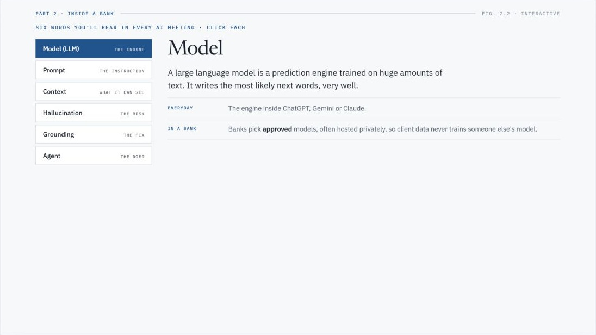

[打开本页原图](figures/m07-web-review-20261127/p17.jpg)。图中来源说法与限制按本节正文读取。

以“查某项费用”为同一请求：prompt 说明客户问题，context 放当前获准费用表；模型形成草稿；grounding 让每个费用有来源位置；agent 可读表和调用查询工具；检查者核是否引用错版本，再由有权者决定对外。检索增强生成（Retrieval-Augmented Generation, RAG）是先取相关材料再生成的一种常见实现，不等于加一个引用就消除了幻觉。

网页列提示高手少于 10 分钟、新手约 30 分钟，及私有模型保护数据等说法。前者是网页转引培训示例、缺相同任务与测量细节；后者取决于真实部署、合同及配置。不能把“私有托管”“只用可信 PDF”写成零泄露或零错误保证。


<details><summary>网页 p.17 的关键英文定义原句</summary>

以下是网页书面定义原句；上文中文解释及边界是学习译解，不能把网页的简化表述当零错误或零泄露保证。

- **Model**: “A large language model is a prediction engine trained on huge amounts of text. It writes the most likely next words, very well.”
  中文对照：大量文本训练的预测引擎生成可能的后续文字；这不保证事实正确。
- **Prompt**: “The instruction you give the model. A clear goal, context, format and examples get better answers.”
  中文对照：给模型的任务指令，目标、资料、格式和示例帮助限定答案。
- **Context**: “Everything the model can see when it answers: your prompt, attached files, the chat so far. It knows nothing else about your situation.”
  中文对照：回答时能看到的提示、附件和当前聊天，不能假定它知道未提供的情境。
- **Hallucination**: “When the model states something false, confidently. It isn't lying. It's predicting plausible words with no source behind them.”
  中文对照：把错误内容说得有把握；应回到证据检查，不能凭语气判断。
- **Grounding**: “Making the model answer only from documents you trust, and show which line each answer came from. Often called RAG (retrieval-augmented generation).”
  中文对照：让答案连回可信文档及具体位置；RAG 是常见实现，仍要核引用是否支持结论。
- **Agent**: “A model that can plan steps, use tools (search, files, email, code) and keep going until a goal is done.”
  中文对照：能规划、用工具并继续多步任务的模型系统，实际动作受权限与停止条件约束。

</details>

### 2.18 四段治理影片要看哪四件事（Review p.18）

本页预告约 9 分钟、四段由 agent 制作并使用嘉宾克隆声音的影片：美国规则边界、三种监管路径、香港 Sandbox++、了解 agent。合成旁白与现场讲话须分开，影片不是监管机关官方解释。

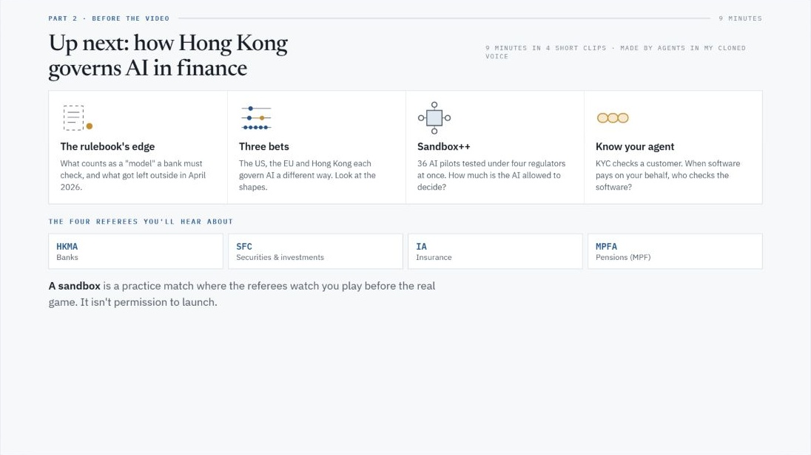

[打开本页原图](figures/m07-web-review-20261127/p18.jpg)。图中来源说法与限制按本节正文读取。

四个缩写分别是香港金融管理局（HKMA，银行）、证券及期货事务监察委员会（SFC，证券投资）、保险业监管局（IA，保险）、强制性公积金计划管理局（MPFA，强积金）。本页用“四名裁判在试验场观察”的比喻解释沙盒；观察与试验不自动授予生产上线许可。

原问 *How much is the AI allowed to decide?* 的学习答法是看每一用例的权限与人批准位置，而不是看到“agentic”就假定可自行行动。英文参考答案（笔记自拟）：“Check the permitted autonomy, limits and human approval for the particular pilot. A sandbox is a test arrangement, not permission to launch.”

### 2.19 影片一：采用感受与可入账价值（Review p.19）

网页嵌片范围为 0:00–3:08，标题 *Why governance holds AI back*。观察词为 *80% feel it, 6% book it; Three questions; A gate or a sensor?* 本页是播放入口，不凭封面确认影片全部内容。

“觉得有效率”和“财务上已确认收益”有不同终点。前者可以来自使用者感受，后者需要基线、工作量、接受质量、审核时间及成本。80% 与 6% 为影片/网页转引说法，当前没有同一问卷与分母，不能直接相除为 ROI。

gate 是结果出去前的关口，sensor 是运行后观察异常的监测；二者处理时点不同。已有 A `13:54`–`28:33` 录到部分影片与现场解释，参见 [[#2.66 录音专题：怎样检查而不把省下的工作全做回来|审核成本专题]]。本次未把观看网页封面当成重看完整影片。

### 2.20 贷款备忘录是否落在新规则范围内（Review p.20）

**英文完整题面**：*A US bank uses generative AI to draft the credit memo for a loan. In April 2026 the regulators rewrote the model rulebook. Is the AI drafting the credit memo governed by the new rules?*

全部选项：*Yes, the new rules cover it; No, the bank must write its own; No, nobody governs it.* 中文分别是新规则覆盖、该份规则不覆盖但银行须自行定控制、无人治理。这里的 *the new rules* 限定为页面所指模型风险指导，不能扩大成美国全部法律。

✅ 网页给定答案是第二项。网页理由是该指导明确排除了 GenAI；第三项错在把“某指导不覆盖”变成“没有任何治理”。第一项则混淆了贷款备忘录生成器和用于同一贷款的传统信用评分模型。

英文参考答案（笔记自拟）：“For the model-risk guidance referred to in this question, the slide selects the second option. Exclusion from that guidance does not mean the bank has no other duties or controls.”

本题是对网页口径的解释；现实适用性仍要核指导原文、机构与用途，见 §9.4 已有外核边界。本页历史 25 票的分布是参与者选择，不是法律依据。改条件：若题目改成传统信用风险评分模型，不能沿用 GenAI 排除结论。

### 2.21 影片二：先问规则管什么（Review p.21）

本页嵌片 3:08–5:06，标题 *The rulebook shrank*。观看提示是“什么算 model”“悖论”“美国、欧盟、香港”。它把上一页个案扩成下一页的治理责任与 p.23 的分类。

复习时先问“这是哪一份文件、哪种系统、哪种用途”，再看边界内外；不能仅按模型能力强弱判断法规范围。本次新增核读的是网页入口、文字和后续图；影片逐帧与原旁白未新增完整核验，现有录音仍是 partial。

### 2.22 治理三问怎样分配责任（Review p.22）

原图左边列三问，右边依次是监管者、银行、业务控制团队。框的变化表示每一问由谁定边界、制定政策和日常执行，不是其中一层可以完全替代其他层。

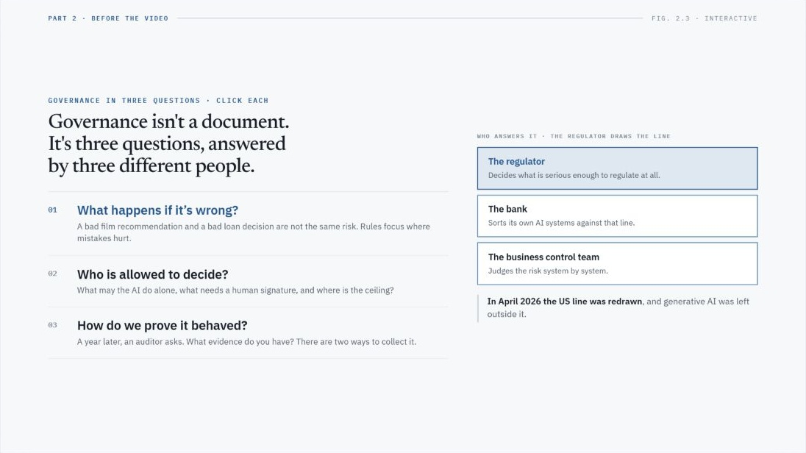

[打开本页原图](figures/m07-web-review-20261127/p22.jpg)。图中来源说法与限制按本节正文读取。

**三问原文**：*What happens if it’s wrong? Who is allowed to decide? How do we prove it behaved?* 中文依次是错误会伤害谁、AI 可以决定到哪一步、日后凭什么证明其行为。

⚪ 参考作答：第一问从后果判断风险，再按监管边界识别系统；第二问由银行政策及系统控制写清可自主动作、金额/对象限制和批准人；第三问保留可重现的输入、版本、检查、批准与异常处置。网页称监管者“退后”是其对特定指导变化的概括，不能理解成监管责任全面消失。

英文参考答案（笔记自拟）：“Assess the consequence of error, define authority and limits, and retain evidence of execution and review. The regulator, bank and control team have connected responsibilities.”

gate 的比喻是成绩发布前由老师检查，sensor 是摄像头事后发现异常。网页使用“catches everything”，这只是过强的类比：人会疲劳、标准会缺项，事前审核也不保证全部错误被发现。若客户回复出错已对外，sensor 可帮助响应，却不能倒过来阻止第一次影响。

### 2.23 规则圈的内外不是“安全／不安全”（Review p.23）

图中方框表示特定模型风险指导的范围，标签在框内外的位置表示网页的分类。2011 状态显示四个对象在内；2026 状态显示两项在内、四项在外。新旧状态的对象数不同，因为两个 GenAI/agent 例子在旧状态中未作为四项计数，不能把 4→2 解释为模型总数下降一半。

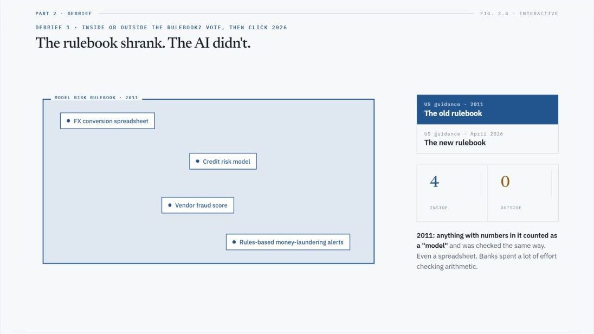

[打开本页原图](figures/m07-web-review-20261127/p23.jpg)。图中来源说法与限制按本节正文读取。

**原页任务**：*inside or outside the rulebook?* 以下保留六个对象及网页给定新分类：

| 英文对象 | 中文题意 | 网页 2026 分类 |
|---|---|---|
| FX conversion spreadsheet | 汇率换算表 | outside |
| Rules-based money-laundering alerts | 规则式洗钱警报 | outside |
| Vendor fraud score | 供应商欺诈评分 | inside |
| Credit risk model | 信用风险模型 | inside |
| AI that drafts the credit memo | 起草贷款备忘录的生成式 AI | outside |
| Agent that makes a payment | 执行付款的 agent | outside |

✅ 上表是网页给定分类；网页用“复杂模型范围收窄、GenAI 暂排除”解释。**它的 2011 “anything with numbers” 是简化说法，不应背成所有含数字表格依法都算 model。** 判断仍依文件定义、重要性、用途与机构条件。

英文参考答案（笔记自拟）：“The slide places the vendor fraud score and credit risk model inside its 2026 perimeter, and the other four examples outside. Outside this perimeter does not mean uncontrolled, risk-free or exempt from every other requirement.”

改条件：若电子表格包含复杂估计逻辑而不只是汇率算术，不能只凭 `.xlsx` 后缀套用“outside”。学习目标是按实际定义分类。

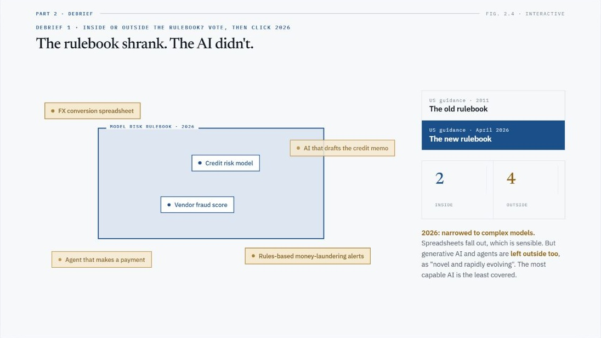

### 2.24 三国时间线比较的是治理路径（Review p.24）

横轴为 2024–2028；每行一个法域，点是网页选择的规则/事件，欧盟空心点与右移线表示网页所称的延期。图形密集不等于约束一定更严格，单一点也不等于该地区没有其他监管。

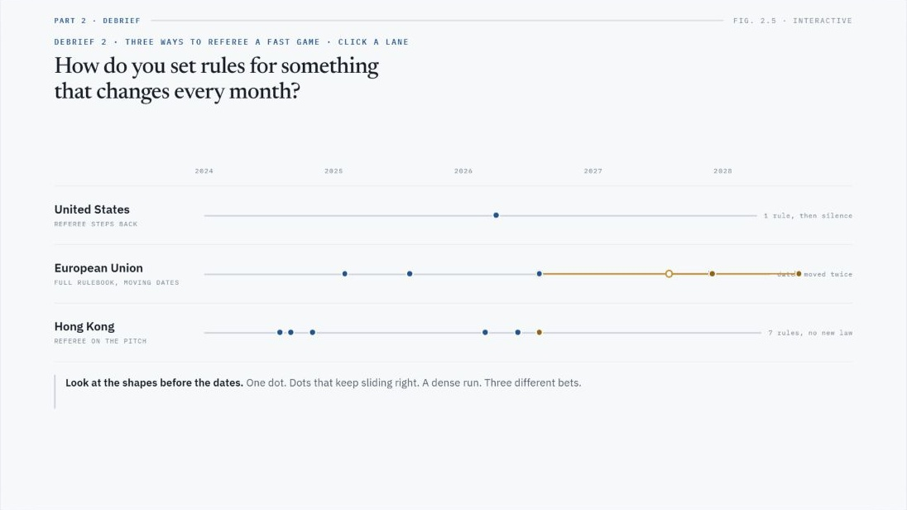

[打开本页原图](figures/m07-web-review-20261127/p24.jpg)。图中来源说法与限制按本节正文读取。

网页列美国 2026 年 4 月 SR 26-2；欧盟列 2025 年 2 月禁用及 AI literacy、2025 年 8 月 general AI、2026 年 8 月 transparency，并把 high-risk 与 Annex I 分别画到 2027 年 12 月和 2028 年 8 月；香港列 2024 年 8 月客户 GenAI、9 月 AML、11 月 SFC，2026 年 3 月沙盒、6 月网络安全、8 月选定 36 项试验。**这些是网页的时间表，本次未逐条更新外核，不能作为现行合规日历。**

原问 *How do you set rules for something that changes every month?* 是制度取舍题。⚪ 参考作答：明确结果责任与风险底线，允许具体测试与迭代，同时留存版本及适用条件；更细的固定规则带来确定性，也可能追不上变化，灵活指导则增加机构自行设计控制的负担。

英文参考答案（笔记自拟）：“Combine clear accountability and risk limits with testing and revision. Compare the predictability of detailed rules with the adaptation burden of flexible guidance. The slide is a simplified comparison, not a complete legal inventory.”

### 2.25 影片三：沙盒试的是可控范围（Review p.25）

嵌片范围 5:06–7:11，标题 *Hong Kong’s Sandbox++*；提示四监管者、谁参与、四级自主性。原问 *Who’s in, who isn’t* 要区分参与名单与全部市场机构；网页没有给出“未参与就不准用 AI”的规则。

本页新增的是影片入口；试验数量与权限由 p.26–p.27 的网页图说明。A `28:38`–`32:23` 记录嘉宾对共同试验、监管接触与非预先批准的解释，见 [[#2.67 录音专题：沙盒和 KYA：能试验，不等于已获准上线|录音专题]]。

### 2.26 四个监管者围着同一试验场（Review p.26）

图中心为 36 个试点方格，四周是 HKMA、SFC、IA、MPFA；连线表示共同观察安排，不表示每项试点都由四机构作同一法律批准。页面称约 100 个想法中选 36 项，涉及 30 家银行、保险及其他机构、27 家技术伙伴，标首批 2026 年 8 月 27 日公布〔网页转引监管公布，本次未逐条外核〕。

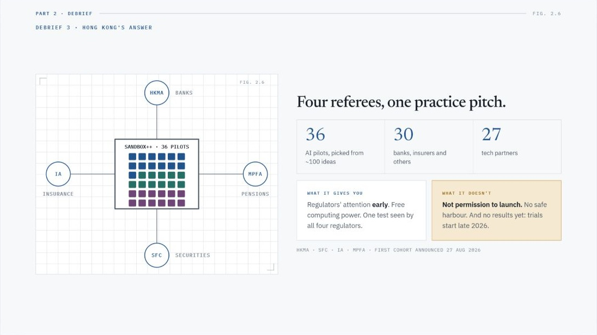

[打开本页原图](figures/m07-web-review-20261127/p26.jpg)。图中来源说法与限制按本节正文读取。

网页列出的价值是更早监管接触、计算资源、同一测试被多方观察；不提供生产上线许可、免责安全港或已经实现的试验成效。这里的“no results yet / trials start late 2026”要按网页讲座时点读，不能当 2026 年 11 月以后最新项目状态。

💡 迁移（笔记补充）：即使原型在试验场顺利运行，进入真实客户流程仍要核数据、权限、适用规则和正式批准。试验参与和生产验收有不同终点。

### 2.27 四级自主性怎样数、怎样判断（Review p.27）

原图四列依次是 L1 Assist、L2 Check、L3 Run、L4 Act。一个小格是一项网页所列试点；颜色表示风险管理、反欺诈、客户体验，不表示通过率。四列数量分别是 5、17、11、3，合计 36；L1+L2 为 22。

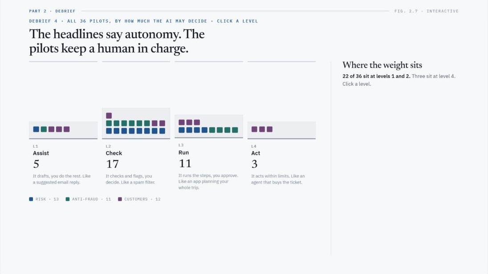

[打开本页原图](figures/m07-web-review-20261127/p27.jpg)。图中来源说法与限制按本节正文读取。

| 层级 | 本页意思 | 人保留的动作 |
|---|---|---|
| L1 Assist | AI 起草 | 人完成余下工作 |
| L2 Check | AI 检查并标记 | 人判断是否采取行动 |
| L3 Run | AI 跑多个步骤 | 人批准关键结果 |
| L4 Act | AI 在界限内行动 | 人设身份、额度、撤销和停止规则 |

读一个具体例：网页把 AML 警报分流与可疑交易报告起草列在 L1；起草报告并不等于自行决定报送。agentic payment 列 L4，因为会产生受限付款动作，所需身份和权限链不同。

这是一套网页教学分类，不能冒充监管机构统一评级或已经批准的自主程度。“22/36”是所列试点的分布，不是全港 AI 应用分布，也不是成功率。完整 36 项名称按本页原始展开记录保留在来源证据；复习判断先看动作与后果，不以用例名称猜等级。


<details><summary>网页四级分类的全部36项（教学分类，非官方统一评级）</summary>

**L1（5）**

- RM-05 Regulatory-change and obligation mapping（监管变化/义务映射）。
- AF-08 AML alert triage & STR drafting（反洗钱分流与报告草拟）。
- CX-03 Grounded knowledge assistant for front line（前线依据型知识助手）。
- CX-04 MPF member engagement（强积金成员沟通）。
- CX-09 Retirement planning illustration（退休计划演示）。

**L2（17）**

- RM-01 Real-time A.I. judge for chatbot（即时回复评审）。
- RM-02 A.I.-enhanced due diligence（尽职调查辅助）。
- RM-03 Multimodal compliance review（多模态合规核查）。
- RM-07 SME credit early warning（中小企信用预警）。
- RM-08 Pre-trade suitability adjudication（交易前适当性判断）。
- RM-09 Insurance underwriting assessment（保险核保评估）。
- RM-11 Trade documentary risk（贸易单据风险）。
- RM-12 Research integrity gate（研究完整性关口）。
- AF-03 Digitally altered document detection（文件篡改检测）。
- AF-04 MPF intermediary red flags（强积金中介警示）。
- AF-05 Deepfake & synthetic identity at onboarding（开户深伪/合成身份检测）。
- AF-07 Mule account network graph（傀儡账户关系图）。
- AF-09 Cantonese voice-channel fraud（粤语声道欺诈识别）。
- AF-10 Claims fraud ring detection（理赔欺诈团伙识别）。
- CX-10 Securities client servicing（证券客户服务）。
- CX-11 Collections & hardship outreach（催收及困难客户沟通）。
- CX-12 Cross-boundary GBA journey（大湾区跨境服务）。

**L3（11）**

- RM-04 Agentic cybersecurity response（网络安全响应）。
- RM-06 Liquidity & treasury forecasting（流动性/资金预测）。
- RM-10 Agent supervisory control plane（agent监督控制面）。
- RM-13 MPF reconciliation & data integrity（强积金对账/数据完整性）。
- AF-01 Fraud simulation & defence reinforcement（欺诈模拟/防御强化）。
- AF-02 Multi-agent fraud detection（多agent欺诈识别）。
- AF-06 Real-time scam interdiction（即时诈骗阻断）。
- AF-11 Rogue-agent behaviour monitoring（越界agent监测）。
- CX-02 Multi-agent wealth management（多agent财富管理）。
- CX-05 Agentic customer onboarding（客户开户流程）。
- CX-06 Cantonese-first voice agent（粤语优先语音agent）。

**L4（3）**

- CX-01 Agentic payment — the Agentic ID framework（付款及agent身份框架）。
- CX-07 Lifestyle agentic commerce & rewards（生活消费/奖励）。
- CX-08 Agentic claims intake & settlement（理赔接收/结算）。


这里的编号及层级是网页的归类；名字含“assessment”“adjudication”不证明AI拥有最终批准权。改变权限后应重新分类。

</details>

### 2.28 影片四：三项试点分别检查什么（Review p.28）

嵌片范围 7:11–9:06，标题 *Three pilots and know your agent*。观察重点是第二 AI 检查第一 AI、agent 起草犯罪报告、了解 agent。三项的共同点是增加能力时也增加对应的核查；它们不是“第二模型保证不会错”的同一个方案。

本次未新增完整影片逐帧核验；现有 A `34:13`–`42:55` 有部分影片和现场说法。下一页的三个图可分别识别输出检查、报告工作流和身份授权链。

### 2.29 检查回复、起草报告、验证 agent 身份（Review p.29）

第一张图从 chatbot 草稿流向 AI judge，再分四条结果：通过并发客户、改写、发送安全标准答案、交人。评审要核准确性、语气和规则；由人定义“好答案”、检查评审是否漏项。它是输出前关口，不代表所有回复都会正确。

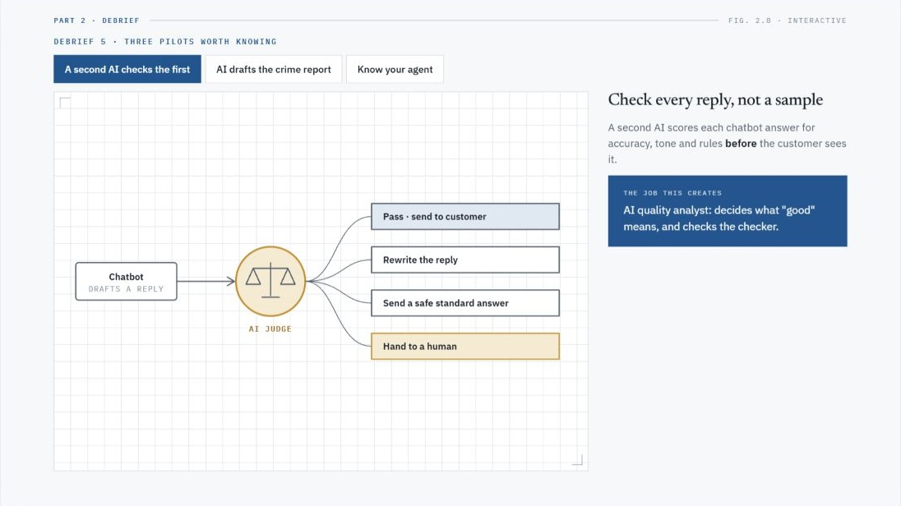

[打开本页原图](figures/m07-web-review-20261127/p29.jpg)。图中来源说法与限制按本节正文读取。

第二张图从多数为误报的 alerts 出发，读取客户概况、交易历史、关联账户、新闻及旧警报，组装 draft report，最后 **human reviews & files**。页面称早期 HKMA 试点起草投入减少 30–80%、读取全部案例而非抽样〔网页转引早期试点，原底表/计时口径未取得〕。它不是本页 36 项新试点的已实现结果；起草和最终报送须分开。

第三张图从 verified customer→agent ID→authority→payment。了解客户（Know Your Customer, KYC）核客户；了解 agent（Know Your Agent, KYA）还核软件身份、与客户的关联、权限、限额及到期。任一链断，图要求停止付款。💡 笔记补充：人身份真实但 agent 授权已过期，也不能继续；身份通过不是无限授权。

三种新职责分别是 AI 质量分析员、核 AI 案件的金融犯罪分析员、数字身份/付款控制角色。这是网页的岗位方向，不是已发布招聘或保证新增岗位数量。

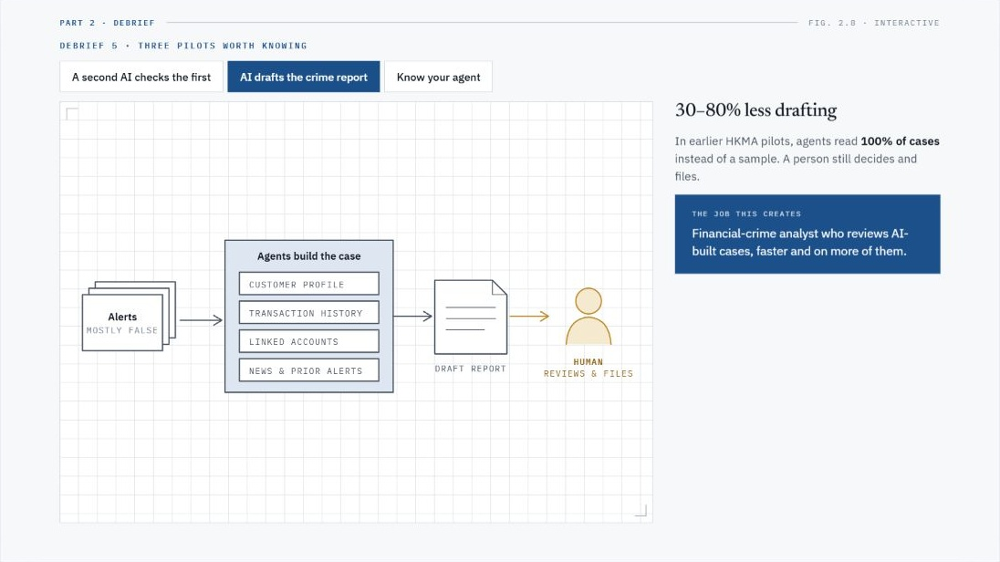

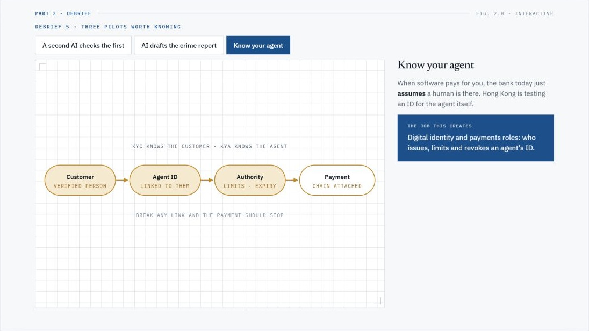

### 2.30 人决定、机器组证据的准确读法（Review p.30）

页面把前面试点概括为 *The human keeps the decision. The machine assembles the evidence.* 又列 *Decision-support tool only, not decision-maker; Decisions remain with qualified professionals; Approved content. Synthetic data. No real personal data.*

这些是网页选择的规则/试点口径，不应扩大成“香港每一种 AI 永远都不能自主行动”。p.27 的 L4 已提示有受限行动的不同试验；要看各系统具体权限和后果。网页还明说 intention, not outcome：计划保留人决定，不等于已经证明人在规模化运行时会认真检查。

复习时能说清的一条链是：机器提供带来源候选→有职责的人检查→在权限内接受/拒绝→记录决定。若证据互相冲突，不能仅靠机器把其中一条写得更流畅就结束。

### 2.31 休息页的提问不是课程作业（Review p.31）

网页设置十分钟计时器，并问 *what’s one task you’d hand to an AI agent this semester?* 中文题意：本学期想把哪一项任务交给 agent？这是现场开放活动，没有唯一正确答案，也不是新增评分要求。

⚪ 参考作答（笔记补充）：让 agent 把本人允许提供的会议文字整理成候选任务，保留来源，日期冲突交人决定。英文参考答案：“I would delegate the extraction of candidate actions from approved meeting notes, while keeping conflicts and commitments for human review.” 若改成自动发邀请或改别人日历，就要另外核对外部动作授权。

页眉写 “Back at 10:45”，p.04 又将后续第三部分排在 11:05；本页只记录原排程，不用它填补 A/B 录音接缝。

### 2.32 两道门按用途和后果分（Review p.32）

图左门为生产率（productivity），帮助个人完成自己的工作；图右门为核心流程（core process），改变银行如何服务客户、处理资金或承担义务。门的形状对比强调控制负担，不能按软件品牌决定进哪门。

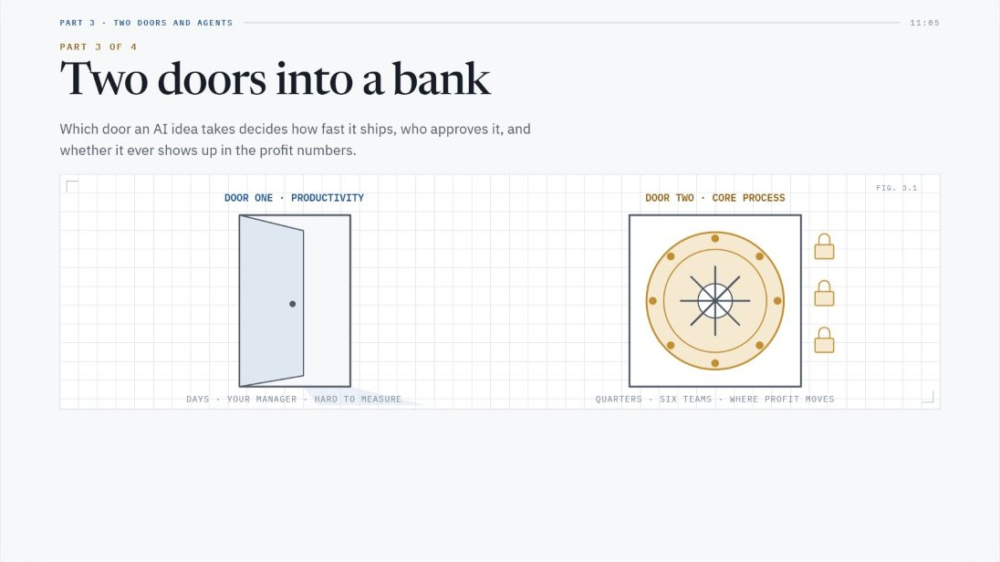

[打开本页原图](figures/m07-web-review-20261127/p32.jpg)。图中来源说法与限制按本节正文读取。

网页给左门 days / your manager / hard to measure，右门 quarters / six teams / where profit moves。这是嘉宾经验性框架，不是所有银行统一时限。较快做出的草稿也要守数据和权限边界；进入核心流程的原型即使模型部分很简单，仍可能需要更长的业务验收。

具体例是同一仪表板：用公开资料供自己分析，与接生产客户资料给业务人员使用，数据边界与错误影响都改变。不能因为代码没有改动就沿用个人工具的批准范围。

### 2.33 影片五：感受价值与流程价值（Review p.33）

本页影片范围为第二组影片 0:00–1:42，标题 *Two doors into a bank*。它预告 *80% vs 6%, one fact; Door one: productivity; Door two: six functions, nine gates.* 影片时钟从零重开，不与前四片的 0:00–9:06 连成同一时钟。

采用感受不自动进入利润表；可测结果要说明流程、基线与接受标准。p.35 把审批分成十个可点击阶段，和这里的 nine gates 数量不同；可理解为阶段/门的计数口径未说明，但不能擅自定成九或十个法定门槛。A `43:17`–`48:53` 提供部分现场解释。

### 2.34 两门的五个比较维度（Review p.34）

网页原站普通翻页会跳过本页，但它仍在 62 个物理页面中；这里逐项展开，不因隐藏导航而漏掉教学。

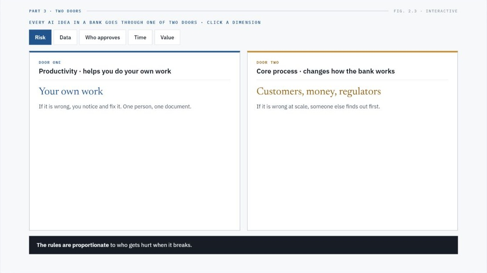

[打开本页原图](figures/m07-web-review-20261127/p34.jpg)。图中来源说法与限制按本节正文读取。

| 维度 | 生产率门 | 核心流程门 |
|---|---|---|
| Risk | 本人的工作和文档 | 客户、资金及监管影响 |
| Data | 本人文档或公开资料较常见 | 真实客户数据，须核私隐、存储与保留 |
| Who approves | 页面称本人/经理 | 页面列 Risk、Compliance、Legal、Privacy、Model Risk、Financial Crime，加具名负责人 |
| Time | 页面经验：数天至数周 | 页面经验：二至四个季度 |
| Value | 使用者感到更快，较难计量 | 流程量、处理速度、损失等较可计量 |

每行比较同一维度。例如 Data 行说明，触及客户资料时要重新核用途和批准，不是“工具可读这个文件就准许读”。审批名册是页面选择的职责分工，不认证任何特定银行的完整制度。

当一个原本个人使用的工具变为团队固定业务步骤，应重新判断影响与控制，不能永久贴“door one”标签。网页时间是经验示例，不保证本人的项目会在某个季度上线。

### 2.35 从原型到上线经过哪些阶段（Review p.35）

本页上轨是生产率工具的 Build it→Show someone→Use it；下轨是核心流程的十个阶段。方框之间的顺序表示网页选择的推进路径，不要求所有机构严格串行。

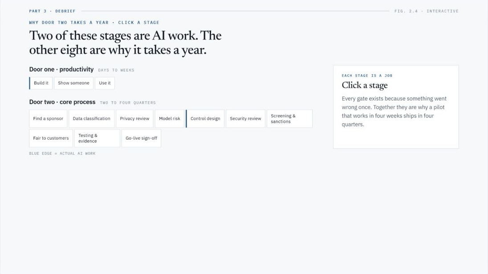

[打开本页原图](figures/m07-web-review-20261127/p35.jpg)。图中来源说法与限制按本节正文读取。

下轨要逐项看对象和产出：

1. **Find a sponsor**：找到出资并负责的业务负责人，否则原型缺少承接者。
2. **Data classification**：确定字段、敏感性和保留时间，为后续使用范围提供输入。
3. **Privacy review**：核用途是否合法、是否最少必要、是否跨境；本页只是职责提示，不替代实际法律核查。
4. **Model risk**：判断模型身份、失败方式和发现失败的办法。
5. **Control design**：设计第二模型检查、批准来源、限额与审计轨迹。
6. **Security review**：核隐藏指令欺骗、可访问资源和权限。
7. **Screening & sanctions**：接金融犯罪筛查/制裁控制，不能只因 AI 能调用接口便认为获准。
8. **Fair to customers**：核弱势客户、披露、投诉及不同语言待遇。
9. **Testing & evidence**：除运行可用外，还保存以后可证明的测试与结果。
10. **Go-live sign-off**：具名负责者、运行手册、回退与监测安排。

💡 一条完整例（笔记补充）：客户费用 chatbot 原型先有业务负责人；确认能使用的费用表和字段；核对隐私及失败后果；加逐回复评审、权限和安全限制；测试两种语言及例外；由负责人接受已知风险后上线，并能停回人工。没有通过就返回相应阶段补证据，而不是“模型已经能答”便跳到最后。

标题称十阶段中“两项 AI、八项其他”，但本页核心流程的生成数据仅把 Control design 标为 AI；上轨 Build it 也标为 AI。**原页标题与下轨着色并不完全对应，不能据颜色计算工程时间比例。** 本页也没有原始计时数据证明“需要一年”；这些时间是嘉宾叙述。

### 2.36 六个业务想法各走哪道门（Review p.36）

**英文原题**：*Which door does each idea go through? Hands up: door one or door two?* 以下保留全部六个案例。✅ 分类来自网页展开答案；中文理由补足其共同判断顺序：先看资料，再看输出进入谁的工作或产生什么后果。

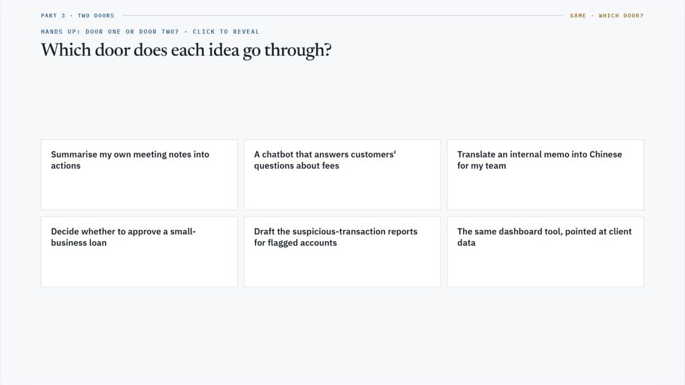

[打开本页原图](figures/m07-web-review-20261127/p36.jpg)。图中来源说法与限制按本节正文读取。

1. *Summarise my own meeting notes into actions.* 第一门。是本人记录的候选整理，本人检查后再采用。英文参考答案：“Door one: it supports my own work, and I check the extracted actions.” 若自动发给客户或形成真实承诺，应重评。
2. *A chatbot that answers customers’ questions about fees.* 第二门。直接面向客户，错费率可能形成业务影响；网页给逐回复第二模型检查。英文参考答案：“Door two: it gives customer-facing answers and needs controls for incorrect fees and escalation.” 加第二模型仍不等于保证准确。
3. *Translate an internal memo into Chinese for my team.* 第一门。页面条件是内部、低风险、有人读后才继续。英文参考答案：“Door one under the slide’s conditions: an internal, low-stakes draft reviewed by a person.” 若内容机密，也必须用获准工具。
4. *Decide whether to approve a small-business loan.* 第二门。涉及信用决定、模型风险、公平及具名批准。英文参考答案：“Door two: the AI may assemble evidence, but credit decisions need the appropriate authority and checks.” 不是“小额”便自动豁免。
5. *Draft the suspicious-transaction reports for flagged accounts.* 第二门。虽然动词是 draft，产出进入金融犯罪流程；人须核并报送。英文参考答案：“Door two: drafting supports a controlled financial-crime process, and a human reviews and files.”
6. *The same dashboard tool, pointed at client data.* 网页标 *Trick · door two*。相同界面改用生产客户资料，边界就变。英文参考答案：“Door two in this framework: moving to client production data changes the approval and data-control requirements.”

六题说明分类看实际用途。不能把“翻译=永远第一门”“草稿=不用审”“仪表板=低风险”当通用规则。

### 2.37 Prompt、skill、plugin、agent 怎样配合（Review p.37）

四个 building blocks 用新实习生作比喻：口头交代一次是 prompt；书面程序是 skill；团队整套工具包是 plugin；能按目标规划、用工具并继续工作的是 agent。它们是不同职责，不是高低等级。

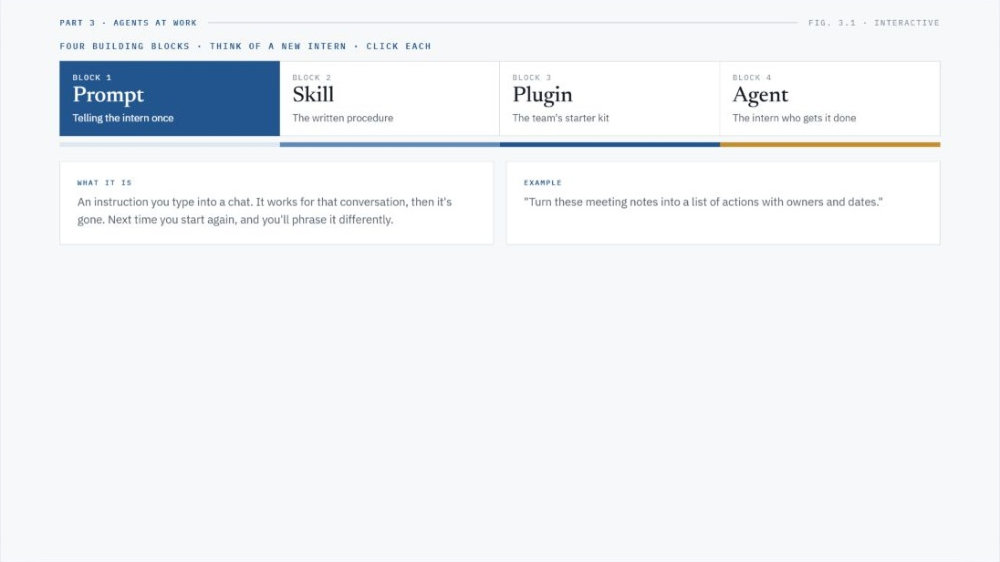

[打开本页原图](figures/m07-web-review-20261127/p37.jpg)。图中来源说法与限制按本节正文读取。

以会议记录为一个输入：prompt 说“抽负责人和日期”；skill 规定每项附来源、不能编日期、冲突须标；plugin 把相关 skills、日历/邮件/数据库连接与快捷入口打包；agent 选择适用步骤和工具，形成候选，再按权限请求本人决定。

网页的 *plans its own steps, uses tools and loops until the goal is met* 中，循环是“提出动作→调用工具→看结果→判断下一步”。停止要有目标达成、明确失败或资源/权限界限；不能把“继续直到做完”解释成无限调用、无限权限。网页也没有证明每次新对话会丢失所有历史；prompt “then it’s gone”是可复用程序与一次交代的教学对比。


<details><summary>网页 p.37 的 skill 与 plugin 英文定义原句</summary>

- **Skill**: “A saved file of instructions, and sometimes templates and scripts, that the AI loads when the task comes up. Same steps, same checks, same format, every time.”
  中文对照：保存的任务指令及可选模板/脚本，用于复用相同步骤、检查和格式。
- **Plugin**: “A package for a team: several skills plus connections to the tools they need (calendar, email, a database), and shortcut commands. Install once, the whole team works the same way.”
  中文对照：团队使用的一组技能、工具连接和快捷入口，安装一致不代表结果必然正确。

这是网页用于比较可复用程序的表述。中文机制及执行限制见本节；“same every time”表达统一程序目标，不证明每次产出都正确。

</details>

### 2.38 Skill 把个人做法变成可检查文件（Review p.38）

表格逐行比较同一任务靠聊天临时交代，和靠保存的 skill 执行。五行分别是 consistency、rules、review、sharing、know-how：步骤/格式更统一，规则可写入文件，文件能版本审阅，团队能分发，新人也可读业务做法。

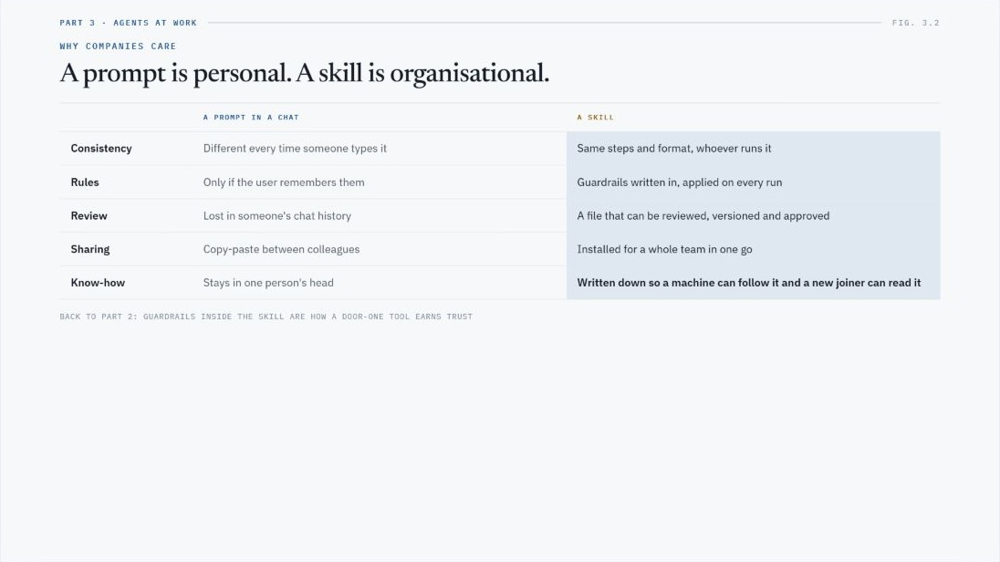

[打开本页原图](figures/m07-web-review-20261127/p38.jpg)。图中来源说法与限制按本节正文读取。

例如“日期不编造”若只靠每个用户记得输入，容易漏；写入公共程序后，更容易检查是否每次加载了它、输出是否遵守。**保存规则只是可检查的条件，不保证模型每次都执行正确。** 文件过期、调用错技能或权限过大，仍会产生问题。

这也解释组织知识（know-how）为何应可维护：业务规则变化后要更新版本、试运行、核结果。把旧文件安装到全部人电脑，不等于获得了永不过期的一致正确性。

### 2.39 真实 skill 节选的输入输出与七条边界（Review p.39）

页面展示 `praxis-process-map` 的 `SKILL.md` 缩短版。任务是把会议纪要、聊天导出或邮件，变成一个含流程、甘特、计划和行动视图的可编辑 HTML。说明段强调每项引用来源行、显露矛盾、不编日期，并说完整文件 238 行；这里没有完整 238 行，不补造它。

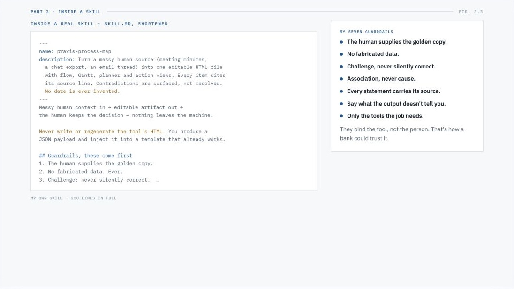

[打开本页原图](figures/m07-web-review-20261127/p39.jpg)。图中来源说法与限制按本节正文读取。

关键实现是：不要重新生成整个工具 HTML；先生成 JSON payload，再注入已有模板。JSON 是按字段保存的结构化资料，例如候选任务、日期、来源；模板负责已有显示结构。这样主要变化落在资料层，减少每次重写界面带来的漂移，但仍要核 payload 和模板安全。

页面七条 guardrails 原文是：

```text
The human supplies the golden copy.
No fabricated data.
Challenge, never silently correct.
Association, never cause.
Every statement carries its source.
Say what the output doesn't tell you.
Only the tools the job needs.
```

中文读法：人提供权威输入；不造数据；有疑问就提出，不静默改；关联不冒充因果；陈述有来源；说明输出不能告诉你的事；只开放当前任务需要的工具。它们约束工具执行，不是给读者的外部操作授权。

💡 一个 JSON 草稿若把“可能周五”写成确定到期日，就同时违背不造数据和不静默修正。即使模板显示漂亮，也必须退回修正资料。

### 2.40 三种技能与 80/20 的意思（Review p.40）

图从左到右对应：会议文字→可编辑流程/甘特/行动；表格→会随筛选更新的仪表板；SFC 通函→导览、判断树和段落引用。输入不同，共同要求是人能检查和修改输出。

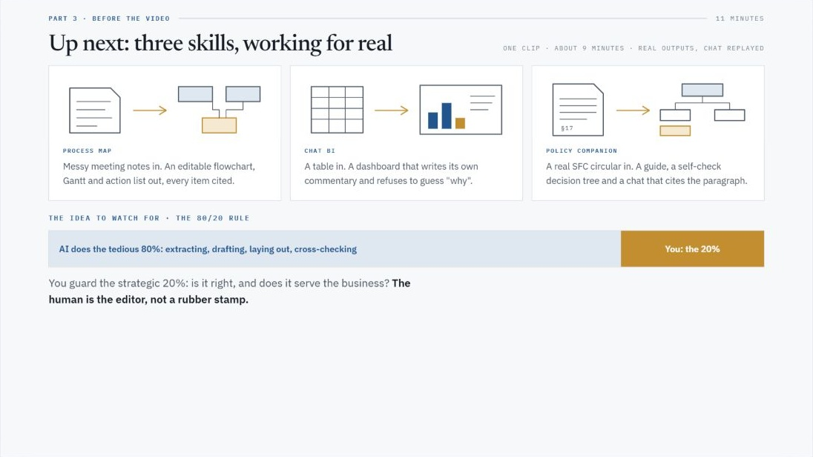

[打开本页原图](figures/m07-web-review-20261127/p40.jpg)。图中来源说法与限制按本节正文读取。

页面的 80/20 指把大部分提取、起草、布局和交叉检查交工具，把业务是否正确、是否有用的判断留给人。它是设计启发，不是测得的 80% 准确率，也不是准许漏掉 20% 风险。若输入本身错误，人的关键判断可以是停止，而不是继续润色。

标题写 11 minutes，正文说一段 about 9 minutes，下一页片段实际边界 1:42–10:43 是 9 分 1 秒。不同计时范围保留，不自行伪造相同长度。

### 2.41 三技能影片的章节怎样定位（Review p.41）

本页嵌片为第二组 1:42–10:43。章节分别从 1:42 的 process map（发现但不替人修冲突）、5:35 的 Chat BI（不猜为什么）、8:47 的 Policy Companion（引用原段落）开始。时间属于网页影片，不是 A/B 录音时钟。

现有录音的对应材料在 A `55:38`–`01:03:51`；它可承接机制讲解，不能证明网页影片版本逐帧相同。本次对影片入口和后续网页演示作新核读，完整影片画面、旁白和全部例子仍另列未核范围。

### 2.42 三工具的共同处理链（Review p.42）

原图左边三个输入汇入中间 skill，再分出可编辑流程、解释型仪表板、可执行规则检查，最后箭头到 YOU DECIDE。盾牌表示页面主张内建七条边界；“nothing leaves the machine”是作者对演示方案的自述，不是本次网络审计结果。

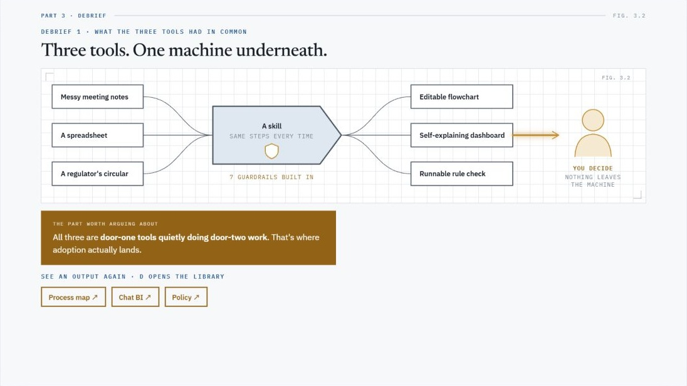

[打开本页原图](figures/m07-web-review-20261127/p42.jpg)。图中来源说法与限制按本节正文读取。

沿会议输入走：抽候选事项→按 skill 保留来源及冲突→套入可编辑视图→人决定是否采用。沿表格输入走，同一位置的“检查”改为字段/筛选/计算核对，不能机械复用会议的日期检查。

原页称这些是 *door-one tools quietly doing door-two work*，是在提醒个人工具会进入重要业务。它与 p.36 的边界判断有张力：**做第二门工作应重新核权限和批准，不能把“quietly”当绕过治理的建议。** 下方选择 Process map / Chat BI / Policy companion / No thanks, show us your agents 是演示偏好投票，没有统一正确答案，本稿未代投。

### 2.43 Process map：来源、冲突与多视图（Review p.43）

本页给命令 `/praxis-process-map` 和 `minutes.txt`，允许打开既有输出及输入。输出能拖步骤、改泳道，步骤回指来源行，两个日期冲突时标记而不擅选。这里的“实时”是网页演示入口，不能自动称为本次现场运行了生成器。

项目管理办公室（Project Management Office, PMO）任务通常要把同一事项展成流程、行动表、甘特及计划。关键是共享同一份状态：人把负责人改掉，各视图应一致；如果每张图各写一份，容易彼此矛盾。具体完整教学例保留在 [[#2.70 录音专题：PMO：让会议变成可追溯、可修正的行动|录音专题 PMO]]。

网页附件库还列 10-Q 双来源计划、访谈单源版本和 research kickoff。它们是不同输入/输出组合，不能以一个封面代表全部附件已核。本次三份文本已全文读取，三output已核默认视图和完整节点载荷。10-Q所谓“单访谈”输出实际含双源；研究输出还给未明确指定的工作包补了负责人，不能把工具的confirmed标签当原文批准。详见[[IS5542_GenAI_in_Business/_prep/外部参考-M07网页演示与输入核验#2.1 PMO：提取成功不等于原文已经批准|PMO 输入与提取核验]]。

### 2.44 Chat BI：筛选条件必须跟着结论走（Review p.44）

本页给 `/praxis-chat-bi` 和 `assets.csv`；文字说每句从数据行计算、下方打印筛选条件、切片后整页改写、问 why 时拒绝猜。这是商业智能（Business Intelligence, BI）的核心区别：计算能说明所给数据发生什么，解释原因需要其他证据。

💡 完整小例（笔记补充）：表内两部门各有一笔收入 10 和 30，总收入是 40；只筛第一部门后，标题、数值与文字都应改为 10，并注明筛选。若文字仍写 40，即使图已变也不正确。若问“第一部门为什么较低”，只有两行收入不能确定原因。

网页库分别提供真实/合成资产、真实/合成 P&L、合成 cohort 和蚊患开放数据。先确认每版身份，再比较字段与结果。

本次已核 8 个 BI 输出和 6 份去重 JSON 输入，复算载荷内的均值、分母及重要对账；外部原序列未全部重下载。年度/季度来源的区别、水平 CV 的含义和推荐评分均值的口径，详见[[IS5542_GenAI_in_Business/_prep/外部参考-M07网页演示与输入核验#2.2 BI：看清一行、一个数、一个比较|BI 数据口径核验]]。

### 2.45 Policy Companion：引用让人能回去核（Review p.45）

本页给 `/praxis-policy-companion`、`sfc-circular.pdf`，说七问分流到有引用的结果，问文档时给段号，不在文件范围内就拒绝。分流（triage）是按用途、对象、资料等事实选择适用路径；七问并不自动等于七项义务。

一个合格学习过程是：先核文件版本和适用主体→逐问收集真实事实→沿条件判断→查看原段落及例外→保留人决定。若事实“不知道是否客户直接接触”，应停在待确认，不可由模型补成 yes。

网页把它称为 looks like door one, does door-two work。政策解读结果可影响核心业务，故仍须适当职责审核。完整录音案例的英文问法、给定结果与不能复核范围，保留在 [[#2.71.2 Policy Companion：把适用条件接到原文段落|政策录音专题]]；本次已取得2024-11-12通函8页及程序载荷：实际8问题/5结果，与本页七问不一致；程序也不能因“有人预审”便自动降为普通风险。按§6–9独立核主体、用途、客户影响与高风险身份，详见[[IS5542_GenAI_in_Business/_prep/外部参考-M07网页演示与输入核验#2.3 Policy Companion：把程序映射同原文分开|Policy 条件与原文核验]]。

### 2.46 CHO 把日常聊天变成什么（Review p.46）

CHO 是 Chief Household Officer（家庭事务主管）。本页说九个 agent 在一台 Mac mini 上读取聊天、提取任务/日期/承诺，7:00 简报，2:00 做夜间整理；影片注明应用使用家庭模拟数据、克隆声音，长 4:20。这是作者演示自述，不是本次性能或网络测试。

它的学习价值是把零散消息转为带来源、时间与确定程度的共同状态，再由多个角色使用。本人仍要处理冲突和承诺；“AI 已看懂消息”不等于本人已答应。B `00:00`–`04:04` 只录到影片中段，并已脱敏，机制与完整补充例见 [[#2.72 录音专题：CHO：从聊天到有来源、有时间的共同记忆|CHO 录音专题]]。

### 2.47 家庭与银行相似的是部件，不是风险（Review p.47）

原图每行左家庭、右银行，等号表示职责类比，不表示合规条件完全相等：读取起草的 agent 对应运营 agent 群；本人审核队列对应制作者/复核者签核（maker–checker）；只可联系本人对应付款及客户联系限额；本机运行对应获准私有云；本人控制面对应组织治理及监管。

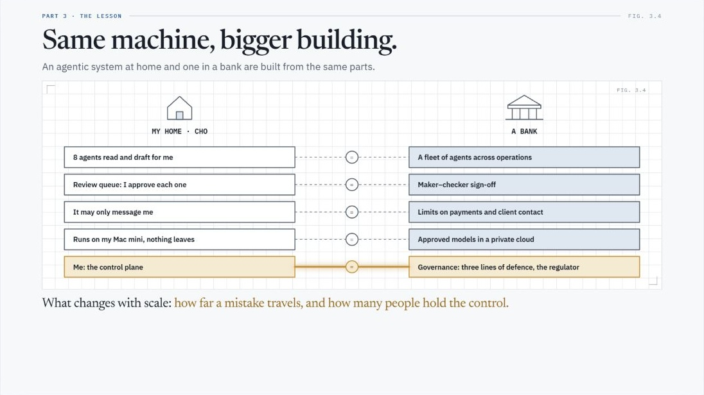

[打开本页原图](figures/m07-web-review-20261127/p47.jpg)。图中来源说法与限制按本节正文读取。

控制面（control plane）是决定系统可以做什么、谁能批准、怎样停止的管理安排。家庭中一个人可能同时提供资料、定规则和批准；银行的责任分到不同人员，错误也可能传播到更多客户。

本页写“8 agents read and draft for me”，上一页写九个总 agent。可能是读写角色与总数口径不同，但网页未完整说明，不能自行造一位角色来凑数。图中 “nothing leaves” 和 “private cloud”同样须看实际配置，不因类比便得到隐私保证。

### 2.48 Vibe coding 与 agentic coding 改变了什么（Review p.48）

左图是个人更快产出；右图是 Spec→多个 agent→Tests→Human signs→Live。规格（specification）规定要做什么，测试（tests）检查可观察行为，人签核后才上线。箭头是软件制作过程，不证明图示系统已在某银行部署。

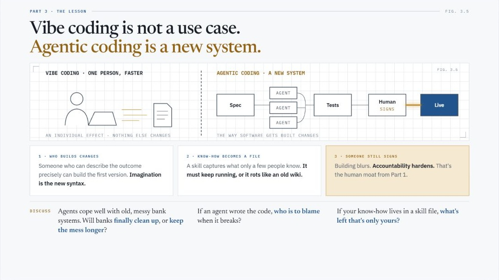

[打开本页原图](figures/m07-web-review-20261127/p48.jpg)。图中来源说法与限制按本节正文读取。

网页列三项变化：能精确说结果的人可做首版；专业做法进入 skill 文件且要持续维护；制作者边界变模糊，责任仍要具名。术语书面形式也能帮助校正 B `07:38`–`07:43` 的 white/hygienic ASR，但不能据此认定音频逐字无误。

**三道原讨论题及参考作答**：

1. *Agents cope well with old, messy bank systems. Will banks finally clean up, or keep the mess longer?* 中文：agent 能包住旧系统，会促成清理还是延长混乱？⚪ 两种都可能：短期接口更易用，可能降低改造动力；若把依赖与错误暴露出来，也能支持重构。要核维护成本、安全和接口依赖。英文参考答案：“Agents may ease short-term use while also prolonging legacy complexity. Compare maintenance, security and dependency costs before claiming that they remove the need to modernise.”
2. *If an agent wrote the code, who is to blame when it breaks?* 中文：写代码者变了，责任怎样安排？⚪ 应事前明确规格、审核、批准与运行责任，并按实际失效原因调查；不能只写“AI 的错”，也不能在缺法律/合同事实时指定法定责任人。英文参考答案：“The organisation needs named responsibilities for specification, review, approval and operation. Investigate the failure; the fact that an agent generated code does not remove accountability.”
3. *If your know-how lives in a skill file, what’s left that’s only yours?* 中文：专业程序可复制后，人还贡献什么？⚪ 仍贡献选择问题、理解情境、发现规则不适用、建立信任和承担决定；文件也依赖持续更新。英文参考答案：“Judgement, context, relationships and responsibility remain valuable, including knowing when the saved procedure no longer fits.”

改条件（笔记补充）：若系统只生成待审代码而不能部署，风险路径不同于自动上线；仍要明确谁能接受并执行变更。

### 2.49 把“我控制”换成组织控制（Review p.49）

本页承接上一张对比：*At home, I’m the control plane. In a bank, it’s governance and a lot of people.* 因此相同技术部件进入组织后，增加的是跨人职责、证据和协调，而非简单多开几个 agent。

网页把设计、检查、签核这些系统的人称为新职业方向。这是嘉宾判断，不是市场净岗位预测。下一部分把方向拆成可以训练的能力；现有 B 录音在引出该互动后结束，后面的具体建议主要由新网页补上，不能标成 B 已录到。

### 2.50 生存工具包怎样承接前文（Review p.50）

此页是第四部分入口：先听担忧，再给四项技能、相应建议和银行 AI literacy 的含义。这里的 AI 素养是能理解任务、边界、检查和责任，并非只会打开聊天工具。

可按 p.51 的市场说法→p.52–p.55 四能力→p.56 刻意练习→p.57 六类担忧→p.59 本学期行动读。网页中的 11:35 是计划时刻，不补定未录到的实际讨论长度。

### 2.51 新岗位预测与入门困难可以同时成立（Review p.51）

图中三根柱/石块分别写 170 million new roles、70% core skill shift、63% employers face a talent gap。它们来自网页转引的 WEF *Future of Jobs 2025* 与 LinkedIn *Work Change Report 2025*，不是同一量纲的柱图：一项是岗位数预测、一项是技能变化比例、一项是雇主调查比例。

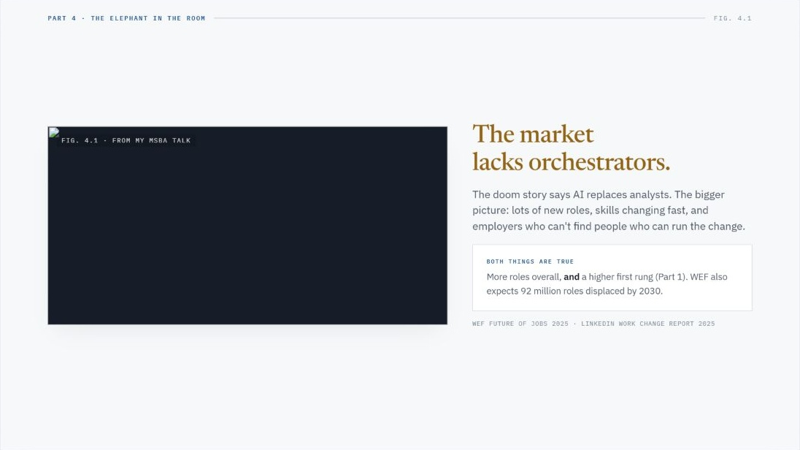

[打开本页原图](figures/m07-web-review-20261127/p51.jpg)。图中来源说法与限制按本节正文读取。

网页另列 WEF 到 2030 年预计 92 million roles displaced。不能只背 170 million 而省略被替代岗位，也不能把全球预测当香港本人求职概率。柱高是演讲视觉，并非可以用尺算出三类变量的统一大小。

“缺 orchestrators”是网页据此提出的方向：组织可能同时创造新任务、抬高入门门槛，并缺少能组织转型的人。本次未核这些外部报告的完整统计方法，保留网页转引地位。

### 2.52 能力一：把任务组织成可交接的步骤（Review p.52）

编排者（orchestrator）先拆工作流，再决定哪些委派，最后核对步骤交接。原图用指挥棒和分开的乐谱线作比喻，表示协调多个角色；不是一个可执行系统的全部数据流。

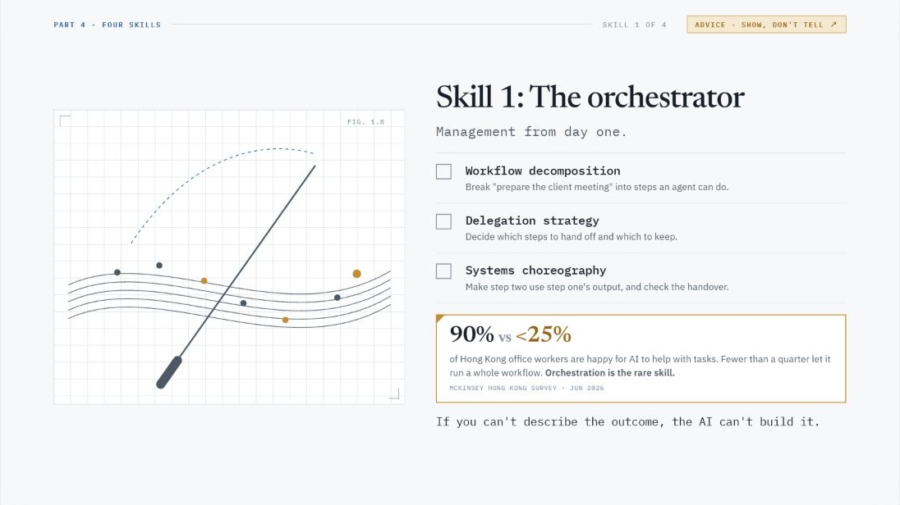

[打开本页原图](figures/m07-web-review-20261127/p52.jpg)。图中来源说法与限制按本节正文读取。

💡 以准备客户会议为例（笔记补充）：先确认问题与获准资料→研究角色给带来源要点→图表角色按要点整理→检查角色对照原数字→本人判断与批准。每步输出都应足够让下一步使用；“做完研究”却不给来源，会让后面的检查做不下去。

页面列 90% 香港办公人员愿让 AI 辅助任务，少于 25% 愿交整个工作流〔网页转引 McKinsey，2026-06；本次未核问卷〕。愿意程度不是技术通过率。建议弹窗 *Show, don’t tell* 要求本学期做一个能解决真实烦恼的运行 demo；“demo gets you hired”是鼓励，不是录取保证。

### 2.53 能力二：设计检查、权限与停止点（Review p.53）

原图从 DATA IN→AI→OUTPUT/ACTION，并画三把锁：human in the loop、intent audit、safety valve。锁的位置提示控制可以放在不同环节，不能把每个真实系统都强行画成完全相同的单线结构。

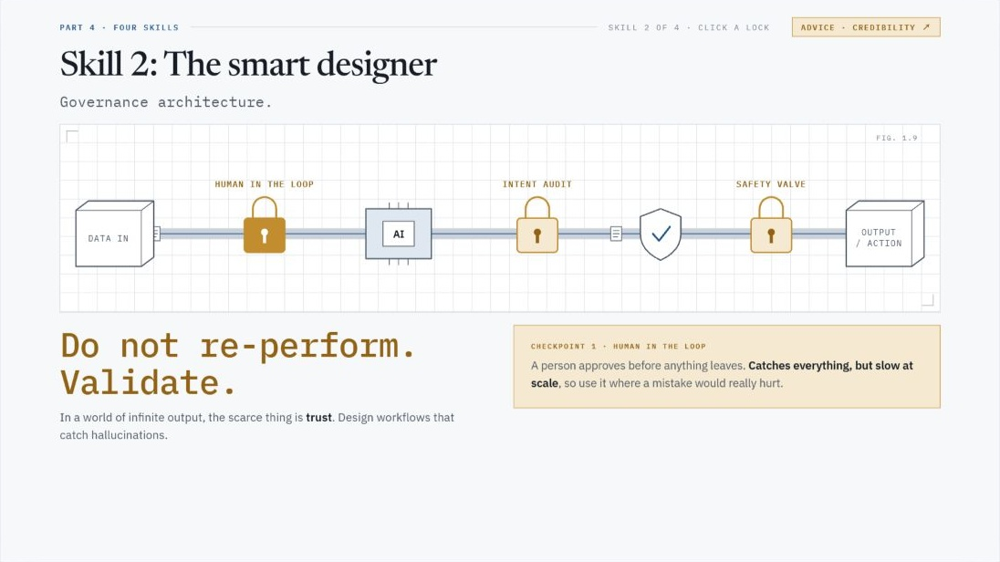

[打开本页原图](figures/m07-web-review-20261127/p53.jpg)。图中来源说法与限制按本节正文读取。

人在环内（human-in-the-loop）是在约定动作前由有能力、有权的人批准；意图核查（intent audit）问有没有完成所求、各项陈述是否有来源、合计是否一致、有没有越界；安全阀（safety valve）限制金额、可联系对象及可停止性。

💡 同一客户回复例（笔记补充）：AI 用有效资料起草；核查器对费用与来源，发现缺依据便退回；高风险例外交人；系统不开放未经批准的发送对象，并可停止运行。这样各控制处理不同失败，而不是让人重复整项任务。

网页对人审写 “Catches everything”，**实际不保证所有错误都被抓到**。人可能不懂业务，检查项也可能缺失。建议弹窗 *Build the currency of credibility* 让学生记录“我检查了什么、发现什么”；日志应记真实检查，不能把写了日志当通过证据。

### 2.54 能力三：把跨领域知识接起来（Review p.54）

综合型通才（synthetic polymath）在这里指能把金融、代码、法律/伦理的知识连接到同一问题。原图三组点标 FINANCE、CODE、LAW & ETHICS；点线是概念网络示意，不能读成实测知识分数或实际知识图谱。

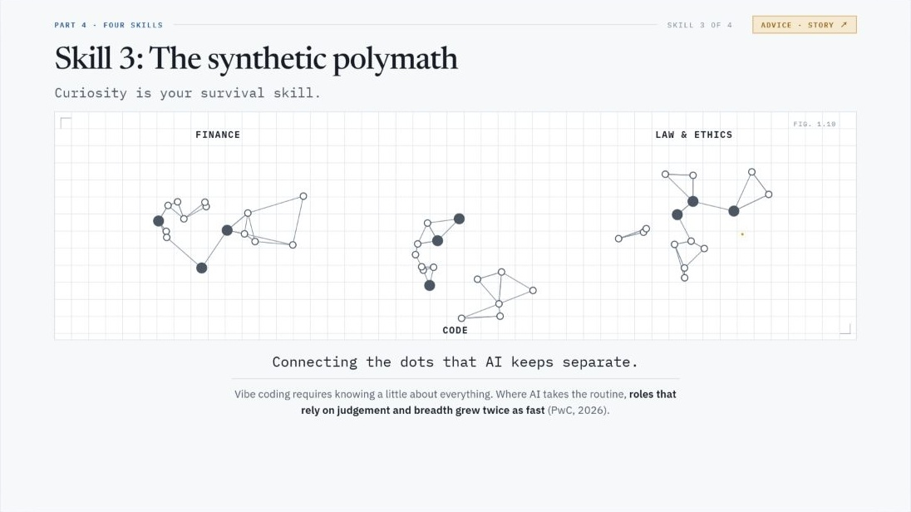

[打开本页原图](figures/m07-web-review-20261127/p54.jpg)。图中来源说法与限制按本节正文读取。

💡 一个费用 chatbot（笔记补充）：金融知识帮助识别费用口径，代码知识帮助理解资料怎样到达回复，法律/伦理知识帮助识别隐私、公平和披露问题。只懂其中一边，可能做出可运行却不适用的工具。

页面称重判断与广度的角色增长快两倍〔网页转引 PwC 2026，未核角色分组与基线〕。建议弹窗 *Features don’t sell. Story does* 要在 60 秒讲清问题、服务谁、发生什么变化。讲故事应有证据，不能用精彩叙述补出未验证效果。

### 2.55 能力四：对后果负责并理解人（Review p.55）

人的护城河（human moat）在原图分成 accountability、trust & empathy、reading the room。中央 YOU 连到三个图标，表示三种不同贡献，而非模型绝对不可能执行任何相关任务的证明。

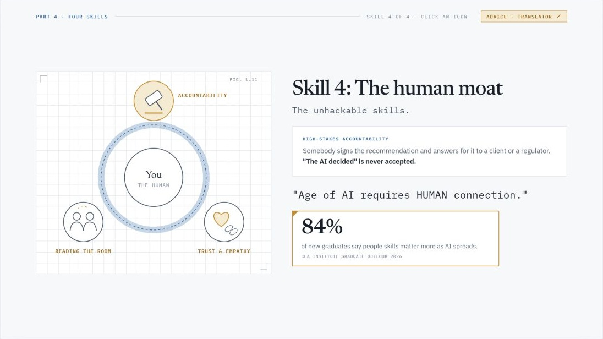

[打开本页原图](figures/m07-web-review-20261127/p55.jpg)。图中来源说法与限制按本节正文读取。

问责是有人对建议签字并解释后果；信任与共情涉及长期关系和坏消息如何传达；理解现场是发现未明说的限制、谁有决定权、何时应停止。网页 “None of it is in the data” 是强调隐性情境的演讲说法，不表示人际信息从来不能记录。

页面列 84% 新毕业生认为 AI 普及后人际能力更重要〔网页转引 CFA Institute 2026；未核问卷〕。这是受访者看法，不是每种岗位的技能权重。建议弹窗 *Be the ultimate translator* 要先与真实使用者交谈，把未说清的困难转成可检查需求，再编码。

### 2.56 为什么不能把所有学习阻力都去掉（Review p.56）

游泳图用水的阻力比喻必要练习：如果 AI 直接交出全部答案，学习者可能没有经历自己推理、试错和修正。*Embrace the resistance* 因而连接 p.14 的认知债务，不是鼓励熬夜本身，也不是说所有低效都值得保留。

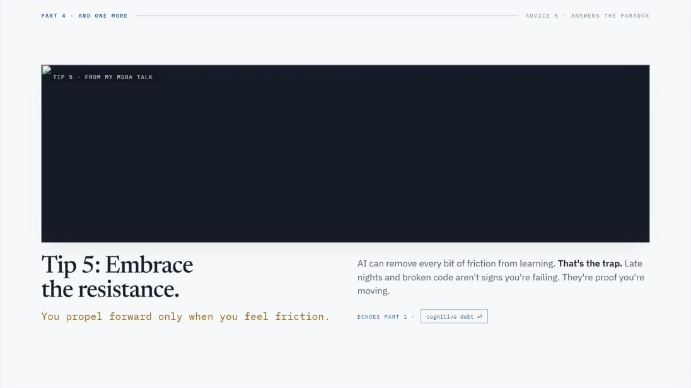

[打开本页原图](figures/m07-web-review-20261127/p56.jpg)。图中来源说法与限制按本节正文读取。

💡 可执行办法（笔记补充）：先手工对一笔合计，写出为何用这个分母，再让 AI 处理大表；对照差异。若你能解释小例和错误原因，才更有依据检查自动结果。没有理解收益的重复抄写则可以交工具，不把痛苦当学习成效。

### 2.57 六类担忧：网页写好的回答与本人判断（Review p.57）

网页注明 evidence 只用本讲来源，*My view* 是由建议整理的短书面摘要；它们不是本次录音里已确认的六段问答。历史 worries 数据为空，显示的是六个预设主题，不能称收到了六位学生的真实发言。

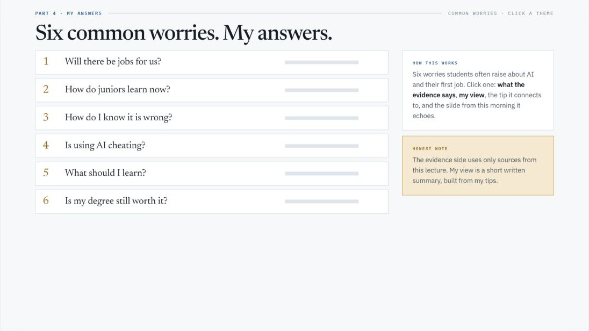

[打开本页原图](figures/m07-web-review-20261127/p57.jpg)。图中来源说法与限制按本节正文读取。

1. **Will there be jobs for us?**（我们还有工作吗？）网页并列入门困难与 AI 技能溢价，建议用运行 demo 显示能力。⚪ 参考作答：机会与风险同时存在，不能由总预测推出个人结果；用具体任务和证据准备。英文：“The market is changing unevenly. I can improve my evidence of relevant ability with a working, checked project, without assuming a guaranteed job.”
2. **How do juniors learn now?**（新人现在怎样学？）网页建议先手工做关键练习再委派。⚪ 学习终点是能解释和检查，而非禁止工具。英文：“Practise the key reasoning first, compare AI drafts with sources, and use feedback to improve judgement.”
3. **How do I know it is wrong?**（怎样知道它错了？）网页建议来源、数字核查和检查设计。⚪ 抽三数字可以是练习起点，却不是所有风险的充分验证；应按错误后果扩检查。英文：“Define the possible errors, check claims and calculations against reliable sources, and escalate what I cannot verify.”
4. **Is using AI cheating?**（用 AI 是否作弊？）网页区分获准工具/资料与隐藏使用，强调遵规则和披露。⚪ 具体课程作业仍由当期题面政策决定，披露并不能把禁止行为变成允许。英文：“It depends on the assessment rules and the permitted scope. Disclosure and checking are necessary where required, but do not override a prohibition.”
5. **What should I learn?**（应该学什么？）网页建议理解业务、读代码、精确描述结果、先听真实用户。⚪ 选一个任务，把设计、执行、验证走完，比只列工具名更能证明能力。英文：“Learn the business problem, describe an observable outcome, understand the workflow and check the result.”
6. **Is my degree still worth it?**（学位还有价值吗？）网页把学位、项目故事和可信人际网络结合。⚪ 课程知识帮助判断，但学历或 demo 都不保证个人回报；须结合实际方向和机会。英文：“A degree can provide foundations and access to people, while practical work and credible evidence show how I use that knowledge.”

改条件：若某评估明确禁止 GenAI，第 4 题即使完整披露仍不能使用；若任务允许 AI 草稿，仍要照规定检查与说明。不能从银行培训例子推定本课每份作业授权。

### 2.58 人际网络怎样帮助核对信息（Review p.58）

图中的 YOU、mentor、professors、classmates、不同年份 alumni、internship manager、guest speakers 用无箭头线连接。线表示可能获得建议和介绍的关系，不表示上级命令、事实必真或保证录用。

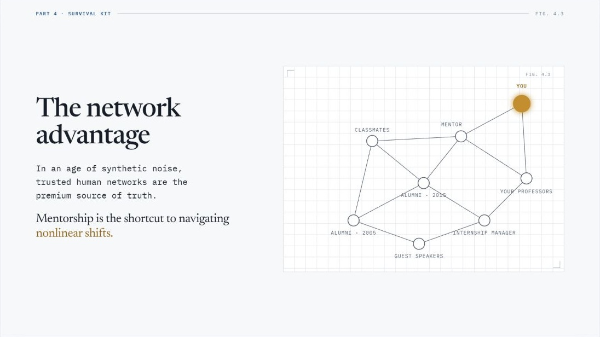

[打开本页原图](figures/m07-web-review-20261127/p58.jpg)。图中来源说法与限制按本节正文读取。

导师的价值是帮助理解行业转向、提供具体反馈并指出可再核的来源。可信关系可以减少找信息的成本，仍须核事实。💡 笔记补充：导师说某岗位重视一个技能，可以据此准备作品，再查正式 JD；不能仅凭熟人说法修改自己的事实或承诺。

### 2.59 把六项行动连成一个学习项目（Review p.59）

网页六项行动完整保留为：*Build one working demo; Keep a “how I checked it” log; Tell its story in 60 seconds; Talk to one real user first; Do the hard reps by hand; Find one mentor.* 它们是嘉宾建议，不是新增课程评分或提交要求。

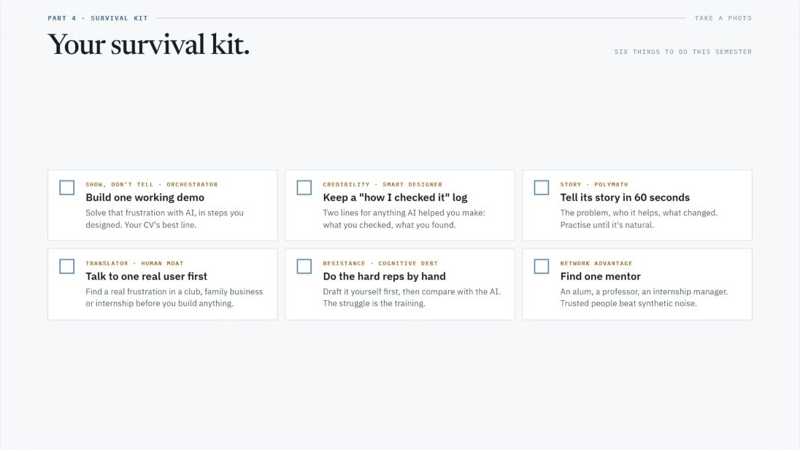

[打开本页原图](figures/m07-web-review-20261127/p59.jpg)。图中来源说法与限制按本节正文读取。

💡 可以按依赖组合（笔记补充）：先找真实用户确认痛点，手工做最难的小例，再做运行 demo；记录检查与发现，练 60 秒解释问题和变化，最后请导师给反馈。这样“做了什么”连到“为什么有用”和“怎样知道正确”。每项都要有实际行为，不能因笔记列出清单便替本人打勾。

### 2.60 结束页的三个动词（Review p.60）

结语是 *Find the resistance. Pitch the crazy ideas. Show, don’t tell.* 依前文可理解为：保留能训练判断的难点、把想法说成可讨论方案、用可检查成果显示能力。它是演讲总结，装饰人物不承担额外教学内容。

“first rung is higher”概括嘉宾观点，不能代替 p.11–p.12 中对证据争议的限定；没有把这句总结当作劳动市场定律。

### 2.61 四个开放提问的作答边界（Review p.61）

本页写 until 12:00，列提问起点，没有提供嘉宾现场答案。以下逐项保留原问，学习答法明确哪些只能询问本人：

1. *What does a day in an AI innovation lab actually look like?* 问实际日常。⚪ 本材料不足以重建某机构一天工作；可据讲座提出“需求、原型、验证、跨团队审批”等待核方向。英文：“The lecture suggests work on use cases, controls and coordination, but the actual daily routine needs the speaker’s confirmation.”
2. *What would you look for in an intern’s CV today?* 问嘉宾的招聘偏好。⚪ 可引用其 demo、真实问题、检查日志和沟通建议，不能冒称正式招聘标准。英文：“The advice favours a working solution to a real problem, with evidence of checking and clear communication. It is not a formal hiring policy.”
3. *Which of the demos would a bank actually let you use?* 问实际获准范围。⚪ 必须核机构、数据、用途、工具与批准；没有通用名单。英文：“Permission depends on the bank, approved tools and data, the use case and the required controls. The demos do not establish production approval.”
4. *Ask Prof Chow: what does Google see its bank customers struggle with?* 问特定人的机构经验。⚪ 当前无可核答案，不能替 Prof Chow 或 Google 发言。英文：“The available material does not record that answer. It requires the professor’s response or another attributable source.”

### 2.62 参考文献页怎样帮助复习（Review p.62）

本页列公开来源，不等于本笔记已经逐篇重做外部研究。就业类包括 Stanford *Canaries in the Coal Mine?* 多版、US Census 工作论文 CES-WP-26-27 / 26-56、Fairlie & Wu 的 CESifo WP 12994、PwC 2026、HKUST 调查及香港职位/劳动力统计。银行人员与技能说法经 Bloomberg、FT、Fortune、McKinsey、CFA Institute 转引；宏观岗位/技能预测来自 WEF 与 LinkedIn。

其余包括 NVIDIA CES 演讲、Our Hong Kong Foundation 学生调查、Kosmyna 等人的 *Your Brain on ChatGPT*、HKMA/SFC/IA/MPFA 的 Sandbox++ 与 HKMA 沙盒/培训资料。部分条目经过媒体二次转述，原样保留来源层次；只写机构名不足以证明具体数值口径。

复习时回到每条断言所在页看对象、年份和分母。要作现实政策决定或对外引用精确效果时，进一步取得对应版本、原表与全文。本次新来源解决“网页有哪62页及怎样读”的问题，没有解决原课堂 PPT、全部原片、录音缺首尾和所有外部研究可复算的问题。


### 2.63 录音专题：先把工作拆开：AI 做草稿，人管理什么

设想银行员工要准备一份研究材料。过去，他可能自己查资料、写分析、整理图表。接入 AI 后，“查找”和“起草”可以交给不同 agent；员工仍须决定要回答的业务问题，以及什么证据足够支持结论。否则，只是更快地产出了一份无法负责的文字。

嘉宾将未来管理对象描述为“人和智能的组合”（A `03:35`–`04:29`）。他用研究 agent、代码 agent、审计 agent 举例：研究者收集材料，代码工具帮助实现，另一角色检查结果；人定义问题、判断标准和控制框架（A `04:34`–`05:53`）。这是一种工作组织设想，不是本批已验证的银行部署。

下表每行是同一工作中的一个职责。关键是分清产出与批准。

| 对象 | 接收什么 | 交出什么 | 谁承担下一步判断 |
|---|---|---|---|
| 研究 agent | 明确问题、允许访问的资料 | 带来源的草稿 | 员工核事实及适用性 |
| 代码 agent | 所需功能、约束 | 代码或运行结果 | 员工核是否解决业务问题 |
| 检查 agent | 草稿及检查标准 | 问题清单或评分 | 人核标准及遗漏风险 |
| 业务负责人 | 证据、风险、例外 | 接受、退回或停止的决定 | 组织按既定职责负责 |

例如，检查 agent 给“通过”，只能说明它按当前标准没找出问题。若标准根本没检查数据是否过期，错误仍会进入后续流程。人的职责包含制定标准、查看证据和处理例外，不能缩成点击一次“同意”。这是对课堂分工的笔记补充。

**🎙️ 课堂补充**（A `03:35`–`05:53`，课上展开）：*"So human in the middle is still the model we're going to run"*（A `05:53`，原段后还有未来范围限定）。嘉宾的判断限定于其能预见的未来，尤其是银行场景；不能推成所有工作永远必须采用同一种审核方式。

### 2.64 录音专题：模型怎样获得行动能力：指令、资料与工具

如果只问模型“请分析这份说明”，模型能返回文字，却不会自动拥有银行账户或文件系统的操作权。要让它实际处理任务，还要给它允许使用的资料和工具。

提示（prompt）告诉模型要做什么；上下文（context）是它判断时能看到的资料。上下文可含原始聊天、文档、日期和已确认约束。工具（tool）把“生成一个动作的描述”连接到“执行一个动作”，例如读文件、运行计算或修改任务。A `10:20`–`12:27` 以此解释模型与 agent 的区别。

💡 笔记补充：以“把会议中的行动整理出来”为例，输入是文字，输出可能先是候选任务。只有系统开放了任务管理工具，agent 才能写入任务表；只有开放相应字段，它才可改负责人或日期。模型说“已安排”与任务表真实存在一行，是两种不同证据。

下图从上往下读。实线表示本教学例中的资料或结果流；批准分支是明确补充的控制设计，不冒称演示已展示所有实现细节。

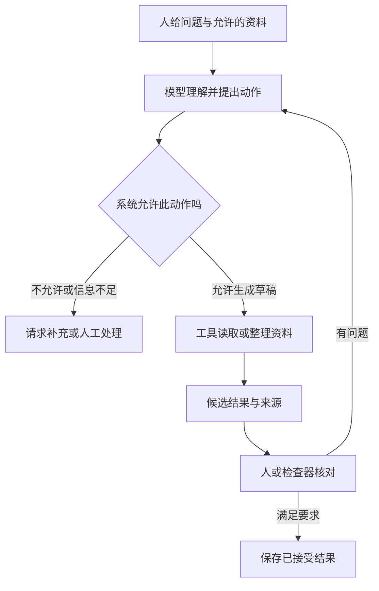

用同一输入走图：人提供会议记录；模型识别一项待办；工具形成草稿；检查器发现日期冲突便返回补充；负责人确认后才保存已接受日期。这里的停止条件是当前任务已满足要求或被退回，不能因为模型仍能继续生成就无限执行。

权限由系统控制。把“你不能付款”写入提示可以表达要求，但真正防止付款还要限制工具能做的动作。若工具根本没有付款能力，模型的错误计划也无法直接转账；若工具有无限权限，仅靠文字约束会留下更大风险。此段为延续 M03 的笔记解释，非本场实际银行架构披露。

**🎙️ 课堂补充**（A `10:20`–`12:27`，课上展开）：*"for example, access to company data"*（A `12:13`）；*"like give them access to a computer they can run Python"*（A `12:20`）。这两句说明 agent 的行动范围依赖接入能力；不证明任何数据都可上传。

### 2.65 录音专题：银行为什么不能直接把客户资料交给聊天工具

银行处理客户身份、交易及内部决定。错误答案可能影响客户，资料泄露也可能破坏信任。因此，银行要问的不是“AI 能不能写得像”，而是：资料能去哪里、输出由谁检查、谁签字、出错如何控制，以及以后能否重现证据（A `08:23`–`10:08`）。

幻觉（hallucination）是模型生成看似可信、却缺乏依据的内容。它与数据泄露不同：前者是内容不可靠，后者是信息流向了不该接收的人或服务。一个系统可以没有泄露却回答错，也可以答得正确却泄露资料。两类问题要分别控制。

治理（governance）在这里指决定权限、检查、责任和应急处理的组织安排。它要落到执行过程：谁能用哪些资料；哪种结果须审核；出现异常谁能停止；留下哪些记录。制度文件是依据，真正是否执行仍要看系统和人员的行为。

A `09:04`–`09:21` 的英文检查问句可以直接用作分析入口：

> *"How to check it? Who should check it? Who signs off?"*（A `09:04`）

> *"And also, like, can we prove it a year later?"*（A `09:08`）

中文意思是：检查什么、谁有能力和职责检查、谁批准，以及过了一年是否还能给出当时的证据。它们是嘉宾的治理提问，不是考试原题或官方答案。

⚪ 参考作答（笔记补充）：以客户回复为例，先核回复依据的费用表版本，再由有职责的员工批准；保存输入、来源版本、回复和审核记录。若费用表缺失，停止生成确定报价，交人工补充。日志能帮助复查，但保存了日志并不证明回复本身正确。

英文参考答案（笔记自拟）：“The system needs an approved data boundary, checks against source evidence, a named approver, retained records, and a way to stop or correct an error.”

**🎙️ 课堂补充**（A `08:23`–`10:08`，课上展开）：*"to us, client trust is everything."*（A `08:29`，从原段截取连续短句）。这段把企业应用的判断对象从模型能力扩展到客户信任及可追责过程。

### 2.66 录音专题：怎样检查而不把省下的工作全做回来

假设原任务需要很久，AI 很快形成草稿。如果审核者必须从头重做全部工作才能确认，生成阶段省下的时间就可能被审核吃掉。嘉宾以“过去数小时、AI 数秒、人工仍需数小时”的例子说明这个矛盾（A `25:37`–`26:08`）；这些时间是口头示意，不能当成已测性能。

人在环内（human-in-the-loop）指人在约定环节检查或决定。它是否有效取决于人看什么、能否发现错误，以及能否退回或停止。盲目签字只有形式，没有解决问题。

另一种办法是让 AI 检查 AI。生成者给候选，评审者（AI judge）按标准判断通过、改写或转人工。嘉宾影片的聊天回复案例在客户看到答案之前评分（A `34:13`–`34:25`）；他也提醒某些监测只会事后发现问题（A `26:12`–`26:38`）。**事前拦截与事后监测的作用时间不同**，不能合成一个“总能阻止错误”的保证。

下表一行是一种检查方式，比较它在哪个时点起作用。

| 方式 | 能帮忙做什么 | 仍可能漏什么 | 代价 |
|---|---|---|---|
| 人从头复做 | 对照关键证据重新判断 | 人也可能疲劳或缺专业能力 | 时间可能很高 |
| 发布前 AI 评审 | 按规则拦住部分不合格输出 | 规则缺项、模型共同错误 | 额外计算及维护 |
| 发布后监测 | 找已发生的异常并触发处理 | 首次影响可能已发生 | 响应与补救成本 |

💡 笔记补充：一个费用回答中，生成者和评审者若都读了过期文件，二者一致不能证明当前费用正确。可以增加文件版本检查、金额计算规则和人工升级；这些检查对应不同错误来源。再加一个模型不是独立事实来源。

嘉宾在 A `36:53`–`37:59` 讨论误报与漏报，但 ASR 对两者取舍破碎。这里不将其转写成确定阈值。误报（false positive）是把正常事项判为异常；漏报（false negative）是没有发现真实异常。笔记补充例：把正常付款拦住会打扰客户，放过欺诈可能造成损失。应比较这两类后果，而不是追求没有说明分母的“准确率高”。

**🎙️ 课堂补充**（A `25:21`–`26:41`；`34:13`–`37:59`，课上展开）：*"you can't possibly have a human to revalidate everything"*（A `26:04`）；*"Every chatbot answer is scored before the customer sees it."*（A `34:17`，影片）。前者指出审核资源限制；后者是特定案例流程，不是所有银行都已如此运行。

### 2.67 录音专题：沙盒和 KYA：能试验，不等于已获准上线

当多个机构对新系统的风险理解不同，联合试验可以让参与者较早讨论边界。沙盒（sandbox）在本段指受安排的试验环境；参加试验、展示用例与获准投入真实生产，是不同状态。

嘉宾影片提及香港 GenAI 沙盒、多个监管者和用例数量（A `28:38`–`30:36`），随后现场解释：共同环境有助于与监管者接触、理解可接受范围，但不是自动预先批准（A `30:44`–`32:23`）。本稿没有把这些数字或当时法制概述当成当前官方结论，具体政策另见 §9.5 的核对限制。

影片问句：*"banks can build their own sandbox. Would you like to join this one?"*（A `28:59`–`29:02`；原文为转述他人提问）。中文任务是：已有内部试验环境，为何还参加共同计划？⚪ 参考作答：价值可能来自共同讨论及较早监管接触，不能把“参与”当作上线许可。英文参考答案（笔记自拟）：“A shared sandbox may help participants discuss expectations with supervisors, but participation does not by itself authorize production use.”

本段的三个案例分别解决不同控制问题（A `34:13`–`36:04` 为影片）：

1. 聊天回复检查：另一个 AI 在回复前评分，决定通过、改写或转人工。
2. 反洗钱（Anti-Money Laundering, AML）材料整理：agent 收集证据，人审阅并签字。收集材料并不等于认定违法；影片中的节省幅度不是本批已测结果。
3. 了解 agent（Know Your Agent, KYA）：若软件代表客户付款，银行除了解客户，还要识别这个 agent 是否获授权、能做什么，以及本次交易是否在授权内。

了解客户（Know Your Customer, KYC）关注客户身份等核验；KYA 在这里补上“代表客户行动的软件”这一层。A `41:02`–`42:17` 明确讨论了创建者、代表权和能力边界。讲者的概念介绍不能替代任何法域的正式合规程序。

下图是对影片“四个联系”的简化教学表达；连线表示需要核验的授权关系，不表示四步已在所有银行实施。

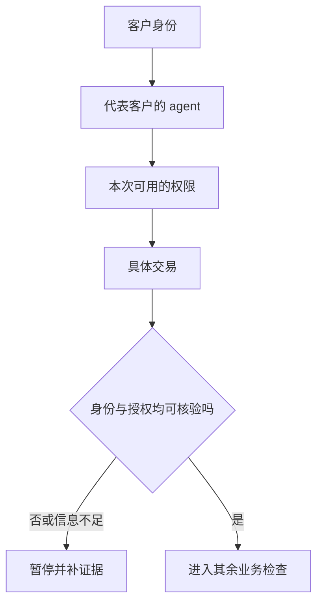

💡 笔记补充：客户允许 agent 查询账单，不代表允许它转账。即使 agent 确实属于客户，权限与本次动作不匹配，仍要暂停。图中“进入其余检查”也不等于付款成功，还可能涉及余额、收款人和风险规则；这些不是本场已披露的完整实现。

**🎙️ 课堂补充**（A `28:38`–`42:17`，课上展开）：*"it doesn't mean that it's an auto pre -approval, right?"*（A `31:33`）；*"There are no results yet."*（A `35:45`，影片）。后句限定当时影片所谈试验，不能把试验目标写成已实现效果。

### 2.68 录音专题：两道门：按业务用途判断风险

同一个聊天界面可以做低影响草稿，也可以直接影响客户，因此不能只凭工具名称决定要怎样审批。嘉宾用“两道门”区分个人生产率和核心业务流程（A `44:18`–`48:53`）。

第一道门是生产率（productivity）：帮助人员更快整理、翻译或起草，并不因此直接替换重要业务控制。第二道门是核心流程（core process）：结果进入客户服务、业务决定或重要的反复运行过程。这里是嘉宾用于解释的分类法，不是统一法律风险等级。

**🎙️ 课堂练习：这些用途走哪道门？**（A `47:43`–`48:53`）

录音是嘉宾逐例讲解，不是完整可见的选择题；没有选项字母，未录到清楚的听众作答。下面保留可读 ASR 片段，不补成幻灯片原题：

> *"Summarizing only thing though, which everyone's do, this is of course the door one."*（A `47:45`，对象词 `[?]`）

> *"And then a chatbot that answer customer question about fees and stuff."*（A `47:50`）

> *"Translating Door 1, whether to approve a small business plan, of course Door 2."*（A `48:16`，plan `[?]`，不改成贷款原题）

> *"And then, you know, like, building dashboard, that's a tricky one."*（A `48:28`）

中文题意：分别考虑总结/翻译、自动回答客户费用问题、批准一项业务事项，以及制作仪表板。区别在输出用于何处、影响谁，以及是否进入重要持续业务。ASR 未保留总结对象或批准对象的准确名称，这两个词保持待核。

逐项答案与理由（嘉宾分类见 A `47:45`–`48:53`；理由用中文整理）：

1. 总结、翻译：嘉宾归第一道门。此分类仅在一般辅助语境成立；若译文直接决定客户合约或进入重要控制，就须重新判断用途。
2. 直接回答客户费用的 chatbot：嘉宾归第二道门，因为它承担了客户服务功能。员工用工具起草后自行审查，与系统直接替代该功能，影响路径不同。
3. 批准事项：嘉宾归第二道门。具体对象未核，但“批准”会改变业务状态，需要明确权限与责任，不能只因金额可能较小就降级。
4. 仪表板（dashboard）：单次制作本身可属第一道门；若连接企业数据、反复支撑重要业务，可能归第二道门。软件名没有变，用途变了。

英文参考答案（笔记自拟）：“Classify the use by its business purpose and consequences. A draft translation may support productivity, while a customer-facing answer or an approval may enter a core process. A dashboard must be reassessed when it supports recurring material decisions.”

改条件例（笔记补充）：同一张图，第一天只是课堂练习，第二天被接入每日资金决策。第二天要重新核数据权限、错误影响、更新、审核与停止方案。不能沿用“昨天它是图表工具，所以今天也低风险”的结论。

**🎙️ 课堂补充**（A `43:17`–`48:53`，课上展开）：*"It really depends on the business purpose and also the importance of the job."*（A `48:53`）。这句给出了分类依据；采用人数多不等于已产生可验证回报。

### 2.69 录音专题：从一次提示到可复用技能：统一程序仍要保留可修改结果

每个人临时输入提示，会得到格式和质量不一致的结果。企业若希望持续复用某种工作方法，可以把步骤、标准和资源整理成技能，而每次另提供当前业务资料。A `49:10`–`51:20` 讲了这条路径。

提示通常面对一次请求；技能保存可重复的程序；插件（plugin）或连接能力提供数据与工具入口；agent 在目标下组合这些能力并处理多步任务。它们不是按名称越高级就越有价值。一个固定步骤已足够完成的任务，不必为了“用 agent”额外增加自主决策。

工作流（workflow）是任务之间的先后、条件与交接。固定工作流可以规定“先提取、再核对、再等批准”；agent 可在允许范围内理解不同说法、选择下一步或请求补充。实际系统可以把两者组合起来。B `06:48`–`07:26` 强调 agent 的灵活性；不能据此推成“传统程序都不灵活”或“agent 不需要规则”。

嘉宾反复用“80/20”提醒：AI 先完成大量整理，人处理关键判断与修正（A `54:24`–`55:11`、`56:45`–`56:59`）。这是其设计启发，**不是测出的 80% 正确率、20% 错误率，也不是可以忽略其余风险的容许值**。

💡 笔记补充：如果输出只有一张不可编辑图片，人发现一项缺失控制时可能只能重做。若结果是可修改的任务、关系和日期，修正一处可更新相关视图。但“可编辑”只降低改错成本，不证明系统自动理解了业务。

**🎙️ 课堂补充**（A `49:10`–`55:11`；`01:06:42`–`01:07:29`，课上展开）：*"In corporate, we want to design the skills centrally"*（A `01:06:53`）；*"so that everyone is using the same skill to be consistent."*（A `01:06:56`）。一致程序仍须针对实际业务上下文检查，不能把统一模板当成结果认证。

### 2.70 录音专题：PMO：让会议变成可追溯、可修正的行动

会议里产生决定，但会议后常要有人再整理流程、任务、进度和日历。嘉宾的项目管理办公室（Project Management Office, PMO）演示将这段转换交给 AI：输入会议文字，生成多个彼此相关的视图（A `51:34`–`51:57`、`55:38`–`59:24`）。

影片中的过程可分为以下动作：

1. 读取会议记录，抽取步骤、负责人、日期和状态。
2. 形成流程图、行动跟踪表、甘特图（Gantt chart）和日历。甘特图把任务画在时间线上，标先后依赖；日历侧重某日发生什么。
3. 为步骤保留来源行，人能查“为什么出现这项任务”。
4. 发现两个日期冲突时标记，等待人确认，不任选一个。
5. 人补上缺失控制并指定负责人，其他视图随同一修改更新。
6. 后续聊天到来后，按新信息更新行动，并保留变更的来源。

下图沿同一条任务走。箭头是信息处理顺序，冲突分支返回本人确认；“更新视图”不表示已执行真实业务。

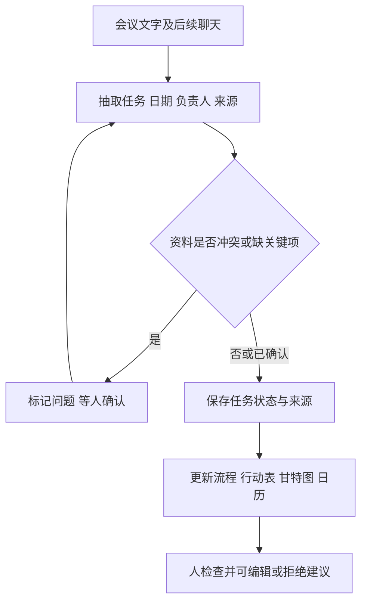

影片的日期冲突是“day 40, or day 45”（A `57:13`–`57:23`）。这不是本课程作业截止，也不证明任何真实监管报送期限。关键机制是**保留两个相互冲突的说法，并把决定留给有权限的人**。

💡 笔记补充完整例：两段记录分别说“任务 X 周二完成”和“任务 X 周四完成”。系统先保存两个来源及冲突标记，任务暂不成为已确认排期；负责人选择周四并说明依据后，更新任务及甘特图。若下一条消息只是“能否改到周五”，它是提议，不能未经确认覆盖已定周四。此例解释了从语言到状态的区别，不是现场原始数据。

影片还让 AI 在流程上提出改进，例如给无人负责的控制补负责人、减少例行人工核对。嘉宾强调提案由团队编辑、拒绝和拥有（A `58:27`–`59:00`）。提出建议与批准改变业务，是两种动作。

**🎙️ 课堂补充**（A `55:38`–`59:24`，影片演示）：*"It doesn't pick one."*（A `57:22`）；*"proposals not decisions"*（A `58:53`，原段内连续短语）。A `01:05:37`–`01:05:54` 现场声明当日演示资料为虚构或公开来源，不来自其公司，也不代表公司。本稿因此不称此工具已在嘉宾所在银行投产。

### 2.71 录音专题：Chat BI 与 Policy Companion：把来源和规则做成能核对的结果

这两个技能分别面向数据判断和政策查阅。它们共同的设计问题是：输出不能只是一句看似有说服力的话，还要让使用者看到它依据什么、哪些问题不能回答。

#### 2.71.1 Chat BI：先分清量，再比较，最后才问原因

商业智能（Business Intelligence, BI）在这里指把数据整理成支持业务判断的指标和图表。嘉宾的 Chat BI 影片输入市场数据，要求找出哪些市场较不稳定、什么时候发生；工具选择图表、计算文字，并随筛选改写结果（A `59:34`–`01:02:27`）。

影片问题跨段可辨为 *"which markets are unsettled and when"*（A `59:53`–`01:00:01`；ASR 无完整问句标点）。中文题意是比较市场的不稳定程度并定位时间。原录音批次未取得输入表与完整算法。本次新网页演示库补到不同真实/合成数据版本，具体核验见 §2.44 及配套参考卡；仍不把某个新版本直接认定为当日影片所用输入。英文参考答复（笔记自拟）：“Compare markets using a stated, comparable measure and locate the relevant dates. The numerical result cannot be reproduced without the data, time windows, and calculation rules.”

影片提醒石油价格与国债收益率的量纲不同（A `01:00:27`–`01:00:41`）。量纲是一个数描述什么，例如价格或利率。不同单位的原始变化不能直接比较为“谁更不稳定”。影片改为相对自身常态作比较；本次补得网页 FRED/合成版本及窗口声明，但不能证明与影片同版，详见 §2.44。

💡 笔记补充：若展示“当前波动是自身常态的多少倍”，必须先说明波动怎样计算、当前与常态各取哪个期间，以及常态是否为零。只有同口径相除，倍数才有可比含义。影片的具体算法未完整录到，不能凭这段解释反推其公式。

**筛选与原因**

之后影片筛选到信用市场，峰值日期改变，工具同步更新文字（A `01:01:08`–`01:01:21`）。这说明图、筛选和叙述要使用同一份当前数据。数据说某日变化大，只支持“何时变化”；要解释“为什么”，还需要额外因果证据。影片在追问原因时拒绝猜测，正是这条边界（A `01:01:21`）。

影片还掠过活动出席、前后得分，以及香港蚊患指数和地图等例子（A `01:01:33`–`01:01:59`）。ASR 跳接，具体表与例子边界待核，不能拼成同一数据集。可辨认的演示意图是按数据的形状选择图表，而非要求所有问题都用预先画好的同一种图。

人看图可以发现异常，但“看起来合理”不能代替复算。检查看到的尖峰、数据筛选和文字结论是否相符，是一项工作；核原始数据、计算规则和因果依据，是另外几项工作。此处为笔记补充，不把嘉宾的可视化建议升级成充分验证。

#### 2.71.2 Policy Companion：把适用条件接到原文段落

政策可能很长。只让模型概述全文，使用者仍不知道当前项目适用哪条义务。Policy Companion 影片先把上传文件整理成可视导览，再通过若干问题分流，列出适用义务，并给原文段落引用（A `01:02:33`–`01:03:51`）。

影片中的完整示例问句是：

> *"Say we're planning a client chatbot built on a third-party model."*（A `01:03:02`）
>
> *"Does the circular apply, and what do we owe?"*（A `01:03:07`）

中文题意：计划采用第三方模型构建客户 chatbot；上传通函是否适用，若适用须做什么？“what do we owe”在此是承担哪些要求，并不是欠款金额。

影片给出的结果是进入适用范围且为高风险，并按段落列出相应要求（A `01:03:18`–`01:03:23`）。**这是影片给定结果，不是本稿基于通函全文重新核定的合规答案**。原录音批次缺通函与完整问题。本次已补得 2024-11-12 SFC 通函和网页程序：实际为 8 个问题节点，书面页称七问，且非 SFC 官方决策树。分流校正与文件边界见 §2.45；不把新程序的路径假作影片逐项回答。

⚪ 学习用参考作答：先确定文件版本和适用主体，再收集模型、用途、客户接触方式等题目所需事实；沿原文条件判断；每项义务附原段落。缺少事实就标待确认。英文参考答案（笔记自拟）：“Check the circular's scope against the actual deployment facts, then link each applicable obligation to its source paragraph. The video result cannot replace an independent check of the full circular and the answers used in triage.”

影片另问客户是否要获知自己在与 AI 交谈，并宣称原文某段有要求（A `01:03:34`–`01:03:40`）。本稿只记录该演示动作，不将其具体段号或每次互动的说法写成现行法律结论。查询到段落是“找到文字”，还要查版本、上下文、适用对象与例外，才可能支持实际决定。

**🎙️ 课堂补充**（A `59:34`–`01:04:30`，影片及现场解释）：*"So I ask why, and it refuses to guess."*（A `01:01:21`，影片）；*"first builds a visual guide"*（A `01:02:48`，原段连续短语）。前者约束因果推断；后者展示查阅方式。两者都不证明结果已经通过独立评测。

### 2.72 录音专题：CHO：从聊天到有来源、有时间的共同记忆

一个人的行动信息不一定先进入日历，常散落在聊天、语音和照片中。CHO（Chief Household Officer，家庭事务主管）演示先把这些信息整理为可用资料，再让不同角色的 agent 围绕它工作（B `00:00`–`04:04`）。这部分含私人信息，正文只讲机制。

知识图谱（knowledge graph）把对象和关系明确保存，例如“某人—参与—某活动”“某事项—发生于—某日”。这里还要保留来源与有效时间：过去正确的事实不一定现在仍正确；一句提议也不等于已确认事件。B `01:16`–`01:50` 介绍了事件、人物信息、重要性、确定程度及时间变化，但具体数据结构未展示。

影片自称有九个 agent（B `00:05`）。现有 ASR 可以辨认读照片/语音、分析、人物关系、日历、待办、项目、资料保护、设备维护等职责；没有足够清楚的完整九员名册，因此不补造第九个角色。角色的拟人姓名是界面设定，不能证明这些是九个独立模型或九台机器。

下图从消息向下读，显示本稿依据影片重建的简化资料流。虚构角色名省略；真正程序、数据表和权限实现未取得。

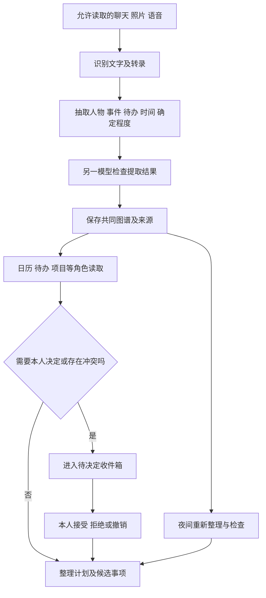

一个明确标为笔记补充的小例可以把它走完：

1. 输入：“周六有个活动，要不要参加？”提取器建立候选事件，并保存原消息位置。
2. 因为“要不要”尚未决定，状态保持“提议”。不得直接记为本人承诺出席。
3. 日历角色发现同一时段已有另一活动，把冲突交到本人收件箱。
4. 本人选择不参加，计划显示拒绝；若误点，撤销（undo）恢复此前状态。影片展示可撤销，但没有证明任何外部发送或付款也都可撤回。
5. 夜间任务再检查图谱、下一周和天气，提出需要更新的事项。天气变化可以影响建议，不能越权代替本人作新的承诺。

影片原过程包含：准备角色承担照片/语音整理，分析角色理解消息，另一个较大模型复核（B `00:55`–`01:32`）。共同图谱连接角色，计划中的事件与任务能追到来源聊天。本人处理少数只可由自己决定的事项，夜间任务重新整理资料和未来安排（B `01:50`–`03:21`）。

“复核模型”仍会出错，图谱也可能保存错误。要让人能回到原消息纠正，而非把结构化结果当成天然事实。

B `00:30`–`00:48` 的影片宣称应用与模型在其本机运行、个人信息不离开设备、通过私人网络由手机访问。这是作者对其个人系统的自述；本批没有检查代码、网络流量或设备，所以不认证“绝无外传”。本地运行减少哪些网络流转，要看实际实现；也不自动解决被错误授权的人读取资料的问题。

**🎙️ 课堂补充**（B `00:00`–`04:04` 影片；`04:12`–`07:26` 现场解释）：*"Take the stream of everyday conversations and turn it into a knowledge graph."*（B `03:40`）；*"and keep a human in charge."*（B `03:44`，原段尾连续短语）。嘉宾随后提出把家庭聊天换为企业邮件、会议和文档的迁移设想；这说明设计相似，不能省去企业权限、隐私、审计和业务验证。

### 2.73 录音专题：怎样评价就业和 AI 编码观点

录音开头已在讨论初级岗位减少后的职业阶梯问题：如果训练新人的工作被改变，组织怎样培养下一阶段人员？嘉宾随后修正“初级岗位全部消失”的简单叙事，转而强调任务和雇主期望改变，转型类工作仍可能需要人（A `00:22`–`03:17`）。这些是嘉宾的观察与预测，不是本稿独立核定的劳动力市场事实。

嘉宾将资源从单纯人数扩展到 AI 用量预算（A `03:53`–`04:29`）。token 是模型处理文字等信息的单位，并非固定一个字；使用 token 会消耗预算。能调用更多 agent 不是没有成本，还要考虑计算、失败重试、工具、人工审核和维护。此成本拆解为笔记补充，课堂未给完整预算表。

他的学习建议是：不要让 AI 替代自己理解问题，因为检查别人或 AI 的工作仍需要知道正确过程（A `06:27`–`07:50`）。这与“不用工具”不同；可以让工具承担整理，同时自己能够解释证据和判断。

B `07:38`–`08:48` 谈到 AI 辅助编码。ASR 把相关术语写成 white/light/agentic 等混杂词；本次网页 p.48 的书面题名确认其讨论 vibe coding / agentic coding，仍未逐字核音，也不补出工具名。可确认的意思是嘉宾自述常借助 agent 写代码，并强调要清楚做什么、为什么。它不是课程对个人作业使用 AI 的新增授权，更不证明学生可以不检查输出。

课堂反问：*"Does it mean that, you know, what I've studied for the past few years are useless?"*（A `01:08:25`）。中文题意：工具能自动完成部分分析，过去学习的分析知识是否无用？嘉宾答“不”，把价值放在定义反馈、提出问题和连接业务（A `01:08:31`）。英文参考答案（笔记自拟）：“Analytical knowledge still helps a person frame the business question, choose meaningful checks, and judge whether the output solves the problem.”

改条件例（笔记补充）：若 AI 画出漂亮图表，但用错数据期间，懂分析的人应能发现结论与问题不匹配；如果只会接受外观，就无法完成审核。这连接了 §2.66 的验证成本和 §2.71 的数据规则。

**🎙️ 课堂补充**（A `00:00`–`07:50`、`01:08:12`–`01:08:31`；B `07:38`–`08:55`，课上展开）：*"you can only check the work"*（A `07:30`）接 *"once you know how to do."*（A `07:33`）。末段 B `08:55` 仍在引出互动与职业建议，后续回答缺失，不能以这段片尾当作讲座总结。

## 3. 一图看懂

从下表左列的问题开始，沿中列寻找机制，再用右列查它的边界。它把前文连成一条业务判断链。

| 业务问题 | 本讲机制 | 不能跳过的边界 |
|---|---|---|
| AI 会写，为什么还不能上业务 | 资料、权限、检查、批准及留证 | 生成结果不等于已接受结果 |
| 人全部重做太慢 | 分层检查，必要时人接管 | AI 评审也有共同错误 |
| 该走哪种审核路线 | 看用途、重要性及影响 | 不按软件名称直接分类 |
| 会议决定容易散落 | 抽取状态并连接多个可编辑视图 | 冲突与提议不能擅自当决定 |
| 数据/政策太复杂 | 保留规则、来源及适用条件 | 图与引用不代替正确性核查 |
| 多 agent 怎样不各说各话 | 共同图谱、来源、时间、角色分工 | 共享错误也可能被多个角色复用 |

## 4. 速查表

下面每行是考试或案例分析中容易混淆的一对；机制已在对应小节展开。

| 要区分 | 正确读法 | 回看 |
|---|---|---|
| 模型 / agent | 生成能力 / 接上工具及执行控制的系统 | [[#2.64 录音专题：模型怎样获得行动能力：指令、资料与工具\|§2.64]] |
| 事实正确 / 没有泄露 | 内容依据 / 信息流向，须分别检查 | [[#2.65 录音专题：银行为什么不能直接把客户资料交给聊天工具\|§2.65]] |
| 人在环内 / 人重新做全部工作 | 按风险与证据设计审核，不只留签字 | [[#2.66 录音专题：怎样检查而不把省下的工作全做回来\|§2.66]] |
| 事前拦截 / 事后监测 | 阻止部分输出 / 发现已发生异常 | [[#2.66 录音专题：怎样检查而不把省下的工作全做回来\|§2.66]] |
| 沙盒 / 上线许可 | 试验安排 / 正式生产资格不同 | [[#2.67 录音专题：沙盒和 KYA：能试验，不等于已获准上线\|§2.67]] |
| KYC / KYA | 客户身份 / 代表软件及其授权边界 | [[#2.67 录音专题：沙盒和 KYA：能试验，不等于已获准上线\|§2.67]] |
| 采用率 / 回报 | 有人使用 / 相对成本的已验证收益 | [[#2.68 录音专题：两道门：按业务用途判断风险\|§2.68]]、[[#2.73 录音专题：怎样评价就业和 AI 编码观点\|§2.73]] |
| 80/20 / 准确率 | 嘉宾设计启发 / 不是统计指标 | [[#2.69 录音专题：从一次提示到可复用技能：统一程序仍要保留可修改结果\|§2.69]] |
| 来源引用 / 合规结论 | 找到段落 / 还须核版本、事实及适用条件 | [[#2.71 录音专题：Chat BI 与 Policy Companion：把来源和规则做成能核对的结果\|§2.71]] |
| 提议 / 已确认 | 等人决定 / 有权限者已经接受 | [[#2.70 录音专题：PMO：让会议变成可追溯、可修正的行动\|§2.70]]、[[#2.72 录音专题：CHO：从聊天到有来源、有时间的共同记忆\|§2.72]] |

## 5. 双语术语卡

以下英文定义为笔记自拟的复习表述，不是讲义或嘉宾逐字定义。首现表示本篇解释位置；课程既有概念沿用原首现，不重新登记。

| 中文 | English | 英文参考定义 | 本篇位置 |
|---|---|---|---|
| 治理 | Governance | Arrangements for authority, checks, accountability, records, and response. | §2.65 |
| 人在环内 | Human-in-the-loop | A person reviews or decides at defined points with authority to challenge the result. | §2.66 |
| AI 评审 | AI judge | A model checks candidate outputs against stated criteria. | §2.66 |
| 误报 | False positive | A normal item is incorrectly flagged as a problem. | §2.66 |
| 漏报 | False negative | A real problem is not detected. | §2.66 |
| 沙盒 | Sandbox | An arranged environment for testing; participation is not itself production approval. | §2.67 |
| 了解客户 | Know Your Customer (KYC) | Checks concerning the customer, distinct from the software acting for that customer. | §2.67 |
| 了解 agent | Know Your Agent (KYA) | Checking an agent's identity, authority, limits, and link to the action. | §2.67 |
| 工作流 | Workflow | An arrangement of task order, conditions, and handovers. | §2.69 |
| 项目管理办公室 | Project Management Office (PMO) | A function that helps organize and maintain project activities and controls. | §2.70 |
| 甘特图 | Gantt chart | A timeline view of tasks and their dependencies. | §2.70 |
| 商业智能 | Business Intelligence (BI) | Organizing data into measures and views for business judgment. | §2.71 |
| 知识图谱 | Knowledge graph | An explicit representation of entities and relationships, with provenance and time where needed. | §2.72 |
| 来源追溯 | Provenance | Records that connect an extracted item or change to its origin. | §2.70、§2.72 |
| 撤销 | Undo | Restoring a prior state for supported actions; it does not guarantee external effects can be reversed. | §2.72 |

## 6. 考点预判与答题框架

### 6.1 可信度

本批没有录到嘉宾对具体考试题目的明示，新增 🔴 考试明示为 0。课程公告“嘉宾内容进入期末”的行政范围由总览/作业页承载，不代表每个影片数字必考。下面均为 🟡 课程目标反推或 ⚪ 笔记推断，不把嘉宾语气“重要”升级为教授考试承诺。

### 6.2 可练的分析任务

下表一行是一种可组织英文答案的任务，不是已知考题。

| 层级 | 任务 | 应覆盖的理由 |
|---|---|---|
| 🟡 课程目标反推 | 解释银行 agent 的分工 | 问题、输入、工具、检查、人和后果 |
| 🟡 课程目标反推 | 判断辅助工具是否进入核心业务 | 用途、对象、反复运行、错误影响 |
| ⚪ 笔记推断 | 评估 AI 评审 | 标准、发生时点、共同错误、升级机制 |
| ⚪ 笔记推断 | 比较 PMO 与 CHO | 从语言抽状态、来源、冲突及人决定 |

一个英文组织框架（笔记自拟）：

“Start with the business task and the consequence of an error. Specify the approved data and tools. Separate generation from checking and authorization. Keep source-linked records and escalate unresolved conflicts. Evaluate review effort and accepted outcomes before expanding use.”

中文读法：先说任务与错误后果，再说资料/工具边界；分开生成、检查与批准；留下来源，遇冲突升级；最后核审核成本与已接受结果，才谈扩大使用。它不能代替对题目具体事实的分析。

## 7. 自测

### 7.1 一个 agent 查到了两条互相冲突的截止日期，另一模型认为其中一条“更像真的”。能否直接排期？

<details><summary>答案与理由</summary>

不能仅据“更像真的”直接确认。保留两条来源，标记冲突，交有权限者核定；确认后再更新相关视图。模型偏好没有消除原始事实冲突。若题目改为两条是不同版本文件，则先核版本与生效时间，仍不能只看语言流畅度。

英文参考答案：“Keep both sources and flag the conflict. Confirm the applicable date with an authorized person or valid source before committing the schedule.”

</details>

### 7.2 员工用工具起草费用回答，与 chatbot 直接把费用发给客户，有什么不同？

<details><summary>答案与理由</summary>

前者仍可由员工在对外前核资料、修改或拒绝；后者输出直接进入客户服务，会产生不同影响和控制需求。两者都要保护资料，不能因为叫“草稿”便允许上传机密。按嘉宾分类，直接承担客户服务更接近第二道门。

英文参考答案：“A reviewed draft and a direct customer response have different paths to impact. The latter needs controls appropriate to the customer-facing process.”

</details>

### 7.3 生成者和 AI 评审者都通过同一份错误费用表给出答案，增加评审解决了什么，没解决什么？

<details><summary>答案与理由</summary>

它可能解决格式或内部一致性问题，却未解决来源过期或错误。两个模型共同引用同一错误依据会一致地出错。需要另外核文件版本、有效期间与证据，按后果安排人工处理。

英文参考答案：“Agreement between models does not validate a shared source. Check the source version and validity separately from output consistency.”

</details>

### 7.4 CHO 收到“也许下周去远足”，为什么不能立即成为已确认行程？

<details><summary>答案与理由</summary>

“也许”表示提议，日期也不完整。图谱应保留原文来源、候选时间和未确认状态；日历角色可以提示安排，不可替本人承诺。如果随后本人确认具体日期，才更新状态，并保留更改依据。

英文参考答案：“Store it as a tentative plan with its source and unresolved time. A confirmed commitment requires the appropriate decision and evidence.”

</details>

### 7.5 一个影片报告节省大量时间，你还缺哪些信息才能说“产生回报”？

<details><summary>答案与理由</summary>

至少要知道相对哪个基线、同类任务的数量、是否包括失败与审核时间、系统及维护成本，以及结果是否达到业务接受标准。影片目标、单次演示与已实现收益分开。本批缺原数据，不能替影片复算 ROI。

英文参考答案：“Verify the baseline, workload, accepted output quality, failed attempts, review time, and total relevant costs before claiming a return.”

</details>

## 8. 网页逐页映射与录音双时钟索引

网页页号是 W01 的物理 `section.slide` 序号。每行直达本页，不把它称原课堂 PPT 的覆盖。原图处置、互动展开与缺口另见来源/图清单。

| 网页物理页 | 正文精确入口 | 处置 |
|---|---|---|
| p.01 | [[#2.1 本场要回答什么（Review p.01）\|本页讲解]] | 封面/目录/过渡仍保留独有事实 |
| p.02 | [[#2.2 暖场调查问的是使用频率（Review p.02）\|本页讲解]] | 逐页解释；图/题按实际内容保留 |
| p.03 | [[#2.3 技术能做什么与企业准许做什么（Review p.03）\|本页讲解]] | 逐页解释；图/题按实际内容保留 |
| p.04 | [[#2.4 四部分怎样连起来（Review p.04）\|本页讲解]] | 封面/目录/过渡仍保留独有事实 |
| p.05 | [[#2.5 香港毕业生职位减少多少：先固定分母（Review p.05）\|本页讲解]] | 逐页解释；图/题按实际内容保留 |
| p.06 | [[#2.6 四轮技术改变了哪些入门任务（Review p.06）\|本页讲解]] | 逐页解释；图/题按实际内容保留 |
| p.07 | [[#2.7 描述结果为何变得重要（Review p.07）\|本页讲解]] | 逐页解释；图/题按实际内容保留 |
| p.08 | [[#2.8 就业差距图怎样读（Review p.08）\|本页讲解]] | 逐页解释；图/题按实际内容保留 |
| p.09 | [[#2.9 阶梯比喻的结论与限制（Review p.09）\|本页讲解]] | 逐页解释；图/题按实际内容保留 |
| p.10 | [[#2.10 银行为何不能只保留资深人员（Review p.10）\|本页讲解]] | 逐页解释；图/题按实际内容保留 |
| p.11 | [[#2.11 嘉宾怎样修正自己较早的说法（Review p.11）\|本页讲解]] | 逐页解释；图/题按实际内容保留 |
| p.12 | [[#2.12 “主要因为 AI 吗”不能只凭一张图决定（Review p.12）\|本页讲解]] | 逐页解释；图/题按实际内容保留 |
| p.13 | [[#2.13 四类 agent 的产出怎样交回人（Review p.13）\|本页讲解]] | 逐页解释；图/题按实际内容保留 |
| p.14 | [[#2.14 认知债务指向哪种学习问题（Review p.14）\|本页讲解]] | 逐页解释；图/题按实际内容保留 |
| p.15 | [[#2.15 初级判断力从哪里来（Review p.15）\|本页讲解]] | 逐页解释；图/题按实际内容保留 |
| p.16 | [[#2.16 银行采用 AI 多出的五个问题（Review p.16）\|本页讲解]] | 逐页解释；图/题按实际内容保留 |
| p.17 | [[#2.17 六个词各解决什么问题（Review p.17）\|本页讲解]] | 逐页解释；图/题按实际内容保留 |
| p.18 | [[#2.18 四段治理影片要看哪四件事（Review p.18）\|本页讲解]] | 逐页解释；图/题按实际内容保留 |
| p.19 | [[#2.19 影片一：采用感受与可入账价值（Review p.19）\|本页讲解]] | 逐页解释；图/题按实际内容保留 |
| p.20 | [[#2.20 贷款备忘录是否落在新规则范围内（Review p.20）\|本页讲解]] | 逐页解释；图/题按实际内容保留 |
| p.21 | [[#2.21 影片二：先问规则管什么（Review p.21）\|本页讲解]] | 逐页解释；图/题按实际内容保留 |
| p.22 | [[#2.22 治理三问怎样分配责任（Review p.22）\|本页讲解]] | 逐页解释；图/题按实际内容保留 |
| p.23 | [[#2.23 规则圈的内外不是“安全／不安全”（Review p.23）\|本页讲解]] | 逐页解释；图/题按实际内容保留 |
| p.24 | [[#2.24 三国时间线比较的是治理路径（Review p.24）\|本页讲解]] | 逐页解释；图/题按实际内容保留 |
| p.25 | [[#2.25 影片三：沙盒试的是可控范围（Review p.25）\|本页讲解]] | 逐页解释；图/题按实际内容保留 |
| p.26 | [[#2.26 四个监管者围着同一试验场（Review p.26）\|本页讲解]] | 逐页解释；图/题按实际内容保留 |
| p.27 | [[#2.27 四级自主性怎样数、怎样判断（Review p.27）\|本页讲解]] | 逐页解释；图/题按实际内容保留 |
| p.28 | [[#2.28 影片四：三项试点分别检查什么（Review p.28）\|本页讲解]] | 逐页解释；图/题按实际内容保留 |
| p.29 | [[#2.29 检查回复、起草报告、验证 agent 身份（Review p.29）\|本页讲解]] | 逐页解释；图/题按实际内容保留 |
| p.30 | [[#2.30 人决定、机器组证据的准确读法（Review p.30）\|本页讲解]] | 逐页解释；图/题按实际内容保留 |
| p.31 | [[#2.31 休息页的提问不是课程作业（Review p.31）\|本页讲解]] | 封面/目录/过渡仍保留独有事实 |
| p.32 | [[#2.32 两道门按用途和后果分（Review p.32）\|本页讲解]] | 逐页解释；图/题按实际内容保留 |
| p.33 | [[#2.33 影片五：感受价值与流程价值（Review p.33）\|本页讲解]] | 逐页解释；图/题按实际内容保留 |
| p.34 | [[#2.34 两门的五个比较维度（Review p.34）\|本页讲解]] | 逐页解释；图/题按实际内容保留 |
| p.35 | [[#2.35 从原型到上线经过哪些阶段（Review p.35）\|本页讲解]] | 逐页解释；图/题按实际内容保留 |
| p.36 | [[#2.36 六个业务想法各走哪道门（Review p.36）\|本页讲解]] | 逐页解释；图/题按实际内容保留 |
| p.37 | [[#2.37 Prompt、skill、plugin、agent 怎样配合（Review p.37）\|本页讲解]] | 逐页解释；图/题按实际内容保留 |
| p.38 | [[#2.38 Skill 把个人做法变成可检查文件（Review p.38）\|本页讲解]] | 逐页解释；图/题按实际内容保留 |
| p.39 | [[#2.39 真实 skill 节选的输入输出与七条边界（Review p.39）\|本页讲解]] | 逐页解释；图/题按实际内容保留 |
| p.40 | [[#2.40 三种技能与 80/20 的意思（Review p.40）\|本页讲解]] | 逐页解释；图/题按实际内容保留 |
| p.41 | [[#2.41 三技能影片的章节怎样定位（Review p.41）\|本页讲解]] | 逐页解释；图/题按实际内容保留 |
| p.42 | [[#2.42 三工具的共同处理链（Review p.42）\|本页讲解]] | 逐页解释；图/题按实际内容保留 |
| p.43 | [[#2.43 Process map：来源、冲突与多视图（Review p.43）\|本页讲解]] | 逐页解释；图/题按实际内容保留 |
| p.44 | [[#2.44 Chat BI：筛选条件必须跟着结论走（Review p.44）\|本页讲解]] | 逐页解释；图/题按实际内容保留 |
| p.45 | [[#2.45 Policy Companion：引用让人能回去核（Review p.45）\|本页讲解]] | 逐页解释；图/题按实际内容保留 |
| p.46 | [[#2.46 CHO 把日常聊天变成什么（Review p.46）\|本页讲解]] | 逐页解释；图/题按实际内容保留 |
| p.47 | [[#2.47 家庭与银行相似的是部件，不是风险（Review p.47）\|本页讲解]] | 逐页解释；图/题按实际内容保留 |
| p.48 | [[#2.48 Vibe coding 与 agentic coding 改变了什么（Review p.48）\|本页讲解]] | 逐页解释；图/题按实际内容保留 |
| p.49 | [[#2.49 把“我控制”换成组织控制（Review p.49）\|本页讲解]] | 逐页解释；图/题按实际内容保留 |
| p.50 | [[#2.50 生存工具包怎样承接前文（Review p.50）\|本页讲解]] | 封面/目录/过渡仍保留独有事实 |
| p.51 | [[#2.51 新岗位预测与入门困难可以同时成立（Review p.51）\|本页讲解]] | 逐页解释；图/题按实际内容保留 |
| p.52 | [[#2.52 能力一：把任务组织成可交接的步骤（Review p.52）\|本页讲解]] | 逐页解释；图/题按实际内容保留 |
| p.53 | [[#2.53 能力二：设计检查、权限与停止点（Review p.53）\|本页讲解]] | 逐页解释；图/题按实际内容保留 |
| p.54 | [[#2.54 能力三：把跨领域知识接起来（Review p.54）\|本页讲解]] | 逐页解释；图/题按实际内容保留 |
| p.55 | [[#2.55 能力四：对后果负责并理解人（Review p.55）\|本页讲解]] | 逐页解释；图/题按实际内容保留 |
| p.56 | [[#2.56 为什么不能把所有学习阻力都去掉（Review p.56）\|本页讲解]] | 逐页解释；图/题按实际内容保留 |
| p.57 | [[#2.57 六类担忧：网页写好的回答与本人判断（Review p.57）\|本页讲解]] | 逐页解释；图/题按实际内容保留 |
| p.58 | [[#2.58 人际网络怎样帮助核对信息（Review p.58）\|本页讲解]] | 逐页解释；图/题按实际内容保留 |
| p.59 | [[#2.59 把六项行动连成一个学习项目（Review p.59）\|本页讲解]] | 逐页解释；图/题按实际内容保留 |
| p.60 | [[#2.60 结束页的三个动词（Review p.60）\|本页讲解]] | 封面/目录/过渡仍保留独有事实 |
| p.61 | [[#2.61 四个开放提问的作答边界（Review p.61）\|本页讲解]] | 逐页解释；图/题按实际内容保留 |
| p.62 | [[#2.62 参考文献页怎样帮助复习（Review p.62）\|本页讲解]] | 逐页解释；图/题按实际内容保留 |

### 8.1 录音独立时钟


每行是一组录音内容；A/B 是独立时钟，时间重复不代表同一课堂时点。

| 正文 | 录音窗口 | 覆盖与来源地位 |
|---|---|---|
| [[#2.63 录音专题：先把工作拆开：AI 做草稿，人管理什么\|§2.63]]、[[#2.73 录音专题：怎样评价就业和 AI 编码观点\|§2.73]] | A `00:00`–`07:50` | 职业变化与人管理资源；缺开头 |
| [[#2.64 录音专题：模型怎样获得行动能力：指令、资料与工具\|§2.64]]、[[#2.65 录音专题：银行为什么不能直接把客户资料交给聊天工具\|§2.65]] | A `08:07`–`13:50` | 银行风险、术语、agent；现场讲述 |
| [[#2.65 录音专题：银行为什么不能直接把客户资料交给聊天工具\|§2.65]]、[[#2.66 录音专题：怎样检查而不把省下的工作全做回来\|§2.66]] | A `13:54`–`28:33` | 自制影片与现场解释；法规及统计疑点 |
| [[#2.67 录音专题：沙盒和 KYA：能试验，不等于已获准上线\|§2.67]] | A `28:38`–`42:55` | 沙盒、AI评审、AML、KYA；影片/讲述分开 |
| [[#2.68 录音专题：两道门：按业务用途判断风险\|§2.68]]、[[#2.69 录音专题：从一次提示到可复用技能：统一程序仍要保留可修改结果\|§2.69]] | A `43:17`–`55:23` | 采用与价值、两道门、技能、80/20 |
| [[#2.70 录音专题：PMO：让会议变成可追溯、可修正的行动\|§2.70]] | A `55:38`–`59:24` | PMO 影片 |
| [[#2.71 录音专题：Chat BI 与 Policy Companion：把来源和规则做成能核对的结果\|§2.71]] | A `59:34`–`01:03:51` | Chat BI、Policy Companion 影片 |
| [[#2.69 录音专题：从一次提示到可复用技能：统一程序仍要保留可修改结果\|§2.69]]、[[#2.73 录音专题：怎样评价就业和 AI 编码观点\|§2.73]] | A `01:04:05`–`01:09:17` | 技能、资料边界、人判断及个人演示入口 |
| [[#2.72 录音专题：CHO：从聊天到有来源、有时间的共同记忆\|§2.72]] | B `00:00`–`04:04` | CHO 影片中段；私人细节已排除 |
| [[#2.69 录音专题：从一次提示到可复用技能：统一程序仍要保留可修改结果\|§2.69]]、[[#2.72 录音专题：CHO：从聊天到有来源、有时间的共同记忆\|§2.72]]、[[#2.73 录音专题：怎样评价就业和 AI 编码观点\|§2.73]] | B `04:12`–`08:55` | 嘉宾解释、展望、AI编码；缺结尾 |

课堂覆盖统计：只确认这些片段被录到；没有整堂分母，不能给课堂覆盖率。A 主段首末跨度 1:09:17，B 为 8:55（由 scan 时间戳计算）；这不是媒体完整时长，更不是两者相加后的堂长。精确媒体信息与对齐记录由来源回执承载。

## 9. 延伸与勘误

### 9.1 网页覆盖与实际课堂覆盖分开

W01 62 页复习网页已按物理页序补入；原课堂 PPT 仍未取得。网页部分页面被普通导航跳过，不代表当时老师略过；复习版新增/修订也不能倒推课堂实际呈现。A/B 缺首尾且接缝未知，仍不登记任何“明确略过”页，不降低未知部分的复习优先级。

### 9.2 录音中的重要增量

下表保留旧录音可证内容。新网页对多数主题提供了书面对应；没有原课堂 PPT，仍不把它们称为“课件没有”。按学习价值排序：

| 顺序 | 内容 | 定位 | 对理解的贡献 |
|---|---|---|---|
| 1 | 审核本身有成本，AI检查也非保证 | A `25:21`–`26:41`、`34:13`–`37:59` | 解释能生成不等于可放心自主 |
| 2 | PMO 的冲突、来源、编辑与人决定 | A `55:38`–`59:00` | 把抽象“人在环内”变成具体操作 |
| 3 | CHO 共同图谱、时间、来源及决定 | B `00:55`–`04:04` | 解释多 agent 协作所依赖的共同状态 |
| 4 | 两道门看业务用途 | A `47:43`–`48:53` | 避免按工具名称判风险 |
| 5 | Chat BI拒绝猜因果、政策工具附来源 | A `01:01:08`–`01:03:51` | 区分算出的结果与额外判断 |

### 9.3 ASR 和材料自身的限制

新网页可核 Chat BI、PMO / process map、Policy Companion、CHO、vibe coding 与 agentic coding 的书面用词。它帮助识别 ASR 疑词，但不是逐字核音；B 的具体角色英文姓名仍不补造。

影片中的监管编号、法律期限、机构统计出现破碎或前后混写；本稿保留观点边界，未还原一个看似精确的版本。影片之间的出入也不在没有原片时强行解释为嘉宾口误。

### 9.4 笔记补充的范围

本稿补充了任务 X 排期、候选远足、来源过期、权限边界及图示，用于把机制走完；均不是现场真实记录。图为可编辑 Mermaid，表示本稿简化理解，不是原始演示截图。未新增外部效果数据；下文监管核对与录音分开。

🔗 **课堂监管说法的局部外核**（主代理核官方一手来源，获取于 2026-10-31）。以下用来限制误读，不是影片原话，也不是对某银行的合规认定；本次未穷尽全部后续修废。

- 美国：[Federal Reserve SR 26-2](https://www.federalreserve.gov/supervisionreg/srletters/sr2602.htm) 日期为 2026-04-17，取代 SR 11-7 与 SR 21-8。[附属指导 II 节及脚注 3](https://www.federalreserve.gov/frrs/guidance/supervisory-guidance-on-model-risk-management.htm) 将 GenAI 和 agentic AI 排除于这份指导范围之外，同时仍说明银行应结合风险管理与治理确定适当控制。**未纳入某份指导，不等于没有任何责任或约束**；适用性也不是全球所有机构同一法定硬标准。
- 欧盟：[AI Act，2026-07-27 合并文本](https://eur-lex.europa.eu/legal-content/EN/TXT/PDF/?uri=CELEX%3A02024R1689-20260727) Annex III 5(b) 涉及自然人资信评估/信用评分，并排除该项中的金融欺诈检测用途；还须结合 Article 6 的条件判断。不能把“银行使用 AI”直接等同“所有用途都是高风险”。本稿不根据破碎录音恢复实施年份。
- 香港：[HKMA 2024-08-19 通函](https://brdr.hkma.gov.hk/eng/doc-ldg/docId/getPdf/20241107-1-EN/20241107-1-EN.pdf) 讨论认可机构面向客户的 GenAI 应用，涉及治理问责、公平、透明与数据私隐；初期强调人保留决策控制。退出 GenAI 或请求人工介入的表述保留可行性及替代复核渠道条件，不能简化成所有应用都必须同一种逐笔人工按钮。此通函与影片的 SFC 政策工具不是同一份文件，不能用它替影片还原义务数量或段号。

### 9.5 转录登记与待核项

下表每行是一项材料缺口与它限制的结论。来源只读；公开转录是有脱敏占位的节选，不能叫完整原转录。

| 项 | 已知事实 | 尚未核对及影响 |
|---|---|---|
| A / S26 | 782 主段；4 过滤片段；无倒退、无 ≥120 秒段首空档 | 开头在讨论中段，前文未知；未逐声核听 |
| B / S27 | 96 主段；1 过滤片段；无倒退、无 ≥120 秒段首空档 | 从影片中段起，末尾仍引出后续互动 |
| 接缝 | A 引出个人演示，B 为 CHO | 无共同语句锚点；连续性及缺口长度未知 |
| 日期 | 课程日程将 Financial Services 对应 10/31 M07 | 不据微信/导出日期认定实际录制日期 |
| 书面源/原片 | 新增 62 页 review 网页及 12 outputs / 10 inputs；原课堂 PPT 未取得 | 网页页序已补；完整链接影片未新增逐帧核验，不能冒称原课堂材料全得 |
| 过滤片段 | A 22:27、25:11、45:14、50:47；B 08:11 均已读 | 25:11 有“如何记录”的实质问法，已由治理留证解释承接；其余为过渡/重复/类比续句，不凭过滤标签认定全是幻觉 |
| 统计 | A 02:51–03:02 薪酬；06:09–06:22 学生；14:32 影片；43:43 EY | 来源、分母或 ASR 不足；不据此作当前工资/学生行为结论 |
| 沙盒与法规 | A 18:21、21:04、27:58、28:38 等有编号/日期/分类说法 | 需当前官方原文核；本稿不构成现实合规指引 |
| 口头题残片 | A 18:21 manual 对象；21:04 AML inside/outside；47:45 总结对象；48:16 plan | 保留可读原文，不编原题对象/选项/官方答案 |
| 影片效果 | A 34:38、38:57、59:47–01:01:21 等有节省或市场数字 | 无原数据/算法/试验结果；不复算ROI或确认峰值 |
| 政策工具 | A 01:02:57、01:03:18、01:03:40 报义务、问题及段号 | 缺原政策版本与完整回答，不认定现行义务 |
| CHO | 影片自报九个 agent、本地运行、可撤销 | 未核代码/网络/角色完整名册/外部动作回滚 |
| 第三方隐私 | B 含儿童/班级/邀请及家庭私谈 | 正文去标识；原音本机保留，公开音频另存静音脱敏副本；原音未逐字核听 |

**口头监管题残片的处理**：

- *"is AI drafting a perfect manual"* 接 *"governed by the new rules by the federal government?"*（A `18:21`–`18:39`），对象不清。
- *"Quick test, rules -based anti -money laundering alerts, inside or outside."*（A `21:04`），影片接续答案破碎。

两题均是“来源不足，无法唯一作答”。中文可辨题意是区分监管范围，但不能从本批材料给出官方范围答案。英文参考答复（笔记自拟）：“The available ASR does not preserve enough reliable wording or source context to determine the regulatory classification. Check the original question and the applicable official guidance.”

**反方视角**：

- 最薄弱的是监管与影片数据：有观点，却缺原文/原表，故不能依此解释当前法律或复算业绩。
- 若考试要求原影片某个具体百分比、法条范围或未录到的问答，本稿答不全；应取得讲义/原片或后续录音。
- 本稿把多个演示抽象成“输入—状态—检查—人决定”，这属于教学整理。若实际系统权限/数据结构不同，应以原始实现证据修正，不能把简图当部署证明。

### 9.6 制作记录

| 日期 | 本次动作与状态 |
|---|---|
| 2026-10-31 | 通读 S26/S27 及过滤片段，制作录音先行全篇笔记、逐源对齐与隐私范围；原件只读。独立教学及来源审查已完成；实际显示、写回、共享台账、Notion、Drive 与 Git 的结果以各自执行回执为准，不由材料状态推定。 |


### 9.7 新网页来源记录（2026-11-27）

W01 原 URL：[Manager of Intelligence · Review edition](https://cityu-ai-review.vercel.app/)。源响应为 310,795 字节，SHA-256 为 `d735f3580f8f746e1b947a37ab02e3a922318ac0b84c9b7b3fd255ef80f46a3e`，含 62 个 `section.slide`。本次逐页正文、源图、互动与演示附件分别有来源清单；哈希用于识别版本，不证明内容本身正确。

来源的三个边界继续保留：复习版不是原 PPT；网页封面不认证原音频日期；有链接影片不等于本次已完整核读影片。网页统计多为转引，现实法律/政策/工资与就业状态不从演讲页直接更新为现行事实。

来源包：[[IS5542_GenAI_in_Business/course_files_export/web-review-20261127/README|网页快照、62页阅读PDF、分支附册及SFC输入]]；演示专项核验：[[IS5542_GenAI_in_Business/_prep/外部参考-M07网页演示与输入核验|演示与输入核验卡]]。
