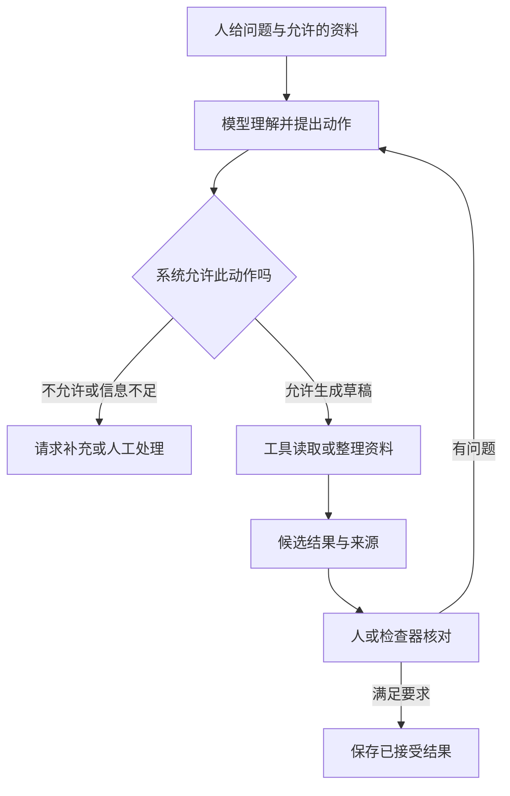
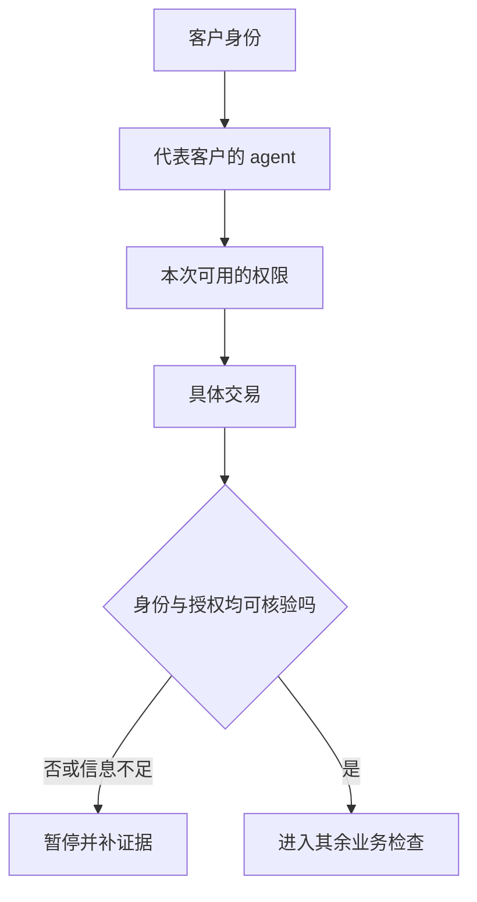
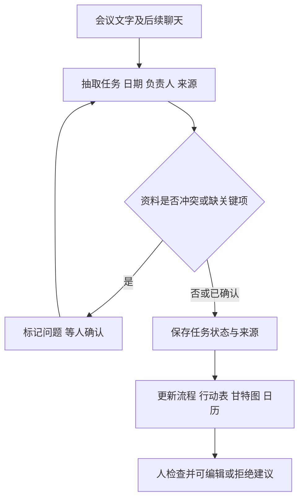
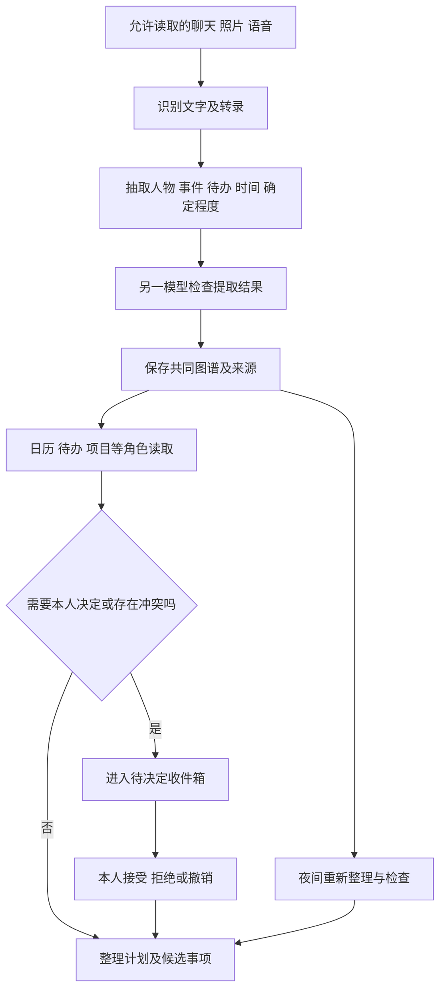

# M07 · 银行 AI 转型与多 agent 实践

> 本稿依据录音制作；讲义仍未取得，材料状态保留 partial／draft。教学审查与写回等执行证据分别记录。A = S26，B = S27；两源各自从零计时，不能相加成为课堂时钟。自动语音识别（Automatic Speech Recognition, ASR）得到的全文已读 782 + 96 个主段及 4 + 1 个过滤片段；尚未逐声核听。未取得本场讲义、影片原片或演示界面，讲义页数记 0，逐页覆盖未知。
>
> 本地总览与主代理当前 Canvas 日程将 Financial Services 对应 M07；音频内容也集中于银行 AI。此证据不证明音频的实际录制日期，所以 `date: null`。A 缺开头，A/B 接缝连续性待核、缺口长度未知，B 缺结尾；未知部分不可降权。涉及儿童及第三方私人聊天的细节不进入笔记，完整来源保留本机。

## 0. 三分钟速览

本讲的主线是：让 AI 真正进入业务，要把“能生成内容”变成“有证据、可检查、有人决定、能控制后果”的过程。

学完你应能：

- 用一个银行请求说明模型、人和业务系统各负责哪一步。
- 解释为什么“每项都由人重做一遍”和“再加一个 AI 评审”都有成本与盲点。
- 按用途和影响区分个人生产率工具与核心业务流程，而不是只看软件名称。
- 追踪会议文字如何成为可编辑的流程、任务和日历，并处理冲突。
- 追踪 CHO 如何从聊天提取有时间和来源的事实，再把少量决定交回本人。

**🎙️ 课堂实况**：A `00:00`–`07:50` 承接未录到的就业讨论；`08:07` 起转向银行治理，期间穿插嘉宾自制影片；`43:17` 起谈业务价值、风险分类和三个技能演示；A 末引出个人 agent。B `00:00`–`04:04` 已在 CHO 演示影片中，`04:12` 起嘉宾解释与展望，`08:55` 引出下一轮互动但后续未录到。影片中的统计、法规和产品效果是影片/嘉宾说法，不能当作本笔记独立验证的现实结论。

## 1. 开始之前 · 知识衔接

### 1.1 当前要用到的前置

下面一行是一项旧概念，以及本讲怎样继续使用它。回链用于查细节；当前动作仍在正文展开。

| 概念 | 一句话唤醒 | 本讲用途 |
|---|---|---|
| 大语言模型（Large Language Model, LLM） | 根据输入生成后续内容，流畅不保证有事实根据 | 区分写答案与实际执行业务 |
| agent | 模型接上工具、状态与执行控制后，可以完成多步任务 | 追踪谁读数据、谁改任务、谁签字 |
| 运行程序（harness） | 组织模型、工具、状态和执行规则的程序 | 解释权限、日志、审批为何不能只靠一句提示 |
| 技能（skill） | 可复用的指令与任务资源 | 让不同人员按共同程序产出可检查的结果 |
| 验证（verification） | 用证据或约定规则检查一个结果 | 分清生成者与检查者各自的盲点 |

前四项详见 [[IS5542_GenAI_in_Business/notes/M03-AI-agent-从harness到部署|M03：从 harness 到部署]]。业务结果与部署边界可回看 [[IS5542_GenAI_in_Business/notes/M05-Agentic-AI时代与FDE实践|M05]]。

### 1.2 本讲新增的学习任务

§2.3 解释银行治理及审核成本；§2.5 解释了解 agent（Know Your Agent, KYA）；§2.6 用用途区分两类风险；§2.8–2.9 解释三种技能；§2.10 解释带来源和时间的知识图谱（knowledge graph）怎样支撑多 agent 协作。

### 1.3 为什么按这个顺序读

原录音先讲职业变化，再讲治理，随后播放多个演示。这里先建立“模型—工具—人”的分工，再解释银行为什么限制它，最后看具体系统怎样落实。这使读者看到演示时已经知道要查权限、证据和责任。就业观点放在机制之后，避免把趋势判断当成系统已经能安全完成的事实。

本稿只讲可由现有录音支持的内容。没有讲义就不能断言“课件没有”，也不能把片段重排成一堂完整课程。

## 2. 正文

### 2.1 先把工作拆开：AI 做草稿，人管理什么

设想银行员工要准备一份研究材料。过去，他可能自己查资料、写分析、整理图表。接入 AI 后，“查找”和“起草”可以交给不同 agent；员工仍须决定要回答的业务问题，以及什么证据足够支持结论。否则，只是更快地产出了一份无法负责的文字。

嘉宾将未来管理对象描述为“人和智能的组合”（A `03:35`–`04:29`）。他用研究 agent、代码 agent、审计 agent 举例：研究者收集材料，代码工具帮助实现，另一角色检查结果；人定义问题、判断标准和控制框架（A `04:34`–`05:53`）。这是一种工作组织设想，不是本批已验证的银行部署。

下表每行是同一工作中的一个职责。关键是分清产出与批准。

| 对象 | 接收什么 | 交出什么 | 谁承担下一步判断 |
|---|---|---|---|
| 研究 agent | 明确问题、允许访问的资料 | 带来源的草稿 | 员工核事实及适用性 |
| 代码 agent | 所需功能、约束 | 代码或运行结果 | 员工核是否解决业务问题 |
| 检查 agent | 草稿及检查标准 | 问题清单或评分 | 人核标准及遗漏风险 |
| 业务负责人 | 证据、风险、例外 | 接受、退回或停止的决定 | 组织按既定职责负责 |

例如，检查 agent 给“通过”，只能说明它按当前标准没找出问题。若标准根本没检查数据是否过期，错误仍会进入后续流程。人的职责包含制定标准、查看证据和处理例外，不能缩成点击一次“同意”。这是对课堂分工的笔记补充。

**🎙️ 课堂补充**（A `03:35`–`05:53`，课上展开）：*"So human in the middle is still the model we're going to run"*（A `05:53`，原段后还有未来范围限定）。嘉宾的判断限定于其能预见的未来，尤其是银行场景；不能推成所有工作永远必须采用同一种审核方式。

### 2.2 模型怎样获得行动能力：指令、资料与工具

如果只问模型“请分析这份说明”，模型能返回文字，却不会自动拥有银行账户或文件系统的操作权。要让它实际处理任务，还要给它允许使用的资料和工具。

提示（prompt）告诉模型要做什么；上下文（context）是它判断时能看到的资料。上下文可含原始聊天、文档、日期和已确认约束。工具（tool）把“生成一个动作的描述”连接到“执行一个动作”，例如读文件、运行计算或修改任务。A `10:20`–`12:27` 以此解释模型与 agent 的区别。

💡 笔记补充：以“把会议中的行动整理出来”为例，输入是文字，输出可能先是候选任务。只有系统开放了任务管理工具，agent 才能写入任务表；只有开放相应字段，它才可改负责人或日期。模型说“已安排”与任务表真实存在一行，是两种不同证据。

下图从上往下读。实线表示本教学例中的资料或结果流；批准分支是明确补充的控制设计，不冒称演示已展示所有实现细节。

用同一输入走图：人提供会议记录；模型识别一项待办；工具形成草稿；检查器发现日期冲突便返回补充；负责人确认后才保存已接受日期。这里的停止条件是当前任务已满足要求或被退回，不能因为模型仍能继续生成就无限执行。

权限由系统控制。把“你不能付款”写入提示可以表达要求，但真正防止付款还要限制工具能做的动作。若工具根本没有付款能力，模型的错误计划也无法直接转账；若工具有无限权限，仅靠文字约束会留下更大风险。此段为延续 M03 的笔记解释，非本场实际银行架构披露。

**🎙️ 课堂补充**（A `10:20`–`12:27`，课上展开）：*"for example, access to company data"*（A `12:13`）；*"like give them access to a computer they can run Python"*（A `12:20`）。这两句说明 agent 的行动范围依赖接入能力；不证明任何数据都可上传。

### 2.3 银行为什么不能直接把客户资料交给聊天工具

银行处理客户身份、交易及内部决定。错误答案可能影响客户，资料泄露也可能破坏信任。因此，银行要问的不是“AI 能不能写得像”，而是：资料能去哪里、输出由谁检查、谁签字、出错如何控制，以及以后能否重现证据（A `08:23`–`10:08`）。

幻觉（hallucination）是模型生成看似可信、却缺乏依据的内容。它与数据泄露不同：前者是内容不可靠，后者是信息流向了不该接收的人或服务。一个系统可以没有泄露却回答错，也可以答得正确却泄露资料。两类问题要分别控制。

治理（governance）在这里指决定权限、检查、责任和应急处理的组织安排。它要落到执行过程：谁能用哪些资料；哪种结果须审核；出现异常谁能停止；留下哪些记录。制度文件是依据，真正是否执行仍要看系统和人员的行为。

A `09:04`–`09:21` 的英文检查问句可以直接用作分析入口：

> *"How to check it? Who should check it? Who signs off?"*（A `09:04`）

> *"And also, like, can we prove it a year later?"*（A `09:08`）

中文意思是：检查什么、谁有能力和职责检查、谁批准，以及过了一年是否还能给出当时的证据。它们是嘉宾的治理提问，不是考试原题或官方答案。

⚪ 参考作答（笔记补充）：以客户回复为例，先核回复依据的费用表版本，再由有职责的员工批准；保存输入、来源版本、回复和审核记录。若费用表缺失，停止生成确定报价，交人工补充。日志能帮助复查，但保存了日志并不证明回复本身正确。

英文参考答案（笔记自拟）：“The system needs an approved data boundary, checks against source evidence, a named approver, retained records, and a way to stop or correct an error.”

**🎙️ 课堂补充**（A `08:23`–`10:08`，课上展开）：*"to us, client trust is everything."*（A `08:29`，从原段截取连续短句）。这段把企业应用的判断对象从模型能力扩展到客户信任及可追责过程。

### 2.4 怎样检查而不把省下的工作全做回来

假设原任务需要很久，AI 很快形成草稿。如果审核者必须从头重做全部工作才能确认，生成阶段省下的时间就可能被审核吃掉。嘉宾以“过去数小时、AI 数秒、人工仍需数小时”的例子说明这个矛盾（A `25:37`–`26:08`）；这些时间是口头示意，不能当成已测性能。

人在环内（human-in-the-loop）指人在约定环节检查或决定。它是否有效取决于人看什么、能否发现错误，以及能否退回或停止。盲目签字只有形式，没有解决问题。

另一种办法是让 AI 检查 AI。生成者给候选，评审者（AI judge）按标准判断通过、改写或转人工。嘉宾影片的聊天回复案例在客户看到答案之前评分（A `34:13`–`34:25`）；他也提醒某些监测只会事后发现问题（A `26:12`–`26:38`）。**事前拦截与事后监测的作用时间不同**，不能合成一个“总能阻止错误”的保证。

下表一行是一种检查方式，比较它在哪个时点起作用。

| 方式 | 能帮忙做什么 | 仍可能漏什么 | 代价 |
|---|---|---|---|
| 人从头复做 | 对照关键证据重新判断 | 人也可能疲劳或缺专业能力 | 时间可能很高 |
| 发布前 AI 评审 | 按规则拦住部分不合格输出 | 规则缺项、模型共同错误 | 额外计算及维护 |
| 发布后监测 | 找已发生的异常并触发处理 | 首次影响可能已发生 | 响应与补救成本 |

💡 笔记补充：一个费用回答中，生成者和评审者若都读了过期文件，二者一致不能证明当前费用正确。可以增加文件版本检查、金额计算规则和人工升级；这些检查对应不同错误来源。再加一个模型不是独立事实来源。

嘉宾在 A `36:53`–`37:59` 讨论误报与漏报，但 ASR 对两者取舍破碎。这里不将其转写成确定阈值。误报（false positive）是把正常事项判为异常；漏报（false negative）是没有发现真实异常。笔记补充例：把正常付款拦住会打扰客户，放过欺诈可能造成损失。应比较这两类后果，而不是追求没有说明分母的“准确率高”。

**🎙️ 课堂补充**（A `25:21`–`26:41`；`34:13`–`37:59`，课上展开）：*"you can't possibly have a human to revalidate everything"*（A `26:04`）；*"Every chatbot answer is scored before the customer sees it."*（A `34:17`，影片）。前者指出审核资源限制；后者是特定案例流程，不是所有银行都已如此运行。

### 2.5 沙盒和 KYA：能试验，不等于已获准上线

当多个机构对新系统的风险理解不同，联合试验可以让参与者较早讨论边界。沙盒（sandbox）在本段指受安排的试验环境；参加试验、展示用例与获准投入真实生产，是不同状态。

嘉宾影片提及香港 GenAI 沙盒、多个监管者和用例数量（A `28:38`–`30:36`），随后现场解释：共同环境有助于与监管者接触、理解可接受范围，但不是自动预先批准（A `30:44`–`32:23`）。本稿没有把这些数字或当时法制概述当成当前官方结论，具体政策另见 §9.5 的核对限制。

影片问句：*"banks can build their own sandbox. Would you like to join this one?"*（A `28:59`–`29:02`；原文为转述他人提问）。中文任务是：已有内部试验环境，为何还参加共同计划？⚪ 参考作答：价值可能来自共同讨论及较早监管接触，不能把“参与”当作上线许可。英文参考答案（笔记自拟）：“A shared sandbox may help participants discuss expectations with supervisors, but participation does not by itself authorize production use.”

本段的三个案例分别解决不同控制问题（A `34:13`–`36:04` 为影片）：

1. 聊天回复检查：另一个 AI 在回复前评分，决定通过、改写或转人工。
2. 反洗钱（Anti-Money Laundering, AML）材料整理：agent 收集证据，人审阅并签字。收集材料并不等于认定违法；影片中的节省幅度不是本批已测结果。
3. 了解 agent（Know Your Agent, KYA）：若软件代表客户付款，银行除了解客户，还要识别这个 agent 是否获授权、能做什么，以及本次交易是否在授权内。

了解客户（Know Your Customer, KYC）关注客户身份等核验；KYA 在这里补上“代表客户行动的软件”这一层。A `41:02`–`42:17` 明确讨论了创建者、代表权和能力边界。讲者的概念介绍不能替代任何法域的正式合规程序。

下图是对影片“四个联系”的简化教学表达；连线表示需要核验的授权关系，不表示四步已在所有银行实施。

💡 笔记补充：客户允许 agent 查询账单，不代表允许它转账。即使 agent 确实属于客户，权限与本次动作不匹配，仍要暂停。图中“进入其余检查”也不等于付款成功，还可能涉及余额、收款人和风险规则；这些不是本场已披露的完整实现。

**🎙️ 课堂补充**（A `28:38`–`42:17`，课上展开）：*"it doesn't mean that it's an auto pre -approval, right?"*（A `31:33`）；*"There are no results yet."*（A `35:45`，影片）。后句限定当时影片所谈试验，不能把试验目标写成已实现效果。

### 2.6 两道门：按业务用途判断风险

同一个聊天界面可以做低影响草稿，也可以直接影响客户，因此不能只凭工具名称决定要怎样审批。嘉宾用“两道门”区分个人生产率和核心业务流程（A `44:18`–`48:53`）。

第一道门是生产率（productivity）：帮助人员更快整理、翻译或起草，并不因此直接替换重要业务控制。第二道门是核心流程（core process）：结果进入客户服务、业务决定或重要的反复运行过程。这里是嘉宾用于解释的分类法，不是统一法律风险等级。

**🎙️ 课堂练习：这些用途走哪道门？**（A `47:43`–`48:53`）

录音是嘉宾逐例讲解，不是完整可见的选择题；没有选项字母，未录到清楚的听众作答。下面保留可读 ASR 片段，不补成幻灯片原题：

> *"Summarizing only thing though, which everyone's do, this is of course the door one."*（A `47:45`，对象词 `[?]`）

> *"And then a chatbot that answer customer question about fees and stuff."*（A `47:50`）

> *"Translating Door 1, whether to approve a small business plan, of course Door 2."*（A `48:16`，plan `[?]`，不改成贷款原题）

> *"And then, you know, like, building dashboard, that's a tricky one."*（A `48:28`）

中文题意：分别考虑总结/翻译、自动回答客户费用问题、批准一项业务事项，以及制作仪表板。区别在输出用于何处、影响谁，以及是否进入重要持续业务。ASR 未保留总结对象或批准对象的准确名称，这两个词保持待核。

逐项答案与理由（嘉宾分类见 A `47:45`–`48:53`；理由用中文整理）：

1. 总结、翻译：嘉宾归第一道门。此分类仅在一般辅助语境成立；若译文直接决定客户合约或进入重要控制，就须重新判断用途。
2. 直接回答客户费用的 chatbot：嘉宾归第二道门，因为它承担了客户服务功能。员工用工具起草后自行审查，与系统直接替代该功能，影响路径不同。
3. 批准事项：嘉宾归第二道门。具体对象未核，但“批准”会改变业务状态，需要明确权限与责任，不能只因金额可能较小就降级。
4. 仪表板（dashboard）：单次制作本身可属第一道门；若连接企业数据、反复支撑重要业务，可能归第二道门。软件名没有变，用途变了。

英文参考答案（笔记自拟）：“Classify the use by its business purpose and consequences. A draft translation may support productivity, while a customer-facing answer or an approval may enter a core process. A dashboard must be reassessed when it supports recurring material decisions.”

改条件例（笔记补充）：同一张图，第一天只是课堂练习，第二天被接入每日资金决策。第二天要重新核数据权限、错误影响、更新、审核与停止方案。不能沿用“昨天它是图表工具，所以今天也低风险”的结论。

**🎙️ 课堂补充**（A `43:17`–`48:53`，课上展开）：*"It really depends on the business purpose and also the importance of the job."*（A `48:53`）。这句给出了分类依据；采用人数多不等于已产生可验证回报。

### 2.7 从一次提示到可复用技能：统一程序仍要保留可修改结果

每个人临时输入提示，会得到格式和质量不一致的结果。企业若希望持续复用某种工作方法，可以把步骤、标准和资源整理成技能，而每次另提供当前业务资料。A `49:10`–`51:20` 讲了这条路径。

提示通常面对一次请求；技能保存可重复的程序；插件（plugin）或连接能力提供数据与工具入口；agent 在目标下组合这些能力并处理多步任务。它们不是按名称越高级就越有价值。一个固定步骤已足够完成的任务，不必为了“用 agent”额外增加自主决策。

工作流（workflow）是任务之间的先后、条件与交接。固定工作流可以规定“先提取、再核对、再等批准”；agent 可在允许范围内理解不同说法、选择下一步或请求补充。实际系统可以把两者组合起来。B `06:48`–`07:26` 强调 agent 的灵活性；不能据此推成“传统程序都不灵活”或“agent 不需要规则”。

嘉宾反复用“80/20”提醒：AI 先完成大量整理，人处理关键判断与修正（A `54:24`–`55:11`、`56:45`–`56:59`）。这是其设计启发，**不是测出的 80% 正确率、20% 错误率，也不是可以忽略其余风险的容许值**。

💡 笔记补充：如果输出只有一张不可编辑图片，人发现一项缺失控制时可能只能重做。若结果是可修改的任务、关系和日期，修正一处可更新相关视图。但“可编辑”只降低改错成本，不证明系统自动理解了业务。

**🎙️ 课堂补充**（A `49:10`–`55:11`；`01:06:42`–`01:07:29`，课上展开）：*"In corporate, we want to design the skills centrally"*（A `01:06:53`）；*"so that everyone is using the same skill to be consistent."*（A `01:06:56`）。一致程序仍须针对实际业务上下文检查，不能把统一模板当成结果认证。

### 2.8 PMO：让会议变成可追溯、可修正的行动

会议里产生决定，但会议后常要有人再整理流程、任务、进度和日历。嘉宾的项目管理办公室（Project Management Office, PMO）演示将这段转换交给 AI：输入会议文字，生成多个彼此相关的视图（A `51:34`–`51:57`、`55:38`–`59:24`）。

影片中的过程可分为以下动作：

1. 读取会议记录，抽取步骤、负责人、日期和状态。
2. 形成流程图、行动跟踪表、甘特图（Gantt chart）和日历。甘特图把任务画在时间线上，标先后依赖；日历侧重某日发生什么。
3. 为步骤保留来源行，人能查“为什么出现这项任务”。
4. 发现两个日期冲突时标记，等待人确认，不任选一个。
5. 人补上缺失控制并指定负责人，其他视图随同一修改更新。
6. 后续聊天到来后，按新信息更新行动，并保留变更的来源。

下图沿同一条任务走。箭头是信息处理顺序，冲突分支返回本人确认；“更新视图”不表示已执行真实业务。

影片的日期冲突是“day 40, or day 45”（A `57:13`–`57:23`）。这不是本课程作业截止，也不证明任何真实监管报送期限。关键机制是**保留两个相互冲突的说法，并把决定留给有权限的人**。

💡 笔记补充完整例：两段记录分别说“任务 X 周二完成”和“任务 X 周四完成”。系统先保存两个来源及冲突标记，任务暂不成为已确认排期；负责人选择周四并说明依据后，更新任务及甘特图。若下一条消息只是“能否改到周五”，它是提议，不能未经确认覆盖已定周四。此例解释了从语言到状态的区别，不是现场原始数据。

影片还让 AI 在流程上提出改进，例如给无人负责的控制补负责人、减少例行人工核对。嘉宾强调提案由团队编辑、拒绝和拥有（A `58:27`–`59:00`）。提出建议与批准改变业务，是两种动作。

**🎙️ 课堂补充**（A `55:38`–`59:24`，影片演示）：*"It doesn't pick one."*（A `57:22`）；*"proposals not decisions"*（A `58:53`，原段内连续短语）。A `01:05:37`–`01:05:54` 现场声明当日演示资料为虚构或公开来源，不来自其公司，也不代表公司。本稿因此不称此工具已在嘉宾所在银行投产。

### 2.9 Chat BI 与 Policy Companion：把来源和规则做成能核对的结果

这两个技能分别面向数据判断和政策查阅。它们共同的设计问题是：输出不能只是一句看似有说服力的话，还要让使用者看到它依据什么、哪些问题不能回答。

#### 2.9.1 Chat BI：先分清量，再比较，最后才问原因

商业智能（Business Intelligence, BI）在这里指把数据整理成支持业务判断的指标和图表。嘉宾的 Chat BI 影片输入市场数据，要求找出哪些市场较不稳定、什么时候发生；工具选择图表、计算文字，并随筛选改写结果（A `59:34`–`01:02:27`）。

影片问题跨段可辨为 *"which markets are unsettled and when"*（A `59:53`–`01:00:01`；ASR 无完整问句标点）。中文题意是比较市场的不稳定程度并定位时间。影片展示结果，但本批无输入表与完整算法，因此只能整理方法，不能独立确认其数值答案。英文参考答复（笔记自拟）：“Compare markets using a stated, comparable measure and locate the relevant dates. The numerical result cannot be reproduced without the data, time windows, and calculation rules.”

影片提醒石油价格与国债收益率的量纲不同（A `01:00:27`–`01:00:41`）。量纲是一个数描述什么，例如价格或利率。不能把不同单位的变化直接比较为“谁更不稳定”。影片改为相对自身常态作比较，但原始表、窗口和计算规则未取得，所以本稿不能复算其中具体峰值或倍数。

💡 笔记补充：若展示“当前波动是自身常态的多少倍”，必须先说明波动怎样计算、当前与常态各取哪个期间，以及常态是否为零。只有同口径相除，倍数才有可比含义。影片的具体算法未完整录到，不能凭这段解释反推其公式。

之后影片筛选到信用市场，峰值日期改变，工具同步更新文字（A `01:01:08`–`01:01:21`）。这说明图、筛选和叙述要使用同一份当前数据。数据说某日变化大，只支持“何时变化”；要解释“为什么”，还需要额外因果证据。影片在追问原因时拒绝猜测，正是这条边界（A `01:01:21`）。

影片还掠过活动出席、前后得分，以及香港蚊患指数和地图等例子（A `01:01:33`–`01:01:59`）。ASR 跳接，具体表与例子边界待核，不能拼成同一数据集。可辨认的演示意图是按数据的形状选择图表，而非要求所有问题都用预先画好的同一种图。

人看图可以发现异常，但“看起来合理”不能代替复算。检查看到的尖峰、数据筛选和文字结论是否相符，是一项工作；核原始数据、计算规则和因果依据，是另外几项工作。此处为笔记补充，不把嘉宾的可视化建议升级成充分验证。

#### 2.9.2 Policy Companion：把适用条件接到原文段落

政策可能很长。只让模型概述全文，使用者仍不知道当前项目适用哪条义务。Policy Companion 影片先把上传文件整理成可视导览，再通过若干问题分流，列出适用义务，并给原文段落引用（A `01:02:33`–`01:03:51`）。

影片中的完整示例问句是：

> *"Say we're planning a client chatbot built on a third-party model."*（A `01:03:02`）
>
> *"Does the circular apply, and what do we owe?"*（A `01:03:07`）

中文题意：计划采用第三方模型构建客户 chatbot；上传通函是否适用，若适用须做什么？“what do we owe”在此是承担哪些要求，并不是欠款金额。

影片给出的结果是进入适用范围且为高风险，并按段落列出相应要求（A `01:03:18`–`01:03:23`）。**这是影片给定结果，不是本稿基于通函全文重新核定的合规答案**。原文件版本、全部七个问题和回答均未取得，所以无法独立复核分流是否正确。

⚪ 学习用参考作答：先确定文件版本和适用主体，再收集模型、用途、客户接触方式等题目所需事实；沿原文条件判断；每项义务附原段落。缺少事实就标待确认。英文参考答案（笔记自拟）：“Check the circular's scope against the actual deployment facts, then link each applicable obligation to its source paragraph. The video result cannot replace an independent check of the full circular and the answers used in triage.”

影片另问客户是否要获知自己在与 AI 交谈，并宣称原文某段有要求（A `01:03:34`–`01:03:40`）。本稿只记录该演示动作，不将其具体段号或每次互动的说法写成现行法律结论。查询到段落是“找到文字”，还要查版本、上下文、适用对象与例外，才可能支持实际决定。

**🎙️ 课堂补充**（A `59:34`–`01:04:30`，影片及现场解释）：*"So I ask why, and it refuses to guess."*（A `01:01:21`，影片）；*"first builds a visual guide"*（A `01:02:48`，原段连续短语）。前者约束因果推断；后者展示查阅方式。两者都不证明结果已经通过独立评测。

### 2.10 CHO：从聊天到有来源、有时间的共同记忆

一个人的行动信息不一定先进入日历，常散落在聊天、语音和照片中。CHO（Chief Household Officer，家庭事务主管）演示先把这些信息整理为可用资料，再让不同角色的 agent 围绕它工作（B `00:00`–`04:04`）。这部分含私人信息，正文只讲机制。

知识图谱（knowledge graph）把对象和关系明确保存，例如“某人—参与—某活动”“某事项—发生于—某日”。这里还要保留来源与有效时间：过去正确的事实不一定现在仍正确；一句提议也不等于已确认事件。B `01:16`–`01:50` 介绍了事件、人物信息、重要性、确定程度及时间变化，但具体数据结构未展示。

影片自称有九个 agent（B `00:05`）。现有 ASR 可以辨认读照片/语音、分析、人物关系、日历、待办、项目、资料保护、设备维护等职责；没有足够清楚的完整九员名册，因此不补造第九个角色。角色的拟人姓名是界面设定，不能证明这些是九个独立模型或九台机器。

下图从消息向下读，显示本稿依据影片重建的简化资料流。虚构角色名省略；真正程序、数据表和权限实现未取得。

一个明确标为笔记补充的小例可以把它走完：

1. 输入：“周六有个活动，要不要参加？”提取器建立候选事件，并保存原消息位置。
2. 因为“要不要”尚未决定，状态保持“提议”。不得直接记为本人承诺出席。
3. 日历角色发现同一时段已有另一活动，把冲突交到本人收件箱。
4. 本人选择不参加，计划显示拒绝；若误点，撤销（undo）恢复此前状态。影片展示可撤销，但没有证明任何外部发送或付款也都可撤回。
5. 夜间任务再检查图谱、下一周和天气，提出需要更新的事项。天气变化可以影响建议，不能越权代替本人作新的承诺。

影片原过程包含：准备角色承担照片/语音整理，分析角色理解消息，另一个较大模型复核（B `00:55`–`01:32`）。共同图谱连接角色，计划中的事件与任务能追到来源聊天。本人处理少数只可由自己决定的事项，夜间任务重新整理资料和未来安排（B `01:50`–`03:21`）。

“复核模型”仍会出错，图谱也可能保存错误。要让人能回到原消息纠正，而非把结构化结果当成天然事实。

B `00:30`–`00:48` 的影片宣称应用与模型在其本机运行、个人信息不离开设备、通过私人网络由手机访问。这是作者对其个人系统的自述；本批没有检查代码、网络流量或设备，所以不认证“绝无外传”。本地运行减少哪些网络流转，要看实际实现；也不自动解决被错误授权的人读取资料的问题。

**🎙️ 课堂补充**（B `00:00`–`04:04` 影片；`04:12`–`07:26` 现场解释）：*"Take the stream of everyday conversations and turn it into a knowledge graph."*（B `03:40`）；*"and keep a human in charge."*（B `03:44`，原段尾连续短语）。嘉宾随后提出把家庭聊天换为企业邮件、会议和文档的迁移设想；这说明设计相似，不能省去企业权限、隐私、审计和业务验证。

### 2.11 怎样评价就业和 AI 编码观点

录音开头已在讨论初级岗位减少后的职业阶梯问题：如果训练新人的工作被改变，组织怎样培养下一阶段人员？嘉宾随后修正“初级岗位全部消失”的简单叙事，转而强调任务和雇主期望改变，转型类工作仍可能需要人（A `00:22`–`03:17`）。这些是嘉宾的观察与预测，不是本稿独立核定的劳动力市场事实。

嘉宾将资源从单纯人数扩展到 AI 用量预算（A `03:53`–`04:29`）。token 是模型处理文字等信息的单位，并非固定一个字；使用 token 会消耗预算。能调用更多 agent 不是没有成本，还要考虑计算、失败重试、工具、人工审核和维护。此成本拆解为笔记补充，课堂未给完整预算表。

他的学习建议是：不要让 AI 替代自己理解问题，因为检查别人或 AI 的工作仍需要知道正确过程（A `06:27`–`07:50`）。这与“不用工具”不同；可以让工具承担整理，同时自己能够解释证据和判断。

B `07:38`–`08:48` 谈到 AI 辅助编码。ASR 把相关术语写成 white/light/agentic 等混杂词，准确术语待核，不能据此给出已核的工具名。可确认的意思是嘉宾自述常借助 agent 写代码，并强调要清楚做什么、为什么。它不是课程对个人作业使用 AI 的新增授权，更不证明学生可以不检查输出。

课堂反问：*"Does it mean that, you know, what I've studied for the past few years are useless?"*（A `01:08:25`）。中文题意：工具能自动完成部分分析，过去学习的分析知识是否无用？嘉宾答“不”，把价值放在定义反馈、提出问题和连接业务（A `01:08:31`）。英文参考答案（笔记自拟）：“Analytical knowledge still helps a person frame the business question, choose meaningful checks, and judge whether the output solves the problem.”

改条件例（笔记补充）：若 AI 画出漂亮图表，但用错数据期间，懂分析的人应能发现结论与问题不匹配；如果只会接受外观，就无法完成审核。这连接了 §2.4 的验证成本和 §2.9 的数据规则。

**🎙️ 课堂补充**（A `00:00`–`07:50`、`01:08:12`–`01:08:31`；B `07:38`–`08:55`，课上展开）：*"you can only check the work"*（A `07:30`）接 *"once you know how to do."*（A `07:33`）。末段 B `08:55` 仍在引出互动与职业建议，后续回答缺失，不能以这段片尾当作讲座总结。

## 3. 一图看懂

从下表左列的问题开始，沿中列寻找机制，再用右列查它的边界。它把前文连成一条业务判断链。

| 业务问题 | 本讲机制 | 不能跳过的边界 |
|---|---|---|
| AI 会写，为什么还不能上业务 | 资料、权限、检查、批准及留证 | 生成结果不等于已接受结果 |
| 人全部重做太慢 | 分层检查，必要时人接管 | AI 评审也有共同错误 |
| 该走哪种审核路线 | 看用途、重要性及影响 | 不按软件名称直接分类 |
| 会议决定容易散落 | 抽取状态并连接多个可编辑视图 | 冲突与提议不能擅自当决定 |
| 数据/政策太复杂 | 保留规则、来源及适用条件 | 图与引用不代替正确性核查 |
| 多 agent 怎样不各说各话 | 共同图谱、来源、时间、角色分工 | 共享错误也可能被多个角色复用 |

## 4. 速查表

下面每行是考试或案例分析中容易混淆的一对；机制已在对应小节展开。

| 要区分 | 正确读法 | 回看 |
|---|---|---|
| 模型 / agent | 生成能力 / 接上工具及执行控制的系统 | §2.2 |
| 事实正确 / 没有泄露 | 内容依据 / 信息流向，须分别检查 | §2.3 |
| 人在环内 / 人重新做全部工作 | 按风险与证据设计审核，不只留签字 | §2.4 |
| 事前拦截 / 事后监测 | 阻止部分输出 / 发现已发生异常 | §2.4 |
| 沙盒 / 上线许可 | 试验安排 / 正式生产资格不同 | §2.5 |
| KYC / KYA | 客户身份 / 代表软件及其授权边界 | §2.5 |
| 采用率 / 回报 | 有人使用 / 相对成本的已验证收益 | §2.6、§2.11 |
| 80/20 / 准确率 | 嘉宾设计启发 / 不是统计指标 | §2.7 |
| 来源引用 / 合规结论 | 找到段落 / 还须核版本、事实及适用条件 | §2.9 |
| 提议 / 已确认 | 等人决定 / 有权限者已经接受 | §2.8、§2.10 |

## 5. 双语术语卡

以下英文定义为笔记自拟的复习表述，不是讲义或嘉宾逐字定义。首现表示本篇解释位置；课程既有概念沿用原首现，不重新登记。

| 中文 | English | 英文参考定义 | 本篇位置 |
|---|---|---|---|
| 治理 | Governance | Arrangements for authority, checks, accountability, records, and response. | §2.3 |
| 人在环内 | Human-in-the-loop | A person reviews or decides at defined points with authority to challenge the result. | §2.4 |
| AI 评审 | AI judge | A model checks candidate outputs against stated criteria. | §2.4 |
| 误报 | False positive | A normal item is incorrectly flagged as a problem. | §2.4 |
| 漏报 | False negative | A real problem is not detected. | §2.4 |
| 沙盒 | Sandbox | An arranged environment for testing; participation is not itself production approval. | §2.5 |
| 了解客户 | Know Your Customer (KYC) | Checks concerning the customer, distinct from the software acting for that customer. | §2.5 |
| 了解 agent | Know Your Agent (KYA) | Checking an agent's identity, authority, limits, and link to the action. | §2.5 |
| 工作流 | Workflow | An arrangement of task order, conditions, and handovers. | §2.7 |
| 项目管理办公室 | Project Management Office (PMO) | A function that helps organize and maintain project activities and controls. | §2.8 |
| 甘特图 | Gantt chart | A timeline view of tasks and their dependencies. | §2.8 |
| 商业智能 | Business Intelligence (BI) | Organizing data into measures and views for business judgment. | §2.9 |
| 知识图谱 | Knowledge graph | An explicit representation of entities and relationships, with provenance and time where needed. | §2.10 |
| 来源追溯 | Provenance | Records that connect an extracted item or change to its origin. | §2.8、§2.10 |
| 撤销 | Undo | Restoring a prior state for supported actions; it does not guarantee external effects can be reversed. | §2.10 |

## 6. 考点预判与答题框架

### 6.1 可信度

本批没有录到嘉宾对具体考试题目的明示，新增 🔴 考试明示为 0。课程公告“嘉宾内容进入期末”的行政范围由总览/作业页承载，不代表每个影片数字必考。下面均为 🟡 课程目标反推或 ⚪ 笔记推断，不把嘉宾语气“重要”升级为教授考试承诺。

### 6.2 可练的分析任务

下表一行是一种可组织英文答案的任务，不是已知考题。

| 层级 | 任务 | 应覆盖的理由 |
|---|---|---|
| 🟡 课程目标反推 | 解释银行 agent 的分工 | 问题、输入、工具、检查、人和后果 |
| 🟡 课程目标反推 | 判断辅助工具是否进入核心业务 | 用途、对象、反复运行、错误影响 |
| ⚪ 笔记推断 | 评估 AI 评审 | 标准、发生时点、共同错误、升级机制 |
| ⚪ 笔记推断 | 比较 PMO 与 CHO | 从语言抽状态、来源、冲突及人决定 |

一个英文组织框架（笔记自拟）：

“Start with the business task and the consequence of an error. Specify the approved data and tools. Separate generation from checking and authorization. Keep source-linked records and escalate unresolved conflicts. Evaluate review effort and accepted outcomes before expanding use.”

中文读法：先说任务与错误后果，再说资料/工具边界；分开生成、检查与批准；留下来源，遇冲突升级；最后核审核成本与已接受结果，才谈扩大使用。它不能代替对题目具体事实的分析。

## 7. 自测

### 7.1 一个 agent 查到了两条互相冲突的截止日期，另一模型认为其中一条“更像真的”。能否直接排期？

答案与理由

不能仅据“更像真的”直接确认。保留两条来源，标记冲突，交有权限者核定；确认后再更新相关视图。模型偏好没有消除原始事实冲突。若题目改为两条是不同版本文件，则先核版本与生效时间，仍不能只看语言流畅度。

英文参考答案：“Keep both sources and flag the conflict. Confirm the applicable date with an authorized person or valid source before committing the schedule.”

### 7.2 员工用工具起草费用回答，与 chatbot 直接把费用发给客户，有什么不同？

答案与理由

前者仍可由员工在对外前核资料、修改或拒绝；后者输出直接进入客户服务，会产生不同影响和控制需求。两者都要保护资料，不能因为叫“草稿”便允许上传机密。按嘉宾分类，直接承担客户服务更接近第二道门。

英文参考答案：“A reviewed draft and a direct customer response have different paths to impact. The latter needs controls appropriate to the customer-facing process.”

### 7.3 生成者和 AI 评审者都通过同一份错误费用表给出答案，增加评审解决了什么，没解决什么？

答案与理由

它可能解决格式或内部一致性问题，却未解决来源过期或错误。两个模型共同引用同一错误依据会一致地出错。需要另外核文件版本、有效期间与证据，按后果安排人工处理。

英文参考答案：“Agreement between models does not validate a shared source. Check the source version and validity separately from output consistency.”

### 7.4 CHO 收到“也许下周去远足”，为什么不能立即成为已确认行程？

答案与理由

“也许”表示提议，日期也不完整。图谱应保留原文来源、候选时间和未确认状态；日历角色可以提示安排，不可替本人承诺。如果随后本人确认具体日期，才更新状态，并保留更改依据。

英文参考答案：“Store it as a tentative plan with its source and unresolved time. A confirmed commitment requires the appropriate decision and evidence.”

### 7.5 一个影片报告节省大量时间，你还缺哪些信息才能说“产生回报”？

答案与理由

至少要知道相对哪个基线、同类任务的数量、是否包括失败与审核时间、系统及维护成本，以及结果是否达到业务接受标准。影片目标、单次演示与已实现收益分开。本批缺原数据，不能替影片复算 ROI。

英文参考答案：“Verify the baseline, workload, accepted output quality, failed attempts, review time, and total relevant costs before claiming a return.”

## 8. 讲义页码映射与逐源定位

讲义未取得，所以本节是**录音到正文的索引**；不是讲义逐页覆盖表。讲义内容页应有多少、题目有多少、图片是否读全，均未知。

每行是一组录音内容；A/B 是独立时钟，时间重复不代表同一课堂时点。

| 正文 | 录音窗口 | 覆盖与来源地位 |
|---|---|---|
| §2.1、§2.11 | A `00:00`–`07:50` | 职业变化与人管理资源；缺开头 |
| §2.2–2.3 | A `08:07`–`13:50` | 银行风险、术语、agent；现场讲述 |
| §2.3–2.4 | A `13:54`–`28:33` | 自制影片与现场解释；法规及统计疑点 |
| §2.5 | A `28:38`–`42:55` | 沙盒、AI评审、AML、KYA；影片/讲述分开 |
| §2.6–2.7 | A `43:17`–`55:23` | 采用与价值、两道门、技能、80/20 |
| §2.8 | A `55:38`–`59:24` | PMO 影片 |
| §2.9 | A `59:34`–`01:03:51` | Chat BI、Policy Companion 影片 |
| §2.7–2.11 | A `01:04:05`–`01:09:17` | 技能、资料边界、人判断及个人演示入口 |
| §2.10 | B `00:00`–`04:04` | CHO 影片中段；私人细节已排除 |
| §2.7、§2.10–2.11 | B `04:12`–`08:55` | 嘉宾解释、展望、AI编码；缺结尾 |

课堂覆盖统计：只确认这些片段被录到；没有整堂分母，不能给课堂覆盖率。A 主段首末跨度 1:09:17，B 为 8:55（由 scan 时间戳计算）；这不是媒体完整时长，更不是两者相加后的堂长。精确媒体信息与对齐记录由来源回执承载。

## 9. 延伸与勘误

### 9.1 课件有但课上略过

无法判定。讲义未取得，片段又缺首尾；本稿不登记任何“明确略过”页。A 开头前内容、A/B 接缝及 B 结尾后的内容均未知，不可降低复习优先级。

### 9.2 录音中的重要增量

没有讲义可作差集，所以这里只说“录音中可证内容”，不称已证明课件没有。按本稿学习价值排序：

| 顺序 | 内容 | 定位 | 对理解的贡献 |
|---|---|---|---|
| 1 | 审核本身有成本，AI检查也非保证 | A `25:21`–`26:41`、`34:13`–`37:59` | 解释能生成不等于可放心自主 |
| 2 | PMO 的冲突、来源、编辑与人决定 | A `55:38`–`59:00` | 把抽象“人在环内”变成具体操作 |
| 3 | CHO 共同图谱、时间、来源及决定 | B `00:55`–`04:04` | 解释多 agent 协作所依赖的共同状态 |
| 4 | 两道门看业务用途 | A `47:43`–`48:53` | 避免按工具名称判风险 |
| 5 | Chat BI拒绝猜因果、政策工具附来源 | A `01:01:08`–`01:03:51` | 区分算出的结果与额外判断 |

### 9.3 ASR 和材料自身的限制

没有讲义，不能以“书面原词”校正专名。A 中 Chat BI、PMO 等名称按多次上下文作工作标签；原 ASR 的 Champion/Chord 等不自动变成已核产品名。B 的 AI 编码术语、角色英文拼写均待核。

影片中的监管编号、法律期限、机构统计出现破碎或前后混写；本稿保留观点边界，未还原一个看似精确的版本。影片之间的出入也不在没有原片时强行解释为嘉宾口误。

### 9.4 笔记补充的范围

本稿补充了任务 X 排期、候选远足、来源过期、权限边界及图示，用于把机制走完；均不是现场真实记录。图为可编辑 Mermaid，表示本稿简化理解，不是原始演示截图。未新增外部效果数据；下文监管核对与录音分开。

🔗 **课堂监管说法的局部外核**（主代理核官方一手来源，获取于 2026-10-31）。以下用来限制误读，不是影片原话，也不是对某银行的合规认定；本次未穷尽全部后续修废。

- 美国：[Federal Reserve SR 26-2](https://www.federalreserve.gov/supervisionreg/srletters/sr2602.htm) 日期为 2026-04-17，取代 SR 11-7 与 SR 21-8。[附属指导 II 节及脚注 3](https://www.federalreserve.gov/frrs/guidance/supervisory-guidance-on-model-risk-management.htm) 将 GenAI 和 agentic AI 排除于这份指导范围之外，同时仍说明银行应结合风险管理与治理确定适当控制。**未纳入某份指导，不等于没有任何责任或约束**；适用性也不是全球所有机构同一法定硬标准。
- 欧盟：[AI Act，2026-07-27 合并文本](https://eur-lex.europa.eu/legal-content/EN/TXT/PDF/?uri=CELEX%3A02024R1689-20260727) Annex III 5(b) 涉及自然人资信评估/信用评分，并排除该项中的金融欺诈检测用途；还须结合 Article 6 的条件判断。不能把“银行使用 AI”直接等同“所有用途都是高风险”。本稿不根据破碎录音恢复实施年份。
- 香港：[HKMA 2024-08-19 通函](https://brdr.hkma.gov.hk/eng/doc-ldg/docId/getPdf/20241107-1-EN/20241107-1-EN.pdf) 讨论认可机构面向客户的 GenAI 应用，涉及治理问责、公平、透明与数据私隐；初期强调人保留决策控制。退出 GenAI 或请求人工介入的表述保留可行性及替代复核渠道条件，不能简化成所有应用都必须同一种逐笔人工按钮。此通函与影片的 SFC 政策工具不是同一份文件，不能用它替影片还原义务数量或段号。

### 9.5 转录登记与待核项

下表每行是一项材料缺口与它限制的结论。来源只读；公开转录是有脱敏占位的节选，不能叫完整原转录。

| 项 | 已知事实 | 尚未核对及影响 |
|---|---|---|
| A / S26 | 782 主段；4 过滤片段；无倒退、无 ≥120 秒段首空档 | 开头在讨论中段，前文未知；未逐声核听 |
| B / S27 | 96 主段；1 过滤片段；无倒退、无 ≥120 秒段首空档 | 从影片中段起，末尾仍引出后续互动 |
| 接缝 | A 引出个人演示，B 为 CHO | 无共同语句锚点；连续性及缺口长度未知 |
| 日期 | 课程日程将 Financial Services 对应 10/31 M07 | 不据微信/导出日期认定实际录制日期 |
| 讲义/原片 | 当前已核入口未取得本场金融讲义 | 逐页覆盖、原图和完整题目未知 |
| 过滤片段 | A 22:27、25:11、45:14、50:47；B 08:11 均已读 | 25:11 有“如何记录”的实质问法，已由治理留证解释承接；其余为过渡/重复/类比续句，不凭过滤标签认定全是幻觉 |
| 统计 | A 02:51–03:02 薪酬；06:09–06:22 学生；14:32 影片；43:43 EY | 来源、分母或 ASR 不足；不据此作当前工资/学生行为结论 |
| 沙盒与法规 | A 18:21、21:04、27:58、28:38 等有编号/日期/分类说法 | 需当前官方原文核；本稿不构成现实合规指引 |
| 口头题残片 | A 18:21 manual 对象；21:04 AML inside/outside；47:45 总结对象；48:16 plan | 保留可读原文，不编原题对象/选项/官方答案 |
| 影片效果 | A 34:38、38:57、59:47–01:01:21 等有节省或市场数字 | 无原数据/算法/试验结果；不复算ROI或确认峰值 |
| 政策工具 | A 01:02:57、01:03:18、01:03:40 报义务、问题及段号 | 缺原政策版本与完整回答，不认定现行义务 |
| CHO | 影片自报九个 agent、本地运行、可撤销 | 未核代码/网络/角色完整名册/外部动作回滚 |
| 第三方隐私 | B 含儿童/班级/邀请及家庭私谈 | 正文去标识；原音本机保留，公开音频另存静音脱敏副本；原音未逐字核听 |

**口头监管题残片的处理**：

- *"is AI drafting a perfect manual"* 接 *"governed by the new rules by the federal government?"*（A `18:21`–`18:39`），对象不清。
- *"Quick test, rules -based anti -money laundering alerts, inside or outside."*（A `21:04`），影片接续答案破碎。

两题均是“来源不足，无法唯一作答”。中文可辨题意是区分监管范围，但不能从本批材料给出官方范围答案。英文参考答复（笔记自拟）：“The available ASR does not preserve enough reliable wording or source context to determine the regulatory classification. Check the original question and the applicable official guidance.”

**反方视角**：

- 最薄弱的是监管与影片数据：有观点，却缺原文/原表，故不能依此解释当前法律或复算业绩。
- 若考试要求原影片某个具体百分比、法条范围或未录到的问答，本稿答不全；应取得讲义/原片或后续录音。
- 本稿把多个演示抽象成“输入—状态—检查—人决定”，这属于教学整理。若实际系统权限/数据结构不同，应以原始实现证据修正，不能把简图当部署证明。

### 9.6 制作记录

| 日期 | 本次动作与状态 |
|---|---|
| 2026-10-31 | 通读 S26/S27 及过滤片段，制作录音先行全篇笔记、逐源对齐与隐私范围；原件只读。独立教学及来源审查已完成；实际显示、写回、共享台账、Notion、Drive 与 Git 的结果以各自执行回执为准，不由材料状态推定。 |
