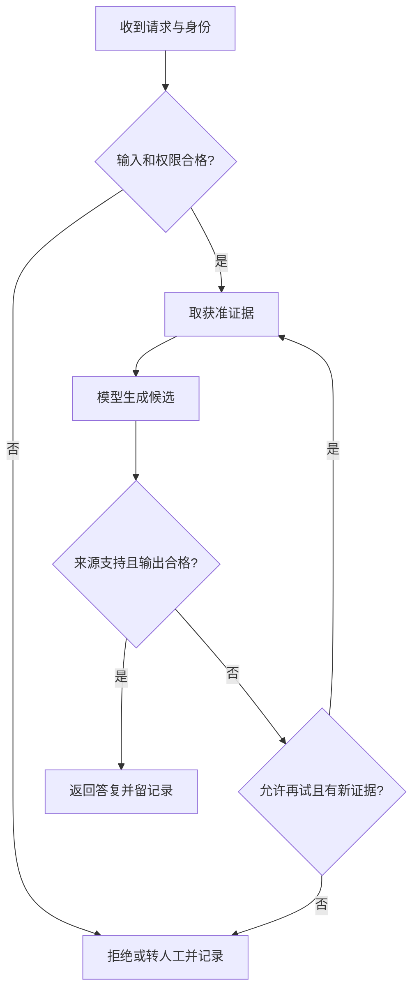

# M10 · 责任 AI：公平、解释与治理落地

## 0. 三分钟速览

本讲要解决：企业怎样把“AI 要负责任”变成可检查、有人执行和能够纠错的实际安排。

学完后应能做五件事；这是学习目标，未替本人勾选掌握：

- 区分模型任务、评测分数与业务成效，指出课件复习图中的适用边界。
- 用同一批数据分别算总体获批率、真阳性率、假阳性率，说明三个公平指标为何可能不一致。
- 区分透明、内部可理解与个案解释，追踪 LIME、SHAP 和图像热图能说明什么。
- 读懂 RACI 每行的执行人与最终责任，给一个系统写影响评估所需证据。
- 沿输入检查、获准资料、生成、引用／输出检查、监测和补救追踪一次请求。

本讲书面材料分五段：

1. p.1–9：讲次行政与技术／商业复习。
2. p.10–20：责任 AI 的范围、机会和挑战。
3. p.21–32：公平性及生命周期干预。
4. p.33–54：行政评价、透明解释与组织问责。
5. p.55–71：Google Cloud 责任生成式 AI 案例及结束。

## 1. 开始之前 · 知识衔接

### 1.1 你已有的 · 先恢复必要含义

下面每行给本讲用到的旧概念；登记或读过不代表已掌握，当前操作在正文继续展开。

| 概念 | 此处要记住什么 | 前文入口 |
|---|---|---|
| 生成式 AI（generative AI） | 按学习到的模式和输入产生内容 | [[IS5542_GenAI_in_Business/notes/M01-导论-生成式AI基础与企业落地\|M01]] |
| 模型评测（model evaluation） | 用任务与评分规则检查输出 | [[IS5542_GenAI_in_Business/notes/M02-模型全景-基准评测与提示设计\|M02]] |
| agent 与运行支架（harness） | 模型之外还需工具、状态与执行控制 | [[IS5542_GenAI_in_Business/notes/M03-AI-agent-从harness到部署\|M03]] |
| 工作待完成（JTBD） | 从用户要达成的结果定义问题 | [[IS5542_GenAI_in_Business/notes/M04-设计思维-业务机会识别与AI创意工作坊\|M04]] |
| 人的复核与来源证据 | 高影响输出须核原资料和权限 | [[IS5542_GenAI_in_Business/notes/M09-AI法律问题-版权责任与客户资料\|M09]] |

以客服为例，模型能写答复，只证明生成了一段文字；要交付可靠服务，还要有正确政策、访问权限、输出检查、接管人和纠错。后文就在这条差别上展开。

### 1.2 本讲新引入的概念

公平指标的分母在 p.25，指标冲突的条件在 p.26，反事实与程序正义在 p.27–28。解释对象的三分法在 p.36；LIME／SHAP 在 p.41；图像热图在 p.42。RACI 决定权在 p.50；影响评估在 p.51；上线数据流在 p.63。这些名称是检索入口，具体含义在对应页第一次使用时说明。

### 1.3 本讲怎样使用 · 来源与学习路线

唯一主来源是 `IS5542 - Lecture 10.pdf`，按 PDF 物理页 1–71 编号。多数页没有独立页脚号，本文“p.”一律指物理页；不能与其他讲义同页号混用。原件于本批取得，实际授课日期与周次未确认，故 YAML 留空。未取得本讲转录，材料稿 v0.9／transcript pending；不能据此判断老师跳页、补充话语或考试明示。

预习：顺读 §2，先走 p.25 的完整比例例，再读 p.26 的条件推导，接着学 p.41 的局部解释和 p.50–51 的责任落实。已懂的复习页也留意本页边界和新图。

课中：使用 §8 每页独立链接，直接打开同页原图与中文读法。图像可点击大图查看细字；老师指的是哪一块，在对应正文就能找到。

课后：用 §3 总览串机制，以 §4 找对应页；用 §5 恢复英文关键词，再独立作 §7。看过答案不记为自测通过。

**来源读法**：各页图像为所供课件原页，图下注明来源；中文解释是据该页编写的译解。新增数例、推导、系统设计标“笔记补充”。题目中英参考标笔记推断；没有把参考答案冒充课堂确认。p.13、14、17 的视频本轮未取得全文，已列精确缺口；产品界面与市场图按课件历史快照理解。

**课堂转录状态**：本讲待转录补充。§2 不制造“教授说”或时间戳；有录音后再逐页登记实际覆盖。

## 2. 正文 · 按原课件逐页跟读

### 讲义 p.1 · Lecture 10

本讲先用 p.3–9 回顾技术、评测和业务设计，再进入责任 AI、公平性、解释性与组织治理。封面只作讲次标识，不从下载日期推断实际授课日。

### 讲义 p.2 · Exam Info

本页原文给出 `Date / Time: 8-May-26 18:30 to 20:30`，即 2026 年 5 月 8 日 18:30–20:30。这个日期早于本材料在 2026 年 11 月的取得时间，不能作为本学期现行考试日期。应到当前 Canvas／学校排考确认，笔记保留原值以便发现冲突。

本页题型写 Multiple choice questions (20%)、Essay questions (80%)；论述题从 5 题选 4 题，每题 20 分，覆盖讲义概念和案例应用。$4 \times 20=80$，与该页 80% 对应，但不说明每道 MCQ 分值。它与 M01 暂定的 MCQ 20%／短答 30%／论述 50% 不同：新取得的页提供了另一口径，不能只因文件名 Lecture 10 就断言已正式替代。

项目原文是 “Adhere to the deadline on Canvas for submission. No report, just presentation video and slides.” 中文是以 Canvas 截止为准，只交演示视频和幻灯片，不要求报告。本页没有给新截止时间、时长或上传入口。制作材料、课程行政确认、本人提交是三个状态，本笔记不登记已交。

### 讲义 p.3 · The Evolution of Intelligence: A Four-Phase Journey of AI

原图从左到右排四阶段：符号 AI（Symbolic AI）、深度学习（Deep Learning）、生成式 AI（Generative AI）和未来的神经符号 AI（Neuro-Symbolic AI）。符号方法按人给的规则操作；深度学习从数据调整多层网络；语言生成常逐个预测 token；神经符号路线尝试把学习能力与显式规则结合。四列是本页的概括，不表示旧方法被新方法消灭。

图左列放入 2013 年 Word2Vec，并写“512–768 dimensions”；维度是表示向量包含多少个数，这个范围不是 Word2Vec 固定规格。其年代与“1950s–1980s”列头不一致。Word2Vec 是学习词的数值表示的方法，不能据布局归为早期符号推理。

第二列 AlphaGo 的任务是围棋决策，要和回归预测分清。第三列写 next word，是语言生成的简化，token 可以是词的一部分。右侧图标汇合音频、文本和视频，表示多模态（multimodality），但这幅愿景图本身未证明责任要求已实现。

💡 笔记补充：客服可以同时用规则核退款资格、用模型理解提问、用生成模型写答复。选方法看任务所需的准确性与可核规则，不按“阶段越后越好”排序。图内产品窗口与能力数字只是原图示例，未核发布日期和实测条件。

![[IS5542_GenAI_in_Business/notes/figures/m10-lecture-10/p003.png]]

[[IS5542_GenAI_in_Business/notes/figures/m10-lecture-10/p003.png|打开本页清晰原图]]。来源：Lecture 10，物理 p.3；整页渲染保留图中文字和关系。

### 讲义 p.4 · Six Vectors

这张图把六项设计约束分成三对。左边模态（modality）问能处理什么形式的数据；延迟（latency）问一个用户要等多久。中间性能（performance）问当前任务答得怎样；上下文窗口（context window）问一次请求能纳入多少材料。右边吞吐量（throughput）问单位时间处理多少任务／token；成本（cost）问构建、购买和长期运营花多少钱。

先沿左下两个仪表读：首 token 时间（time to first token, TTFT）是开始等到第一个输出；token 间延迟（inter-token latency, ITL）是后续输出相邻 token 的间隔。两者不等于每秒可同时服务多少客户。沿中间交织箭头读到右侧，表示约束彼此牵制：批量处理可能提高总吞吐，却增加个人等待。

💡 笔记补充：语音客服要及时接话，TTFT 与 ITL 都重要；夜间核验长报告可容许较慢输出，但更看重证据与准确性。模型宣称能放很长文本，不保证能找对每一段证据。原图部分小字存在乱码，六项含义按可读标签恢复，不把乱码抄成技术定义。

![[IS5542_GenAI_in_Business/notes/figures/m10-lecture-10/p004.png]]

[[IS5542_GenAI_in_Business/notes/figures/m10-lecture-10/p004.png|打开本页清晰原图]]。来源：Lecture 10，物理 p.4；整页渲染保留图中文字和关系。

### 讲义 p.5 · The Global LLM Landscape: Strategic Clusters & Performance Benchmarks

图把厂商分为美国的规模／推理、中国的单位经济性／效率、欧洲及中东的主权／合规三组。它是在比较商业取向，不是严格互斥的模型分类；同一家厂商也能同时追求效率、推理和区域部署。图列 OpenAI、Anthropic、Google、Meta、xAI；DeepSeek、Qwen、GLM、Yi；Mistral、Falcon、Apertus，均按原图识别，不把名单当今日完整市场清单。

下方三种评测也要分开。AgentBench 看系统在操作系统、数据库等环境执行任务；Chatbot Arena 用匿名成对偏好比较，Elo 是相对偏好分；MT-Bench 让评审模型评多轮回答。一个模型在聊天偏好上领先，不能直接推出它在数据库操作成功率也领先。

💡 笔记补充：若银行要本地部署，就先问数据驻留与运维条件，再在相同任务、版本和预算下测试。不能用厂商国籍证明合规，也不能用图中“高性能”形容词替代测量。本页未列同条件原始分数，不能据此形成当前选购榜。

![[IS5542_GenAI_in_Business/notes/figures/m10-lecture-10/p005.png]]

[[IS5542_GenAI_in_Business/notes/figures/m10-lecture-10/p005.png|打开本页清晰原图]]。来源：Lecture 10，物理 p.5；整页渲染保留图中文字和关系。

### 讲义 p.6 · An Atlas of Evaluation for LLMs

按图中心向外看五条路：一般知识与推理（general knowledge and reasoning）、编码能力（coding proficiency）、对话与人类偏好（conversation and human preference）、安全偏见伦理（safety, bias and ethics）、agent 能力与元认知（agentic and metacognition）。本页把不同评测目的并列，先选任务，再选指标。

MMLU 测多领域题目；GPQA 测难知识问答；HumanEval 以程序测试评价代码；LiveCodeBench 用持续更新的代码题减少旧题泄漏；Arena 用人的成对偏好；AgentBench 看环境任务。安全评测要查伤害类别、失败条件和群体差异，不能只看平均正确率。“元认知”在此指检查自己答案／不确定性的能力，模型说“很确定”并不等于校准良好。

中央训练数据泄漏（training data leakage）警告：若评测题曾用于训练／挑模型，分数可能包含记题效果。较新的题有助减轻污染，但不能仅凭“新”证明完全未见。

底部 Intelligence Index、token/s 和 USD per 1M tokens 是三种不同量；前者越高通常越好，速度越高通常越快，单价越低通常越省。图标有 Jan 2026 Projections，表示投影／预测口径，不能当实测。

原图三组从左到右的读数分别是：智能指数 51、49、48、41、19；速度 96、81、120、35、134 token/s；价格 4.8、10.0、4.5、0.3、0.5 USD／百万 token。部分柱缺模型标签，部分标签失真，且不同组不能凭顺序强行配对；保留原图和读数，不把这些柱当可复算、同设置的实测排名。

![[IS5542_GenAI_in_Business/notes/figures/m10-lecture-10/p006.png]]

[[IS5542_GenAI_in_Business/notes/figures/m10-lecture-10/p006.png|打开本页清晰原图]]。来源：Lecture 10，物理 p.6；整页渲染保留图中文字和关系。

### 讲义 p.7 · Diagnose Before You Deploy: Cynefin Framework

先问业务里的因果关系能否事先看清，再按四域选行动顺序。右下清晰域（clear）已有稳定规则，按 Sense–Categorize–Respond：识别情形、归类、执行标准动作。右上繁复域（complicated）需专家分析，按 Sense–Analyze–Respond。左上复杂域（complex）不能预先可靠判断，按 Probe–Sense–Respond：先做可控试探，再观察结果调整。左下混乱域（chaotic）先止损稳定，按 Act–Sense–Respond。

💡 笔记补充：重复登录重置可走稳定流程；合同异常需专家比较条款；新客服人格先小范围试验；机器人公开外泄资料时先停外发权限，再查影响。这些例子都要细分具体任务，不能把整个“法律行业”固定为一种域。

图中央 Disorder 表示尚未分清所处域。底部 aporetic turn 提示把含糊“AI 项目”拆成可诊断子问题。图还画“从复杂到繁复到清晰”的可能路线和清晰域跌入混乱的警告；这是管理启发，不是每项目必经的定律。监测停止、环境变化后，旧稳定规则也可能失效。

![[IS5542_GenAI_in_Business/notes/figures/m10-lecture-10/p007.png]]

[[IS5542_GenAI_in_Business/notes/figures/m10-lecture-10/p007.png|打开本页清晰原图]]。来源：Lecture 10，物理 p.7；整页渲染保留图中文字和关系。

### 讲义 p.8 · The Generative AI Ideation Roadmap: A Design Thinking Approach

从左到右读五步：改提示、识别用户任务、写问题、评估排序、构思方案。提示的角色、受众、限制、任务资料、输出格式，是让模型知道要完成什么；不能弥补错误业务目标。工作待完成（Jobs To Be Done, JTBD）问用户想实现的结果，工作故事（Job Story）用 When／I want／so I can 写情境、动机与结果。

接着把任务转为如何才能问题（How Might We, HMW）。💡 笔记补充：When 我第一次退货，I want 知道需要什么证据，so I can 一次提交完整资料。HMW 可写“我们怎样帮助首次退货客户一次备齐证据？”；不要直接写“怎样部署聊天机器人”，那会过早锁定方案。

矩阵横轴是实施复杂度，纵轴是组织价值。高价值低复杂度优先试；高价值高复杂度为战略投入；低价值低复杂度只是小收益；低价值高复杂度通常暂缓。投票能筛选偏好，不证明客户需求或收益。最后用 AI 发散候选、用原型验证最难假设；图中“10X thinking”是构思口号，不能当作已量得十倍效果。

![[IS5542_GenAI_in_Business/notes/figures/m10-lecture-10/p008.png]]

[[IS5542_GenAI_in_Business/notes/figures/m10-lecture-10/p008.png|打开本页清晰原图]]。来源：Lecture 10，物理 p.8；整页渲染保留图中文字和关系。

### 讲义 p.9 · US vs. China: The Great AI Venture Capital Divide

左侧把美国投资概括为基础研究和企业应用，右侧把中国概括为消费者／专业消费者（prosumer）与全球扩张。中间三行比较主要客户、资金阶段、市场优先级。下方左侧举法律、银行、生命科学与工业机器人；右侧强调 born global，即创办时就面向跨国市场。

本页是产业叙事，不是带样本的投资调查。“美国资金充裕”“中国 seed 到 Series B 流动性”没有给时间、样本或统计定义，不能泛化为每个市场／项目的融资现实。prosumer 在此是既使用又参与生产的专业或积极用户，不直接等于所有 B2C 客户。

💡 笔记补充：分析一个企业客服 agent，先写客户是谁、谁付款、采购周期、数据权限、部署成本和结果如何验收，再讨论融资与扩张。面向消费者也要保护资料；面向企业也可能全球扩张，左右两列不是互斥规则。

![[IS5542_GenAI_in_Business/notes/figures/m10-lecture-10/p009.png]]

[[IS5542_GenAI_in_Business/notes/figures/m10-lecture-10/p009.png|打开本页清晰原图]]。来源：Lecture 10，物理 p.9；整页渲染保留图中文字和关系。

### 讲义 p.10 · Responsible AI

责任 AI 部分入口。后面先问系统怎样影响人，再分别讲公平性（p.21–32）、透明与解释（p.34–44）、问责治理（p.45–54）和 Google Cloud 案例（p.55–70）。

### 讲义 p.11 · Dario Amodei: Visionary Leader, CEO of Anthropic

原图以 Dario Amodei 介绍 AI 安全（AI safety）与对齐（alignment）：让系统行为符合明确的人类目标和约束。左侧列学术、OpenAI、共同创办 Anthropic 的经历；右侧列 Claude、Constitutional AI 和模型可控性研究。这里记录的是讲义人物引介，不把任职、研究贡献和图中引号当作本轮核实的履历／逐字采访。

图中文字“可靠、可解释、与人类价值一致”提出三个检查方向。💡 笔记补充：客服系统即使能答产品问题，仍须检查是否泄漏资料、是否按错误政策拒退、出问题能否找到责任人。人物或公司的安全愿景不能替代具体系统证据。

![[IS5542_GenAI_in_Business/notes/figures/m10-lecture-10/p011.png]]

[[IS5542_GenAI_in_Business/notes/figures/m10-lecture-10/p011.png|打开本页清晰原图]]。来源：Lecture 10，物理 p.11；整页渲染保留图中文字和关系。

### 讲义 p.12 · Anthropic's AI Constitution: Principles for Helpful, Harmless, and Honest AI

图围绕中心模型列六组要求：有帮助、诚实、安全无害、尊重人权、避免偏见、可理解与可引导。宪法式 AI（Constitutional AI）在本页是用明确原则指导模型行为的思路，不是法律意义上的国家宪法，也不是保证模型永不违规。

💡 笔记补充：用户问“把客户电话贴给我”，有帮助不等于照做。系统先核请求者权限；无权限时说明能提供什么非敏感资料；不编造已查记录。诚实要求承认不知道，安全要求限制有害动作，公平要求检查不同用户是否受到不合理区别。原则冲突时需要具体政策和人的责任，不能只选一个好听词。

原图是教学信息图，不是 Anthropic 完整、现行原则原文；当前产品条款及内部训练流程本轮未核。

![[IS5542_GenAI_in_Business/notes/figures/m10-lecture-10/p012.png]]

[[IS5542_GenAI_in_Business/notes/figures/m10-lecture-10/p012.png|打开本页清晰原图]]。来源：Lecture 10，物理 p.12；整页渲染保留图中文字和关系。

### 讲义 p.13 · A Tsunami No One Believes Is Coming

本页是访谈视频封面及链接：[课件视频入口](https://youtu.be/68ylaeBbdsg?si=D-E3BDYS3tcnQnsM&t=108)。可见标题把 AI 变化比作“海啸”，但封面不包含论证、时间预测或数据。

本轮未取得完整视频／逐字稿，不能据标题写“受访者证明某年失业多少”。学习时可带三个问题观看：预测的是哪种能力，依据是什么，哪些组织行动由该预测支持？视频内容仍待补，不把本段提示当作视频摘要。

![[IS5542_GenAI_in_Business/notes/figures/m10-lecture-10/p013.png]]

[[IS5542_GenAI_in_Business/notes/figures/m10-lecture-10/p013.png|打开本页清晰原图]]。来源：Lecture 10，物理 p.13；整页渲染保留图中文字和关系。

### 讲义 p.14 · CBS News interview thumbnail

这是另一个人物采访封面，[课件视频入口](https://youtu.be/MPTNHrq_4LU?si=4NgFgQff8LCZ5nVp)。画面可识别 CBS NEWS EXCLUSIVE 与采访对象，但没有可读取的完整观点。

它承接上一页的产业风险引入，不能与 p.13 当作两个独立证实同一预测的证据。本轮未复看外链；可先继续 p.15 的书面责任维度，未来取得视频后按原话和时间戳补充。

![[IS5542_GenAI_in_Business/notes/figures/m10-lecture-10/p014.png]]

[[IS5542_GenAI_in_Business/notes/figures/m10-lecture-10/p014.png|打开本页清晰原图]]。来源：Lecture 10，物理 p.14；整页渲染保留图中文字和关系。

### 讲义 p.15 · Responsible AI is

词云中的责任 AI（Responsible AI）涵盖技术和组织怎样共同影响人。公平（fairness）问不同对象是否有不合理差别；透明（transparency）问资料、流程与责任能否被适当了解；可解释性（explainability）问能否说明某次输出的理由；问责（accountability）问谁有权决定、谁须回应和补救。

其余词也有分工：隐私（privacy）管个人资料如何收集使用；安全（safety and security）包括避免伤害和抵御攻击；稳健性（robustness）管合理扰动／环境变化下能否维持要求；可理解性（interpretability）管人能否理解模型结构；AI 治理（AI governance）把责任落实到制度和流程。社会技术（sociotechnical）提醒：模型、工作人员、用户和组织安排都在系统里。

💡 笔记补充：退款机器人回答“政策不允许”仍不足够。应能指出适用政策，允许纠错，记录谁批准上线，并保护订单隐私。词云字体和位置没有给权重，不能把最大词当作唯一目标。

本页 “What is Responsible AI?” 的中文题意是“什么是责任 AI？”⚪ 参考作答：在设计、使用和持续治理 AI 时，明确对人的影响、质量与风险标准，并由可识别的人和组织承担责任。English reference: Responsible AI means designing, using, and governing AI with explicit attention to its impacts on people, quality, risks, and accountable human oversight.

![[IS5542_GenAI_in_Business/notes/figures/m10-lecture-10/p015.png]]

[[IS5542_GenAI_in_Business/notes/figures/m10-lecture-10/p015.png|打开本页清晰原图]]。来源：Lecture 10，物理 p.15；整页渲染保留图中文字和关系。

### 讲义 p.16 · Responsible AI = Successful AI

原页只给等式式标语。它强调责任要求会影响长期业务成功，例如不泄漏资料才能维持客户信任；它不是数学恒等式，也不能推出“负责的项目一定赚钱”或“赚了钱就负责”。

💡 笔记补充：一个透明且公平的推荐系统可能因需求不足而失败；一个短期赚钱的系统可能带来隐私伤害。评价时分别核业务结果、人的权益和风险控制，再讨论它们之间的关系。

### 讲义 p.17 · Responsible and Ethical AI

本页嵌入 TED-Ed 自动驾驶伦理视频封面，[课件视频入口](https://youtu.be/ixIoDYVfKA0)。标题是 “The ethical dilemma of self-driving cars”。它提出“有多方可能受伤时，系统应怎样选择”的伦理问题；本轮没有视频全文，不补造其具体乘客／行人数目和结论。

💡 笔记补充：分析这类情境，先列可选行动、谁受影响、感知是否可靠、是否还有安全停车等备选，再说明所用伦理原则。避免伤害、尊重人的权利、事故预防和组织责任都不能被一道极端二选一题取代。本页不构成现行驾驶法律意见。

![[IS5542_GenAI_in_Business/notes/figures/m10-lecture-10/p017.png]]

[[IS5542_GenAI_in_Business/notes/figures/m10-lecture-10/p017.png|打开本页清晰原图]]。来源：Lecture 10，物理 p.17；整页渲染保留图中文字和关系。

### 讲义 p.18 · Responsible AI brings tremendous opportunity

右侧列品牌差异、顾客参与、长期盈利、产品价值与信任、监管准备、顾客忠诚。左图是合作与工具的示意，未提供效果数值。页脚引用 MIT Sloan Management Review 2022 的文章题名，尚未回读该外链全文。

💡 笔记补充：把“提高信任”变成可检验任务：让客户看到答复依据和申诉渠道，再测错误纠正时间、投诉率和留存。若只增加政策页面、客服仍无法纠错，不能据此宣称实现了商业收益。列出的项目是潜在价值方向，不是已证实的因果效果。

![[IS5542_GenAI_in_Business/notes/figures/m10-lecture-10/p018.png]]

[[IS5542_GenAI_in_Business/notes/figures/m10-lecture-10/p018.png|打开本页清晰原图]]。来源：Lecture 10，物理 p.18；整页渲染保留图中文字和关系。

### 讲义 p.19 · Key Challenges

责任 AI 没有一套适用所有情境的清单。风险会随技术、用途、文化和受影响的人变化；标准也会变化。相同的错字在广告草稿与用药提醒中有不同后果，所以先固定场景和伤害，再定审核强度。

社会技术方法要求同时改模型和工作制度。💡 笔记补充：检测出不公平拒贷后，若工作人员仍无权纠错，技术告警不能解决客户问题。需让业务、工程、合规和受影响用户参与，并指定响应人。原页“AI-specific regulation is coming”保留为课件历史表述，不能当作当前全球法律状态。

### 讲义 p.20 · Responsible, Trustworthy, and Ethical AI

本页用三色块区分范围：责任 AI 是广义的设计、使用与长期影响框架；可信 AI（Trustworthy AI）强调可靠、公平、透明、可解释、安全等可落实品质；伦理 AI（Ethical AI）强调避免伤害与道德原则。它们高度重叠，三者的边界是本页教学用法，不是所有机构统一定义。

下方列公平、透明、问责、稳健四原则，不表示隐私或安全可以不管。💡 笔记补充：同一个投诉机器人，伦理层问是否尊重顾客；可信层测答复与权限控制；责任层再问谁审批、谁监控、如何补救。用同一案例说明层次，比只背三个名字更有用。

![[IS5542_GenAI_in_Business/notes/figures/m10-lecture-10/p020.png]]

[[IS5542_GenAI_in_Business/notes/figures/m10-lecture-10/p020.png|打开本页清晰原图]]。来源：Lecture 10，物理 p.20；整页渲染保留图中文字和关系。

### 讲义 p.21 · Governing the Scales of Algorithmic Justice

公平性部分从天平图开始：左侧算法结构与右侧人的利益需要在公司治理中一起考虑。标题页也给核心论点：公平性是治理和风险管理的一部分，不能只交给工程师调参数。

💡 笔记补充：贷款系统要决定怎样比较群体机会、怎样解释拒贷、谁能复核，工程团队无法单独决定全部价值取舍。后续 p.25–26 解决“用哪个比例测”，p.28 解决“过程能否申诉”，p.31–32 解决“在哪一步干预”。天平高度是象征，不是量化公平得分。

![[IS5542_GenAI_in_Business/notes/figures/m10-lecture-10/p021.png]]

[[IS5542_GenAI_in_Business/notes/figures/m10-lecture-10/p021.png|打开本页清晰原图]]。来源：Lecture 10，物理 p.21；整页渲染保留图中文字和关系。

### 讲义 p.22 · AI Scales Human Decisions—and Human Biases

从左向右读：一个有偏的人类决定进入可复制逻辑，再产生大量有偏结果。模型会从历史样本学习规律；如果历史上某类人被无理由拒绝，模型可能学到这种拒绝模式。更快执行同一规则会把影响扩展到更多人。

这里“算法必然学习不平等”是原图的强表述。实际偏差取决于数据、目标、约束和部署；不能说每个模型都必然歧视。💡 笔记补充：过去人工只审过某地区客户，把他们当全部客户训练，其他地区可能错误更多。部署前分群测错误并补样本，比只扩大请求量更能发现问题。图中“millions”是规模示意，无具体样本不能计作事故人数；罚款／诉讼也须按具体法域与事实判断。

![[IS5542_GenAI_in_Business/notes/figures/m10-lecture-10/p022.png]]

[[IS5542_GenAI_in_Business/notes/figures/m10-lecture-10/p022.png|打开本页清晰原图]]。来源：Lecture 10，物理 p.22；整页渲染保留图中文字和关系。

### 讲义 p.23 · Bias Infiltrates Every Stage of the AI Lifecycle

四根柱分别是历史／世界偏差（historical/world bias）、数据偏差（data bias）、设计偏差（design bias）、生态偏差（ecosystem bias）。前者指现实机会本就不平等；第二类是抽样、测量或代表性不足；第三类来自目标和开发选择；第四类是系统在不适用的环境中使用。

💡 笔记补充：用旧招聘结果训练筛选器。历史上机会不均是世界偏差；只收到某类学校简历是数据偏差；把“像旧员工”设成成功目标是设计偏差；把技术岗模型拿去筛护理岗是生态偏差。同一次失败可有多种来源，应按资料链查原因。

因此调一个阈值不一定能修所有问题。先问错误从哪里进入，再选择补数据、改目标、改使用范围或人工复核。原图底部“完美算法也承受不了有偏生态”强调部署条件，不能拿“数据真实”证明数据适合作公平决策。

![[IS5542_GenAI_in_Business/notes/figures/m10-lecture-10/p023.png]]

[[IS5542_GenAI_in_Business/notes/figures/m10-lecture-10/p023.png|打开本页清晰原图]]。来源：Lecture 10，物理 p.23；整页渲染保留图中文字和关系。

### 讲义 p.24 · Blindness is Not a Strategy for Algorithmic Fairness

图中受保护属性（protected attribute），例如种族／性别，藏在底部；邮编、教育和购买习惯与其连线。删除显式敏感列后，模型仍可能通过相关的代理变量（proxy variable）间接区分群体。这叫公平无知（fairness through unawareness）的局限。

💡 笔记补充：若某地区曾被系统性排除，邮编可能代替群体标签进入拒贷规则。删除“群体”列并未删除地区的历史关联。但邮编并非在每个数据集必然成为精确代理；需要查关联和对结果的作用，不能把任何相关变量直接判为歧视。

敏感属性用于公平审计和用于直接决策是不同用途。审计可能需要在合法授权、访问限制下分组统计，完全不留群体信息反而难测差距。具体合法性须另按法域和用途核实。

![[IS5542_GenAI_in_Business/notes/figures/m10-lecture-10/p024.png]]

[[IS5542_GenAI_in_Business/notes/figures/m10-lecture-10/p024.png|打开本页清晰原图]]。来源：Lecture 10，物理 p.24；整页渲染保留图中文字和关系。

### 讲义 p.25 · The Mathematical Illusion of Perfect Distributive Equity

本页先分群体公平（group fairness）与个体公平（individual fairness）。前者比较群体之间的某种比例；后者要求“在任务相关方面相似的人得到相似待遇”，难点在于先定义什么算相关、什么算相似。

三种群体比例的分母不同。人口统计均等（demographic parity）比较每组所有申请者中获批的比例。机会均等（equality of opportunity）只在确实符合条件的人里比较获批率，即真阳性率（true positive rate, TPR）。均等赔率（equalized odds）同时要求 TPR 和假阳性率（false positive rate, FPR）跨组相同；FPR 的分母是实际不符合条件的人。

💡 完整数例（笔记补充，非讲义数据）：A、B 各 100 人，真实合格分别 60、30 人。A 中合格获批 48、不合格误批 8；B 中合格获批 24、不合格误批 14。

逐项按问题计算，每一步都固定自己的分母。

1. 先数全体获批：A 为 $48+8=56$ 人，获批率 $56/100=56\%$；B 为 $24+14=38$ 人，获批率 $38/100=38\%$。
2. 再只看合格者：A 的 $TPR=48/60=80\%$，B 的 $TPR=24/30=80\%$。
3. 最后只看不合格者：A 的 $FPR=8/40=20\%$，B 的 $FPR=14/70=20\%$。

本例满足机会均等及均等赔率，但不满足人口统计均等。结果差异来自不同分母，不能把 56% 与 80% 当同一指标。

English reference（笔记自拟）：Demographic parity compares acceptance rates across groups. Equality of opportunity compares true positive rates among qualified applicants. Equalized odds requires both true positive and false positive rates to match across groups.

🔗 定义核对：[Hardt、Price、Srebro 原论文](https://arxiv.org/abs/1610.02413)，2026-11-26。这里的“真实合格”是假设可获得的标签，现实标签本身也可能带偏差。

![[IS5542_GenAI_in_Business/notes/figures/m10-lecture-10/p025.png]]

[[IS5542_GenAI_in_Business/notes/figures/m10-lecture-10/p025.png|打开本页清晰原图]]。来源：Lecture 10，物理 p.25；整页渲染保留图中文字和关系。

### 讲义 p.26 · Optimizing Every Fairness Metric Simultaneously is Mathematically Impossible

左图把无知、群体均等和更复杂指标排在一起，纵轴写技术努力（technical effort），横轴写分配公平（distributive fairness）。这是概念示意，没有可据以计算的刻度；不能读成“越复杂一定越公平”。右侧天平表示可能要权衡准确性与公平约束，也不证明每次改公平必然降低准确率。

#### 准确率均等：把两类正确决定一起数

左图的另一项是准确率均等（Accuracy Parity），原文为 “The protected and unprotected groups should have equal accuracy.” 中文是：受保护群体与比较群体的总体准确率应相同。准确率的分子是判断正确的人数：合格者获批，加上不合格者被正确拒绝；分母是该组全部人数。它既计算批得对，也计算拒得对，和只数获批人数的获批率不同。

💡 沿用 p.25 的笔记补充数据，逐组核正确决定：

1. A 的不合格者有 40 人，其中误批 8 人，故正确拒绝 $40-8=32$ 人。加上合格且获批的 48 人，总体准确率为 $(48+32)/100=80\%$。
2. B 的不合格者有 70 人，其中误批 14 人，故正确拒绝 $70-14=56$ 人。加上合格且获批的 24 人，总体准确率为 $(24+56)/100=80\%$。

本例准确率同为 80%，但获批率仍为 56%／38%。准确率把两类正确决定合并，相同准确率本身不保证真阳性率、假阳性率或获批率都相同。English reference（笔记自拟）：Accuracy parity requires equal overall accuracy across groups. Accuracy counts correct approvals and correct rejections, whereas the acceptance rate counts all approvals.

#### 不同公平要求何时会冲突

原图称不同基础率下人口统计均等与均等赔率不能同时优化。应补条件：令 p 表示某组真实合格比例；t 为共享 TPR；f 为共享 FPR。则该组获批率为 $t p + f(1-p)$：先在合格者中获批，再加不合格者中的误批。两组获批率相减，得到 $(t-f)(p_A-p_B)$。

用 p.25 的数值验证这条关系：

1. 共享检出与误批率为 $t=0.8$、$f=0.2$，两者差 $t-f=0.6$。
2. 两组真实合格率为 $p_A=0.6$、$p_B=0.3$，基础率差为 $p_A-p_B=0.3$。
3. 两个差相乘得到 $0.6\times0.3=0.18$，即 18 个百分点，与 $56\%-38\%=18\%$ 一致。

当两组基础率不同且分类器有区分力（$t\ne f$），共享 TPR/FPR 后获批率会不同。因此这组条件下不能再要求完全相等的总体获批率。若 $t=f$，例如随机给每人同样 50% 获批概率，就可以同时满足这些比例，但失去区分合格与不合格的能力；所以“数学上永远不可能”过强。

管理选择须说明优先保护谁、哪类错误更有害、为什么选该指标及牺牲什么，不能由默认软件设置代替。上式为笔记补充推导，不冒称课件已给证明。

![[IS5542_GenAI_in_Business/notes/figures/m10-lecture-10/p026.png]]

[[IS5542_GenAI_in_Business/notes/figures/m10-lecture-10/p026.png|打开本页清晰原图]]。来源：Lecture 10，物理 p.26；整页渲染保留图中文字和关系。

### 讲义 p.27 · Shifting from Statistical Correlation to Causal Reasoning

左侧散点只说明两个量一起变化，不能证明一个导致另一个。右侧同一人走属性 X 和属性 Y 两条路径，提出反事实公平（counterfactual fairness）的问题：如果此人的敏感属性不同，在保留适当背景并按因果模型调整后，预测是否相同？

原页完整问句是 “Would this individual have received the same prediction if their sensitive attribute had been different?” 中文是“若这个人的敏感属性不同，他还会得到相同预测吗？”⚪ 参考作答：只有建立结构因果模型（structural causal model, SCM）、说明哪些变量会随属性改变，才能检验。简单改一格性别、其余全部不动，可能造出不可能的记录，不能直接当作完整反事实。

💡 笔记补充：若属性会通过过去教育机会影响教育记录，决定哪些教育差异可作为合理依据，需要事实和规范判断。缺因果结构时，只能报告分群差异与疑点，不能从相关图宣布已证明因果歧视。

English reference（笔记自拟）：We need a justified causal model to compare the same individual's prediction under a different sensitive attribute. Changing a field without accounting for its causal consequences is not sufficient to establish counterfactual fairness.

![[IS5542_GenAI_in_Business/notes/figures/m10-lecture-10/p027.png]]

[[IS5542_GenAI_in_Business/notes/figures/m10-lecture-10/p027.png|打开本页清晰原图]]。来源：Lecture 10，物理 p.27；整页渲染保留图中文字和关系。

### 讲义 p.28 · Users Judge the Process Just as Harshly as the Outcome

左盘问分配正义（distributive justice）：“Did I get the loan?” 右侧问程序正义（procedural justice）：“Was the decision process fair and transparent?” 获批结果和形成结果的过程是两个问题；结果平均相等，也可能没有解释和申诉。

原图的三个程序检查问句分别是：

1. Explainability: “Can the AI's logic be understood by humans?” 中文：人能否理解系统给出的理由？⚪ 参考：用申请者读得懂、与实际决策一致的理由，并指出资料来源，不只说“算法决定”。English reference: Provide understandable reasons that are faithful to the decision and its evidence.
2. Correctability: “Is there an avenue to appeal or correct flawed algorithmic decisions?” 中文：错误能否申诉和修正？⚪ 参考：提供可用渠道、负责人和复核流程，让错误资料真的能更正。English reference: Users need a usable appeal and correction process with a responsible human reviewer.
3. Bias Suppression: “Are there mechanisms in place to actively monitor and prevent favoritism?” 中文：有无持续监测与防偏袒机制？⚪ 参考：按适用群体统计错误、审计处理差异、跟踪补救是否有效。English reference: Monitor relevant group disparities, audit decisions, and verify that corrective actions reduce unfair treatment.

💡 笔记补充：顾客因记录错写逾期而被拒，收到解释后能补证并由有权限的人改结果，才把三项接成一条流程。原图天平不是让程序与结果二选一，两者都要核。

![[IS5542_GenAI_in_Business/notes/figures/m10-lecture-10/p028.png]]

[[IS5542_GenAI_in_Business/notes/figures/m10-lecture-10/p028.png|打开本页清晰原图]]。来源：Lecture 10，物理 p.28；整页渲染保留图中文字和关系。

### 讲义 p.29 · Broad Group Metrics Mask Deep Subgroup Discrimination

维恩图的两个圆是性别（gender）与种族（race），交叠处表示一个人同时属于多个群体；不是说两者互斥。交叉性（intersectionality）提醒：只比较“所有女性”和“所有男性”，或只比较两个大种族群体，可能掩盖某个交叉小群体的错误。

💡 完整数例（笔记补充）：某图像系统在浅色／深色肤色男女四组各测 10 人，错误数依次为浅色男 2、深色男 0、浅色女 0、深色女 2。所有男性 $2/20=10\%$，所有女性 $2/20=10\%$；所有浅色 $2/20=10\%$，所有深色也 $2/20=10\%$。但深色女性 $2/10=20\%$，浅色女性 $0/10=0\%$，大组均值掩盖交叉差距。

小样本的比例不稳定，发现差距后要保留分母、增补适合样本和不确定性；不能看到 2 个错误就断言普遍真实错误率恰为 20%。图中个别乱码不承担术语定义，本文用可读的交叉群体含义。

![[IS5542_GenAI_in_Business/notes/figures/m10-lecture-10/p029.png]]

[[IS5542_GenAI_in_Business/notes/figures/m10-lecture-10/p029.png|打开本页清晰原图]]。来源：Lecture 10，物理 p.29；整页渲染保留图中文字和关系。

### 讲义 p.30 · Fairness is Rapidly Shifting from Voluntary Ethics to Hard Law

地图把 EU AI Act、美国 NIST AI RMF 和 OECD Principles 放在一起，提醒跨地区经营要看规则。但三者法律地位不同：EU AI Act 是欧盟条例；NIST AI RMF 是自愿风险管理框架；OECD 原则提供政府间原则指引，不能把后两者统称强制法律。

EU 图框指 Article 10，核心是适用高风险系统的数据与治理要求，包括资料相关性、代表性和偏差检查。是否适用某企业还取决于系统分类、角色、地域与时间，不能由“用了 AI”一步推出。

🔗 2026-11-26 核对：[EUR-Lex 当前合并文本](https://eur-lex.europa.eu/eli/reg/2024/1689) Article 10／113；其高风险章节有分类适用与过渡安排，不从旧课件推立即生效于所有系统。[NIST 官方说明](https://www.nist.gov/itl/ai-risk-management-framework) 明示 voluntary use。本页只教辨别规则来源与地位，不作任何具体企业合规认证。OECD 的现行版本和具体条文未在本轮回读，保持课件原则层来源。

![[IS5542_GenAI_in_Business/notes/figures/m10-lecture-10/p030.png]]

[[IS5542_GenAI_in_Business/notes/figures/m10-lecture-10/p030.png|打开本页清晰原图]]。来源：Lecture 10，物理 p.30；整页渲染保留图中文字和关系。

### 讲义 p.31 · A Strategic Blueprint for Bias Interventions

从左向右读三个干预点。预处理（pre-processing）在训练前改数据，例如补代表不足群体、重加权、处理不合理代理；训练中处理（in-processing）把公平约束或对抗去偏加入目标；后处理（post-processing）在模型输出后调整决策，例如按明确目标校正阈值。

💡 笔记补充：在 p.25 的贷款例里，先查标签与群体缺样；若训练目标只追总正确率，可能忽略小组，再加入适合的错误差异约束；输出后复查每组 TPR/FPR。调低阈值会让更多人通过，但通常同时改变真批和误批，不能只报告改善的一项。

原图把 calibration 与阈值调整并列。校准（calibration）是让预测风险与相应实际频率匹配，和“按群体一样多录取”不是同一目标。选择任何干预都需重新测业务质量、公平与成本，不能把三种方法全勾选就记完成。

![[IS5542_GenAI_in_Business/notes/figures/m10-lecture-10/p031.png]]

[[IS5542_GenAI_in_Business/notes/figures/m10-lecture-10/p031.png|打开本页清晰原图]]。来源：Lecture 10，物理 p.31；整页渲染保留图中文字和关系。

### 讲义 p.32 · Fair AI Requires a Continuous Sociotechnical Mandate

环图连接人的专业知识（human expertise）、技术审计（technical audits）与伦理治理（ethical governance）。读法是循环：业务与用户指出伤害，审计用资料验证，治理决定责任与行动，再检查行动有没有改变真实结果。

💡 笔记补充：顾客申诉暴露某地区误拒多→团队查分群错误及资料→负责人批准修数据和申诉流程→上线后再测新顾客。若只出审计报告、无人有权限改系统，循环在治理处断掉。技术团队、领域专家、合规和受影响群体提供不同证据，参与多样性有助找盲点，但不自动保证结论正确。

![[IS5542_GenAI_in_Business/notes/figures/m10-lecture-10/p032.png]]

[[IS5542_GenAI_in_Business/notes/figures/m10-lecture-10/p032.png|打开本页清晰原图]]。来源：Lecture 10，物理 p.32；整页渲染保留图中文字和关系。

### 讲义 p.33 · LOQ Evaluation

本页说明教学评价系统（LOQ）的访问方式：邀请邮件链接、Portal 的 My LOQ、Canvas 课程页、直接登录 [LOQ](https://onlinesurvey.cityu.edu.hk)，或扫描课件二维码。只可在实际评价期按学校系统提示操作，本页没有提供本次有效窗口。

这属于行政说明，不是已完成评价的记录。本轮没有登录、填写或提交，也不复制可能随评价期变化的二维码为长期入口；本人是否已填保持原状态。

### 讲义 p.34 · Transparency and Explainability in Responsible AI

透明与可解释性部分从“输入进入黑盒，再出现业务结果”的图开始。左边资料表和右边输出图是示意，不是实际数据。问题是：模型给出结果后，谁能知道资料来源、系统如何运作以及这次为什么得到该结果？

先把这三个问题分开，后续 p.36 逐项命名，p.38 连接到资料／模型／决定三层，p.41–42 介绍解释工具。能解释一项输出不表示已公开整个训练集，也不表示系统已公平。

![[IS5542_GenAI_in_Business/notes/figures/m10-lecture-10/p034.png]]

[[IS5542_GenAI_in_Business/notes/figures/m10-lecture-10/p034.png|打开本页清晰原图]]。来源：Lecture 10，物理 p.34；整页渲染保留图中文字和关系。

### 讲义 p.35 · The Black Box Dilemma

天平把预测能力（predictive power）和人的理解（human understanding）放在两边。神经网络可能有大量参数和层间运算，输入输出清楚也不等于人能直接理解所有中间机制。“黑盒”（black box）在这里指这种解释困难，不是说完全不能测。

💡 笔记补充：贷款评分很准，但只返回数字，业务人员无法判断是否用了错误逾期记录。仍可用留出数据测错误、用输入变化测敏感性、用解释工具定位线索，再由人回核原始资料。图是权衡提醒，不是定律；更复杂的模型不保证更准，简单且合适的模型也可能兼顾准确与可理解。

![[IS5542_GenAI_in_Business/notes/figures/m10-lecture-10/p035.png]]

[[IS5542_GenAI_in_Business/notes/figures/m10-lecture-10/p035.png|打开本页清晰原图]]。来源：Lecture 10，物理 p.35；整页渲染保留图中文字和关系。

### 讲义 p.36 · Decoding the Vocabulary

三栏依次是透明（transparency，过程）、可理解性（interpretability，机制）、可解释性（explainability，决定）。透明问用了什么资料、谁负责、如何治理；可理解性问人能否掌握模型内部如何运作；可解释性问为什么这次得到某个输出。

💡 同一案例（笔记补充）：公开“模型用申请表与付款历史，由风险团队管理”是过程透明；展示一棵可读决策树的分支是机制可理解；说明“该申请因最近一次逾期及收入条件被拒”是个案解释。最后一句必须与实际模型和记录一致，不能让生成模型自由编理由。

这些词的用法在文献中可能重叠，本讲按此三栏区分。原图把 explainability 主要写为事后解释，不代表所有解释都只能事后做。

![[IS5542_GenAI_in_Business/notes/figures/m10-lecture-10/p036.png]]

[[IS5542_GenAI_in_Business/notes/figures/m10-lecture-10/p036.png|打开本页清晰原图]]。来源：Lecture 10，物理 p.36；整页渲染保留图中文字和关系。

### 讲义 p.37 · The Enterprise Cost of Opacity

两栏分别以 COMPAS 与 Amazon 招聘工具说明不透明可能掩盖偏差。左栏讲重新犯罪风险评估中的误报群体差异；右栏讲历史招聘数据和词语惩罚。应把这些看作需要核查的数据与指标问题，不由名称直接推法律结论。

左栏“黑人被误判高风险率为白人两倍”须区分假阳性率与所有人的高风险率。右栏“十年资料、75% 男性”和惩罚含 woman 简历的说法没有给原始报告定位。当前仅保留为〔讲义未注明来源〕的案例表述，本轮未取得底层样本和原评测，不能独立复算或把比例当精确事实。

💡 笔记补充：若招聘器只是复制以往录取模式，所谓高准确率可能只是在重复历史选择。需要审计目标标签、分群错误、实际岗位能力与申诉过程；不是删除 woman 一个词便完成去偏。两个案例的事实与争议不在本页得到最终裁断。

![[IS5542_GenAI_in_Business/notes/figures/m10-lecture-10/p037.png]]

[[IS5542_GenAI_in_Business/notes/figures/m10-lecture-10/p037.png|打开本页清晰原图]]。来源：Lecture 10，物理 p.37；整页渲染保留图中文字和关系。

### 讲义 p.38 · The Three Layers of AI Transparency

从金字塔底向上读：数据透明（data transparency）记录来源、质量、同意机制和已知偏差；模型透明（model transparency）说明结构、开发、测试和评价；决定透明（decision transparency）向最终用户说明本次输出如何形成及主要依据。

💡 笔记补充：一份拒贷解释需能沿记录向下追踪：这次使用的模型版本→该版本评估记录→本次实际输入来自哪张表。若源表金额错了，再清楚的解释也不能使结论正确。金字塔表达信息支撑关系，不是“只公开顶层就够”；披露内容还须按受众、权限和隐私选择。

![[IS5542_GenAI_in_Business/notes/figures/m10-lecture-10/p038.png]]

[[IS5542_GenAI_in_Business/notes/figures/m10-lecture-10/p038.png|打开本页清晰原图]]。来源：Lecture 10，物理 p.38；整页渲染保留图中文字和关系。

### 讲义 p.39 · Interpretable Design vs. Post-Hoc Explainability

左侧白盒（white-box）模型把规则结构直接暴露，例如可读的短决策树或简单线性模型；右侧黑盒用事后解释（post-hoc explanation）工具帮助检查。模型种类本身不保证可理解：几千节点的树或复杂变换后的回归也可能难读。

💡 笔记补充：若任务可用“有效证据齐全且金额低于批准上限才自动通过”的清楚规则解决，先测该方案是否够用；不必为了复杂而上大模型。若复杂模型确有价值，需同时测试输出和解释是否忠实、稳定、能让审核者发现错误。不能把事后解释当模型内部真实因果过程。

本页建议高风险任务优先考虑可理解设计；这是设计取舍，不是“黑盒永远不能用”或“可解释就免责任”的结论。

![[IS5542_GenAI_in_Business/notes/figures/m10-lecture-10/p039.png]]

[[IS5542_GenAI_in_Business/notes/figures/m10-lecture-10/p039.png|打开本页清晰原图]]。来源：Lecture 10，物理 p.39；整页渲染保留图中文字和关系。

### 讲义 p.40 · XAI Scope: Global vs. Local Explanations

地图与放大镜分别表示全局解释（global explanation）和局部解释（local explanation）。全局回答模型在整体上怎样工作，例如在所查历史样本中逾期记录最常推动拒绝；局部回答某一个输入为什么得此输出，例如本申请某次逾期记录的影响。

💡 笔记补充：整体最重要特征是收入，不代表张同学的拒贷也是收入造成；他的输入中可能另一项才主导。反过来，一个个案解释也不能代表所有客户。全局总结要说明样本范围、汇总方法与分组；局部解释要绑定输入、模型版本和输出。图内街区与房间只是观察尺度类比，不是地理模型。

![[IS5542_GenAI_in_Business/notes/figures/m10-lecture-10/p040.png]]

[[IS5542_GenAI_in_Business/notes/figures/m10-lecture-10/p040.png|打开本页清晰原图]]。来源：Lecture 10，物理 p.40；整页渲染保留图中文字和关系。

### 讲义 p.41 · The XAI Toolkit: LIME and SHAP

本页比较两种可解释 AI（Explainable AI, XAI）方法。LIME 全称 Local Interpretable Model-agnostic Explanations，中文是局部可理解、与模型种类无关的解释。做法是围绕一个输入改出多个邻近版本，让原模型分别预测，再用更简单的局部替代模型（surrogate model）拟合附近行为。左图点云和虚线圈表示“只在附近”，不是整个复杂模型都变成直线。

💡 手工演示（笔记补充，未调用 LIME 软件）：模型对收入 18、20、22 单位的输出分别为 0.40、0.50、0.60。附近可用“收入每增 1 单位，输出约增 0.05”概括，因为 $(0.60-0.40)/(22-18)=0.05$。若收入 40 时原模型变成 0.65，就不能继续外推为 1.50。真正 LIME 会选扰动样本、按距离加权并拟合简单模型；换邻域、随机样本或特征表示可能改解释，所以要测稳定性和局部拟合质量。

SHAP 全称 SHapley Additive exPlanations。它在选定参考背景与特征缺失处理方式后，把某次预测相对基线的差额分给各特征。右图箭头右推为增加当前输出，左推为减少；原图的 Feature A 重复只是示意标签，不能据此认定五条都是不同特征。

💡 两特征完整算例（笔记补充，合作价值表为明确假设）：空特征基线 0.40，只加收入为 0.50，只加逾期为 0.20，两者都加为 0.35。按两种加入顺序平均计算贡献：

1. 收入先加得到 $0.50-0.40=0.10$，后加得到 $0.35-0.20=0.15$，平均为 $(0.10+0.15)/2=0.125$。
2. 逾期先加得到 $0.20-0.40=-0.20$，后加得到 $0.35-0.50=-0.15$，平均为 $(-0.20-0.15)/2=-0.175$。
3. 基线加贡献 $0.40+0.125-0.175=0.35$，重构了原输出。

贡献是解释约定下对模型输出的分配，不是收入／逾期对现实还款的因果效应；换背景数据可能改归因。原图所说 local accuracy 是加和重构等性质，不是“解释保证公平和真实”。准确计算所有组合可昂贵，实际方法会用结构优势或近似，不宜说所有 SHAP 必定一样慢。

🔗 机制核对：[LIME 原论文](https://arxiv.org/abs/1602.04938)、[SHAP 原论文](https://arxiv.org/abs/1705.07874)，2026-11-26。本文演示仅帮助追踪操作，未冒称运行工具或真实贷款模型。

![[IS5542_GenAI_in_Business/notes/figures/m10-lecture-10/p041.png]]

[[IS5542_GenAI_in_Business/notes/figures/m10-lecture-10/p041.png|打开本页清晰原图]]。来源：Lecture 10，物理 p.41；整页渲染保留图中文字和关系。

### 讲义 p.42 · Visualizing Decisions: Saliency & Grad-CAM

右侧两张图把红黄热区叠在医学影像和道路场景上。显著性图（saliency map）显示输入某些部分对指定输出的敏感程度。梯度加权类激活映射（Gradient-weighted Class Activation Mapping, Grad-CAM）则把网络中间的区域响应，组合成与一个目标输出有关的粗热区。

先认清被组合的对象：网络处理图像时，中间会形成多张特征图（feature maps）。每张可看成一个小网格，各格记录图像相应区域对某种模式的响应强弱，例如边缘或纹理。它们是网络内部的数值记录，不是人工已经标好的病灶图。

💡 机制桥梁（笔记补充）：以想检查的“异常”类别分数为目标，梯度（gradient）描述这个分数对某个区域响应的小幅变化有多敏感。若该响应稍增，目标分数明显上升，就说明它在当前输入附近有正向影响；若分数下降，影响方向相反。这里解释的是模型分数对内部数值的局部敏感性，不是改变现实物体后的因果效应。

再按顺序把这些记录变成可看的图：

1. 对每张特征图，把不同空间位置的目标分数敏感性作平均，形成这张图的权重。权重表示这类模式对当前目标分数的局部影响方向和程度。
2. 各张特征图乘上自己的权重后相加，保留对目标起正向支持的部分，得到粗粒度区域图。某区域在重要模式上的响应强，组合后可能更亮。
3. 把小区域图放大并叠回原图，供人定位模型关注的区域。放大不会补出原来没有的精确像素证据。

较亮区域提示模型对这个输出使用了哪里的信息；不是“此处一定有病”或“已证明刹车由行人造成”。原论文明确是 coarse localization，原页“exact pixels”与“visual proof”说法过强。

💡 笔记补充：若识别动物时热区主要在角落水印，可能提示模型靠背景捷径；移除水印、换背景并复测才能进一步判断。图像解释适合发现线索，不能替代临床／驾驶安全的独立验收。本页图片没有模型、数据和生成记录，不当作本轮真实诊断演示。

🔗 [Grad-CAM 原论文](https://arxiv.org/abs/1610.02391)，2026-11-26，核对其粗粒度定位用途。

![[IS5542_GenAI_in_Business/notes/figures/m10-lecture-10/p042.png]]

[[IS5542_GenAI_in_Business/notes/figures/m10-lecture-10/p042.png|打开本页清晰原图]]。来源：Lecture 10，物理 p.42；整页渲染保留图中文字和关系。

### 讲义 p.43 · Documenting AI: Model Cards

模型卡（model card）是随模型版本提供的说明与评价文档。右侧模板从上到下列 intended use、training data、evaluation data、ethical considerations：预期与范围外用途、训练资料来源及处理、评价任务指标及分群结果、偏差措施及限制。

💡 笔记补充：学校 FAQ 模型卡可写只回答公开校务资料、训练／检索资料版本、测试的语言与典型题、引用错误率、无法回答的情况、人工转接及负责人。若测试只用英文，不能把中文服务写成已测。文档应绑定版本并随变更更新；写了模型卡不会自动阻止错误部署，仍要把限制接进权限和发布门槛。

原图是模板示意，不是某现成模型已填完的官方卡；本文示例也不是学校实际部署。

![[IS5542_GenAI_in_Business/notes/figures/m10-lecture-10/p043.png]]

[[IS5542_GenAI_in_Business/notes/figures/m10-lecture-10/p043.png|打开本页清晰原图]]。来源：Lecture 10，物理 p.43；整页渲染保留图中文字和关系。

### 讲义 p.44 · Navigating the Innovation Trade-Offs

三角形三个角是性能、透明、隐私与知识产权。它说明设计可能出现冲突，没有数轴，不能计算“最佳点”。更简单的模型可能更容易理解，但准确率要实测；公开细节有助审查，也可能泄漏个人资料或商业机密。

💡 笔记补充：对申请者提供其本人的主要拒绝理由；向获授权审计者提供受控日志和模型资料；公开报告只汇总群体错误和适用限制。分层披露让不同人取得完成其任务需要的信息，不能把透明理解为网上公开训练集，也不能用商业秘密拒绝任何合理解释。

取舍必须记录受众、必要信息、权限和残余风险。增加透明不必然伤隐私，脱敏、访问控制与合适汇总可能同时改进两者。

![[IS5542_GenAI_in_Business/notes/figures/m10-lecture-10/p044.png]]

[[IS5542_GenAI_in_Business/notes/figures/m10-lecture-10/p044.png|打开本页清晰原图]]。来源：Lecture 10，物理 p.44；整页渲染保留图中文字和关系。

### 讲义 p.45 · The Blueprint of Accountability

问责蓝图从建筑图与神经网络叠合开始。建筑图意味着设计需要明确结构与责任，神经网络表示 AI 技术组件。图内尺寸与连线是概念配图，不是本讲要求复算的工程图或真实模型架构。

问责（accountability）的学习任务是：谁决定部署、谁执行检查、谁能停止、谁向受影响者解释并补救。后续 p.49–51 把组织图、分工矩阵和影响评估连接起来，不能只写“全员负责”。

![[IS5542_GenAI_in_Business/notes/figures/m10-lecture-10/p045.png]]

[[IS5542_GenAI_in_Business/notes/figures/m10-lecture-10/p045.png|打开本页清晰原图]]。来源：Lecture 10，物理 p.45；整页渲染保留图中文字和关系。

### 讲义 p.46 · The AI Accountability Vacuum

曲线图中 AI 采用速度上升快，治理控制增长慢，两者之间涂色叫问责真空（accountability vacuum）。横轴没有给具体时间刻度，纵轴也无单位，所以不能从形状计算缺口大小或增长率。

右框说 2025 年 48% 公司把 AI 风险纳入董事会监督，较前一年 16% 为三倍。算术上 $48/16=3$，增加的是 32 个百分点；不能写成增加 32%。但样本、调查机构、题项和可比性未给，列作〔讲义未注明来源，2025 年表述〕，不当本轮已核调查。

💡 笔记补充：客服每天自动处理量增长，审批人和事故接管安排却未建，发生错误便无人能停服务。治理缺口可从权限、监测、申诉和责任记录具体检查；不能仅凭右侧比例认定本组织也有同样问题。

![[IS5542_GenAI_in_Business/notes/figures/m10-lecture-10/p046.png]]

[[IS5542_GenAI_in_Business/notes/figures/m10-lecture-10/p046.png|打开本页清晰原图]]。来源：Lecture 10，物理 p.46；整页渲染保留图中文字和关系。

### 讲义 p.47 · Moving from Philosophical Principles to Operational Practice

桥的左岸是 AI 伦理（AI ethics）“应该做什么”，右岸是 AI 治理（AI governance）“怎样使要求可执行”。左边“偏差不对、系统应透明”是价值方向；右边需要责任、测试、审查和处置流程。

💡 笔记补充：把“公平”转成上线前必须完成分群错误评估，由风险负责人审查，超出约定差距就暂停自动拒绝并交人，补救后再测。桥不是一句标语：有具体输入、判断门槛、执行人和可核记录才接上。门槛数值应按任务和权益决定，本页没有给统一允许差距。

![[IS5542_GenAI_in_Business/notes/figures/m10-lecture-10/p047.png]]

[[IS5542_GenAI_in_Business/notes/figures/m10-lecture-10/p047.png|打开本页清晰原图]]。来源：Lecture 10，物理 p.47；整页渲染保留图中文字和关系。

### 讲义 p.48 · The Three Layers of Trustworthy AI

金字塔三层与 p.38 不同，这里是治理层次。环境层（environmental layer）包括法律、标准和利益相关者要求；组织层（organizational layer）包括战略、文化、董事会监督与职责；AI 系统层（AI system layer）包括技术控制、模型清单、模型卡和持续监测。

💡 笔记补充：客户要求删除资料属于外部要求；组织指定资料负责人和处理时限；系统提供可查版本、删除路径与访问控制。系统技术做对但组织没人接工单，删除仍可能落空。不能把“有模型卡”当作环境合规的完整证明。

![[IS5542_GenAI_in_Business/notes/figures/m10-lecture-10/p048.png]]

[[IS5542_GenAI_in_Business/notes/figures/m10-lecture-10/p048.png|打开本页清晰原图]]。来源：Lecture 10，物理 p.48；整页渲染保留图中文字和关系。

### 讲义 p.49 · Institutionalizing Responsibility Within Corporate Leadership

组织图上方董事会（Board of Directors）承担最终监督；下方首席 AI 官（Chief AI Officer, CAIO）管战略与跨部门协调，首席风险官（Chief Risk Officer, CRO）管风险偏好与升级，首席合规官（Chief Compliance Officer）管法规与政策落实。这是治理设计示意，不表示所有公司必须有相同职位名称。

💡 笔记补充：发现自动拒贷差异后，数据团队提供证据，风险角色判断影响与升级，合规角色核适用要求，授权角色决定暂停或调整。需要记录到真实的人和权限；只写“业务和技术一起看”会让每个人以为别人接手。图中的董事会表述是课件治理安排，不替代某法域具体董事责任分析。

![[IS5542_GenAI_in_Business/notes/figures/m10-lecture-10/p049.png]]

[[IS5542_GenAI_in_Business/notes/figures/m10-lecture-10/p049.png|打开本页清晰原图]]。来源：Lecture 10，物理 p.49；整页渲染保留图中文字和关系。

### 讲义 p.50 · Delineating Decision Rights Across the AI Lifecycle

RACI 分工矩阵一行是一项任务，一列是一个角色。R（Responsible）是实际执行者，A（Accountable）是对该项决定最终负责的人／角色，C（Consulted）是作决定前咨询者，I（Informed）是需要获知者。这里“R”和“A”中文都容易译成负责，务必分清做事与最终承担决定。

按原图逐行读：企业风险偏好由董事会 A、CAIO R、法律 C、数据团队 I；监管政策起草由董事会 I、CAIO A、法律 R、数据团队 C；模型开发与遵循要求由董事会 I、CAIO A、法律 C、数据团队 R；高风险部署批准由董事会 A、CAIO R、法律 C、数据团队 I。

💡 笔记补充：高风险部署有一份检测结果，CAIO 整理并推进审批，法律先被咨询，董事会按该示意作最终决定，数据团队得到批准结果。I 不等于可以省略必要技术输入；现实应确保执行者提供足够证据，再按组织授权调整矩阵。每行最终 A 明确且单一是本页的管理约定，不表示 R 不能多人合作，也不表示其他角色没有职责。

![[IS5542_GenAI_in_Business/notes/figures/m10-lecture-10/p050.png]]

[[IS5542_GenAI_in_Business/notes/figures/m10-lecture-10/p050.png|打开本页清晰原图]]。来源：Lecture 10，物理 p.50；整页渲染保留图中文字和关系。

### 讲义 p.51 · Operationalizing Trust via Algorithmic Impact Assessments

算法影响评估（algorithmic impact assessment, AIA）先问系统为什么需要，再问受影响的人、如何减害补救、怎样让人有效干预。四个左框的原题与中文如下，右侧还有七项问责检查。它们是审查问题，不是课件已填写的公司合规答案。

**左侧原题与逐问参考（⚪ 笔记推断）**

1. System Purpose: “Does the AI align with organizational goals? Are non-AI alternatives sufficient?” 中文：是否符合组织目标；不用 AI 是否也能解决？参考：明确任务和成功标准，比较简单规则／人工方案，再判断新增 AI 的收益是否足以承担风险。English reference: Define the task and success criteria, compare non-AI alternatives, and justify the added benefits and risks of AI.
2. Stakeholder Scrutiny: “Who benefits, and who is negatively impacted?” 中文：谁受益，谁可能受损？参考：列客户、被拒者、员工、第三方和不同群体，区分省时收益与错误、隐私或机会损失。English reference: Identify beneficiaries and potentially harmed groups, including users, employees, and affected non-users.
3. Mitigation & Redress: “Technical measures for handling incorrect AI decisions.” 中文：怎样处理错误决定？此项是任务短语而非问句。参考：设验证、转人工、纠错和申诉，并安排负责人跟踪结果。English reference: Specify prevention, correction, appeal, and redress measures for incorrect decisions.
4. Human Oversight: “Defining exact protocols for human intervention to prevent automation bias.” 中文：规定何时、由谁、怎样介入，避免机械信任机器。参考：明确触发条件、人员权限、所需证据、响应与复核，而非只在界面加“人工审核”。English reference: Define intervention triggers, authorized reviewers, evidence requirements, and review procedures to counter automation bias.

**右侧 Accountability 原题**（每题原选项均为 Yes / No）

1. “Has a clear owner for the model been designated?”
2. “Are there mechanisms to address accountability for model failures?”
3. “Is there a process for model auditing and review?”
4. “Are third-party audits required for high-risk models?”
5. “Are model owners identified in model documentation?”
6. “Is there a formal process for reporting model issues?”
7. “Are there clear lines of responsibility for model outcomes?”

中文依次问：是否指定模型负责人；失败后是否有追责处置机制；有无审计复核流程；高风险模型是否要求第三方审计；文档是否写负责人；有无正式报错流程；结果责任线是否清楚。Yes 是“有对应证据”，No 是“没有／不满足”；不知道不能当 Yes，也不能把未知伪装成已否认事实。

逐问参考证据与英文作答如下，每项对应上方原编号。

1. 用任命记录和权限核负责人。English: Verify a named owner with documented authority.
2. 用事故升级、调查和补救程序核失败处置。English: Check documented escalation, investigation, and remediation responsibilities.
3. 用审计计划、独立复核及关闭记录核流程。English: Verify an audit schedule, review process, and issue closure records.
4. 先核适用法律、合同和风险政策，不能把所有高风险模型一律填 Yes。English: Determine whether applicable law, contracts, or risk policy require independent third-party audits.
5. 查当前模型卡／登记簿是否标负责人。English: Confirm that current model documentation identifies the owner.
6. 查报错渠道、接收人和处理记录。English: Verify a formal reporting channel and accountable issue handling.
7. 对照 p.50 的决定权和升级路径。English: Check clear decision rights and escalation paths for model outcomes.

💡 笔记补充：对学校 FAQ agent 的假设方案，可把用途限于公开资料答疑，低置信／无证据转人工，并指定资料与系统负责人。这个设计仍须拿真实记录核上述问题；这里不能替任何真实项目勾 Yes／No。

![[IS5542_GenAI_in_Business/notes/figures/m10-lecture-10/p051.png]]

[[IS5542_GenAI_in_Business/notes/figures/m10-lecture-10/p051.png|打开本页清晰原图]]。来源：Lecture 10，物理 p.51；整页渲染保留图中文字和关系。

### 讲义 p.52 · Scaling Accountability with Automated Compliance Software

原图从 API 集成→持续监测→自动工单→可审计报告。应用程序接口（Application Programming Interface, API）把系统记录传入平台；监测查配置是否偏离约定；异常生成带负责人和期限的工单；报告汇总证据与处置记录。报告只是最后一步，前面没接完整资料就会漏报。

💡 笔记补充：模型外发权限从只读变成可发送，监测发现配置变化→工单发给权限负责人→核是否已审批→未审批则停相应动作→修复后回测并记录。自动创建工单不等于已解决，也不等于获得认证。

页内称审计准备时间减少 75–90%，SOC 2 Type II 准备从 6–12 个月变为 2–4 周，均为〔讲义未注明来源〕。没有统一月周换算、匹配端点、样本与范围，不能从两个区间推出唯一减幅；SOC 2 审计本身的观察要求也不能与“准备时间”混同。本轮未核该认证具体流程，不把数字当保证。

![[IS5542_GenAI_in_Business/notes/figures/m10-lecture-10/p052.png]]

[[IS5542_GenAI_in_Business/notes/figures/m10-lecture-10/p052.png|打开本页清晰原图]]。来源：Lecture 10，物理 p.52；整页渲染保留图中文字和关系。

### 讲义 p.53 · Governance as a Catalyst for Competitive Advantage

三个框分别说成熟治理对应 2.5 倍成功率、创新加快 30–40%、67% 消费者信任。原图没有调查样本、定义、比较组或出处，全部为〔讲义未注明来源〕。2.5 倍是两个率的比，不是增加 2.5 个百分点；“加快”也需说明指时间缩短还是速度提高。

💡 笔记补充：若治理提前说清资料权限和验收条件，团队少返工，可能更快上线；要证实效果仍需记录同类项目的基线、完成条件和耗时。治理成熟与项目成功同时出现，也可能受预算、人才和管理能力影响，不能只凭关联证明治理单独造成 2.5 倍效果。页脚“exponentially more value”没有函数或数据，不按指数增长教学。

![[IS5542_GenAI_in_Business/notes/figures/m10-lecture-10/p053.png]]

[[IS5542_GenAI_in_Business/notes/figures/m10-lecture-10/p053.png|打开本页清晰原图]]。来源：Lecture 10，物理 p.53；整页渲染保留图中文字和关系。

### 讲义 p.54 · The Imperatives of Trustworthy AI

四根柱归纳前面动作：规模化运营（operationalize at scale）把测试、监测、可观测记录嵌进生命周期；明确问责（clarify accountability）用决定权和 RACI 固定责任；面向自主性设计（design for autonomy）让 agent 行动时也有动态控制；治理作为持续系统（living system）随环境和要求更新。

💡 笔记补充：一个从答问题扩成自动退款的 agent，新增了真实资金动作。要重新评估权限、额度、逐项批准和日志，不能沿用“只聊天”的低风险验收。监测到新失败再更新控制，同时回测旧功能；持续治理不等于每次事故临时加一句提示词。

![[IS5542_GenAI_in_Business/notes/figures/m10-lecture-10/p054.png]]

[[IS5542_GenAI_in_Business/notes/figures/m10-lecture-10/p054.png|打开本页清晰原图]]。来源：Lecture 10，物理 p.54；整页渲染保留图中文字和关系。

### 讲义 p.55 · Google Cloud's approach to Responsible Generative AI

后半段以 Google Cloud 课件说明厂商如何组合审查、模型训练措施、内容过滤、引用与监测。它是课程中的供应商案例；API 名、界面、产品限制和原则可能变化，本稿讲其机制和原页边界，不作为当前安装／采购说明。

### 讲义 p.56 · Google AI Principles

左侧七项原原则是：社会有益；避免制造或强化不公平偏差；为安全而构建与测试；对人负责；纳入隐私设计；保持科学研究高标准；只用于符合这些原则的用途。最后一项再看主要目的、性质与独特性、规模、Google 参与方式。

右侧四项原禁区是：可能造成总体伤害；主要目的是直接伤人；违反国际接受规范的监控；目的违反国际法与人权。这里复述课件旧版的七项／四项结构，不冒称 Google 当前完整政策。

💡 笔记补充：评估人脸识别不能只说“模型准”。要核谁使用、搜谁、规模、同意／权限、错误后果及可接受用途。同一底层模型用于不同场景可能要不同审查。原则陈述需接 p.57–60 的审查与减害动作；表中出现“国际法”也不直接替代具体法律适用分析。

![[IS5542_GenAI_in_Business/notes/figures/m10-lecture-10/p056.png]]

[[IS5542_GenAI_in_Business/notes/figures/m10-lecture-10/p056.png|打开本页清晰原图]]。来源：Lecture 10，物理 p.56；整页渲染保留图中文字和关系。

### 讲义 p.57 · Cloud Product and Use Case Reviews

两栏区分客户 AI 方案（Customer AI Deals）和 Cloud Vertex AI 产品。前者是专业服务或合作伙伴为客户定制的系统；后者是可供多客户使用的现成产品。审查对象不同，不能只拿“基础产品审过”证明定制应用也安全。

💡 笔记补充：通用文本模型经过产品评估，接上银行客户资料并自动发拒贷通知时，仍需审数据权限、业务规则和补救流程。自定义方案审查关注具体人和场景；平台审查关注通用组件、已知风险和使用限制。本页 CAIIS 未展开全称，不从缩写猜其组织现行架构。

![[IS5542_GenAI_in_Business/notes/figures/m10-lecture-10/p057.png]]

[[IS5542_GenAI_in_Business/notes/figures/m10-lecture-10/p057.png|打开本页清晰原图]]。来源：Lecture 10，物理 p.57；整页渲染保留图中文字和关系。

### 讲义 p.58 · What do we review our products for, and why?

原页标题原文：“What do we review our products for, and why?” 中文题意是“审查什么、为什么审查？”右侧从 Identify→Assess→Mitigate，中文是识别→评估→减害。先用研究、历史事件与标准形成可更新风险库；再评估影响；最后在投产前形成社会技术减害计划。

⚪ 参考作答（笔记推断）：审查潜在伤害及其受影响对象、影响与控制措施，以支持负责任的部署决定。English reference: Products are reviewed to identify potential harms, assess their impacts, and define sociotechnical mitigations before production.

💡 笔记补充：识别客服泄漏风险→评估哪些资料、哪些用户及后果→限制检索权限、输出检查并提供事故升级。原页称有“五个交叉影响维度”，却未列维度名称，不自造一套当原文。图里的自上而下是评审步骤，不表示上线后不必再评。

![[IS5542_GenAI_in_Business/notes/figures/m10-lecture-10/p058.png]]

[[IS5542_GenAI_in_Business/notes/figures/m10-lecture-10/p058.png|打开本页清晰原图]]。来源：Lecture 10，物理 p.58；整页渲染保留图中文字和关系。

### 讲义 p.59 · Cloud Responsible Generative AI Mitigation Plans

六格中五格有具体内容：技术减害、文档与透明、政策限制、反馈机制、客户工具；第六格 “…and more” 表示非穷尽。减害（mitigation）是降低风险的发生可能或影响，不等于保证零风险。

💡 笔记补充：为客服外泄这一风险，技术上限制字段；文档说明可用资料；政策禁止越权查询；反馈渠道接收泄漏报告；客户工具让管理员测权限和审日志。只做内容过滤可能拦不住合法措辞下的越权读资料，组合措施应对应风险来源。

![[IS5542_GenAI_in_Business/notes/figures/m10-lecture-10/p059.png]]

[[IS5542_GenAI_in_Business/notes/figures/m10-lecture-10/p059.png|打开本页清晰原图]]。来源：Lecture 10，物理 p.59；整页渲染保留图中文字和关系。

### 讲义 p.60 · Google + Cloud RAI Approach: LM + GenAI Applications

五列给上一页措施的例子。技术减害列含内容过滤、模型评估、基础模型研究；政策列含可接受使用政策（Acceptable Use Policy）、服务条款（Terms of Service）、隐私限制；文档列含技术报告、模型卡、责任 AI 指南；工具列含内容审核、评估套件、引用／接地和 SynthID；反馈列含客户反馈渠道。

💡 笔记补充：模型卡告诉管理员用途限制，服务条款规定可以怎样用，内容审核工具在运行时检查，用户反馈揭露没测出的场景。它们作用与证据不同，任何一项都不能证明其余项自动满足。原图不是一次请求的执行顺序，实际数据流要看 p.63。

![[IS5542_GenAI_in_Business/notes/figures/m10-lecture-10/p060.png]]

[[IS5542_GenAI_in_Business/notes/figures/m10-lecture-10/p060.png|打开本页清晰原图]]。来源：Lecture 10，物理 p.60；整页渲染保留图中文字和关系。

### 讲义 p.61 · Generative AI Technical Mitigations (non-exhaustive)

本页按开发位置列三组措施。模型安全政策（model safety policies）先定义不希望出现的行为及评价标准；数据整理（data curation）过滤高风险内容、关注质量与群体多样性；后训练（post-training）再调整模型的行为。

监督微调（Supervised Fine-Tuning, SFT）用任务输入和目标答复示范想要的输出；基于人类反馈的强化学习（Reinforcement Learning from Human Feedback, RLHF）利用反馈／奖励信号引导行为。这里学习目标是理解控制发生在哪，不要求本稿实现完整训练算法。

💡 笔记补充：同一个无权限查询，先写“不得泄漏”的政策，再准备正确拒绝与可提供替代信息的示例，并用评测查是否有帮助且不越权。奖励模型也会有误差；表面礼貌不等于事实正确。地方语言和语境要由相关专家补样本，不能把英语测试直接当所有地区安全证据。

### 讲义 p.62 · Generative AI Safety Evaluations

四栏区分不同检查者与目的。开发评估（development evaluations）在模型／产品开发中结合安全场景与用户体验；红队测试（red teaming）由专门团队主动找新攻击与弱点；保证评估（assurance evaluations）由独立组为治理审查提供证据；外部评估（external evaluations）让独立外部专家找内部盲点。

💡 笔记补充：作者先测正常退款问题；红队试把恶意指令藏在订单备注；独立组核协议、范围和测试结果；外部专家检查语言或弱势群体遗漏。四种视角互补，不能用“外部”保证绝对独立，也不能把红队找不到攻击解释为没有漏洞。原页指向 Gemini 技术报告，本轮未逐项核该报告的测试数据。

### 讲义 p.63 · Gen AI Responsible AI Tooling, Enablement, and Support

这是一次请求的数据流。左侧用户在 Studio／API 给 prompt，提示可能零示例（zero-shot）、少示例（few-shot）或多轮；输入先过责任与安全检查，再送基础模型。模型可连接补充资料、接地与扩展（augmentation, grounding and extensions），随后检查引用、输出安全，最后返回 response。右侧 Data Prep→Tune→Evaluate→Deploy→Monitor 是模型定制生命周期，和左边一次问答是不同时间尺度。

💡 跟一条请求（笔记补充）：顾客问订单可否退款→入口检查身份与文本→只检索获准订单和政策→模型组织候选→检查引用是否支持答复、是否泄漏字段→通过则返回；不通过则拒绝、重做或转人工。原图只画检查节点，没有给失败分支；下方补图把这部分补齐。

补图为笔记设计，不是 Google 原图中已给的完整实现。返回 R 前必须有重试预算，不能无限重试直到检查器放行。引用检查旁星号写 first-party models only，这是原页产品范围，不推广到所有第三方模型。第一方（first-party）是服务方自家的模型，第三方（third-party）来自别的提供方。真实现行能力与权限仍需按版本核。

![[IS5542_GenAI_in_Business/notes/figures/m10-lecture-10/p063.png]]

[[IS5542_GenAI_in_Business/notes/figures/m10-lecture-10/p063.png|打开本页清晰原图]]。来源：Lecture 10，物理 p.63；整页渲染保留图中文字和关系。

### 讲义 p.64 · Text-based Tooling for Productionizing Responsible AI

图上三块是文本内容安全、引用工具、解释与偏差工具；下面 MLOps 包住定制／增强和评价／监测。机器学习运维（Machine Learning Operations, MLOps）在此指把模型开发、部署、记录和持续检查连成可维护流程。

💡 笔记补充：答复没有辱骂不等于答对，带引用不等于引用支持断言，解释清楚不等于公平。分别测试三个问题，再用版本、日志和监测连接上线动作。本页是工具分类，不按图标位置猜调用顺序；真正顺序见 p.63。

![[IS5542_GenAI_in_Business/notes/figures/m10-lecture-10/p064.png]]

[[IS5542_GenAI_in_Business/notes/figures/m10-lecture-10/p064.png|打开本页清晰原图]]。来源：Lecture 10，物理 p.64；整页渲染保留图中文字和关系。

### 讲义 p.65 · Content Moderation and Safety

左边安全属性（safety attributes）表示被检测的伤害类别和敏感主题；每类可能有 0–1 的置信分数，也可能另有严重程度。右侧 JSON（JavaScript Object Notation）是一种用字段名和数值记录资料的文本格式。这个示例中 categories 与 scores 按位置配对：Hate 为 0.7，Toxic 为 0.4，Violent 为 0.6，其余示例为 0.0，最后 blocked 是 false。它们不是互斥类别，$0.7+0.4+0.6$ 不必等于 1。

💡 笔记补充：若假设一个自定规则“某类分数至少 0.5 就交人工”，0.7 与 0.6 会触发，0.4 不触发。0.5 是此处新增演示阈值，原页没有给真实阻止策略；因此不能只看这几个分数推翻原示例 blocked=false。置信度也不是“发生伤害概率”或严重程度，具体语义须查该接口定义。

原图 JSON 由于双列排版不便直接运行，本文不把它当可执行 API 请求。左截图是产品界面示意，本轮未点设置或保存。不同模型的内建属性和外部审核服务要分别核，不能从“可自定义”推所有类别都可任意关闭。

![[IS5542_GenAI_in_Business/notes/figures/m10-lecture-10/p065.png]]

[[IS5542_GenAI_in_Business/notes/figures/m10-lecture-10/p065.png|打开本页清晰原图]]。来源：Lecture 10，物理 p.65；整页渲染保留图中文字和关系。

### 讲义 p.66 · Citations Tooling

本页说服务旨在生成内容，降低长段复制已有内容的机会；若直接长引网页则给引用。引用（citation）让读者找到来源，但不自动证明来源可靠、断言得到支持、取得许可或不存在版权问题。

💡 笔记补充：答复说“七天可退”，引用却只写发货时间，链接存在仍不能支持退款结论。核验要打开来源、定位对应段落、核版本，再检查输出是否超出材料。页脚写只有 Google 第一方基础模型适用，本稿保留为课件范围；内部／外部来源都需要访问权限，不能把“内部引用”当公开许可。本轮未验证现行产品行为。

### 讲义 p.67 · Evaluation and Monitoring

左边预测模型评价给精确率（precision）与召回率（recall）。精确率的分母是模型判为正的对象；召回率的分母是真正为正的对象。💡 笔记补充：真实有 10 条违规，系统报 8 条，其中 6 条真的违规，精确率 $6/8=75\%$，召回率 $6/10=60\%$；还漏 4 条、误报 2 条。这比只说“75% 准”清楚。

左边监测还看训练与使用资料差异（skew）和随时间变化（drift）。分布变化是告警线索，不一定等于性能下降；仍需标签或人工样本核实。右边生成评估包括小样本快速检查、按数据集算指标、AutoSxS 侧对侧比较。下方一个 prompt 分给模型 1／2，再比较输出；要固定任务、输入、版本、预算和评价标准。

模型评审者可提供理由和置信分数，但也可能偏爱文风、位置或共享错误。💡 笔记补充：A 引错政策但很流畅，B 简短且引用正确，评审应按任务证据评，不只选长答案。校准模型评审和人工抽查、保留未用于反复调参的最终测试，才能避免“自己改题自己评分”。原页“in seconds”是产品表述，无数据规模不能当耗时承诺。

![[IS5542_GenAI_in_Business/notes/figures/m10-lecture-10/p067.png]]

[[IS5542_GenAI_in_Business/notes/figures/m10-lecture-10/p067.png|打开本页清晰原图]]。来源：Lecture 10，物理 p.67；整页渲染保留图中文字和关系。

### 讲义 p.68 · Image-based Tooling for Productionizing Responsible AI

上方保留内容安全、解释与偏差，新增数字水印（digital watermarking）；下方是任务专用模型及 Vision API／Video Intelligence API。图是工具类别，不意味着所有模型都同时具备全部能力。

💡 笔记补充：营销图像需检查有害内容、人物授权与刻板印象；水印帮助识别生成来源；解释工具帮助审查模型依据；视频另有帧与时间段问题。图像安全分类不等于确认照片中人物身份，也不能替代版权和同意核查。

![[IS5542_GenAI_in_Business/notes/figures/m10-lecture-10/p068.png]]

[[IS5542_GenAI_in_Business/notes/figures/m10-lecture-10/p068.png|打开本页清晰原图]]。来源：Lecture 10，物理 p.68；整页渲染保留图中文字和关系。

### 讲义 p.69 · Content Moderation and Safety: Imagen 3

原页把人物与人脸、儿童生成、安全过滤分开。它说 Imagen 3 开发中做过人权尽职调查，儿童生成默认受限，若客户开启则用最高安全过滤，输入提示和上传／生成图像按所选阈值评估。这些是〔厂商课件表述，版本 Imagen 3〕，不是本轮重新测试的当前配置。

💡 笔记补充：一条文字提示没有问题，生成结果仍可能含不合适图像，因此输入与输出都要查。客户开关、模型政策和应用权限应一起检查，不能仅改变一个开关就认为允许任何人物内容。右侧 Advanced options 区域在所供 PDF 基本为空，不能据空白推断里面实际控件或填值。

![[IS5542_GenAI_in_Business/notes/figures/m10-lecture-10/p069.png]]

[[IS5542_GenAI_in_Business/notes/figures/m10-lecture-10/p069.png|打开本页清晰原图]]。来源：Lecture 10，物理 p.69；整页渲染保留图中文字和关系。

### 讲义 p.70 · Digital Watermarking

原页以 Imagen 2 与 SynthID 说明像素层数字水印：生成时嵌入不易察觉的识别信号，之后由相应检测器判断。下方客户端与 Imagen on Vertex AI 图标只提供组件示意，没有画出完整网络协议或操作步骤。

💡 笔记补充：生成图像→嵌水印→用户传播／编辑→检测器检查信号。检测到水印可支持来源判断，但不能证明画面事件真实；没检测到也不证明由人创作，因为可能不是相应系统生成、信号受损或检测有限。原图“without any degradation”是厂商质量表述，不能读成任何压缩、裁切都百分百可检出。

🔗 [Google DeepMind SynthID 官方页](https://deepmind.google/models/synthid/)，2026-11-26，确认其定位是标记与识别 AI 生成／修改内容。此核对不证明本页 Imagen 2 的每项产品参数仍有效，也没有把课程图片上传检测。

![[IS5542_GenAI_in_Business/notes/figures/m10-lecture-10/p070.png]]

[[IS5542_GenAI_in_Business/notes/figures/m10-lecture-10/p070.png|打开本页清晰原图]]。来源：Lecture 10，物理 p.70；整页渲染保留图中文字和关系。

### 讲义 p.71 · Thank you

结束封面，无新增知识。复习时回到 p.25–26 解释公平指标的条件，p.36–42 区分解释对象，p.50–51 检查决定权与补救，p.63／67 追踪一次请求及上线监测。材料学习与本人掌握仍分开记录。

## 3. 一图看懂

把企业 AI 的责任检查读成一条工作链；每个框都在 §2 有具体任务和例子。

以客服为例：先明确服务谁，再查不同客户的误拒，解释所用政策；由授权的人审批部署，限制资料与外发，收集投诉并纠正。最后一条返回箭头表示新失败可能改变任务和控制设计；它不是“报告发出就结束”。此图为笔记总览。

## 4. 速查表

每行是一个复习问题，右侧可直达原页及详细理由。

| 要判断的事 | 先查什么 | 返回正文 |
|---|---|---|
| 一样多通过是否就公平 | 分母和公平目标 | [[#讲义 p.25 · The Mathematical Illusion of Perfect Distributive Equity\|p.25]] |
| 指标何时冲突 | 基础率、TPR 与 FPR | [[#讲义 p.26 · Optimizing Every Fairness Metric Simultaneously is Mathematically Impossible\|p.26]] |
| 删除敏感列是否足够 | 代理变量与审计证据 | [[#讲义 p.24 · Blindness is Not a Strategy for Algorithmic Fairness\|p.24]] |
| 能否纠正错误决定 | 理由、申诉、负责人 | [[#讲义 p.28 · Users Judge the Process Just as Harshly as the Outcome\|p.28]] |
| 解释的是哪一层 | 过程、机制、个案 | [[#讲义 p.36 · Decoding the Vocabulary\|p.36]] |
| 特征贡献意味着什么 | 基线、局部与因果边界 | [[#讲义 p.41 · The XAI Toolkit: LIME and SHAP\|p.41]] |
| 红色热区是否证明正确 | 重要区域与独立核验 | [[#讲义 p.42 · Visualizing Decisions: Saliency & Grad-CAM\|p.42]] |
| 谁做、谁最终负责 | 每行 R 与 A | [[#讲义 p.50 · Delineating Decision Rights Across the AI Lifecycle\|p.50]] |
| 怎么审一个具体系统 | 用途、人、减害与介入 | [[#讲义 p.51 · Operationalizing Trust via Algorithmic Impact Assessments\|p.51]] |
| 一次问答怎样受控 | 权限、证据、输出、失败分支 | [[#讲义 p.63 · Gen AI Responsible AI Tooling, Enablement, and Support\|p.63]] |
| 水印能证明什么 | 生成来源，不是画面真实性 | [[#讲义 p.70 · Digital Watermarking\|p.70]] |

## 5. 双语术语卡

以下英文是笔记自拟复习定义，不是讲者逐字引文；正文已有中文解释与完整例子。

| 中文 | English | 英文参考定义 | 首次展开 |
|---|---|---|---|
| 责任 AI | Responsible AI | Designing, using, and governing AI with attention to its impacts, quality, risks, and human accountability. | p.15 |
| 代理变量 | Proxy variable | A variable that can indirectly carry information about another attribute. | p.24 |
| 人口统计均等 | Demographic parity | Equal acceptance rates across groups. | p.25 |
| 准确率均等 | Accuracy parity | Equal overall accuracy across groups, counting correct approvals and correct rejections. | p.26 |
| 机会均等 | Equality of opportunity | Equal true positive rates across groups. | p.25 |
| 均等赔率 | Equalized odds | Equal true positive and false positive rates across groups. | p.25 |
| 个体公平 | Individual fairness | Treating individuals similarly when they are similar in task-relevant respects. | p.25 |
| 反事实公平 | Counterfactual fairness | Comparing predictions under justified causal changes to a sensitive attribute for the same individual. | p.27 |
| 程序正义 | Procedural justice | Fairness of the decision process, including explanation, correction, and bias control. | p.28 |
| 交叉性 | Intersectionality | Attention to overlapping identities and their combined patterns of disadvantage. | p.29 |
| 透明 | Transparency | Appropriate openness about data, design, governance, and responsibility. | p.36 |
| 可理解性 | Interpretability | The extent to which humans can understand a model's workings. | p.36 |
| 可解释性 | Explainability | Providing understandable reasons for an output or decision. | p.36 |
| 局部替代模型 | Local surrogate model | A simpler model fitted to approximate another model near a selected input. | p.41 |
| LIME | Local Interpretable Model-agnostic Explanations | A method that fits an interpretable approximation around a prediction. | p.41 |
| SHAP | SHapley Additive exPlanations | An additive allocation of a prediction's difference from a reference to features. | p.41 |
| Grad-CAM | Gradient-weighted Class Activation Mapping | A method that weights internal feature maps by their sensitivity to a target score and combines them into a coarse region map. | p.42 |
| 模型卡 | Model card | Versioned documentation of intended use, evaluation, data, and limitations. | p.43 |
| RACI | Responsible, Accountable, Consulted, Informed | A matrix distinguishing execution, final accountability, consultation, and notification. | p.50 |
| 算法影响评估 | Algorithmic impact assessment | A structured assessment of purpose, affected stakeholders, risks, mitigations, and oversight. | p.51 |
| 红队测试 | Red teaming | Adversarial testing aimed at discovering vulnerabilities and harmful behaviors. | p.62 |
| 数字水印 | Digital watermarking | An embedded signal that can help identify the origin of generated content. | p.70 |

## 6. 考点预判与答题框架

### 6.1 可信度与来源

本讲没有转录，不登记任何“教授明示会考”。p.2 确实有书面题型说明，但日期冲突且其现行性待核；它与“哪一具体知识点会考”是两件事。以下均为 🟡 笔记推断的练习方向，课程 CILO 可作为学习目标背景，不用它推算本讲具体分值。

### 6.2 公平指标题

先写谁是群体、真实正类和预测正类，再按分母算率。分别回答总体获批是否一致、合格者机会是否一致、错误是否一致，最后说明选择与局限。英文框架可写：

> First define the target, predicted decision, groups, and denominators. Compare acceptance rates, true positive rates, and false positive rates separately. Explain which fairness criterion is satisfied, why it is relevant, and what trade-offs or data limitations remain.

返回 [[#讲义 p.25 · The Mathematical Illusion of Perfect Distributive Equity|p.25]]，不要把不同分母混在一个“公平率”里。

### 6.3 企业治理案例题

按“任务与对象→可能伤害→公平／解释检查→角色与权限→监测与补救”写具体动作。英文框架可写：

> Define the business purpose and affected stakeholders. Identify plausible harms and the evidence needed to assess them. Assign clear decision rights and operational responsibilities. Implement proportionate controls, human intervention, monitoring, and a usable correction process. Verify outcomes after deployment.

返回 [[#讲义 p.51 · Operationalizing Trust via Algorithmic Impact Assessments|p.51]]；每个动作要连接案例事实，不能只列工具名。

### 6.4 解释工具题

先说解释对象是全局还是单次输出，再说方法怎么得到解释、可用来检查什么及不能证明什么。LIME 关注输入附近的近似；SHAP 分配相对基线差额；Grad-CAM 给目标输出相关区域。英文结尾可写：

> An explanation is evidence about model behavior under stated assumptions. It does not by itself establish causal validity, factual correctness, or fairness.

返回 [[#讲义 p.41 · The XAI Toolkit: LIME and SHAP|p.41]] 和 [[#讲义 p.42 · Visualizing Decisions: Saliency & Grad-CAM|p.42]]。

## 7. 自测 · 先作答，再展开

### 7.1 公平比例与总体准确率

A、B 各 100 人，真实合格分别 60、30 人。合格获批分别 48、24，不合格误批分别 8、14。计算两组获批率、TPR、FPR 和总体准确率；满足哪些公平定义？若 B 误批改为 7，哪项结论会变？

答案与理由

A 获批率 $(48+8)/100=56\%$；B 为 $(24+14)/100=38\%$。TPR 分母只用合格者，均为 80%；FPR 分母只用不合格者，A 为 $8/40=20\%$，B 为 $14/70=20\%$。因此机会均等和均等赔率成立，总体获批不均等。

A 正确拒绝 32 人，总体准确率为 $(48+32)/100=80\%$；B 正确拒绝 56 人，总体准确率为 $(24+56)/100=80\%$。两组也满足准确率均等，但这不使获批率自动相同。

B 误批改 7 后，B 获批率变 31%，FPR 变 10%，TPR 仍是 $24/30=80\%$。B 正确拒绝变为 $70-7=63$ 人，总体准确率升为 $(24+63)/100=87\%$。机会均等仍成立，均等赔率与准确率均等不再成立。不是所有指标跟着一项同时变化。准确率的读法见 [[#讲义 p.26 · Optimizing Every Fairness Metric Simultaneously is Mathematically Impossible|p.26]]。返回 [[#讲义 p.25 · The Mathematical Illusion of Perfect Distributive Equity|p.25]]。

### 7.2 “数学上不可能”是否无条件成立

两组真实合格率不同，分类器对两组都以同样 50% 概率批准，且与合格情况无关。它能同时满足人口统计均等与均等赔率吗？这样的分类器有什么问题？

答案与理由

能。每组 $TPR=FPR=50\%$，总体获批率也是 50%。它没有区分合格者的能力，公平比例一致不代表有业务效用。p.26 的冲突推导还需要 TPR 与 FPR 不相等这一条件。返回 [[#讲义 p.26 · Optimizing Every Fairness Metric Simultaneously is Mathematically Impossible|p.26]]。

### 7.3 解释不等于因果

一个模型的 SHAP 解释以 0.40 为基线，收入贡献 0.125，逾期贡献 −0.175。最终输出是什么？能否说提高收入必然让现实还款概率增加 0.125？

答案与理由

输出为 $0.40+0.125-0.175=0.35$。贡献是给定模型、参考背景和特征处理方式下的输出归因，不是现实因果干预效果，也不是改收入后的固定增幅。先改变实际输入再运行、按合适因果设计核现实影响，是不同任务。返回 [[#讲义 p.41 · The XAI Toolkit: LIME and SHAP|p.41]]。

### 7.4 从“大家负责”到可执行安排

客服 agent 原先只写草稿，现在要直接批准退款。请写出需要重新检查的两项技术控制和一项组织安排，并解释为何旧验收不足。

参考答案与理由

检查退款动作的身份／权限／额度，并把批准绑定到具体订单和金额；检查失败、重复请求和人工接管，避免同单多退或越权执行。组织上指定最终批准角色和执行、咨询、升级责任。旧草稿验收只检查文字，新增资金动作改变伤害和权限范围，需重做影响评估。以上是笔记参考设计，不是已实施系统。返回 [[#讲义 p.50 · Delineating Decision Rights Across the AI Lifecycle|p.50]]、[[#讲义 p.63 · Gen AI Responsible AI Tooling, Enablement, and Support|p.63]]。

### 7.5 能否因缺少水印而判断真人创作

检测器没找到 SynthID 信号，可否证明图片由人拍摄？有水印又能否证明画面真实？

答案与理由

两者都不能。无信号可能是其他系统生成、信号受损或检测限制；有信号支持生成来源判断，不证明场景真的发生。来源识别与事实核实要分开。返回 [[#讲义 p.70 · Digital Watermarking|p.70]]。

## 8. 讲义页码映射

每行对应本讲 PDF 一个物理页，正文链接逐页精确定位。无转录，全部课堂覆盖保持未知；图 ID 与下方原图对应。

| 来源／物理页 | 原页标题 | 正文入口 | 原图／页型 |
|---|---|---|---|
| L10／1 | Lecture 10 | [[#讲义 p.1 · Lecture 10\|定位]] | 封面 |
| L10／2 | Exam Info | [[#讲义 p.2 · Exam Info\|定位]] | 行政 |
| L10／3 | The Evolution of Intelligence: A Four-Phase Journey of AI | [[#讲义 p.3 · The Evolution of Intelligence: A Four-Phase Journey of AI\|定位]] | 原图 m10-p003 |
| L10／4 | Six Vectors | [[#讲义 p.4 · Six Vectors\|定位]] | 原图 m10-p004 |
| L10／5 | The Global LLM Landscape: Strategic Clusters & Performance Benchmarks | [[#讲义 p.5 · The Global LLM Landscape: Strategic Clusters & Performance Benchmarks\|定位]] | 原图 m10-p005 |
| L10／6 | An Atlas of Evaluation for LLMs | [[#讲义 p.6 · An Atlas of Evaluation for LLMs\|定位]] | 原图 m10-p006 |
| L10／7 | Diagnose Before You Deploy: Cynefin Framework | [[#讲义 p.7 · Diagnose Before You Deploy: Cynefin Framework\|定位]] | 原图 m10-p007 |
| L10／8 | The Generative AI Ideation Roadmap: A Design Thinking Approach | [[#讲义 p.8 · The Generative AI Ideation Roadmap: A Design Thinking Approach\|定位]] | 原图 m10-p008 |
| L10／9 | US vs. China: The Great AI Venture Capital Divide | [[#讲义 p.9 · US vs. China: The Great AI Venture Capital Divide\|定位]] | 原图 m10-p009 |
| L10／10 | Responsible AI | [[#讲义 p.10 · Responsible AI\|定位]] | 分隔 |
| L10／11 | Dario Amodei: Visionary Leader, CEO of Anthropic | [[#讲义 p.11 · Dario Amodei: Visionary Leader, CEO of Anthropic\|定位]] | 原图 m10-p011 |
| L10／12 | Anthropic's AI Constitution: Principles for Helpful, Harmless, and Honest AI | [[#讲义 p.12 · Anthropic's AI Constitution: Principles for Helpful, Harmless, and Honest AI\|定位]] | 原图 m10-p012 |
| L10／13 | A Tsunami No One Believes Is Coming | [[#讲义 p.13 · A Tsunami No One Believes Is Coming\|定位]] | 原图 m10-p013 |
| L10／14 | CBS News interview thumbnail | [[#讲义 p.14 · CBS News interview thumbnail\|定位]] | 原图 m10-p014 |
| L10／15 | Responsible AI is | [[#讲义 p.15 · Responsible AI is\|定位]] | 原图 m10-p015 |
| L10／16 | Responsible AI = Successful AI | [[#讲义 p.16 · Responsible AI = Successful AI\|定位]] | 文字 |
| L10／17 | Responsible and Ethical AI | [[#讲义 p.17 · Responsible and Ethical AI\|定位]] | 原图 m10-p017 |
| L10／18 | Responsible AI brings tremendous opportunity | [[#讲义 p.18 · Responsible AI brings tremendous opportunity\|定位]] | 原图 m10-p018 |
| L10／19 | Key Challenges | [[#讲义 p.19 · Key Challenges\|定位]] | 文字 |
| L10／20 | Responsible, Trustworthy, and Ethical AI | [[#讲义 p.20 · Responsible, Trustworthy, and Ethical AI\|定位]] | 原图 m10-p020 |
| L10／21 | Governing the Scales of Algorithmic Justice | [[#讲义 p.21 · Governing the Scales of Algorithmic Justice\|定位]] | 原图 m10-p021 |
| L10／22 | AI Scales Human Decisions—and Human Biases | [[#讲义 p.22 · AI Scales Human Decisions—and Human Biases\|定位]] | 原图 m10-p022 |
| L10／23 | Bias Infiltrates Every Stage of the AI Lifecycle | [[#讲义 p.23 · Bias Infiltrates Every Stage of the AI Lifecycle\|定位]] | 原图 m10-p023 |
| L10／24 | Blindness is Not a Strategy for Algorithmic Fairness | [[#讲义 p.24 · Blindness is Not a Strategy for Algorithmic Fairness\|定位]] | 原图 m10-p024 |
| L10／25 | The Mathematical Illusion of Perfect Distributive Equity | [[#讲义 p.25 · The Mathematical Illusion of Perfect Distributive Equity\|定位]] | 原图 m10-p025 |
| L10／26 | Optimizing Every Fairness Metric Simultaneously is Mathematically Impossible | [[#讲义 p.26 · Optimizing Every Fairness Metric Simultaneously is Mathematically Impossible\|定位]] | 原图 m10-p026 |
| L10／27 | Shifting from Statistical Correlation to Causal Reasoning | [[#讲义 p.27 · Shifting from Statistical Correlation to Causal Reasoning\|定位]] | 原图 m10-p027 |
| L10／28 | Users Judge the Process Just as Harshly as the Outcome | [[#讲义 p.28 · Users Judge the Process Just as Harshly as the Outcome\|定位]] | 原图 m10-p028 |
| L10／29 | Broad Group Metrics Mask Deep Subgroup Discrimination | [[#讲义 p.29 · Broad Group Metrics Mask Deep Subgroup Discrimination\|定位]] | 原图 m10-p029 |
| L10／30 | Fairness is Rapidly Shifting from Voluntary Ethics to Hard Law | [[#讲义 p.30 · Fairness is Rapidly Shifting from Voluntary Ethics to Hard Law\|定位]] | 原图 m10-p030 |
| L10／31 | A Strategic Blueprint for Bias Interventions | [[#讲义 p.31 · A Strategic Blueprint for Bias Interventions\|定位]] | 原图 m10-p031 |
| L10／32 | Fair AI Requires a Continuous Sociotechnical Mandate | [[#讲义 p.32 · Fair AI Requires a Continuous Sociotechnical Mandate\|定位]] | 原图 m10-p032 |
| L10／33 | LOQ Evaluation | [[#讲义 p.33 · LOQ Evaluation\|定位]] | 行政 |
| L10／34 | Transparency and Explainability in Responsible AI | [[#讲义 p.34 · Transparency and Explainability in Responsible AI\|定位]] | 原图 m10-p034 |
| L10／35 | The Black Box Dilemma | [[#讲义 p.35 · The Black Box Dilemma\|定位]] | 原图 m10-p035 |
| L10／36 | Decoding the Vocabulary | [[#讲义 p.36 · Decoding the Vocabulary\|定位]] | 原图 m10-p036 |
| L10／37 | The Enterprise Cost of Opacity | [[#讲义 p.37 · The Enterprise Cost of Opacity\|定位]] | 原图 m10-p037 |
| L10／38 | The Three Layers of AI Transparency | [[#讲义 p.38 · The Three Layers of AI Transparency\|定位]] | 原图 m10-p038 |
| L10／39 | Interpretable Design vs. Post-Hoc Explainability | [[#讲义 p.39 · Interpretable Design vs. Post-Hoc Explainability\|定位]] | 原图 m10-p039 |
| L10／40 | XAI Scope: Global vs. Local Explanations | [[#讲义 p.40 · XAI Scope: Global vs. Local Explanations\|定位]] | 原图 m10-p040 |
| L10／41 | The XAI Toolkit: LIME and SHAP | [[#讲义 p.41 · The XAI Toolkit: LIME and SHAP\|定位]] | 原图 m10-p041 |
| L10／42 | Visualizing Decisions: Saliency & Grad-CAM | [[#讲义 p.42 · Visualizing Decisions: Saliency & Grad-CAM\|定位]] | 原图 m10-p042 |
| L10／43 | Documenting AI: Model Cards | [[#讲义 p.43 · Documenting AI: Model Cards\|定位]] | 原图 m10-p043 |
| L10／44 | Navigating the Innovation Trade-Offs | [[#讲义 p.44 · Navigating the Innovation Trade-Offs\|定位]] | 原图 m10-p044 |
| L10／45 | The Blueprint of Accountability | [[#讲义 p.45 · The Blueprint of Accountability\|定位]] | 原图 m10-p045 |
| L10／46 | The AI Accountability Vacuum | [[#讲义 p.46 · The AI Accountability Vacuum\|定位]] | 原图 m10-p046 |
| L10／47 | Moving from Philosophical Principles to Operational Practice | [[#讲义 p.47 · Moving from Philosophical Principles to Operational Practice\|定位]] | 原图 m10-p047 |
| L10／48 | The Three Layers of Trustworthy AI | [[#讲义 p.48 · The Three Layers of Trustworthy AI\|定位]] | 原图 m10-p048 |
| L10／49 | Institutionalizing Responsibility Within Corporate Leadership | [[#讲义 p.49 · Institutionalizing Responsibility Within Corporate Leadership\|定位]] | 原图 m10-p049 |
| L10／50 | Delineating Decision Rights Across the AI Lifecycle | [[#讲义 p.50 · Delineating Decision Rights Across the AI Lifecycle\|定位]] | 原图 m10-p050 |
| L10／51 | Operationalizing Trust via Algorithmic Impact Assessments | [[#讲义 p.51 · Operationalizing Trust via Algorithmic Impact Assessments\|定位]] | 原图 m10-p051 |
| L10／52 | Scaling Accountability with Automated Compliance Software | [[#讲义 p.52 · Scaling Accountability with Automated Compliance Software\|定位]] | 原图 m10-p052 |
| L10／53 | Governance as a Catalyst for Competitive Advantage | [[#讲义 p.53 · Governance as a Catalyst for Competitive Advantage\|定位]] | 原图 m10-p053 |
| L10／54 | The Imperatives of Trustworthy AI | [[#讲义 p.54 · The Imperatives of Trustworthy AI\|定位]] | 原图 m10-p054 |
| L10／55 | Google Cloud's approach to Responsible Generative AI | [[#讲义 p.55 · Google Cloud's approach to Responsible Generative AI\|定位]] | 分隔 |
| L10／56 | Google AI Principles | [[#讲义 p.56 · Google AI Principles\|定位]] | 原图 m10-p056 |
| L10／57 | Cloud Product and Use Case Reviews | [[#讲义 p.57 · Cloud Product and Use Case Reviews\|定位]] | 原图 m10-p057 |
| L10／58 | What do we review our products for, and why? | [[#讲义 p.58 · What do we review our products for, and why?\|定位]] | 原图 m10-p058 |
| L10／59 | Cloud Responsible Generative AI Mitigation Plans | [[#讲义 p.59 · Cloud Responsible Generative AI Mitigation Plans\|定位]] | 原图 m10-p059 |
| L10／60 | Google + Cloud RAI Approach: LM + GenAI Applications | [[#讲义 p.60 · Google + Cloud RAI Approach: LM + GenAI Applications\|定位]] | 原图 m10-p060 |
| L10／61 | Generative AI Technical Mitigations (non-exhaustive) | [[#讲义 p.61 · Generative AI Technical Mitigations (non-exhaustive)\|定位]] | 文字 |
| L10／62 | Generative AI Safety Evaluations | [[#讲义 p.62 · Generative AI Safety Evaluations\|定位]] | 文字 |
| L10／63 | Gen AI Responsible AI Tooling, Enablement, and Support | [[#讲义 p.63 · Gen AI Responsible AI Tooling, Enablement, and Support\|定位]] | 原图 m10-p063 |
| L10／64 | Text-based Tooling for Productionizing Responsible AI | [[#讲义 p.64 · Text-based Tooling for Productionizing Responsible AI\|定位]] | 原图 m10-p064 |
| L10／65 | Content Moderation and Safety | [[#讲义 p.65 · Content Moderation and Safety\|定位]] | 原图 m10-p065 |
| L10／66 | Citations Tooling | [[#讲义 p.66 · Citations Tooling\|定位]] | 文字 |
| L10／67 | Evaluation and Monitoring | [[#讲义 p.67 · Evaluation and Monitoring\|定位]] | 原图 m10-p067 |
| L10／68 | Image-based Tooling for Productionizing Responsible AI | [[#讲义 p.68 · Image-based Tooling for Productionizing Responsible AI\|定位]] | 原图 m10-p068 |
| L10／69 | Content Moderation and Safety: Imagen 3 | [[#讲义 p.69 · Content Moderation and Safety: Imagen 3\|定位]] | 原图 m10-p069 |
| L10／70 | Digital Watermarking | [[#讲义 p.70 · Digital Watermarking\|定位]] | 原图 m10-p070 |
| L10／71 | Thank you | [[#讲义 p.71 · Thank you\|定位]] | 结束 |

## 9. 延伸与勘误

### 9.1 课件有但课上略过

未取得本讲录音或转录，无法判断跳页／略过。所有 71 页均按书面来源登记，不能用“没有转录”降低某页复习权重。

### 9.2 课上讲了但课件没有

本讲课堂差集待转录。正文“笔记补充”的例子不是教师补充，不附伪造时间戳。

### 9.3 课件自身的问题与来源边界

- p.2 日期为 8-May-26；题型与 M01 暂定版不同，日期与现行性必须分开核，不自动改学校排考。
- p.3 阶段图把 Word2Vec 放进早期符号列，年代与机制不一致；生成模型也不全都预测“词”。p.4／29 信息图含局部乱码。
- p.5–6 厂商分组与分数图是课件概括，部分标签／原始设置不齐，不能用于今日排名和直接选型。
- p.26 “不可能性”须说明不同基础率且有区分力等条件；p.25–26 已给同一例和推导，不以标语代替定理。
- p.30 把 EU 法律、NIST 自愿框架与 OECD 原则并列；不能全部当作硬法。适用范围和时间另外核。
- p.37 的案例比例、p.46 的 48%／16%、p.52 的 75–90% 及 6–12 月／2–4 周、p.53 的 2.5 倍／30–40%／67% 缺完整出处，保留课件声称与无法复算范围。
- p.42 的 exact pixels／visual proof 表述过强，Grad-CAM 原论文说粗粒度区域定位。解释不是事实、因果或安全的证明。
- p.56 七原则／四禁区是所供旧版；p.63–70 产品范围和界面按所供版本记录，本轮未逐项现行实测。p.69 控件区基本空白，p.70 原图未画完整数据流，不补造操作。

### 9.4 本轮定向外部核对

以下只用于澄清相应机制／地位，没有把外部网页当作课堂转录。获取日期均为 2026-11-26。

- [Hardt 等，Equality of Opportunity in Supervised Learning](https://arxiv.org/abs/1610.02413)：核机会均等、均等赔率定义；数例和推导为笔记补充。
- [LIME 原论文](https://arxiv.org/abs/1602.04938)、[SHAP 原论文](https://arxiv.org/abs/1705.07874)：核局部拟合和加性特征归因；未运行其软件。
- [Grad-CAM 原论文](https://arxiv.org/abs/1610.02391)：核粗粒度定位与图像解释用途；未复算课件图片。
- [NIST AI RMF 官方页](https://www.nist.gov/itl/ai-risk-management-framework)、[EUR-Lex 当前合并文本](https://eur-lex.europa.eu/eli/reg/2024/1689)：核自愿框架与欧盟条例的地位／范围区别；不认证任何企业合规。
- [SynthID 官方页](https://deepmind.google/models/synthid/)：核其标记识别 AI 内容的用途；不把产品页当作任何图片的真实性鉴定。

### 9.5 待核对与材料状态

本稿主来源为 71 页 PDF，无本讲转录。p.13、14、17 三个视频只读了封面和链接，完整视频内容未纳入；p.18 引用文章、p.62 技术报告未全文回读。实际授课日期、当前考试安排、课件无来源数字、Google 历史产品配置及 OECD 现行条文仍有明确边界。

本篇为讲义 v0.9，独立教学抽检与最终显示的完成状态以配套审查回执为准；材料版本不能替代验收。不改变本人通读、自测、出席、贡献或提交状态。
