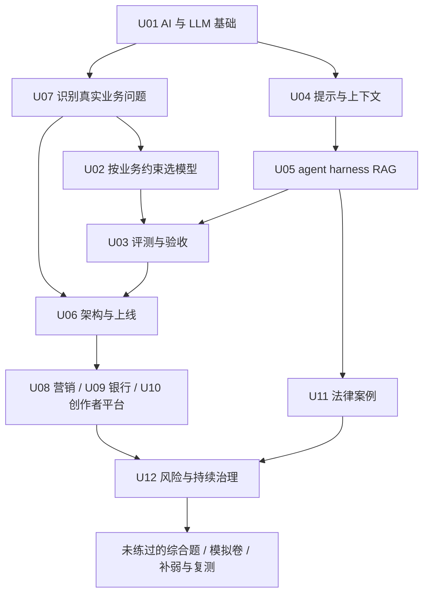

# IS5542：从会辨题到会独立分析案例

本路线的目标是：看到一道题，先识别它要解释、比较、设计、评价还是作条件判断，再用课程知识完成推理。先从基本概念补起，逐步做到英文短答和综合案例。这里是复习地图，还没有开始授课、诊断或模拟考试；本人掌握状态全部未知。

## 考试依据先说清

已直接读本学期 Syllabus 3 页、Lecture 1 的考核页，并实际查看 9/11 客座公告截图。Syllabus p.3 写选择题、简答题、论述题，要求解释概念与应用框架。Lecture 1 p.12 给 20%／30%／50%，同时写明最终格式由教师确认。当前按三种能力准备，比例仍是暂定，不能预设题数、选答规则或官方评分点。

考试基线是 **12 月 18 日 18:30–20:30，LI 3508（香港时间）**，来自总览所记 11/5 AIMS 快照，本轮没有重登 AIMS。50% 与 2 小时另获本地课件和[当年官方目录的公开索引正文](https://www.cityu.edu.hk/catalogue/pg/202627/course/IS5542.htm)支持。开闭卷、允许带何种材料、计算器及具体答题选择规则仍待正式通知，不从旧学期推定。

9/11 原公告明确客座内容纳入期末，因此六场客座都进入路线。原公告曾把 10/17 标成 Venture Capitalist，实际已取得的两份讲义是 Agentic Era 与 FDE；学习以实际内容为准，范围变化待最后复习课确认。嘉宾职业建议与效果倍数按材料观点理解，不当作保证会考的事实。

**最高优先级待补**：按既有 tentative 日程，最后复习课在 11 月 28 日，今天 11 月 23 日尚未到；最新安排还未回读。11/21 Responsible AI 专属材料、本学期教师参考卷／mock、官方答案也尚未取得。这些到位后先决定训练重点，再回查下面完整课程地图，防止只练参考卷而漏课。

本轮侧栏 `iab` 与随后尝试的 `chrome` 均返回浏览器不可用，未进入 Canvas，故不能说新文件“未发布”。M07 已重新核本地全部源文件（包含一份无扩展名 PDF）和 Downloads 相关文件名，仍未找到金融原讲义；这是当前本地结论，不是 Canvas 结论。

## 一条贯穿全课的逻辑

先问“用户要完成什么”，再问“模型和系统怎样帮助完成”，最后问“拿什么证据证明有效、谁控制后果”。以下箭头表示学习依赖与工作顺序，不表示必须把所有任务做成 agent。

例如，学会写提示还不够分析一套客户系统：还要识别资料来源、工具能改什么、何时停下来、用什么任务测试，以及错误会影响谁。每次只补当前问题需要的前置知识，不默认已经会向量、统计推断、ML 或 Python。

## 建议顺序与每单元目标

顺序是 U01 → U07 → U02 → U04 → U05 → U03 → U06 → U08 → U09 → U10 → U11 → U12。编号是稳定索引，顺序按依赖安排。行业三单元在共同基础后可按诊断结果调整；没有做题证据前，不跳过任何单元。

### 1. U01 从 AI 到 LLM：概念和生成过程

- 学什么／做到什么：区别规则、预测、生成与产品界面；追踪文字→token→表示→注意力→逐 token 生成。
- 练什么题：概念辨别、机制解释；这些细分名称是训练设计，教师目前只确认到选择／简答／论述类别。
- 先修：日常语言、四则运算与百分数；先用小例确认起点。
- 回源：Lecture 1 pp.14–58；Lecture 2 p.7。材料稳定 ID：lecture-01, lecture-02, note-m01。
- 已有讲解入口：[[IS5542_GenAI_in_Business/notes/M01-导论-生成式AI基础与企业落地|M01 现有讲解]]。
- 最容易卡住与适用边界：不默认会神经网络／向量；先讲输入输出和学到的参数；注意训练可并行与生成逐步的区别；语言流畅不证明理解／正确。

### 2. U07 先找值得解决的问题：用户目标与设计思维

- 学什么／做到什么：从情境、动机、期望结果写 job story，再转 HMW；按组织价值与实施复杂度说明 Top 3 选择依据；说出同理理解（Empathise）→定义问题（Define）→构思（Ideate）→原型（Prototype）→测试（Test）的阶段任务、产物及反馈；分清理解问题与寻找方案中的发散和收敛。
- 练什么题：情境转写、机会识别、优先级选择；这些细分名称是训练设计，教师目前只确认到选择／简答／论述类别。
- 先修：U01。
- 回源：Design Thinking pp.31–71；尤其 pp.34、39、49–63。材料稳定 ID：guest-design, syllabus-2026a, note-m04。
- 已有讲解入口：[[IS5542_GenAI_in_Business/notes/M04-设计思维-业务机会识别与AI创意工作坊|M04 现有讲解]]。
- 最容易卡住与适用边界：用户想完成的事（Jobs To Be Done, JTBD）用工作故事（job story）的情境、动机、结果表达；我们可以怎样（How Might We, HMW）把目标改为开放问题；Top 3 指前三条 HMW 候选；job 是用户想实现的结果；不等同岗位或一项产品功能；p.61 的一般建议和 p.63 的课堂 Top 3 程序分开；先用事实支持定位，再讨论投票。

### 3. U02 按业务约束选模型与部署方案

- 学什么／做到什么：从任务找模态、性能、延迟、吞吐、上下文、成本约束；比较开放权重／托管 API／路由方案并提出取舍。
- 练什么题：比较选择、读图读表、简单成本计算；这些细分名称是训练设计，教师目前只确认到选择／简答／论述类别。
- 先修：U01、U07。
- 回源：Lecture 1 pp.60–87；Lecture 2 pp.7–27、81。材料稳定 ID：lecture-01, lecture-02, note-m01, note-m02。
- 已有讲解入口：[[IS5542_GenAI_in_Business/notes/M01-导论-生成式AI基础与企业落地|M01 现有讲解]]、[[IS5542_GenAI_in_Business/notes/M02-模型全景-基准评测与提示设计|M02 现有讲解]]。
- 最容易卡住与适用边界：先补 token 计价、单位与比例；不背模型榜单名次；价格与模型表是课件日期快照；用给定数据练方法，不充当实时产品建议。

### 4. U04 把任务写清：提示、结构化输出与上下文

- 学什么／做到什么：写清任务、资料、示例、约束、输出格式和未知项；区分 zero-shot／few-shot、检索补证据、调参训练与上下文修复。
- 练什么题：提示改写、错误诊断、方法选择；这些细分名称是训练设计，教师目前只确认到选择／简答／论述类别。
- 先修：U01。
- 回源：Lecture 2 pp.82–87；Design Thinking pp.5–30。材料稳定 ID：lecture-02, guest-design, note-m02, note-m04。
- 已有讲解入口：[[IS5542_GenAI_in_Business/notes/M02-模型全景-基准评测与提示设计|M02 现有讲解]]、[[IS5542_GenAI_in_Business/notes/M04-设计思维-业务机会识别与AI创意工作坊|M04 现有讲解]]。
- 最容易卡住与适用边界：结构合法与事实正确分开；few-shot 不改模型权重；fine-tuning 在现有课件只作概念／可选干预比较；完整训练或 function calling 工程链未据材料设为已讲必考。

### 5. U05 模型怎样行动：智能体、运行系统与检索增强生成

- 学什么／做到什么：分清 chatbot、固定 workflow、single／multi-agent 的下一步由谁决定；追踪读上下文→选动作→工具执行→观察→继续／停止，并定位权限与证据。
- 练什么题：概念比较、流程追踪、架构设计、风险定位；这些细分名称是训练设计，教师目前只确认到选择／简答／论述类别。
- 先修：U01、U04。
- 回源：Lecture 3 pp.9–40。材料稳定 ID：lecture-03, note-m03。
- 已有讲解入口：[[IS5542_GenAI_in_Business/notes/M03-AI-agent-从harness到部署|M03 现有讲解]]。
- 最容易卡住与适用边界：运行系统（harness）组织循环、工具、上下文、状态、权限与验证；检索增强生成（Retrieval-Augmented Generation, RAG）先找相关资料再据此回答；先解释状态、工具、条件、循环；不要求先会 Python；普通 RAG 与 agentic RAG 的搜索反馈分开；提示中的禁止语不等于权限隔离。

### 6. U03 证明系统有效：十类评测、任务集与留出集

- 学什么／做到什么：从业务任务选择相应评测类别和验收条件；识别污染、饱和、judge 偏差；解释每个分母和失败类型；分清至少一次成功的 pass@k、重复全成功的 pass^k、Elo 偏好分及校准／弃答；不把总体通过率直接作幂代替逐题统计。
- 练什么题：评测匹配、实验设计、指标解释、简单成本计算；这些细分名称是训练设计，教师目前只确认到选择／简答／论述类别。
- 先修：U01、U02、U05。
- 回源：Lecture 2 pp.28–80；Lecture 3 pp.69–77。材料稳定 ID：lecture-02, lecture-03, note-m02, note-m03。
- 已有讲解入口：[[IS5542_GenAI_in_Business/notes/M02-模型全景-基准评测与提示设计|M02 现有讲解]]、[[IS5542_GenAI_in_Business/notes/M03-AI-agent-从harness到部署|M03 现有讲解]]。
- 最容易卡住与适用边界：十类完整覆盖：知识推理、数学、代码、多模态、长上下文、事实性、agent工具、人类偏好、安全、综合／经济价值；benchmarks 的数学／科学示例用于理解测量对象，不据此设定本课须掌握全部竞赛数学或物理；p.45 原图仍缺。

### 7. U06 从原型到上线：架构、业务价值与交付

- 学什么／做到什么：比较 Deep Research、OpenClaw、autoresearch 的输入、回路和验证信号；从 Diagnose→Prototype→Deploy→Productize 说明数据、人员、监控、成本与放行条件；用七类应用检查环境是否有界、反馈是否明确；区分 AlphaFold 等科学 AI、强化学习 agent 与 LLM agent，不把预测结构写成实物实验。
- 练什么题：场景匹配、实施路线论述、业务案例分析；这些细分名称是训练设计，教师目前只确认到选择／简答／论述类别。
- 先修：U02、U03、U05、U07。
- 回源：Lecture 3 pp.42–80；Agentic Era pp.4–12；FDE pp.6–12。材料稳定 ID：lecture-03, guest-agentic, guest-fde, syllabus-2026a, note-m03, note-m05。
- 已有讲解入口：[[IS5542_GenAI_in_Business/notes/M03-AI-agent-从harness到部署|M03 现有讲解]]、[[IS5542_GenAI_in_Business/notes/M05-Agentic-AI时代与FDE实践|M05 现有讲解]]。
- 最容易卡住与适用边界：不把成功 demo 当生产证据；评审和失败尝试也进入成本分母；嘉宾倍数／行业趋势是材料说法；不是本人部署结果或普遍回报保证。

### 8. U08 营销：研究、创作、触达与测量

- 学什么／做到什么：把 AI 任务放到 Discover／Create／Activate／Analyze 对应步骤；区分真人研究、synthetic persona、内容生成与邮件 agent；检查资料、客户授权、复核与效果。
- 练什么题：行业案例、流程追踪、效果证据判断、指标解释；这些细分名称是训练设计，教师目前只确认到选择／简答／论述类别。
- 先修：U02、U03、U04、U05、U07。
- 回源：Marketing pp.7–14、39–58、59–68。材料稳定 ID：guest-marketing, lecture-03, note-m06。
- 已有讲解入口：[[IS5542_GenAI_in_Business/notes/M06-AI营销-从研究创作到触达与测量|M06 现有讲解]]。
- 最容易卡住与适用边界：先解释每个指标量什么；相对百分比／百分点不混用；供应商案例数字、创作节省与投放因果效果分开；Analyze 仅末页概览，不补造完整分析讲座。

### 9. U09 银行：控制、用途分层与多 agent 工作

- 学什么／做到什么：按业务用途和后果区分辅助生产率与核心流程；追踪 PMO、Chat BI、Policy Companion、CHO 的来源、冲突、提议与确认。
- 练什么题：用途风险分类、流程追踪、控制设计、证据判断；这些细分名称是训练设计，教师目前只确认到选择／简答／论述类别。
- 先修：U03、U05、U06。
- 回源：A 08:23–10:08、25:37–42:17、43:17–48:53；A 55:38–01:09:17；B 00:00–08:55。材料稳定 ID：bank-source26, bank-source27, bank-slides, note-m07。
- 已有讲解入口：[[IS5542_GenAI_in_Business/notes/M07-银行AI转型与多agent实践|M07 现有讲解]]。
- 最容易卡住与适用边界：两份录音各自从零计时，不相加；先用已有可读段落学习；金融讲义／原演示重新查后仍未在本地找到；数字与合规判断不当作复算或官方结论。

### 10. U10 AI 创作者平台：数据、训练、评估与再创作

- 学什么／做到什么：解释 compute／data／model 及 pretraining／SFT／RL 的分工；从 Discover→Create→Reuse 追踪素材和用户结果，评价平台反馈。
- 练什么题：行业比较、产品机制解释、方案评价；这些细分名称是训练设计，教师目前只确认到选择／简答／论述类别。
- 先修：U01、U03、U04、U06。
- 回源：Creator pp.8–24。材料稳定 ID：guest-creator, lecture-02, note-m08。
- 已有讲解入口：[[IS5542_GenAI_in_Business/notes/M08-AI创作者平台-研究型产品经理与再创作生态|M08 现有讲解]]。
- 最容易卡住与适用边界：先补训练、评估与用户行为的区别，不默认会 RL；p.22／23 媒体缺口与 recursive／ralph loops 定义待核；不编写产品现实能力。

### 11. U11 AI 法律案例：按法域、事实与责任分析

- 学什么／做到什么：分别分析输出权属、训练资料、专业意见、自动驾驶和客户数据；用事实→争点→适用规则／法域→应用→有条件结论写答案；对 Meridian 分开法律与伦理。
- 练什么题：案例选择／短答、多方责任分析、案例论述；这些细分名称是训练设计，教师目前只确认到选择／简答／论述类别。
- 先修：U01、U05。
- 回源：Legal pp.11–49、51–62；Lecture 1 pp.91–104。材料稳定 ID：guest-legal, lecture-01, note-m09。
- 已有讲解入口：[[IS5542_GenAI_in_Business/notes/M09-AI法律问题-版权责任与客户资料|M09 现有讲解]]。
- 最容易卡住与适用边界：先解释权属／许可／责任／隐私，不用案例名代替推理；法律材料是讲者截至日期的教学版本；没有复核全部现行法律或完整判词，不输出法律意见；缺事实可给条件结论。

### 12. U12 Responsible AI：把风险转成持续控制

- 学什么／做到什么：逐项检查幻觉、注入／权限、隐私、知识产权、公平、人机关系和供应链／环境影响；用 Govern／Map／Measure／Manage 连接负责人、证据、处理和剩余风险。
- 练什么题：风险定位、控制设计、跨单元综合案例；这些细分名称是训练设计，教师目前只确认到选择／简答／论述类别。
- 先修：U02、U03、U05、U11。
- 回源：Lecture 1 pp.88–117；NIST pp.111–117；Legal pp.51–62；11/21 新材料待补。材料稳定 ID：lecture-01, guest-legal, bank-source26, responsible-1121, final-review-1128, note-m01, note-m09。
- 已有讲解入口：[[IS5542_GenAI_in_Business/notes/M01-导论-生成式AI基础与企业落地|M01 现有讲解]]、[[IS5542_GenAI_in_Business/notes/M09-AI法律问题-版权责任与客户资料|M09 现有讲解]]。
- 最容易卡住与适用边界：不能把责任压缩成“加一个人审核”；核人能看到的证据和停止权；M01 责任 AI 部分可先学，不能冒充已覆盖 11/21；最后复习课到位后定向补范围／题型。

## 从题面动作选解题路线

下面是一套自编训练方法，后续会用例题逐步教，不是教师评分 rubric。先圈出题目动词及限定词，再选相应路线。每个结论都要接题目给的事实，不能只堆术语。

| 题面要做什么 | 学习时练的作答顺序 | 主要单元 |
|---|---|---|
| Identify／distinguish | 先找判别条件；逐项对照；指出最易混选项在本题哪一条件不成立 | U01、U04、U05、U09 |
| Explain／compare | 说明对象和问题；追踪关键步骤；给一个差异与成立条件；接回业务影响 | U01–U06、U10 |
| Select／recommend | 明确目标和硬约束；比较可行方案；说明取舍、所需证据及什么变化会推翻选择 | U02、U06、U07 |
| Design | 输入／来源→处理和工具→输出；再交代权限、验证、失败分支、人及停止条件 | U04–U06、U08、U09、U12 |
| Evaluate／calculate | 说明测谁、何时、分母和单位；比较同口径结果；列未测风险；计算后解释结果 | U02、U03、U08 |
| Discuss／assess a case | 题目事实→适用框架／法域→各方影响与反方→条件结论及控制建议 | U06、U08–U12 |

英文短答会在理解后练完整句。法律、伦理和业务题有时不能给唯一结论；能指出缺哪个事实、补足后如何改变判断，也属于有效作答。

## 全课覆盖检查：练样题也要回到这些内容

| 官方教学模块／实际讲次 | 本路线去向 | 已知边界 |
|---|---|---|
| Foundations：AI 范式、LLM、模型比较、局限 | U01–U05、U12 | 保留 token／attention／上下文／生成过程；不只背 AI 名称 |
| Strategy：机会、business case、架构、路线图、人员流程、质量控制 | U02、U03、U06、U07 | change management／readiness 随实施案例练；不等于教师另有完整专讲 |
| M04 Design Thinking；M05 Agentic Era＋FDE | U04、U06、U07 | 实际内容覆盖，不只沿用“VC”旧标签 |
| M06 Marketing；M07 Financial Services | U08、U09，并回接 U03／U12 | 金融仍是部分录音，缺讲义／演示原件 |
| M08 Digital Native；M09 Legal Industry | U10、U11、U12 | 创作者媒体、法律当前性和转录缺口分别保留 |
| Responsible AI＋Emerging Trends＋最后复习 | U12，并更新受影响单元 | M01 的概览不能替代未取得的 M10／M11 |
| Syllabus 提到的零售、保险、HR 等业务功能 | 在 U06／U08／U09 用已出现例子作迁移；等待复习课核范围 | 没找到独立完整专讲，不能编成已授课内容；若 final review 列为要求，补实际材料后扩单元 |

本次已对 **10 份核心原件、551 个物理页／slide** 建立文本索引（含 3 页 syllabus、117 页 L1、88 页 L2、80 页 L3、71 页设计工作坊、12＋22 页 M05、68 页营销、25 页创作者、65 页法律）。这是来源盘点和定向回源，不是 551 页重新全篇教学／视觉验收。两张公告与五张既有源页图像资产实际查看；低文本媒体页保留待视觉复验。M01–M09 现有笔记只作解释与导航辅助，本轮没有重写、升级或替用户标记学会。

## 参考卷、历年卷与外部资料怎样使用

1. **当学期最后复习课优先**：取得课件、完整考试说明与录音／转录后，提取教师对范围、题型、限制和示例的明确表述，逐条记录页码／时间戳；口述与书面冲突保留，不自行投票决定。
2. **教师 mock 次之，并用全课反查**：逐题映射知识、解题动作及条件；官方答案、笔记参考作答分别标记。留一组未提前讲解的题用于最终检测。当前没有取得教师 mock，不能制作伪“原题”。
3. **历年卷只用于可比部分**：[图书馆入口](https://www.cityu.edu.hk/lib/digital/exampaper/index.htm)的公开索引说明须 EID／AD-LAN，按年份和部门查。[年份目录](https://www.cityu.edu.hk/lib/digital/exampaper/ftlist.htm)列有 2025–2026、2024–2025、2023–2024 等。本轮实际用课程码和这些年份检索，未取得 IS5542 可读卷面，也未进入认证后的 IS／学期清单，故不能说“没有往年卷”。特别是[2023/24 同代码目录](https://www.cityu.edu.hk/catalogue/pg/202324/course/IS5542.pdf)显示旧课是 Outsourcing and Offshoring Management，不能拿来当 GenAI 真题。
4. **外部只作线索**：已查 IS5542＋小红书／期末及 `site:xiaohongshu.com IS5542`，未取得可核年份与题面的结果，未完成站内登录搜索。另找到自称 2025/26 Semester B 的独立学习指南预览，既非本学期教师材料，且口径存在版本差异，不采用其考试比例、题面或答案，不购买。任何外部题都要核课程、年份、学期、来源与答案地位。

## 首轮诊断（尚未施测）

开始时先让用户用一句话说目前最不确定哪块、一次可用多久，再按下表从 D1 逐题进行。建议约 20–30 分钟，实际按作答节奏调整；不一次发整卷。允许明确说“不知道”，用它定位起点。以下题均为本框架自编诊断，未被教师确认，当前不展示答案或填写得分。

| 编号 | 诊断任务 | 看哪种起点 |
|---|---|---|
| D1 | 一个程序按固定 if–then 回答，另一个根据上下文生成回答。二者都有聊天窗口，怎样判断它们的区别？ | U01：界面与实现、规则与生成 |
| D2 | 某客服很快给出首字，但整段输出慢；另一个首字等待久但输出快。要为语音服务选方案，还缺哪些证据？ | U02：TTFT／后续生成／任务约束 |
| D3 | 把“帮公司提升客户体验”改成一条具体 job story，再写一条对应 HMW；写明你补充的假设。 | U07：用户结果与方案是否混淆 |
| D4 | 公司的资料更新后，回答仍引用旧政策。你会先检查提示、资料、工具结果还是模型训练？说明检查顺序和依据。 | U04／U05：错误定位和证据 |
| D5 | 为“查订单、解释延迟、必要时申请退款”画出步骤，标出什么动作需要权限／批准，以及何时转人工。 | U05：流程与真实行动的区别 |
| D6 | 100 次尝试，合计模型及工具成本 HK$100、人工审核 HK$60，其中 80 次获接受。怎样定义并计算每次获接受结果的成本？ | U03：成本范围、分母和失败尝试 |
| D7 | 生成式视频把制作时间缩短。这个结果能否证明广告带来新增销售？还需要什么比较和测量？ | U08：制作效率与效果／因果证据 |
| D8 | 公司拟将客户文件送入第三方 AI，并以输出直接给客户专业建议。应先核哪些事实、责任和控制？若法域不明如何作答？ | U09／U11／U12：资料、责任与条件判断 |

D3 先确认是否见过 job story／HMW。没见过时，改用“谁在什么情境想实现什么结果、我们可以怎样提出开放问题”来问，分别记录术语陌生与业务推理卡点。D5 可以先用普通文字写步骤，不因不会画规范图而判知识不合格。

如果一题不会，先给定位提示；仍卡住才补最小解释和一个例子，再让用户完成原任务。提示后做对记“提示后会做”，随后换条件；新题独立做对才记独立证据。不用自评或看过解释代替作答。

## 后续每轮怎样教、怎样记录

每轮围绕一个能完成的任务：短讲与例子 → 用户尝试 → 按卡点提示 → 换条件的新题 → 反馈。理解后再练英语表达，不在用户未回答时连续替其完成所有步骤。若错误来自更早单元，只补对应依赖，再回到当前题。

`progress.json` 先有 12 个单元，`sessions`／`mistakes` 均为空。以后每轮结束保存日期、题目来源／编号、用户关键原问题与原作答、提示、纠错过程、采用的方法及下一步；重复解释可整理，但保留回溯线索。第三方私人资料不抄入学习记录。

“看过讲解”“提示后会做”“独立做对”“复测通过”分开。最终模拟在范围和允许材料核清后按实际考试条件设计；没有教师卷时明确为自编卷，不包装成真题。练过原题所得分数单列，另用未见变式检测；错题按概念、读题、流程、证据、计算、英文表达定位，再补弱和隔后复测。

## 当前下一步

可以从 D1 开始真实诊断，再按反馈走第一轮 U01；本轮没有自动开始。待能访问 Canvas 时，优先核最后复习课安排、11/21 材料、教师 mock／答案与金融原件。总监督只需读取本目录四个文件来汇总路线和缺口；共享看板、Git 提交与发布由总监督统一处理。
