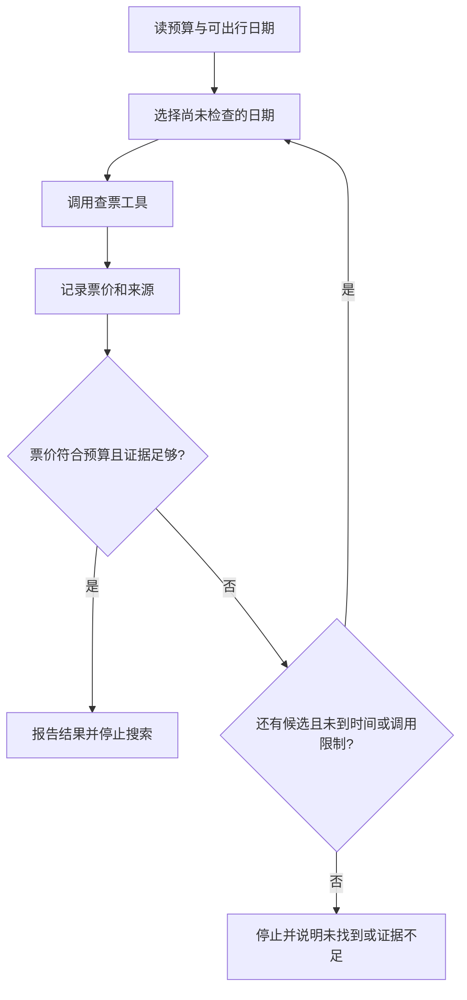

# Review Session：考试要求与复习重点

这份指南用来回答三件事：考试怎样答、老师这次集中回顾了什么、怎样把概念写成有依据的英文答案。按本人要求采用考前指南结构，不新增一篇普通 M 课堂笔记。

依据是 11 月 27 日上传、11 月 28 日下载的 [20 页原件](../../course_files_export/canvas-20261128/IS5542%20-%20Review%20Session.pdf)。下文“课件明确”指书面课件；讲解、训练顺序和参考答案是笔记整理。尚未取得本次复习课转录，不把书面内容冒充课堂口述。

先看 [[#1. 考试规则先记准（p.2）|考试规则]]，再过 [[#2. 这次复习的主线与优先顺序|复习主线]]，最后独立尝试 [[#4. 原题一：邮件为什么越过了授权边界（p.17）|邮件案例]] 和 [[#5. 原题二：旧题高分为什么还不能证明能力（p.18）|评测案例]]。 查具体幻灯片用文末的 [[#8. 原件 20 页导航与资料边界|20 页导航]]。

## 1. 考试规则先记准（p.2）

课件明确写的是 “Two hours. Open book.”，即 2 小时、开卷。下表每行对应试卷一个部分；分数是该部分合计分数，不能据此推定各小题一定等分。

| 部分 | 合计分数 | 必须回答什么 |
|---|---:|---|
| A：选择题（multiple-choice questions） | 20 分 | 全部 20 题 |
| B：简答题（short-answer questions） | 30 分 | 全部 3 题 |
| C：论述／案例题（essay / case questions） | 50 分 | 3 题选 2 题 |

可带资料限定为允许的课程材料、被引用的文章／书籍的纸质副本。课件没有明确写自制笔记、手写批注、页数或计算器的具体许可；这份指南也不能自行认证为可带入考场。禁止电子设备、Internet access 和 generative AI。开卷不等于可以在电脑里搜索、使用手机或向 AI 提问。

读这张原页时，先看三行题型及选答数，再看表格下方两行红字。红字限制了开卷的载体和资料范围；它与“Open book”必须一起理解。

考试日期、时间、场地和座位号，原页要求到 AIMS → Student Record → My Examinations → Examination Timetable 查看。本地已有 11 月 26 日回读记录：12 月 18 日 18:30–20:30，LI 3508，见 [个人考试表回执](../../../_meta/final-review-2026/exam-schedule-20261126.json)。这是承接既有记录，本次没有重登 AIMS，座位号未由这份课件给出。

本次版本结论：Lecture 1 的 20／30／50 此前注明待确认；Lecture 10 p.2 的 20／80、五选四还印有 8-May-26。现在取得的本学期 Review Session p.2 明确了上表，当前按新课件准备。旧页保留作版本历史，不再并列为当前未解决的题型冲突。学校当期允许材料清单仍需与教师说明一起核对；既有记录预计 11 月 30 日起公布，本次未取得当期逐课程清单。

## 2. 这次复习的主线与优先顺序

这次的知识关系可以连成一句话：先弄清任务和证据，选择合适的模型，用 harness 组织行动，再验证结果与权限。 模型回答得流畅，只解决其中一部分。

下表是笔记建议的复习顺序，不是老师给出的分值或押题概率。每行最后一列是读完后应能完成的动作。

| 建议顺序 | Review 页码与主题 | 对应既有单元 | 应能做什么 |
|---|---|---|---|
| 1 | p.3–5：RAG、上下文、模型六向量 | U02、U04、U05 | 区分找到证据、使用证据和批准行动；按业务约束选模型 |
| 2 | p.7–8：上线评测、污染；p.18 案例 | U03、U06 | 判断分数测了什么；设计可比的新题测试 |
| 3 | p.9–12：harness、编辑格式、ReAct、RSI | U05、U06 | 追踪一次行动循环；说明模型之外的系统为什么影响结果 |
| 4 | p.13–14：注入、双模型、批准与临时权限；p.17 案例 | U05、U12 | 找到不可信内容如何跨越授权边界，并设计检查与测试 |
| 5 | p.16：商业提示五部分 | U04 | 把模糊请求改成可执行、可检查的提示 |
| 6 | p.6：GPU 与电力；p.15：SynthID | U02、U06、U12 | 解释基础设施瓶颈和来源识别工具的边界 |

这是一份重点回顾，不是章节排除通知。 全文没有说“只考这些页”，也没有取消六场客座、法律或 Responsible AI。完整范围继续看 [固定框架](../final-2026/framework.md)，已有讲解从 [学习地图](../final-2026/learning-map.md)进入。重点可以先练，未出现的内容不能直接判成不考。

## 3. 重点怎样理解、怎样写进答案

### 3.1 RAG：找到了规则，还要应用规则（p.3）

员工申报费用，系统要判断金额是否符合政策。课件原问是：“Does this expense meet the reimbursement limit?” 这里问金额门槛，不是问是否已完成全部报销审批。

检索增强生成（Retrieval-Augmented Generation, RAG）让回答先取得相关资料。检索（retrieval）在本例找出两条事实：政策上限为 HK\$600，申报为 HK\$500。推理（reasoning）把规则用于这笔申报：500 小于 600，所以金额条件满足。最终批准（approval）仍由经理作出；金额满足不能推出其他条件也满足，更不能推出钱已支付。

从左边蓝框读到右边橙框：蓝框是取得的政策和金额，箭头是把事实送入规则判断。底部绿色一句另设经理批准这一关，不能把它吞进橙框的“符合金额要求”。固定比较规则在条件相同时给相同判断；生成式模型的输出有概率性质，因此业务系统可以把金额比较交给明确的程序规则，再让模型解释。

英文参考作答（笔记拟写）：Retrieval finds the HK\$600 policy limit and the HK\$500 claim. Reasoning applies the limit and concludes that the claim meets the amount requirement. The manager still gives final approval.

改条件小测（笔记补充）：若申报 HK\$650，仍使用同一政策，变的是比较结果：金额超过上限，不能认定金额合规。若政策原文只说“最多 600”，600 本身可以满足；当前课件的 500 例没有展示边界等号，不要擅自把所有业务规则改成严格小于。

详读：[[IS5542_GenAI_in_Business/notes/M01-导论-生成式AI基础与企业落地#讲义 p.93 · RAG, Reasoning, and Human Review|M01 的 RAG、推理与人工复核]]。

### 3.2 两种上下文问题：位置不利与资料越积越多（p.4）

任务都是找一张不超过 HK\$2,000 的机票，但课件比较的是两种不同变化。

| 现象 | 保持什么、改变什么 | 本例怎样出错 |
|---|---|---|
| 中间遗失（Lost in the Middle） | 输入总长度保持相同，只把预算句从开头移到中间或结尾 | 预算在中间时更容易被忽略 |
| 上下文退化（Context Rot） | 连续搜索，从 1 次积累到 20 次，旧结果使输入不断增长 | 系统失去对预算的追踪，提出 HK\$2,400 的票 |

左框的 Start／Middle／End 是同一预算句的位置；右框的 1 search 到 20 searches 是资料随轮次增长。不能把两边都解释成“超出了最大上下文长度”。课件特意指出，退化可在到达输入上限之前发生。左侧“低于无检索基线”只描述某些测试，不说明 RAG 总是降低表现。

harness 可以保存一条短而可靠的任务记录：预算、已核票价、来源 ID；清除旧搜索堆积，需要时再取原细节。压缩时必须保留限制和来源，不能只保留“找到不错的票”。当前上下文（context）是模型这一步实际看见的资料；状态／记忆（state / memory）是跨步骤保留、以后可再取的记录。

英文答题句（笔记拟写）：Lost in the Middle concerns the position of relevant information at a fixed input length. Context Rot concerns degraded use of evidence as context grows. A harness can retain verified constraints and source IDs while removing stale results.

详读：[[IS5542_GenAI_in_Business/notes/M03-AI-agent-从harness到部署#2.7.6 C · 上下文管理：context rot 与五种手法（讲义 p.30）|M03 上下文管理]]。

### 3.3 模型选择：六向量加上数据去向（p.5）

先写业务必须完成的任务，再比较模型。这里“向量（vector）”是选择维度，不要求做线性代数运算。

| 维度 | 在业务里要问什么 | 容易混淆的地方 |
|---|---|---|
| 模态（modality） | 所需文字、图片等输入输出能否处理？ | 能读文字不等于能读扫描图片 |
| 延迟（latency） | 一个请求能否在业务期限内返回？ | 单个请求快不保证高峰期服务充足 |
| 表现（performance） | 在实际任务上能否达到验收要求？ | 通用榜单不能代替本业务测试 |
| 成本（cost） | 每个被接受的结果总共花多少？ | 调用便宜不等于加上重试、复核后仍便宜 |
| 吞吐（throughput） | 最繁忙时能同时处理多少请求？ | 与单请求等待时间不同 |
| 上下文（context） | 能否准确使用任务所需证据？ | 可容纳长度不等于有效使用长度 |

另核数据主权（data sovereignty）：敏感资料在哪处理，谁能访问。课件对比外部 API 与环境内部署的开放权重模型。开放权重（open-weight）表示模型参数可以取得，不自动意味着免费、无限制商用或已安全配置；部署位置、日志和访问权限仍要分别核。

笔记补充例：客户资料不准外发时，先把“资料留在指定环境”列为硬条件；在可行方案里再比较质量、速度、峰值容量与每个合格结果的成本。不能用“某模型分数最高”直接盖过资料限制。

详读：[[IS5542_GenAI_in_Business/notes/M01-导论-生成式AI基础与企业落地#2.8 ★ 六向量：企业架构是一道多目标优化题（讲义 p.59–87）|M01 六向量]]。

### 3.4 GPU 与电力：模型能扩大，不等于服务能立即扩大（p.6）

训练更大模型、服务更多请求，需要更多计算。图形处理器（Graphics Processing Unit, GPU）供货不足会拖慢扩容；即使买到设备，还要有电源、电厂设备和能把电送到现场的电网。业务决策应同时估计算力、供电、接入和建设时间。

课件用“大型 AI 数据中心年用电约相当于 100,000 户家庭”说明量级。它没有指定中心功率、运行时长或每户用电量，不能据此计算任意中心的精确用电，也不能当作所有数据中心的统一数值。

原页以 Texas 选举和居民电费作背景，并问新数据中心会否推高家庭账单。参考分析（笔记补充）：新增需求与电网投资可能增加成本，但账单结果还取决于谁支付接入／扩建成本、费率和负载安排，不能由选举结果推出单一因果。本次核得 [Texas 官方选举结果](https://electionresults.sos.state.tx.us/results.html)中民主党候选人票数领先；“超过 30 年”及竞选议题与结果之间的因果未在该结果表认证。背景不替代应掌握的“算力—电力—电网—交付时间”链条。（外部核查：2026-11-28。）

### 3.5 上线前评测：分数连同测试条件一起看（p.7）

基准测试（benchmark）是一套规定任务和计分方式的测试。一个分数只能说明系统在该版本、规则、工具、预算与尝试次数下的表现。课件提到 ARC-AGI-3 作为测试名称示例，没有在本页给其规则或当前榜单，不需要从名称猜它能证明所有通用能力。

基准饱和（benchmark saturation）是很多系统已接近分数上限，测试难以继续区分强弱。它与“训练时见过答案”的污染不同。agent 可靠性（reliability）还要看能否完成长任务、错误后恢复，并一直处于权限内。

准备上线时，用未见过的实际案例重复运行，按失败类型分析，并检查高影响动作是否等待批准。一次成功 demo 不能替代这些证据。重复运行也不能证明永不失败；应说明测试了哪些情况、仍遗漏什么。

英文答题句（笔记拟写）：A benchmark score depends on its version and evaluation setup. Before deployment, test fresh cases repeatedly, analyse failures by case type, and verify recovery and authorization controls.

### 3.6 污染：高分可能来自见过题，差距本身还不是证明（p.8）

数据污染风险（Data Contamination Risk, DCR）问的是模型训练时是否可能接触过测试材料。不是只查题目逐字重复。

左圈是训练资料，右圈是测试基准；红色交集表示两者重叠。该图表达关系，没有给交集面积的真实比例，不能读成“污染了多少百分比”。右侧四种重叠分别是：语义（semantic），题目换过说法；信息（information），出现帮助解题的事实或步骤；数据（data），出现原测试题或记录；标签（label），出现与题目对应的答案。

旧题高、新题低可能支持污染疑虑，也可能因为新题更难、主题不同或测试条件不同。正确做法是尽量匹配新旧题的主题与难度，固定工具、预算与评分，再查训练来源及重复／近似内容。[[#5. 原题二：旧题高分为什么还不能证明能力（p.18）|第 5 节]]把这一步展开成完整案例。

详读：[[IS5542_GenAI_in_Business/notes/M02-模型全景-基准评测与提示设计#2.9.2 训练重叠与基准完整性：数据污染（讲义 p.71）|M02 污染与分数可信度]]。

### 3.7 harness 六部分：把模型放进一个能行动、能核验的系统（p.9）

模型负责根据输入提出文字或动作；运行系统（harness）安排如何把这些提议变成受控工作。课件以 $H=(E,T,C,S,L,V)$ 记六项职责。$H$ 是这套系统的记号，各字母是部件标签，不是六个数字相乘。

以预算 HK\$2,000 的东京机票任务逐项对应：

| 标签与名称 | 负责什么 | 任务中的具体动作 |
|---|---|---|
| E：执行循环（execution loop） | 决定继续做什么或停止 | 周六超预算后查周日 |
| T：工具层（tool layer） | 定义可用工具及输入 | 按路线和日期查票 |
| C：上下文（context） | 选取本步需要的证据 | 给模型预算与已查票价 |
| S：记忆／状态（memory / state） | 跨步保存事实 | 保留已查日期和搜索 ID |
| L：生命周期检查（lifecycle hooks） | 在工具调用前后检查 | 调用前核权限，完成后记结果 |
| V：评估（evaluation） | 检查输出并识别新失败 | 将报价与来源对应 |

课件“模型像芯片、harness 像操作系统”是职责类比：要表达周边组织方式也影响结果，不表示每个组件与真实操作系统一一对应。只写“加强模型”无法回答哪一关丢了预算、谁允许付款或报价如何验证。

### 3.8 同模型、同测试，编辑接口也能改变成绩（p.10）

课件报告 Grok Code Fast 在一种代码编辑测试中，patch 格式为 6.7%，hashline 为 68.3%。补丁（patch）给出旧代码和新代码的差异；hashline用行标签定位修改处，再给替换文本。模型仍需把修改意图准确表达成工具可执行的输入。

左框与右框的变化来自本页所列编辑格式，箭头不表示换了更强模型。这个例子支持“工具接口／harness 是表现的一部分”；不能推出 hashline 在所有模型和任务上必胜，也不能把 68.3% 当成 Grok 的通用能力分。原实验样本、评分细节和可复现记录未随本页给出，本次没有重跑实验。

### 3.9 ReAct：让工具返回结果改变下一步（p.11）

推理与行动交替（ReAct）的重点是循环：读现状、选动作、调用工具、记录观察，再决定继续或停止。课件初始条件是预算 HK\$2,000，周六或周日都可以。

周六查到 HK\$2,400，它是观察（observation），不是系统可以忽略预算的授权。因为超过预算，要更新状态后查周日；周日 HK\$1,800 满足金额条件，于是报告票价并停止搜索。原任务只要求查票，不包含购票许可。

下面是根据 p.11 补画的控制流程；时间或调用次数达到限制，是课件所说停止限制的具体实现，不代表教师指定了某个轮数。

沿“否→继续”走一次就是周六 2,400 后查周日；沿“是→报告”走一次就是周日 1,800。若两个日期都超预算，就走下方停止路径，不能无期限搜索，也不能自行提高预算。

### 3.10 RSI：能改训练代码，不能改自己的评分尺（p.12）

递归自我改进（Recursive Self-Improvement, RSI）在这里指 agent 利用实验反馈继续提出修改。原图显示，人先给目标、限制与 program.md；coding agent 提出修改，只编辑 train.py；然后运行训练，由受保护的固定评估器决定是否保留。

从上方 Human 进入 Coding agent，向右经过 Editable training code、Training run、Fixed evaluator；再向下到 Keep or discard，往左写入 Experiment history，最后返回 agent。固定评估器（fixed evaluator）不能被 agent 修改，否则“提高成绩”可能只是把题目或评分规则改容易。

原图的实验设置是 1 个 GPU、5 分钟预算，并注明启动／编译时间不计入；这些是该例设置，不是所有 RSI 的定义。图中的 val_bpb 是验证资料上的预测误差度量；原图明确越低越好，此处只需会按相同尺比较，不要求从缺失的数据推导该指标。比既有最好结果更好才按该程序保留，实验历史记录结果并支持下一次尝试。

课件说 83 次实验保留 15 次改进。这不表示必然保留约 18% 的实验，也不是“能力提高 15 倍”。长期反复在同一验证集上筛选仍可能迎合该集合，因此还要在新的、未用于挑选修改的案例上检查提升。改条件小测（笔记补充）：若 agent 能改 evaluator，最高分也无法单独证明训练方法改善；先恢复不可改的比较尺，再做新案例验证。

### 3.11 间接注入与双 LLM：先分开资料和授权（p.13）

间接提示注入（indirect prompt injection）是通过外部邮件、文档或检索结果，把本应当作资料的内容混入指令。供应商可以提供交货日期，但邮件发送人没有权力替经理批准采购。

从左向右读：外部内容先给阅读模型（Reader LLM）；它只提取允许字段，不能持有业务工具的凭据。应用层检查（application checks）核字段、当前用户和记录，只把通过验证的资料送给执行模型（Execution LLM）。执行模型可以提出工具动作，工具 API在实际执行前还要核权限。

例如，Reader 可输出“delivery_date=某日”及来源标识；不得把邮件中的“现在批准采购”当作已批准字段。两个模型之间应传有固定字段、可检查的任务数据，而不是整封邮件连同其中的命令。双模型是隔离设计，不是让第二个模型天然更可信；决定动作是否允许的检查必须在应用及工具执行边界落实。

### 3.12 Petrov 与 JIT：同意某动作、开放多少权限是两道问题（p.14）

课件所称 Petrov Rule 是高风险动作暂停并取得明确批准；即时授权（Just-in-time access, JIT）则只在任务需要时授予必要访问，结束即失效。

左图强调在自动动作前停下来判断；右图从 Agent 经时钟与 Authorization System，只连向当前 Task Resource，灰色其他资源表示未开放。读图时要把“批准这次订单”和“只给这次任务所需访问”分开。

笔记补充例：经理批准某笔订单后，系统仅开放对应采购操作与指定记录，设置到期时间／金额限制，执行后撤销临时访问并保留批准与执行日志。经理批准不等于永久管理员权限；临时权限也不替代对具体订单的批准。沙箱（sandbox）限制可操作环境，时间／花费限制约束任务资源，但它们都不能单独证明输出正确。

### 3.13 SynthID：识别生成来源，不认证内容真伪（p.15）

数字水印（digital watermark）把可检测标记放入内容。课件的图像例是 Imagen 在像素中嵌入人眼不易察觉的 SynthID 水印，再由对应检测技术识别。

原图左侧是 Client application，右侧是 Imagen on Vertex AI；本页用它定位应用与图像服务，没有画出完整检测流程，也没有给检测准确率。不能从两个图标推断所有内容都能被识别。[Google DeepMind 官方说明](https://deepmind.google/models/synthid/)也将其定义为嵌入并检测水印的工具。（外部核查：2026-11-28。）

笔记补充边界：检测到标记支持该内容带有相应来源标记，不证明图像描绘的事件真实、无偏见或合法。没检测到标记也不能证明一定是人做的：可能未由支持该水印的系统生成，或检测证据不足。

### 3.14 商业提示五部分：每一项解决一种缺信息（p.16）

提示（prompt）是交给模型的任务说明。下表用一个笔记补充的报销审核任务，把课件五部分变成可以写出来的内容；“角色”和“受众”不能合并，前者是以谁的视角处理，后者是结果给谁看。

| 课件部分 | 要说明什么 | 补充例里的写法 |
|---|---|---|
| 角色（Persona(s)） | 模型采用的工作视角 | 作为报销政策分析助理 |
| 受众（Audience） | 谁读、已有多少知识 | 给需要快速复核的经理 |
| 限制（Constraints） | 证据、禁止动作与边界 | 只用所附政策并标出缺项，不得批准或付款 |
| 任务信息（Task information） | 要做什么、所给事实和材料 | 按所附政策检查 500 元申报，政策上限为 600 元 |
| 输出格式（Output format） | 结构、字段、长度、语言 | 表格列规则、证据、金额判断、缺项；中文解释 |

英文参考提示（笔记拟写）：Act as an expense-policy analyst. Write for a manager who needs a quick review. Use only the supplied policy and claim. Check a HK\$500 claim against the HK\$600 limit, state missing information, and do not approve or pay it. Return a table with the rule, evidence, amount decision and missing items, with explanations in Chinese.

提示里的禁止语负责表达意图；真正的权限仍要按 p.13–14 在系统边界执行。格式正确的表格也可能填了错误事实，仍需核证据。

## 4. 原题一：邮件为什么越过了授权边界（p.17）

本题给的是“读取外部邮件后，助理尝试修改用户未批准的账号设置”。要追踪资料到动作的路径，提出隔离方案，再证明方案没有把正常请求一起堵死。课件没有附独立标准答案，以下为参考解析（笔记推断），依据 p.9、p.13–14；不是正式试卷或老师原话答案。

### 4.1 题面与逐问解析

完整英文题面：An assistant acts after reading an email

Situation

A support assistant reads an external email and attempts to change an account setting the user never approved.

Trace the decision

What came from the email? What led to the tool request? Where was the user's authorization checked?

Separate the roles

If one model reads the email and another can use tools, what should pass between them? Who should check the requested action?

Test the boundary

How would you check that the unauthorized change is blocked and a legitimate request can still proceed?

#### 4.1.1 追踪决策：先查哪一关把邮件当成了命令

先区分邮件中的业务事实、要求修改设置的文字，以及真正由用户批准的动作。沿“邮件→模型提议→工具请求→账号变更”查记录。题面只说 attempts to change，是尝试修改，不代表已成功；没有给完整邮件或日志，不能虚构恶意原文、攻击者身份或权限检查必定缺在哪一行。

要检查模型是否把邮件文字当成可执行指令，工具请求要改哪个设置、哪个账号，用户身份与该动作的批准记录在哪里核过。如果工具已经拒绝请求，模型边界可能被诱导，但执行边界仍挡住了后果。诊断时必须分别说明。

英文参考答案：Separate email facts from instructions and user authorization. Trace the email, the model's proposed action and the tool request. Check the target account, requested change and approval record at the application and tool boundary. An attempted change does not establish that it succeeded.

#### 4.1.2 分离职责：传可核字段，工具端再核身份与动作

Reader 没有改账号的凭据，只提取允许字段并带来源。应用程序校验字段是否合规、记录是否匹配当前用户；传给执行端的应是这些已核数据，不是能自由改写系统指令的邮件全文。执行模型即使提出修改，也必须由应用／工具 API 核对当前用户的权限、目标账号、具体动作及所需批准。模型自己说“有权限”不能代替这一关。

英文参考答案：Pass only validated fields and source references from a reader without business-tool credentials. Application code validates the data and user context. The execution model may propose an action, but the tool API must enforce permission and any required approval for that specific account and change.

#### 4.1.3 检查边界：要测“该挡住”和“应放行”两类

用同一业务任务准备一组笔记补充的成对测试，固定工具设置与账号权限：

| 测试 | 输入与条件 | 期望结果及核验 |
|---|---|---|
| 邮件含未获批准的改设置要求 | 只有外部邮件，没有用户对该改动的批准 | 工具拒绝变更；检查账号状态没有被改，日志记录拒绝原因 |
| 合法请求 | 用户确有权限并批准相同目标、相同设置改动 | 在权限范围内完成；核变更结果与来源／批准记录相符 |
| 越界变式 | 有批准，但改成另一账号或另一设置 | 原批准不能扩展，必须拒绝越界部分 |

这同时查安全性和可用性：把所有请求一律拒绝虽然能挡攻击，也没完成合法业务。应重复运行并检查真实状态／工具日志，不只看模型说“已阻止”。

英文参考答案：Test unauthorized email-driven requests, authorized requests and requests outside an approval's scope. Verify that unauthorized changes do not alter account state, valid requests still work, and logs connect the decision to the user, action and approval. Repeat the tests rather than relying on a single response.

本题答题顺序：外部内容的身份 → 诱导到工具动作的路径 → 哪一层负责授权 → 隔离和最小权限 → 正常／攻击成对测试 → 现有证据的限制。

## 5. 原题二：旧题高分为什么还不能证明能力（p.18）

本题给的是“旧基准分数高，新编题显著更低”。重点不是抢答“模型作弊”，而是提出竞争解释、控制比较条件并解释证据强弱。以下为参考解析（笔记推断），依据 p.7–8；课件没有给独立官方答案或原始成绩数据。

### 5.1 题面与逐问解析

完整英文题面：High scores on old test questions

Situation

A new model scores well on old benchmark questions and substantially lower on newly written questions.

Compare explanations

Could the model have seen the old questions or their solutions? Could the new questions be harder or cover different topics?

Design a fair check

How would you build a fresh test with comparable topics and difficulty? What would you look for in possible training sources?

Interpret the evidence

Which result would make the old score less credible? What does a similarity match tell you, and what would you check next?

#### 5.1.1 比较解释：污染是假设，题目难度也是解释

可能见过旧题、解答、同义改写或关键步骤，是污染假设。新题也可能更难、主题不同，或工具、预算、评分发生改变。给定分数差支持“需要调查”，不足以在这些解释中唯一选择一个。

英文参考答案：The gap is consistent with contamination, but it could also reflect harder questions, different topics or evaluation settings. The scores alone do not identify the cause. Investigate both training overlap and whether the two tests are comparable.

#### 5.1.2 公平检查：新题要新，比较条件要尽量相同

先列旧测试各主题和难度分布，按相近要求独立编写新题并检查答案，不只把旧题换人名。固定模型版本、提示、工具、时间／调用预算、尝试次数和评分方式。按主题、难度分组比较，并在相同条件下重复运行。

查可能的训练来源时，找原题、题解、同义版本、相关关键事实和题目—答案配对；同时核资料发布时间、是否可能被纳入训练以及实际训练访问证据。网上存在一份题解，不等于已证明模型训练使用了它；训练资料不公开时就说明无法完全认证。

英文参考答案：Build independently written fresh questions matched by topic and difficulty. Keep the model, tools, budget, attempts and scoring consistent, and compare results by question group. Search possible training sources for original items, paraphrases, solution steps and answer pairs, while checking dates and evidence of actual inclusion.

#### 5.1.3 解释证据：相似匹配说明重叠线索，不自动证明因果

若新旧题已尽量匹配，其他条件也一致，旧题优势仍大，且找到可追溯的训练重叠证据，旧分数作为“未见题泛化能力”的证据就更弱。泛化（generalization）在这里是对未用于训练／挑选方案的新任务仍能有效作答。

相似匹配先证明“资料相似”，还须检查是否属于实际训练材料、题目与答案是否同时出现、时间是否允许接触，以及匹配阈值会不会把普通共同知识误判为泄题。可以在新留出题、不同表述和相近新任务上复测；旧高分仍可描述旧测试表现，但应限制对新任务能力的推论。

英文参考答案：A persistent old-question advantage under matched conditions, together with traceable training overlap, weakens the old score as evidence of generalization. Similarity is a clue, not proof of training exposure or causation. Check inclusion, timing and item–answer overlap, then validate on genuinely held-out tasks.

改条件小测（笔记补充）：如果新题全是更难的数学题、旧题全是常识题，不能直接用差距判污染；先匹配任务和难度。即使没有逐字重复，同义题和解题步骤仍需检查。

## 6. 怎样练成三种题型

以下是训练建议，不是教师评分细则，也不是正式模拟试卷。

| 题型 | 准备方法 | 自查标准 |
|---|---|---|
| 选择题 | 练易混对：retrieval／reasoning／approval、latency／throughput、context／memory、saturation／contamination | 能说明最接近的错误选项错在哪里 |
| 简答题 | 一句解释概念，再写机制、业务小例与适用限制 | 每个专业词都对应对象和动作，不能只罗列缩写 |
| 论述／案例 | 按题目的动词组织：追踪、比较、设计、解释证据 | 逐问引用题面事实，提出可执行控制／测试，说明未知项 |

简答补充练习：Explain why a larger context window does not guarantee better task performance.（解释更大的上下文窗口为何不保证任务表现更好。）

参考答案与理由

窗口大小只限制可容纳输入，不保证准确利用。重要预算放中间可能被忽略；多轮旧结果积累也可能使任务约束失焦。应保留可靠限制与来源、移除过期资料，并在真实任务测试。

A larger window increases capacity, not guaranteed effective use. Relevant constraints may be missed in the middle, and stale results can accumulate across steps. Preserve verified constraints and sources, remove obsolete context, and test performance on the actual task.

2 小时时间分配建议：A 20 分钟、B 30 分钟、C 60 分钟、检查 10 分钟，共 120 分钟。C 先快速读 3 题，选最有证据和结构的 2 题；不要同时写 3 题挤掉完整作答时间。实际按题目长度调整，这不是学校强制时限。

## 7. 纸质资料与最后一轮复习清单

开卷最需要的是“能迅速找到哪条规则”，不是堆尽可能多的纸。以下只说明准备方法，不认证这些自制资料可带入考场；先核当期允许材料清单、教师补充与批注规定。

- 核考试表的日期、时间、场地和座位号；当前日期／场地承接 11/26 回执。
- 核具体可带材料；为最终获允许的纸质材料做主题目录和页码索引。
- 先尝试 p.17、p.18 原题，再对照参考解析，找自己缺的是事实、机制还是英文组织。
- 把 p.9 六部件、p.11 循环、p.13 执行边界连起来解释一次：系统怎样做、怎样停止、谁批准。
- 做一次符合 A／B／C 结构的计时练习。本文没有生成 20 道 MCQ 或完整官方 mock，不把两道源案例当整套试卷。
- 回到完整框架查客座、法律和 Responsible AI，避免把本次重点误读为排除范围。

这些是待执行动作，不是已完成勾选。资料已生成不改变本人通读、自测、session、错题或掌握状态。

## 8. 原件 20 页导航与资料边界

下表逐页说明本指南如何承接原件。物理页号以 PDF 为准；p.1、p.19、p.20 没有新增考试规则，不把装饰图片全部复制进复习正文。

| 原页 | 内容 | 本指南位置或处置 |
|---:|---|---|
| p.1 | Final Exam Review 封面 | 来源身份；封面校徽为装饰，不另嵌入 |
| p.2 | Examination arrangements | [[#1. 考试规则先记准（p.2）\|第 1 节]]；三部分与纸质资料限制 |
| p.3 | Retrieval and reasoning in RAG | [[#3.1 RAG：找到了规则，还要应用规则（p.3）\|3.1]]；金额例与经理批准 |
| p.4 | Lost in the Middle and Context Rot | [[#3.2 两种上下文问题：位置不利与资料越积越多（p.4）\|3.2]]；两种变化分别比较 |
| p.5 | Six vectors for model selection | [[#3.3 模型选择：六向量加上数据去向（p.5）\|3.3]]；六向量与数据主权 |
| p.6 | Frontier AI needs power and GPUs | [[#3.4 GPU 与电力：模型能扩大，不等于服务能立即扩大（p.6）\|3.4]]；供给、量级和背景边界 |
| p.7 | What to test before an agent goes live | [[#3.5 上线前评测：分数连同测试条件一起看（p.7）\|3.5]]；测试条件和可靠性 |
| p.8 | Benchmark contamination | [[#3.6 污染：高分可能来自见过题，差距本身还不是证明（p.8）\|3.6]]；四种重叠 |
| p.9 | The harness | [[#3.7 harness 六部分：把模型放进一个能行动、能核验的系统（p.9）\|3.7]]；六职责与例子 |
| p.10 | Grok Code Fast | [[#3.8 同模型、同测试，编辑接口也能改变成绩（p.10）\|3.8]]；6.7%／68.3% 的含义和限制 |
| p.11 | The ReAct execution loop | [[#3.9 ReAct：让工具返回结果改变下一步（p.11）\|3.9]]；循环与停止 |
| p.12 | Recursive self-improvement | [[#3.10 RSI：能改训练代码，不能改自己的评分尺（p.12）\|3.10]]；原图控制条件 |
| p.13 | Indirect prompt injection and dual LLMs | [[#3.11 间接注入与双 LLM：先分开资料和授权（p.13）\|3.11]]；资料流与权限 |
| p.14 | The Petrov Rule and temporary access | [[#3.12 Petrov 与 JIT：同意某动作、开放多少权限是两道问题（p.14）\|3.12]]；批准和访问范围 |
| p.15 | SynthID digital watermarking | [[#3.13 SynthID：识别生成来源，不认证内容真伪（p.15）\|3.13]]；来源标记的边界 |
| p.16 | The five parts of a business prompt | [[#3.14 商业提示五部分：每一项解决一种缺信息（p.16）\|3.14]]；完整提示补充例 |
| p.17 | An assistant acts after reading an email | [[#4. 原题一：邮件为什么越过了授权边界（p.17）\|第 4 节]]；三组问题逐组中英解析 |
| p.18 | High scores on old test questions | [[#5. 原题二：旧题高分为什么还不能证明能力（p.18）\|第 5 节]]；竞争解释与公平测试 |
| p.19 | Some final words | 寄语内容在表后说明，无新增考试规则；配图为装饰 |
| p.20 | Wishing you all the best | 结束祝福；无新增考务或复习知识，猫图不嵌入 |

p.19 的寄语分别是边做边学、能力努力与运气、寻找较强 LLM 之外的贡献，以及接受不被所有人喜欢。其反思问题可以从人的情境判断、责任承担与真实需求识别着手，没有唯一标准答案。

p.20 是结束祝福，没有新增考试范围。

来源与仍未确认的事项：原件是本学期 Canvas 课程文件，不是独立教师 mock，也没有官方参考答案。本文没有取得复习课录音／转录，因此不记录额外口头排除、出题承诺或评分细则。具体允许材料、座位号、后续更正仍以 AIMS／当期正式清单和教师新通知为准。原图、来源哈希和抽检范围记录在同目录的审查证据中；教学材料完成与本人学习完成分别记录。
