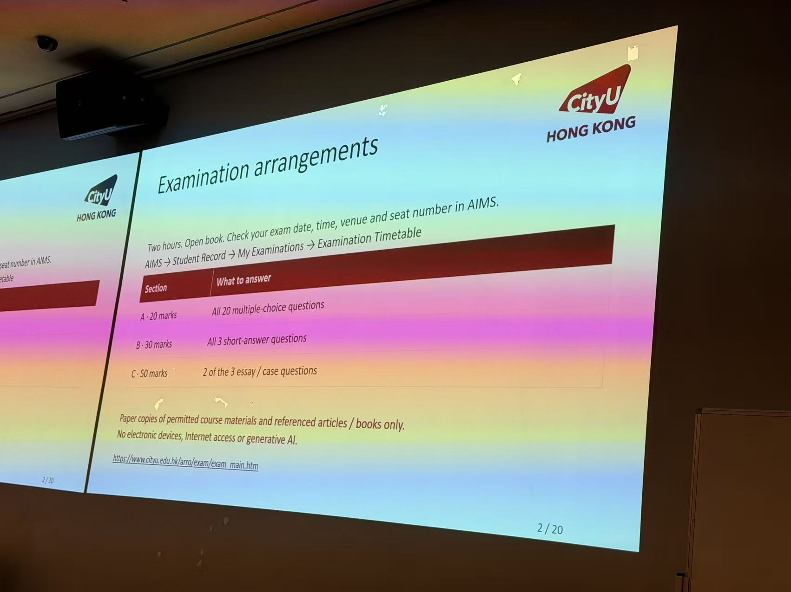

# 最后一课：口头复习增量与考试准备

这份材料接在 [[IS5542_GenAI_in_Business/review/review-session-20261128/Review-Session-考试要求与复习重点|Review Session 考前指南]]之后读。原指南整理 20 页书面课件；这里补充最后一课录音中值得用于答题的说明，并用本人提供的课堂照片核对考试安排。

两个新增来源均按本人要求列为重点材料。“重点材料”表示复习时优先取用，不表示老师承诺每个例子必考。本文的课堂引文来自本地 Whisper 转录；中文解释和新增练习另行标注，不作为教师原话。

## 1. 考试要求：照片与书面课件互相印证

照片显示的就是 Review Session 第 2 页：2 小时、开卷；A 全部 20 道选择题，共 20 分；B 全部 3 道简答题，共 30 分；C 三道论述／案例选二，共 50 分。只限获允许课程材料及引用文章／书籍的纸质副本；禁电子设备、联网和生成式 AI。

看图时先读表格的题数和选答要求，再看下方两行资料限制。照片中没有给自制笔记、手写批注、页数或计算器的单独许可，不能从“开卷”自行补出这些权限。日期、场地、座位按原页要求到 AIMS 核对；当前日期和场地仍承接已有个人表回执，没有因本照片重新核过 AIMS。

这段录音从 RAG 例子开始，没有录到本页考试安排的说明。考试结构的新增现场证据来自照片，不把它写成录音确认；现有 [[IS5542_GenAI_in_Business/review/final-2026/exam-guide|当前考试依据]]已统一口径。

## 2. 录音里最值得补进答案的八件事

### 2.1 管上下文：资料可以按需再取，但预算要一直能核对

**🎙️ 课堂补充**（`01:06`–`03:55`；对应 Review p.4）

这段不是只讲“把输入缩短”。老师区分一份输入里的位置问题，以及多次工具调用后旧结果不断积累的问题。harness 应保留预算、已核票价和来源 ID；旧搜索可以不带入下一轮，后来真要改票时再按链接取票规。这是按需取回（just-in-time retrieval）的例子。

- *"One is the message within one prompt."*（`03:41`）
- *"Another is multiple message and multiple prompts."*（`03:45`）

答题时要分别写清“改变了证据的位置”与“资料随轮次增长”，再说怎样保留限制和来源。输出前再比票价与预算，比只让模型记住一句“不要超预算”更可检查。口述 ASR 关于输入是否已满的句子不用于推导必要条件；书面 p.4 明确说明退化可在输入上限前发生。

### 2.2 选模型：数据留在公司，不代表工具和日志也留在公司

**🎙️ 课堂补充**（`03:55`–`06:18`；对应 Review p.5）

老师用机密供应商报价作例子。要先查在哪里处理、谁能看、外部提供商会不会保留副本，再比较模型的表现、速度与成本。

- *"We ask where the data is allowed to be processed and who may see it."*（`04:07`）
- *"local servers we still need to check where the tools send data and where we store the logs"*（`04:46`）

模型在公司服务器运行，只说明模型的处理地点；它调用的工具仍可能把报价发出去，日志也可能存到别处。因此答案要把模型、工具、日志三处数据去向分开检查。不能只写“开放权重模型，所以安全”。

成本比较也以一个可用结果为单位：模型调用费用之外，还要考虑工具、失败重试和人工复核。ASR 把其中重试一词识别得不稳定，不在引文里擅自校成确定原话；这些成本项的完整解释仍按原指南与课件。

### 2.3 上线评测：高风险失败不能被总体平均数盖住

**🎙️ 课堂补充**（`08:58`–`11:44`；对应 Review p.7）

老师举采购请求的例子：日常请求应正常处理，资料不全要追问，大订单需要批准时必须等待。测试应在相同设置下重复跑，并按案例类型看错误。

- *"and still try to place a large order without approval."*（`10:33`）
- *"So the overall score would hide that problem."*（`10:39`）
- *"We usually do not only use the standard test, we developed our own evaluation data set for"*（`10:49`）

这里的关键不是再报一个更高的总体成功率，而是单独检查“未批准的大订单有没有被放行”。正常请求和高风险请求都需要测，否则既可能漏掉风险，也可能把所有业务都堵死。

老师还强调按本公司的工作和业务目标建立评测资料，提到 ROI 和点击率等。某个业务缩写在 ASR 中不清楚，本文不猜它的全称。公开 benchmark 回答的是特定测试表现；业务验收还要回答本场景的质量、成本、收益与权限要求。两者可以并用，不必把公开测试全部弃掉。

### 2.4 分析污染：新旧题差 20 分，不等于污染贡献 20 分

**🎙️ 课堂补充**（`11:44`–`14:16`；对应 Review p.8、关联 p.18 案例）

老师说明四种重叠可以出现在同一个案例中，不是互斥选项。语义相似、解题信息、原记录及答案配对都可能同时存在。

- 同一案例可以有多类重叠（`13:01`–`13:08`），不把四类 DCR 理解为互斥选项。
- *"Suppose the model scores 90 on the old data set"*（`13:24`）
- *"and 70 on the new data set."*（`13:29`）

90 与 70 是课堂假设，相差 20 分，不是真实实验数据。差距可能来自见过题、题目难度差异，或两者都有。仅换一套题再测一次，不能把差距全部分给污染。

老师随后提出训练对照：相同模型的两个副本，在相同条件下，一个接触测试题，另一个接触可比材料，然后参加同一测试。

- *"effect of exposure, we could train two copies of the same model"*（`13:47`）
- *"and one sees the test question and the other sees the"*（`13:54`）
- *"both take the same test."*（`13:59`）

下面把课堂思路展开成可答题的设计；控制细节是笔记补充，不代表课堂真的运行过训练实验。

| 训练组 | 训练时接触什么 | 最终用什么测 |
|---|---|---|
| A：有暴露组 | 包含目标测试题／解答的材料 | 同一套目标测试 |
| B：对照组 | 数量与内容要求可比、但不含目标测试题／解答的材料 | 同一套目标测试 |

要尽量保持初始模型、其余训练资料、训练预算和评分设置相同，重点只改变“是否接触目标测试材料”。这样，A 与 B 在同一测试上的差值，才更有理由被解释为该次暴露的影响。训练仍有随机波动，笔记建议重复运行并报告差异的不确定性，不能把一次差值当普遍常数。

“同一模型分别做旧题与新题”的比较换了题目；“两个可比模型副本参加同一测试”的受控比较，尽量只改变训练暴露条件。若只有外部 API、无法控制训练，就只能做可比新题、重叠调查等有限检查，不能冒称已完成该受控实验。

这类实验故意研究暴露影响；用于业务验收的未见题集仍要另行保护，不能把已经暴露的测试继续当作未见题证据。

英文参考作答（笔记拟写）：The 20-point old–new gap does not isolate contamination because question difficulty may also differ. A controlled study would train comparable model copies with and without exposure to the target test material, hold other conditions constant, and evaluate both on the same test. The study estimates exposure effects under those conditions; it is not established by the original score gap alone.

### 2.5 harness 与工具接口：核过一次，系统更新后还要再核

**🎙️ 课堂补充**（`14:16`–`17:26`；对应 Review p.9–10）

老师把 harness 说成围绕模型的软件：让 agent 使用工具、保存工作状态并核结果。报价前可以凭保存的搜索 ID 回查原结果；工具前查权限、工具后记结果。

- *"Harness is the software around the model, and it lets agents use tools,"*（`14:16`）
- *"keep track of its work, and check the results."*（`14:25`）
- *"And we can also run the same checks after a system updates"*（`15:53`）
- *"to catch any new failures."*（`15:59`）

这支持回归测试（regression testing）：改模型、提示、工具或系统后，再跑此前应当通过的检查，防止新版把已能完成的事情弄坏。一次上线前通过不等于以后永远通过。

编辑工具的例子则强调，同一组模型权重、相同任务，编辑接口格式仍会改变表现。口述 ASR 只给大约 65%的量级，不能替代书面 p.10 的 68.3%；两者都不表示模型权重变强，也不保证接口在所有任务上都更好。

### 2.6 ReAct 与 RSI：既要有停止规则，也要保住评估尺

**🎙️ 课堂补充**（`17:26`–`20:06`；对应 Review p.11–12）

ReAct 由工具结果决定下一步。搜索失败也应记录错误，达到资源限制时说明无法确认什么，而不是把失败当成已完成或无期限继续。口述中的机票数字与书面例子不同，按各自来源读；预算约束与继续／停止的判断不变。

RSI 的改进循环里，agent 可以改训练代码，固定评估器不能随意改。

- *"The evaluator stays locked so that each experiment is judged in the same way."*（`19:27`）
- *"we still need a fresh test to see if all these changes help on the new [cases]"*（`19:57`）

后一句的 cases 跨到下一段，方括号明确这是衔接处理。保留 15 次改动、83 次实验是该例的计数，不代表普遍成功率。旧评估集上挑出的提升，还要在没参与选择的新案例检验。

### 2.7 批准必须对应当前订单，临时权限只覆盖当前任务

**🎙️ 课堂补充**（`20:06`–`24:22`；对应 Review p.13–14、关联 p.17 案例）

外部邮件可以提供交货日期，不能自己批准修改订单。Reader 不持业务工具凭据；应用检查提取字段、用户和记录；执行模型只提出动作；工具端实际核用户权限。

- *"a reader model takes the details we need from the email, and it has no credentials for business tools."*（`20:54`）
- *"the app checks the extracted fields, the user, and the matching records, and passes only the checked data to the second model."*（`21:07`）

凭据是取得工具访问权所需的身份／授权信息；工具 API 是程序请求业务操作的接口。“没有凭据的 Reader”因此不能直接调用改订单工具。传过去的“允许字段”应由应用事先限定并校验，不是让邮件自己宣布哪些字段可以执行。

Petrov Rule 进一步要求高风险动作先暂停，得到有权人员批准才继续。老师具体说到经理检查供应商、数量和价格；若内容变了，要批准更新后的订单。

- *"If any of this change, then the manager has to approve the updated order instead [of the initial one]."*（`22:46`–`22:55`）

JIT 只给该任务所需访问，任务结束失效。老师用“能访问采购系统，但工资文件不在范围内”说明沙箱边界，并保留时间、花费限制及日志。批准某订单、开放哪项资源、实际执行是否越界是三道不同检查，不能互相代替。

英文参考作答（笔记拟写）：Approval must match the current supplier, quantity and price. A material change requires approval of the updated order. Temporary access should cover only the approved task, expire afterwards, and be enforced at the tool boundary with an audit trail.

### 2.8 水印是来源线索，真实事件仍要另找证据

**🎙️ 课堂补充**（`24:22`–`25:17`；对应 Review p.15）

SynthID 有助于识别图像的生成来源；找到信号不等于图像展示的事情真的发生过。顺序复转补出的尾句直接支持这一边界：

- *"event really happened, so we still need evidence."*（`25:01`）

可以据此解释“来源标记”与“事实真实性”解决的是两种问题。本文没有对某张具体图做检测，也不把老师的示例当成检测准确率实验。

## 3. 两个适合现在练的变式

以下是笔记自拟练习，不是老师新增题目或正式考试预测。

### 3.1 能把新旧题的差距全部归给污染吗

英文题意：A model scores 90 on old questions and 70 on fresh questions. Can all 20 points be attributed to contamination? Explain what comparison would better isolate exposure.

参考答案

不能。先查主题、难度、工具和评分条件是否相同；即使匹配了新旧题，差距仍不自动等于污染的因果贡献。更直接的研究思路是两个可比模型副本，只改变训练暴露条件，再做相同测试。课堂并未给出这种对照的实际结果。

No. The original gap can reflect exposure, difficulty or evaluation differences. A better controlled comparison would vary training exposure while keeping other conditions comparable and test both model copies on the same questions. No such experimental result is supplied here.

### 3.2 改数量后能沿用原批准吗

笔记补充情境：经理批准向供应商 A 买 10 台设备；agent 随后改成 12 台。英文问法：Can the agent execute the updated order under the original approval?

参考答案

不能直接沿用。供应商相同也不够，批准还对应数量等订单条件；先取得对更新订单的批准，再由工具核当前动作和临时权限范围。沙箱只限制访问，不替经理批准新增数量。

No. The quantity has changed, so the updated order needs approval. The tool must verify that the proposed action matches that approval and the temporary access scope. A sandbox does not authorize the changed quantity.

## 4. 录音页码映射与时间分配

每行表示同一个录音时钟中的连续区间；页号是 Review Session 的物理页。区间用于回听定位，不是老师给出的考试分值。最后一行延续至媒体结尾，表内只引用真实存在的末段起点。

| 录音区间 | 对应页 | 课堂覆盖与补充 |
|---|---:|---|
| `00:00`–`01:06` | p.3 | RAG 检索／推理／审批；数值识别差异保留 |
| `01:06`–`03:55` | p.4 | 两类上下文问题，按需再取票规 |
| `03:55`–`06:18` | p.5 | 数据去向与日志、六向量和成本 |
| `06:18`–`08:58` | p.6 | GPU、电力、电网；选举因果只作为讲者观点 |
| `08:58`–`11:44` | p.7 | 上线验收、分组失败、业务自建评测 |
| `11:44`–`14:16` | p.8 | 四类污染可重叠；分数差与暴露对照 |
| `14:16`–`16:04` | p.9 | harness 六职责、版本更新后重跑检查 |
| `16:04`–`17:26` | p.10 | 同权重与不同编辑接口 |
| `17:26`–`18:39` | p.11 | ReAct 循环、出错与停止 |
| `18:39`–`20:06` | p.12 | RSI、固定评估器与新案例验证 |
| `20:06`–`21:55` | p.13 | 邮件资料、双模型与执行端权限 |
| `21:55`–`24:22` | p.14 | 更新订单重批、JIT 与沙箱 |
| `24:22`–`25:17` | p.15 | 水印来源与事实证据；末段起点后至文件结束 |

p.1–2 及 p.16–20 没有在这份录音中确认，不能因此标为课堂略过。p.2 由照片独立印证；p.16 提示五部分及 p.17–18 两道书面案例继续按原指南复习。

## 5. 来源边界与勘误

### 5.1 录音范围与未确认页

原录音长 1518.656 秒。采用本地 large-v3 顺序解码，共 242 段、241 个不同整秒时间戳，0 次时序倒退，0 处至少 120 秒的段间空档。没有长空档不等于整堂课完整。开头已在讲 RAG，未录到考试安排；末端为 SynthID，最后极短的 Thank you 不作为完整下课语认证。

首轮批处理有 166 段，并把`05:11`的照片／视频模态例误判为重复幻觉。顺序复转恢复了这句、开头上传 slides 一句和`25:01`的真实性尾句，因此正式引用使用顺序版。两次都是机器转录，不声称逐秒人工听校。

| 原件范围 | 本录音的证据状态 | 复习处置 |
|---|---|---|
| p.1–2：封面与考试安排 | 录音从 RAG 开始，未录到安排说明；照片另印证 p.2 | 考试要求按书面与照片，不降权 |
| p.3–15：知识回顾 | 本文件有可定位讲解，见第 4 节 | 书面条件与口述增量分别核 |
| p.16–20：提示、案例与寄语 | 本文件中未确认对应讲解 | 不当作略过，不自行判不考 |

### 5.2 课堂增量速查

每行提炼一个适合补进案例答案的动作；时间仍指原录音，不是考试权重。

| 增量 | 录音定位 | 答题落点 |
|---|---|---|
| 数据流不止模型 | `04:07`–`04:46` | 同时检查模型、工具和日志 |
| 总分会掩盖越权失败 | `09:55`–`10:39` | 单独验大订单批准边界 |
| 暴露影响需要受控比较 | `13:24`–`14:05` | 区分换题与改变训练暴露 |
| 更新订单要重新批准 | `22:37`–`22:55` | 批准对应当前供应商、数量和价格 |
| 水印不替代事实证据 | `24:50`–`25:01` | 识别来源后仍核事件真实性 |

### 5.3 识别差异与反方视角

| 定位 | 可见差异 | 采用方式 |
|---|---|---|
| `00:09`、`00:27` | ASR 中出现 400、500 及 500 below 300，与 PDF 的 500／600 不一致 | 不判断究竟是口误还是识别错误；书面 RAG 原例不改 |
| `01:35`、`02:47`、`18:06`、`18:10` | 机票金额与书面例不完全相同 | 不把不同金额拼成同一原例，保留机制与来源 |
| `02:52` | ASR 呈现 because input is full，书面明确可在上限前退化 | 不推导“必须输入满才会发生”的必要条件 |
| `11:00` | 某业务缩写识别为 GMB，含义未确定 | 不猜全称，使用已清楚的业务目标说明 |
| `17:03` | 口述 ASR 约 65%，PDF 为 68.3% | 精确书面数字仍按 PDF，不据模糊口述改值 |
| `21:55`、`24:22`等 | Petrov、SynthID、sandbox 等专名有误识 | 术语写法按书面；原 ASR 文件不改，引用不静默补词 |

原始录音：[Drive 保存副本](https://drive.google.com/file/d/1-_llGnCQYC9iS8Q0QkTNU6Wv5WAuJZeF/view?usp=drivesdk)。机器原文：[带时间戳的部分转录](../../transcripts/final-review-20261128-partial.txt)。来源哈希、恢复段、全文对齐和抽检范围见配套来源记录。

反方视角：没有从这段录音取得新的题数、开闭卷、章节排除、允许材料细则或 p.17–18 官方答案。最容易误判的是把未录到当不考、把假设分数当实测、把总体高分当权限安全，或把水印当事实认证；本材料逐项保留了这些边界。

### 5.4 转录变更记录

| 日期 | 本次变化 |
|---|---|
| 2026-11-28 | 首次接入 242 段部分转录与课堂照片，按 13 个连续页段记录并提炼八项答题增量；v1.0 表示材料已融合，不表示整课录音完整或本人已学会 |
