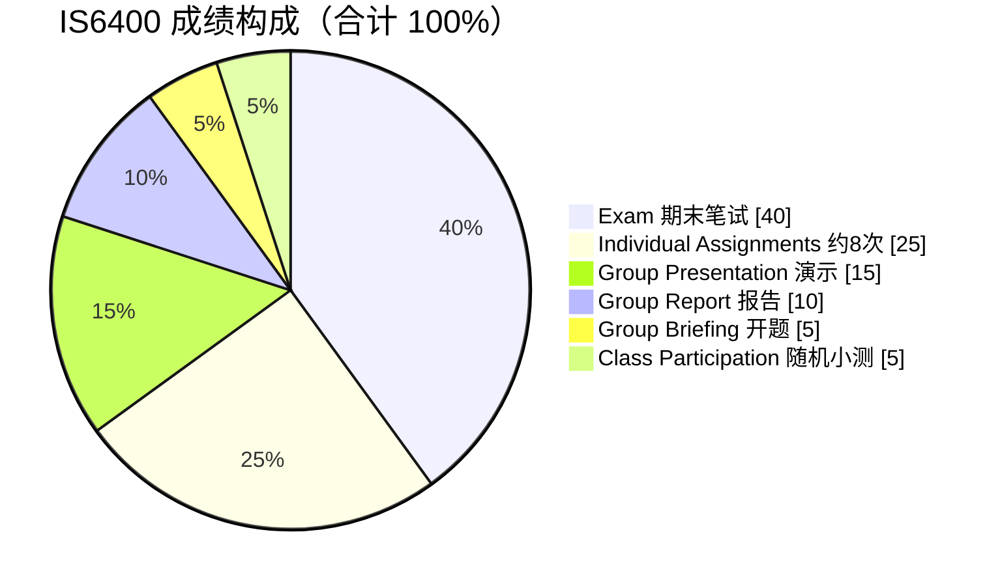
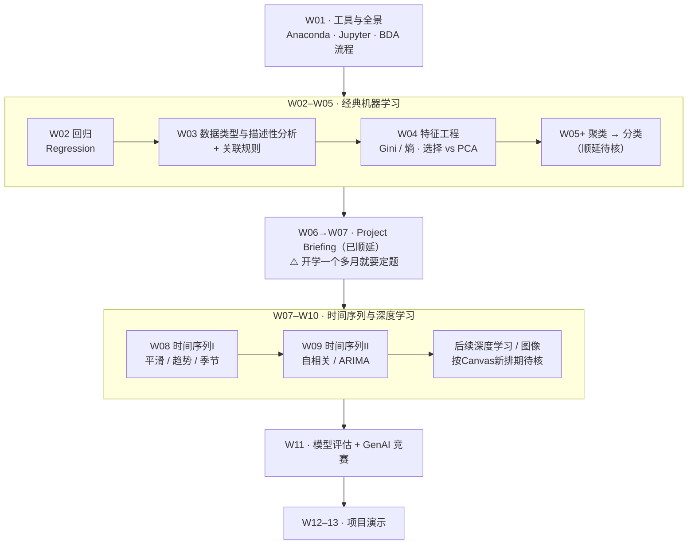
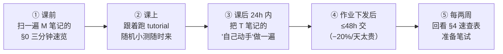

# IS6400 · Business Data Analytics —— 课程总览

> 个人作业、项目与练习索引另有本地私有 `assignment/00-overview/作业总览.md`；已提交的 Week 1–3 个人文件已移入私有目录并核对 SHA-256，Canvas 提交回执已于 2026-09-27 核实。W04 当前要求已于 2026-09-30 核对，答案在私有原件副本续写；标准见 [[IS6400_Business_Data_Analytics/_meta/IS6400作业制作规范|本课作业标准]]。

> **一句话**：这是本 vault 五门课里**唯一动手写代码的课**。别的课教你判断该不该用 AI，这门课教你**把模型建出来、跑出来、并把系数翻译成一句老板听得懂的话**。

---

## 1. 这门课在干什么

| | |
|---|---|
| 官方定位 | 教授商业数据分析的**流程、模型、工具**，覆盖金融、营销、会计等场景 |
| 官方先修 | **Basic knowledge on statistics**（统计学基础）—— **不是 Python** |
| 学分 / Level | **3 学分** · P5, P6 研究生 |
| 授课语言 | 英文（**考试也用英文作答**） |
| 教师 | **Dr. LIU Junming**（junmiliu@cityu.edu.hk，AC3 6-277）· Office hour 周一 12:00–14:00，需邮件预约 |
| 助教 | **QIN Yaxue**（W1–W5 tutorial）· **SHUAI Yanqin**（W7–W11 tutorial）· Yu Shujing |
| 课时结构 | **每周近 3 小时 = Lecture + Hands-on Tutorial 两段** |
| 平台 | Canvas（交作业、组队）；Anaconda / Jupyter Notebook（写代码） |

**它跟一门"机器学习课"的差别在哪**：ML 课关心模型精度，这门课关心**"这个系数在业务上意味着什么"**。官方 CILO 里权重最高的一条（35%）是"用 Python 在数据里**发现模式**去解决选定的问题"，第二高的（30%）是"**创造性地**改造模型，为真实组织问题提出**原创发现**"。**没有一条 CILO 在讲"把 accuracy 调高"。**

---

## 2. 考核构成 —— 先看这个，它决定你怎么分配时间

| 项目 | 权重 | 关键信息 |
|---|---|---|
| **Exam** | **40%** | **2 小时**（官方目录）。开卷/闭卷**未定**（W1 讲义 p.8 两个都写着）。范围**明确包含 assigned readings**，不只是 slides |
| **Individual Assignments** | **25%** | **约 8 次**（W1 讲义 p.8 写 "5~10"）。⚠️ **迟交每天扣 20%**，5 天归零 |
| **Group Project** | **30%** | Briefing 5% + Presentation 15% + Report 10%。⚠️ 报告迟交每天扣 10% |
| **Class Participation** | **5%** | **随机抽课做堂上小测 + 签到**，按"你答对的次数占比"计分。**不知道哪节课抽** |

### ⭐ 两条只在官方目录里、Syllabus 完全没写的硬规则

> **① 及格线是两道门，都要过**
> `Minimum Continuous Assessment Passing Requirement = 30%`
> `Minimum Examination Passing Requirement = 20%`
> 平时分（60% 那部分）至少拿 30 分制的 30%，考试至少拿 20%。**一边高分补不了另一边。**
>
> **② GenAI 政策：平时作业和小组项目，官方明确写 `Allow Use of GenAI? — Yes`**
> 考试不在 ATs 表里，**没有标注**（按惯例不允许，但**没有白纸黑字**）。

完整三方对校见 [[IS6400_Business_Data_Analytics/_prep/课程前置资料#2. 官方目录 × Syllabus × W1 讲义 —— 三方对校总表|课程前置资料 › 2. 官方目录 × Syllabus × W1 讲义 —— 三方对校总表]]。

---

## 3. 周次地图

`M<NN>` = 讲义笔记，`T<NN>` = tutorial 代码笔记。⚪ 日期为推算（未核对香港公众假期）。

| 周 | ⚪ 日期 | Lecture | Tutorial | 笔记 | 状态 |
|---|---|---|---|---|---|
| **W01** | 09-02 | Course Introduction | Software installation | [[M01-导论-商业数据分析全景与工具链]] · [[T01-Jupyter入门与Pandas基础]] | ✅ v0.9（M01 §2、T01 §2 已按预习可读性规则重写，2026-09-11） |
| **W02** | 09-09 | **Predictive Analytics: Multivariate regression** | Regression Analysis | [[M02-预测分析-线性回归]] · [[T02-回归实战-从合成数据到Airbnb定价]] | ✅ **v1.0**（转录已合并；M02 §2、T02 §2–4 已按预习可读性规则重写，2026-09-11） |
| **W03** | 实课日待确认（旧推算09-16） | **Data Types & Descriptive Analytics**（Syllabus/Canvas主题错位保留） | Data Description（Iris + Airbnb） | [[M03-数据类型与描述性分析]] · [[T03-数据探索实战-Iris与Airbnb的描述统计]] | M03本次全篇独审/定向关闭/full门槛及必要同源显示完成，正文已原子写回并精确回读，关联同步见本批回执；T03仅承接9/18旧融合，不借M03升级其独立审查；9/30同源辨认仍为历史 |
| **W04** | 09-23 | **Feature Engineering: Feature Importance / Selection / PCA**（⚠️ Syllabus 写的是 Clustering） | Feature Selection & PCA（Iris） | [[M04-特征工程-特征重要性与降维]] · [[T04-特征选择与PCA实战-Iris]] | ✅ **M04/T04 v1.0**（2026-10-07融合9/23原录音）；1058段，M04 29格/4条明示含反向，T04 12格/37cell映射。缺开头；保存版与现场修改分别标注；现行任务/DDL不由历史题替代 |
| **W05** | 09-30 | **Clustering: K-means / Hierarchical / DBSCAN**（✅ Canvas Lecture 5 课件已到；Syllabus 原 W04） | Clustering Methods（现有 T05 与 notebook 已到） | [[M05-聚类-Kmeans层次与DBSCAN]] · [[T05-聚类实战-Kmeans层次密度与谱聚类]] | ✅ M05 v1.0：29格双源融合、3条课堂明示、strict/逐源及9组机制阅读检验通过；T05 v1.0；开头p.2–17未录到，接缝同句重叠 |
| W06 | 10-07（旧推算） | Project Briefing（Canvas 9/22、10/1 公告） | — | 本轮不新建 | 原分类周次推算已被当前 Week 7 模块替代；项目行政以已核记录为准 |
| W07 | 2026-10-14 | **Classification（Canvas 当前 Week 7；讲义 Lecture 6）** | 五模型、混淆矩阵与类别权重 | [[IS6400_Business_Data_Analytics/notes/M06-分类-决策树集成SVM与不平衡学习\|M06 分类机制]] · [[IS6400_Business_Data_Analytics/notes/T07-分类实战-信用审批与欺诈识别\|T07 分类实战]] | M06/T07 材料 v1.0；A265/B619段双源融合，T07为B后段助教教程；A缺首p.1–6，尾部/接缝完整性限制保留 |
| W08 | 10-21（旧推算，未核） | Canvas Time series I | 时间顺序切分与ETS | [[IS6400_Business_Data_Analytics/notes/M07-时间序列I-平滑趋势与季节性\|M07]] · [[IS6400_Business_Data_Analytics/notes/T08-时间序列实战-销量与季度季节性\|T08]] | M07 v1.0：S15/S16/S17三源融合，接缝长度未知；T08 v0.9且未录。课堂日期仍未核 |
| W09 | 10-28（旧推算，未核） | Canvas Time series II | 尚无对应tutorial增量 | [[IS6400_Business_Data_Analytics/notes/M08-时间序列II-自相关差分与ARIMA\|M08]] | v0.9；46 物理页，转录待补；本轮全篇独审与 B1–B4 定向关闭已完成；原 ANN/RNN 排期已被当前模块替代 |
| W10 | 11-04 | Deep Learning: Image Mining | Image Recognition | — | ⏳ |
| W11 | 11-11 | Model Assessment ／ 🟨 **Competition: GenAI for BDA** | Model Selection | — | ⏳ |
| W12–13 | 11-18 / 11-25 | 🟦 **Group Project Presentation** | — | — | ⏳ |

> 🟨🟦 = 讲义 p.6 的原始高亮颜色。教授在唯一一张课程表上只高亮了这两行，**这是有意的信号**。
>
> ⚠️ **2026-09-16 发现 Syllabus 与 Canvas 周次错位**：Syllabus 的 W03 = Feature Selection / PCA、W04 = Clustering，但 Canvas 的 Week 3 是描述性分析、Week 4 是特征工程——**实际进度比 Syllabus 晚一周**。W05 起按顺延填写，Proposal / Briefing 是否顺延待课上确认（[[IS6400_Business_Data_Analytics/_meta/作业与DDL\|作业与DDL]] §6）。

**课程的三段式结构**

---

## 4. 笔记索引

### 讲义笔记（M 系列）

| 笔记 | 主题 | 讲义 | 转录 | 核心概念 |
|---|---|---|---|---|
| [[M01-导论-商业数据分析全景与工具链]] | 课程运作规则 · 数据分析是什么 · CRISP-DM 六步 · 全课技术地图 · Anaconda/Jupyter/Colab | `IS6400-Week1.pdf`（57 页） | `none`（永久无录音；M01本次全篇审修，T01另审） | 数据分析、机器学习 vs 人工规则、CRISP-DM、特征、聚类/分类/预测、LLM |
| [[M02-预测分析-线性回归]] | 预测建模 · 简单/多元线性回归 · 虚拟变量 · 参数训练（正规方程 + 梯度下降） · 过拟合与正则化 | `L2-Linear_Regression.pdf`（53 页） | ✅ **`merged`**（631段/时戳00:02–02:34:37；缺首与TA尾，时长缺口未知；本次M02教学独审，T02另审） | 因变量/自变量、β 系数、p 值、虚拟变量、最小二乘、MLE、正规方程、梯度下降、过拟合、验证集、Ridge/Lasso |
| [[M03-数据类型与描述性分析]] | 对象与属性 · 四种属性类型 · 数据集类型 · 数据质量 · 描述统计（集中趋势 / 分位数 / 偏度峰度 / 协方差相关）· 相关 ≠ 因果 · **关联规则（支持度 / 置信度 / 提升度）** · 聚合与抽样 · 降维预告 · 用 Iris 画六种图 | `IS6400-W3-DataMining.pdf`（72 页；三份材料拼接） | ✅ **merged**（2026-09-18；缺开头，p.2–3/p.5 ❓） | 名义 / 序数 / 区间 / 比率、IQR、偏度、峰度、相关系数、支持度、置信度、提升度、代表性样本、冗余特征 |
| [[M05-聚类-Kmeans层次与DBSCAN]] | 聚类定义与三种类型 · 欧氏距离与归一化（Homer / Burns）· **K-means 四步 + 初始化敏感 + K-means++ + 三种失灵与补救 + 二分 K-means** · 层次聚类（树状图、凝聚六步、**五种簇间距离**、**单链接手算与 p.60 小测**）· **DBSCAN**（核心 / 边界 / 噪声、算法、何时好用） | `IS6400-L5-Clustering.pdf`（67 页） | `merged`（双源 partial；缺课堂开头及接缝限制保留） | 簇内近簇间远、质心、SSE、树状图、Eps / MinPts；本次完整教学独审与图文核；原算法数值承接已核输入及历史脚本，旧 verify_m05_cluster.py 不作当前入口 |
| [[M04-特征工程-特征重要性与降维]] | 特征与特征工程的定义 · 三大挑战与维度灾难 · 特征重要性（类纯度 / **Gini / 熵 / 信息增益**）· 过滤 vs 包装 · 特征选择 vs 特征约简 · 递归前向选择 · **PCA**（目标 / 几何 / 协方差矩阵特征分解 / 读输出表） | `IS6400-W4-Feature.pdf`（69 页） | `merged`（M04-transcript-partial.txt，9/23；缺开头） | Gini、熵、增益、过滤 / 包装模型、特征选择 / 约简、主成分、特征值 / 特征向量、$U_{\text{reduce}}$ |
| [[IS6400_Business_Data_Analytics/notes/M06-分类-决策树集成SVM与不平衡学习\|M06 分类机制]] | 决策树、集成、SVM、不平衡与业务代价 | `IS6400-L6-Classification.pdf`（92物理页） | merged，A265/B619段；A缺首，B末/接缝完整性限制保留 | Hunt、Bagging、AdaBoost、Stacking、间隔、precision/recall、成本 |
| [[IS6400_Business_Data_Analytics/notes/M07-时间序列I-平滑趋势与季节性\|M07 时间序列I]] | 有序数据、定性/定量预测、水平/趋势/季节、SMA/WMA/SES、双重移动平均、Holt/Holt-Winters、ETS、趋势与季节回归、滞后特征导入 | `IS6400-L8-time series1-new.pdf`（45物理页） | ✅ merged：S15/S16/S17分别295/55/415段；独立时钟，接缝长度未知；课堂日期未核 | 时间序列、水平/趋势/季节、SES、Holt、Holt-Winters、ETS、lag feature |
| [[IS6400_Business_Data_Analytics/notes/M08-时间序列II-自相关差分与ARIMA\|M08 时间序列II]] | 白噪声、自相关、平稳、差分、ARIMA/SARIMA、滚动前推与ADL | 时间序列II讲义（46物理页） | `pending`；本次三源均属M07，未录M08 | ACF/PACF、平稳、差分、ARIMA/SARIMA、ADL |

### 代码笔记（T 系列）

| 笔记 | 主题 | notebook | 数据 |
|---|---|---|---|
| [[T01-Jupyter入门与Pandas基础]] | Jupyter 怎么用 · `datetime` · pandas DataFrame · `describe()` · `apply()` · numpy 矩阵运算 · **7 个 AI Prompt** | `Tutorial 1 - Introduction to Jupyter Notebook_Prompt.ipynb`（25 cells） | 自造小表 |
| [[T02-回归实战-从合成数据到Airbnb定价]] | sklearn 训练/预测与形状 · R²/MAE/RMSE · 多项式训练拟合与数值风险 · Ridge 协议比较 · 类别字典/行身份 · Airbnb 留出评价 · 原 16 项 AI Prompt · 4 题学习复盘 | `Week 2 Regression Analysis_With Prompt.ipynb`（39 cells）及保存 HTML；未重跑拟合 | [[IS6400_Business_Data_Analytics/_meta/数据集卡片#Airbnb.csv\|数据集卡片 › Airbnb.csv]] |
| [[T03-数据探索实战-Iris与Airbnb的描述统计]] | 描述统计函数 · 分位数 / 偏度峰度 · 分组 · 四种图 · **缺失值三种填补** · **IQR vs Z 离群点** · StandardScaler / RobustScaler · 相关矩阵热力图 · **Week 3 Assignment（3 题 100 分）** · ⚠️ 无 AI Prompt 格 | `Week 3 Description.ipynb`（48 cells） | [[IS6400_Business_Data_Analytics/_meta/数据集卡片#iris.txt\|iris.txt]] · Airbnb.csv |
| [[T04-特征选择与PCA实战-Iris]] | `SelectKBest(chi2 / f_classif)` · `ExtraTrees.feature_importances_` + `SelectFromModel` · `RFE` · `PCA` · **旧版 Week 4 作业解读（80 分，已由新 100 分题面替代）** · ⚠️ 无 AI Prompt 格、kernel Python 3.7.6 | `Week 4 Feature Engineering.ipynb`（37 cells） | iris.txt · Airbnb.csv（作业 Q4） |
| [[IS6400_Business_Data_Analytics/notes/T07-分类实战-信用审批与欺诈识别\|T07 分类实战]] | 五分类器、混淆矩阵、类别权重；B01:00:04起助教教程 | `Week 7 Classification_Tutorial.ipynb`（23cells） | Credit_approval.csv；creditcard-reduced.csv仅作业题面 |
| [[IS6400_Business_Data_Analytics/notes/T08-时间序列实战-销量与季度季节性\|T08 时间序列实战]] | 时间切分、SMA/SES/Holt/Holt-Winters/ETS与季度季节性 | Week 8 时间序列notebook（公开Cells0–48；评分Cells49–50隔离） | CVD季度序列；本次未录tutorial，不升级版本 |

### 元数据文件

| 文件 | 作用 |
|---|---|
| [[IS6400_Business_Data_Analytics/_meta/知识层级台账\|知识层级台账]] | ⭐ **写笔记前必读**。L0 入场基线（**本课的 Python 口径写在这里**）+ L1 概念登记表 |
| [[IS6400_Business_Data_Analytics/_meta/术语表\|术语表]] | 本课双语术语，含考试可用的英文定义 |
| [[IS6400_Business_Data_Analytics/_meta/考点库\|考点库]] | 按 module 汇总的潜在考点，带三档可信度 |
| [[IS6400_Business_Data_Analytics/_meta/作业与DDL\|作业与DDL]] | 所有作业、截止日期、提交格式 |
| [[IS6400_Business_Data_Analytics/_meta/数据集卡片\|数据集卡片]] | `Airbnb.csv` 与 `iris.txt` 的六项数据集卡（真实跑出来的统计） |
| [[IS6400_Business_Data_Analytics/_meta/待并入术语总表\|待并入术语总表]] | 需由主 agent 合并进根 `_meta/术语总表.md` 的跨课条目 |
| [[IS6400_Business_Data_Analytics/_prep/课程前置资料\|课程前置资料]] | 官方目录 × Syllabus × 讲义三方对校；所有硬规则的出处 |

---

## 5. 这门课的三个"只有本课有"的特点

### 5.1 教授**要求**你用 AI 写代码

Tutorial notebook 里每个 code cell 后面都跟一个 markdown 单元格：

> 
 🤖 <b>AI Prompt (Copy this to AI)</b>: 
> Write Python code to import the 'datetime' module, get the current time, store it in a variable named 'x', and print 'x'. 

**这不是噪音，是教学设计。** Syllabus ILO 第 3 条明写 "Manage GenAI tools for BDA proposal and Python programming"；官方目录在两项平时评估上都标 `Allow Use of GenAI? Yes`；W11 还有一场 "Competition: GenAI for BDA"。

**所以 T 系列笔记必须保留这些 prompt，并分析"教授期望你怎么向 AI 提问"** —— 这是会被考核的能力。⚠️ **但 W3、W4 的 notebook 里一个 AI Prompt 格都没有**（T03 / T04 §0 已注明）——是否从 W3 起取消了这个设计，待课上观察。详见 [[T01-Jupyter入门与Pandas基础#6. 教授在教你怎么向 AI 提问|T01-Jupyter入门与Pandas基础 › 6. 教授在教你怎么向 AI 提问]] 与 [[T02-回归实战-从合成数据到Airbnb定价#7. 一整段 AI Prompt：把整个 notebook 要回来|T02-回归实战-从合成数据到Airbnb定价 › 7. 一整段 AI Prompt：把整个 notebook 要回来]]。

### 5.2 W6 就要定题，开学一个月出头

Project Briefing 原定 **W6**（2026-10-07），✅ **2026-09-16 已确认顺延**（⚪ 约 W7 · 10-14），proposal 按 Guideline 在 Briefing 前一周末交（⚪ 顺延后约 10/09–10/10）。也就是说：**W02 讲完回归、W03 讲完降维，你就得开始想题目了。**

Proposal 必须包含 **Dataset Description（字段名 + 数据类型）** —— 这意味着 **W5 之前必须已经拿到数据**，不能只有一个想法。

### 5.3 迟交惩罚是五门课里最重的

个人作业 **−20%/天**（5 天归零），小组报告 **−10%/天**。别的课通常是 −5% 或按小时算。

---

## 6. 学习路径建议 ⚪（笔记推断，非教授明示）

**每周的正确姿势**

**两条分线复习**

| 目标 | 看什么 | 为什么 |
|---|---|---|
| **应付 40% 的笔试** | M 笔记的 §4 速查表、§5 术语卡、§6 考点，加上 **DM / HM 指定章节** | 官方明写考试 "will cover the **readings assigned in class**"。笔试要写英文定义、解释系数、判断过拟合，**不考你能不能敲代码** |
| **应付 25% 作业 + 30% 项目** | T 笔记的逐块讲解与"改哪个参数会怎样" | 作业就是把 tutorial 的 cell 改几个参数重跑。项目是把整条链路走一遍 |

---

## 7. 跨课交叉

### ⭐ 硬交叉：IS6400 W02 ↔ EF5560 Lec02（同周同主题）

**EF5560 的 `Lec02_Regression_Vibe_Coding.pdf` 与 IS6400 的 `L2-Linear_Regression.pdf` 是同一周、同一主题（线性回归），并且两门课都在教"用 AI 写代码"。**

| | IS6400 W02 | EF5560 Lec02 |
|---|---|---|
| 笔记 | [[M02-预测分析-线性回归]] · [[T02-回归实战-从合成数据到Airbnb定价]] | **[[M02-回归与样本外设计]]**（EF5560，✅ 已产出） |
| 讲义 | `L2-Linear_Regression.pdf`（53 页） | `Lec02_Regression_Vibe_Coding.pdf` |
| AI 写代码的叫法 | **GenAI for BDA** | **Vibe Coding** |
| 教学侧重 | ⚪ 建模全链路：从 β 系数解释 → MLE 推导 → 正则化 | ⚪ 待该课笔记产出后补 |

> ⏳ **待办（主 agent）**：EF5560 的 Lec02 笔记产出后，回来补齐上表右列的"教学侧重"，并在 [[M02-预测分析-线性回归#9. 延伸与勘误|M02-预测分析-线性回归 › 9. 延伸与勘误]] 加一节对照。**同一套数学被两位老师讲两遍，差集就是各自的重点。**

### 软交叉

| 交叉点 | 本课在哪 | 对方课 |
|---|---|---|
| LLM / Transformer / Attention | [[M01-导论-商业数据分析全景与工具链#2.6.6 深度学习、GenAI 与 LLM（p.43–45）\|M01-导论-商业数据分析全景与工具链 › 2.6.6 深度学习、GenAI 与 LLM（p.43–45）]] | IS5542（GenAI in Business）—— 那门课整学期讲这个 |
| "用 AI 写代码是否算学术不端" | 本课官方 `Allow GenAI: Yes` | IS5113（AI Ethics）—— 那门课讲 GenAI 使用的边界 |
| 模型输出用于金融决策 | [[M02-预测分析-线性回归#2.2 预测建模：管理者为什么需要回归\|M02 §2.2]] | EF5560 · AC6761 |
| 算法偏见 / 数据代表性 | [[IS6400_Business_Data_Analytics/_meta/数据集卡片#5. 已知坑\|数据集卡片 › 5. 已知坑]]（Airbnb 只有 6 个城市、property_type 只剩 4 类） | IS5113 W03 偏见与公平 |

---

## 8. 命名对照

本 vault 统一用 `M<NN>` / `T<NN>` 前缀。本课原始材料的命名对应如下：

| 本库命名 | 课程原始命名 | 原始文件 |
|---|---|---|
| M01 | Lecture 1 / Week 1 | `IS6400-Week1.pdf` |
| T01 | Tutorial 1 | `Tutorial 1 - Introduction to Jupyter Notebook_Prompt.ipynb` |
| M02 | Lecture 2 / Week 2 | `L2-Linear_Regression.pdf` |
| T02 | Tutorial 2 / Week 2 | `Week 2 Regression Analysis_With Prompt.ipynb` |
| M03 | Lecture 3 / Week 3 - Descriptive Analytics | `IS6400-W3-DataMining.pdf` |
| T03 | Week 3 Description | `Week 3 Description.ipynb`（`.html` 同内容，忽略） |
| M04 | Lecture 4 / Week 4 - Feature Engineering | `IS6400-W4-Feature.pdf` |
| T04 | Week 4 Feature Engineering | `Week4_Feature_Engineering_Tutorial.ipynb`（43cells，课堂1–37；现场有修改，评分部分隔离） |
| M05 | Lecture 5 - Clustering | `IS6400-L5-Clustering.pdf` |
| 数据 | Week 3 / Week 4 附件 | `iris.txt`、`Airbnb.csv`（同一文件，两周重复挂出） |

转录按 [[转录处理规则#5. 文件约定|转录处理规则 › 5. 文件约定]] 命名。当前已融合来源包括M02、M03、M04、M05、M06/T07与M07；M07固定别名S15/S16/S17，三份保留各自相对时钟。M08/T08未录。

---

## 9. 当前欠债清单

| # | 欠什么 | 影响 | 何时能补 |
|---|---|---|---|
| 1 | **W01 录音** | M01 已改 transcript: none，课堂原话与覆盖未知；T01独立验收不随本篇升级 | 用户明确本讲永久无录音，不列未来转录任务；行政问题另核书面通知 |
| 2 | ~~**W02 转录**~~ | ✅ **2026-09-09 已合并**，M02/T02 升到 **v1.0**：新增 🎙️ 差集 31 条、🔴 教授明示考点 8 条、🔴 助教项目规则 5 条、🔀 冲突 3 处 | 已完成 |
| 2b | ⚠️ W02 来源缺口 | 开头已在讲义 p.3 句中；末条起始戳 02:34:37 仍在 tutorial AI 生成代码，未覆盖 cell 38。实际音频尾时长、墙钟终点与缺失分钟数未核；未录到不等于未宣布。 | 来源限制保留；行政以对应 Canvas 记录为准 |
| 3 | Briefing 究竟 W5 还是 W6 | 影响定题时间表 | ✅ 9/16 确认**顺延**；精确到哪周待 Canvas |
| 4 | Report 真实截止日 | Guideline 写的 "May 1" 是残留 | Canvas |
| 5 | 期末开卷/闭卷 | 影响复习策略 | 课上确认 |
| 6 | 第一次作业截止日 | −20%/天，不能猜 | Canvas |
| 7 | 官方目录仍是 2025/26 版 | GenAI 相关 CILO 可能未更新 | 下学年 |
| 8 | ~~W03 转录~~ | ✅ 2026-09-18 已合并（本地 Whisper，1361 段）：M03 28 格 + T03 9 格回填；**关联规则会考计算题**（`01:26:36`）；小测 = 属性类型判断；同组不同变量规则 | 已完成 |
| 9 | **W04转录** | ✅ 已定位Windows录音机9/23无编号原录音，内容确认特征工程；1058段已入库并融合 | M04/T04均v1.0；缺开头，课间暂停墙钟未知，结尾有下课语 |
| 10 | Week 4/5 作业现行要求 | W04已于9/30核为43cells、100内部分、10/2 23:59、HTML/PDF；旧80分为历史。W05已于10/6核为10/9 23:59 HKT、10 points、HTML；五题与拓展已完成运行，待本人审阅，未提交 | 不沿用旧推算期限 |
| 11 | **Syllabus 周次顺延** | ✅ W05 = 聚类已由 Canvas 课件确认（2026-09-22）；Proposal / Briefing 日期仍待核 | 课上确认 |
| 13 | ~~W05转录与notebook~~ | ✅ 双源已转录，M05已融合；35-cell tutorial已到，T05 已建稿（v1.0）；p.60平局官方口径仍待核 | 录音不完整边界保留 |
| 14 | ~~M07转录~~／M08与T08待录 | ✅ M07三源已归属并融合；S15/S16/S17接缝长度未知，S17有下课语；M08/T08无本次来源 | M07缺口边界保留；M08/T08继续pending |
| 12 | ~~两份 W3 / W4 PDF 被截断~~ | ✅ 用户 9/16 重新下载到 `Downloads/`，`pdfinfo` 72 / 69 页、文字层与笔记所用完全一致（`diff` 无差异）；**待用户自行复制覆盖 `course_files_export/`** | 已解决 |

---

> **A06 项目准备**：2026-09-30 记录为已定 Olist、6 人各自探索角度；官方数据和九表学习导览位于 `assignment/graded/A06-group-project/`，入口为 [[IS6400_Business_Data_Analytics/assignment/graded/A06-group-project/notes/开始这里|Olist A06 学习入口]]。35-cell Notebook 仅修订教学 Markdown，原代码与保存输出不变；本次没有运行单元格或训练模型。项目 draft、本人学习/团队分工/提交状态不变；Canvas 登录跳转是 2026-09-30 的历史记录，未作今天现行要求核验。教学发布与 HTML 重新标准导出的完成状态见本批回执。

## 相关

- 🔗 [[IS6400_Business_Data_Analytics/_prep/外部参考-BIS-Navigator与往届IS6400资料|BIS Navigator 与往届 IS6400 参考资料]]：课程心得与夸克 4 项目录，2026-10-04 收录；附件正文未读，按往届参考使用。

- 课程背景与三方对校：[[IS6400_Business_Data_Analytics/_prep/课程前置资料|课程前置资料]]
- 连贯性机制：[[IS6400_Business_Data_Analytics/_meta/知识层级台账|知识层级台账]]
- 全库方法论：`CityU/CLAUDE.md` · 材料规则：[[材料处理规则]] · 转录规则：[[转录处理规则]]

## 2026-09-30 录音来源核对与融合

A=`M05-transcript-part1-partial.txt`：电脑录音原误选EF5560，46段、音频754.1秒；B=`M05-transcript-part2-partial.txt`：手机新录音4，738段、音频5947.75秒。A12:18/B00:00同句重叠，不能直接相加；开始已在欧氏距离，p.2–17未录到。B01:32:20有下课语，01:35:24仍有作业提醒，余尾提示词复读不作为课堂证据。[[M05-聚类-Kmeans层次与DBSCAN]]保留讲义推导并纠正课堂简化。

旧 `Supermarket Transaction Data Structure and Customer Analytics.mp3` 已实际重转并比对，为M03已有源；不重写已融合M03/T03。2026-10-07另定位9/23Windows原录音，已确认M04并融合两篇，不重写既有M03/T03。

目录新增两份M05 partial转录及 `M05-transcript-provenance.json`。配套 `Week5_Clustering_Tutorial.ipynb` 35cells/16code已真实顺序执行，10图输出，原始输入hash不变；T05 v1.0，课堂代码考试边界和作业说明已纳入。

## 2026-10-07 W04录音融合登记

| 项目 | 实际结果与限制 |
|---|---|
| 原音源 | Windows录音机9/23无编号录音；原文件不动，哈希核对见回执 |
| 转录 | `M04-transcript-partial.txt`，1058段，00:00–02:12:01；媒体2h12m55.547s |
| 实际课堂 | 无单独W03顺延；缺开头p.2–9；lecture至01:36:05，tutorial01:36:11–02:12:01 |
| 课堂重心 | Gini/熵及加权、选列vs约简、PCA直觉；全部矩阵细算当时明确降权；p.68–69未展开 |
| 当前notebook | tutorial含新Gini/IG块和新版任务路由，现场有X表示/轴标签修改，不等于保存字节逐字运行 |
| 验收 | M04/T04 audit、显式strict通过；T04§7与两篇代码/图围栏不变；不认证个人评分作业完成 |

## 2026-10-14 当前分类材料与笔记

新增 [[IS6400_Business_Data_Analytics/notes/M06-分类-决策树集成SVM与不平衡学习|M06 分类机制]]、[[IS6400_Business_Data_Analytics/notes/T07-分类实战-信用审批与欺诈识别|T07 分类实战]]，两篇材料 v1.0（2026-10-15 融合10月14日两源转录）；讲义 92 物理页，Notebook 23 格／11 个代码格，两份 CSV 数据卡已登记。Canvas 已确认 Week 7 分类模块；Lecture 6 与 Week 7 是不同编号层级，不把分类挪回旧推算 W06。

讲义的 Stacking 数值、SVM 间隔内预测与 AdaBoost 错误率口径保留勘误；Tutorial 软件复算与保存输出分开。本次两源转录已融合，专属作业截止仍未核；没有代勾学习或提交。来源、计算、图文与机器诊断见 [[IS6400_Business_Data_Analytics/_meta/M06-T07-制作验收记录-2026-10-14|制作验收记录]]。

## 2026-10-15 分类双源转录

固定别名 A 为 Windows 录音机源5，B 为源6；两份保留各自相对时钟，不能把时长相加称整堂课时长。用户说明、媒体日期和课堂内容共同支持2026-10-14归属；没有M05顺延。

| 来源 | 正式转录 | 段首范围／段数 | 媒体长度 | 融合去向与缺口 |
|---|---|---|---|---|
| A／源5 | `transcripts/M06-transcript-part1-partial.txt` | 00:00–39:35／265段 | 40:08 | M06决策树至集成引入；p.1–6缺开头 |
| B／源6 | `transcripts/M06-transcript-part2-partial.txt` | 00:00–01:36:09／619段 | 1:36:12.368 | 前段M06，01:00:04起T07；末无正式下课语 |

A末宣布休息，B首复述p.28后继续，内容支持先后接续；暂停墙钟和接缝是否漏一句未知。A19:39–24:58空档对应约五分钟小测；B三条自动过滤中有疑似实质教程片段，保留原dropped与核听限制。完整性、讲义/口述冲突及图文验收边界见M06/T07§9。

M06原16个课堂格落态（课上展开12、同讲义1、无可定位细讲3），新增p.18四阶段训练准确率参考解析；T07新增14个助教课堂格。Stacking教授明确免考与助教一般API提示分别记录；SVM拉格朗日数学不要求final，仍保留机制自学。课堂小测参考解析不代表本人已提交。

## A09 · Week 8 时间序列（2026-10-21 已提交，本人确认）

2026-10-21 已在本地私人作业工作区完成 Week 8 四题、实际计算、基准拓展、英文 Notebook、标准 HTML 和中文学习导览。原题内部 20/20/40/20 共 100 分；77 格成品保留 51 格教师原件，42 个代码单元空内核运行、0 error。本人已在本对话确认提交。

当前 `已提交（本人确认）`；准确提交时刻、Canvas 回执与成绩未核。以下 Canvas 信息为提交前检查记录。本日已只读核 Canvas 四入口，Notebook 与 CSV 重新下载哈希一致；可见列表未发现专属提交项、截止及 points，不推算。本人学习和审阅未确认，既有 A01–A08 状态未改。完整个人答案本次保存于本地 assignment 工作区，尚未上传 GitHub；现行公开范围按《备份与公开发布规则》，本次不执行发布。

## 2026-10-20 Canvas 材料增量

| 笔记 | 原始材料与覆盖 | 当前状态 |
|---|---|---|
| [[IS6400_Business_Data_Analytics/notes/M07-时间序列I-平滑趋势与季节性\|M07]] | 时间序列I 45/45物理页，公开Quiz两问；S17只到p.44 lag/rolling入口，p.45周期／日历编码未录 | v1.0，date=null；三源独立时钟，接缝长度未知；p.45不可降权 |
| [[IS6400_Business_Data_Analytics/notes/M08-时间序列II-自相关差分与ARIMA\|M08]] | 时间序列II 46/46物理页，四图Quiz两问及原图/模拟补充 | v0.9，date=null，转录pending |
| [[IS6400_Business_Data_Analytics/notes/T08-时间序列实战-销量与季度季节性\|T08]] | 公开Cells0–48，30代码单元0错误；评分Cells49–50隔离 | v0.9；A09于10/21本人确认已提交 |

W08/W09以当前Canvas模块为材料编排；课堂实际日期未核，不以旧推算日期冒充到场。Notion保持原日期并加待核说明。

## 2026-10-21 G/E实质审修

M07补分解、ETS误差/对数似然与必要符号、单位和季节回归理由；M08补差分/MA/PACF符号、ARIMA拟合还原、ADL一步和长期反馈；T08补Holt/HW完整代入及六期RMSE。原始教材、30个公开code cells的10/20运行结果和今天新增手算分开。该句记录当时融合前状态：M07/M08/T08均为v0.9、transcript pending、date null；其后M07已由本日三源融合更新，M08/T08仍保持原状态。

8篇本次范围的教学、来源、R疑点和同源显示已集中核对并正式写回；L/R硬项0，旧G/E配额FAIL及局限如实保留。[[G-E诊断与实质修复回执-2026-10-21|本次G/E回执]]。

## 2026-10-21 · 23 条待核线索闭环

T08 H01 在 §2.1 补两期 RMSE 代入、单位、抵消反例与改条件结果，并回指 §2.14 原六期例；M07/M08 正文不改。T08 仍 v0.9／transcript pending，不改作业评分 Cells 或本人状态。 [[待核线索核实与修复回执-2026-10-21|23 条线索回执]]

2026-10-21 本人在本对话确认“已提交”。状态记为已提交（本人确认）；未回读 Canvas 提交回执、远端附件字节或准确提交时刻，未核成绩。

## 2026-10-21 · M07三源转录材料登记

课堂日期没有从导出时间推断，M07 frontmatter继续保留`date: null`。三份来源固定别名如下，时间均为各自相对时钟，不能相加为课堂总时长。

| 别名 | 正式来源 | 范围／段数 | 覆盖与限制 |
|---|---|---|---|
| S15 | `M07-transcript-source15-partial.txt` | `00:00–30:10`／295段 | 从回归树预测值复习进入时间序列、定性/定量预测与水平/趋势模式；首句已在回归树中段 |
| S16 | `M07-transcript-source16-partial.txt` | `00:00–06:37`／55段 | WMA限制与SES递推；首尾都在讲授中段 |
| S17 | `M07-transcript-source17-partial.txt` | `00:00–43:32`／415段 | SES续讲、历年课堂Quiz、双重移动平均、Holt/Holt-Winters、ETS、趋势/季节回归与p.44 lag/rolling入口；p.45周期／日历编码未录；`43:25`正式下课，`43:29`说明2pm tutorial |

S15→S16话题跨越，缺口长度未知；S16→S17语义可接续，但仍没有墙钟或共同音频锚点证明接缝长度。未录到的区间不可降权。S17 `28:06`–`28:16`只明确Holt-Winters p.34–35公式无需背／抄进cheat sheet，仍须理解模型做什么；不扩大为整章免考。S17 `29:34`附近关于统计方法没有训练算法／目标函数，是课堂固定参数递推口径，T08软件`fit`仍会估计参数。S17 `43:03`–`43:20`只承接M07 p.44历史$Y_t$构造lag/rolling特征的入口，并把完整滞后方法留到下周；p.45周期／日历编码未录到，保持❓且不可降权。该信号不据此升级M08。M08/T08没有本次录音，保持v0.9／pending；本人学习、提交与评分状态不动。

## 2026-10-27 · M01 本篇审修

本篇57页对应内容、全部19图源码和16个折叠块已按现行流程审查，任务分流、零基础入口、13项神经网络图例及原题中英对照已修。永久无录音/date null/v0.9，课件政策冲突与完整原模型缺参限制保留。本篇变更不升级T01/A01或本人状态；正式写回／本地同步／Notion／Git各按本次回执分别记录。

## 2026-10-27 · M05 本篇重审

M05 全篇 29 正文单元、67 物理页、两份部分转录与全部摘要/自测完成一次独立审查及集中修复，原审定向关闭后由主写者落地。11张Mermaid和3张既有SVG经同源浏览器实看；原生Obsidian、逐声核音未执行。材料仍v1.0/merged；第三水果坐标、p.60官方平局口径和开头缺录保留。本篇不认证T05执行或本人学习/提交状态。

## 2026-10-27 · 两份作业复盘审修

[[IS6400_Business_Data_Analytics/assignment/00-overview/前三周作业复盘|前三周复盘]]、[[IS6400_Business_Data_Analytics/assignment/00-overview/官方参考答案对照与复盘-2026-10-20|五周官方对照]]补齐题意/代码/结果/解释的一致性、评价协议、原题中英对照与改条件判断。旧复盘误多写的训练噪声乘数已按保存答卷纠正；W4 Q3 的特定参考名单扣分条款与方法合理性分开，Olist 轮廓分数保留同一 5,000 客户抽样口径。旧提交件、本人学习/提交/评分及 M/T 材料版本不因本批改变。

## 2026-10-27 · M03 本次全篇审修

[[IS6400_Business_Data_Analytics/notes/M03-数据类型与描述性分析|M03]] 本次按§0–§9全篇审修：72物理页/69内容页、28leaf及47自拟检查完成先候选后来源的同一次独审与定向关闭；补全部原题中英、Easter原口头三问的条件参考、三页原题图表和可见流程节点。修稀疏定义、lift非恒定条件、时间表和货币转义；门槛L/C.hard/R.hard为0，3个C父节导读提示已核子节机制，历史G/E FAIL保留。原21问中13可具体参考作答、8仍缺完整数据；p49独立题干仍缺；材料v1.0/缺开头/课间墙钟未知不变，实际课日未确认，date为null。T03和独立作业不随M03升级；不改变本人通读/自测/复习/提交/评分。

## 2026-10-27 · M07 本次全篇审修

[[IS6400_Business_Data_Analytics/notes/M07-时间序列I-平滑趋势与季节性|M07]]：本次范围为 §0–§9.6 全篇，45 个物理页／42 个内容页；三项明确原题单元为 p.22 窗口问与 p.26 Q1/Q2，完整英文、中文限定、逐步参考作答与英文参考答案分别保留。本次补可复做的两候选／两验证起点／独立测试链，明确状态吸收与参数选择不同；连续同号误差可由一次水平突变产生，不能唯一诊断为趋势。共享状态图先存预测再等实际并保留更新状态；Holt-Winters 给定状态例不冒充完整初始化，ETS 课堂固定参数递推不否认软件估参。材料保持 v1.0／merged，date: null；S15/S16/S17 为 295/55/415 段的三份独立时钟，不相加成堂长；缺首尾、接缝与原音核听限制不变，只有 p.44 完整滞后方法明确顺延，p.45 未录到且不可降权。M08/T08 不随本篇升级；本人通读、自测、复习、提交与评分不改。

正文/必要同源显示、独审关闭及正式写回由主写者逐项核证后登记；Notion与Git分别记录，不以本节替代各端回读。

## 2026-10-27 · M02 本篇审修

M02 本次完整教学范围按高中知识起点审修；53页讲义、631段文字及39cells相关来源核对，20源提示/23作答分量保留原题中英与源限。原鸡蛋数值PI、原15阶图同数据复现仍缺输入；材料v1.0/merged不变，未重训或改个人Notebook，T02/A02及本人状态另列。 现有课间提示与48:18–58:52时钟跳变不证明录音完整；长段英文校读整理与原始ASR短摘录分开，考试语气两项歧义仍待听校。正式写回/共享回读/Notion/Git按本批回执分别记录。

## 2026-10-27 · M04 本次审修口径

[[IS6400_Business_Data_Analytics/notes/M04-特征工程-特征重要性与降维|M04 特征工程]]：69 页讲义（4 标题页、65 内容页）；13 提问页／16 问的中英参考；p.52 八行布尔源表；树待处理集合与类别二分最优状态；ANOVA、子集搜索及 PCA。材料仍 v1.0／merged。原音未新核听、原生 Obsidian 未直接查看；1058 段原转录的缺开头、暂停墙钟未知等限制保留。旧 37-cell 与现行 43-cell 题面分别定位，未重新访问 Canvas；本人学习、自测、复习、提交与评分均不改。 T04 只作现有机制及版本对照，不因 M04 本次审修升级 T04 教学状态。最终状态见本批回执。

## 2026-10-27 · M08 本次全篇审修

[[IS6400_Business_Data_Analytics/notes/M08-时间序列II-自相关差分与ARIMA|M08 时间序列 II]]：M08 按高中知识起点完成本次全篇独立审查与 B1–B4 同审定向关闭，教学阻塞为 0；来源为 46 物理页（2 封面、44 内容页），9 源页的 11 原题单元保留完整英文、中文解析和英文参考。补平滑复习、Polars/工作簿、ACF 估计口径、误差递推、趋势平稳/弱平稳区别、根与单位圆读法、连续 lag OLS、统计外生性与 GLS、滚动防泄漏。正式 full gate 退出 0，L/C.hard/R.hard 为 0，C.warn 为 0，R.warn 157；历史 G/E FAIL 保留。材料仍 v0.9 / transcript pending / date null；未给原数列与 p.36 参数/算法/KPSS、p.44 第 10 行遮挡、p.12 小时 df 及 ARIMA 新实跑等限制保留。必要同源显示已核，未声称原生 Obsidian/Notion 显示；M07/T08、A09 及本人通读/自测/复习/提交/评分不随本篇改变。正文正式写回与各端同步、Git 仍以本批实际回读记录分别确认。

## 2026-10-27 · T01 / A01 本次重审同步

[[IS6400_Business_Data_Analytics/notes/T01-Jupyter入门与Pandas基础|T01]] 的 25 cells 已按本次完整教学范围独审并完成修复复核：七个父 Prompt（P7 四动作）及 cell 24 四题（Q4 三动作）的英文原题、中文过程和自拟英文参考分开。[[IS6400_Business_Data_Analytics/assignment/graded/A01-week1/notes/tutorial|A01 教程]] 已单独全篇独审，说明同一题面下 170／195／345 来自不同输入；grade 业务含义未知的来源限定保留。

材料仍为 T01 v0.9 / transcript: pending，没有新转录。官方／本人 HTML 只读，未刷新 Canvas、未核远端附件字节或评分；A01 既有已提交及本人学习／评分字段不因教程更新改变。旧 W01 日期和有日期的历史记录保留，实际写回／本地同步／Notion／Git分别记录。

## 2026-10-27 · T02 / A02 来源与学习边界

T02 全篇含 §8 四题中英复盘；A02 任务说明仅更新官方参考答案对照教学段。原 39 cells、5 张保存 PNG、官方参考 HTML 与个人历史 HTML 分开。训练内 alpha 最佳 0.001、个人验证最佳 0.01 属于不同协议；Airbnb 原码仅一次留出 MAE，编码器曾在全表 fit。Q1 历史关系错位、Q4 约 0.217% 小幅改善已解释；未重训，不升级本人状态。教学、视觉、正式写回及各端同步按实际主回执分列。

## 2026-10-27 · T03 / A04 本次学习入口

[[IS6400_Business_Data_Analytics/notes/T03-数据探索实战-Iris与Airbnb的描述统计|T03]] 本次全篇审修范围为48-cell教程、全部原题与中英解析、图与自测；[[IS6400_Business_Data_Analytics/assignment/graded/A04-week3/notes/任务说明|A04 官方对照]] 仅本次官方参考对照教学段。原价／log价、插值、样本／总体分母及图对象分别说明；官方与本人保存结果分层。材料v1.0、授课日未核和ASR原不确定标记保留；完整KNN未重新运行，不能把旧输出说成本日新跑。本人通读、自测、复习、提交、评分不因审修改变。

### 2026-10-27 · T04 / A05 本次全篇审修

[[IS6400_Business_Data_Analytics/notes/T04-特征选择与PCA实战-Iris|T04]]完整课堂、旧题教学、图与自测，以及[[IS6400_Business_Data_Analytics/assignment/graded/A05-week4/notes/开始这里|A05导览]] §0–§9/官方对照，已分别完成本次全篇两阶段独审及主核对，实质阻塞0；逐篇full机械/记录门槛通过，未为非阻塞建议加轮。补训练专用预处理、SFS/RFE差别、PCA中心化/方差/软件输出和当前Q3扣分边界。材料仍v1.0 merged，源缺开头/原音未核/现场代码未知；同源浏览器显示已核，Obsidian原生未核。原件/本人Notebook与HTML、行政/学习/提交/评分字段不变；正式写回/逐项同步/Notion/Git分别以主写者实际回读为准。

## 2026-10-27 · T05 / A07 教学更新范围

[[IS6400_Business_Data_Analytics/notes/T05-聚类实战-Kmeans层次密度与谱聚类|T05]] 保留 35-cell 原教程的 16 个代码单元及历史执行边界，补高中起点语法、距离/尺度、密度扩展、谱矩阵/坐标右乘桥梁和五问中英解析；原 cell 10 偏好文字按其已保存质心勘误，gamma 区分代码与未明确录到的口述。[[IS6400_Business_Data_Analytics/assignment/graded/A07-week5/notes/开始这里|A07 学习入口]] 与学习补充同步相应教学；本轮未重训，未修改评分 Notebook/HTML、本人学习/提交/评分或历史期限。独审、显示与正式写回分别以本批逐篇回执为准。

## 2026-10-27 · T07 全篇教学范围

[[IS6400_Business_Data_Analytics/notes/T07-分类实战-信用审批与欺诈识别|T07 分类实战]] 覆盖原23cells、11代码格及10格保存输出、三问原题中英方法与现有课堂格。补训练/验证/最终测试、预处理折内边界、树/集成/SVM/OOF、正类指标和权重/阈值/成本/校准、重采样分布。材料仍v1.0/merged；原版本未知、Canvas当前条件和评分任务运行结果仍按正文限制。独审、必要显示、门槛、正式写回与同步由本批回执分别核证，不由本段替代；M06和个人状态不随T07升级。

## 2026-10-27 · M06 全篇审修增量

M06完成全篇两阶段独审与B1–B5定向关闭；v3教学字节568b4c…，v4只补一空行、12图及非空白序列不变。授权IAB已实际看12图、原题Q59/Q68、三表、K/校准/IHT必要窗。原Windows安全停止历史保留，原生Obsidian及逐声核音未执行；92物理页/A265/B619双时钟、缺首尾/接缝/ASR及原件矛盾保留。T07独立范围不升级；正式写回/Notion/Git逐端另记，本人学习/提交状态不变。

## 2026-10-27 · T08 与 A09 教学解释更新

[[IS6400_Business_Data_Analytics/notes/T08-时间序列实战-销量与季度季节性|T08]] 全文及 A09 [[IS6400_Business_Data_Analytics/assignment/graded/A09-week8/notes/任务说明|任务说明]] §1/§3、[[IS6400_Business_Data_Analytics/assignment/graded/A09-week8/notes/开始这里|中文导览]] §0–§13 补信息可得时点、工作簿机制、初始化、权重换算及验证冻结／独立测试。原件、提交 Notebook／HTML、历史运行与本人确认状态保持。T08 仍 v0.9／pending，课堂日期未知；评分 Cells 49–50 另在 A09 完整讲解，教学分工不表示默认私有，不执行评分代码。教学、视觉、写回、Notion 与 Git 完成度以本批逐项回执为准。
