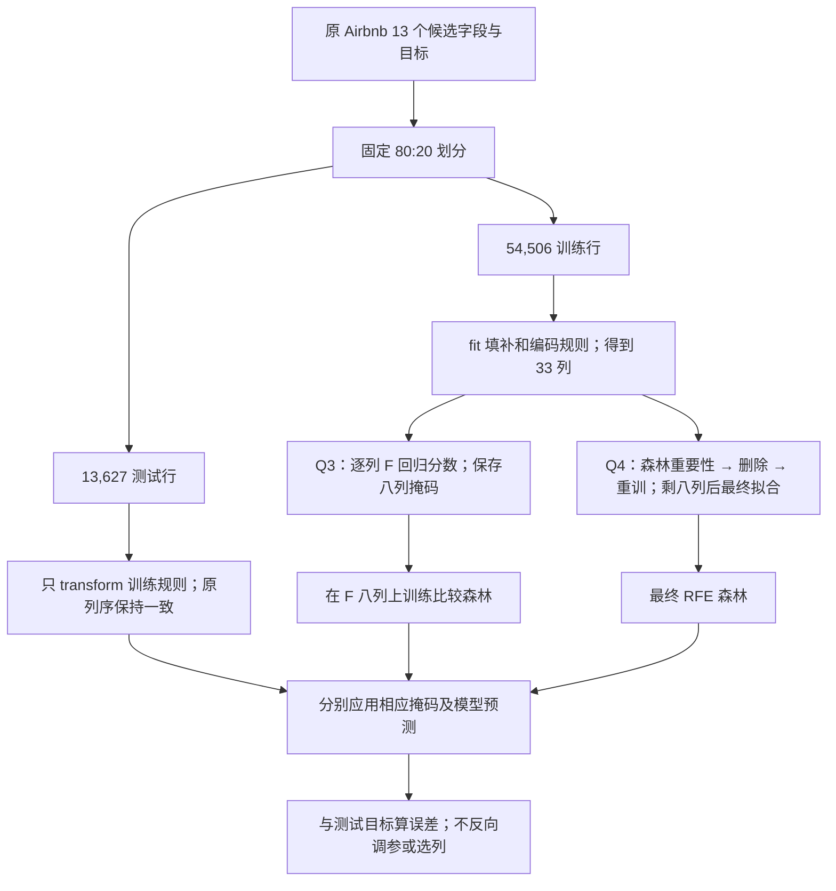

# W04 手把手学习：从第一次写代码到解释特征选择

这份指南陪你操作同一份完成版 Notebook。**要提交的是 HTML；平时继续学习和改写用 `.ipynb`。** 老师的原件没有改动，答案在副本里续写。先读下面的概念，再在 Notebook 中运行对应 cell；不用到各个小文件拼代码。

- [打开可继续编辑的 Notebook](../work/IS6400_Week4_60234350_LI_Binxiong.ipynb)
- [打开供人工评阅的 HTML](../submission/IS6400_Week4_60234350_LI_Binxiong.html)
- [[IS6400_Business_Data_Analytics/assignment/00-overview/作业总览|回作业总览]] · [[IS6400_Business_Data_Analytics/_meta/IS6400作业制作规范|本课作业标准]]

> **本次阅读口径（2026-10-27）**：本指南讲解已保存的 83-cell 本人 Notebook，不改其中代码或结果，不执行用户 kernel。下文具体名单、表格、误差及“已核”运行项来自历史保存输出，本次只读对照源文件并复算重要数学，不是当日重新训练。行政/提交字段沿用原记录，不据教程修订升级本人状态。原始 43-cell 教学文件在本人 Notebook 的 cells 4–46；新增答案从 cell 47 开始。

## 0. 先知道做什么、交什么、从哪里开始

2026-09-30 核到当前 Canvas [作业页](https://canvas.cityu.edu.hk/courses/71457/assignments/330603)：**2026-10-02 23:59，香港时间（UTC+08:00）**，10 Canvas points，允许上传 HTML 或 PDF。新版 [Notebook](https://canvas.cityu.edu.hk/courses/71457/files/16057486) 是 43 个 cell，四题内部 20／40／20／20，共 100 分。旧 37-cell 版本的 80 分题面已经过时。

| 题目 | 你实际要做的事 | 结果在哪里 |
|---|---|---|
| Q1 | 用 ANOVA F 重做 Iris 单变量筛选，解释统计量及 filter／wrapper | Notebook Q1、Table 1 |
| Q2 | 调用 SFS 选两个特征，解释每轮怎样找，并报告具体名称 | Notebook Q2、Table 2 |
| Q3 | 对连续 `log_price` 用 F 回归筛出 8 列，解释分类检验不适合的原因 | Notebook Q3、Table 3–4 |
| Q4 | 用随机森林加 RFE 保留 8 列，比较 Q3 的真实名单和原因 | Notebook Q4、Table 5–6 |
| 必做深度 | 六种 Iris 组合全核、嵌套验证、Airbnb 测试误差与冗余／局限 | Appendix A、Table A1–A5、Figure A1 |

## 1. 第一次打开和运行

在 Anaconda Prompt 或 PowerShell 中，到工作目录后启动 Jupyter：

```powershell
Set-Location -LiteralPath 'D:\上课资料\CityU\IS6400_Business_Data_Analytics\assignment\graded\A05-week4\work'
& 'D:\anaconda3\python.exe' -m jupyter notebook 'IS6400_Week4_60234350_LI_Binxiong.ipynb'
```

Notebook 是一串单元格：Markdown cell 放解释，code cell 放 Python。`Shift+Enter` 执行当前格并移到下一格；左侧出现 `[*]` 表示还在运行，出现数字表示已完成。内核（kernel）是保存变量、执行 Python 的进程。只运行后面的格却没运行前面的导入，常会得到 `NameError`。

第一次检验选 **Kernel → Restart Kernel and Run All Cells**，清掉上次运行留下的变量，再按顺序执行。中途不要改数据或在 RFE 运行时跳到后面的格。单线程版本在本机完整运行约三分钟；不同电脑可能更慢。

### 1.1 路径格逐行怎么读

`from pathlib import Path` 导入处理文件路径的类。`Path.cwd()` 返回当前工作目录；`.resolve()` 将它变成明确的绝对路径。`=` 是赋值，`==` 才是比较，例如 `n == 150` 问 n 是否等于 150。`START` 是变量名，不是必须照用的命令。

方括号 `[...]` 建列表，逗号分隔项目；`*START.parents` 把所有上级目录逐个展开到列表。`for parent in ...:` 把每个目录依次取出，缩进的行都在循环里。`parent / "course_files_export"` 是 Path 的拼路径写法，不是除法。

`.is_file()` 检查文件存在；`and` 要求两个条件都真。找到目录后赋给 `DATA` 并 `break` 退出循环。这里 `for ... else:` 中的 else 是“循环没有用 break 找到时”执行，明确报缺文件。`os.chdir(DATA)` 让老师原代码的相对文件名从数据目录读取，没有移动或修改任何文件。

```python
from pathlib import Path
import os
# Limit worker threads inside this kernel on a memory-constrained computer.
for variable in ["OMP_NUM_THREADS", "OPENBLAS_NUM_THREADS", "MKL_NUM_THREADS", "BLIS_NUM_THREADS"]:
    os.environ[variable] = "1"
import numpy as np

START = Path.cwd().resolve()
candidates = [START]
for parent in [START, *START.parents]:
    candidates.extend([parent / "course_files_export",
                       parent / "IS6400_Business_Data_Analytics/course_files_export"])
for candidate in candidates:
    if (candidate / "iris.txt").is_file() and (candidate / "Airbnb.csv").is_file():
        DATA = candidate
        break
else:
    raise FileNotFoundError("Put iris.txt and Airbnb.csv beside this notebook or in course_files_export.")
os.chdir(DATA)
np.random.seed(42)
print("Data directory:", DATA.name)
```

预期输出是 `Data directory: course_files_export`。如果失败，检查 `iris.txt` 和 `Airbnb.csv` 是否仍在课程原始材料目录，不要靠修改原始文件名解决。

## 2. 先补 Python 和数据表基础，再读 Q1

### 2.1 三种对象及常用写法

一张 DataFrame 是“有行列标题的表”；Series 是“一列，带行索引”；NumPy array 是“数值阵列”。`X_iris` 是 150 × 4 表，`y_iris` 是 150 个标签。模型用四个花朵测量去猜品种：输入列叫特征，想预测的列叫目标。

`df["class"]` 取一列 Series；`df[["petal-L", "petal-W"]]` 取两列组成表。外层方括号是“从 df 取”，内层列表是“我要这些列”。`.shape` 返回 `(行数, 列数)`，`.columns` 返回列名，`.tolist()` 将列名对象转成普通列表。`.iloc[indices]` 按位置取行；在数据模型里，行表示对象，列表示对象的属性，别把两者混淆。

`True/False` 是布尔值。形如 `[False, False, True, True]` 的布尔掩码表示“前两列不要、后两列要”。`.get_support()` 给的就是掩码。`X.columns[mask]` 用它筛出列名；`.transform(X)` 真正筛出数据。这两步分别回答“选了谁”和“留下的数值是什么”。

函数是能反复调用的一段操作，括号内是参数。`SelectKBest(score_func=f_classif, k=2)` 里的 `score_func=` 指定打分规则，`k=` 指定留几个。写 `f_classif` 是把函数本身交给选择器，不先自行调用；写 `f_classif(X, y)` 则是立即计算。`.fit(...)` 学会选择规则，名字后面的 `_`（如 `.scores_`）通常表示拟合后才存在的结果。

### 2.2 导入与输出函数

这格只准备工具，不训练模型。`def show_table(...)` 定义显示函数：`frame` 是输入表，`caption` 是标题，`scientific=()` 是默认不特别指定科学计数法。`f"{value:.6f}"` 是格式化字符串：六位小数；`.6e` 是六位小数的科学计数法。显示改变不了原始数值，所以选择不会被四舍五入影响。`return` 在需要时返回函数结果；这里 `display(...)` 直接展示表。

```python
import itertools
import json
import hashlib
import platform
import pandas as pd
import matplotlib.pyplot as plt
import sklearn
from IPython.display import display, Markdown
from sklearn.base import clone
from sklearn.feature_selection import SelectKBest, f_classif, f_regression, SequentialFeatureSelector, RFE
from sklearn.pipeline import Pipeline, make_pipeline
from sklearn.preprocessing import StandardScaler, OneHotEncoder
from sklearn.impute import SimpleImputer
from sklearn.compose import ColumnTransformer
from sklearn.linear_model import LogisticRegression
from sklearn.ensemble import RandomForestRegressor
from sklearn.dummy import DummyRegressor
from sklearn.model_selection import train_test_split, StratifiedKFold, cross_val_score
from sklearn.metrics import mean_absolute_error, mean_squared_error, r2_score

SEED = 42
pd.set_option("display.float_format", lambda value: f"{value:.6f}")
plt.rcParams.update({"font.size": 12, "axes.spines.top": False, "axes.spines.right": False})

def show_table(frame, caption, scientific=()):
    formats = {column: "{:.6f}" for column in frame.select_dtypes(include="floating").columns}
    for column in scientific:
        formats[column] = "{:.6e}"
    display(frame.style.format(formats, na_rep="—").hide(axis="index").set_caption(caption))

print("Python", platform.python_version(), "| pandas", pd.__version__,
      "| NumPy", np.__version__, "| scikit-learn", sklearn.__version__)
```

这格导入选择器、模型、分折与指标；SEED 保存随机配置。`show_table` 只调整表的显示格式；末行打印运行环境，保存输出为 Python 3.12.3、pandas 2.3.3、NumPy 1.26.4、scikit-learn 1.5.1。

## 3. Q1：为什么 F 值能筛花朵测量

### Question 1（原题，当前源 cell 39）

> use f_classif as your evaluation measurement and redo the feature selection in Univariate feature selection. what does "f_classif" represent? Is this a filter model or wrapper model? (20 points).

中文读题：改用 `f_classif` 重做单变量特征选择，说明函数统计含义，判断 filter 或 wrapper；沿用 Iris 留两个特征。不是训练回归价格的模型。对应本人 Notebook cells 49–51。


想象三个品种的花瓣长度各集中在不同位置：品种之间差得大，同品种里面差得小，这列就有区分类别的能力。ANOVA 将这两个量相除。`f_classif` 同时返回 F 分数与 p 值；F 越大，组间均值差异相对组内波动越强。p 值对应“各组均值相同”假设下的检验，不是预测正确率，也不是因果影响大小。

这叫过滤模型（filter），因为不用选一个分类器反复预测来评估子集。它有使用目标标签，不能将它叫无监督。它一次只看一列，也看不到两个单独普通但组合有用的特征。

先用完整小例把 F 算出来（💡 笔记补充）。两类测量分别是 (1,3) 与 (5,7)，每类 2 行，总体均值 4，两类均值 2、6。组间平方和为 $2(2-4)^2+2(6-4)^2=16$；组内平方和为 $(1-2)^2+(3-2)^2+(5-6)^2+(7-6)^2=4$。

组间有 2 个组均值，但受总体均值约束，只剩 1 个独立变化方向；组内每类各估一个均值，4 行减 2 个均值剩 2 个方向。各平方和除以各自方向数，得到均方 16 与 2，因此 F=8。一般式为：

$$
F_j=\frac{\sum_{g=1}^{G}n_g(\bar x_{gj}-\bar x_j)^2/(G-1)}{\sum_{g=1}^{G}\sum_{i\in g}(x_{ij}-\bar x_{gj})^2/(N-G)}.
$$

每个符号对应一类对象；平方和单位都是原测量的平方，相除后的 F 无单位。

| 符号 | 含义 | Iris 值或读法 |
|---|---|---|
| $j$、$i$ | 当前测量列、当前花朵行 | 如 petal-L 与第 1 行 |
| $G$、$N$ | 类别数、总行数 | 3、150 |
| $n_g$ | 第 g 类行数 | 每种花 50 行 |
| $x_{ij}$ | 第 i 朵花的第 j 列测量 | 单位 cm |
| $\bar x_{gj}$、$\bar x_j$ | 该类均值、总体均值 | 都由该训练表求得 |

把例中所有测量乘 10，两个平方和都乘 100，F 仍为 8。所有类均值相同则分子 0；组内完全没有变化时分母可能为 0，不能把无穷大或未定义值当正常检验。p 值还依赖独立性、正态/方差等检验条件，F 排序本身不证明这些条件成立。

Notebook Q1 中另有 12÷2=6 的简短比值例；两例输入不同，不能混用。实际代码如下；`header=None` 因为原文件无表头，`names=` 给五列起名，`assert` 用于核输入契约。如果 assert 失败，先查版本和输入，不要删断言让它“通过”。

```python
iris_features = ["sepal-L", "sepal-W", "petal-L", "petal-W"]
iris_q = pd.read_csv(DATA / "iris.txt", header=None, names=iris_features + ["class"])
X_iris = iris_q[iris_features]
y_iris = iris_q["class"]
assert X_iris.shape == (150, 4) and y_iris.nunique() == 3
assert not iris_q.isna().any().any()

anova_selector = SelectKBest(score_func=f_classif, k=2)
anova_selector.fit(X_iris, y_iris)
anova_names = X_iris.columns[anova_selector.get_support()].tolist()
anova_table = pd.DataFrame({"Feature": iris_features,
                            "F score": anova_selector.scores_,
                            "p-value": anova_selector.pvalues_,
                            "Selected": anova_selector.get_support()})
show_table(anova_table.sort_values("F score", ascending=False), "Table 1. Iris ANOVA F ranking", ["p-value"])
print("Q1 selected features:", anova_names)
print("Transformed shape:", anova_selector.transform(X_iris).shape)
```

你应看到 Table 1：`petal-L` 的 F 为 **1179.034328**，`petal-W` 为 **959.324406**，比另外两列高，选出的形状是 `(150, 2)`。这说明删了两列，没有删花朵。四个 p 值都小仍然只选两个，因为题目指定 k=2。关联的讲义知识见 [[IS6400_Business_Data_Analytics/notes/M04-特征工程-特征重要性与降维|M04 特征工程]] 和 [[IS6400_Business_Data_Analytics/notes/T04-特征选择与PCA实战-Iris|T04 教学示例]]。

英文参考答案（⚪ 笔记自拟；名称与官方 Q1 一致）：`f_classif` computes a one-way ANOVA F statistic for each feature. It selects petal length and petal width here. This is a filter method because it ranks features by a statistical test without repeatedly fitting a classifier to evaluate feature subsets.

## 4. Q2：SFS 一轮一轮选，为什么答案可能不同

### Question 2（原题，当前源 cell 40）

> Read documentation of "SequentialFeatureSelector" and use it to select the top TWO features. What is the mechnism of this tool? What are these two optimal features? (40 points)
>
> document: https://scikit-learn.org/stable/modules/generated/sklearn.feature_selection.SequentialFeatureSelector.html

中文读题：读文档后实际调用 SFS，选 **两个**特征，解释工具机制并报名称。原词 `mechnism` 应为 mechanism；“optimal”要连模型、评分和分折理解，不能扩大为普遍最优。对应本人 Notebook cells 52–57。


### 4.1 从“给每列打分”转到“试一个模型”

包装模型（wrapper）要先确定预测模型，再试不同输入组合。这次模型是逻辑回归（LogisticRegression）：虽然名字里有 regression，这里做的是品种分类。它对每个类别建立一组输入权重和常数项，将输入的加权和转成类别概率，再选概率最高者。

例如两个候选类别的加权分数是 1 与 0，经指数后为约 2.718 与 1；各除以总和 3.718，概率为约 0.731 与 0.269，因此预测第一类。Iris 实际有三类，做同样的归一化；这些是模型估计，不能直接当现实正确率。

`fit` 调整权重，使真实类别得到更高概率，同时惩罚过大的权重以限制复杂度，这叫正则化（regularisation）。这里 `C=1.0` 固定惩罚强弱，C 越大通常惩罚越弱；`max_iter=3000` 是数值求解的迭代上限。达到上限并有不收敛警告时，不能只因仍有预测便称拟合已收敛。当前任务通过公开 sklearn 完成优化，不要求手写底层求解器。

`StandardScaler` 学训练数据每列的均值和标准差，再把数值改成“距均值多少个标准差”。例如训练均值 5、标准差 2，原值 7 变成 (7−5)÷2=1。参数来自训练行，不能从测试行学。`make_pipeline` 将缩放和模型放到一起，每次 CV 都在该折训练行重新拟合缩放。

五折交叉验证把 150 行分成五份，每次用四份训练、剩下一份评估，循环五次。分层（stratified）让三个品种的比例大致相同。`random_state` 固定打乱的结果，方便复现；它不是让模型更准的魔法参数。`accuracy` 是预测对的比例，0.960000 表示比例而不是 0.96%。

```python
iris_model = make_pipeline(StandardScaler(), LogisticRegression(C=1.0, max_iter=3000, random_state=SEED))
iris_cv = StratifiedKFold(n_splits=5, shuffle=True, random_state=SEED)
sfs = SequentialFeatureSelector(estimator=iris_model, n_features_to_select=2,
                                direction="forward", scoring="accuracy", cv=iris_cv, n_jobs=1)
sfs.fit(X_iris, y_iris)
sfs_names = X_iris.columns[sfs.get_support()].tolist()
print("Q2 selected features:", sfs_names)
print("Transformed shape:", sfs.transform(X_iris).shape)
```

这格先建缩放＋分类管线，再按固定五折搜索；fit 保存选择规则，get_support 映射回原列名。保存输出为 sepal-L、petal-W，shape 为 (150,2)，两列保持输入列序。

### 4.2 用真候选分数看懂贪心搜索

第一轮四选一，第二轮在已选列的基础上再三选一。算法不会后悔换掉第一轮选择，所以称“贪心”：每步追求当前最高分，不保证所有子集中最高。此处 `chosen + [candidate]` 拼出候选列表；列表推导式 `[name for name in ... if ...]` 是简洁的循环筛选写法；`np.argmax(means)` 返回最大值在列表里的位置。

下面代码是本人保存的两轮重放程序，本次没有重新执行。每个候选、每一折均使用新的未拟合模型副本；训练折 fit 缩放与权重，验证折只 transform 后预测。第一轮 4 候选×5 折=20 次 fit，第二轮 3×5=15 次，共 35 次候选折拟合；随后 `selected_cv` 再做 5 次，是核同一选择口径，不是独立测试。

保存 Table 2 的一行是一组候选子集，分数为五折准确率平均。这里按入选顺序显示候选；最终 transform 的列仍按原输入列序。

| 轮次 | 候选组合 | CV 准确率 |
|---|---|---:|
| 1 | sepal-L | 0.746667 |
| 1 | sepal-W | 0.540000 |
| 1 | petal-L | 0.946667 |
| 1 | petal-W | 0.960000 |
| 2 | petal-W + sepal-L | 0.960000 |
| 2 | petal-W + sepal-W | 0.953333 |
| 2 | petal-W + petal-L | 0.953333 |

先选 petal-W，再添加 sepal-L；第二次没有超过第一轮 0.960000，仍选满两列，因为本调用按固定个数停止。SFS 学的是掩码，原 `iris_model` 模板不会因此成为可直接预测的最终分类器；实际预测需在所选训练列另 fit 模型。

```python
chosen = []
search_rows = []
for step in [1, 2]:
    remaining = [name for name in iris_features if name not in chosen]
    means = []
    for candidate in remaining:
        subset = chosen + [candidate]
        scores = cross_val_score(iris_model, X_iris[subset], y_iris, cv=iris_cv, scoring="accuracy")
        means.append(float(scores.mean()))
        search_rows.append({"Step": step, "Candidate subset": " + ".join(subset),
                            "CV accuracy": float(scores.mean()), "Fold SD": float(scores.std(ddof=1))})
    chosen.append(remaining[int(np.argmax(means))])
assert set(chosen) == set(sfs_names)
search_table = pd.DataFrame(search_rows)
show_table(search_table, "Table 2. Forward SFS candidate scores (selection data, not a test set)")
print("Search order:", chosen)
```

外层循环推进两轮，内层循环逐个试剩余列。`means` 每轮清空，`chosen` 跨轮保存；最大平均分的位置映射到候选名。保存输出的顺序为 petal-W、sepal-L，与 transform 的原列序不同。

```python
selected_cv = cross_val_score(iris_model, X_iris[sfs_names], y_iris, cv=iris_cv, scoring="accuracy")
display(Markdown(f"**Answer.** Under the stated model and folds, SFS selects **{', '.join(sfs_names)}** "
                 f"with selection-CV accuracy **{selected_cv.mean():.6f}**. The first search choice is "
                 f"**{chosen[0]}**, followed by **{chosen[1]}**. The ANOVA selection in Q1 "
                 f"{'agrees' if set(anova_names) == set(sfs_names) else 'differs'} with this pair."))
```

这里选出 **sepal-L 与 petal-W**，选择 CV 分数 **0.960000**。它与 Q1 不同，并不是表格写错。Q1 看单列的均值区分；Q2 看指定分类器使用组合后的正确比例。附录核全部六种双列组合，本次这个组合确实最高，但仍不能据此宣布它对任何分类器、划分和新花朵都最好。

最容易搞混的是：这五折的分数已经用于选特征，不能再把它当“模型从没见过的新数据表现”。真正评估整个选特征程序，要让选特征本身也被关在外层训练折里，见 §7。

英文参考答案（⚪ 笔记自拟）：Forward SFS evaluates every possible addition to the current subset using the specified estimator and cross-validation score. With the saved standardised logistic-regression pipeline and stratified five-fold splits, it selected sepal-L and petal-W. This greedy result depends on the settings and is not a universal optimum. The official Q2 explicitly allows a different feature list when the settings differ.

## 5. Q3：先把 Airbnb 转成可计算输入，再选八列

### Question 3（原题，当前源 cell 41）

> Load Airbnb.csvon Canvas-Week4 Homepage. The target is log_price (regression). Use SelectKBest with f_regression to select the top 8 features. Print the selected feature names. Briefly explain why chi2 and f_classif are not appropriate here. (20 Points)

中文读题：用指定 `SelectKBest`＋`f_regression` 选 **八列**，打印名称，解释两个分类检验为何不适合连续价格目标。不能把它改成选三个、只处理数值列或任意换选择算法。对应本人 Notebook cells 58–64。官方另有具体名单评分约束，见本节末与 §9 后的对照。


### 5.1 连续目标和离散标签为什么用不同检验

Iris 目标是三种品种；Airbnb 目标是连续 `log_price`。用 `f_classif` 把不同价格当不同类别，就把原问题改成分类。`chi2` 即使能处理非负指示列，也仍需要类别目标，不能因为输入非负就忽略目标类型。`f_regression` 衡量每列与连续目标的线性联系，适合这里。

`log_price` 是价格的对数，因此预测误差也以对数价格单位计。预测价格 100 元与对数预测误差 0.1 不是一个量。`id` 是记录身份，不是可加减的经济数量；从目标价格生成输入更会泄漏答案，因此两列都排除。

### 5.2 先划分，不让测试行帮助填补和编码

读取后只建立衍生表，原 CSV 不动。`.select_dtypes(include="number")` 找出数值列；`cleaning_fee` 是布尔列，在数值矩阵里代表 1／0；剩下的是类别。`X_train_raw, X_test_raw, y_train, y_test = ...` 是一次拆包，把返回的四个对象分别赋给四个变量。

```python
airbnb = pd.read_csv(DATA / "Airbnb.csv")
X_air = airbnb.drop(columns=["id", "log_price"])
y_air = airbnb["log_price"]
X_train_raw, X_test_raw, y_train, y_test = train_test_split(X_air, y_air, test_size=0.20, random_state=SEED)
assert len(X_train_raw) + len(X_test_raw) == len(airbnb) == 68133
assert set(X_train_raw.index).isdisjoint(X_test_raw.index)
assert y_air.notna().all() and np.isfinite(y_air).all()
numeric = X_air.select_dtypes(include="number").columns.tolist()
binary = ["cleaning_fee"]
categorical = [name for name in X_air.columns if name not in numeric + binary]
missing_table = pd.DataFrame({"Original feature": X_air.columns,
                              "Missing rows": X_air.isna().sum().to_numpy(),
                              "Representation": ["numeric" if c in numeric else "Boolean 0/1" if c in binary
                                                  else "one-hot category" for c in X_air.columns]})
show_table(missing_table, "Table 3. Airbnb candidate fields and missing values (descriptive counts)")
print("Train rows:", len(X_train_raw), "| Test rows:", len(X_test_raw), "| Original candidate fields:", X_air.shape[1])
```

预期全数据 68,133 行，训练 **54,506** 行、测试 **13,627** 行；表中 `review_scores_rating` 缺失 15,275 行，两种 host 字段各缺失 180 行。训练／测试索引不重叠。`.sum()` 对布尔缺失标记相加，就得到缺失行数。

字符串城市不能直接喂给这些选择器，也不能随便编码 NYC=1、SF=2 暗示 SF 是 NYC 的两倍。独热编码（one-hot）给每个类别一列，例如 NYC 房源 `city_NYC=1`，其他为 0。一个原字段会分成多列，所以“8 个特征”在这份答案里是 **8 个编码列**，可能来自不到 8 个原字段。

原题没有写出编码细节；后来官方解答用了 `drop='first'`、不同填补和全表筛选，并对 Q3 给出参考名单与扣分条款。本人的 train-only、全部类别列方案可以解释为何有差异，不能由此保证 Q3 评分认可。比较预测程序时，两种选择方法仍须共用同一候选矩阵。

数值缺失用训练中位数；类别缺失变成 `Missing`，然后编码。`fit_transform` 在训练行学习规则并应用，`transform` 在测试行只应用。`handle_unknown="ignore"` 遇到训练中没见过的类别用全零表示，不临时重学列。ColumnTransformer 的每个三元组依次是“分支名称、处理方法、列名单”。

```python
preprocess = ColumnTransformer([
    ("numeric", SimpleImputer(strategy="median"), numeric),
    ("categorical", make_pipeline(SimpleImputer(strategy="constant", fill_value="Missing"),
                                  OneHotEncoder(handle_unknown="ignore", drop=None, sparse_output=False)), categorical),
    ("binary", "passthrough", binary),
], verbose_feature_names_out=False)
X_train_array = preprocess.fit_transform(X_train_raw)
X_test_array = preprocess.transform(X_test_raw)
encoded_names = preprocess.get_feature_names_out()
X_train = pd.DataFrame(X_train_array, columns=encoded_names, index=X_train_raw.index)
X_test = pd.DataFrame(X_test_array, columns=encoded_names, index=X_test_raw.index)
assert X_train.shape[1] == len(encoded_names) == X_test.shape[1]
assert np.isfinite(X_train.to_numpy()).all() and np.isfinite(X_test.to_numpy()).all()
print("Encoded candidate predictors:", len(encoded_names))
print("Target:", y_train.name, "| Example city indicators:", [n for n in encoded_names if n.startswith("city_")])
```

预期得到 **33 个候选编码列**。列的命名保留原字段和类别，不能取了前八列却报成分数前八。接下来 `.fit` 计算每列的 F 与 p 值，`get_support` 决定名单，`.corrwith(y_train)` 补上有正负号的相关系数。

F 回归逐列比较“只用目标均值预测”与“允许该列做线性预测”能解释多少变化。相关系数（Pearson correlation）r 是两列各减均值后乘积的总和，除以两列平方偏差和乘积的平方根；它在 −1 到 1 之间，符号表示线性同向或反向。

在带常数项、中心化、非恒定列的单变量线性回归中，$r_j^2$ 是解释的变动比例，$1-r_j^2$ 是未解释比例。新增一列用一个方向，估计常数与斜率后误差剩 $n-2$ 个自由方向，因此：

$$
F_j=\frac{r_j^2}{1-r_j^2}(n-2).
$$

n 为当前训练行数，这里 54,506；j 为当前编码列。r=0.5、n=100 时，$F=(0.25/0.75)\times98=32.666667$；r=−0.5 也同分，所以方向要看带符号 r。r=0 时 F=0；常数列使相关未定义、完全线性关系使分母为 0，库会按 `force_finite` 等实现政策处理，不能当普通样本值解释。p 值的推断还需相应线性误差模型条件，不能当因果证据。

```python
f_selector = SelectKBest(score_func=f_regression, k=8)
f_selector.fit(X_train, y_train)
f_mask = f_selector.get_support()
f_names = encoded_names[f_mask].tolist()
correlations = X_train.corrwith(y_train)
f_table_all = pd.DataFrame({"Encoded feature": encoded_names, "F score": f_selector.scores_,
                            "p-value": f_selector.pvalues_, "Correlation": correlations.to_numpy(),
                            "Selected": f_mask})
f_table = f_table_all.loc[f_mask].sort_values("F score", ascending=False)
assert f_mask.sum() == 8
show_table(f_table, "Table 4. Eight Airbnb features selected by f_regression", ["p-value"])
print("Q3 selected features:", f_names)
```

这格 fit 逐列计算 F 分数，get_support 保存八列掩码，sort_values 仅把显示表按分数降序排列。后续模型依掩码保持原列顺序。

### 5.3 读取八列与保留评分边界

实际八列：**accommodates, bathrooms, bedrooms, beds, cancellation_policy_flexible, cancellation_policy_strict, city_SF, cleaning_fee**。它们包括容量、政策、城市和清洁费；是训练数据上的单列关联名单。科学计数法显示为零的 p 值属于浮点下溢，不是证明概率严格等于零。不要将相关系数解释成控制其他条件后的因果效应。

#### 5.3.1 英文参考答案与评分限制

英文参考答案（⚪ 笔记自拟，报告本人保存结果）：With the saved training-only preprocessing, SelectKBest with `f_regression` retained accommodates, bathrooms, bedrooms, beds, cancellation_policy_flexible, cancellation_policy_strict, city_SF and cleaning_fee. Both `chi2` and `f_classif` use a categorical target, whereas log_price is continuous. This list differs from the official Q3 list by one feature; the rubric deducts 2 points for each missing reference feature, so the alternative preprocessing does not guarantee grading acceptance.

## 6. Q4：随机森林和 RFE 各做什么

### Question 4（原题，当前源 cell 42）

> Load Airbnb.csvon Canvas-Week4 Homepage. The target is log_price (regression). Use RandomForestRegressor with RFE to select 8 features. Print the selected feature names. Briefly compare them with your answer in Question 3 and discuss any difference. (20 Points)
>
> document: https://scikit-learn.org/stable/modules/generated/sklearn.ensemble.RandomForestRegressor.html#sklearn.ensemble.RandomForestRegressor

中文读题：指定随机森林回归器与 RFE，留八列并打印；然后比较 **自己的 Q3 与 Q4** 的共同/不同列并解释机制。不能只复制官方示例差异。对应本人 Notebook cells 65–69。


先看一棵回归树（regression tree）怎样训练。一个节点是一堆训练行；叶子预测该堆目标的平均值。树试不同特征与阈值，把行分左右，选择使平方误差减少较多的切法，再在孩子继续；达到深度、最小叶行数或无有效改善便停止。

用四行目标 1、1、3、5 看一刀（💡 笔记补充）：父均值 2.5，平方误差和 $2.25+2.25+0.25+6.25=11$。某条件切成 (1,1) 与 (3,5)，两叶均值 1、4，误差和为 0 与 2；平均平方误差从 11/4 降为 2/4，这次减少 2.25。不是把类别 Gini 公式直接拿来回归。

随机森林回归（Random Forest Regression）训练很多这样的树。当前保存参数未显式改 `bootstrap`，对应版本默认每树有放回抽训练行；候选特征数由 `max_features` 决定，这里 1.0 表示每次可考虑全部特征。新房源在每树沿条件到叶子，最后平均各树预测，例如两树预测 3 与 5，森林给 4。它能利用“人数达到某阈值，再结合城市”等非线性组合。RFE 则负责取舍输入：先用所有候选列拟合森林，按重要性删掉最弱一列，再重新拟合，重复到剩八列。两者分工别混在一起。

#### 森林参数与递归状态

`n_estimators=120` 指 120 棵树；`max_depth=12` 限制一棵树最多走多深；`min_samples_leaf=5` 要求末端叶子至少五行，减少少数样本的偶然切分；`step=1` 每轮删除一列；`n_jobs=1` 只用一个 CPU 工作单元，降低内存压力。参数在看测试结果前固定，不是看到结果后换到最好的一组。

`.ranking_` 为 1 表示保留，八列的 1 不表示它们重要性相等。`.estimator_` 是最后拟合的森林；它的 `.feature_importances_` 才能比较保留列在该模型里的相对贡献。这个贡献把每个使用该列的分裂带来的误差下降按节点占训练权重累计，再在树内归一化、跨树平均得到；不是价格的因果影响。33 列以 step=1 留 8 列，需要 25 次删除轮，再在 8 列上拟合最终模型，共 26 个森林，而不是只训练一次。RFE 用原模板的未拟合副本，原 `forest` 不因 RFE.fit 自动成为最终八列模型。

如果第二轮活动列由原 0/1/2 变为原 0/2，当前局部下标 1 已指原列 2，不能继续按旧下标读名。每轮活动列数严格减少，到八列停止；被删列不回来，所以也没有全局最优子集保证。

```python
forest = RandomForestRegressor(n_estimators=120, max_depth=12, min_samples_leaf=5,
                               max_features=1.0, random_state=SEED, n_jobs=1)
rfe = RFE(estimator=forest, n_features_to_select=8, step=1)
rfe.fit(X_train, y_train)
rfe_mask = rfe.get_support()
rfe_names = encoded_names[rfe_mask].tolist()
assert rfe_mask.sum() == 8 and np.all(rfe.ranking_[rfe_mask] == 1)
rfe_table = pd.DataFrame({"Encoded feature": rfe_names,
                          "Final forest importance": rfe.estimator_.feature_importances_,
                          "RFE rank": rfe.ranking_[rfe_mask]})
show_table(rfe_table.sort_values("Final forest importance", ascending=False),
           "Table 5. Eight Airbnb features retained by random-forest RFE")
print("Q4 selected features:", rfe_names)
```

实际八列：**accommodates, bathrooms, number_of_reviews, review_scores_rating, bedrooms, property_type_House, city_LA, city_SF**。接下来逐列对照 Q3；`set` 是集合，`&` 是交集、`|` 是并集、`-` 是差集；集合不保证原顺序，所以表格仍用原编码顺序排列。

```python
union_names = [name for name in encoded_names if name in set(f_names) | set(rfe_names)]
comparison = pd.DataFrame({"Encoded feature": union_names,
                            "Q3: f_regression": [name in f_names for name in union_names],
                            "Q4: forest RFE": [name in rfe_names for name in union_names]})
show_table(comparison, "Table 6. Feature membership in Q3 and Q4")
shared = sorted(set(f_names) & set(rfe_names))
only_f = sorted(set(f_names) - set(rfe_names))
only_rfe = sorted(set(rfe_names) - set(f_names))
display(Markdown(f"The methods share **{len(shared)} of eight** encoded predictors: "
                 f"**{', '.join(shared)}**. F selection alone keeps **{', '.join(only_f) or 'none'}**; "
                 f"RFE alone keeps **{', '.join(only_rfe) or 'none'}**."))
```

两种方法共享 **accommodates、bathrooms、bedrooms、city_SF** 四列。F 回归单独保留 beds、两种取消政策及清洁费；RFE 单独保留评论数量、评分、House 及 LA。可以说“算法使用不同证据，所以得到不同输入组合”，不能只写“随机森林更强”。它是否对预测更合适，要看后面的真实误差。

英文参考答案（⚪ 笔记自拟）：The saved random-forest RFE retained accommodates, bathrooms, number_of_reviews, review_scores_rating, bedrooms, property_type_House, city_LA and city_SF. It shares accommodates, bathrooms, bedrooms and city_SF with my Q3 result. The F test ranks individual linear associations, whereas forest RFE repeatedly refits a nonlinear model on the remaining columns. This explains why the lists can differ; it does not establish causal effects or guarantee better test accuracy. The official Q4 allows different retained features and requires discussion based on one's own results.

### 6.1 把“自己的理解”写到有依据

容量列常一起变化：房间多的房源往往也容纳更多人、床更多。单列关联可能让它们都很高；模型把多个特征一起用时，有些可能互相替代。这里 accommodates 与 beds 的训练相关 **0.828606**，为这种解释提供了实际证据，但相关依然不是因果。

森林的重要性可能偏好连续特征或可切分位置很多的特征；类别字段又被拆成多列，证据分散。这是比较的限制，而不是简单宣称“森林找出了真实定价规律”。附录的测试误差更接近我们真正关心的预测问题。

### 6.2 先画清训练与评估的边界

图中箭头表示数据流。Airbnb 的两种选择器共用同一训练预处理结果；测试只读训练规则。Iris 的 CV 则要在每个训练折重新拟合其管线，不能先全表选好列。



走一条测试房源：它不进入 P，只经 X 用训练中位数和训练类别转换；F 模型读取自己的八列，RFE 读取另一套八列。若看 Z 后再挑模型或调参，这个测试集便参与了选择，需要另留新数据评估；“之前没训练过”不能消除后续选择造成的偏差。

## 7. 附录：做了哪些额外检验，怎么复做

### 7.1 全部六种双列组合

`itertools.combinations(iris_features, 2)` 从四列中不重复地列出所有两列组合。仍用相同 classifier 和相同 CV；只有列组合变化，才能公平判断 SFS 是否错过更好组合。

```python
pair_rows = []
for pair in itertools.combinations(iris_features, 2):
    scores = cross_val_score(iris_model, X_iris[list(pair)], y_iris, cv=iris_cv, scoring="accuracy")
    pair_rows.append({"Pair": " + ".join(pair), "CV accuracy": float(scores.mean()),
                      "Fold SD": float(scores.std(ddof=1)), "Selected by SFS": set(pair) == set(sfs_names)})
pair_table = pd.DataFrame(pair_rows).sort_values("CV accuracy", ascending=False, kind="stable")
show_table(pair_table, "Table A1. All six Iris pairs, under the Q2 selection criterion")
best_pair_score = pair_table["CV accuracy"].max()
tied_pairs = pair_table.loc[np.isclose(pair_table["CV accuracy"], best_pair_score), "Pair"].tolist()
display(Markdown(f"SFS's chosen pair {'matches' if np.isclose(selected_cv.mean(), best_pair_score) else 'does not match'} "
                 f"the largest mean score **{best_pair_score:.6f}**. The highest-scoring pair(s) are "
                 f"**{'; '.join(tied_pairs)}**. This verifies this small search problem; "
                 "it does not turn a greedy algorithm into a general exhaustive-search guarantee."))
```

本次 SFS 组合最高为 **0.960000**；Q1 的 petal 双列组合是 **0.953333**。差异只有 **0.006667**，在 150 行小数据里不应夸大；这个穷举证据只适用于当前设置。

### 7.2 内层选特征，外层核泛化

外层每次留下 30 朵完全不参与选特征，剩 120 朵在内层四折中搜索。`enumerate(..., start=1)` 给每一折编号；`clone` 生成还没训练的模型副本；`.score` 在外层留下行计算分类准确比例。这一格没有拿全数据上选好的固定两列硬套外层，所以避免了选特征的泄漏。

```python
nested_rows = []
for fold, (train_index, valid_index) in enumerate(iris_cv.split(X_iris, y_iris), start=1):
    fold_X = X_iris.iloc[train_index]
    fold_y = y_iris.iloc[train_index]
    inner_cv = StratifiedKFold(n_splits=4, shuffle=True, random_state=SEED)
    inner_sfs = SequentialFeatureSelector(iris_model, n_features_to_select=2,
                                          direction="forward", scoring="accuracy", cv=inner_cv, n_jobs=1)
    inner_sfs.fit(fold_X, fold_y)
    fold_names = X_iris.columns[inner_sfs.get_support()].tolist()
    two_model = clone(iris_model).fit(fold_X[fold_names], fold_y)
    all_model = clone(iris_model).fit(fold_X, fold_y)
    nested_rows.append({"Outer fold": fold, "Training-selected pair": " + ".join(fold_names),
                        "Two-feature accuracy": two_model.score(X_iris.iloc[valid_index][fold_names], y_iris.iloc[valid_index]),
                        "Four-feature accuracy": all_model.score(X_iris.iloc[valid_index], y_iris.iloc[valid_index])})
nested_table = pd.DataFrame(nested_rows)
show_table(nested_table, "Table A2. Outer held-out Iris accuracy; selection is training-only")
nested_two = nested_table["Two-feature accuracy"].mean()
nested_all = nested_table["Four-feature accuracy"].mean()
display(Markdown(f"Mean outer accuracy is **{nested_two:.6f}** for the two-feature procedure and "
                 f"**{nested_all:.6f}** for all four features. "
                 f"The chosen pair appears in **{nested_table['Training-selected pair'].nunique()}** "
                 "distinct combination(s) across outer folds. This separates a selection result "
                 "from an evaluation of the selection procedure."))
```

外层平均两列程序 **0.940000**，四列模型 **0.953333**。这提醒我们：输入更少不保证泛化更高。五个结果也不是五个独立大样本实验，不能随便声称统计显著。若只关注整齐的 0.960000 而隐藏这一步，就会把选择分数说得过满。

### 7.3 Airbnb 的公平预测比较

四个比较是训练均值常数、F 回归八列、RFE 八列、全部 33 列。森林参数相同，预测同一组 13,627 行。Q4 的最后森林已拟合；`rfe.predict(X_test)` 会先按选择结果取八列再预测，不把其他列偷偷加回来。其他森林用 `clone(forest)` 从头拟合。

预测误差先对齐同一行，令 $e_i=y_i-\hat y_i$。y 是真实对数价格，$\hat y$ 是模型预测，m 是 13,627 个测试对象。三个指标各回答不同问题：

$$
\mathrm{MAE}=\frac{1}{m}\sum_i|e_i|.
$$

MAE 是绝对误差的平均，避免正负相消。平方会更重地惩罚大错，再开方回到对数价格尺度：

$$
\mathrm{RMSE}=\sqrt{\frac{1}{m}\sum_i e_i^2}.
$$

R² 则拿模型平方误差与“始终猜测试目标均值”的误差相比，注意这个测试均值仅用于指标基准，没有拿去训练预测器：

$$
R^2=1-\frac{\sum_i(y_i-\hat y_i)^2}{\sum_i(y_i-\bar y_{test})^2}.
$$

例如真实值 1、3，预测 2、2，误差 −1、1：MAE=1、RMSE=1；测试均值为 2，R²=0。若预测都为 0，平方误差和 10、基准和 2，R²=−4；负值合法，说明比该均值基准更差。测试目标全相同时分母为 0，需要另说明软件处理政策。RMSE 必须有 `np.sqrt`，否则只是 MSE。目标和预测都是对数，单位写对数价格单位。

```python
test_predictions = {}
dummy = DummyRegressor(strategy="mean").fit(X_train, y_train)
test_predictions["Training-mean baseline"] = dummy.predict(X_test)
f_forest = clone(forest).fit(X_train[f_names], y_train)
test_predictions["F-test: 8 columns"] = f_forest.predict(X_test[f_names])
# RFE's final estimator is already fitted on the retained columns in their original order.
test_predictions["RFE: 8 columns"] = rfe.predict(X_test)
all_forest = clone(forest).fit(X_train, y_train)
test_predictions["All encoded columns"] = all_forest.predict(X_test)
performance_rows = []
for label, prediction in test_predictions.items():
    performance_rows.append({"Model": label, "Test MAE": mean_absolute_error(y_test, prediction),
                             "Test RMSE": np.sqrt(mean_squared_error(y_test, prediction)),
                             "Test R²": r2_score(y_test, prediction)})
performance_table = pd.DataFrame(performance_rows)
show_table(performance_table, "Table A3. Fixed-model comparison on the untouched Airbnb test split")
```

这格拟合训练均值、F 八列、全部列三个比较模型，RFE 使用前面已有最终模型；四者预测同一组测试行。循环将每种预测与同序 y_test 计算 MAE、RMSE、R²，保存 Table A3，而不是用测试目标重新训练。

```python
fig, ax = plt.subplots(figsize=(10, 4.8))
bars = ax.barh(performance_table["Model"], performance_table["Test RMSE"],
               color=["#b7c3cc", "#4d86a5", "#26776e", "#c39248"])
for bar, value in zip(bars, performance_table["Test RMSE"]):
    ax.text(value + 0.009, bar.get_y() + bar.get_height() / 2, f"{value:.6f}", va="center", fontsize=12)
ax.invert_yaxis()
ax.set_xlabel("Test RMSE (log-price units; lower is better)")
ax.set_xlim(0, performance_table["Test RMSE"].max() * 1.25)
ax.set_title("Figure A1. Airbnb held-out prediction error", loc="left", pad=16)
ax.grid(axis="x", alpha=0.18)
ax.set_axisbelow(True)
fig.tight_layout()
plt.show()
```

这格用已保存 Table A3 数值画横条，条长是测试 RMSE，越短误差越小；zip 把各条与六位标注配对，横轴单位为对数价格。

```python
perf = performance_table.set_index("Model")
rmse_f = perf.loc["F-test: 8 columns", "Test RMSE"]
rmse_rfe = perf.loc["RFE: 8 columns", "Test RMSE"]
rmse_all = perf.loc["All encoded columns", "Test RMSE"]
relative_gap = (rmse_rfe / rmse_all - 1) * 100
display(Markdown(f"The eight-column F-test forest has RMSE **{rmse_f:.6f}**, while the RFE forest "
                 f"has **{rmse_rfe:.6f}** and the all-column forest **{rmse_all:.6f}**. "
                 f"RFE's RMSE is **{abs(relative_gap):.6f}%** {'higher' if relative_gap >= 0 else 'lower'} "
                 "than the all-column comparison. I judge the reduction in input columns against "
                 "that measured error difference, rather than assuming fewer features must predict better. "
                 "The all-column forest is a fixed benchmark here, not a model tuned on this test set."))
```

Table A3 的 RMSE 分别为 **0.706282／0.518355／0.500328／0.484444**。RFE 八列在本次测试中优于 F 回归八列，但仍不如全部列的森林；不能得出“特征选择必然提高精度”。RFE 留较少输入可简化采集与解释，是否值得接受误差差距取决于实际应用。这些结果没有被反过来用于换模型参数或重选列。

Figure A1 是新增分析图，单独附录编号，不插进必答图号。图上的六位数与表完全相同。绘图 `fig, ax` 分别代表画布和坐标轴；`barh` 画横条；`zip(bars, values)` 把每个条与对应数值配对；`ax.text` 将标注放在条末；`tight_layout` 给长标签留出空间。

### 7.4 检查容量冗余及类别支持量

相关矩阵中每一格是两列的相关；对角线 1.000000 因为变量与自己完全一致。每个选中 one-hot 列求和，得到支持这个类别的训练行数；它提示少数类别和大类别证据量不同，而不是将所有列当同样稳定。

```python
capacity_corr = X_train[["accommodates", "bedrooms", "beds"]].corr()
capacity_table = capacity_corr.reset_index().rename(columns={"index": "Capacity feature"})
show_table(capacity_table, "Table A4. Training correlations among capacity measurements")
category_support = []
for name in union_names:
    if name not in numeric + binary:
        category_support.append({"Selected indicator": name, "Training rows with value 1": int(X_train[name].sum())})
show_table(pd.DataFrame(category_support), "Table A5. Training support for selected category indicators")
```

局限要具体：本次随机留出只评估该样本分布。未来年份、新城市、新房东需要相应新验证；当前缺少 host ID／时间字段，分组或时间验证仍待补数据。评分的大量缺失可能带来偏差，中位数填补只是一项明确政策。八列由题目规定；未来若加入缺失指示列，两种选择器都要共用更新后的候选矩阵。

## 8. 自检、排错和导出

### 8.1 最后一格为什么不只是说“全部成功”

独立按公式计算一次 `petal-L` 的 ANOVA F 和 accommodates 的回归 F，再与 sklearn 核对。代码中的 `sum(... for ...)` 是生成式求和，计算每个品种的量后相加；`np.isclose` 按浮点容差比，避免数学相同却因极小数值误差失败。行数、名单数量、有限预测和 RFE 自动预测与手动先 transform 再预测也独立核了。

```python
# Independently verify one ANOVA score and one regression F score against their formulas.
check_feature = "petal-L"
overall_mean = X_iris[check_feature].mean()
between = sum(len(group) * (group[check_feature].mean() - overall_mean) ** 2
              for _, group in iris_q.groupby("class"))
within = sum(((group[check_feature] - group[check_feature].mean()) ** 2).sum()
             for _, group in iris_q.groupby("class"))
manual_anova = (between / 2) / (within / 147)
assert np.isclose(manual_anova, anova_selector.scores_[iris_features.index(check_feature)])
r = correlations.loc["accommodates"]
manual_regression_f = (r ** 2 / (1 - r ** 2)) * (len(y_train) - 2)
assert np.isclose(manual_regression_f, f_selector.scores_[list(encoded_names).index("accommodates")])
print(f"Formula cross-check: petal-L ANOVA F = {manual_anova:.6f}; accommodates regression F = {manual_regression_f:.6f}")
assert len(anova_names) == len(sfs_names) == 2
assert len(f_names) == len(rfe_names) == 8
assert np.allclose(rfe.estimator_.predict(rfe.transform(X_test)), test_predictions["RFE: 8 columns"])
assert all(len(p) == len(y_test) and np.isfinite(p).all() for p in test_predictions.values())
input_records = []
for name in ["iris.txt", "Airbnb.csv", "Week4_Feature_Engineering_Tutorial.ipynb"]:
    path = DATA / name
    if path.exists():
        input_records.append({"File": name, "Bytes": path.stat().st_size,
                              "SHA-256": hashlib.sha256(path.read_bytes()).hexdigest()})
show_table(pd.DataFrame(input_records), "Input versions")
summary = {"q1_features": anova_names, "q2_features": sfs_names,
           "q3_features": f_names, "q4_features": rfe_names,
           "airbnb_rows": len(airbnb), "train_rows": len(y_train), "test_rows": len(y_test),
           "encoded_features": len(encoded_names), "shared_features": shared,
           "iris_selection_cv": float(selected_cv.mean()),
           "iris_nested_two": float(nested_two), "iris_nested_all": float(nested_all),
           "performance": performance_table.to_dict(orient="records"),
           "source_hashes": input_records,
           "python": platform.python_version(), "sklearn": sklearn.__version__}
print("Consistency checks passed. Q1–Q4 and Appendix A are complete.")
```

### 8.2 常见报错和处理

| 现象 | 先查什么 | 怎么处理 |
|---|---|---|
| FileNotFoundError | 两个数据文件和启动目录 | 从 §1 的 work 启动，核原文件仍在 `course_files_export/` |
| NameError | 是否跳过前面的变量／导入格 | Restart & Run All，按顺序执行 |
| 字符串无法转成 float | 是否直接把 city 等文本传模型 | 用 §5 的 ColumnTransformer，不随意编成城市大小序列 |
| `.scores_` 不存在 | 是否只创建 selector 而没 `.fit` | 运行同一节拟合格后再读取 |
| RFE 长时间 `[*]` | 是否正在逐列训练很多森林 | 等它完成；如果中断须从空内核完整重跑 |
| 特征名和数值不对应 | 是否丢失编码列名或另建名单 | 用同一 `get_feature_names_out` 与 `get_support` |
| 显示 `$...$` 或红色公式 | 渲染器、导出是否依赖联网 | 标准导出使用 MathJax；先检查联网加载与公式源码，不另造 SVG 报告 |

### 8.3 重新导出

先在 Jupyter 完整运行并保存 Notebook，再在 work 中运行：

```powershell
& 'D:\anaconda3\python.exe' -X utf8 .\export_html.py
```

它只调用 Jupyter 标准 `HTMLExporter(template_name="lab")`，直接保存返回的 HTML；全部 83 个 cell 按 Notebook 原顺序导出，不重排、折叠或独立制作网页。也可使用下面的标准命令，效果相同：

```powershell
& 'D:\anaconda3\python.exe' -m jupyter nbconvert --to html '.\IS6400_Week4_60234350_LI_Binxiong.ipynb' --output-dir '..\submission'
```

字号调整在 Notebook 的首个 Markdown cell 内，标准导出会带出；数学由标准 MathJax 渲染，默认需要联网加载，不能称为完全离线。重新运行后先保存 `.ipynb`，再导出并检查公式、代码输出、表格和附录编号。文件已做出不代表本人已学会，也不代表 Canvas 已提交。

## 9. 自测：不用看源码能否说清楚

<details><summary>为什么 Q1 与 Q2 选的列不同也可以都算对？</summary>

Q1 单独按 ANOVA 组间／组内变化打分；Q2 给指定分类器试组合并用固定 CV 准确率选择。判据不同，结果可以不同。要报告选择设置，并核实际组合，不预写两个 petal 作为唯一答案。
</details>

<details><summary>先对全数据 fit 编码，再分训练测试为什么不符合这份规范？</summary>

编码已经学习了测试数据的类别集合；填补或缩放若这样做还会学习测试统计量。统一划分后训练拟合，测试只 transform，CV 内也要在训练折拟合。
</details>

<details><summary>RFE 的 ranking=1、森林重要性大、测试误差低是同一件事吗？</summary>

1 表示最终保留；重要性表示该森林如何使用列降低训练误差；测试误差衡量留出行的预测。三者回答不同问题，因果还需要额外的研究设计。
</details>

<details><summary>为什么 RFE 八列比 F 八列好，却仍不能说应该永远采用 RFE？</summary>

这只是本数据、本次划分和参数的证据；全部列模型还更好，而且部署可能在不同城市、时期和人群。选择要结合误差差距、输入成本与进一步验证。
</details>

知识衔接：[[IS6400_Business_Data_Analytics/_meta/术语表|课程术语表]] · [[IS6400_Business_Data_Analytics/_meta/知识层级台账|讲义台账]] · [[IS6400_Business_Data_Analytics/assignment/00-overview/知识地图|作业知识地图]]。assignment 仍单独组织本人答卷与学习导览，公开范围执行现行备份与公开规则。

### 0.1 2026-10-20 官方参考答案对照

Q1 与官方同选 `petal-L`、`petal-W`。Q2 官方用 KNN 的 SFS 选 `petal-L`、`petal-W`；本答卷用标准化 LogisticRegression 与分层五折，选 `sepal-L`、`petal-W`。官方明确允许因 estimator／参数不同而得到不同名单。

Q3 与官方共享 7 个编码列，差异来自 train-only preprocessing、是否保留全部 one-hot levels 和候选矩阵。Q4 与官方共享 `accommodates`、`bathrooms`、`bedrooms`、`city_LA`、`city_SF`；森林深度、编码和训练边界不同会改变 RFE。Q2／Q4 的设置差异允许改变名单；Q3 还必须单独面对下方明确扣分条款，不能仅靠设置解释保证认可。完整对照见 [[IS6400_Business_Data_Analytics/assignment/00-overview/官方参考答案对照与复盘-2026-10-20|Week 1–5 官方参考答案对照]] §5。此处只更新学习复盘，不修改历史答卷或本人学习、提交、评分字段。


### 2026-10-27 · Q3 参考名单与评分边界补记

官方 Q2 的 SFS 与 Q4 的 RFE 明确允许不同设置产生不同名单；Q3 则另列每缺一个参考特征扣 2 分，并要求按其处理得到同名单。当前私人 Q3 与参考共享七列，缺少参考的 `bed_type_Real Bed`，多出 `cancellation_policy_flexible`。编码和训练边界可解释方法差异，但不能据此保证评分认可。详见 [[IS6400_Business_Data_Analytics/assignment/00-overview/官方参考答案对照与复盘-2026-10-20|五周对照]] §5.3；最终评分待核，现有 Notebook/HTML 及本人学习、提交、评分字段保持原记录。
