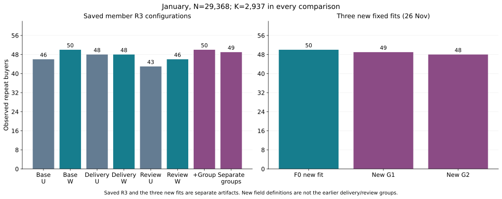
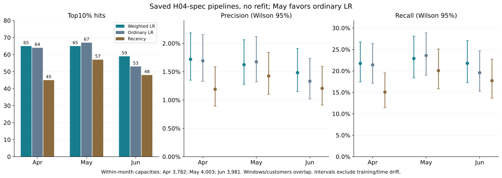

# 18项统一修补处理报告

2026-11-26。本轮由本人转述团队交由本人统一处理，并明确采用“名单主线＋概率/价值扩展”。18项均已给出可核的处理结果：能修的代码已修，所需表/图/来源/写作准备已生成；现实数据边界和未执行业务试验如实保留，不用“全部修补”冒称所有未知已经被证明。

本包可以支持下一步分工写报告正文；正式报告正文仍未开始，不是最终提交件。

## 本轮真正执行了什么

- 修R3元数据生成，未改原建模计算函数；4次元数据专用命令执行无拟合，重复结果一致。
- 额外只拟合预先固定F0/G1/G2三版：十月21160/211训练，一月29368/230开发，同取2937人命中50/49/48。未扫参数、未在测试月份重选模型。
- 新F0与原R3保存分数有约5.275e-5差异，但Top10%2937人名单完全一致；保留独立模型SHA，不覆盖旧run。
- 从已有及新增聚合表生成10张SVG/PDF报告图，源数据和绘图代码随包；校准和价值在独立协议中展示。
- 完成方法/字段/时间/实验身份/不确定性/准用素材/贡献/章节等表和说明。旧错误CI图不使用，旧PPT和已交附件保持原字节。

## 新增字段与跨期表现

[全部10张图、源数据与读法](figures/README.md)。

## 18项对应处理

| finding   | status                    | implemented_action                                          | evidence                            | remaining_boundary                        |
|:----------|:--------------------------|:------------------------------------------------------------|:------------------------------------|:------------------------------------------|
| R01       | resolved                  | 展示/报告状态已核并保留                                     | scope-decision.json                 | 展示完成；报告正文仍未开始                |
| R02       | confirmed_scope           | 本人已明确名单主线＋概率/价值独立扩展                       | scope-decision.md                   | 不杜撰全员最终稿通读或新章节认领          |
| R03       | code_fixed_and_checked    | 元数据生成修正；4次metadata-only、重复一致、计算函数AST未改 | metadata-repair-verification.json   | 原训练环境不倒填                          |
| R04       | corrected_material_policy | 错误原CI素材禁用；用真实配对/群席位/新图                    | data/figure-policy.csv              | 不把替换图当营销因果证据                  |
| R05       | prepared                  | 45行实验身份表区分H04/R3/新run/测试/校准扩展                | data/experiment-registry.csv        | 历史未存权重以源/分数指纹说明，不造SHA    |
| R06       | prepared                  | 统一客户/时间表与Figure01                                   | data/dataset-flow.csv               | 窗口/重复客户不合并为独立样本             |
| R07       | documented_limits         | 字段可得性与静态历史假设逐类说明                            | data/feature-availability.csv       | 没有日志就不声称绝对无回写/漏采           |
| R08       | prepared                  | 主7方法、R3/新字段和类别权重参数已齐                        | data/model-parameters.csv           | 排序分数不自动校准概率                    |
| R09       | corrected_scope           | 条件群CV明确；均值/SD/4232/424单位写清                      | cv-and-uncertainty.md               | 未跑严格嵌套聚类CV，也不作该主张          |
| R10       | prepared_and_plotted      | 完整27行三期表及Figures04/05                                | data/frozen-test-metrics.csv        | 保留不利五月，不重新选择测试模型          |
| R11       | prepared                  | 按正确run选择配对/Wilson/SD解释和Figure07                   | data/claim-uncertainty.csv          | 不借用别的模型区间，不证明等效/利润       |
| R12       | prepared                  | 当前群卡、73/181/518及固定79图表                            | figures/06-group-coverage.svg       | 名额增加不是群内排序必然改善              |
| R13       | tested_minimal_comparison | 已实际拟合固定F0/G1/G2，命中50/49/48；不双log               | data/feature-experiment-results.csv | 这是额外开发结果，非新盲测或旧PPT时点改写 |
| R14       | replay_ready              | 公开聚合与图只读重放；本机3个保存模型重放                   | RUN-REPORT.md                       | 私有输入不可公开，原所有实验不声称全重跑  |
| R15       | integrated                | 已做深化材料按兼容协议单独扩展与Figures09/10                | results-for-writing.md              | 没有重开AE/网格/全部网络                  |
| R16       | design_ready              | 1:1内容对照、90天、全随机分母及功效/样本规划                | business-experiment.md              | 真实试验/触达/成本未发生，不虚构结果      |
| R17       | writing_ready             | 23页章节、图表、证据、六岗建议和引用/工具说明               | writing-brief.md                    | 这是写作准备，不是已写完20–25页正式报告   |
| R18       | prepared                  | 原成员贡献、课程复核和本次Codex辅助修补分开                 | contributions-and-acceptance.md     | 认领与最终人工审阅按后续真实记录          |

## 写作入口

- [报告范围](scope-decision.md) · [方法与数据](methods-and-data.md) · [结果读法](results-for-writing.md)
- [验证与不确定性](cv-and-uncertainty.md) · [图表索引](figures/README.md) · [业务试验](business-experiment.md)
- [23页章节和六岗写作简报](writing-brief.md) · [贡献/验收](contributions-and-acceptance.md) · [限制](limitations-and-use.md)
- [可复跑说明](RUN-REPORT.md) · [逐项状态CSV](closure-register.csv) · [独立检查](review/independent-review.md)

代码/数据/图自查、保存模型回放及隔离重画的实际结果见verification.json；独立检查发生在完整候选/作者自查之后，检查范围以实际报告为准。GitHub、本地/线上发布各自以操作回执为准，不把保存文件或模型跑通当正式报告完成。
