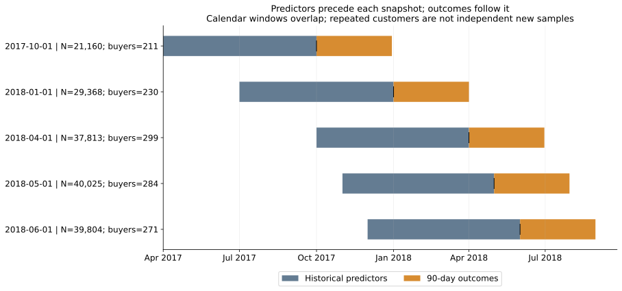
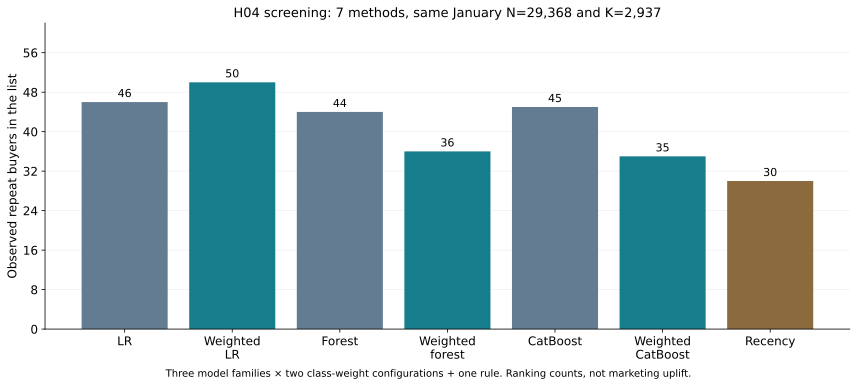
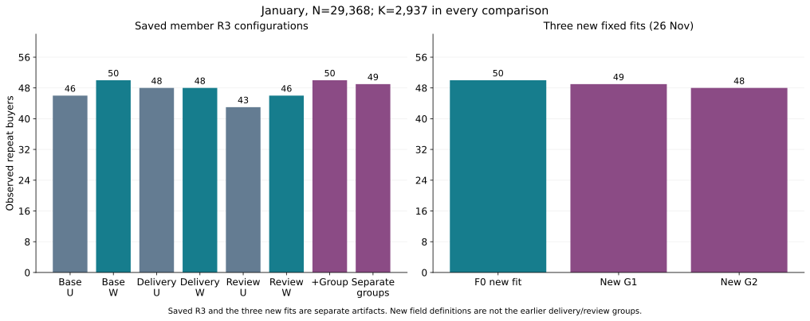
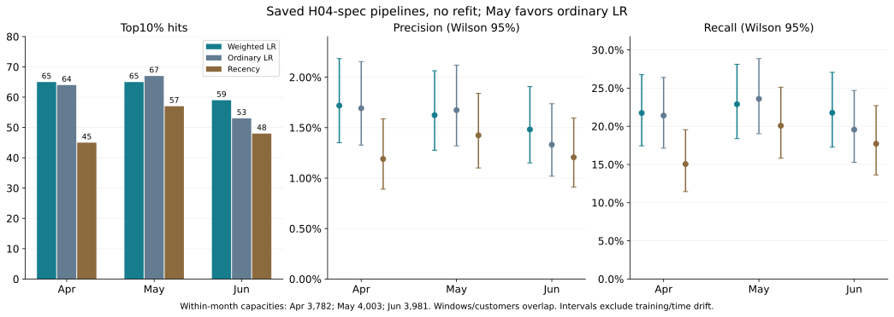
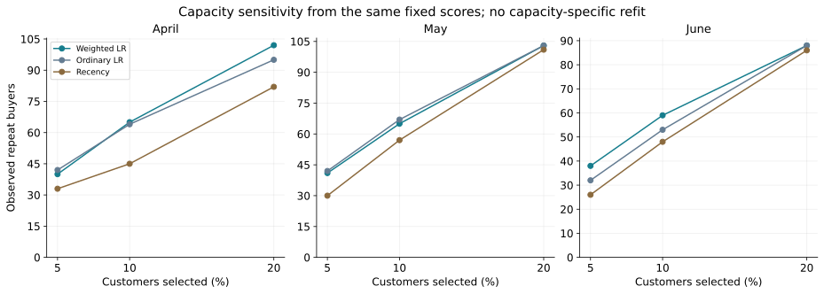
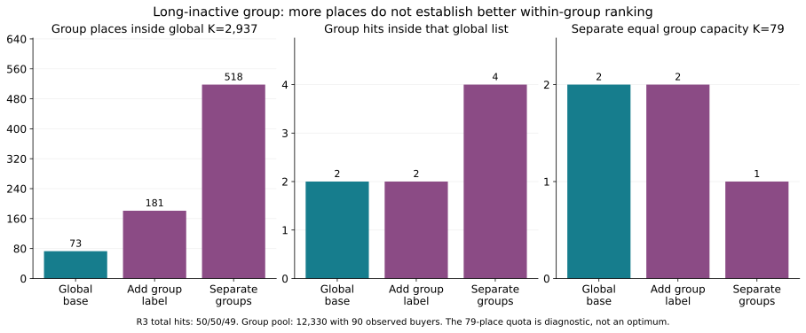
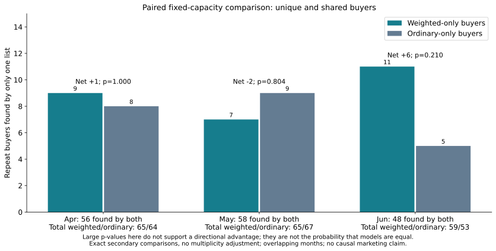
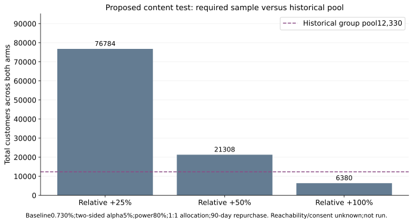
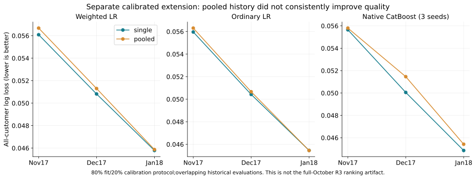
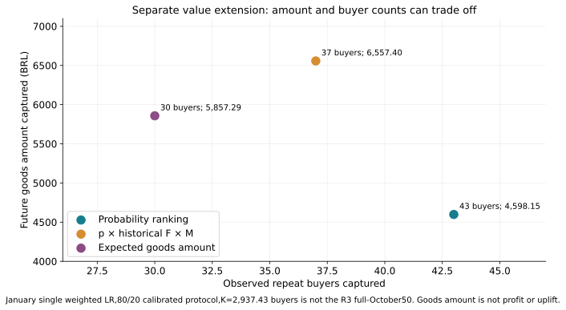

# 图表索引与准用说明

所有新图提供SVG/PDF，源CSV和绘图代码同包。内部预览PNG不作正式导出。旧错误CI图明确排除，校准/价值图与主线协议分开。

## 01-time-windows

[SVG](01-time-windows.svg) · [PDF](01-time-windows.pdf)

All intervals left-closed/right-open. October training, January development, April–June saved-model evaluation; calendar coverage is not source-system completeness.

数据：[ dataset-flow.csv ](../data/dataset-flow.csv)

## 02-initial-screening

[SVG](02-initial-screening.svg) · [PDF](02-initial-screening.pdf)

Separate H04 saved stage. Weighted LR leads Top10% hits/AP; CatBoost leads ROC-AUC; not all metrics have the same winner.

数据：[ h04-screening.csv ](../data/h04-screening.csv)

## 03-feature-comparisons

[SVG](03-feature-comparisons.svg) · [PDF](03-feature-comparisons.pdf)

New fixed run: F0=50,G1=49,G2=48. Only October/January used for fitting/evaluation; tests not used for reselection. G2 AUC improves while primary hits/AP do not.

数据：[ r3-methods.csv ](../data/r3-methods.csv), [ r3-group-methods.csv ](../data/r3-group-methods.csv), [ feature-experiment-results.csv ](../data/feature-experiment-results.csv)

## 04-frozen-months

[SVG](04-frozen-months.svg) · [PDF](04-frozen-months.pdf)

All methods and adverse month retained. Wilson intervals are conditional reference intervals, not evidence from three independent blind tests.

数据：[ frozen-test-metrics.csv ](../data/frozen-test-metrics.csv), [ frozen-test-windows.csv ](../data/frozen-test-windows.csv)

## 05-frozen-capacity

[SVG](05-frozen-capacity.svg) · [PDF](05-frozen-capacity.pdf)

More contacts can increase counts while lowering list concentration;10% is a comparison capacity, not a proven operating optimum.

数据：[ frozen-test-metrics.csv ](../data/frozen-test-metrics.csv)

## 06-group-coverage

[SVG](06-group-coverage.svg) · [PDF](06-group-coverage.pdf)

73/181/518 are group places inside a global list;79 is a separate same-size within-group comparison.

数据：[ r3-group-methods.csv ](../data/r3-group-methods.csv), [ fixed-long79.csv ](../data/fixed-long79.csv), [ current-profiles.csv ](../data/current-profiles.csv)

## 07-paired-evidence

[SVG](07-paired-evidence.svg) · [PDF](07-paired-evidence.pdf)

April共有56人，加权/普通独有9/8人，因此总计65/64、净差1。p值是针对无方向偏向假设的计数差概率，不是模型相等的概率；月份不独立。

数据：[ frozen-test-paired.csv ](../data/frozen-test-paired.csv)

## 08-trial-feasibility

[SVG](08-trial-feasibility.svg) · [PDF](08-trial-feasibility.pdf)

Both groups contacted:home-goods versus generic guide. Sample plan is not evidence of treatment effectiveness.

数据：[ trial-plan.csv ](../data/trial-plan.csv)

## 09-probability-extension

[SVG](09-probability-extension.svg) · [PDF](09-probability-extension.pdf)

Compare single/pooled within a family/date;do not read falling loss across dates as isolated model improvement because prevalence changes.

数据：[ extension-calibrated-probabilities.csv ](../data/extension-calibrated-probabilities.csv)

## 10-value-extension

[SVG](10-value-extension.svg) · [PDF](10-value-extension.pdf)

Same calibrated p,only ranking formula changes;43/4598.15 vs37/6557.40 vs30/5857.29. Never attach these amounts to the R3 50-buyer list.

数据：[ extension-value-capacity.csv ](../data/extension-value-capacity.csv)
