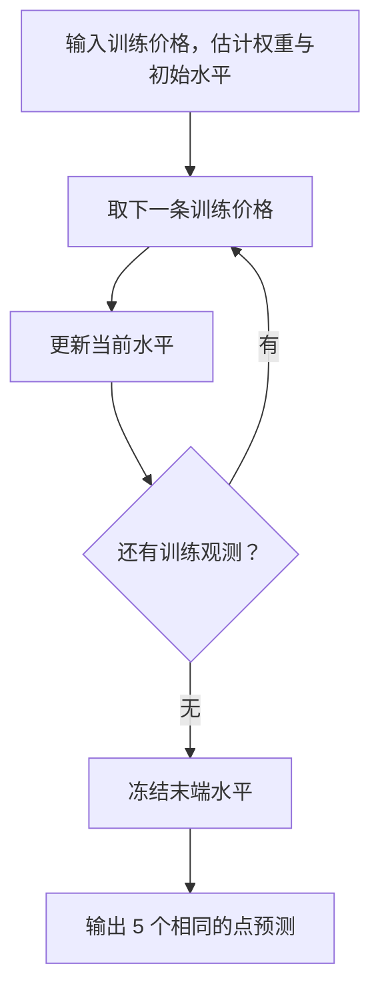
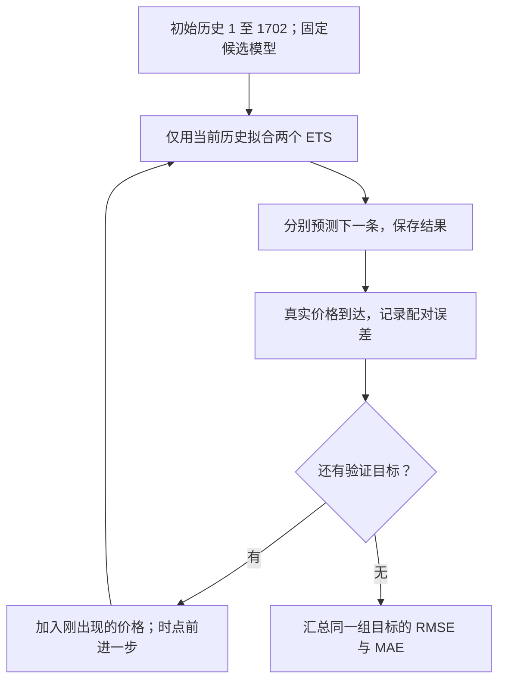

# Week 8 中文学习导览：从价格变化到可信预测

这次要回答：用历史 Bitcoin 价格预测未来时，应该预测什么、加入趋势是否有帮助、怎样评价才符合实际使用。

Q1–Q4、真实计算与基准拓展已写入英文 Notebook。正式 HTML 由同一 Notebook 标准导出。2026-10-21 本人已确认提交；本人阅读、学会及成绩仍分别记录，不自动升级。

先看结果：最后五条观测中，无趋势 ETS 的 RMSE 为 190.562940，带趋势 ETS 为 196.475103。无趋势模型较好，但仅比朴素预测改善 0.016622 USD/BTC。做出模型不代表获得了明显预测优势。

## 0. 先打开哪份文件

- [英文 Notebook](../work/IS6400_Week8_60234350_LI_Binxiong.ipynb)：唯一分析源码，保留老师 51 个原单元格及相对顺序，后接 Q1–Q4 与附录。
- [英文 HTML](../submission/IS6400_Week8_60234350_LI_Binxiong.html)：阅读和待审阅提交件，含代码、输出、表格和图；没有上传。
- [任务说明](任务说明.md)：完整英文题目、内部评分、Canvas 核对及原件版本。
- [验收记录](验收记录.md)：计算与实际显示核对、文件哈希、行政缺口。

原教程放在前面，避免丢失教师教学内容。HTML 首页有 Q1–Q4 导航，可以直接跳到个人作答。shampoo 的原文字称按月，CSV 却用了类似逐日的日期标签；本次保留这个频率冲突，不擅自指定真实频率。不要用 shampoo 的模型排名推定 Bitcoin 也会如此。

本次文件保存于本地 `assignment/graded/A09-week8/`，尚未上传 GitHub。现行规则允许本人作业公开；本任务按“先不要提交”保留本地成果。图源和输入数据副本位于 `work/`，保持整目录即可复现。

## 1. 题目到底要什么

一行是一道原题。内部分数合计 100，不等于课程总评百分比。

| 小问 | 内部分 | 必须交出的内容 |
|---|---:|---|
| Q1 | 20 | 选择价格或差分，并用完整理由支持 |
| Q2 | 20 | 无趋势、无季节 ETS；五个预测和 RMSE |
| Q3 | 40 | 加趋势 ETS；同窗口比较与解释 |
| Q4 | 20 | 次日滚动评价的区间、计算和比较设计 |

读 Q3：它既要算出数字，也要解释趋势为何改善或恶化误差。只写“模型 A 的 RMSE 更低”还缺机制。

- 小问列对应原题编号。
- 内部分列来自原 Notebook cell 49。
- 内容列是各题应展示的证据，不是新增的教师评分标准。

Q4 明确不需编程。Notebook 中给出可执行的设计步骤和算例，没有把未运行的滚动回测写成实际结果。

## 2. 从零开始运行

### 2.1 一个 cell 怎样执行

Notebook 由单元格（cell）组成。Markdown 单元格显示解释、表格和公式；Code 单元格把 Python 代码交给内核执行。

内核（kernel）是保存变量的 Python 进程。运行 `x = 3` 后，内核记住 `x`；重启后，这个变量消失。只运行后半页容易依赖上一次遗留变量，所以最终使用 Restart & Run All。

在 Jupyter 中打开 Notebook，选择 `Python 3 (ipykernel)`，再选 `Kernel → Restart Kernel and Run All Cells`。等待代码全部完成，保存 Notebook，再导出 HTML。

### 2.2 本机的可复现命令

下面是在 PowerShell 中逐条运行的命令。`&` 表示调用带引号的程序路径。第一条把工作目录切到 Notebook 所在文件夹。

```powershell
Set-Location -LiteralPath 'D:\上课资料\CityU\IS6400_Business_Data_Analytics\assignment\graded\A09-week8\work'
& 'D:\anaconda3\python.exe' -X utf8 -m nbconvert --to notebook --execute --inplace 'IS6400_Week8_60234350_LI_Binxiong.ipynb' --ExecutePreprocessor.timeout=300 --ExecutePreprocessor.kernel_name=python3
& 'D:\anaconda3\python.exe' -X utf8 'export_html.py'
```

`--execute` 从新内核执行；`--inplace` 将实际输出保存回该工作副本。`export_html.py` 只调用标准 HTMLExporter，再原子保存，不重排、隐藏或另写答案。

`work/data/` 必须含 `Q5BTC-USD.csv`、`shampoo_sales.csv`、`CVD.csv`。后两份供保留的原教程使用。输入副本与原件字节相同，原始材料没有改动。

HTML 图形已内嵌，数学公式由 MathJax 渲染，默认需要联网加载。不能把该文件称为完全离线版本。

### 2.3 先认识最少的 Python 语法

下面是教学小例，不是 Bitcoin 数据。

```python
prices = [100, 110, 105]
last_price = prices[-1]
change = prices[1] - prices[0]
print(last_price, change)
```

输出为 `105 10`。

- `=` 把右侧计算结果保存到左侧变量；变量可以是数字，也可以是整张表。
- `[]` 建立列表，也用于取其中一个位置。Python 从位置 0 开始，`prices[1]` 是第二个数。
- `[-1]` 取最后一个数。
- `print(...)` 调用函数，把括号内的结果显示出来。

`import numpy as np` 把 NumPy 工具库取名为 `np`。`np.sqrt(9)` 调用它的平方根函数，得到 3。

`ETSModel(y_train, trend='add')` 也是函数式调用：第一个参数给价格序列，命名参数 `trend` 指定趋势形式。引号中的 `'add'` 是字符串标签。

## 3. 数据检查与时间边界

对应 Notebook 的 “Bitcoin data and common evaluation setup”。CSV 是逗号分隔文本，DataFrame 是 pandas 用来保存行列表格的对象。

```python
bitcoin = pd.read_csv(DATA_DIR / 'Q5BTC-USD.csv')
bitcoin['Date'] = pd.to_datetime(bitcoin['Date'], format='%m/%d/%Y', errors='raise')
bitcoin['Close'] = pd.to_numeric(bitcoin['Close'], errors='raise')
```

一行对应一条操作。

| 代码片段 | 接收什么 | 产生什么 |
|---|---|---|
| `pd.read_csv(...)` | CSV 路径 | 1,827 行、2 列的表 |
| `bitcoin['Date']` | 列名字符串 | 日期这一列 |
| `pd.to_datetime(...)` | 月/日/年文字 | 可比较和求差的日期 |
| `pd.to_numeric(...)` | Close 列 | 数值价格 |

读第一行：文件被读成表，不是在这里拟合模型。

- 代码列可在正式源码中定位。
- 接收列说明该函数需要的对象。
- 产生列说明执行后的类型或形状。

`DATA_DIR / 'Q5BTC-USD.csv'` 使用 Path 拼接目录和文件名；这里的 `/` 不做数值除法。`format` 明确按月、日、年解释，避免把 4/5 读成 5 月 4 日。`errors='raise'` 遇到错误就停止，防止悄悄吞掉错误值。

### 3.1 最后五条如何切出来

```python
train_btc = bitcoin.iloc[:-5].copy()
test_btc = bitcoin.iloc[-5:].copy()
y_train = train_btc['Close'].reset_index(drop=True)
y_test = test_btc['Close'].to_numpy(dtype=float)
```

`.iloc` 按位置取行，切片右端不包含在内。`[:-5]` 从开头取到倒数第六条，`[-5:]` 取最后五条。

- `.copy()` 取得独立副本，避免随后新增列时意外修改另一张表。
- `.reset_index(drop=True)` 把训练序列编号重设为 0–1,821，不把旧编号额外保留成特征。
- `.to_numpy(dtype=float)` 取出五个浮点价格，便于逐元素算误差。

训练集为 1,822 条，标签范围为 2013-04-30 至 2018-04-25。测试集是 2018-04-26 至 2018-04-30 五条。

禁止随机打乱后切分。否则模型可能看到未来价格，再回头预测过去，误差会失去真实含义。

### 3.2 空值、重复行与重复日期不同

`isna()` 返回布尔值：每个位置是 `True` 或 `False`。`.any()` 判断是否至少有一个 True；`.sum()` 计数时把 True 当 1。

原文件没有空单元格，也没有完全相同的整行；但 Date 列有 5 个多余重复标签。例如 2018-03-25 对应 8,472.84 和 8,152.20，两条价格不同，不能把它们当冗余数据删除。

另有 5 处相邻标签相差两天。`.diff()` 求当前项减前一项，`.dt.days` 把日期差换成天数，`.eq(2)` 选出相差两天的位置。

本次保留原始行序，按观测编号拟合。每步表示下一条观测；历史中不保证每步都对应下一个日历日。没有猜测异常成因、合并价格或补造缺失价格。

## 4. Q1：为什么考虑差分

### 4.1 先区分预测目标

自回归（Autoregression）用过去的目标值预测新的目标值。若目标是价格，模型读取过去价格；若目标是价格变化，模型读取过去变化。

一阶差分（First difference）定义为：

$$
\Delta P_t=P_t-P_{t-1}.
$$

一行是一个符号，价格和价格变化都以 USD/BTC 计量。

| 符号 | 含义 | 本步是否已知 |
|---|---|---|
| $t$ | 当前观测编号 | 已知 |
| $P_t$ | 当前价格 | 历史中已知 |
| $P_{t-1}$ | 上一条价格 | 已知 |
| $\Delta P_t$ | 相邻价格之差 | 相减得到 |

读最后一行：它是绝对价格变化，不是收益率。

- 符号列连接数学写法。
- 含义列说明每个对象。
- 已知列区分输入和计算结果。

教学补充例：价格为 100、110、105，差分为 10、−5。第一条没有前一期，所以差分长度少 1。

```python
delta_train = y_train.diff().dropna()
```

`.diff()` 在首位产生缺失值，`.dropna()` 仅移除这个缺少前一期的结果。因此 1,822 个训练价格产生 1,821 个差分。

### 4.2 平稳性与 ADF 的含义

平稳性（Stationarity）要求序列的统计特性不随观测时点系统变化。先看价格是否在不同阶段围绕不同水平波动，再看差分是否减弱这种变化。

ADF 是带滞后项的单位根检验。原假设（Null hypothesis）是存在单位根，即一种导致水平持久漂移的结构。p 值很小，表示该检验规格下的观测结果与原假设不太相容。

```python
adf_result = adfuller(values, regression='c', autolag='AIC')
```

- `values` 是本轮使用的训练价格或差分。
- `regression='c'` 包含常数项，不额外放确定性线性趋势。
- `autolag='AIC'` 在候选滞后长度中用信息准则选择；没有用测试误差挑设置。
- 返回结果的 `[0]` 是检验统计量，`[1]` 是 p 值，`[2]` 是选中的滞后数。

正式代码中的循环 `for label, values in ...` 会依次对价格和差分执行同一套诊断。循环变量每轮换成对应名称和序列，结果以字典保存，再组装成 DataFrame。

### 4.3 怎样读实际输出

一行是一种目标，所有诊断仅用训练数据。

| 序列 | ADF p 值 | 滞后 1 自相关 |
|---|---:|---:|
| 原价格 | 5.966439e-01 | 0.995727 |
| 一阶差分 | 1.309988e-09 | 0.068442 |

读第二行：差分的 p 值约为十亿分之一，在 5% 水平拒绝单位根原假设；这不是“预测正确的概率”。

- 序列列说明被诊断的目标。
- p 值来自同一规格的 ADF；科学计数法避免把很小的数显示成 0。
- 自相关来自 `acf(values, nlags=1)[1]`，描述相邻观测线性相关程度，无单位。

价格自相关接近 1，说明水平非常持久。差分后自相关大幅下降，支持以变化作为传统平稳自回归的起点。

![[IS6400_Business_Data_Analytics/assignment/graded/A09-week8/work/figures/figure-1-diagnostics.svg]]

图左上是价格，横轴为原始观测编号，纵轴为 USD/BTC。左下是相邻价格变化；后半段更宽的波动，说明差分没有把所有时期的波动幅度变得相同。

右侧是自相关函数（ACF）：横轴表示相隔多少条观测，纵轴是相关系数。滞后 0 与自身比较，恒为 1；应比较正滞后位置。蓝色带是绘图程序给出的近似参考带，不是未来价格的预测区间。

差分前半段标准差 33.333481，后半段 325.895831，均为 USD/BTC。这里只作描述比较，不把它写成正式方差检验，也不因此声称差分序列整体平稳。

若模型预测下一步变化为 100，而最后价格为 9,000，则价格预测为 9,100。多步时，把预测变化逐步累加回最后已知价格。Q2/Q3 按题目直接拟合价格，不沿用差分目标。

## 5. Q2：没有趋势时，为什么五个预测相同

简单指数平滑（Simple exponential smoothing，SES）保存一个“当前水平”。每来一个新价格，就修正这个水平。

$$
\ell_t=\alpha P_t+(1-\alpha)\ell_{t-1}.
$$

一行是一个更新对象。

| 符号 | 对象 | 单位 |
|---|---|---|
| $P_t$ | 新观察到的价格 | USD/BTC |
| $\ell_{t-1}$ | 更新前水平 | USD/BTC |
| $\ell_t$ | 更新后水平 | USD/BTC |
| $\alpha$ | 新价格的权重 | 无单位 |

读最后一行：权重为 0.8，表示新价格占 80%，旧水平占 20%。

- 符号列连接公式。
- 对象列区分输入、旧状态和新状态。
- 单位列保证加权后的结果仍是价格。

### 5.1 用三个观测走完更新

教学补充例：初始水平设为 100，权重设为 0.5，依次收到 110、106、108。这些固定数值用于理解更新，不是本题拟合参数。

| 新价格 | 更新前水平 | 加权计算 | 更新后水平 |
|---:|---:|---|---:|
| 110 | 100 | $0.5\times110+0.5\times100$ | 105 |
| 106 | 105 | $0.5\times106+0.5\times105$ | 105.5 |
| 108 | 105.5 | $0.5\times108+0.5\times105.5$ | 106.75 |

读最后一行：收到第三个价格后，模型认为当前水平约为 106.75。

- 新价格来自这一轮观测。
- 更新前水平沿用上一轮结果。
- 加权计算使用两个权重，其和为 1。
- 更新后水平是下一轮要保存的状态，单位均为 USD/BTC。

没有更多观测后，更新停止。模型没有趋势和季节状态，未来两步都预测 106.75。它无法凭空知道下一天会涨多少。



读图时跟随主线：用 110 更新到 105 后，判断为“有”，再读取 106；第三次更新后走“无”，冻结 106.75。拟合时还要通过优化选择权重和初始状态，图中把这一步集中在首个框内。

### 5.2 正式代码与参数

```python
ses_model = ETSModel(y_train, error='add', trend=None, seasonal=None,
                     initialization_method='estimated')
ses_fit = ses_model.fit(disp=False, maxiter=10000)
ses_forecast = np.asarray(ses_fit.forecast(steps=5), dtype=float)
ses_error = y_test - ses_forecast
ses_rmse = float(np.sqrt(np.mean(ses_error ** 2)))
```

`ETS` 的三个字母分别代表误差、趋势、季节性。ETS(A,N,N) 中，A 为加法误差，两个 N 表示没有趋势和季节性。

一行是一项调用或参数。

| 代码／参数 | 在本题中的作用 |
|---|---|
| `error='add'` | 实际价格等于预测加价格误差 |
| `trend=None` | 不估计趋势状态 |
| `seasonal=None` | 不估计季节状态 |
| `initialization_method` | 从训练数据估计初始状态 |
| `.fit(...)` | 学习参数并生成拟合结果对象 |
| `.forecast(steps=5)` | 从训练末端一次预测五步 |

读最后一行：函数此时只能读取拟合结果，不能读取 `y_test`。

- 代码列是在源码中使用的 API 名或参数。
- 作用列解释其对模型输入、状态或输出的影响。

`disp=False` 关闭优化器的冗长迭代日志，不隐藏预测输出。`maxiter=10000` 只设置迭代上限，实际是否收敛另检查 `mle_retvals['converged']`。

优化器通过训练价格的似然选择参数。加法误差、同一训练长度下，这与减小训练残差平方和紧密相关。数值收敛说明优化过程达到停止条件，不保证找到了所有可能规格的全局最好模型。

### 5.3 实际预测怎样读

本题估计的权重为 0.999900，末端水平为 9,282.079158。权重接近 1，使模型几乎复制最后一条训练价格 9,282.12。

一行是一条测试观测，预测与误差按两位小数展示。

| 日期 | 实际价格 | SES 预测 | 实际减预测 |
|---|---:|---:|---:|
| 2018-04-26 | 8938.47 | 9282.08 | -343.61 |
| 2018-04-27 | 9351.47 | 9282.08 | 69.39 |
| 2018-04-28 | 9407.04 | 9282.08 | 124.96 |
| 2018-04-29 | 9248.45 | 9282.08 | -33.63 |
| 2018-04-30 | 9077.28 | 9282.08 | -204.80 |

读第一行：模型预测高了约 343.61 USD/BTC，所以“实际减预测”为负。

- 日期列来自测试行标签。
- 实际列是保留到评价阶段才使用的真实价格。
- 预测列来自训练末端的同一个拟合模型。
- 误差列为实际减预测，三列数值单位均为 USD/BTC。

## 6. RMSE 如何手算，为什么不能先舍入

RMSE 是均方根误差：先把误差平方，再平均，最后开平方。

$$
\mathrm{RMSE}=\sqrt{\frac{1}{n}\sum_{i=1}^{n}(y_i-\hat y_i)^2}.
$$

这里 $y_i$ 为真实价格，$\hat y_i$ 为预测，$n=5$ 是测试观测数。它不是训练行数，也不扣除参数个数。

教学补充例：误差为 3、−4。

1. 平方：得到 9、16，避免正负抵消。
2. 平均：$(9+16)/2=12.5$，单位为价格单位的平方。
3. 开平方：$\sqrt{12.5}\approx3.535534$，回到价格单位。

`ses_error ** 2` 对数组的每个元素分别平方。`np.mean(...)` 求算术平均，`np.sqrt(...)` 开平方；`float(...)` 转成一个 Python 数。

本题 SES 的未舍入误差平方和约为 181571.169695，除以 5 再开方，得到 190.562940 USD/BTC。请在验收记录看完整独立复算。

`f'{ses_rmse:.6f}'` 只规定显示六位小数，不修改变量本身。预测值也只在输出时显示两位。若先把预测四舍五入再算 RMSE，最后几位会改变。

MAE 先取绝对值再平均。上述两误差的 MAE 为 3.500000；对 MAE 再开平方，不是 RMSE。

## 7. Q3：加趋势后改变了什么

Holt 保存两项状态：当前水平与每步趋势。比 SES 多保存一个“价格大约每步变多少”。

对本题加法误差、加法趋势、无阻尼的 ETS，令误差为新价格减去旧水平加旧趋势：

$$
e_t=P_t-(\ell_{t-1}+b_{t-1}).
$$

先修正水平：

$$
\ell_t=\ell_{t-1}+b_{t-1}+\alpha e_t.
$$

再用同一个预测误差修正趋势：

$$
b_t=b_{t-1}+\beta e_t.
$$

一行是一个新增符号。

| 符号 | 含义 | 单位 |
|---|---|---|
| $b_t$ | 更新后的每步趋势 | USD/BTC 每观测 |
| $e_t$ | 当前一步预测误差 | USD/BTC |
| $\beta$ | 趋势对新误差的更新权重 | 无量纲、以一步为尺度 |

读第一行：趋势为 2，表示每前进一条观测，预测增加约 2 USD/BTC。

- 符号列补充 SES 未使用的对象。
- 含义列对应当前预测、误差和更新状态。
- 单位列区分价格水平与每步变化。

这里的 $\beta$ 对应 `ETSModel` 的 `smoothing_trend`。其他教材把水平差加权的趋势系数写作 $\beta^*$，在此参数化下 $\beta^*=\beta/\alpha$，不能把两套系数直接混用。

### 7.1 完整的小例

教学补充：初始水平 100、趋势 2，设 $\alpha=0.5$、$\beta=0.1$，依次观察 110、112。

一行是一轮更新，观测间隔取一个单位。

| 新价格 | 先验预测 | 误差 | 新水平 | 新趋势 |
|---:|---:|---:|---:|---:|
| 110 | $100+2=102$ | 8 | $102+0.5\times8=106$ | $2+0.1\times8=2.8$ |
| 112 | $106+2.8=108.8$ | 3.2 | $108.8+0.5\times3.2=110.4$ | $2.8+0.1\times3.2=3.12$ |

读第二行：先预测 108.8，看到实际 112 后，把水平修到 110.4，也把上升趋势修到 3.12。

- 新价格列是本轮输入。
- 先验预测只使用上一轮状态。
- 误差是实际减先验预测。
- 新水平是旧预测加一部分误差。
- 新趋势是旧趋势加另一部分误差。

两条训练观测用完后停止更新。未来两步分别为 $110.4+3.12=113.52$ 和 $110.4+2\times3.12=116.64$。

### 7.2 正式代码与结果

```python
holt_model = ETSModel(y_train, error='add', trend='add', damped_trend=False,
                      seasonal=None, initialization_method='estimated')
holt_fit = holt_model.fit(disp=False, maxiter=10000)
holt_forecast = np.asarray(holt_fit.forecast(steps=5), dtype=float)
```

与 Q2 共用输入序列和拟合方式，仅加入 `trend='add'`。`damped_trend=False` 表示趋势不随预测距离衰减；没有另外加入季节性。

实际末端水平 9,282.079661，趋势 5.071565 USD/BTC 每观测。五个预测逐步上升：9,287.15、9,292.22、9,297.29、9,302.37、9,307.44。

![[IS6400_Business_Data_Analytics/assignment/graded/A09-week8/work/figures/figure-2-forecasts.svg]]

左图展示末端历史与预测，虚线标记训练截止。右图放大同五个测试日期；黑色为实际价格，蓝色虚线为 SES，棕色点线为 Holt，标记形状也不同。

读 4 月 30 日：实际 9,077.28，SES 为 9,282.08，Holt 为 9,307.44。增加向上的趋势使这一天的高估更大。4 月 27–28 日实际高于水平预测，趋势反而能减少部分低估。

一行是一个模型，所有指标使用同五条测试观测。

| 模型 | RMSE（USD/BTC） | 相对 SES 的 RMSE 变化 |
|---|---:|---:|
| SES | 190.562940 | 0 |
| Holt | 196.475103 | +5.912164 |

读 Holt 行：增加趋势使 RMSE 上升约 3.102473%。这是本测试区间的结果，不能扩展成“所有时期都不应使用趋势”。

- 模型列区分是否有趋势状态。
- RMSE 列先用未舍入误差计算，再显示六位。
- 变化列是 Holt 的未舍入 RMSE 减 SES 的未舍入 RMSE；不要拿表上舍入值反复相减。

`holt_fit.smoothing_trend` 为 0.000100（六位显示），趋势更新很慢。测试期价格有上下跳动，而模型沿着正斜率外推，最终总平方误差更大。

## 8. Q4：每天预测下一天，和一次预测五天不同

Q2/Q3 站在 4 月 25 日，一次给出 4 月 26–30 日五个预测。即使 4 月 26 日真实值已在文件里，也不能用它更新 Q2/Q3 的后四个预测。

滚动预测（Rolling forecasting）让预测时点逐步前进。扩展窗口（Expanding window）在每轮加入新观测，同时保留全部更早历史。

本次设计用前 1,822 条作开发区，末 120 条作验证目标。先用 1–1,702 条训练，再逐步增加训练范围。这里的 120 是本次提出的设计长度，不是教师明示数字。

一行是一次预测，编号从 1 开始。

| 已看到的历史 | 现在预测哪条 | 何时加入新真实值 |
|---|---|---|
| 1–1,702 | 1,703 | 预测存好，真实值到达后 |
| 1–1,703 | 1,704 | 下一轮开始前 |
| 1–1,821 | 1,822 | 最后一个验证目标到达后 |

读第二行：第 1,703 条已发生，所以能成为第 1,704 条预测的训练信息。

- 历史列是模型在该时点允许看到的价格。
- 目标列是仍未知、不得提前使用的那一条。
- 加入时机列规定新真实值何时可以变成历史。



走一次具体路径：历史止于 1,702 时，先存下对 1,703 的两个预测；看到 1,703 后才记录误差并扩充历史。下轮预测 1,704，不返回修改已经存下的 1,703 预测。

真实次日任务须先核实唯一、连续的日期。原件的重复和缺口仍未解决，所以直接按行运行只能叫“下一观测”评价。若无法从原数据提供者核实某个日历目标，就让两模型共同排除该目标，并报告实际评价数量；不要借用未来价格插值。

评价时把每轮误差收集起来，再整体平方、平均、开方。逐日先算平方根再平均，就变成 MAE，不能标为 RMSE。

模型选择用验证分数；若调很多设置，需在更早历史中再做内层选择。Q3 已看过最后五条，所以后来重新逐步预测这五条只能作方法演示，不能冒称新获得了一份未见测试。

## 9. 必做拓展：是否优于最简单规则

固定起点朴素预测（Naïve forecast）把训练末端价格 9,282.12 重复五次。它和 Q2/Q3 使用同一个预测时点，不读取任何测试期真实价格。

```python
naive_forecast = np.repeat(y_train.iloc[-1], len(y_test))
naive_error = y_test - naive_forecast
naive_rmse = float(np.sqrt(np.mean(naive_error ** 2)))
```

`np.repeat(一个值, 次数)` 生成五个相同预测。`len(y_test)` 取得测试数组长度，避免手写次数与数据不一致。

一行是一个相同口径的预测规则。

| 规则 | RMSE（USD/BTC） | 相对朴素规则的变化 |
|---|---:|---:|
| 朴素预测 | 190.579561 | 0 |
| SES | 190.562940 | -0.016622 |
| Holt | 196.475103 | +5.895542 |

读 SES 行：误差改善只有约 0.008722%，因为它的权重几乎为 1，行为接近重复最后价格。

- 规则列说明输入如何变成预测。
- RMSE 列使用同五条实际价格。
- 变化列由未舍入指标减朴素指标，负值表示误差降低。

这项拓展回答了“算一个复杂模型是否真有收益”。它没有证明显著性，也没有考虑任何交易策略或收益，不将价格预测误差写成赚钱能力。

## 10. 图表与输出代码怎样对应

正式 Notebook 的全部核心运算都在代码单元格中，没有调用外部大函数来藏分析过程。

- `plt.subplots(2, 2, ...)` 创建四个画图区，分别显示价格、差分及其 ACF。
- `axes[0, 0]` 取第一行第一列；`.plot(...)` 把真实计算值画成线。
- `plot_acf(...)` 计算和显示不同观测间隔的相关系数。
- `fig.savefig(...)` 从同一张图保存 SVG，保留可编辑矢量结构。
- `plt.show()` 将图嵌进 Notebook 输出；HTML 中显示的是这些已保存输出。
- `pd.DataFrame({...})` 用“列名：列数据”的字典组织结果表。
- `.style.hide(axis='index')` 只不显示无业务意义的 pandas 行号；没有隐藏 Notebook 单元格。
- `.format(...)` 决定表中小数位，计算变量保持原精度。
- `display(Markdown(...))` 把计算值插入正文，避免手动抄数与表格不一致。

## 11. 常见错误与排查

一行是一种症状及其检查方向。

| 症状 | 先查什么 |
|---|---|
| `FileNotFoundError` | 当前目录是否为 work，data 三文件是否齐全 |
| `NameError` | 是否只运行了后面的 cell；重启并从头运行 |
| 日期解析报错 | 是否仍使用原 CSV 和月/日/年格式 |
| 预测五个相同数 | SES 本来没有趋势，先看模型规格 |
| 图显示 LaTeX 源码 | MathJax 网络资源是否载入；重新打开 HTML |
| 模型未收敛 | 查看优化状态，不直接解释失败拟合结果 |

读第四行：相同预测是结构决定的，不应为了让曲线变化而手改输出。

- 症状列保留实际报错或可见表现。
- 检查列指出恢复步骤；检查后应从源 Notebook 修正并重新导出。

日期错误时不要用 `drop_duplicates('Date')` 快速“解决”；那会丢掉真实不同的价格。单位根检验显著时也不要写“预测必然更准”，诊断与样本外误差回答不同问题。

## 12. 自测与改条件练习

以下均为学习练习，不属于教师额外评分题。答案用于核对推理，不代表本人已经完成学习。

### 12.1 修改 SES 权重

当前水平 100，新价格 110。把权重从 0.5 改为 0.8，新水平是多少？为什么更接近新价格？

<details><summary>答案与理由</summary>

新水平为 $0.8\times110+0.2\times100=108$。新价格权重增加，所以从原来的 105 向 110 移动。若之后不再收到观测，无趋势模型的所有未来点预测仍为 108。

</details>

### 12.2 修改 Holt 趋势

最终水平 110.4，趋势改为 −3.12。未来两步怎样预测？这个改动代表什么？

<details><summary>答案与理由</summary>

一步为 $110.4-3.12=107.28$，两步为 $110.4-2\times3.12=104.16$。负趋势让预测递减；这仍然是线性外推，若真实市场转涨，就可能持续低估。

</details>

### 12.3 检查信息泄漏

站在 4 月 25 日一次预测五天，计算 4 月 28 日预测时使用了 4 月 27 日真实价格。是否仍符合 Q2/Q3？

<details><summary>答案与理由</summary>

不符合。4 月 27 日在固定预测起点仍属于未来。该做法变成滚动一步预测，只能放在相应滚动评价中，并给出不同的评价口径。

</details>

### 12.4 判断结论强度

差分 ADF p 值很小，但后半段变化明显更剧烈。应该写“差分后已完全平稳”吗？

<details><summary>答案与理由</summary>

不应这样写。ADF 对单位根提出证据，没有证明方差恒定；可以写“差分减弱水平持久性，更适合作为传统自回归的起点”，同时保留波动变化的限制。

</details>

## 13. 本人审阅与行政状态

- 姓名和学号沿用本地 W01–W05 的 LI Binxiong／60234350；仍需本人最后核对。
- 制作阶段没有代上传或提交；2026-10-21 本人已确认提交。Notebook 与 HTML 原文件未改。
- 2026-10-21 已查看 Canvas 四入口；Week 8 独立提交项、专属截止和 points 尚未在可见列表发现，不按上周规律推算。
- 当前状态为 `已提交（本人确认）`；未核 Canvas 回执、远端附件哈希、准确提交时刻和成绩。本人学会仍待本人确认。
- AI 使用声明在正式答卷末尾，写明实际使用 OpenAI Codex。

进一步理解可读 [[IS6400_Business_Data_Analytics/notes/M07-时间序列I-平滑趋势与季节性|M07 平滑与趋势]]、[[IS6400_Business_Data_Analytics/notes/M08-时间序列II-自相关差分与ARIMA|M08 自相关与差分]] 和 [[IS6400_Business_Data_Analytics/notes/T08-时间序列实战-销量与季度季节性|T08 原教程逐步解释]]。


2026-10-21 本人在本对话确认“已提交”。状态记为已提交（本人确认）；未回读 Canvas 提交回执、远端附件字节或准确提交时刻，未核成绩。
