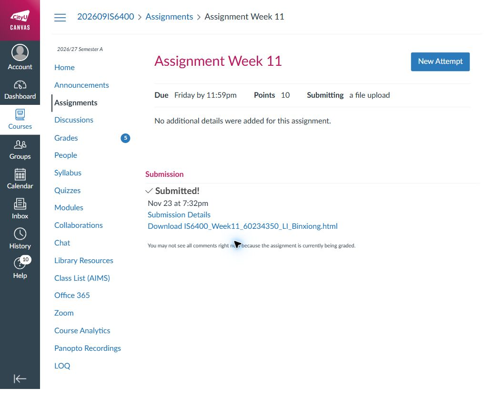

# W11 提交回执 · 2026-11-23 19:32 HKT

本人在已展示最终材料后回复“可以提交了”，随后完成 Chrome CityU 登录。本次提交唯一附件为 `IS6400_Week11_60234350_LI_Binxiong.html`，使用既有核定版本，SHA-256 为 `5d52af4900424320d1f9749f86a96120aa1f6ed12f68772052770fe5d131e2ed`；未修改或重新导出答卷。

Canvas Assignment Week 11（330587）显示 `Submitted!`、`Nov 23 at 7:32pm`，随后重新打开任务页仍显示相同成功状态。分钟级提交时间记为 2026-11-23 19:32 HKT，不编造秒数。附件 ID 16662857；[提交详情](https://canvas.cityu.edu.hk/courses/71457/assignments/330587/submissions/266126)。

截图为原始浏览器回执截图，1020×858 JPEG，不通过放大或 DPI 元数据冒称增加细节。回下载进入 Canvas user-content 域后发生 ERR_CONNECTION_CLOSED，未取得服务器文件作哈希比对；提交成功、文件名与本地核定版本分别有记录，不称远端字节已比对。

Notion 连接器本次恢复，已将既有 A12 作业行改为“已提交”，追加本次时间、文件、回执和格式说明；回读确认状态、原截止、其他字段和原摘要均保留。Notion 对换行和下划线作显示转义，已核可见事实，未把序列化字符串差异当成内容丢失。

本次只更新提交与授权事实，不推定本人已学习、已通读、已掌握或已评分。此前“未上传、待本人核阅”保留为制作/首次收尾时点，当前以本回执与 assignment.json 为准。线上看板现行发布器仅接入小组项目，A12 个人作业尚未接入，未冒用 A06 发布。
