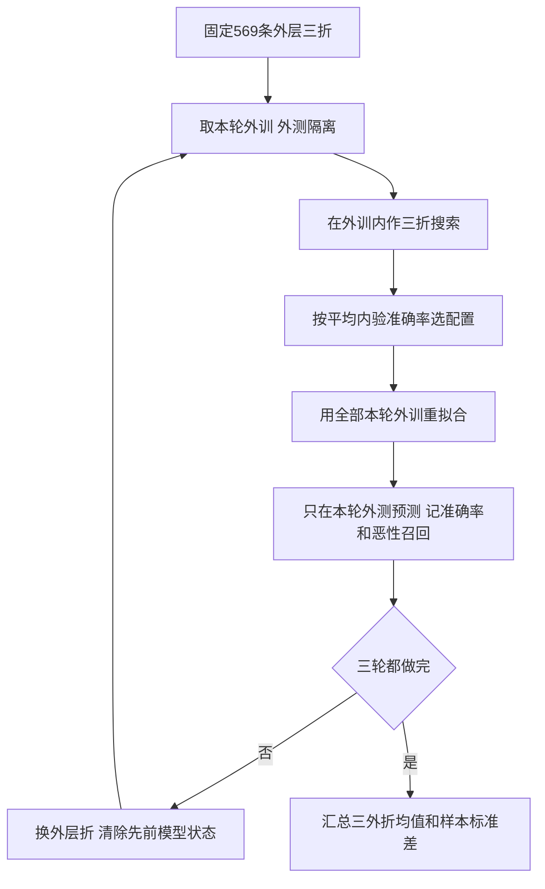

# Week 11 三问学习参考 · 默认模型、嵌套 CV 与预处理

> 2026-11-23：本页保留 11/18 三折小网格参考实验及当时文件状态；现已另有 [五折正式答卷与中文导览](开始这里.md)。下文“未生成提交件”是旧实验时点描述，不代表当前库存，旧数值不改写。

<!-- cityu-nav:opening -->
> [!abstract] 三问阅读导航
> **预习**：[[#2. 数据、输入与代码入场|数据／语法]] → [[#3. Q1 · 三种默认模型|Q1]] → [[#4. Q2 · 内层选参，外层评价|Q2]] → [[#5. Q3 · 对额外 BDA 处理作实际评价|Q3]]。
> **按题**：[[#1. 给定条件与完整原题|完整原题]]；[[#3.2 实际结果怎样读|默认比较]] · [[#4.1 为什么是两层|嵌套流程]] · [[#5.1 哪一步改变了|折内预处理]]。
> **复做／复习**：[[#6. 从干净进程复做|启动脚本]] → [[#7. 自测：改一个条件会怎样|改条件自测]] · [[#8. 当前完成与未完成|限制]]。
> 关键位置可返回三问入口；[[IS6400_Business_Data_Analytics/00-课程总览|课程入口]]。
<!-- cityu-nav:opening:end -->

这是按原题制作的本地参考实验与学习解释，与个人正式答卷分开。当前没有生成可提交 Notebook／HTML，也没有上传。题面、期限与格式限制在 [[IS6400_Business_Data_Analytics/assignment/graded/A12-week11-model-selection/notes/任务说明|A12 任务说明]]；课堂代码机制在 [[IS6400_Business_Data_Analytics/notes/T11-模型选择实战-Ridge剪枝与交叉验证|T11]]。

## 1. 给定条件与完整原题

原 Notebook 第63 cell给三问，内部分值40／40／20；Canvas独立显示10points，不自行换算。

> 1. Use the Breast Cancer Wisconsin (Diagnostic) dataset to select the best model among Decision Trees, RandomForest, and SVC that has the minimum testing error (use the default model settings) (40 points).
> 2. Use the same dataset and try to use nested Cross-validation to get the optimal hyperparameters for each model, and then compare the model performance (40 points).
> 3. What other BDA process can you use to further improve the performance of the best models in Question 2? For example, feature selection or dimension reduction, imbalanced data sampling, etc., Please evaluate. (20 points).

Q1限定默认模型，不把已调参或缩放后的SVC成绩混进来；Q2要求各模型内部选参，同时比较它们；Q3要实际评价一项额外BDA处理。这里预先固定一套小型可复做协议，只在明确候选范围内找好配置，不宣称“所有可能参数的全局最优”。

## 2. 数据、输入与代码入场

`load_breast_cancer()`载入569条公开基准记录、30列数值特征；目标0=恶性212条，1=良性357条。行是一条记录，列是同一记录不同测量，输入X形状569×30，目标y长度569。这里不提供任何个人医疗判断。

分类错误率为错误条数／评价条数，等于1−accuracy。恶性召回率另外按0类计算，分母是所有真实恶性；不能因默认1为正类就反向汇报安全意义。两项指标回答不同问题：Q1主比较按原题最小错误率，恶性召回作补充。

### 2.1 先知道几个语法与对象

赋值保存当前结果；列表把候选对象按顺序放好；字典给参数名对应的候选值。`for`循环逐个候选、逐个外折运行；索引数组`X[tr]`一次取该轮训练行，`y[tr]`必须取同样编号。`enumerate(...,1)`额外给从1起的轮号，不改变数组仍0起的行索引。

Pipeline（管线）把转换器与模型按先后组成一个估计器。`('select',工具)`这样的元组给步骤命名，`select__k`中的双下划线表示“select步骤的k参数”；`model__C`表示最后分类器的C。网格搜索克隆并重新拟合整条管线，因此每个验证折都不会参与自己的特征筛选或缩放统计量估计。

## 3. Q1 · 三种默认模型

### 3.1 划分和随机性怎样固定

沿用课堂乳腺部分的`train_test_split(X,y,random_state=0)`，默认25%留出，得到426训练／143测试；没设stratify，真实测试类计数53／90。三个候选分别为`DecisionTreeClassifier()`、`RandomForestClassifier()`、`SVC()`，不改它们的模型参数。

默认树和森林的random_state为None，会使用随机数状态。为了让这个教学例可重做，每个模型fit前把NumPy全局随机种子设为20261118，模型构造仍保持默认。它是本实验的外部随机性约定，不是教师给定种子，也不保证跨库版本逐位相同。本批版本为sklearn1.5.1／NumPy1.26.4／Python3.12.3。

### 3.2 实际结果怎样读

<!-- cityu-nav:ancillary-landing-1 -->
[[#Week 11 三问学习参考 · 默认模型、嵌套 CV 与预处理|↑ 三问入口]] · [[#1. 给定条件与完整原题|原题]] · [[#7. 自测：改一个条件会怎样|自测]]
<!-- cityu-nav:ancillary-landing:end -->

下表一行一种默认模型，全部用同样143条测试，错分数为实际预测与真实标签不同的条数。错误率先按未舍入值比较，最后统一显示6位小数。

| 默认模型 | 错分条数／分母 | 错误率 | 准确率 | 恶性召回率 |
|---|---|---|---|---|
| DT | 19／143 | 0.132867 | 0.867133 | 0.943396 |
| RF | 4／143 | 0.027972 | 0.972028 | 0.981132 |
| SVC | 9／143 | 0.062937 | 0.937063 | 0.849057 |

RF错4条，错误率4／143≈0.027972，小于DT的19／143≈0.132867与SVC的9／143≈0.062937，因此在本默认模型／切分／种子中选RF。原始SVC没缩放输入，不能把后面缩放的结果拿来替Q1默认设置。

英文参考答案（笔记自拟）：Under the documented common hold-out split and default-estimator experiment, Random Forest has the lowest observed testing error, 4/143, compared with 19/143 for the decision tree and 9/143 for SVC. This is a result for the stated version and random-state protocol, not a universal ranking.

题目让testing error参与选家族，所以最高的所选测试分数已经带选择作用；如要报告未受选择影响的最终成绩，应另留评估或用下一问的外层协议。不能既用它选赢家，又称它完全未参与选择。

## 4. Q2 · 内层选参，外层评价

### 4.1 为什么是两层

<!-- cityu-nav:ancillary-landing-2 -->
[[#Week 11 三问学习参考 · 默认模型、嵌套 CV 与预处理|↑ 三问入口]] · [[#1. 给定条件与完整原题|原题]] · [[#7. 自测：改一个条件会怎样|自测]]
<!-- cityu-nav:ancillary-landing:end -->

外层先把全部569条作分层三折，shuffle=True、random_state=11，固定为三轮训练／测试。第一、二轮各379训练／190外测，第三轮380训练／189外测。每轮外测标签不参与本轮的参数搜索。

在当轮外层训练数据内部，再用分层三折、shuffle=True、random_state=22。每个候选配置在两份内折拟合、剩一份内验，三次内验准确率平均后选配置。内层选好，用完整外层训练数据重拟合，再仅对这轮外测预测。三轮各从头选参，不复用先前可能见过当前外测的赢家。



沿第一轮走时，“外训”包含379条，内折只在这379条内部划分，不是重新从569条抽内折。`refit=True`将内层赢家在这379条上重训，外测190条只提供本轮评分。循环在全部外折做完后结束，不以出现高分为停止条件。

### 4.2 固定候选范围

| 模型 | 参数候选 | 每家族组合数 |
|---|---|---|
| DT | max_depth∈{3,None}，min_samples_leaf∈{1,3} | 4 |
| RF | 默认100棵；max_depth∈{5,None}，min_samples_leaf∈{1,3} | 4 |
| SVC | C∈{1,10}，gamma∈{'scale',0.0001}，默认RBF核 | 4 |

None不额外限最大深度，最少叶样本3不允许最终叶太小。树和森林random_state=0用于本问确定性；这与Q1完全默认构造的实验约定分开。当前Q2保持原始输入，不加学习型预处理，方便Q3另比较管线变化。

每家族3外折×4组合×3内折=36次候选fit，再加每外折赢家重拟合3次，共39次。主指标accuracy越高越好，`best_score_`是内部选择成绩，不能替代外测成绩。以下均值来自外测，标准差用3−1分母描述这三个折间变化，不作独立样本显著性证明。

### 4.3 结果与每轮参数

| 家族 | 三外折准确率均值 | 样本标准差 | 平均错误率 |
|---|---|---|---|
| DT | 0.927959 | 0.010823 | 0.072041 |
| RF | 0.957839 | 0.009020 | 0.042161 |
| SVC | 0.940230 | 0.011102 | 0.059770 |

原始输入RF的外层准确率均值约0.957839，在本三家族的小网格中最高；DT约0.927959，SVC约0.940230。这里平均的是三折各自比例，第三折189条而非190条，所以不把未加权均值直接说成某个合并样本的正确条数比例。

| 家族／外折 | 外测条数／正确条数 | 外测准确率 | 内层选中的配置 |
|---|---|---|---|
| DT／1 | 190／177 | 0.931579 | model__max_depth=None, model__min_samples_leaf=3 |
| DT／2 | 190／174 | 0.915789 | model__max_depth=None, model__min_samples_leaf=1 |
| DT／3 | 189／177 | 0.936508 | model__max_depth=3, model__min_samples_leaf=3 |
| RF／1 | 190／181 | 0.952632 | model__max_depth=None, model__min_samples_leaf=1 |
| RF／2 | 190／181 | 0.952632 | model__max_depth=5, model__min_samples_leaf=1 |
| RF／3 | 189／183 | 0.968254 | model__max_depth=5, model__min_samples_leaf=1 |
| SVC／1 | 190／181 | 0.952632 | model__C=10, model__gamma=0.0001 |
| SVC／2 | 190／178 | 0.936842 | model__C=10, model__gamma=0.0001 |
| SVC／3 | 189／176 | 0.931217 | model__C=10, model__gamma=0.0001 |

各外折可以选择不同配置，说明“最佳超参数”取决于可用训练样本。本表不是最终部署一套权重；如需部署，应在协议冻结后在开发数据再选参和重拟合，并另安排最终评价。为了比较模型家族，我们又观察了外层成绩，因此所选最高均值也参与了跨家族选择；报告这个开发使用史，不伪装成额外未见测试。

英文参考答案（笔记自拟）：Use an inner three-fold search within each outer training split, refit the selected configuration on that outer training split, and score only its outer test fold. Under the fixed small grids, raw-input Random Forest has the highest mean outer accuracy, approximately 0.957839. The selected hyperparameters may differ across outer folds, and the result does not establish a global optimum over all possible settings.

## 5. Q3 · 对额外 BDA 处理作实际评价

### 5.1 哪一步改变了

<!-- cityu-nav:ancillary-landing-3 -->
[[#Week 11 三问学习参考 · 默认模型、嵌套 CV 与预处理|↑ 三问入口]] · [[#1. 给定条件与完整原题|原题]] · [[#7. 自测：改一个条件会怎样|自测]]
<!-- cityu-nav:ancillary-landing:end -->

在相同外层三折上，为每家族加入`SelectKBest(f_classif)`与`StandardScaler`，再接原分类器。候选k为10、20、'all'，且与该家族四个配置共同在内层搜索；不是先看全部数据选10列再CV。每家族12组合×3内折×3外折=108候选fit，加3次重拟合，共111次。

特征筛选（Feature selection）只保留选中的列；`f_classif`用类间均值差异相对类内波动的F分数逐列排序。它用训练标签，因此特别要放进每个训练折。

💡 笔记补充：一列在类0为1、2，类1为5、6，组均值1.5与5.5，总均值3.5。类间平方和为$2(1.5-3.5)^2+2(5.5-3.5)^2=16$；类内平方和把各点减本组均值后平方相加，得1。两组均值受总均值关系约束，类间独立差异数为2−1=1；四个点先估了两个组均值，类内剩4−2=2。用这两个自由度把平方和换成平均平方，比例为$F=(16/1)/(1/2)=32$。

高分表示该列的组间差异相对组内更突出，不保证该列与其他列组合最好，也可能漏交互信号。这里用F分数排序，没有计算F检验p值或宣称差异显著。

标准化（Standardization）的实际动作是：原值先减当前训练折学到的该列均值，再除当前训练折学到的该列缩放因子。对第j列，写成$z_j=(x_j-\mu_{train,j})/scale_j$；x是待转换的原值，μ是训练均值，scale对应已拟合StandardScaler的`scale_`属性，不在验证折重新估计。

这里使用StandardScaler默认`with_mean=True, with_std=True`：训练方差`var_`按该训练折人数n作分母，即ddof=0，通常`scale_`为这个方差的平方根；零方差或实现判为近常数的列使用缩放因子1。复算时读取拟合对象的`mean_`／`scale_`，不擅自换成以n−1作分母的样本标准差。

例如训练列为2、4，训练均值3；方差为$((2-3)^2+(4-3)^2)/2=1$，因此scale为1，两个训练值变为−1、1。验证值6只用既有统计量，算$(6-3)/1=3$。若另一训练折给均值5、scale2，则验证值9变成$(9-5)/2=2$，不能直接拿9除2或拿验证值更新均值。标准化改变距离尺度，可能帮助SVC；树只依顺序阈值，不因为线性缩放就一定提高。

两步同时加入，是本轮“预处理包”的比较，不能仅从整体变化认定改善完全由筛特征造成。若要拆贡献，应另作只缩放／只筛选的消融，不能把未执行的消融写成结果。

### 5.2 实际比较

下表把同一家族的原始输入与预处理包并排，Δ为后者准确率减前者，单位为准确率比例，不是百分数乘数。

| 家族 | 原始输入均值 | 筛选＋缩放均值 | Δ准确率 |
|---|---|---|---|
| DT | 0.927959 | 0.915632 | -0.012327 |
| RF | 0.957839 | 0.947257 | -0.010582 |
| SVC | 0.940230 | 0.975411 | +0.035181 |

Q2原赢家RF加当前包后约0.947257，低于原0.957839，差约−0.010582（−1.0582个百分点），因此这次证据不支持为RF采纳该包。不能为了题目写“improve”就把下降改成上升。

SVC升到约0.975411，三外折都选择k='all'，即保留全部30列；这提示在当前候选中，改善与缩放／超参数变化相关，不能宣称“删特征改善了SVC”。DT亦下降。本实验没做重采样、PCA或更多方案，不把它们列成已验证改进。

| 家族／外折 | 外测条数／正确条数 | 外测准确率 | 内层选中的配置 |
|---|---|---|---|
| DT／1 | 190／177 | 0.931579 | model__max_depth=None, model__min_samples_leaf=3, select__k=all |
| DT／2 | 190／172 | 0.905263 | model__max_depth=None, model__min_samples_leaf=1, select__k=10 |
| DT／3 | 189／172 | 0.910053 | model__max_depth=None, model__min_samples_leaf=3, select__k=10 |
| RF／1 | 190／181 | 0.952632 | model__max_depth=None, model__min_samples_leaf=1, select__k=all |
| RF／2 | 190／181 | 0.952632 | model__max_depth=5, model__min_samples_leaf=1, select__k=20 |
| RF／3 | 189／177 | 0.936508 | model__max_depth=5, model__min_samples_leaf=3, select__k=10 |
| SVC／1 | 190／185 | 0.973684 | model__C=1, model__gamma=scale, select__k=all |
| SVC／2 | 190／184 | 0.968421 | model__C=1, model__gamma=scale, select__k=all |
| SVC／3 | 189／186 | 0.984127 | model__C=10, model__gamma=scale, select__k=all |

英文参考答案（笔记自拟）：Evaluate fold-fitted feature selection and scaling as an additional BDA pipeline. In this experiment it reduces the Random Forest mean accuracy from about 0.957839 to 0.947257, so it is not adopted as an improvement for the Q2 winner. The SVC comparison improves to about 0.975411, but every outer fold selects all 30 features; therefore the result does not demonstrate a benefit from removing features. Additional ablations would be required to separate scaling and selection effects.

### 5.3 进一步理解与限制

两类标签为212／357，并非像罕见欺诈那样极端失衡；任何重采样都应先给业务理由和训练折内方案，不能看见两个类就自动生成合成样本。主指标accuracy未表示恶性漏报成本；结果文件同时保留恶性召回，若业务重视漏报，应事先改变选择指标并重做完整选择流程，而非事后只挑好看的列。

网格很小，外层只有三折，没有重复种子试验或独立机构数据。相同外折被多次用于开发比较，若继续据其选最好的完整方案，最终成绩仍需另留评价；这些限制改变结论范围，不能被“嵌套”这个名称免除。

## 6. 从干净进程复做

<!-- cityu-nav:ancillary-landing-4 -->
[[#Week 11 三问学习参考 · 默认模型、嵌套 CV 与预处理|↑ 三问入口]] · [[#1. 给定条件与完整原题|原题]] · [[#7. 自测：改一个条件会怎样|自测]]
<!-- cityu-nav:ancillary-landing:end -->

原始Notebook只读。本参考的持久入口是[打开完整脚本](../work/learning-reference.py)与[打开完整结果JSON](../work/learning-reference-results.json)。输入是sklearn内置数据，不下载或改原件。脚本不是正式提交Notebook，未来答卷仍须从教师原Notebook副本续写并按明确格式导出。

在本机PowerShell先进入这份脚本所在目录，再用已核解释器运行；下面路径对应本课现有布局，命令没有额外参数：

```powershell
Set-Location -LiteralPath 'D:/上课资料/CityU/IS6400_Business_Data_Analytics/assignment/graded/A12-week11-model-selection/work'
& 'D:/anaconda3/python.exe' -X utf8 './learning-reference.py'
```

这一步会在同一work目录写入`learning-reference-results.json`，包含环境、Q1三模型、Q2／Q3各折分数与参数；再次运行会更新同名结果文件。需要保留一次结果时先保存副本。脚本按自身文件位置向上找到CityU根，并导入现有`_meta/tools/safe_write.py`，因此不要只把脚本随意搬到另一层目录。所需库与本批版本在§3.1及结果environment字段记录，不自动安装或更换环境。

打开代码时先读`load_breast_cancer`和第一次`train_test_split`，它们定义Q1数据；再读`outer`／`inner`与`configs`，它们定义Q2／Q3分折及候选。最关键的真实代码行如下，`pipe`与`candidates`是该轮已建立的管线／参数网格：

```python
search = GridSearchCV(pipe, candidates, cv=inner, scoring='accuracy', refit=True, n_jobs=1, error_score='raise')
search.fit(X[tr], y[tr])
pred = search.predict(X[te])
```

先在本轮训练索引tr上fit整个搜索器，内层赢家重拟合也只见这些行；随后才对外测te预测。最后读取结果的`q1.models`看默认比较，`q2_q3.results`前三项看原始输入、后三项看筛选／缩放包，再进入各项`folds`核每轮配置与正确数。表格是这些实际JSON值的展示，没有另一套手填结果。

代码先建立数据与Q1默认候选；再固定外层索引，内层GridSearchCV只接本轮X[tr]／y[tr]；Q3把选择器／缩放器放进同一Pipeline。`search.predict(X[te])`发生在内层挑选和外训重拟合之后，所以每一轮的外测未参与该轮fit。完整代码作为同一可复做来源，不在报告里维护第二套逻辑。

## 7. 自测：改一个条件会怎样

问：如果先在全部569条上用f_classif选10列，再做外层三折，是否仍是同样的独立外测？

<details><summary>答案与理由</summary>

不是。f_classif使用了全部标签，当前外测类别已经影响保留哪些列，外层fit虽未直接传外测标签，输入选择仍泄漏。应让选择器随每个训练折重新fit，验证／测试只transform。英文参考：Feature selection must be fitted within the training portion of each split because the F scores use class labels. Selecting features on all observations leaks outer-test information.

</details>

问：若RF预处理包下降，能否只写SVC上升来回答“原最佳RF进一步改善”？

<details><summary>答案与理由</summary>

不能。原RF的结果要直接报告下降，SVC是另一家族的比较结果。可以提出下一步试验，但未经执行不能写成RF已改善，也不能用更换家族掩盖原问题的负结果。

</details>

## 8. 当前完成与未完成

本学习参考已实际计算三问的这一套明确协议，不是官方标准答案；教学独审、最终图文显示与正式学习稿写回尚以本批回执为准。本人最终材料、格式确认、审阅、提交与评分分别待核。没有创建submission成品，不把本脚本直接当可交附件。
