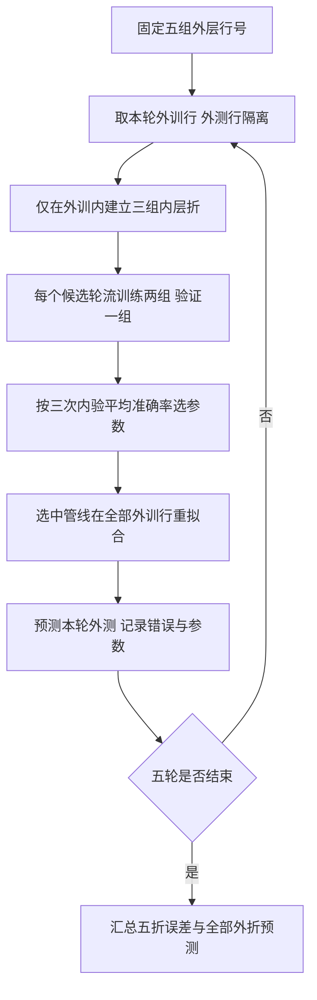

# Week 11 作业 · 从默认模型到嵌套验证

这份导览解释正式答卷怎样得到三问答案。英文答卷和教师原教程在 [Notebook](../work/IS6400_Week11_60234350_LI_Binxiong.ipynb)，阅读成品在 [HTML](../submission/IS6400_Week11_60234350_LI_Binxiong.html)。本人学习、审阅与 Canvas 提交分别记录；本页的解释和实验属于参考作答，不是官方标准答案。

第一次做：[[#1. 三问各要交什么|读题]] → [[#2. 运行前先认识数据与 Python|数据与语法]] → [[#3. Q1 · 怎样比较默认模型|Q1]] → [[#4. Q2 · 为什么要两层验证|Q2]] → [[#5. Q3 · 怎样判断额外处理是否有效|Q3]]。复做可到 [[#6. 运行与排错|运行入口]]，复习可到 [[#7. 自测与条件变化|自测]]。课堂机制的完整参考为 [[IS6400_Business_Data_Analytics/notes/T11-模型选择实战-Ridge剪枝与交叉验证|T11]]。

## 1. 三问各要交什么

来源是教师 `Week 11 selection.ipynb` 第 63 cell。以下完整保留三问；内部分值为 40／40／20，Canvas 页面另标 10 points，不在这里推断折算规则。

> 1. Use the Breast Cancer Wisconsin (Diagnostic) dataset to select the best model among Decision Trees, RandomForest, and SVC that has the minimum testing error (use the default model settings) (40 points).
> 2. Use the same dataset and try to use nested Cross-validation to get the optimal hyperparameters for each model, and then compare the model performance (40 points).
> 3. What other BDA process can you use to further improve the performance of the best models in Question 2? For example, feature selection or dimension reduction, imbalanced data sampling, etc., Please evaluate. (20 points).

Q1 让三种默认分类器在同一测试数据上比较，直接选错误率最小者。限定词 `default model settings` 排除了先给 SVC 调参再冒充默认比较的做法。Q2 要在每个模型内部找参数，再比较模型，不能只做一次普通交叉验证（Cross-validation，CV）就称嵌套。Q3 的 `evaluate` 要求实际运行额外处理，与基线比较；处理不一定改善，负结果仍要回答。

本次对应位置如下。cell 从 1 开始计数；教师的 63 个 cell 保持相对顺序，前面只增加身份、字号和运行设置。

| 作答动作 | 正式 Notebook 位置 | 要看什么 |
|---|---|---|
| 原题 | Cell 65，教师原 Cell 63 | 完整三问及分值 |
| Q1 | Cell 66–68 | 默认构造、共同划分、错分数、错误率与结论 |
| Q2 | Cell 69–76 | 候选网格、两层划分、逐折配置、汇总与全数据拟合配置 |
| Q3 | Cell 77–79 | 四种预处理管线与实际变化 |
| 拓展 | Cell 80–82 | 两种误判、配对折差、Figure A1 与适用范围 |
| 环境与声明 | Cell 83–84 | 实际软件版本、一句真实 AI 声明 |

表中一个区间是一组解题动作。比如 Q2 的函数在 Cell 72，不需要去教师的 Iris 示例里寻找乳腺数据结果。HTML 首页的 Question 1／2／3 链接也可直达答案。

## 2. 运行前先认识数据与 Python

### 2.1 一行、一列和目标

输入矩阵（matrix）`X_bc` 是按行列排列的数字表，形状为 569 × 30：一行是一条病例记录，一列是某种细胞核测量。目标（target）`y_bc` 是长度 569 的标签列表，顺序与输入的行严格对应。0 表示恶性，1 表示良性；有 212 个 0 和 357 个 1。数据由 `load_breast_cancer()` 从 scikit-learn 自带文件加载，不把 `iris.txt` 当作本次作业输入。

模型（model）在训练时接收输入和正确标签，寻找从测量到类别的规则；预测时只给测量，让模型输出类别。评价再把预测与真实标签逐条比较。这里分析的是公开基准数据的分类表现，不将输出用于个人诊断。

缺失值检查是 `np.isfinite(X_bc).all()`：`isfinite` 对每个数字判断它是不是有限值，`all` 要求每个判断都成立。实测全部有限，因此没有凭空添加填补步骤。没有单独“学习”填补、编码或缩放的 Q1／Q2，直接使用原始 30 列。

### 2.2 看代码需要的最小语法

以下为笔记补充的小例，目的是读懂正式代码。赋值 `a = 3` 给数值起名字；比较 `a == 3` 才是在判断是否相等。函数是把一组操作封装成有名称的工具；`len([4, 8, 9])` 返回列表长度 3，括号里的内容是输入。`random_state=0` 这样的命名参数指定工具的一项设置，不是把整个函数结果设成 0。

列表（list）按顺序存对象，如 `[10, 20, 'all']` 是三个候选保留列数；字典（dictionary）按键找值，如 `{'model__C': [1, 10]}` 指定 SVC 的两个候选 C。字符串用引号包住，因此 `'scale'` 是 scikit-learn 认识的一项规则名称，不是此刻待计算的变量。

`for name, estimator in defaults.items():` 逐一取字典里的名字和模型，缩进的几行对每个模型做一次。`enumerate(outer_splits, start=1)` 还给每轮附上 1、2、3……的折号。`append` 把一次结果加到列表末尾。`pd.DataFrame(records)` 最后将这些字典记录排成表格。

NumPy 数组的索引（index）从 0 开始。若 `ids = [0, 2]`，`X_bc[ids]` 取第 1、3 行；`y_bc[ids]` 必须取同样行号的标签。不能对输入与标签各随机打乱一次，否则病例和答案会错配。`np.arange(569)` 先生成 0 到 568 的行号，Q1 划分的是这些行号。

`predicted != y_bc[test_ids]` 逐条比较，得到真／假的布尔数组。求和把真计为 1，所以它的和就是错分数。`np.full(569, -1, dtype=int)` 先建立 569 个整数 -1，后面每个外层测试折将自己的预测填到原行号；最后检查没有 -1，说明每条记录都已得到外折预测。

### 2.3 三种分类器在做什么

决策树（Decision Tree）每次根据一列是否超过某阈值分支。比如“测量 A 是否大于 5”将记录分到两边，再继续提问，最终叶子给类别。树太深时可能记住训练中的偶然差异；限制最大深度和叶子最少样本数，是限制规则复杂度的方式。

随机森林（Random Forest）训练多棵有随机差异的树，再汇总它们的判断。scikit-learn 的 `RandomForestClassifier` 默认对树的类别概率取平均，并按最高平均概率给类别；每棵树由其叶子里的类别比例给概率。训练样本抽取和候选特征的随机性使各树不完全相同，因此重跑时要记录随机性约定。

支持向量分类器（Support Vector Classifier，SVC）寻找分隔类别的边界，并惩罚靠近边界或落到错误一侧的点。默认使用径向基函数（Radial Basis Function，RBF）核：相近输入的影响较强，较远输入的影响衰减。不同测量列数值量级相差很大时，距离容易被大数值列主导，这就是 Q3 检验标准化的原因。

## 3. Q1 · 怎样比较默认模型

### 3.1 先固定谁训练、谁测试

`train_test_split(..., random_state=0)` 沿用教师乳腺示例的划分；默认测试比例 0.25，实际分成 426 条训练和 143 条测试。未设置 `stratify`，所以这次测试中恶性 53 条、良性 90 条。三种模型使用同一组行号；不会给某模型换一个更有利的测试集。

构造器分别是 `DecisionTreeClassifier()`、`RandomForestClassifier()`、`SVC()`，没有更改模型超参数。树与森林的默认 `random_state=None` 会使用全局随机状态；每次 `fit` 前重设 `np.random.seed(20261118)`，使本实验在相同版本下可重做。外部随机种子是本次实验约定，不是教师指定参数，也不保证跨版本逐位相同。

`fit(X_bc[train_ids], y_bc[train_ids])` 根据训练记录和答案建立规则。`predict(X_bc[test_ids])` 用这套规则产生测试预测，不再提供测试标签去训练。

### 3.2 错误率和恶性召回怎样算

错误率（error rate）的分母是全部测试记录，准确率（accuracy）是正确条数占比，两者相加为 1：

$$
e=\frac{m}{n},\qquad a=1-e.
$$

m 是错分条数，n 是测试条数，e 与 a 都是无单位比例。

随机森林错 4 条，故 $e=4/143=0.027972$（展示到六位小数），准确率为 $139/143=0.972028$。做选择时用未舍入数值，展示时才四舍五入。

恶性召回率（malignant recall）问的是“真实恶性中找回多少”。它的分母是 53，而不是 143。正式代码 `recall_score(..., pos_label=0)` 明确将 0 类作为所关注类别；如果省略 `pos_label=0`，默认统计的是良性，不能把它命名为恶性召回。

| Model | Wrong | Test n | Error | Accuracy | Malignant recall |
|---|---|---|---|---|---|
| Decision Tree | 19 | 143 | 0.132867 | 0.867133 | 0.943396 |
| Random Forest | 4 | 143 | 0.027972 | 0.972028 | 0.981132 |
| SVC | 9 | 143 | 0.062937 | 0.937063 | 0.849057 |

一行代表一个默认分类器。RF 即随机森林，DT 即决策树；读取 RF 一行可知，在共同 143 条测试记录上错 4 条，比另外两种更少。因此 Q1 选择随机森林。

英文参考作答：Random Forest has the minimum observed testing error, 4/143 = 0.027972, on the common hold-out split with default estimators and the documented external random seed.

Q1 是按题意用测试误差选模型家族。这个测试结果已经参与选择，不能再把选中模型的成绩称为一个额外的、完全未参与选择的最终评价。

## 4. Q2 · 为什么要两层验证

### 4.1 参数搜索也可能迎合评价数据

超参数（hyperparameter）是训练前规定的设置，比如树最大深度或 SVC 的 C。若比较 12 个配置，再拿最高的那一个验证成绩当最终成绩，配置已经利用了验证数据提供的信息。候选越多，越有机会碰巧迎合这几次划分。因此要把“用来选设置的数据”和“用来评价选择流程的数据”分开。

嵌套交叉验证（nested cross-validation）的内层选参，外层评价。折（fold）是把行分组后轮流留出的一组。分层（stratified）让每折中的类别比例大致接近整体，而不是保证各折分数相同。

本次先固定五组外层测试行；每条记录恰好外测一次。前四折各外测 114 条、外训 455 条；最后一折外测 113 条、外训 456 条。内层三折只在当轮外训内部切分，不重新接触外测行。



从图的顶端向下读。第一轮先隔离 114 条外测；只在剩余 455 条内部为每个参数做三次验证。选好以后用全部 455 条重训，最后才预测那 114 条。外层下一轮更换外测行，从头训练和搜索，不把上一轮模型接着用。图是本次代码流程的笔记补充，不是教师原图。

### 4.2 网格与关键参数

网格（grid）是预先列出的候选集合。正式代码中，DT 有 3 × 2 = 6 个组合，RF 有 2 × 2 × 2 = 8 个组合，SVC 有 4 × 3 = 12 个组合。

| 模型 | 候选 | 改变什么 |
|---|---|---|
| DT | `max_depth=[3,5,None]`，`min_samples_leaf=[1,3]` | `None` 表示不额外限制深度；叶子至少 3 条时不能形成只有 1 条记录的最终叶 |
| RF | `max_depth=[5,None]`，`min_samples_leaf=[1,3]`，`max_features=['sqrt',0.5]` | 后一项在每次分裂时改变候选列数：平方根规则或总列数的一半；默认 100 棵树 |
| SVC | `C=[0.1,1,10,100]`，`gamma=['scale',0.0001,0.001]` | C 越大越重视减少边界违反；gamma 越大，相似度随距离衰减越快，边界可更局部 |

`'scale'` 让 gamma 依训练输入的特征数与方差确定，不等于一个固定的 0.0001。对 30 列原始输入和筛过的 10 列输入，它可能取不同值。

`Pipeline([('model', estimator)])` 是命名步骤的管线（pipeline）。`model__C` 中的双下划线表示修改名为 `model` 的步骤里的 C 参数。Q2 只有模型步骤；Q3 会在模型前加入筛选或缩放，让搜索器把整套处理视为一个对象。

### 4.3 跟着 Cell 72 走完一轮

Cell 72 的 `def evaluate_nested(label, pipeline, grid):` 定义可重复使用的函数；函数收到名字、管线和候选，返回含结果的字典。`return` 把结果交给调用它的代码。变量在函数每次调用时重新建立，因此三个家族不会共用已经训练好的模型状态。

关键三行如下，与正式代码相同：

```python
search = GridSearchCV(clone(pipeline), grid, cv=inner_cv, scoring='accuracy',
                      refit=True, n_jobs=1, error_score='raise')
search.fit(X_bc[train], y_bc[train])
predicted = search.predict(X_bc[test])
```

这段是函数内部的节选，需先运行 Notebook 上文以建立变量。`clone` 复制设置而不沿用拟合状态。`cv=inner_cv` 指定三折内验；`scoring='accuracy'` 让搜索器按平均内验准确率择优。`refit=True` 在选完之后自动用全部当前外训行再训练赢家。`n_jobs=1` 每次只做一个拟合，避免多个搜索同时争用资源。`error_score='raise'` 遇拟合失败立即报错，不把失败候选悄悄转成一个分数。

第一轮 RF 有 8 个配置，每个配置做 3 次内验拟合，即 24 次；选好后再重拟合 1 次，共 25 次。五个外折共 125 次。Q2 末尾为获得一套全数据参数，另做一次同网格三折搜索及重拟合；那不是又得到一个测试成绩。

`best_params_` 保存当轮选中的设置，`best_score_` 保存平均内验准确率。代码先生成外测预测，再与 `y_bc[test]` 比较。`assert not np.intersect1d(train, test).size` 检查外训与外测没有同一行；输入矩阵和标签始终共用索引。

### 4.4 怎样读最终表格

| 模型 | 平均错误率 | 折标准差 | 合并错误率 | 恶性召回率 |
|---|---|---|---|---|
| Decision Tree | 0.068576 | 0.023699 | 0.068541 | 0.905660 |
| Random Forest | 0.042136 | 0.018967 | 0.042179 | 0.933962 |
| SVC | 0.063236 | 0.015573 | 0.063269 | 0.882075 |

一行代表一种模型家族，五次外测的错误率先分别算，再作简单平均。最小值对应 Random Forest（平均错误率 0.042136）。逐折所选参数和结果见 Notebook Cell 74；不同外折选出不同配置是允许的，因为它们看见的训练数据不同。

简单均值与合并错误率（pooled error）略有差异：前者给五折同样权重，后者把所有错分数相加再除以 569。举笔记补充的小例：两折分别错 1/2 与 1/3，平均为 $(1/2+1/3)/2=0.416667$，合并为 $2/5=0.400000$。分母不同，不能混写。

样本标准差（sample standard deviation）描述五个折分数有多分散：先将每折误差减均值，再平方相加，除以 5−1=4，最后开平方。它与错误率同单位；这里不拿它直接当置信区间，因为各折训练数据相互重叠。

英文参考作答：The inner three-fold search selects hyperparameters within each outer training set; the five outer folds evaluate the resulting procedure. Random Forest gives the lowest mean outer error, 0.042136, within the tested grids.

“最优”仅针对实际搜索网格与训练样本。Cell 76 在全部 569 条上重新搜索得到供后续预测使用的一套配置，不把全数据训练或内验成绩冒充新测试成绩。

## 5. Q3 · 怎样判断额外处理是否有效

### 5.1 先区分三种动作

特征选择（feature selection）保留原列中的一部分；标准化（standardization）改变各列的数值单位；主成分分析（Principal Component Analysis，PCA）用原列的组合建立新的轴。三者不是同一件事。

`SelectKBest(f_classif)` 根据训练标签给每列一个 F 分数，选分数靠前的 k 列。笔记补充小例：某列在类 0 为 1、2，在类 1 为 5、6。

组均值为 1.5、5.5，总均值 3.5；组间平方和为 $2(1.5-3.5)^2+2(5.5-3.5)^2=16$。组内平方偏差之和为 1。

两组给组间自由度 2−1=1，四点减两组均值给组内自由度 4−2=2。F 分数为 $(16/1)/(1/2)=32$：组间差异相对组内波动较大。

它是单列打分，不保证挑出的列组合起来最好，也不识别所有交互关系。

标准化先用当前训练列计算均值与总体标准差，随后验证列只套用已有数值：

$$
z=\frac{x-\mu_{\mathrm{train}}}{s_{\mathrm{train}}}.
$$

这里 $x$ 是待转换值，$\mu_{\mathrm{train}}$ 是训练均值，$s_{\mathrm{train}}$ 是 `StandardScaler` 学到的缩放因子。训练值 2、4 的均值是 3，方差按人数 2 为分母，得 $((2-3)^2+(4-3)^2)/2=1$，标准差为 1；验证值 6 变为 $(6-3)/1=3$。零方差或实现判为近常数的列使用因子 1。不能把验证值也拿来重新估均值。

PCA 的轴是原测量的线性组合。例如两列总是近似一起增加，可用它们沿共同变化方向的坐标概括主要变动；另一个方向只剩较小差异。若标准化后两列恰好完全相同，投影 $u=(z_1+z_2)/\sqrt{2}$ 记录共同变化，垂直方向 $(z_1-z_2)/\sqrt{2}=0$ 没有变化。这是笔记补充的二维示意，不是乳腺数据实际算出的主成分。实际 `PCA(svd_solver='full')` 根据训练数据求轴，`n_components=0.95` 选择足够多的新轴，使累计解释方差比例超过 0.95；它不是保留 95% 的原列，也不承诺保留所有分类信息。

### 5.2 为什么一定放在管线内部

若先在全部 569 条上按 F 分数挑列，外测标签已经参与决定输入，后来再把模型套进 CV 也补不回这个信息泄漏（data leakage）。标准化和 PCA 虽不用标签，仍会从验证／测试输入学到分布，因此也在训练折内拟合。

正式 Q3 的 RF 为“筛选 → 森林”，SVC 有“缩放 → SVC”“筛选 → 缩放 → SVC”“缩放 → PCA → SVC”。把这些步骤放进同一 `Pipeline` 后，`GridSearchCV.fit` 每次用内训行拟合整条管线，内验行只应用已拟合规则；外层赢家重拟合也仅用外训行。

`select__k=[10,20,'all']` 与模型参数共同搜索，`'all'` 允许结果说明删列无助。PCA 的 0.90、0.95、0.99 也是内层候选；实际组件数取决于本轮训练数据，保存在 `Features/components` 列。RF 筛选管线不额外缩放，以便只检验增加筛选的效果。

### 5.3 实际结果与消融比较

| 方案 | 平均错误率 | 错分总数 | 恶性召回率 |
|---|---|---|---|
| Decision Tree | 0.068576 | 39 | 0.905660 |
| Random Forest | 0.042136 | 24 | 0.933962 |
| SVC | 0.063236 | 36 | 0.882075 |
| RF + selection | 0.035119 | 20 | 0.938679 |
| SVC + scaling | 0.022838 | 13 | 0.952830 |
| SVC + selection + scaling | 0.021084 | 12 | 0.957547 |
| SVC + scaling + PCA | 0.026362 | 15 | 0.948113 |

一行是一个完整处理方案，“平均错误率”越小越好。先比较 RF 原始输入与 RF 筛选；再比较原始 SVC 与仅缩放 SVC；最后把筛选／PCA 与仅缩放 SVC 比。后两项是消融比较（ablation comparison），用来分清在已有缩放基础上继续加处理是否有额外收益。

RF 加筛选后平均错误率从 0.042136 降到 0.035119；五折中一次保留 30 列、四次保留 20 列。仅给 SVC 缩放就由 0.063236 降到 0.022838，再加筛选为 0.021084：合并错分仅比仅缩放少 1 条（13 变 12），不能夸大这点额外收益。PCA 的平均错误率为 0.026362，虽把维度降到 10–17，误差反而高于仅缩放；本轮优先选择筛选加缩放 SVC 作为开发候选。

这里所有比较使用相同五组外层行号。Cell 81 的差值表逐折计算“新方案错误率 − 基线错误率”，负数才是该折改善。单看平均值可能掩盖某几折变好、某几折变差，不能看见整体上升就编造所有折都改善。

### 5.4 错分对象也要看

混淆矩阵（confusion matrix）将真实类别放在行、预测类别放在列，本代码固定顺序 `[0,1]`。左上是恶性正确判恶性，右上是真恶性误判良性，左下是真良性误判恶性，右下是良性判对。`cm[0,1]` 就是漏掉的恶性记录数；两格错分加起来才是总错误数。

Figure A1 左图是平均错误率，短条较好；右图是合并恶性召回，长条较好。右图分母是全部 212 条恶性记录。若一个方案总错误较低但漏掉更多恶性，两个指标就给出不同取舍。Q1／Q2 按题意以错误率排名；若以后要优先减少恶性漏报，应先改选型目标再重做，而不是事后改挑一个好看的指标。

数据的类别数量是 212／357，存在不均衡但不是极罕见类别。本次实际评价筛选、缩放与 PCA；没有运行合成过采样，不把题目举例写成所有方法都已实施。跨家族、跨管线已经利用外层结果作选择，所以当前是开发比较；后续若需独立的最终性能估计，应另留新数据或再加外层评价。

英文参考作答：Feature selection improves the Random Forest comparison, reducing mean error from 0.042136 to 0.035119. Scaling contributes most of the SVC improvement; selection plus scaling reaches 0.021084, while PCA gives 0.026362. The selected SVC pipeline makes 12 out-of-fold errors, versus 13 for scaling alone.

[[#1. 三问各要交什么|↑ 三问与代码位置]] · [[#7. 自测与条件变化|检查自己是否理解]]

## 6. 运行与排错

### 6.1 从一个文件入口运行

正式分析只维护 Notebook 这一份代码；[结果 JSON](../work/week11-results.json) 是同次执行导出的数值记录，不是第二套分析逻辑。旧 [学习参考](学习参考.md) 保留其三折小网格历史实验，数值与本次五折、更宽候选的答卷不同，不互相覆盖。

Notebook 和 `iris.txt` 放在同一个 `work/` 目录。`iris.txt` 只是为了让保留的教师 Iris 演示从空内核运行，内容是原件副本；正式三问使用 sklearn 内置乳腺数据。库外 scratch 保存执行日志、图文预览和本次候选。

PowerShell 中先进入最终 work 目录，再启动 Jupyter。以下命令启动本地程序，不向 Canvas 提交：

```powershell
Set-Location -LiteralPath 'D:/上课资料/CityU/IS6400_Business_Data_Analytics/assignment/graded/A12-week11-model-selection/work'
& 'D:/anaconda3/python.exe' -m jupyter notebook 'IS6400_Week11_60234350_LI_Binxiong.ipynb'
```

`Set-Location -LiteralPath` 把工作目录设到文件所在处，避免中文路径被当通配符；解释器后 `-m jupyter notebook` 启动 Notebook 程序。打开后选择 Python 3 内核（kernel，即实际执行代码的 Python 进程），使用 Restart Kernel and Run All Cells，从最上方顺序运行并保存。实际版本见最后的环境输出，本次为 Python 3.12.3、NumPy 1.26.4、scikit-learn 1.5.1。五折调参会训练多次，运行中有 `[*]` 表示尚在计算。

生成 HTML 时，在已保存 Notebook 上使用 Jupyter 导出，或从相同目录运行：

```powershell
& 'D:/anaconda3/python.exe' -m jupyter nbconvert --to html 'IS6400_Week11_60234350_LI_Binxiong.ipynb' --output-dir '../submission'
```

该命令通过标准 nbconvert 导出，不改变单元格顺序；不直接编辑导出的 HTML。若改过代码或动态解释，要执行受影响路径并保存，再导出。浏览器渲染公式依赖 MathJax 在线资源，不声称完全离线。

### 6.2 看到异常时查哪一层

| 现象 | 先查什么 | 原因与处理 |
|---|---|---|
| `FileNotFoundError: iris.txt` | 文件是否与 Notebook 同目录、Jupyter 工作目录是否为 work | 教师示例使用相对路径；不要改成另一份无关数据 |
| `NameError` | 是否跳过前面单元格 | 后续依赖前面建立的变量，重启后从头运行 |
| 数字和成品不同 | sklearn／NumPy 版本、种子、划分、完整网格 | 不手改输出；先核计算条件 |
| 调参运行较久 | 内核是否仍忙、CPU 是否工作 | 多候选 × 多内折 × 多外折需要反复拟合，不连续重复点击 |
| 教师示例的 FutureWarning | 是否只是弃用提示，还是有 error 输出 | 本次保留原代码；实际版本可正常完成，不能把警告说成代码失败，也不静默假称无警告 |
| HTML 显示公式源码 | MathJax 是否加载 | 联网重新打开并检查，不能只查看 Notebook 源文字 |

表中一行对应一种具体异常。比如 `NameError` 首先排查跳格，而不是重新安装 scikit-learn；源代码、执行状态与导出显示是不同层的问题。

## 7. 自测与条件变化

问：Q1 若先给 SVC 加 `StandardScaler`，再将结果与默认 DT／RF 并列，是否仍回答默认设置比较？

<details><summary>答案与理由</summary>

不完整。模型构造虽然仍可写 `SVC()`，输入处理已改变，应该把它作为额外管线另列。Q1 保留共同原始输入，Q3 再评价缩放。

</details>

问：第一轮外层有 455 条训练行，内层三折是否应从全部 569 条重新抽？

<details><summary>答案与理由</summary>

不应。内层只划分这 455 条，外测 114 条一直隔离。若从 569 条重新抽，外测可能进入内训或内验，便不能用它评价当前选择流程。

</details>

问：训练列 2、4 标准化后，验证值 6 等于 3。若验证集还多了一个值 100，会不会把这个 3 再改小？

<details><summary>答案与理由</summary>

不会。均值 3 与缩放因子 1 已在训练列确定；验证值 6 仍为 3，100 为 97。用验证集重新估均值会改变评估条件，并使不同测试批次反过来影响处理规则。

</details>

问：平均错误率由 0.04 降为 0.03，是否减少了 1% 的错误率？

<details><summary>答案与理由</summary>

绝对减少 0.01，即 1 个百分点；相对原 0.04 减少 $0.01/0.04=25\%$。这两个说法分母不同。本题表格统一使用比例，涉及百分点时再乘 100 并注明。

</details>

问：PCA 保留 95% 方差，是不是一定比原 30 列少 5% 分类错误？

<details><summary>答案与理由</summary>

不是。方差是在测量空间描述输入沿轴的变化，错误率是预测与标签不一致的比例。低方差方向也可能包含分类信息，所以要看实际外测比较，不能从 95% 直接推出准确率。

</details>

问：在五折外测中选出最好的七种管线之一，能否把它的均值叫作未参与选择的最终成绩？

<details><summary>答案与理由</summary>

不能。各管线的折内训练过程没有使用对应外测行，但最后跨管线选择已经观察这些外测成绩。当前均值用于开发比较；若要给最终选中流程独立估分，需要新数据或更外层评价。

</details>

## 8. 行政核对、精度与交付边界

本次 Canvas 核对与当前提交要求见 [[IS6400_Business_Data_Analytics/assignment/graded/A12-week11-model-selection/notes/任务说明|任务说明]]。教师 2026-10-01 的全作业公告要求执行全部代码、保留结果、用 Markdown 解释各题并提交 HTML。本次查看 W11 上传面板仅核格式，未选择附件、未上传、未点 Submit Assignment。

| 数量 | 本次展示规则 |
|---|---|
| 样本数、错分数、折号、列数 | 整数 |
| 错误率、准确率、召回率、折标准差、差值 | 无单位比例，六位小数 |
| 百分点差值 | 比例差 × 100，六位小数并写明单位 |
| 超参数 | 保持实际候选表示；深度 None、k='all'、gamma='scale' 均保留语义 |

同一数值在正文、动态输出与表里来自同次真实执行，选择不使用展示后的舍入值。正式答卷末尾保留一句真实 OpenAI Codex 辅助声明。原件不改；本页不代替本人审阅，不把文件生成或 GitHub 发布写成 Canvas 已提交。

参考依据为教师原件、scikit-learn 1.5 官方的 [嵌套验证示例](https://scikit-learn.org/1.5/auto_examples/model_selection/plot_nested_cross_validation_iris.html)、[StandardScaler](https://scikit-learn.org/1.5/modules/generated/sklearn.preprocessing.StandardScaler.html) 与 [PCA](https://scikit-learn.org/1.5/modules/generated/sklearn.decomposition.PCA.html)，核对日期 2026-11-23。新数值和补充例是本次参考实验，不写成教授给定答案。
