# M06 · 分类：决策树、集成学习、SVM 与不平衡学习

> ✅ **材料融合 v1.0（2026-10-15）**：2026-10-14 Windows 录音机两源已按内容归属融合。固定别名 A=`M06-transcript-part1-partial.txt`（源5；265段；段首 `00:00`→`39:35`；媒体40:08），B=`M06-transcript-part2-partial.txt`（源6；619段；段首 `00:00`→`01:36:09`；媒体1:36:12.368）。两源各用原始时钟；时长不相加为课堂总长。
>
> A 首句已在 p.7 决策树，p.1–6 未录到，不可降权。A 末宣布休息，B 首复述 p.28 后继续，支持顺序接续；课间暂停及接缝是否漏一句未知。B `01:00:04` 起换助教（TA）带 T07，末尾停在作业答问，无正式下课语。新增教学／最终视觉验收单独记录，材料 v1.0 不等于本人已学会。
>
> 助教负责本次代码教程。自动语音识别（ASR）把录音转成文字，可能误认专名或数字；正文保留相应疑点。

> **本讲一句话**：从带标签的记录学习分类规则，再用集成与最大间隔改进边界，最后按少数类指标和业务代价选择决策。
>
> 本文覆盖全部 92 个物理页。页脚的 `/83` 是旧版编号，不能用来确定本 PDF 的总页数。与本讲配套的代码练习见 [[IS6400_Business_Data_Analytics/notes/T07-分类实战-信用审批与欺诈识别|Tutorial T07：分类实战]]。

---

## 0. 三分钟速览

讲义 p.1 给出四段内容：分类导论、集成学习、支持向量机和不平衡分类。本文依次讲单树、集成、最大间隔和类别不平衡，最后比较改数据、改权重与改阈值的区别。p.24 是进入集成学习的重复封面，不新增知识点，却明确把学习问题从“怎样训练一棵树”切换为“怎样组合多个模型”。

**学完本讲，你应该能**

1. 把一个商业问题写成训练表 $(X,y)$，并分清训练阶段和对新记录推断的使用阶段。
2. 给定一棵决策树和一条记录，逐节点走到叶子；给定节点计数，用 Gini 或熵比较候选分裂。
3. 解释 Hunt 递归怎样建树，为什么贪心树可能失败，以及回归树为何在同一区域输出均值。
4. 从 Bootstrap 样本训练 10 个树桩，并对讲义 p.39 的 $x=0.9$ 完成每轮投票、求和、取符号和拟合判断。
5. 用 AdaBoost 的加权错误率算出 $\alpha$，归一化更新样本权重，并把多轮弱学习器合成最终分类。
6. 说明 Stacking 的折外训练，计算 SVM 的间隔与软间隔目标，并用混淆矩阵和代价阈值解释少数类取舍。

**先抓住三条主线**

- 决策树在一个节点选择一条局部最好的切分规则，再对子节点重复同一动作。
- Bagging 让模型在不同 Bootstrap 样本上并行训练；Boosting 让后轮更关注前轮错例。
- Stacking 把不同基模型的预测当成新特征，再训练一个元模型学习组合方式。

---

> 🎙️ **课堂实况**：A 重心在走树、Hunt 生长与四阶段准确率小测；B 依次讲 Bagging、AdaBoost、Stacking、SVM 与不平衡代价。教授明说 Stacking 不进 final，SVM 不考拉格朗日数学，但 Bagging 表格题型可能出现。B `59:35` 引介 TA，T07 教程从 B `01:00:04` 继续，内容与现有 Week 7 notebook 对应。

## 1. 开始之前 · 知识衔接

### 1.1 你已经学过的

下面一行表示一个先修概念。第二列给本讲够用的唤醒，第三列指向完整展开位置。

| 概念 | 本讲所需的一句话唤醒 | 回链 |
|---|---|---|
| 特征与标签 | 特征 $x$ 是模型输入；标签 $y$ 是训练时给出的目标答案 | [[IS6400_Business_Data_Analytics/notes/M04-特征工程-特征重要性与降维#2.2 什么是特征：苹果、程序员、文档、社交用户（讲义 p.8–12）\|M04 §2.2]] |
| Gini 与熵 | 两者都量节点内类别有多混杂；纯节点取 0 | [[IS6400_Business_Data_Analytics/notes/M04-特征工程-特征重要性与降维#2.7 ⭐ Gini 指数（讲义 p.32, p.35–39）\|M04 §2.7]] |
| 信息增益 | 父节点不纯度减去按人数加权的子节点不纯度 | [[IS6400_Business_Data_Analytics/notes/M04-特征工程-特征重要性与降维#2.8 熵、信息增益与单变量分数（讲义 p.32, p.40–42）\|M04 §2.8]] |
| 训练／测试隔离 | 用训练数据学规则，用未参与学习的数据估计对新对象的表现 | [[IS6400_Business_Data_Analytics/notes/M02-预测分析-线性回归#2.9 过拟合与模型评估（讲义 p.39–45）\|M02 §2.9]] |

读第一行：“特征与标签”在 M04 已出现；本讲会把标签从连续数值换成预先定义的类别，并据此训练分类器。

### 1.2 本讲重点新机制与复用概念

下面列前半的重点机制；分类已在 M01 出现，本讲复用并深入训练。位置列指向本讲展开位置。

| 概念 | 最短定义 | 展开位置 |
|---|---|---|
| 分类（Classification） | 把一条记录映射到预先定义的类别 | §2.1 |
| 决策树归纳（Tree induction） | 从训练记录递归学习分裂与叶标签 | §2.3 |
| Bootstrap | 从原训练集有放回抽取同样多条记录 | §2.6 |
| Bagging | 在多个 Bootstrap 样本上并行训练并投票 | §2.6 |
| 随机森林（Random Forest） | 在 Bagging 基础上，每个节点只比较随机特征子集 | §2.6 |
| AdaBoost | 逐轮提高错例权重，并按学习器可靠度加权投票 | §2.7 |
| Stacking | 用折外基模型预测训练第二层元模型 | §2.8 |

读第一行：“分类”输出有限类别，比如 spam / non-spam；它与回归输出连续数值不同。

### 1.3 为什么按这个顺序学

讲义的顺序基本正确，但有两处需要显式衔接。p.2 的总流程图先提醒读者：训练模型只是机器学习闭环的一步，训练后还要评价，评价失败会返回重新分析问题。p.24 的重复封面则把单棵树切换到集成学习。

正文按“定义任务 → 使用现成树 → 学出树 → 集成 → SVM → 不平衡决策”展开。这样先知道输出是什么，再学习训练算法，不会把“沿树走一遍”和“从数据长出一棵树”混成同一件事。

---

## 2. 正文

### 2.1 分类问题与训练／使用两阶段（讲义物理 p.1–6）

先看一个具体问题。银行已有一批申请人的收入、住房和婚姻状态，也知道过去是否违约。现在来了一位新申请人，银行要输出“违约”或“不违约”。分类模型接收申请人的属性，交出一个预先定义的类别。

**是什么**

讲义 p.3 把每条训练记录写成 $(x,y)$。$x$ 是属性集合，也可叫 predictor、independent variable 或 input；$y$ 是 class label，也可叫 response、dependent variable 或 output。

分类学习的目标可写成：

$$
\hat f:\mathcal{X}\rightarrow \mathcal{Y},\qquad \hat y=\hat f(x),
$$

这里 $\mathcal{X}$ 是所有允许输入的属性组合，$\hat f$ 是训练学出的冻结映射，$\hat y$ 是该输入的预测标签。$\mathcal{Y}$ 是预先定义的类别集合。邮件任务中，$\mathcal{Y}=\{\text{spam},\text{non-spam}\}$；模型不能临时发明第三类。

**为什么需要它**

商业记录数量大，而且相同输入模式会反复出现。分类器把过去记录中的输入与标签关系压缩成可复用规则，使新记录到来时不必每次人工从头判断。

**课件原例**

p.4 给三类任务。下面每行是一种业务对象，特征列写模型能看到的输入，标签列写必须输出的类别。

| 任务 | 输入特征来自哪里 | 输出类别 | 输出单位 |
|---|---|---|---|
| 邮件分类 | 邮件头与正文 | spam / non-spam | 每封邮件一个类别 |
| 保险理赔 | 申请与理赔资料 | valid / not valid | 每宗申请一个类别 |
| 信用卡申请 | 申请人资料 | approve / not approve | 每名申请人一个类别 |

逐列读法：

- 任务列指出被判断的业务动作。
- 输入列只列模型可见信息。
- 输出列是监督标签。
- 单位列说明一行预测对应一个对象。

读第一行：模型读取一封邮件的头部和正文特征，给这封邮件一个 spam 或 non-spam 标签。

p.5 的流程必须分成两段：

1. **归纳（induction）**：学习算法读取带已知 Class 的训练集，输出一个模型。
2. **演绎／使用（deduction）**：冻结模型读取 Class 为 `?` 的新记录，输出预测标签。

p.2 的分隔页并非空页。图中红框是“Train ML algorithm → Evaluate solution”。评价不满意时，箭头回到问题分析；满意才 Launch。它提醒我们：一次训练完成不等于方案可用。

p.6 把方法分为两层。Base classifier 包括决策树、规则、近邻、神经网络、朴素贝叶斯／贝叶斯网络和 SVM；ensemble classifier 包括 Boosting、Bagging、Random Forest 与 Stacking。前者产生单个模型，后者组合多个模型。

**🎙️ 课堂补充**（D · ❓ 未录到）

A `00:00` 首句已经在讨论三个特征与类别标签的关系，两源的开头尚不能覆盖 p.1–6。分类定义与流程仍按讲义自学，**不可降权**。A `05:09`–`05:27` 又确认训练／未来使用的区别，但不能据此补造开课导入。

**💡 换个说法（笔记补充）**

训练像“根据带答案的旧题总结判分规则”，推断像“拿已定规则批一份没答案的新题”。如果看见新题答案后再改规则，就把测试答案泄漏回训练阶段。

**常见误解**

- ❌ 把 $x$ 当作单个数字。→ $x$ 可以是一整行属性，如住房、婚姻状态与收入。
- ❌ 认为测试集的 Class 是训练输入。→ p.5 用 `?` 表示使用时未知；预测完成后才可与真实标签比较。
- ❌ 把分类器名单当成机制。→ 名称只说明家族；后文要分别解释模型怎样更新状态并产生输出。

**与其他概念的关系**

分类沿用 [[IS6400_Business_Data_Analytics/notes/M02-预测分析-线性回归|M02 回归]] 的训练／评价隔离，但输出由连续数值变为类别。配套代码实现与评价指标应在 [[IS6400_Business_Data_Analytics/notes/T07-分类实战-信用审批与欺诈识别|T07 分类实战]] 对照。

**所以呢**：先把业务对象、可见特征和输出类别写清，后面的树、Bagging 与 AdaBoost 才是在解决同一个明确任务。

### 2.2 沿一棵决策树完成推断（讲义物理 p.7–15）

现在假设树已经训练好。输入一条 `Home Owner=No, Marital Status=Married, Annual Income=80K` 的记录，目标是逐节点找到唯一叶子。

**是什么**

决策树由三种对象组成：内部节点提出属性测试；分支表示测试结果；叶节点给出预测类别。推断时不重新训练，只按新记录的值沿一条路径向下走。

**为什么需要它**

树把复杂分类拆成一串局部判断。小树容易解释，且每条记录只访问一条路径，因此预测成本低。

**课件原例**

p.7 的十条训练记录可以被不止一棵树完全拟合。图中树先问 Marital Status；若 Married，直接预测 No。若 Single / Divorced，再问 Home Owner；仍为 No 时再比较 Income 与 80K。

p.9–14 用动画逐步显示另一棵等价树。按图运行：

1. 从根节点 `Home Owner` 开始（p.9）。输入值为 No，所以走 No 分支（p.10–11）。
2. 到 `MarSt` 节点。输入值为 Married，所以走 Married 分支（p.12–13）。
3. 到叶节点 `NO`，输出 `Defaulted Borrower=No`（p.14）。收入 80K 没被访问，因为这条路径在婚姻状态处已结束。

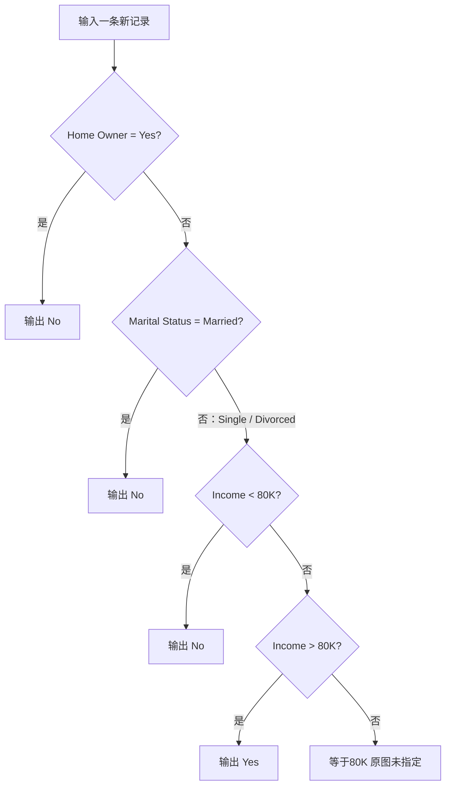

图要回答“新记录走哪条路径”。判断框读取当前属性，箭头写条件，终点只输出类别。用 p.9 的记录走图：No → Married → 输出 No。

读图自测：把婚姻状态改成 Single，收入仍为 80K，会怎样？

先走 `Home Owner=No`，再走 Single / Divorced 分支。p.9–14 的原图写 `<80K` 与 `>80K`，因此等于 80K 没有指定出口，不能据此确定标签。p.18 的另一棵训练树写 `>=80K`；若明确使用那棵树的约定，则得到 Yes。两页的边界写法应分开记录。

p.8 与 p.15 的图分别突出 Apply Model 与 Tree Induction algorithm。两页使用相同训练／测试表，作用是把“使用树”和“学习树”分开。

**🎙️ 课堂补充**（A · 课上展开；A `00:00`–`05:44`）

教师先让学生逐行检查训练树，再让新申请人沿冻结树走到叶。原话 *"So, you can examine all the training records here in the data table"*（A `03:13`）引出训练表可被完全拟合；A `04:38` 则用 Home Owner=No、Married 走到 No。

这两次操作的区别是：检查训练行是在看已知答案能否被树重现；使用新行时只读取特征。A `03:45` 说不再需要训练表，是指预测阶段可保存树来运行，不是要求删除原数据，也不保证新记录全对。

**💡 换个说法（笔记补充）**

把树看成一张客服电话脚本：每次只回答一个问题，答案决定下一问；走到“结束语”就是叶标签。

**常见误解**

- ❌ 每个属性都必须被检查。→ 一条路径可能在访问收入前就到叶子。
- ❌ 同一训练表只有唯一决策树。→ p.7 明示可以有多棵树拟合同一数据。
- ❌ 走树时可以看到真实标签。→ 推断输入不含答案，模型只读特征。

**与其他概念的关系**

本节是冻结模型的使用阶段；§2.3 才学习节点和分支。[[IS6400_Business_Data_Analytics/notes/M01-导论-商业数据分析全景与工具链#2.6.4 分类与集成学习（p.38–39）|M01 §2.6.4]] 已用给定树做过一次推断，本节把训练机制接上。

**所以呢**：会走树只证明会使用模型；要解释树为什么长成这样，还要理解递归分裂与不纯度。

### 2.3 Hunt 递归、CART 与 Gini／熵分裂（讲义物理 p.16–18）

一棵树从哪来？从根节点的全部训练记录开始。如果节点仍混有多个类别，就找一条能让子节点更纯的属性测试，再对子节点重复。

**是什么**

p.16 列出 Hunt、CART、ID3、C4.5、SLIQ 与 SPRINT。它们实现细节不同，却共享“用特征把记录递归分开，使叶标签更确定”的主线。Hunt 给通用递归骨架；CART 通常做二叉分裂，并用 Gini 比较分类切分。

Hunt 算法的输入是到达当前节点 $t$ 的训练记录集合 $D_t$。输出是一棵以 $t$ 为根的子树。

**为什么需要它**

可能的树数量随特征和切分增加得很快，无法穷举全部结构。贪心算法在每个节点先选当前最好的切分，让问题缩小后继续递归。

**课件原例**

p.17 的递归规则是：若 $D_t$ 全属同一类 $y_t$，就把 $t$ 变成标签为 $y_t$ 的叶；若 $D_t$ 混有多个类别，就用属性测试分成较小子集，再递归处理每个子集。

p.18 的根节点有 3 个 Yes、7 个 No。图先按 Home Owner 分：Yes 子节点是 0 Yes / 3 No，已经纯；No 子节点是 3 Yes / 4 No，仍需按 Marital Status 和 Annual Income 继续切。

分裂准则使用以下通用量。表中一行表示一个符号在当前节点的意义。

| 符号 | 是什么 | 单位 | 已知／待算 | p.18 取值 |
|---|---|---|---|---|
| $n$ | 父节点记录数 | 条 | 已知 | 10 |
| $p_j$ | 父节点中类别 $j$ 的比例 | 无单位 | 待算 | 0.3 / 0.7 |
| $n_i$ | 第 $i$ 个子节点记录数 | 条 | 已知 | 3 / 7 |
| $I(t)$ | 节点不纯度 | Gini 无单位；熵为 bit | 待算 | 见下 |
| $\Delta I$ | 父不纯度减加权子不纯度 | 同 $I$ | 待算 | 越大越好 |

逐列读法：

- 符号列供公式引用。
- “是什么”说明对象。
- 单位防止把人数与比例相加。
- 状态列说明是否要计算。
- 末列代入 p.18 的图。

读第一行：根节点共有 10 条训练记录，这是人数，不是概率。

其中 j 是类别编号，求和把各类贡献逐项加起来。log2 表示以 2 为底的对数；例如 $\log_2(0.5)=-1$。Gini 与熵分别为：

$$
G(t)=1-\sum_j p_j^2,
\qquad
H(t)=-\sum_j p_j\log_2p_j.
$$

一个候选分裂产生子节点 $1,\ldots,m$ 后：

$$
I_{\text{children}}=\sum_{i=1}^{m}\frac{n_i}{n}I(t_i),
\qquad
\Delta I=I(t)-I_{\text{children}}.
$$

人数权重来自“随机抽一条父节点记录时，它落入第 $i$ 个子节点的概率为 $n_i/n$”。因此不能把大小不同的子节点简单平均。

用 Gini 复算 p.18 的 `Home Owner` 候选：

1. 父节点：$G=1-0.3^2-0.7^2=0.42$。
2. Owner=Yes 子节点：全为 No，$G_L=0$。
3. Owner=No 子节点：3 Yes / 4 No，$G_R=1-(3/7)^2-(4/7)^2=24/49\approx0.4898$。
4. 加权子 Gini：$(3/10)0+(7/10)(24/49)=0.3429$。
5. Gini 增益：$0.42-0.3429=0.0771$。

同一分裂用熵得到父熵约 $0.8813$ bit、加权子熵约 $0.6897$ bit、信息增益约 $0.1916$ bit。数值由本任务 `calc.py` 复算；不同尺度不能把 0.0771 与 0.1916 直接比大小，只能在同一准则内比较候选。

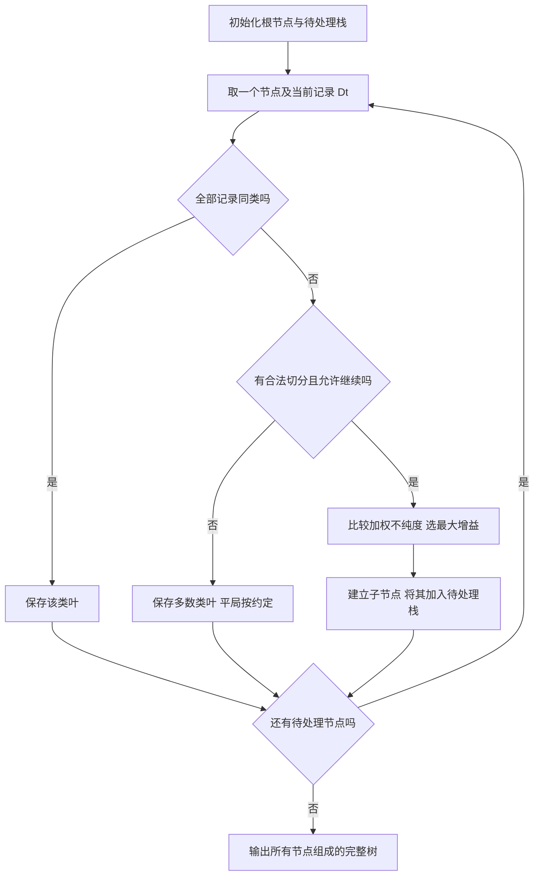

图用待处理栈展示与递归等价的执行次序。保存一个叶以后仍要处理其余节点；栈空才输出整树。完整实现还要给最大深度、最小叶样本数或最小增益等停止条件；讲义 p.17 只写了纯节点停止。

**🎙️ 课堂补充**（A · 课上展开；A `05:44`–`19:39`）

教师把“当前节点收到哪些记录”讲得很明确：*"We are starting from these seven data points. We are not starting from the ten original data set"*（A `14:32`）。根节点切分后，右叶的候选分裂只用到达该叶的七条记录，不能重新拿十条计算。

纯叶无需再切：*"If we choose a new actual node to further split this leaf node, the information gain is zero."*（A `13:22`）。这里 actual node 是 ASR 用词；书面术语是 attribute node。A `17:01` 明说最终训练误差为零。四阶段准确率被设为课堂小测，详见下方 §2.3.2。

A `10:49` 把 Home Owner 称为最低 Gini／熵的选择，但没有给三种候选分数。按 p.18 表复算，Married 切分增益反而更高；§2.3.1 的数值校正继续保留，不能把课堂口述当成已完成的最优性证明。

**💡 换个说法（笔记补充）**

贪心建树像每一步都选“眼前最能把红蓝球分开的一刀”。这一刀局部最好，不保证若干刀后的整棵树全局最好。

**常见误解**

- ❌ Gini 越大，切分越好。→ 子节点不纯度越小越好；父减子的增益才越大越好。
- ❌ 子节点 Gini 直接平均。→ 必须按子节点人数占父节点比例加权。
- ❌ 纯节点是唯一停止条件。→ 实现还会受深度、样本数、可用切分与最小增益限制。

**与其他概念的关系**

公式完整推导与更多分裂题见 [[IS6400_Business_Data_Analytics/notes/M04-特征工程-特征重要性与降维#2.7 ⭐ Gini 指数（讲义 p.32, p.35–39）|M04 §2.7]] 和 [[IS6400_Business_Data_Analytics/notes/M04-特征工程-特征重要性与降维#2.8 熵、信息增益与单变量分数（讲义 p.32, p.40–42）|M04 §2.8]]。本节把同一度量放回“长树”的递归状态中。

**所以呢**：决策树训练不是随意画规则，而是反复比较候选切分、更新当前节点记录集合，直到达到停止边界。

#### 2.3.1 从候选分数到完整小树（笔记补充）

p.18 问“为什么选 Home Owner”。直接答案是：这个切分把三条有房记录分成纯 No 叶，确实降低了混杂程度。但这张示意树不能证明它是信息增益最大的根切分。

原表同样允许先把 Married 与其他婚姻状态分开。Married 有 4 条 No，其他状态有 3 Yes / 3 No。

1. Married 组的 Gini 为 0；其他组为 0.5。
2. 按 4／10 与 6／10 加权，分裂后 Gini 为 0.3。
3. 父 Gini 为 0.42，因此该切分增益为 0.12。
4. Home Owner 的增益为 0.0771，低于 0.12。

同一对候选按熵比较，Married 切分的信息增益约 0.2813 bit，Home Owner 为 0.1916 bit。可见，课件是在演示递归生长过程；若题目要求解释“它为何是最优”，还缺指定候选集合和选取准则。不能把正增益写成最大增益。

为了独立走完训练过程，下面使用一份明确标作补充的四点数据。一行是一条记录，x 是无单位输入，y 是二分类标签。

| 记录 | x | y |
|---|---:|---:|
| A | 1 | 0 |
| B | 2 | 0 |
| C | 3 | 1 |
| D | 4 | 1 |

逐列读法：

- 记录是身份。
- x 是参与比较的数值。
- y 是训练答案，0 和 1 不表示大小等级。

读第一行：A 的输入为 1，训练标签为 0。

1. 当前根记录为 A–D，两类各两条，Gini 为 0.5。
2. 枚举相邻不同 x 之间的阈值：1.5、2.5、3.5。
3. 阈值 1.5 的加权子 Gini 为 1／3，增益为 1／6。
4. 阈值 2.5 的两边都纯，加权子 Gini 为 0，增益为 0.5。
5. 阈值 3.5 对称于 1.5，因此选择阈值 2.5。
6. 左边 A、B 变成标签 0 的叶；右边 C、D 变成标签 1 的叶。
7. 两个叶都纯，不再递归。输出是“x ≤ 2.5 判 0，否则判 1”的完整树。

新点 x=2.2 沿根的左边到标签 0，推断时不用新点的真实答案。若教学规则规定根节点不可分裂，两类平票需要预先约定标签顺序。若所有 x 相同而 y 冲突，无法靠这个特征继续切分，只能留下混合叶或引入其他输入。

**读图自测**：原 §2.3 的递归图中，四点例从哪个判断直接转为叶？两个子节点都在“所有记录同一类别？”选择“是”。继续分裂只会增加模型复杂度。

**迁移题**：把 B 的标签改成 1，第一刀如何变化？阈值 1.5 能把唯一的 0 独立出来，两边都纯，增益为 0.375，因此第一刀改为 1.5。

#### 2.3.2 课堂小测：四阶段准确率（讲义 p.18）

🎙️ 教师要求 *"So please tell me how the training accuracy is changing from the default setting to the final structure."*（A `18:16`），并要求提交四个数（A `19:09`）。以下是 p.18 十条记录的参考解析；不是个人已提交记录。

同一张十行训练表依次经历四个状态。每行表示一棵当时已停止生长的树；准确率的分母始终是全部十条训练记录。

| p.18 状态 | 预测规则与错误位置 | 正确数／总数 | 训练准确率 |
|---|---|---:|---:|
| (a) 默认树 | 全部预测 No；三个 Yes 都错 | 7／10 | 70% |
| (b) 只切 Home Owner | 有房叶为 No；无房叶仍按 4 比 3 预测 No | 7／10 | 70% |
| (c) 再切 Marital Status | 三条 Yes 与一条 No 同叶并预测 Yes，只有该 No 错 | 9／10 | 90% |
| (d) 再切 Annual Income | 最后混合叶分为纯 No 与纯 Yes | 10／10 | 100% |

逐列读法：

- 状态列对应讲义 p.18 的四幅图。
- 规则列说明各叶预测什么，以及错误来自哪里。
- 计数列以条为单位，分母都是十条原训练记录。
- 准确率列是正确数除以十，以百分数表示。

读第一行：没有任何属性测试也能达到 70%，因为多数类有七条。

1. 从 (a) 到 (b)，纯度改善，但两边的多数类仍都是 No，所以标签预测没有改变。
2. 到 (c)，无房且 Single／Divorced 的四条改判 Yes，其中三条正确，另一条成为唯一错例。
3. 到 (d)，收入再分开这四条，训练记录全部正确；这只说明训练拟合，不证明泛化。

数值由本任务 `calc_transcript.py` 逐记录复算。教师 A `19:24` 给约五分钟提交，`19:39`→`24:58` 的空档与作答时间一致；未录到独立的四数逐项讲评，答案标为讲义与课堂口述共同支持的参考解析。

**改条件自测**：若不切树、只把默认类改成 Yes，准确率是多少？

答案

只有原表三条 Yes 正确，所以为 $3/10=30\%$。改默认标签没有学习新特征关系。

**所以呢**：分裂降低不纯度与当下提高准确率是两个不同问题；先数每个叶的多数类，再逐记录统计错误。

### 2.4 单棵树的局限与回归树（讲义物理 p.19–23）

即使树能拟合训练表，也可能因为边界形状、贪心选择或噪声而泛化不好。分类树输出类别；回归树沿用同一空间切分思想，但叶子输出数值均值。

**是什么**

这里的平方误差是响应减叶预测之后平方；导数表示常数预测改变一点时误差如何变化。

p.19 总结分类树：构建和推断便宜，小树容易解释；配合防过拟合方法时对噪声较稳健，也能处理不少冗余或无关属性。缺点是树空间指数级、贪心选择可能错过最佳树、单节点通常只看一个属性，难以直接表达属性交互或斜边界。

p.22 定义回归树：把预测变量空间划分为互不重叠的区域 $R_1,\ldots,R_J$。落入同一区域的观测使用同一个预测，即该区域训练响应的均值：

$$
\hat y(x)=\frac{1}{|R_j|}\sum_{i:x_i\in R_j}y_i,
\qquad x\in R_j.
$$

**为什么需要它**

一棵轴对齐树每次只沿一个坐标切，复杂边界要用许多矩形近似。回归树则把连续目标的复杂关系改写为“在哪个区域 → 输出该区均值”，免去预先假定一条全局直线。

**课件原例**

p.20 的正负类来自中心约为 $(8,8)$ 与 $(12,12)$ 的倾斜高斯分布。散点呈斜向带状，而树画出的边界由水平和竖直线组成，所以需要阶梯状很多小块近似。

p.21 的数据有两个类别，各 5,200 条。正类中 5,000 条来自中心 $(10,10)$ 的高斯分布，另加 200 个噪声点；负类来自均匀分布。只用 10% 训练、90% 测试。图的重点是：外围噪声与均匀背景容易诱发过细切分，必须在独立测试集看泛化。

p.23 的二维图把平面切成 Region1、Region2、Region3。每区内的点形状仍有差异，但回归树只输出区域均值；图上示例均值约为 3.2、2.2、5.6。坐标轴是 $x_1,x_2$，这些均值是响应 $y$，不能当成区域中心坐标。

**💡 笔记补充：为什么叶子取均值**

固定一个区域 $R$ 后，若叶预测常数为 $c$，平方误差为 $L(c)=\sum_{i\in R}(y_i-c)^2$。求导得 $L'(c)=2|R|c-2\sum y_i$；令导数为 0，得到 $c=\bar y_R$。二阶导数为区域样本数的两倍，严格大于零，所以均值是该区域平方误差最小的常数。

**🎙️ 课堂补充**（A · 课上展开；A `24:58`–`32:13`）

教师把树的限制具体化为斜边界：A `27:39`–`29:37` 用 $x_1+x_2=20$ 解释，逐次只看一个属性会得到阶梯边界；人工新增 $x_1+x_2$ 特征后，可以用一个阈值表达同一划分。这是特征工程改变表示的课堂例，不是原 PDF 给出的精确坐标方程。

回归叶的原话是 *"Now, we may use the average value of the 7 data points as my predictive value here."*（A `31:08`）。要平均的是当前叶七条训练记录的响应，不是输入坐标；分类叶的多数类与回归叶的响应均值在此分开。

**💡 换个说法（笔记补充）**

分类树的叶子写“属于哪类”；回归树的叶子写“这个区域大约是多少”。两者都先切空间，再在叶中汇总答案。

**常见误解**

- ❌ “不考虑属性交互”等于树完全不能表达交互。→ 单个节点只看一个属性；多层路径能间接组合条件，但可能需要更深的树。
- ❌ 训练误差低就说明边界好。→ p.21 特意留下 90% 测试数据，强调要看新记录表现。
- ❌ 回归树区域均值是特征坐标均值。→ 它是训练响应 $y$ 的均值。

**与其他概念的关系**

回归树与 [[IS6400_Business_Data_Analytics/notes/M02-预测分析-线性回归|M02 线性回归]] 都输出连续值。线性回归用全局方程；回归树用分区常数。§2.6 的 Bagging 与随机森林可以组合许多分类树，也可以组合回归树。

**所以呢**：单树的可解释性来自简单轴对齐规则，同一简单性也造成边界僵硬与贪心误差；集成学习正是下一步缓解这些波动。

#### 2.4.1 回归树的四点完整计算（笔记补充）

假设输入 x 为 1、2、3、4，对应响应 y 为 2、4、8、10。所有数字没有业务单位，只用于演示分区预测。

1. 根响应均值为 6，平方误差和为 40。
2. 候选阈值 1.5：左均值 2，右均值约 7.3333，总平方误差约 18.6667。
3. 候选阈值 2.5：左均值 3，右均值 9，总平方误差为 4。
4. 候选阈值 3.5：左均值约 4.6667，右均值 10，总平方误差约 18.6667。
5. 选择误差最小的阈值 2.5；明确设置最大深度为 1，两个子节点停止。
6. 输出规则：x ≤ 2.5 预测 3，其他 x 预测 9。新点 x=2.2 得到 3。

误差 4 来自四条训练响应各离叶均值 1，平方后相加。叶均值是响应的平均值，不能把输入 x 的均值当作预测。

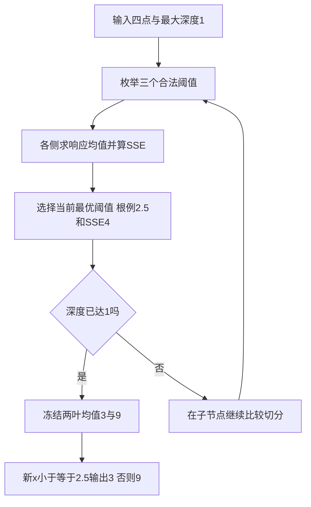

本图是补充例的训练与输出流程。读图时跟着 x=2.2：训练结束后只走最后的保存规则，得到 3；预测不重新枚举阈值。

**边界与失败**：深度太小会把不同响应压成同一均值，形成欠拟合。深度无限增加又可能把噪声记成叶值，训练误差下降而新数据变差。

**变式与读图自测**：若最大深度改为 2，左组再按 1.5、右组再按 3.5 切开，四个叶分别预测 2、4、8、10，训练误差变成 0。这个变化证明训练拟合改善，不能证明独立测试改善。

### 2.5 集成为何可能优于单模型（讲义物理 p.24–30）

p.24 的重复封面把重点标到 Ensemble Learning。p.25 随即追问：Tree 只是 Learn Model 的一种选择，能否让多个模型共同判断？

**是什么**

p.26 定义集成：从训练数据构造一组分类器，再把多个分类器对测试记录的预测组合成最终标签。p.29 把过程拆成三步：从原数据 $D$ 产生多个数据集 $D_1,\ldots,D_t$；训练多个分类器 $C_1,\ldots,C_t$；组合为 $C^*$。

**为什么需要它**

不同模型可能看见数据的不同方面。p.27 的“盲人摸象”图说明单个观察者只接触局部；但只有在错误不完全同步时，组合才可能互相抵消。

**课件原例**

p.28 假设 25 个基分类器，每个错误率 $\varepsilon=0.35$，以多数投票决定输出。若进一步假设每个分类器对该记录的错误是**独立且同分布**的 Bernoulli 事件，集成至少 13 个出错的概率为：

$$
P(X\ge 13)=\sum_{i=13}^{25}\binom{25}{i}\varepsilon^i(1-\varepsilon)^{25-i}
\approx0.06044.
$$

讲义写“errors are uncorrelated”，但仅有不相关不足以推出完整二项分布。上式还需要独立、同错误率的假设。`calc.py` 得到 0.0604449，与 p.28 的 0.06 一致。

p.30 列出五种制造差异的方法。下表每行是一种改变位置及讲义例子。

| 方法 | 改变什么 | 讲义例子 | 期待得到的差异 |
|---|---|---|---|
| Bayesian ensemble | 模型成分 | Gaussian mixture | 不同成分解释 |
| 数据分布 | 训练记录抽样／权重 | resampling | 不同训练集 |
| 输入特征 | 可见特征子集 | feature subset | 不同视角 |
| 类别标签 | 标签编码 | error-correcting code | 不同子任务 |
| 学习算法随机性 | 候选或过程 | random forest | 不同树结构 |

逐列读法：

- 方法列是集成家族。
- 改变列指出随机性进入哪里。
- 例子列来自 p.30。
- 末列解释为什么基模型不会完全相同。

读第一行：Bayesian ensemble 通过多个概率成分表达数据，而不是重抽训练记录。

**🎙️ 课堂补充**（A · 课上展开；A `32:13`–`39:35`，后续 B 单独登记）

A `33:59`–`34:54` 用盲人摸象说明单个模型只观察局部，再把多位判断者合并。随后教师邀学生分别猜股票涨跌：*"Now I have 25 students, not every single one has a very outstanding prediction."*（A `37:29`）。股票名称和实际投资价格的 ASR 未独立核听，不作为市场事实。

多数票出错要至少 13 人同时错，A `39:16` 明确从 13 累加到 25。A `38:26` 的口述 “larger than 13” 与随后计算不一致，按讲义 $X\ge13$ 解释。约 0.06 仍依赖本节写明的独立同错误率假设，课堂类比没有证明真实学生满足该条件。

B `00:53` 明说 *"each base class file should be independent from each other"*，并在 B `01:35`–`01:48` 排除比随机猜测更差的基模型。这里 base class file 是 classifier 的 ASR 错词。课堂强调确认了本节“有能力且不总同错”的条件，但重抽同一数据不自动保证统计独立。

**💡 换个说法（笔记补充）**

三个完全抄同一答案的人不会因投票变可靠。集成收益需要个体有一定能力，而且错误不能总在同一记录上同时发生。

**常见误解**

- ❌ 基模型越多，错误率一定越低。→ 若错误高度相关，增加同类模型可能几乎没有收益。
- ❌ p.28 的 0.06 只靠“不相关”即可证明。→ 二项和需要更强的独立同分布假设。
- ❌ 集成只是投票。→ Stacking 会学习组合函数，AdaBoost 会给模型不同权重。

**与其他概念的关系**

p.29 的三步框架统一 Bagging、Boosting 与 Stacking；区别在“怎样造差异”和“怎样组合”。M01 曾给概览，完整机制从下一节开始。

**所以呢**：集成不是神奇平均，而是有条件地利用“多个有用且不完全同错的判断”。

### 2.6 Bootstrap、Bagging 与随机森林（讲义物理 p.31–39）

目标是降低单棵树对训练样本的小变化过于敏感的问题。Bagging 反复有放回抽样，训练多棵模型，再用投票输出类别。

**是什么**

Bootstrap（有放回自助抽样）的样本从 $n$ 条原记录中抽 $n$ 次，每次抽后放回。因此一条记录可能重复，也可能整轮未被抽到。Bagging 是 Bootstrap aggregating：每轮独立抽样、训练基分类器，最后等权组合。

p.32 的算法输入是训练集 $D$、Bootstrap 轮数 $k$ 和基学习器；输出是集成 $C^*$。分类时可写为：

$$
C^*(x)=\arg\max_y\sum_{i=1}^{k}\mathbf{1}[C_i(x)=y].
$$

随机森林（p.33）再增加一次随机：每棵树用 Bootstrap 数据，而且每个节点只从随机抽到的特征子集中找分裂。这样能减少强特征让所有树长得太像的相关性。

**为什么需要它**

深树常有高方差：训练数据换几条，根节点与后续结构可能大变。多棵较不相关的树投票，能让单棵树的偶然波动互相抵消。

**课件原例**

p.31 给 10 条原记录的三轮 Bootstrap。第一轮是 `7,8,10,8,2,5,10,10,5,9`：记录 10 出现 3 次，1、3、4、6 没出现。这正是“有放回”的可见证据。

p.34 定义一维原数据：

| $x$ | 0.1 | 0.2 | 0.3 | 0.4 | 0.5 |
|---|---:|---:|---:|---:|---:|
| $y$ | 1 | 1 | 1 | -1 | -1 |

第二半为 $x=0.6,0.7,0.8,0.9,1.0$，对应 $y=-1,-1,1,1,1$。每个基分类器是决策树桩：比较 $x\le k$ 与 $x>k$，阈值按熵选择。

p.35–36 展示 10 轮抽样与树桩。

p.37 汇总阈值、左右类别。

以 $x=0.5$ 为例：前五轮预测为 $-1,+1,-1,-1,-1$。

后五轮为 $-1,-1,-1,-1,+1$，所以 8 票为 $-1$、2 票为 $+1$，最终 $-1$。

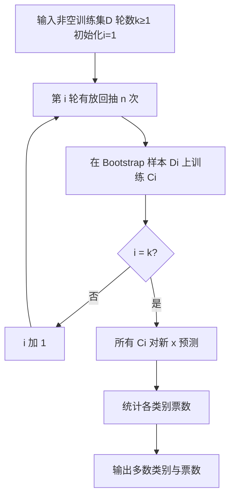

走图例：令 $k=10$，新点 $x=0.9$。先用 p.37 的每个阈值决定左右类别，再投票。

**p.39 Quiz 逐问作答｜⚪ 参考作答（讲义表 + 本任务复算）**

题意有三个动作：填 $x=0.9$ 一列；给最终预测；判断模型能否很好拟合原数据。

第一行是一轮树桩对 $x=0.9$ 的输出。票数没有单位；Sum 是把 $+1/-1$ 相加。

| Round | 规则摘要 | $x=0.9$ 落点 | 预测 |
|---:|---|---|---:|
| 1 | $k=0.35$；右类 -1 | 右 | -1 |
| 2 | 左右均 +1 | 任一侧 | +1 |
| 3 | $k=0.35$；右类 -1 | 右 | -1 |
| 4 | $k=0.30$；右类 -1 | 右 | -1 |
| 5 | $k=0.35$；右类 -1 | 右 | -1 |
| 6 | $k=0.75$；右类 +1 | 右 | +1 |
| 7 | $k=0.75$；右类 +1 | 右 | +1 |
| 8 | $k=0.75$；右类 +1 | 右 | +1 |
| 9 | $k=0.75$；右类 +1 | 右 | +1 |
| 10 | 左右均 +1 | 任一侧 | +1 |

逐列读法：

- Round 是模型编号。
- 规则摘要来自 p.37。
- 落点说明比较结果。
- 预测是该轮投的一票。

读第一行：0.9 大于 0.35，进入第 1 个树桩右侧，得到 -1。

1. **填表答案**：$(-1,+1,-1,-1,-1,+1,+1,+1,+1,+1)$。
2. **预测结果**：逐项相加为 $-1+1-1-1-1+1+1+1+1+1=2$；所以正票 6、负票 4，Sum=2，Sign=+1，最终预测 $+1$。
3. **能否很好拟合原数据**：对 p.34 列出的十个原点，p.38 的集成预测为 $(+,+,+,-,-,-,-,+,+,+)$，与原标签逐点一致。因此它在这 10 个列示点上训练拟合完全正确。p.38 明说测试集假设与原数据相同，这不是独立泛化证据；不能由此断言新数据也拟合良好。

若把一轮输出改成相反类别，应重新算票数。若出现 5:5 平票，讲义未指定规则；实现必须预先规定按类别顺序、概率平均或其他固定方案处理。

**讲义与软件的聚合区别**：p.39 树桩题使用类别多数票。T07 使用 scikit-learn 1.5.1；其随机森林和支持概率的 Bagging 基学习器先平均各类概率，再取概率最大的类别。两种聚合可能给不同结果，不能把软件输出过程直接改成硬投票。

**p.35 与 p.37 回图核对**：第 2 轮在两页都写阈值 0.7、左右类别均为 +1，二者并不冲突。它等价于该树桩对任何输入都预测 +1；这能拟合该 Bootstrap 样本中的多数类，却没有使用阈值区分输出。

**🎙️ 课堂补充**（A · 课上展开；B `05:01`–`18:17`）

教师把有放回抽样拆为取出、记录、放回：

> *"Now I put this, I get a pattern, the x and the y values for this data point, and I put this point back so the original data set is not affected."*（B `07:36`）

意思是先记录抽中点的特征与标签，再把原点放回。同一条能被重复抽到，下一轮再生成另一份十行训练册。

B `15:39` 口述右端点有四票负、六票正，最终正类，确认 p.39 的 $x=0.9$ 参考结果；B `16:12`–`16:28` 确认十原点的正、负、正三段训练拟合。它仍不是独立测试。

本例题型有考试信号：*"So if you see this in your final, do not be surprised."*（B `17:01`）。同段说这是以往 quiz 题。B `06:59` 把多棵树称为 random forest，是课堂宽泛称呼；p.33 的节点特征随机性与 T07 软件概率聚合仍应分别理解。

**💡 换个说法（笔记补充）**

Bagging 像从同一叠病例中反复有放回抽出不同训练册，让多位医生独立制定规则，再数票。随机森林还限制每位医生每次只能查看随机一部分指标。

**常见误解**

- ❌ Bootstrap 是不放回抽样。→ 放回才会出现重复记录和未抽中记录。
- ❌ Bagging 每轮必须用不同算法。→ 可以用同一种基学习器；差异来自样本。
- ❌ 随机森林只在整棵树开始时抽一次特征。→ 常见做法是在每个节点重新抽候选特征子集。
- ❌ 训练表上十点全对等于泛化好。→ p.38 没有独立测试。

**与其他概念的关系**

Bagging 对各轮等权；§2.7 的 AdaBoost 让错例权重和学习器权重随轮次变化。T07 应把本节与 `DecisionTreeClassifier`、`BaggingClassifier`、`RandomForestClassifier` 的参数和实际输出互链。

**所以呢**：Bagging 的核心不是“多训练几次”，而是通过有放回样本制造差异，再用等权投票稳定单模型。

### 2.7 AdaBoost：错例加权与加权投票（讲义物理 p.40–47）

Bagging 各轮彼此独立。Boosting 改为顺序学习：后一轮把更多注意力放在前一轮分错的记录上。

**是什么**

p.40–41 说明：初始 $N$ 条记录等权；每轮结束后，提高错分记录权重，降低正确记录权重。p.41 的记录 4 多次被抽中，用来表示它是难例。

对第 $i$ 个分类器 $C_i$，讲义 p.42 的加权错误率与学习器权重为：

$$
\varepsilon_i=\sum_{j=1}^{N}w_j^{(i)}\mathbf{1}[C_i(x_j)\ne y_j],
\qquad
\alpha_i=\frac12\ln\frac{1-\varepsilon_i}{\varepsilon_i}.
$$

讲义公式印有额外 $1/N$，但权重表 p.47 每轮和约为 1，标准归一化权重口径下不应再除以 $N$。候选保留这一口径差异，不能把两者混用。

p.43 的权重更新可统一写成：

$$
w_j^{(i+1)}=\frac{w_j^{(i)}\exp[-\alpha_i y_j C_i(x_j)]}{Z_i},
\qquad
Z_i=\sum_jw_j^{(i)}\exp[-\alpha_i y_j C_i(x_j)].
$$

这里用 $y,C_i(x)\in\{-1,+1\}$。预测正确时乘 $e^{-\alpha_i}$，错误时乘 $e^{+\alpha_i}$；$Z_i$ 把新权重归一化到和为 1。

最终二分类分数为 $F(x)=\sum_i\alpha_i C_i(x)$，输出 $\operatorname{sign}F(x)$。多分类时可按 p.43 对每个候选类别累计匹配权重，再取最大者。

**为什么需要它**

若前轮总错在某些记录，等权重训练可能继续忽略它们。提高错例权重会改变下一轮优化重点；$\alpha_i$ 则让低错误率的学习器在最终投票中发言更重。

**课件原例**

p.45 沿用 p.34 的十点一维数据与决策树桩。p.46 给前三轮抽样、分裂和 $\alpha=(1.738,2.7784,4.1195)$。p.47 显示每轮开始的样本权重，以及三棵树对十点的预测。

以 $x=0.1$ 为例，三轮输出为 $(-1,+1,+1)$：

$$
F(0.1)=-1.738+2.7784+4.1195=5.1599,
$$

所以预测 $+1$。

对 $x=0.4$，分数为 $-1.738+2.7784-4.1195=-3.0791$，预测 $-1$。

对 $x=0.9$，分数为 $1.738+2.7784-4.1195=0.3969$，预测 $+1$。

这三段分别覆盖左、中、右区间，与 p.47 的 5.16、-3.08、0.397 一致。

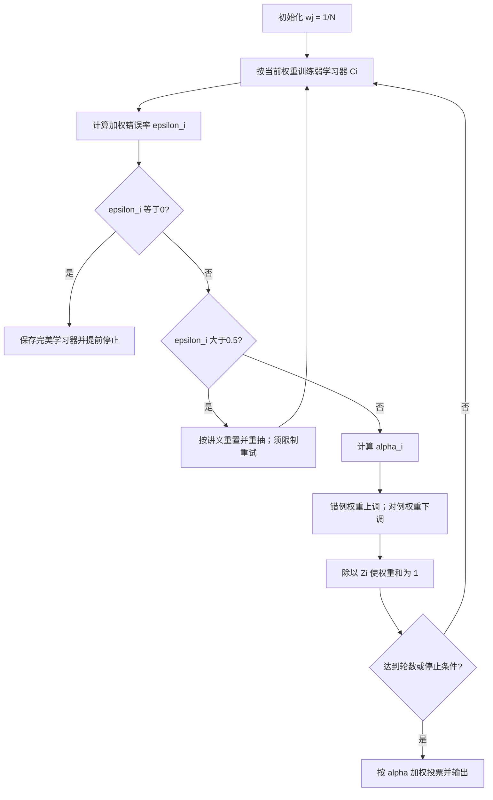

这张图在讲义流程上补充零错误提前停止和重试上限，避免无穷权重或无限重抽。错误率等于 0.5 时贡献为零，须按实现跳过或停止。

图中状态是整条权重向量 $w^{(i)}$。每一轮先用旧权重训练，再统一更新；不能一边扫描记录一边让后面记录使用新权重。

**💡 笔记补充：三轮完整可复算例**

为展示权重怎样变化，使用四条记录，真实标签为 $(-1,-1,+1,+1)$。三轮基学习器预测依次为：

- $h_1=(-1,-1,+1,-1)$，只错第 4 条。
- $h_2=(-1,+1,+1,+1)$，只错第 2 条。
- $h_3=(-1,-1,-1,+1)$，只错第 3 条。

下面每行是一轮开始状态及更新结果。权重无单位，四项之和为 1。

| 轮 | 轮前权重 | $\varepsilon$ | $\alpha$ | 轮后权重 |
|---:|---|---:|---:|---|
| 1 | (0.25,0.25,0.25,0.25) | 0.25 | 0.5493 | (0.1667,0.1667,0.1667,0.5000) |
| 2 | (0.1667,0.1667,0.1667,0.5000) | 0.1667 | 0.8047 | (0.1000,0.5000,0.1000,0.3000) |
| 3 | (0.1000,0.5000,0.1000,0.3000) | 0.1000 | 1.0986 | (0.0556,0.2778,0.5000,0.1667) |

逐列读法：

- 轮前权重进入当前错误率。
- 错误率决定学习器权重。
- 末列归一化后交给下一轮。

读第一行：第 1 轮只错第 4 条，所以错误率 0.25；更新后第 4 条占总权重的一半。

本补充例用预先给定的三个弱学习器演示离散二分类 AdaBoost；T07 原软件的 SAMME.R 使用概率，更新式不同，不能逐轮套用本表。

三轮累计分数为 $(-2.4526,-0.8432,0.2554,1.3540)$，取符号得到 $(-1,-1,+1,+1)$，四条全对。这里预定最多三轮；第三轮集成在本例四条记录上全对；标准 AdaBoost 不因此自动停止，提前停止规则必须另行设置。数字由 `calc.py` 复算。

**停止与边界**

- $\varepsilon_i=0.5$ 时，$\alpha_i=0$，学习器没有净贡献。

- $\varepsilon_i>0.5$ 时，$\alpha_i<0$。

p.42–44 选择不使用该学习器，并在中间轮高于 50% 时把权重重置为 $1/N$ 后重新抽样。

这是讲义给定流程。

- $\varepsilon_i=0$ 时公式趋向无穷。

实际实现应提前停止或做数值截断，不能直接存无穷权重。

- 权重和若因浮点误差偏离 1，应使用 $Z_i$ 重新归一化。

**失败机制与选择**

1. **标签噪声**：一个错标记录会持续被加权，后轮反复追它。征兆是少数记录权重极高而验证误差不降；可限制树深、降低学习率或检查标签，代价是可能忽略真正难例。
2. **弱学习器无法优于随机**：若多轮 $\varepsilon\ge0.5$，流程反复重抽。应检查特征、标签和基学习器能力；换更强学习器会增加过拟合与计算风险。

**迁移题 1**：若某轮 $\varepsilon$ 从 0.25 变成 0.40，$\alpha$ 会增还是减？

答案

会减。$\alpha(0.25)=0.5\ln3\approx0.5493$；$\alpha(0.40)=0.5\ln1.5\approx0.2027$。错误率更接近 0.5，学习器发言权更小。

**迁移题 2**：验证误差停止下降，但一条疑似错标记录权重越来越大，应怎样诊断？

答案

先回查该记录标签与特征。若确为噪声，AdaBoost 正在按机制放大它；可修标签、降低学习率、限制轮数或换对噪声更稳健的方法。不能把“继续增加轮数”当成必然改进。

**🎙️ 课堂补充**（A · 课上展开；B `18:17`–`34:17`）

教师先比较抽样概率：Bagging 每轮等概率；Boosting 要先把上一模型用回原十条记录，再更新下一轮抽样权重。原话 *"They have non-equal probability to be selected."*（B `21:10`）说明后轮已不再等权。

B `23:07` 代入错误率 0.5 得模型权重 0；B `28:07`–`29:50` 先提高左三点权重、再提高中四点权重，解释 p.47 状态表。最后 *"So it's a weighted sum."*（B `32:26`），确认最后按模型重要性加权，不能只数三票。

ASR 在 B `25:46`、`26:05`、`31:21` 有数字／短语复读；B `26:44`–`27:04` 的阈值也相互矛盾。正文按 p.46 的 0.75、0.05、0.3 和 p.47 表解释，不据转录拼一个新数值轨迹。p.42 权重口径问题未被课堂明确纠正。

**💡 换个说法（笔记补充）**

AdaBoost 像连续请老师补课：下一位老师会多看前一位讲错的题；期末汇总时，平时更可靠的老师票更重。

**常见误解**

- ❌ “错例权重提高”等于直接把标签改掉。→ 标签不变，只改变下一轮训练关注度。
- ❌ 最终按多数票。→ AdaBoost 按 $\alpha$ 加权，三票不一定同权。
- ❌ 权重表里的数是抽样次数。→ 它们是归一化概率／重要度，后续可据此抽样。

**与其他概念的关系**

Bagging 通过并行重抽样降低方差；AdaBoost 通过顺序重权重修正错例。二者都组合弱学习器，但状态依赖与最终权重不同。

**所以呢**：AdaBoost 的关键链条是“错例 → 更大样本权重 → 新学习器 → 由错误率决定的模型权重 → 加权输出”，任何一环省略都无法复算。

#### 2.7.1 为什么 alpha 是这个对数比（笔记补充）

样本权重反映当前哪些记录难判。加进一个弱学习器以后，希望总惩罚下降；错的记录加惩罚，对的记录减惩罚。

离散二分类 AdaBoost 可用指数损失说明这一选择。真实标签与累计分数相乘得到有符号分数，分数越低，指数惩罚越大；例如分数为 -1 时损失约为 2.7183，为 +1 时约为 0.3679。

固定当前弱学习器，正确记录权重合计为 $1-\varepsilon$，错例权重合计为 $\varepsilon$。加入强度 $\alpha$ 后，本轮损失缩放量为：

$$
Z(\alpha)=(1-\varepsilon)e^{-\alpha}+\varepsilon e^\alpha.
$$

epsilon 是已归一化的加权错误率，alpha 是本轮要选的学习器权重，Z 是两组贡献加总后的无单位量。正确组乘负指数而错例组乘正指数，正好对应“相对上调错例”的更新。

1. 要找使 Z 最小的强度，先求 alpha 的导数。
2. 导数为 $-(1-\varepsilon)e^{-\alpha}+\varepsilon e^\alpha$。
3. 令导数为零，得到 $e^{2\alpha}=(1-\varepsilon)/\varepsilon$。
4. 两边取自然对数，再除以 2，得到讲义的 alpha 公式。
5. 本例错误率 0.25，代入得到 $0.5\ln 3\approx0.5493$，与三轮表第 1 行一致。

这个推导要求 $0<\varepsilon<1$；若要让本轮正权重优于随机，还要错误率低于 0.5。零错误时应停止或截断，不直接代入无穷值。它解释的是本节离散算法，不能当成 T07 概率型 SAMME.R 的逐轮公式。

**所以呢**：alpha 不是随手指定的信任分，它由“当前正确／错误权重各有多少”共同决定，以平衡两组指数惩罚。

### 2.8 Stacking：用折外预测训练元模型（讲义物理 p.48–53）

Bagging 和 Boosting 通常组合同类基学习器。Stacking 允许逻辑回归、树等异质模型同时输出，再让第二层模型学习怎样组合。

**是什么**

p.48 把结构分两层：Level-1 是多个基模型；Level-2 是元模型。元模型的输入不是原始 $x_1,x_2$，而是各基模型对同一条记录的预测概率。

训练元模型必须使用折外预测（out-of-fold, OOF）：一条训练记录的基模型预测，必须来自训练时未使用该记录的基模型；预处理也只在相应训练折拟合。否则元模型会把基模型在训练行上的过拟合当成可泛化信号。

**为什么需要它**

p.49 给出两点优势：利用异质模型；自动学习组合权重。若树擅长阈值关系、逻辑回归擅长平滑线性边界，元模型可根据验证式预测学会何时更信谁。

**课件原例**

p.50 的伪码流程是：把训练集分成 $K$ 折；每个基模型轮流在 $K-1$ 折训练、对留出折预测；拼成元特征矩阵；训练元分类器；随后各基模型在完整训练集重训；新记录先通过这些完整基模型，再送入元模型。

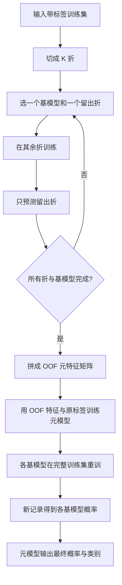

图的循环对象是“基模型 × 留出折”。每个训练行只在自己被留出时生成元特征；新数据阶段才使用完整训练集重训后的基模型。

p.51 给 5 条样本、两个基模型和 2 折。样本 1–3 为 Fold1，4–5 为 Fold2。OOF 特征表由两次交叉预测拼成：

| Sample | LR 概率 | Tree 概率 | 真值 $y$ |
|---:|---:|---:|---:|
| 1 | 0.30 | 0.10 | 0 |
| 2 | 0.35 | 0.15 | 0 |
| 3 | 0.65 | 0.85 | 1 |
| 4 | 0.75 | 0.95 | 1 |
| 5 | 0.70 | 0.80 | 1 |

逐列读法：

- Sample 是原记录身份。
- LR 与 Tree 是该记录被留出时得到的 $P(y=1)$。
- 真值列只供训练元模型。

读第一行：样本 1 没参与产生这一行预测的相应基模型训练；LR 给 0.30，Tree 给 0.10，真实标签为 0。

不过 p.51 的 Fold2={4,5} 两条标签都是 1。若真的只用这两行训练普通二分类 Logistic Regression，再预测 Fold1，标准实现会因训练数据只有一个类别而无法拟合。因此 p.51 的概率只能视为**讲义给定的示意数值**，不能声称由表中这次 LR 真实运行得到。

p.52 直接给元模型：

$$
z=-4+3\,p_{LR}+2\,p_{Tree},
\qquad
P(y=1)=\sigma(z)=\frac{1}{1+e^{-z}}.
$$

p.53 给测试点 A、B、C 的两个基模型概率。按 p.52 公式实际复算：

| 点 | $(p_{LR},p_{Tree})$ | 公式得到 $z$ | $\sigma(z)$ | 0.5 阈值类别 |
|---|---|---:|---:|---:|
| A | (0.25, 0.10) | -3.05 | 0.0452 | 0 |
| B | (0.70, 0.85) | -0.20 | 0.4502 | 0 |
| C | (0.60, 0.80) | -0.60 | 0.3543 | 0 |

逐列读法：

- 第二列是基模型对正类的概率。
- 第三列是元模型线性分数。
- 第四列经 sigmoid 变成概率。
- 最后一列使用 0.5 阈值。

读第一行：A 的线性分数是 $-4+3(0.25)+2(0.10)=-3.05$，sigmoid 后约 0.045，因此预测 0。

**p.53 原件冲突**

- A 的上方算式写 -3.05，概率 0.045 与它一致；表内 Meta-logit 却写 -0.35，属于冲突。
- B 的讲义算式写 0.8，但按 p.52 截距 -4 应为 -0.2。0.69 与 0.8 的 sigmoid 一致。
- C 的讲义算式写 0.4，但按同一公式应为 -0.6。0.60 与 0.4 的 sigmoid 一致。
- B、C 的 0.8、0.4 看起来像使用截距 -3；A 的 -3.05 又使用截距 -4。因此不能从该页恢复一个统一公式。正文以 p.52 明示公式复算，并把讲义输出登记为待核。

**停止与边界**

训练阶段在所有折外预测填满后才可训练元模型。若某折缺类别，应重新分层切分、增加数据或使用能处理该边界的方法；不能虚构概率。推断阶段在基模型和元模型全部冻结后输出。

**失败机制与选择**

1. **元特征泄漏**：用基模型对其训练行的拟合值训练元模型，得到过于乐观的组合。诊断方法是确认每行预测来自不含该行的折。
2. **样本太少或折分失衡**：如 p.51 的 Fold2 只有正类，基模型无法正常二分类拟合。可用分层交叉验证或减少折数，但每折样本更少与估计波动之间要权衡。
3. **基模型高度相同**：元模型收到几乎重复的列，难以获得新增信息。可增加异质模型，但复杂度与调参成本会上升。

**迁移题 1**：若把样本 1 自己参与训练的 LR 概率填进样本 1 的元特征，会发生什么？

答案

发生数据泄漏。元模型看到的是基模型对已见标签记录的拟合能力，而推断时新记录未参与训练，训练与使用分布不一致。

**迁移题 2**：若 p.52 截距确认改成 -3，A、B、C 哪些预测会变化？

答案

线性分数整体加 1：A=-2.05，B=0.8，C=0.4。以 0.5 概率阈值等价于 $z\ge0$，所以 A 仍为 0，B、C 变为 1。这正好匹配 p.53 对 B、C 的算式，却仍不匹配 A 页面写的 -3.05，说明原页内部口径不统一。

**🎙️ 课堂补充**（A · 课上展开；B `34:26`–`39:20`）

教授先明确降考试优先级：*"So this method will not show up in your final exam."*（B `34:31`）。随后仍用 p.51–53 的 LR／Tree 概率解释两层学习，B `38:23` 确认 A 的最终预测为 0，但没有逐项纠正 B、C 算术，也没有解决单类折问题。

B `38:56` 建议可在项目尝试，B `39:12` 再说不进 final。TA 后来在 B `01:20:17`–`01:24:35` 讲 Stacking API，并泛称按作业／final 要求自定义。两位讲者的语境不同：保留教授明确免考，TA 的一般代码训练提示单列，不把它改写成教授取消免考。项目与 tutorial 仍需理解本节机制。

**💡 换个说法（笔记补充）**

Stacking 像先让多位专家分别给置信度，再让一位协调者根据“这些专家在没见过的旧案例上表现怎样”学习组合。协调者不能拿专家背过答案后的分数训练。

**常见误解**

- ❌ 元模型直接读取原始 $x_1,x_2$。→ 本例读取 LR 与 Tree 的预测概率。
- ❌ 训练基模型一次就能得到所有 OOF 行。→ 每个留出折都要重新训练相应基模型。
- ❌ p.53 的表是可直接照抄的官方数值。→ 同页至少有三处公式／数值冲突，须待核。

**与其他概念的关系**

p.49 的对比可记为：Bagging 并行重抽样后平均；Boosting 顺序更新关注点；Stacking 用两层结构学习组合。配套实现应在 [[IS6400_Business_Data_Analytics/notes/T07-分类实战-信用审批与欺诈识别|T07 分类实战]] 核对折分、`predict_proba` 列顺序与最终指标。

**所以呢**：Stacking 的关键不是“模型再套模型”，而是用无泄漏的 OOF 预测构造第二层训练表，再把同一列语义用于新数据推断。

### 2.9 线性 SVM 与最大间隔（讲义 p.54–64）

如果两类点已经可以被一条直线分开，问题还没有结束。讲义 p.56–58 画出多条都能把绿色方块和红色圆圈分开的直线。真正的问题是：新样本稍微移动时，哪条线仍不容易判错？支持向量机（Support Vector Machine, SVM）的回答是：在所有满足训练约束的分界面中，选择两侧安全带最宽的一个。

**是什么。** 线性 SVM 的输入是训练样本 $(\mathbf{x}_i,y_i)$，其中 $\mathbf{x}_i\in\mathbb{R}^d$，$y_i\in\{-1,+1\}$。输出是权重向量 $\mathbf{w}$ 与截距 $b$。决策面为

$$
\mathbf{w}^{\top}\mathbf{x}+b=0.
$$

对新样本，分数 $s(\mathbf{x})=\mathbf{w}^{\top}\mathbf{x}+b$ 的正负决定类别：$s>0$ 判为 $+1$，$s<0$ 判为 $-1$。

$s=0$ 正好落在边界上，需要预先约定平局处理。

讲义 p.61 的两条间隔边界为 $\mathbf{w}^{\top}\mathbf{x}+b=+1$ 与 $-1$，两线之间的总宽度是 $2/\lVert\mathbf{w}\rVert$。

**符号表。** 下表把公式中的每个量翻成人话。第一行读作：“第 $i$ 个样本的特征向量是模型用来定位该样本的输入。”

| 符号 | 含义 | 单位／范围 | 在算法中做什么 |
|---|---|---|---|
| $\mathbf{x}_i$ | 第 $i$ 个样本的特征向量 | 经缩放后的特征值 | 决定样本在空间中的位置 |
| $y_i$ | 第 $i$ 个样本的真实类别 | $-1$ 或 $+1$ | 指定样本应在边界哪一侧 |
| $\mathbf{w}$ | 垂直于分界面的方向向量 | 与特征缩放有关 | 决定边界方向与间隔宽度 |
| $b$ | 截距 | 分数单位 | 平移分界面 |
| $y_i(\mathbf{w}^{\top}\mathbf{x}_i+b)$ | 函数间隔 | 无量纲分数 | 至少为 1 才满足硬间隔约束 |

**为什么需要它。** 只追求训练集零错误，会把 p.56 的 $B_1$、p.57 的 $B_2$ 和 p.58 的许多直线视为同样好。最大化间隔则把“离最近训练点还有多少余量”纳入目标。离边界最近的点决定安全带，它们叫支持向量（support vectors）；远离边界的点只要仍在正确一侧，通常不会改变最优边界（讲义 p.63–64）。

$\lVert\mathbf{w}\rVert$ 表示权重向量的欧氏长度：各坐标先平方、相加，再开平方。补充例 $\mathbf{w}=(3,4)$ 的长度为 5，总间隔为 $2/5=0.4$。特征需固定尺度，间隔才有相同的比较口径。

**原理与约束。** 对线性可分数据，最大化 $2/\lVert\mathbf{w}\rVert$ 等价于最小化

$$
\min_{\mathbf{w},b}\ \frac{1}{2}\lVert\mathbf{w}\rVert^2
\quad\text{s.t.}\quad
y_i(\mathbf{w}^{\top}\mathbf{x}_i+b)\ge 1,\; i=1,\ldots,N.
$$

这里不是“随便把 $\mathbf{w}$ 变小”。缩小 $\mathbf{w}$ 的同时还必须让每个样本满足右侧为 1 的约束，所以只有真正扩大几何间隔的解才可行。这是凸优化问题；若可行，局部最优就是全局最优。讲义 p.62 提到可用拉格朗日乘子法求解，但没有展开求解器细节。

**完整可复算小例（💡 笔记补充）。**

只有一个特征 $x$。

负类为 $x=-2,-1$，正类为 $x=1,2$。

负类最近点要求 $w-b\ge1$，正类最近点要求 $w+b\ge1$。

相加得 $w\ge1$。

使 $w^2/2$ 最小时取 $w=1,b=0$，因此不是随便猜的一组可行参数：

| $x$ | $y$ | $y(wx+b)$ | 是否满足 $\ge 1$ |
|---:|---:|---:|---|
| -2 | -1 | 2 | 是 |
| -1 | -1 | 1 | 是，支持向量 |
| 1 | +1 | 1 | 是，支持向量 |
| 2 | +1 | 2 | 是 |

逐列读法：

- x 为输入位置。
- y 为已知标签。
- 乘积列是标签乘预测分数。
- 末列检查其是否至少为 1。所有数值是无单位补充数据。

第一行读作：“$x=-2$ 的负类样本得到有符号间隔 2，大于 1，所以在安全带外。”

此时边界是 $x=0$，两条间隔边界是 $x=-1$ 与 $x=1$，总间隔 $2/|w|=2$。

若取 $w=2,b=0$，约束仍满足，但间隔缩为 1，目标从 $1/2$ 增至 2，因此不是最大间隔解。

计算见本任务 scratch 的 `calc.py` 与 `results.json`。

**控制流程图。** 图中每个菱形都是一个会改变下一步的判断。例子中的四个点全部满足约束，求解器返回 $w=1,b=0$；若加入无法分开的点，则转入 §2.10 的软间隔。

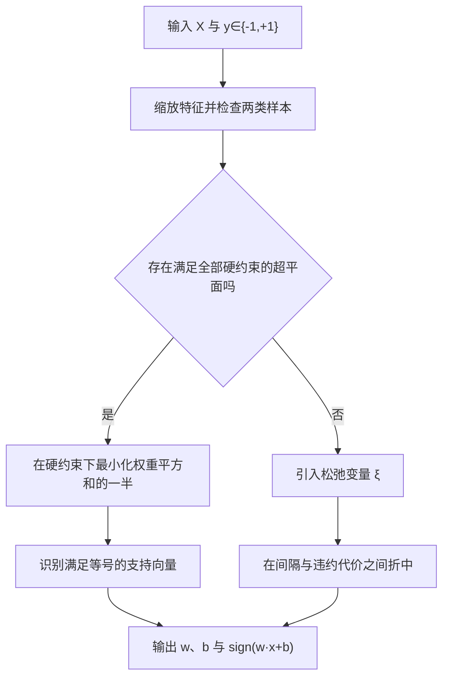

文字替代：先输入带 $-1/+1$ 标签的数据并缩放特征；若数据线性可分，就在全部硬约束下最小化 $\lVert\mathbf{w}\rVert^2/2$，由等号点确定支持向量；若不可分，就引入松弛变量。

**停止边界。** 实际求解器达到最优性容差或迭代上限后停止。容差表示允许保留多小的约束或最优性误差；达到上限不等于已经最优。教学上，必须至少得到 $\mathbf{w},b$、支持向量及训练约束检查，才算完成一次硬间隔运行。若任一训练点无法满足约束，硬间隔问题不可行，不能继续假装有解。

**课件原例。** p.55–60 的同一批二维点先展示 $B_1$、$B_2$ 和其他可行线，再用两侧虚线比较间隔，结论是 $B_1$ 的间隔更大。p.63 圈出贴在间隔边界上的点，说明这些点决定模型。

**🎙️ 课堂补充**（A · 课上展开；B `39:20`–`43:13`）

B `40:45` 记录多数学生选 B1；教师用新点靠近原簇时是否容易被错分来解释较宽余量。随后明确 *"We are trying to get the classification boundary using support vector machine with the maximum margin"*（B `42:59`）。这是对 p.59 选择题的课堂确认，理由是最大间隔，不是线条看起来更好。

数学范围另有反向信号：*"so for the support vector machine, you do not need to solve or understand how we solve it using the Lagrangian optimization problem"*（B `42:45`）。免去手推拉格朗日求解，不免去边界、间隔、支持向量与预测读法。B `42:14`–`42:31` 的公式转写失真，符号继续以讲义为准。

**💡 换个说法（笔记补充）。** 把两类点想成道路两旁的建筑。普通线性分类只要求中线不穿楼；最大间隔 SVM 还要把道路修得尽量宽。最靠近道路的几栋楼决定道路能有多宽，它们就是支持向量。

**常见误解。**

- 第一，支持向量不是“方向向量”，而是训练样本。第二，讲义 p.64 把 $\ge1$ 与 $\le-1$ 写在“如何分类测试记录”下；那是训练时的间隔约束。测试预测通常只看分数的正负，分数位于 $(-1,1)$ 仍然可以分类，只是说明该点在间隔带内。第三，特征尺度会改变距离和 $\lVert\mathbf{w}\rVert$，SVM 前通常要标准化。

**与其他概念的关系。** 硬间隔 SVM 与 [[M02-预测分析-线性回归]] 都学习线性函数，但前者用类别约束和间隔，后者拟合连续数值。它与本讲前半的决策树不同：树用轴对齐的分支逐步切空间，线性 SVM 一次学习一个全局超平面。代码实现与业务案例互链 [[T07-分类实战-信用审批与欺诈识别]]。

**讲义问题（p.59）：$B_1$ 还是 $B_2$ 更好？“更好”如何定义？**

🎙️ **课堂确认（B `40:45`–`42:03`）**：在两条线都把训练样本分对的前提下，$B_1$ 更好，因为它到两类最近样本的最小距离更大，即间隔更宽。换一批点时，不能凭线条角度判断，要计算或比较两侧最近点到边界的距离。

**讲义问题（p.64）：找到 $\mathbf{w},b$ 后如何分类 $\mathbf{x}_i$？**

⚪ **参考作答（笔记推断）**：计算 $s_i=\mathbf{w}^{\top}\mathbf{x}_i+b$。

$s_i>0$ 判 $+1$，$s_i<0$ 判 $-1$。

$|s_i|<1$ 表示点落在间隔带内，不等于“无法分类”。

若题目要求置信概率，原始 SVM 分数本身不是概率，还需校准。

**读图自测。** 若在远离间隔的地方再加入一个正确分类点，边界是否一定改变？答案：不一定；在正则形式和样本权重口径固定时，只要支持向量及最优约束结构不变，边界可以不变。若把最近点向边界移动，间隔上限会缩小，边界可能改变。

**所以呢。** 线性 SVM 的关键不是“画一条能分开的线”，而是在约束成立时用最近点决定一条最大间隔线，并用分数正负完成预测。

### 2.10 软间隔、松弛量与惩罚参数（讲义 p.65–67）

讲义 p.65 圈出的点互相穿插，说明不存在一条线能让所有样本都落在正确的间隔外。此时模型必须在“道路尽量宽”和“允许少量样本闯入道路或走错边”之间取舍，这就是软间隔（soft margin）。

**是什么。** 每个样本增加松弛变量 $\xi_i\ge0$：

$$
y_i(\mathbf{w}^{\top}\mathbf{x}_i+b)\ge1-\xi_i.
$$

目标为

$$
\min_{\mathbf{w},b,\boldsymbol{\xi}}\;
\frac12\lVert\mathbf{w}\rVert^2+C\sum_{i=1}^{N}\xi_i^k,
\qquad \xi_i\ge0.
$$

讲义 p.66 允许 $k=1$ 或 $2$。$k=1$ 是线性惩罚，$k=2$ 会更重地惩罚大违约。常见实现的线性 SVM 多写成 hinge loss 形式，对应 $k=1$。

下面一行是软间隔公式的一个新增量。

| 符号 | 含义 | 本例状态／取值 |
|---|---|---|
| $\xi_i$ | 第 i 条训练记录的最小间隔违约 | 由当前分数计算 |
| $C$ | 每单位违约的惩罚强度 | 0.1、1、10 |
| $k$ | 松弛惩罚的次数 | 本例取 1 |
| $N$ | 参与训练的记录数 | 冲突补充例为 5 |

逐列读法：符号进入本节目标式；含义说明调整的对象；末列区分输入参数与待算状态。N 的单位为条，其余是无单位教学参数。读第一行：违约量由模型分数与标签决定，不能预先把每条都设成零。

**逐个状态读法。** $\xi_i=0$ 表示样本在正确的间隔边界上或外侧；$0<\xi_i<1$ 表示类别仍判对，但样本闯入间隔带；$\xi_i=1$ 表示落在决策面上；$\xi_i>1$ 表示越过决策面而被误分。

**为什么需要它。** 真实业务数据有测量误差、异常点和重叠类别。若坚持硬间隔，一个异常点就可能让优化无解。软间隔把“不可行”改成一个可量化折中。

**$C$ 的方向。** $C$ 大时，每单位违约更贵，模型会努力减少训练违约，往往得到更窄或更曲折的边界；$C$ 小时，更愿意容忍违约以换取更宽的间隔。$C$ 不是“置信度”，也不是直接的错误个数。

**完整可复算小例（💡 笔记补充）。** 沿用 §2.9 四个点，再在 $x=1$ 加入一个标签为 $-1$ 的冲突样本；同一坐标现在同时有 $+1$ 与 $-1$，所以硬间隔必然不可行。先比较三个候选边界，目标取 $k=1$：

| 候选 $(w,b)$ | 松弛量 $\boldsymbol{\xi}$ | $C=0.1$ 的目标 | $C=1$ 的目标 |
|---|---|---:|---:|
| $(1,0)$ | $(0,0,0,0,2.0)$ | $0.5+0.20=0.70$ | $0.5+2.0=2.50$ |
| $(0.8,-0.4)$ | $(0,0,0.6,0,1.4)$ | $0.32+0.20=0.52$ | $0.32+2.0=2.32$ |
| $(0,-1)$ | $(0,0,2,2,0)$ | $0+0.4=0.40$ | $0+4=4.00$ |

第一行读作：“边界 $x=0$ 让冲突负类点产生 2.0 的违约，当 $C=0.1$ 时总目标为 0.70。”

这三行先说明目标怎样算，再由 `calc.py` 用带显式约束的 SLSQP 求连续最优：$C=0.1$ 得 $w\approx0.30,b\approx-0.40$、目标 0.355。

$C=1$ 得 $w\approx0.667,b\approx-0.333$、目标约 2.222。

$C=10$ 得同一 $w,b$、总松弛仍为 2、目标约 20.222。

同坐标冲突无法被任何线性边界消除，提高 $C$ 只会把不可避免的松弛计得更贵。

`results.json` 同时保存每个约束的剩余量，用来确认没有把不可行硬间隔冒充可行解。

**输入—输出—步骤。** 输入为缩放后的 $X$、标签 $y$、$C$ 和惩罚阶数／损失形式；求解器同时调整 $\mathbf{w},b$ 与隐含违约；输出为边界、支持向量和训练分数。验证集用来选择 $C$，测试集只在选择完成后评估一次。

**停止边界。** 求解器检查约束与最优性误差；误差小于设定容差，或达到最大迭代次数时停止。若收到 `convergence warning`，结果是“未充分收敛”，不能当成已完成模型；应检查缩放、容差、迭代上限与数据量。

**课件原例。** p.65 用蓝圈标出互相穿插的样本；p.66 给出松弛变量、目标和约束；p.67 把 $B_1/B_2$ 放回同一图，强调同时优化间隔与违约代价。

**🎙️ 课堂补充**（B · 讲了同讲义；B `43:13`–`43:56`）

教师简讲允许某些训练点落到边界另一侧：*"Located on the other side of the classification boundary"*（B `43:26`）。这确认“可付代价地放松硬约束”的动机，没有现场逐个计算松弛量或比较 C。正文的候选目标与求解器小例继续标为笔记补充。

**💡 换个说法（笔记补充）。** $\xi_i$ 是每个样本“侵占安全带”的账单，$C$ 是每单位侵占要付多少钱。$C$ 越大，模型越不愿欠账。

**常见误解。** 大 $C$ 不保证测试效果更好；它只让训练违约更贵。小 $C$ 也不等于一定欠拟合，必须看验证表现。类别不平衡时，只调一个全局 $C$ 仍可能忽视少数类，需要 §2.14 的类别代价或 §2.16 的重采样。

**与其他概念的关系。** 松弛惩罚是正则化权衡的一种：$\lVert\mathbf{w}\rVert^2/2$ 控制边界复杂度，$C\sum\xi_i$ 控制训练违约。它与 [[M02-预测分析-线性回归]] 中“拟合误差对模型复杂度”的取舍同构，但损失和输出不同。

**讲义问题（p.65）：数据不是线性可分怎么办？**

⚪ **参考作答（笔记推断）**：若总体边界仍近似线性，用软间隔允许少量违约；若结构本身是非线性的，再用 §2.11 的特征映射／核。两者可同时使用，并非二选一。

**变式题。** 若把 $C$ 从 0.1 提到 100，哪一部分目标被放大？答案：松弛惩罚被放大，模型更强烈地减少训练违约；$\lVert\mathbf{w}\rVert^2/2$ 的系数没有变。

**所以呢。** 软间隔把“有噪声就无解”变成可优化的权衡，而 $C$ 明确控制模型为减少训练违约愿意牺牲多少间隔。

### 2.11 非线性映射与核函数（讲义 p.68–72）

p.68 的一维红蓝点交替分布，任意一个阈值都分不开。p.69 的二维红点在圆内、蓝点在圆外，也不能用单一直线分开。关键动作不是在原空间硬画曲线，而是把数据映射到一个新空间，在那里寻找线性分界。

**是什么。** 设映射为 $\Phi(\mathbf{x})$，新空间中的边界是

$$
\mathbf{w}^{\top}\Phi(\mathbf{x})+b=0.
$$

核技巧（kernel trick）不用显式生成所有高维坐标，只计算内积

$$
K(\mathbf{x}_i,\mathbf{x}_j)=\Phi(\mathbf{x}_i)^{\top}\Phi(\mathbf{x}_j).
$$

讲义 p.71 给出三类核：多项式核、径向基函数核（Radial Basis Function, RBF）与 sigmoid 核。常用 RBF 写法为

$$
K(\mathbf{x},\mathbf{z})=\exp\left(-\gamma\lVert\mathbf{x}-\mathbf{z}\rVert^2\right),
$$

讲义用 $\exp(-\lVert\mathbf{x}-\mathbf{z}\rVert^2/(2\sigma^2))$，因此 $\gamma=1/(2\sigma^2)$。

**为什么需要它。** 原空间的非线性形状在合适的新坐标中可能变成线性。p.68 把 $x$ 扩成含 $x^2$ 的坐标；p.70 把二维点映射为 $(x_1^2,x_2^2,\sqrt2x_1,\sqrt2x_2,1)$，新空间中的一个超平面对应原空间中的二次曲线。

**p.71 另外两种核的公式与读法**：多项式核把原输入的点积加 1 后取指定次数幂。

$$
K(\mathbf{x},\mathbf{z})=(\mathbf{x}^{\top}\mathbf{z}+1)^p.
$$

这里 x、z 是同维度输入，点积是对应坐标相乘后相加；p 是正整数次数。补充例取一维 x=1、z=2、p=2，核值为 9。次数越高，表示越复杂，仍需验证泛化。

sigmoid 核按讲义写作：

$$
K(\mathbf{x},\mathbf{z})=\tanh(k\mathbf{x}^{\top}\mathbf{z}-\delta).
$$

k 是斜率参数，delta 是平移参数；tanh 把一个分数压到 -1 与 1 之间。例如点积为 0 且 delta=0，核值为 0。并非任意 k、delta 都能得到满足 SVM 凸优化条件的有效核，参数须依所用求解器与文档检查。

这两种核与 RBF 使用同一“先算内积或距离，再生成核值”的入口，但参数的含义不同。核值的正负不直接给类别；还要经过训练学出的加权分数组合。

**参数怎样改变几何。** 对 RBF 而言，$\gamma$ 大表示“只有非常近的点才相似”，单个训练点的影响范围窄，边界容易弯得很细；$\gamma$ 小表示影响范围宽，边界更平滑。$C$ 管违约代价，$\gamma$ 管相似度半径，两者必须在训练折内联合选择。

**完整可复算小例（💡 笔记补充）。** 令 $\gamma=0.5$，固定参考点 $(0,0)$：

| 比较点 | 平方距离 | $K=\exp(-0.5d^2)$ | 读法 |
|---|---:|---:|---|
| $(0,0)$ | 0 | 1.0000 | 与自身最相似 |
| $(1,0)$ | 1 | 0.6065 | 一单位外仍有中等相似度 |
| $(2,0)$ | 4 | 0.1353 | 两单位外影响明显减弱 |

第一行读作：“两个点重合，平方距离为 0，RBF 相似度为 1。”若把 $\gamma$ 提高到 2，距离 1 的相似度变成 $e^{-2}\approx0.1353$，说明影响半径缩小。

**控制流程图。**

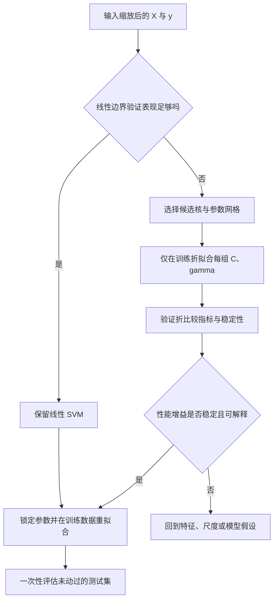

具体例走图：若二维同心圆用线性 SVM 验证表现差，就在训练折比较 RBF 的若干 $(C,\gamma)$；选择验证指标稳定的一组，重拟合后才碰测试集。

**停止边界。** 参数搜索在预先设定的候选范围或预算用完时停止。不能看到测试分数后继续调参；那会把测试集变成训练信息。

**课件原例。** p.68 展示一维点经二次映射后可被直线分开；p.69 给出圆形边界；p.70 写出显式二次映射与原空间中的二次决策方程；p.71 给出核内积和三类核函数；p.72 总结 SVM 是凸优化、靠间隔抑制过拟合，但核和代价仍需用户指定，且缺失值难处理、训练复杂度高。

**🎙️ 课堂补充**（A · 课上展开；B `43:56`–`47:13`）

教师用原 x 再增加平方列解释映射：*"I actually mapped one-dimensional feature space into two-dimensional feature space using x and x squared."*（B `44:54`）。新表示允许一条线把原本交错的点分开，确认本节先改表示再寻线性边界的链条。

B `45:22`–`45:27` 二维映射的 ASR 不能可靠还原原公式，以 p.70 书面映射为准。B `47:07` 明说 final 不要求设计拉格朗日优化或该数学部分；仍须能解释核映射与最大间隔怎样区别于单纯最小分类错误。

**💡 换个说法（笔记补充）。** 核函数像一把“相似度尺子”。模型不必真的把每个点搬到高维，只要能回答任意两点在那个空间有多相似，就能完成边界计算。

**常见误解。** 核技巧不是免费增加信息；它只改变表示。RBF 不是自动最好，特征仍要缩放。大 $\gamma$ 与大 $C$ 同时使用时尤其容易追随噪声。讲义说 SVM “robust to noise” 时应理解为最大间隔与软间隔提供一定稳健性，并不表示对离群点、错误标签或未缩放特征免疫。

**与其他概念的关系。** 显式特征映射与 [[M04-特征工程-特征重要性与降维]] 同属“改变表示”；核技巧则在内积层面隐式完成。与树模型相比，RBF SVM 的边界可以很光滑，但解释单个分支更困难。

**讲义问题（p.68–69）：这些数据线性可分吗？边界非线性怎么办？**

⚪ **参考作答（笔记推断）**：图中的一维交替点和二维内外圈都不是原空间线性可分。可用显式非线性特征或核函数映射，再在新空间训练线性 SVM。换成任意非线性数据时，仍需用验证集判断所选核是否合适。

**读图自测。** RBF 中两个点距离变大时 $K$ 怎样变化？答案：单调减小；$\gamma$ 越大，下降越快。

**所以呢。** 非线性 SVM 的核心不是直接画曲线，而是用映射后的内积建立线性分界，再把它解释为原空间的非线性边界。

#### 2.11.1 二次映射走到最终分类（笔记补充）

前面的 RBF 表只展示相似度；下面把一个非线性问题完整走到分类输出。给定 x=-2、-1、1、2，外侧两点标签为 -1，内侧两点为 +1。

1. 原坐标上负、正、正、负依次排列，一条阈值不能把两侧负类同时分开。
2. 增加新坐标 $z=x^2$，四点变成 z=4、1、1、4。
3. 在 z 空间学习分数 $s=wz+b$，要求 z=1 的正类分数至少为 1。
4. z=4 的负类分数必须至多为 -1，因此两个约束推出 w≤-2／3。
5. 最小化 $w^2/2$ 时选 w=-2／3、b=5／3；两类支持点都恰好满足等号。
6. 输出原坐标规则：$s(x)=5/3-2x^2/3$，正分判 +1，负分判 -1。

本例 z、w、b 都是无单位补充数值。训练得到的边界为 $x^2=2.5$，在原坐标上出现两条分界位置；它在 z 空间只是一个阈值。

新点 x=0 得分为 5／3，预测 +1；x=3 得分为 -13／3，预测 -1。训练结束后冻结 w、b，推断阶段只映射新点并计算分数。

这个映射也定义一个核 $K(x,u)=x^2u^2$。它是新坐标的内积，可隐式用于相同的优化；核值是相似性运算，不是分类概率。RBF 使用更丰富的表示，但同样要训练系数，不能把核表中最大的数直接当类别。

**失败与变式**：若同一 x 同时有相反标签，二次映射不能消除冲突，须允许软间隔。若真实标签依赖 x 的正负，平方会丢掉正负号，仅保留 x² 可能不够；需要保留 x 或换表示。

**读图自测**：新点 x=1.5 的 z=2.25，分数为 1／6，因此走正类出口。若错把 RBF 相似度当概率，这个分数计算就无法完成。

### 2.12 逻辑回归与 SVM 的区别（讲义 p.73）

p.73 只列出比较问题，没有给表。要回答它，必须从两种模型“优化什么”入手。

**是什么。** 逻辑回归（Logistic Regression, LR）学习概率形式 $P(y=1\mid\mathbf{x})=\sigma(\mathbf{w}^{\top}\mathbf{x}+b)$，通常最小化对数损失；线性 SVM 学习带符号的间隔分数，通常最小化正则项加 hinge loss。两者都可产生线性边界 $\mathbf{w}^{\top}\mathbf{x}+b=0$，但分数含义不同。

hinge loss（合页损失）把有符号间隔不足 1 的部分记为损失：

$$
\ell=\max(0,1-ys).
$$

y 是 -1／+1 的真实标签，s 是当前模型分数，损失无单位。间隔为 0.4 时，损失为 0.6；间隔为 1.2 时损失为 0。逻辑回归则按预测概率对真实类给对数损失，预测越确信且越错误，惩罚越大。

**为什么需要比较。** 商业决策常常既要排序／概率，也要清晰边界。模型外形相同不代表输出可互换。

**比较表。** 第一行读作：“LR 直接拟合条件概率；SVM 原始输出是到边界有关的分数，不自动等于概率。”

| 维度 | Logistic Regression | 线性 SVM | 选择提示 |
|---|---|---|---|
| 训练目标 | 对数损失 | 间隔 + hinge loss | 看业务输出需求 |
| 原始输出 | 概率模型 | 决策分数 | 需要概率时 LR 更直接 |
| 关键样本 | 所有样本都贡献损失 | 间隔内／违约点最关键 | SVM 由支持向量主导 |
| 非线性 | 显式造特征 | 可用核技巧 | 核会降低解释性 |
| 正则参数 | 常见实现也用 $C$ | $C$ 控违约惩罚 | 两者软件参数方向需查文档 |
| 概率校准 | 仍应检查校准 | 需额外校准 | 阈值决策前先验证 |

**完整小例（💡 笔记补充）。** 同一个客户的线性分数为 0.8。LR 若把 0.8 当 logit，则概率为 $1/(1+e^{-0.8})\approx0.690$；SVM 的 0.8 只表示在正侧且位于规范化间隔带内，不能直接说“违约概率 69%”。

**步骤与输出。** LR：输入 $X,y$ → 最小化对数损失 → 输出概率 → 选阈值。SVM：输入 $X,y$ → 最大间隔／软间隔优化 → 输出决策分数 → 如需概率再用独立校准数据拟合校准器。

**停止边界。** 两者都依赖数值优化收敛条件。若业务需要真实概率而校准误差未检查，模型开发不能在“分类准确率不错”处停止。

**课件原例。** p.73 提出“Comparison between logistic regression and support vector machine”与“How does SVM build a separation boundary”，但未给标准答案。

**🎙️ 课堂补充**（D · ❓ 未录到完整比较）

B `39:33` 把 LR、树、线性回归的训练目标与 SVM 间隔目标作口头对比，B `46:52` 又要求理解机制差异；但没有逐项回答 p.73 的概率、损失与校准比较。本节表格仍是笔记参考解析，**不可降权**，不能改成教师官方比较答案。

**💡 换个说法（笔记补充）。** LR 回答“属于正类的概率有多大”；SVM 先回答“站在边界哪一边、离边界有多远”。

**常见误解。** 不要把 SVM 的 `decision_function` 当概率。也不要认为 LR 一定只能画直线，加入非线性特征后它也能产生非线性边界。

**与其他概念的关系。** 两者都需要数据划分、正则化和阈值选择；在不平衡任务中，模型训练与决策阈值要结合 §2.13–2.16 的指标、代价、规则和采样方法。

**讲义问题（p.73）：SVM 如何建立分界？**

⚪ **参考作答（笔记推断）**：先定义超平面与两侧间隔约束，再最小化 $\lVert\mathbf{w}\rVert^2/2$；不可分时加入松弛惩罚；非线性时通过核内积在映射空间求同类最大间隔问题。

**所以呢。** 选择 LR 或 SVM 不能只看两者都能画线；要看是否需要概率、边界形状、校准、解释与训练成本。

### 2.13 99.9% accuracy 为什么可能毫无用处？（讲义 p.74–83）

欺诈、入侵和缺陷检测都有同一特点：真正关心的正类很少。此时大多数样本天然是负类，模型即使永远回答“没有问题”，也能得到漂亮的 accuracy。

**是什么。** 类别不平衡（class imbalance）是不同类别样本数相差很大。把少数且重要的类别定义为正类后，混淆矩阵按“真实类别 × 预测类别”计数。

**逐列读法。** 下表每个值都是测试集中“记录数”。第一行读作：“真实为正且预测为正的记录数叫 TP。”

| 真实类别 | 预测为正 | 预测为负 | 业务含义 |
|---|---:|---:|---|
| 正类 | TP | FN | 抓到的风险／漏掉的风险 |
| 负类 | FP | TN | 误报／正确放行 |

四个缩写须按同一正类读：

- TP（True Positive，真阳性）：真实为正，模型也报正。
- FN（False Negative，假阴性）：真实为正，模型漏报为负。
- FP（False Positive，假阳性）：真实为负，模型误报为正。
- TN（True Negative，真阴性）：真实为负，模型正确放行。

由此得到

$$
\text{Accuracy}=\frac{TP+TN}{TP+TN+FP+FN},
$$

$$
\text{Precision}=\frac{TP}{TP+FP},\qquad
\text{Recall}=\frac{TP}{TP+FN},
$$

$$
F_1=\frac{2\,\text{Precision}\,\text{Recall}}
{\text{Precision}+\text{Recall}}
=\frac{2TP}{2TP+FP+FN}.
$$

**为什么需要这些量。** 精确率（Precision）的分母是“模型报正的全部记录”，回答报警有多可信；召回率（Recall）的分母是“真实正类的全部记录”，回答真正风险抓到了多少；$F_1$ 用调和平均同时惩罚二者过低。指标名称不能脱离正类定义。

**完整运行 1：1000 笔交易，只有 1 笔欺诈（讲义 p.77–78）。** 全部预测为非欺诈时，$TP=0,FN=1,FP=0,TN=999$：

$$
\text{Accuracy}=\frac{999}{1000}=99.9\%,\quad
\text{Recall}=0.
$$

没有正类预测时，precision 在数学上分母为 0；本笔记按常见软件约定记 0，并应同时报告“没有任何正类预测”，不能只报 99.9%。

**完整运行 2：9990/10 例（讲义 p.81）。** 全部预测 Class 0 时，$TN=9990,FN=10$，accuracy 仍为 99.9%，但 10 个 Class 1 一个都没抓到，recall 为 0。

**完整运行 3：讲义 p.83。** $TP=10,FN=20,FP=50,TN=10000$：

| 指标 | 代入 | 结果 | 读法 |
|---|---|---:|---|
| Accuracy | $(10+10000)/10080$ | 99.31% | 全部记录中判对比例 |
| Precision | $10/(10+50)$ | 16.67% | 60 个警报中 10 个是真风险 |
| Recall | $10/(10+20)$ | 33.33% | 30 个真实风险只抓到 10 个 |
| $F_1$ | $20/(20+50+20)$ | 22.22% | precision 与 recall 都低 |

第一行读作：“10080 笔中判对 10010 笔，accuracy 很高，但这主要由 10000 个 TN 撑起来。”

**控制流程图。**

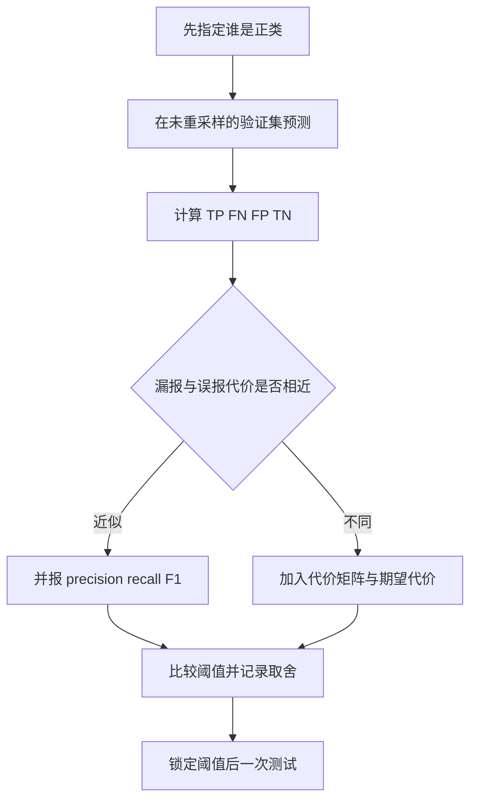

**停止边界。** 至少要报告正类定义、混淆矩阵、precision、recall 和与业务目标一致的指标；只报 accuracy 不足以结束评估。阈值必须在验证集锁定后才看测试集。

**课件原例。** p.75 列欺诈、入侵、制造缺陷；p.76 把稀有类比作草堆里的针；p.77–78 给 1000/1 反例；p.79–80 定义矩阵与 accuracy；p.81 给 9990/10；p.82 给 precision、recall、F-measure；p.83 给具体矩阵并问银行经理最关心哪个数。

**🎙️ 课堂补充**（A · 课上展开；B `47:23`–`54:25`）

教师用 1000 笔中 1 笔欺诈反问 99.9% 是否可靠；B `48:45`–`49:07` 说明全猜正常也得到同数，因此要拆开错误。*"We have precision recall and F-measure."*（B `51:04`）后，B `51:12`–`52:04` 分别解释预测正类与真实正类两个分母。

对 p.83，B `52:48` 希望抓到的欺诈尽量多，B `53:05`–`54:20` 又逐项讨论漏欺诈与误拦正常交易的代价。故不能把原题答案压成“只看 b”。课堂把 F-measure 泛称 average；正文保留其调和平均公式。

**💡 换个说法（笔记补充）。** Accuracy 像问“保安对所有进门者判断对了多少”；Recall 问“真正的小偷抓到了多少”；Precision 问“抓住的人里有多少真是小偷”。

**常见误解。** Precision 与 recall 的分母不同。TN 很大时，accuracy 可被“淹没”。$F_1$ 不使用 TN，因此也不是万能指标；若正确放行的价值或总体成本重要，还要看代价、PR 曲线、校准等。

**与其他概念的关系。** 本节的矩阵是 §2.13–2.16 所有方法的共同验收接口。训练阶段可以重采样，最终指标必须在保持总体分布的验证／测试集计算。案例实作互链 [[T07-分类实战-信用审批与欺诈识别]]。

**讲义问题（p.77）：99.9% accuracy 是好模型吗？**

⚪ **参考作答（笔记推断）**：不能据此判断。全负类模型也有 99.9% accuracy，却有 0 recall。还需看混淆矩阵、少数类 recall／precision、业务代价和与基线的比较。

**讲义问题（p.83）：银行经理最关心 $a,b,c,d$ 哪个？**

⚪ **参考作答（笔记推断）**：若正类是欺诈，通常首先关心 $b=FN$，因为这是漏掉的欺诈；但不能脱离业务代价断言永远只看 $b$。过度降低 $b$ 可能让 $c=FP$ 暴增，导致大量正常交易被拦截。应由 p.84–88 的代价矩阵量化取舍。

**变式题。** 若同一模型把正类定义从“欺诈”改成“正常”，precision 与 recall 的含义会怎样？答案：TP/FN/FP/TN 会随正类定义重排，指标的业务解释也完全改变，不能沿用原结论。

**所以呢。** 不平衡任务先看少数类是否被抓到，再谈总体正确率；混淆矩阵是把漂亮数字还原成业务后果的第一步。

### 2.14 代价矩阵与决策阈值（讲义 p.84–88）

银行漏掉一笔欺诈与误拦一笔正常交易，不是同一种损失。代价敏感分类把这种差异写进矩阵，再选择期望代价最小的类别。

**是什么。** $C(i,j)$ 表示真实类别为 $i$、却决策为 $j$ 的单笔代价。对记录 $\mathbf{x}$ 决策为 $j$ 的条件期望代价是

$$
R(j\mid\mathbf{x})=\sum_i P(i\mid\mathbf{x})C(i,j).
$$

选择 $R$ 最小的 $j$。注意讲义 p.84 的文字说“Cost of misclassifying”，但 p.85 对正确判正设置了 $-1$，这是收益而非误分类成本，所以更准确的名称是“决策代价／效用矩阵”。

**为什么需要它。** Accuracy 默认每种错误和正确都同价。代价矩阵允许业务明确说：漏报稀有风险比误报更贵，或抓到风险会带来收益。

**讲义 p.85 原数字复算。** 矩阵为 $C(+,+)=-1,C(+,-)=100,C(-,+)=1,C(-,-)=0$。第一行读作：“真实为正且预测为正，每笔记作 -1，即收益 1。”

| 模型 | $TP$ | $FN$ | $FP$ | $TN$ | 总代价 |
|---|---:|---:|---:|---:|---:|
| $M_1$ | 150 | 40 | 60 | 250 | $-150+4000+60=3910$ |
| $M_2$ | 250 | 45 | 5 | 200 | $-250+4500+5=4255$ |

$M_2$ 的表内 accuracy 为 90%，高于 $M_1$ 的 80%。

按各自表内计数，成本也确实分别为 4255 与 3910。

不过，两张表的真实正类总数不同：$M_1$ 有 $150+40=190$ 个正类，$M_2$ 有 $250+45=295$ 个正类。

这说明它们不是同一个测试集上的两个混淆矩阵，或讲义数字存在抄录不一致。

因此这里只能复核“每张表内部的 accuracy 与 cost”，不能据此公平断言 $M_1$ 比 $M_2$ 更好。

若题目额外假定两者可比较且唯一目标是最小化表内总成本，才会选择成本较低的 $M_1$。

**阈值方向与完整推导（💡 笔记补充）。** 令 $q=P(+\mid\mathbf{x})$。预测为正的代价为

$$
R(+)=q(-1)+(1-q)(1)=1-2q.
$$

预测为负的代价为

$$
R(-)=q(100)+(1-q)(0)=100q.
$$

当 $R(+)<R(-)$ 时预测正类：

$$
1-2q<100q\Rightarrow q>\frac1{102}\approx0.009804.
$$

阈值约为 0.98%，远低于 50%，方向符合直觉：漏报正类极贵，所以即使正类概率不高，也倾向报警。若提高误报成本 $C(-,+)$，正类阈值会升高；若提高漏报成本 $C(+,-)$，阈值会降低。

**输入—步骤—输出。** 输入为校准过的类别概率与经业务确认的代价矩阵；逐个候选决策计算期望代价；输出代价最小的类别和对应风险。多类问题同样对每个 $j$ 求和再取 $\arg\min$。

**停止边界。** 代价单位、时间范围和估算责任人必须明确；概率校准与阈值须在验证集检查。代价还未确认时，只能做敏感性分析，不能把某个阈值写成业务定案。

**课件原例。** p.84 定义成本矩阵和总成本；p.85 对 $M_1/M_2$ 给出混淆矩阵、accuracy 与 cost；p.86 把 cost-sensitive classification 列为三条不平衡处理路线之一；p.88 给出二分类期望代价规则。

**🎙️ 课堂补充**（A · 课上展开；B `52:30`–`57:29`）

教师把四格转为奖金／损失：抓对欺诈奖励 1，漏掉欺诈罚 100，误拦正常罚 1，正确正常为 0。B `56:20` 逐格算 $150(-1)+40(100)+60(1)+250(0)$；*"And the cost is 3,910"*（B `56:30`）。

B `56:38` 明说按较低成本选模型 1，这是题内目标的课堂答案；p.85 两模型真实类总数不同的限制仍保留。B `56:34` 只转成 “4,000”，不能用这个约数改掉原表 4255。课堂没有现场推导 p.88 的概率阈值，阈值例继续标为笔记补充。

**💡 换个说法（笔记补充）。** 阈值不是模型天然规定的 0.5，而是“多大风险值得采取行动”的价格线。

**常见误解。**

- 第一，矩阵的行是真实类别、列是预测类别，反过来会算错。第二，负代价可表示收益，不代表公式错误。第三，只有概率经过合理校准时，基于 $P(i\mid x)$ 的阈值才有直接风险含义。

**与其他概念的关系。** 调阈值不改变训练样本；类别权重可能改变训练边界；重采样改变训练分布。三者都能改善少数类表现，但作用环节不同。

**讲义题（p.85）：哪个模型更好？**

⚪ **参考作答（讲义数字复算）**：各自表内计算得到 $M_1$ accuracy 80%、cost 3910，$M_2$ accuracy 90%、cost 4255。但两表真实类别总数不同，不能视为同一测试集上的公平模型比较。若题目明确要求只比较这两个表内总成本，则 $M_1$ 较低；若问“哪个模型本身更好”，现有信息不足，必须让两模型在同一批真实标签上评估。

**变式题。** 若 $C(+,-)$ 从 100 降为 10，必须重新计算两张表的总成本与阈值；即使数字变化，也仍需先确认两模型是否在同一测试集上，才能比较模型优劣。

**所以呢。** 代价敏感决策把“更关心漏报”变成可计算规则，并可能让低 accuracy 的模型成为更优业务选择。

### 2.15 RIPPER 的有序规则学习（讲义 p.86–87）

讲义只给出“含 free 或 win → Spam”的结果，没有展示规则如何长出来。要理解 RIPPER，必须区分规则生长、剪枝、规则加入、覆盖样本移除和停止条件。

**是什么。** RIPPER 是有序规则分类器。它通常先为较少的类别学习规则，预测时从第一条规则向下检查；第一条命中的规则立即给出类别，最后用默认规则处理未命中样本。

**为什么需要它。** 在不平衡数据中，若先写多数类规则，宽泛规则可能先吞掉少数类。把稀有类规则放前面，能让少数类获得明确的优先判定路径。

**输入与输出。** 输入是离散／可阈值化特征、类别标签和规则评价准则；输出是有顺序的 `IF 条件 THEN 类别` 列表与默认类别。

**真实机制的最小流程（💡 笔记补充，课件未展开算法细节）。** RIPPER 的经典思路是：把数据分为 grow set 与 prune set；在 grow set 上贪心加入能提升正类区分度的条件；在 prune set 上删去不能改善规则表现的尾部条件；把规则加入列表并移除其覆盖样本；重复直到正类已覆盖或继续加规则不再改善描述长度／误差；最后做规则集优化。具体软件实现的划分比例、增益公式、停止与优化轮数可能不同，应查所用库文档。

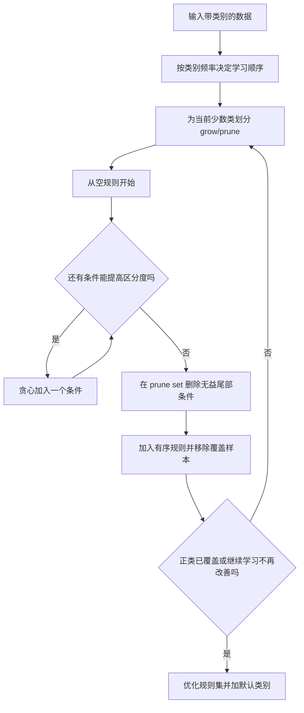

文字替代：每轮先长出一条尽量纯的少数类规则，再用独立剪枝部分删掉过拟合条件；规则确认后移除已覆盖样本，直到少数类被覆盖或继续增加规则不值得，最后加入默认多数类。

**从明确数据走完规则例（💡 笔记补充，不是课程原始训练集）。** 为使上一段机制可以复算，下面公开规则生长部分的全部 8 封邮件。1 表示特征存在，0 表示不存在；spam 是目标类别。

| 邮件 | free | win | known_sender | 类别 |
|---|---:|---:|---:|---|
| s1 | 1 | 0 | 0 | spam |
| s2 | 1 | 1 | 0 | spam |
| s3 | 0 | 1 | 0 | spam |
| n1 | 1 | 0 | 1 | normal |
| n2 | 1 | 1 | 1 | normal |
| n3 | 0 | 1 | 1 | normal |
| n4 | 0 | 0 | 1 | normal |
| n5 | 0 | 0 | 0 | normal |

逐列读法：

- 邮件为身份。
- free 与 win 表示是否有该词。
- known_sender 表示是否来自已知发件人。
- 类别为训练时可见的标签。全部特征都是无单位二值。

读第一行：s1 含 free、不含 win，来自未知发件人，标签是 spam。

生长条件可用 FOIL 增益作演示。它比较加条件前后的正类比例，并按仍被覆盖的正例数加权。

$$
\operatorname{Gain}=p_1\left[\log_2\frac{p_1}{p_1+n_1}-\log_2\frac{p_0}{p_0+n_0}\right].
$$

每个符号是一种覆盖计数，单位均为封。

| 符号 | 对应计数 | 第一轮示例 |
|---|---|---:|
| $p_0$ | 加条件前的 spam | 3 |
| $n_0$ | 加条件前的 normal | 5 |
| $p_1$ | 加条件后仍覆盖的 spam | 3 |
| $n_1$ | 加条件后仍覆盖的 normal | 1 |

逐列读法：

- 符号供公式定位。
- 对应计数明确类别与操作时点。
- 示例列使用 known_sender=0 的第一步计数。

读第一行：加任何条件前有 3 个 spam，不是 3 个已判对的测试样本。

1. 空规则覆盖 3 spam、5 normal，正类比例为 3／8。
2. free=1 覆盖 2 spam、2 normal，增益约 0.8301；win=1 相同。
3. known_sender=0 覆盖 3 spam、1 normal，增益为 3，因此先选它。
4. 再加 free=1，留下 s1、s2，变成 2 spam、0 normal。与加 win=1 平局，本例固定优先 free。
5. 剪枝另用 4 封记录：spam 两封分别同 s1、s3；normal 两封分别同 n1、n5。
6. 完整规则的剪枝得分为 1；删除 free 后得分为 1／3，因此保留 free。
7. 加入第一规则并从生长池移除 s1、s2。剩下唯一 spam 为 s3，再生长 known_sender=0 AND win=1。
8. 第二规则在剩余剪枝记录上保留两个条件；生长池已无未覆盖 spam，停止加规则并输出默认 normal。

剪枝得分在这个演示中定义为“被规则覆盖的正例减负例，再除以覆盖总数”。第一规则完整时覆盖 1 正、0 负，得分为 1；只留 known_sender=0 时覆盖 2 正、1 负，得分为 1／3。零覆盖时不能计算该比值，须放弃或按实现规则处理。

最后，s3 不命中第一规则，却命中第二规则；n5 两条都不命中，到默认 normal。8 封生长记录全部预测正确，仅证明小例运行自洽。这个例子展示一次生长、剪枝和覆盖停止；实际 RIPPER 还使用描述长度限制和规则替换优化，不能把此简化例称为完整软件复现。

若把 n5 改成错标 spam，known_sender=0 会变纯，规则可能停止在更宽条件。这个变化说明有序规则也会受标签错误影响，不能只凭“可解释”认定可靠。

**停止边界。** 当前类的正样本已覆盖、候选条件没有正增益、规则使描述长度／验证误差恶化，或达到实现规定的规则／优化上限时停止。不能无限加条件直到训练误差为零。

**课件原例。** p.86 将 class-based ordering 列为方案；p.87 定义 RIPPER 生成 if–then 规则，并以包含 `free` 或 `win` 的邮件判 Spam，强调少数类优先。

**🎙️ 课堂补充**（D · ❓ 无可定位的 RIPPER 细讲）

B `57:00` 只概述 class-based ordering 和优先级，未出现可确认的 RIPPER／spam 规则生长、剪枝与优化过程。不能由这个短转场断言完整 p.87 已讲，也没有明确 skip 证据。本节机制和补充例继续保留，**不可降权**。

**💡 换个说法（笔记补充）。** RIPPER 像一份从“最需要先拦截”到“默认放行”的检查清单；顺序本身就是模型的一部分。

**常见误解。** RIPPER 不是只写一条关键词规则；它要用数据生长和剪枝。规则列表的 `OR` 来自多条规则任一命中，而单条规则内部常是多个条件的 `AND`。规则可解释不代表自动公平或稳定，稀疏类别的小样本规则尤其容易波动。

**与其他概念的关系。** RIPPER 与决策树都产生条件判断，但树沿节点路径走，RIPPER 按有序规则列表匹配。它与 cost-sensitive learning 的共同目标是保护少数类，机制不同。

**变式题。** 若误报 spam 的代价突然很高，应怎样改？答案：提高剪枝和验证对 precision 的要求，或把规则分数与代价阈值结合；不能只因 spam 稀有就无限优先。

**所以呢。** RIPPER 的价值来自“少数类优先的有序规则学习”，而完整机制包含生长、剪枝、覆盖移除与停止，不是手写一个关键词判断。

### 2.16 训练折内的重采样（讲义 p.86、p.89–92）

重采样的目标是让训练算法在学习边界时看见足够的少数类，而不是把现实世界伪装成 50:50。讲义 p.86 与 p.89 用大写强调：只重平衡训练数据，测试集应保持总体分布。

**是什么。** 欠采样（under-sampling）减少多数类；过采样（over-sampling）增加少数类；组合方法先合成少数类，再清理类别交界或噪声。

**为什么需要它。** 很多学习器最小化总体平均损失。少数类太少时，即使它们全部判错，总损失也可能不大。重采样改变训练时各类对损失的贡献。

**方法逐项读。** 第一行读作：“随机欠采样直接丢掉多数类记录，速度快，但可能丢信息。”

| 方法 | 训练集动作 | 主要收益 | 主要风险 |
|---|---|---|---|
| 随机欠采样 | 删除多数类样本 | 训练更快、比例更平衡 | 丢掉多数类结构 |
| Prototype selection | 从原样本选代表点 | 保留真实记录 | 选择偏差 |
| Prototype generation | 生成更少的代表原型 | 强压缩 | 原型未必是真实记录 |
| IHT | 估计实例难度并删难例 | 清理重叠／噪声 | 可能删掉重要边界点 |
| 随机过采样 | 有放回复制少数类 | 简单、不改坐标 | 重复噪声、过拟合 |
| SMOTE | 邻域内插值合成少数类 | 增加少数类覆盖 | 跨边界造点 |
| ADASYN | 给难学邻域更多合成量 | 聚焦困难区域 | 放大噪声与异常点 |
| SMOTE–Tomek | SMOTE 后清理 Tomek links | 清边界重叠 | 可能过度清理 |
| SMOTE–ENN | SMOTE 后用 ENN 清理 | 清理更积极 | 数据改动更大 |

**SMOTE 完整小例（💡 笔记补充）。** SMOTE 原始论文明确在少数类样本及其近邻之间生成合成点，而不是简单复制原点。两个少数类近邻为 $\mathbf{x}_i=(2,2)$ 与 $\mathbf{x}_{nn}=(4,3)$。取随机比例 $\lambda=0.25$：

$$
\mathbf{x}_{new}=\mathbf{x}_i+\lambda(\mathbf{x}_{nn}-\mathbf{x}_i)
=(2,2)+0.25(2,1)=(2.5,2.25).
$$

新点不是复制旧点，而是两点之间的插值。若这条线穿过多数类区域，新点可能是有害样本，所以要检查邻域结构或结合清理。

**ADASYN 的状态更新。** ADASYN 原始论文的核心是按少数类样本的学习难度设置加权分布，对更难学的少数类样本生成更多合成数据。可操作地说：先统计每个少数类点邻域内多数类比例 $r_i$；把合成预算更多分给 $r_i$ 高的点；再在少数类近邻方向生成合成点。若某点难学是因为标签错误，ADASYN 会把错误附近放大，这是明确失败机制。

**组合清理。** Tomek link 是彼此互为近邻、类别相反的一对，常表示边界重叠；SMOTE–Tomek 合成后删除这类边界样本（具体删哪一侧取决于实现）。ENN 检查一个点的近邻多数标签，若与自身不一致就删；SMOTE–ENN 通常清得更强。使用时必须记录库的具体策略。

**无泄漏控制流程。**

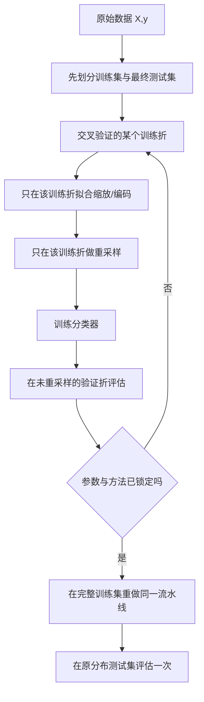

具体例走图：把 10000 笔交易先留出测试集；每个交叉验证轮次只对当前训练折做 SMOTE，再在自然比例验证折计算 precision、recall、$F_1$ 与成本。若在划分前合成，某个原点的信息可能同时进入训练和验证，形成泄漏。

**停止边界。** 达到预设采样比例／合成数量后停止；清理方法没有更多符合删除条件的点或完成一次既定清理后停止。方法和比例只能用验证集选择，不能反复看测试集。

**课件原例。** p.89 给欠采样与过采样并强调测试分布不变；p.90 区分 prototype generation、prototype selection 和 Instance Hardness Threshold；p.91 比较随机过采样、SMOTE、ADASYN；p.92 给出 SMOTE–Tomek 与 SMOTE–ENN。

**🎙️ 课堂补充**（A · 课上展开；B `57:25`–`59:41`）

教师简讲删多数与增少数，重点是评估边界：*"You cannot do under-sampling or over-sampling for your testing data set."*（B `58:24`）。测试集保留原总体比例，才代表未来未知记录；教师把重平衡测试集与以往小组低分联系起来（B `58:48`）。

B `59:13` 预告 Week 11 会有更多例子。现有转录未逐项展开 p.90–92 的 IHT、SMOTE、ADASYN、Tomek／ENN；它们保持讲义自学与笔记补充边界，不标成教授当堂完整推导。

**💡 换个说法（笔记补充）。** 重采样像给训练时的少数意见加麦克风，但考试现场的人群比例不能跟着改。

**常见误解。**

- 第一，SMOTE／ADASYN 不是简单复制；讲义 p.91 的 “duplicating” 是不精确概括。第二，先对全数据 SMOTE 再划分会泄漏。第三，测试集做成 50:50 后得到的 precision 不能直接代表真实部署环境。第四，重采样不会自动解决概率校准，部署前仍要检查。

**与其他概念的关系。** 重采样改变训练数据；类别权重改变损失；阈值改变预测决策。可组合，但每一层都应在训练／验证流程内调，最后在自然分布测试集统一比较。实作互链 [[T07-分类实战-信用审批与欺诈识别]]。

**变式题。** 若少数类有 5 个点，其中 1 个是错标，ADASYN 与随机过采样哪个更可能放大它？答案：若错标点周围多数是多数类，ADASYN 会把它视为困难点并给更多合成预算；随机过采样也可能复制它，但不会因“困难”额外倾斜。

**读图自测。** 流程图中为什么先划分再重采样？答案：保证验证／测试从未参与合成邻域与参数拟合，从而测到接近部署分布的泛化表现。

**所以呢。** 重采样只服务于训练；选择方法时要同时问“增加了什么、删掉了什么、有没有泄漏、最终在哪个真实分布上验收”。

## 3. 一图看懂

这张图把本讲前半的树／集成与后半的 SVM／不平衡学习连成一条建模链。它只作全讲导航，各算法的运行细节仍以 §2 的局部流程和完整例子为准。

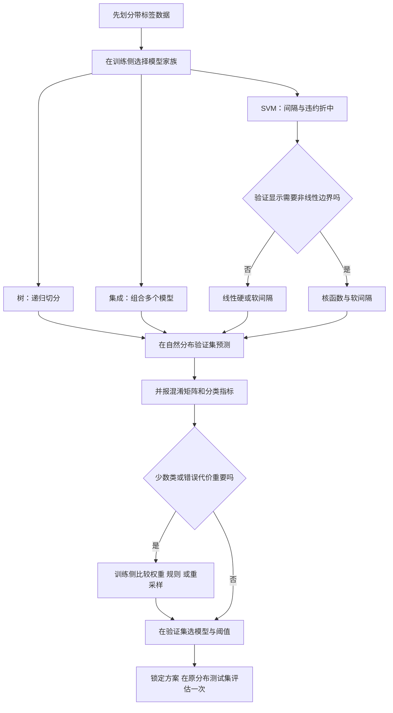

文字替代：数据进入后，按边界和解释需求选择树、集成或 SVM；SVM 按验证所需边界形状选择线性或核；线性重叠本身也可由软间隔处理。所有模型产生预测后，若类别不平衡，就用混淆矩阵和成本选择规则、权重、训练折重采样与阈值，最终只在原分布测试集验收。

**读图自测。** `SMOTE → 再划分数据` 为什么不在图中？因为那会让测试信息通过合成邻域泄漏进训练。正确路径是先划分，再只处理训练折。

## 4. 速查表

下表用于考前快速定位“输入、核心动作、输出和最容易答错的边界”。第一行读作：“决策树接收带标签表格，递归选择分裂，输出分支规则；小树易解释，但轴对齐边界和过拟合是限制。”

| 方法 | 核心动作 | 输出 | 关键边界／风险 |
|---|---|---|---|
| 决策树 | 递归选分裂，直到纯度／停止条件满足 | 分支规则与类别 | 单树易过拟合；斜边界低效 |
| Bagging | bootstrap 多份数据并行训练 | 多数票／平均 | 降方差；基学习器应有差异 |
| Random Forest | Bagging + 每次分裂随机选特征 | 树森林 | 解释性低于单树 |
| AdaBoost | 提高错分样本权重，顺序训练 | 加权投票 | 噪声标签会被持续放大 |
| Stacking | 用折外预测训练元模型 | 学习后的组合器 | 必须用 OOF，避免泄漏 |
| 线性 SVM | 最大化间隔，软间隔容错 | $\mathbf{w},b$ 与分数 | 需缩放；分数不是概率 |
| RBF SVM | 用核内积形成非线性边界 | 支持向量与核参数 | $C,\gamma$ 联合调参 |
| RIPPER | 少数类优先的规则生长／剪枝 | 有序规则列表 | 顺序决定结果；小样本不稳 |
| Cost-sensitive | 最小化条件期望代价 | 代价最小决策／阈值 | 依赖概率校准与真实代价 |
| SMOTE 系列 | 训练折合成并可清理 | 重平衡训练集 | 不能处理测试集；防泄漏 |

## 5. 双语术语卡

| 中文 | English | 考试可用的英文定义（笔记整理） | 首现位置 |
|---|---|---|---|
| 分类 | Classification | A supervised task that learns a mapping from attributes to discrete class labels. | §2.1 |
| 决策树 | Decision Tree | A predictive model that recursively partitions the feature space with conditional tests. | §2.2 |
| 集成学习 | Ensemble Learning | A method that combines multiple base models to produce one prediction. | §2.5 |
| 支持向量机 | Support Vector Machine | A classifier that finds a decision boundary with a large margin, allowing penalized violations when needed. | §2.9 |
| 支持向量 | Support Vector | A training point on or inside the margin whose constraint helps determine the SVM boundary. | §2.9 |
| 硬间隔 | Hard Margin | An SVM formulation that requires every training point to satisfy the margin constraint. | §2.9 |
| 软间隔 | Soft Margin | An SVM formulation that uses slack variables to permit penalized margin violations. | §2.10 |
| 松弛变量 | Slack Variable | A nonnegative variable that measures how much a sample violates the unit-margin constraint. | §2.10 |
| 核技巧 | Kernel Trick | The use of a kernel to compute inner products in a feature space without explicitly constructing the mapped coordinates. | §2.11 |
| RBF 核 | Radial Basis Function Kernel | A similarity function that decreases exponentially with squared distance between two observations. | §2.11 |
| 类别不平衡 | Class Imbalance | A setting in which some classes have far fewer observations than others. | §2.13 |
| 精确率 | Precision | The proportion of predicted positives that are truly positive. | §2.13 |
| 召回率 | Recall | The proportion of actual positives that are correctly detected. | §2.13 |
| 代价敏感分类 | Cost-sensitive Classification | Classification that selects decisions using unequal costs for different actual-predicted outcomes. | §2.14 |
| 有序规则 | Ordered Rules | A rule list in which the first matching rule determines the prediction. | §2.15 |
| 欠采样 | Under-sampling | Rebalancing that removes or replaces majority-class observations in the training data. | §2.16 |
| 过采样 | Over-sampling | Rebalancing that duplicates or synthesizes minority-class observations in the training data. | §2.16 |
| SMOTE | Synthetic Minority Over-sampling Technique | A method that synthesizes minority observations by interpolation between neighboring minority samples. | §2.16 |
| ADASYN | Adaptive Synthetic Sampling | A method that allocates more synthetic minority samples to locally difficult observations. | §2.16 |

以下条目补齐前半的英文答句，一行是一个术语。

| 中文 | English | 考试可用的英文定义（笔记整理） | 首现位置 |
|---|---|---|---|
| 回归树 | Regression Tree | A tree that predicts a numeric response using a constant, often a mean, in each terminal region. | §2.4 |
| 自助抽样 | Bootstrap | Sampling records with replacement to create a new training sample. | §2.6 |
| 装袋法 | Bagging | Training base models on bootstrap samples and aggregating their predictions. | §2.6 |
| 随机森林 | Random Forest | An ensemble of trees with bootstrap sampling and random feature subsets at each split. | §2.6 |
| 自适应提升 | AdaBoost | Sequential learning that updates sample importance and combines base-model outputs. | §2.7 |
| 堆叠集成 | Stacking | Learning a meta-model from out-of-fold base-model predictions. | §2.8 |
| 折外预测 | Out-of-fold Prediction | A training-row prediction produced without fitting the model or preprocessing on that row. | §2.8 |
| F1 分数 | F1 Score | The harmonic mean of precision and recall for a specified positive class. | §2.13 |

读第一行：分类的英文定义是本笔记整理，来源为讲义 p.3 的任务定义。逐列读法：中文给统一译名；English 给考试关键词；英文定义是可用答句，非教授原话；首现位置指本讲的展开节号。

## 6. 考点预判与答题框架

本次转录新增明确题型、课堂要求与反向考试信号。下表保留原有 ILO／讲义推断；Stacking 的 final 优先级按教授免考信号降低，内容仍供 tutorial 与项目使用。

### 6.0 前半机制与计算题

下面一行是一种讲义支持的复习题，全部为讲义／ILO 反推或笔记推断，不含教师考试明示。

| 可信度 | 考法 | 必须展示的过程 | 正文位置 |
|---|---|---|---|
| 🟡 | 给定树判断新客户 | 当前节点、条件、叶与等号边界 | §2.2 |
| 🟡 | 选树分裂 | 父纯度、各子计数、人数加权、候选比较 | §2.3 |
| ⚪ | 回归叶为何用均值 | 平方误差与固定区域的最优常数 | §2.4 |
| 🟡 | Bagging p.39 填表 | 十轮阈值、每票、总票与泛化限制 | §2.6 |
| 🟡 | AdaBoost 权重迭代 | 错例权重和、alpha、归一化与加权输出 | §2.7 |
| 🔴 反向：final 免考；项目理解 | Stacking 防泄漏 | 折外矩阵、元模型、全训练重拟合 | §2.8 |

逐列读法：可信度表示推断来源；考法是复习任务；过程列是答卷需写的中间步骤；位置列是本讲索引。读第一行：给定树的题须走到叶，不能只写“用决策树分类”。

### 6.1 概念关系题

| 可信度 | 可能考法 | 答题顺序 | 对应小节 |
|---|---|---|---|
| 🟡 | 为什么最大间隔优于任意可分线？ | 定义超平面 → 写约束 → 写 $2/\|w\|$ → 支持向量 → 边界 | §2.9 |
| 🟡 | $C$ 增大有什么影响？ | 写软间隔目标 → 指出违约更贵 → 训练拟合增强 → 过拟合风险 | §2.10 |
| 🟡 | 核技巧怎样产生非线性边界？ | 原空间不可分 → 映射 → 核内积 → 新空间线性 → 参数风险 | §2.11 |
| 🟡 | LR 与 SVM 比较 | 共同线性分数 → 损失不同 → 概率／间隔 → 校准与核 | §2.12 |
| 🟡 | 为什么 accuracy 误导？ | 给全负类基线 → 混淆矩阵 → recall/precision/F1 → 业务成本 | §2.13 |
| 🟡 | 重采样为何只用于训练？ | 训练分布可改 → 测试保持人口分布 → 泄漏 → 折内 pipeline | §2.16 |

### 6.2 计算题模板

1. 先写正类是谁，并把题目数字落到 $TP,FN,FP,TN$。
2. 写公式后逐步代入，不跳过分母。
3. 若有 cost matrix，确认“行=真实、列=预测”，逐格做 “该格记录数乘以单笔代价”。
4. 比较模型时同时写统计指标和业务指标；若冲突，以题目给定目标解释选择。
5. 阈值题先写两种决策的条件期望代价，再解不等式，最后检查方向是否符合业务直觉。

### 6.3 算法机制题模板

按“输入 → 状态 → 重复步骤 → 停止 → 输出 → 两种失败”回答。SVM 的状态是 $\mathbf{w},b,\xi$；RIPPER 的状态是当前规则、未覆盖样本和规则列表；重采样的状态是当前训练折及其类别分布。失败至少写两类：数据／标签问题与流程／验证问题。

### 6.4 本次课堂明示与反向信号

每行是一条可定位的课堂要求。免考范围只限原话所指内容，不能外推为整个算法不用理解。

| 级别 | 要求 | 原话证据 | 去向 |
|---|---|---|---|
| 🔴 课堂要求 | 四阶段训练准确率小测 | *"you need to provide four training accuracies"*（A `18:28`） | §2.3.2 |
| 🔴 题型 | Bagging 表格例可能进入 final | *"So if you see this in your final, do not be surprised."*（B `17:01`） | §2.6 |
| 🔴 反向 | Stacking 不进 final | *"So this method will not show up in your final exam."*（B `34:31`） | §2.8 |
| 🔴 反向 | SVM 不要求拉格朗日推导 | *"I'm not challenging you anything for designing the Lagrangian optimization or the mathematics in the final exam."*（B `47:07`） | §2.9–2.11 |
| 🔴 评分边界 | 测试集不得重平衡 | *"You cannot do under-sampling or over-sampling for your testing data set."*（B `58:24`） | §2.16 |

TA 的 API／参数考试提示见 T07；讲者与范围单列，尤其不据泛称覆盖教授对 Stacking 的明确免考。

## 7. 自测

1. 为什么把 $\mathbf{w}$ 乘以 0.1 不能无条件把 SVM 间隔放大 10 倍？

答案

因为硬间隔还有 $y_i(\mathbf{w}^{\top}\mathbf{x}_i+b)\ge1$。单独缩小参数会破坏规范化约束；目标与约束必须一起看。

2. 某点满足 $y_i(\mathbf{w}^{\top}\mathbf{x}_i+b)=0.4$。它是否错分？对应最小松弛是多少？

答案

它仍在正确一侧，因为有符号分数为正，但进入间隔带。最小 $\xi_i=1-0.4=0.6$。

3. RBF SVM 把 $\gamma$ 调得非常大，最常见的风险是什么？

答案

每个点的影响半径变得很窄，边界可能围绕训练点剧烈弯曲并过拟合噪声。还需结合 $C$ 与验证表现判断。

4. $TP=40,FN=10,FP=30,TN=920$。计算 precision、recall 与 $F_1$。

答案

$\text{Precision}=40/70\approx0.5714$，$\text{Recall}=40/50=0.8$，$F_1=80/(80+30+10)=2/3\approx0.6667$。

5. 为什么在全数据上先 SMOTE 再做 5-fold CV 是错误流程？

答案

合成点使用全数据的邻域，验证折样本的信息会进入训练折生成过程，造成数据泄漏。SMOTE 必须在每个 CV 训练折内部拟合与执行。

6. 给定 p.85 的成本矩阵，模型输出 $P(+\mid x)=0.02$，应判正还是负？

答案

阈值为 $1/102\approx0.009804$。因为 $0.02$ 更高，应判正。也可直接算 $R(+)=1-2(0.02)=0.96$，$R(-)=100(0.02)=2$，选代价更低的正类。

7. RIPPER 为什么需要 prune set？

答案

grow 阶段会贪心加入条件，容易贴合噪声；prune set 用未参与规则生长的数据检查并删去无益条件，降低过拟合。具体评分依实现而异。

8. **案例迁移。** 制造缺陷率为 0.2%，漏检一次成本远高于误报。你会怎样设计训练与验收？

参考思路

先按时间或生产批次划分训练、验证和原分布测试集；训练折内比较类别权重、SMOTE 系列或少数类优先规则；用 recall、precision、PR 指标和期望代价选模型与阈值；锁定后在原分布测试集评估。若概率参与期望代价，还要检查校准。不能只优化 accuracy，也不能重采样测试集。

## 8. 讲义页码映射

下表使用 92 个 PDF 物理页，不使用过时的 `/83` 页脚。每个覆盖标记均按 A／B 独立时钟；区间表示可定位内容，不证明教师逐页展示了每张动画。

| 讲义物理页 | 笔记位置 | 页面内容 | 课堂覆盖 |
|---|---|---|---|
| p.1–2 | §2.1 | 本讲目录、分类导入 | ❓ A开头已至p.7，不可降权 |
| p.3–6 | §2.1 | 分类定义、任务例、建模流程、分类器家族 | ❓ 未录到导入，不可降权 |
| p.7–15 | §2.2 | 决策树例与测试记录逐步推断 | ✅ A `00:00`–`05:44` |
| p.16–18 | §2.3 | Hunt 算法与树构造 | ✅ A `05:44`–`19:39`；小测至`24:58` |
| p.19–21 | §2.4 | 决策树优缺点、轴对齐限制、示例数据 | ✅ A `24:58`–`30:05` |
| p.22–23 | §2.4 | 回归树区域划分 | ✅ A `30:05`–`32:13` |
| p.24–26 | §2.5 | 集成学习导入与定义 | ✅ A `32:13`–`34:57` |
| p.27–30 | §2.5 | 盲人摸象、25 个分类器、三步总流程、类型 | ✅ A `34:57`–`39:35`；B `00:00`–`05:01` |
| p.31–32 | §2.6 | Bagging 抽样与算法 | ✅ B `05:01`–`09:37` |
| p.33 | §2.6 | Random Forest | ✅ B `06:59`宽泛介绍；TA B `01:10:45`–`01:14:12` |
| p.34–39 | §2.6 | Bagging 完整例与 p.39 quiz | ✅ B `05:24`–`18:17` |
| p.40–44 | §2.7 | Boosting、AdaBoost 权重与算法 | ✅ B `18:17`–`25:03` |
| p.45–47 | §2.7 | AdaBoost 数值例 | ✅ B `25:03`–`34:17`；复读/阈值疑点见§9.5 |
| p.48–50 | §2.8 | Stacking、与 Bagging/Boosting 比较、API | ✅ B `34:26`–`36:18` |
| p.51–53 | §2.8 | Stacking 训练与测试例 | ✅ B `36:18`–`39:20`；原表错误未纠正 |
| p.54 | §2.9 | SVM 单元目录页 | ⚪ 单元目录 |
| p.55–60 | §2.9 | 多条可分边界与最大间隔选择 | ✅ B `39:20`–`42:03` |
| p.61–64 | §2.9 | 线性 SVM 公式、优化、支持向量、分类 | ✅ B `42:03`–`43:13` |
| p.65–67 | §2.10 | 不可分数据、松弛变量与两因素折中 | ✅ B `43:13`–`43:56` 简讲 |
| p.68 | §2.11 | 非线性 SVM 分隔页与二次映射图 | ✅ B `44:03`–`44:54` |
| p.69–71 | §2.11 | 圆形边界、高维映射、kernel trick 与核例 | ✅ B `45:02`–`46:22` |
| p.72 | §2.11 | SVM 特性与限制 | ✅ B `46:22`–`47:13` |
| p.73 | §2.12 | LR 对比与 SVM 边界总结题 | ❓ 未录到完整LR比较，不可降权 |
| p.74 | §2.13 | 不平衡分类单元目录页 | ⚪ 单元目录 |
| p.75–78 | §2.13 | 场景、挑战与 1000/1 accuracy 反例 | ✅ B `47:23`–`49:07` |
| p.79–82 | §2.13 | 混淆矩阵、accuracy、9990/10、替代指标 | ✅ B `49:07`–`52:04` |
| p.83 | §2.13 | 具体混淆矩阵与银行经理问题 | ✅ B `52:30`–`54:25`，按多格成本讨论 |
| p.84–85 | §2.14 | 代价矩阵、$M_1/M_2$ 成本计算 | ✅ B `54:25`–`56:49` |
| p.86 | §2.14–2.16 | 三类不平衡处理路线 | ✅ B `57:00`–`58:58` 路线概览 |
| p.87 | §2.15 | RIPPER 与 Spam 规则 | ❓ RIPPER细讲无对应，不可降权 |
| p.88 | §2.14 | 条件期望代价决策 | ❓ 未现场推导阈值，不可降权 |
| p.89–90 | §2.16 | 训练集重采样、欠采样三类 | ✅ p.89 B `57:29`–`58:58`；p.90未细讲 |
| p.91 | §2.16 | 随机过采样、SMOTE、ADASYN | ❓ 具体方法未细讲，不可降权 |
| p.92 | §2.16 | SMOTE–Tomek、SMOTE–ENN | ❓ 组合清理未细讲，不可降权 |

## 9. 延伸与勘误

### 9.1 课件有但课上略过

下面一行是一类确实未录到或未能定位的内容；“不可降权”表示不能由缺录推断不考。

| 讲义页／范围 | 记录事实 | 判定 | 学习处理 |
|---|---|---|---|
| p.1–6 | A `00:00` 已在p.7树模型中段 | ❓ 缺开头 | 不可降权，按讲义自学 |
| p.73 | B `46:52` 只要求比较机制，无完整LR逐项答案 | ❓ 未录到完整比较 | 保留参考解析，不可降权 |
| p.87 | B `57:00` 只概述规则优先级，无RIPPER细讲 | ❓ 无细节对应 | 保留完整讲义／补充机制，不可降权 |
| p.90–92 | B `59:13` 预告后续更多例子，未逐项讲本页方法 | ❓ 未细讲 | 不冒称明确顺延，仍须自学 |
| 课堂尾部 | B `01:36:09` 作业答问后结束 | ❓ 尾部完整性未知 | 不猜后续分钟或新要求 |

A 开头已在 p.7，p.1–6 未录到；两源接缝只有课间后复述，墙钟与连续性未能完整证明。p.73 完整比较、p.87 RIPPER 细讲及 p.90–92 具体方法无可靠对应，保留 ❓ 与不可降权。没有足够证据把这些页面记成 ⏭️；课堂预告后续例子也不等于明确将整页顺延。

### 9.2 课上讲了但课件没有

下面每行是一项有正文落点的真实课堂增量；时长是对应源内部区间，不能相加为课堂总长。

| 内容 | 原始时间 | 正文位置 | 增量价值 |
|---|---|---|---|
| 四阶段准确率小测与五分钟提交 | A `18:16`–`24:58` | §2.3.2 | 从p.18四图提炼可复算任务 |
| 人工构造x1+x2处理斜边界 | A `27:39`–`29:37` | §2.4 | 说明表示选择如何减少树层数 |
| Bagging表格例可能入final | B `17:01` | §2.6、§6.4 | 升级题型来源，未保证必考 |
| Stacking明确免考 | B `34:31`、B `39:12` | §2.8、§6.4 | 调整final复习优先级 |
| SVM拉格朗日数学反向范围 | B `42:45`、B `47:07` | §2.9–2.11 | 区分机制理解与考试推导 |

新增：§2.3.2 四阶段准确率小测（A `18:16`–`24:58`）；§2.4 的 x1+x2 斜边界／人工特征例（A `27:39`–`29:37`）；§6.4 的五条课堂明示。B `17:30`–`18:05` 提醒缺席者不可通过 Canvas 可见 quiz 冒充到场；这是课堂行政提醒，不推断本人参与或提交。

### 9.3 课件自身的问题

- **p.18 示意分裂不等于最优分裂**：A `10:49`–`11:06` 口述 Home Owner 最优但未展示候选分数；课堂口述与下列原表计算分开保留。Home Owner 的 Gini 增益为 0.0771；同表 Married 切分可得 0.12。不能由示意树宣称 Home Owner 全局最优。
- **p.28 的概率条件**：二项式多数错误概率还需要错误事件独立且错误率相同；不相关本身不足。实际尾概率约 0.0604。
- **p.42／p.44 的错误率**：若权重已经归一化，错例权重之和才是加权错误率；再除以 N 会与后续 alpha／权重口径不一致。
- **p.51 的单类折**：Fold2 两条都为 1，普通二分类 LR 无法只用该折拟合；表中概率按示意给定值处理。
- **p.53 的算术冲突**：p.52 公式推得 A/B/C 的 logit 为 -3.05/-0.20/-0.60，概率约 0.0452/0.4502/0.3543；不能照抄该页互相矛盾的表。
- **p.53 真值字段**：测试标签本来未知，该页填出的类别不能作为已知真值证明模型正确。

- **页数模板过时**：PDF 实际 92 页，但 p.61 起多页页脚仍写 `61/83` 至 `92/83`。

本笔记统一使用物理页码 p.1–92。

- **p.64 的测试分类条件不完整**：页面用 $\ge1$ 与 $\le-1$ 回答“如何分类测试记录”，遗漏 $(-1,1)$。

预测应按 $\operatorname{sign}(\mathbf{w}^{\top}\mathbf{x}+b)$。

$\pm1$ 是训练规范化间隔边界。

- **p.66 的 $k=1/2$ 说明含混**：两者共享软间隔思想，但惩罚形状与相应优化形式不同，不能只理解为“约束不同”。

本笔记保留讲义写法并解释线性／平方惩罚。

- **p.72 的 “Robust to noise” 需加边界**：SVM 对噪声并非免疫。

$C$、核参数、错误标签和特征尺度都会影响稳健性。

- **p.84 的 `C(i,j)` 不全是“misclassification cost”**：p.85 的 $C(+,+)=-1$ 是正确抓到正类的收益。

称“决策代价／效用”更准确。

- **p.91 对 SMOTE/ADASYN 的 “duplicating” 不准确**：这是讲义原文的概括。

随机过采样才直接有放回复制。

SMOTE 原始论文在少数类样本与其近邻之间生成合成点，ADASYN 原始论文按学习难度加权生成量。

纠错依据见 §9.4 的两篇原始论文。

- **p.90 的 IHT 文字需要实现边界**：删除“难例”可能同时删掉噪声与真正重要的决策边界点，不能无条件当成清洗。

### 9.4 课外补充

- 💡 本笔记补充了硬间隔四点复算、软间隔候选目标、RBF 相似度、p.85 阈值推导、RIPPER 生长／剪枝小例与 SMOTE 插值例。这些用于讲清机制，不声称来自讲义原数据。
- 🔗 Chawla, Bowyer, Hall & Kegelmeyer, *SMOTE: Synthetic Minority Over-sampling Technique*, JAIR 16 (2002), DOI `10.1613/jair.953`，原文 PDF：`https://cse.usf.edu/~lohall/papers/smote.pdf`（获取日期 2026-10-14）。用于核对“合成点沿少数类近邻方向生成”，不把讲义的 `duplicating` 当成精确定义。
- 🔗 He, Bai, Garcia & Li, *ADASYN: Adaptive Synthetic Sampling Approach for Imbalanced Learning*, IJCNN 2008, DOI `10.1109/IJCNN.2008.4633969`，IEEE 页面：`https://ieeexplore.ieee.org/document/4633969`（获取日期 2026-10-14）。用于核对“按学习难度分配更多合成样本”。
- 与 Python 分类流水线、折内重采样和业务案例互链 [[T07-分类实战-信用审批与欺诈识别]]。两篇本轮共同制作，代码变量与指标口径见 T07。
- RIPPER 小例只演示生长、剪枝和覆盖停止，未冒称课程源代码或完整库实现；实现策略应另核。

### 9.5 来源、完整性与待核

- A 源5媒体40:08，265段，段首00:00→39:35；B 源6媒体1:36:12.368，619段，段首00:00→01:36:09。零倒退；A 19:39→24:58 唯一≥120秒空档与五分钟小测相符；B 无≥120秒空档。连续时间戳不证明课堂完整。
- A 首句中段，缺开头；A末宣布休息，B首复述同一p.28结论，先后接续可信但课间／暂停墙钟未知。B 50:44宣布十分钟休息，50:56即恢复：只说明时钟可能暂停或编辑，不能写实际只休十二秒。
- B末停在作业答问，没有正式下课语；尾部是否尚有问题未知，不补造缺失分钟。
- B自动过滤3段：31:10重复句；01:33:45–01:34:06指标/API检索段；01:36:01–01:36:06指标列举。后两段与上下文相符，不能一概断言噪声；原dropped另存，未回听不直接作为证据，现有未过滤段和原题已支持指标要求。
- B 25:46/26:05、31:21、35:24、01:10:58仍有长复读串，未作为课堂原话引用。B26:44–27:04阈值互相冲突，按p.46书面表；数字来源不改写。A股票专名、B映射公式、TA口述200次迭代/15marks等有ASR风险，按原件2000/50保留。
- p.51单类折、p.53算术、p.42归一化口径未被课堂明确纠正；原讲义推断及补充不升级成官方答案。
- 教授明确Stacking免考；TA在API教学中泛称按final需求配置，口径冲突分别归属，保留教授具体反向信号。
- 最弱处：核公式／阈值的声轨未核听；若考原件内部冲突必须先说明所用口径。本次新增及受影响单元已集中完成教学与同源浏览器视觉核对；未做真人试读或独立读者评分。

**反方视角**

1. 最薄弱的是哪些部分？核映射公式与阈值声轨未核听；p.90–92没有逐项课堂细讲，不能把自学补充当教师讲授。
2. 哪些问法仍无官方答案？p.51单类折如何真正训练LR、p.53统一截距以及p.42归一化口径，课堂未给明确纠正。
3. 哪些结论含推断，错了影响什么？两源是课间先后接续由元数据和主题支持，但句级连续性未知；若漏了行政句，需要新声轨证据，现有笔记不猜截止。四阶段小测逐数答案是原表与课堂口述共同支持的参考解析，不是本人提交。

### 9.6 转录融合记录

| 日期 | 本次材料与改动 |
|---|---|
| 2026-10-15 | 10月14日两源转录A265/B619段融合；16个原课堂格落态，新增四阶段小测；5条明示含2条反向；保留缺首尾/接缝/ASR/原表矛盾；本次转录融合经集中核对，发布以正式文件回读为准 |

### 9.7 本轮制作记录

10月14日讲义版的覆盖、复算、图文显示及原始诊断见 [[IS6400_Business_Data_Analytics/_meta/M06-T07-制作验收记录-2026-10-14|讲义版制作验收记录]]，该阶段未提交或推送Git。本轮10月15日转录融合另见 [[转录融合与来源定位说明-2026-10-15]] 及下节；原始材料只读，个人学习与提交状态不由笔记生成代填。

### 9.8 2026-10-15 本次集中核对范围

本轮按changed范围核全部新增课堂格及受影响相邻解释、小测、来源冲突和实际图文显示；L/R硬项0，旧strict G/E诊断FAIL保留。材料audit及逐源引文核对通过不代表声轨已听校。Obsidian未直接查看，原件/软件/DDL与ASR疑点保留。没有重验全部未改历史正文，也没有真人已懂评分；正式写回、Notion、Git分别登记。
