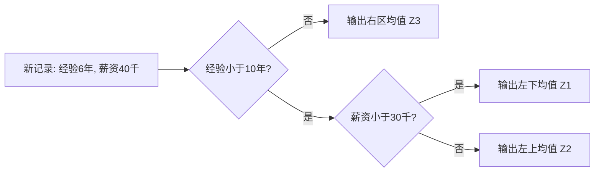
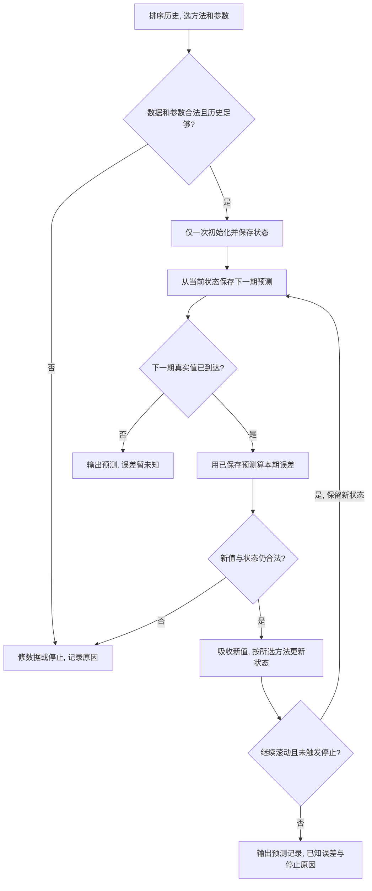
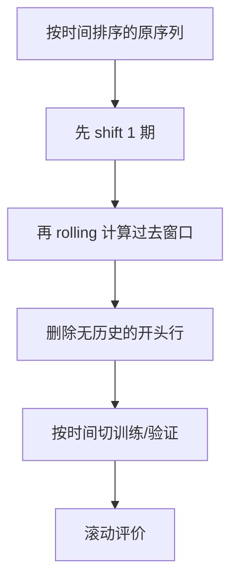
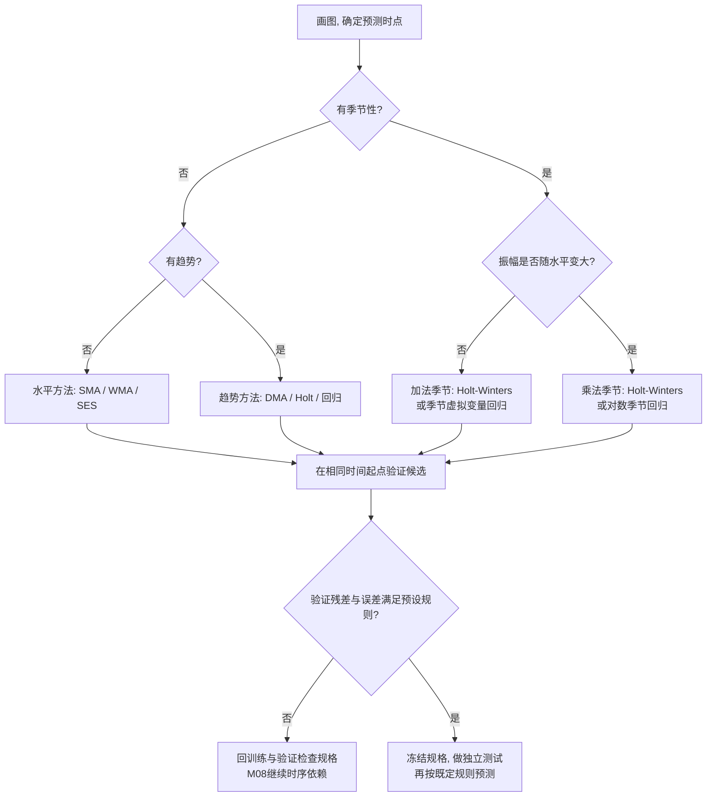

# M07 · 时间序列 I：平滑、趋势与季节性

> **本讲一句话**：先辨认序列里的水平、趋势和季节性，再选择移动平均、指数平滑、Holt／Holt-Winters 或回归，把可预测结构与随机波动分开。
>
> ✅ **本笔记为 v1.0**：已融合三份独立时钟来源 S15／S16／S17。三源分别覆盖 M07 的不同片段，不能把媒体时长相加成课堂总时长；S15 从讲义 p.6 中段开始，S16／S17 都从 SES 中段开始，S17 有明确下课语。课堂日期仍未核实，frontmatter `date` 保持 `null`。
>
> 三源文件、媒体长度、文本哈希和云端录音链接见[来源清单](../transcripts/M07-transcript-provenance.json)。
>
> **原始材料**：`IS6400-L8-time series1-new.pdf`，45 个物理页。PDF 页脚仍写 `/39`，本文一律用物理页码。配套工作簿只读核对：`Why Double Moving Average Works.xlsx`、`model lagged term in sklearn.xlsx`。

---

## 0. 三分钟速览

时间序列（Time Series）与普通回归的最大差别是：每行数据有先后顺序，过去值可能帮助预测未来值。建模不能随机打乱时间，也不能让未来信息进入过去的特征。

本讲有两条路线。平滑路线用最近观测递推更新“当前水平”，再按需要加入趋势和季节性；回归路线把时间、季度和滞后量做成特征。两条路线都要先问：序列里究竟有哪些结构，预测时点能看到哪些信息？

**学完你应该能**

1. 从图形区分水平、趋势、季节性与周期性，并说明加法、乘法组合的差别。
2. 给定短序列，手算简单移动平均、加权移动平均和简单指数平滑的一步预测。
3. 用双重移动平均或 Holt 方法分别更新水平和趋势，并说明停止或换模型的边界。
4. 解释 Holt-Winters 和 ETS 的状态更新，判断应使用加法还是乘法季节项。
5. 构造时间趋势、季节虚拟变量、滞后与滚动特征，并识别时间泄漏。

**如果只记三件事**

- “最近数据更有用”是一项建模假设，不是自然定律；窗口和权重必须用按时间滚动的样本外误差选择。
- 简单指数平滑只更新水平；有趋势用 Holt，有稳定季节循环再考虑 Holt-Winters／季节 ETS。
- 构造 `shift` 和 `rolling` 特征时必须先移位，再滚动；否则当前答案会进入当前输入。

**🎙️ 课堂实况**

S15 从 p.6 回归树复习进入时间序列，可定位到 p.6–15 内容；p.1–5 和 p.16–21 没有可靠录音对应，不能据此降权。S16 与 S17 共同覆盖 SES，S17 再讲 DMA、Holt、Holt-Winters、ETS、趋势／季节回归和 lag 预告，并在 S17 `43:25`–`43:32` 明确结束 lecture、转回 2pm tutorial。三源是独立时钟，本文只分别报告各源区间，不计算合计课堂分钟或占比。

---

## 1. 开始之前 · 知识衔接

### 1.1 你已经学过的

下面一行表示一个先修概念。第二列给出本讲够用的唤醒，第三列指向原笔记。

| 概念 | 一句话唤醒 | 回看 |
|---|---|---|
| 因变量与自变量 | 回归用输入 $X$ 预测响应 $Y$；时间序列把时点 $t$ 和过去信息加入输入 | [[IS6400_Business_Data_Analytics/notes/M02-预测分析-线性回归#2.2 预测建模：管理者为什么需要回归\|M02 §2.2]] |
| 残差 | 残差是观测值减拟合值；仍有规律的残差表示模型漏掉结构 | [[IS6400_Business_Data_Analytics/notes/M02-预测分析-线性回归#2.5.3 曲线拟合：怎么定义"最好的那条线"（讲义 p.19, p.28）\|M02 §2.5.3]] |
| 训练／验证／测试隔离 | 规格和超参数只能在训练与验证历史中选择，测试期只能做最后评价 | [[IS6400_Business_Data_Analytics/notes/M02-预测分析-线性回归#2.9 过拟合与模型评估（讲义 p.39–45）\|M02 §2.9]] |
| 虚拟变量 | $k$ 个类别在含截距回归中通常用 $k-1$ 个指示变量，并留一个基准类别 | [[IS6400_Business_Data_Analytics/notes/M02-预测分析-线性回归#2.7.2 虚拟变量与 n−1 规则（讲义 p.25）\|M02 §2.7.2]] |

读第一行：普通回归已告诉我们怎样把输入映射到输出；本讲新增的约束是输入只能来自预测时点已经发生的历史。

### 1.2 本讲全新引入的概念

| 概念 | English | 展开位置 |
|---|---|---|
| 时间序列与预测时点 | Time Series / Forecast Origin | §2.2 |
| 水平、趋势、季节性、周期性 | Level / Trend / Seasonality / Cycle | §2.3 |
| 简单／加权移动平均 | Simple / Weighted Moving Average | §2.4 |
| 简单指数平滑 | Simple Exponential Smoothing, SES | §2.4 |
| 双重移动平均 | Double Moving Average, DMA | §2.5 |
| Holt 线性趋势 | Holt's Linear Trend | §2.6 |
| Holt-Winters 与 ETS | Holt-Winters / ETS | §2.6–§2.7 |
| 趋势与季节回归 | Trend / Seasonal Regression | §2.8–§2.9 |
| 滞后、滚动与周期特征 | Lag / Rolling / Cyclical Features | §2.10 |

### 1.3 为什么这一讲放在这里 · 重排说明

M02 假定每行观测可以用同期输入解释，本讲处理“顺序本身就是信息”的数据。它又为 [[IS6400_Business_Data_Analytics/notes/M08-时间序列II-自相关差分与ARIMA|M08]] 铺路：M07 先建模水平、趋势和季节性，M08 再检查残差是否还有自相关，并引入 ARIMA。

讲义按“导论 → 模式 → 平滑 → 回归”展开。本文保留主次序，但把 p.20–21 的分解与 p.14–18 的图形模式合并讲；把 p.22–26 的三种平滑并列比较；把 p.44–45 的 sklearn 特征工程放在最后，形成“识别结构 → 更新状态 → 建回归特征”的学习链。

---

## 2. 正文

### 2.1 从普通回归转到有顺序的数据（讲义物理 p.1–6）

讲义先用六页复习建立桥梁，把已学模型与本讲的时间顺序约束接起来：

- p.2：机器学习从训练、评价与纠错走到上线，预测规则要先训练好。
- p.3：independent／predictor／explanatory variable 是不同学科对输入变量的称呼；dependent／target／response variable 指要预测的输出。
- p.4：用人均国内生产总值（GDP，即平均每人的年度经济产出）预测生活满意度；训练好后再处理新国家。
- p.5：回到输入 $X$ 与输出 $Y$。
- p.6：回归树提醒我们，预测规则不必是一条直线。

**是什么**

普通监督学习把每行写成 $(x_i,y_i)$。

时间序列则把观测写成 $Y_t$，下标 $t$ 表示时点。

读法是：$Y_t$ 为第 $t$ 期真实值；帽子表示预测；$t+1\mid t$ 表示“只用第 $t$ 期末已知信息预测第 $t+1$ 期”。

若用过去信息预测下一期，就要构造只依赖 $\{Y_t,Y_{t-1},\ldots\}$ 的预测 $\hat Y_{t+1\mid t}$。

**为什么需要它**

如果把序列随机打乱，训练集可能看到“未来”，评价误差会虚低。时点下标因此不是普通 ID，而是决定信息能否使用的边界。

**课件原例**

p.4 的 GDP 回归在实施阶段只把新国家的 GDP 放进已训练模型。图上直线是 $\hat Y=4.85+4.91\times10^{-5}X$：$X$ 是人均 GDP（美元），$\hat Y$ 是生活满意度预测。若新国家 $X=60000$，则 $\hat Y=4.85+0.0000491(60000)=7.796$，约为图上 7.8。这个代入是笔记复算；相关关系不能证明提高 GDP 必然造成同幅度的幸福增长。

p.5 的截距（Intercept）是 $X=0$ 时直线的高度；斜率（Slope）是输入增加一单位时预测增加多少，即 $\Delta Y/\Delta X$。这里 $\Delta$ 表示“后值减前值”，不是新的未知函数。p.2 的闭环则提醒：先定义预测任务、训练并用隔离的数据评价；不合格时分析误差再改任务或模型，合格才上线，不能只用训练误差决定上线。

p.6 的回归树（Regression Tree）先用训练记录学分区，再把每区训练目标的均值存为叶子预测。图中的经验 $X_1=6$ 年、薪资 $X_2=40$ 千的新记录落在左上区 $Z_2$；沿规则应先判断 $(6)<10$ 为真，再判断 $(40)<30$ 为假，输出该区均值。图没有各点真实目标数，不能算出 $Z_2$ 的具体金额。**原图右下树的第一个 Yes／No 箭头与分区图相反**，这里按分区条件读，勘误见 §9.3。

下面重画使用阶段的分支，读者从经验判断进入，再按薪资判断走到叶子。它说明保存好的规则怎样作用于新记录，不代表重新训练了树。

若只把经验改成 12 年，就在第一个判断直接到 $Z_3$，不再检查薪资。该图是按讲义分区重画，箭头已纠正。

**🎙️ 课堂补充**（S15 `00:00`–`03:25`，A · 部分课上展开）

- S15 开头已经在 p.6 的回归树中段。教授用叶区训练样本的目标均值解释回归树预测：*"we can use the average value of the prediction target from the training data points in this same region as my prediction value"*（S15 `00:15`–`00:24`）。这确认了正文对“训练后让新记录沿树到叶区”的解释，并补出叶区怎样给数值预测。
- 随后教授用“交换普通回归表的行次序”作对照：*"for the general regression analysis, the order of the data records in our data set will not matter at all"*（S15 `02:54`–`03:02`）。时间序列的差别不是输出一定为数值，而是记录顺序承载信息。
- p.1–5 没有被三源录到。这里不能把未录到写成课堂略过，也不能据此降低复习页优先级。

**💡 换个说法（笔记补充）**

把模型想成考试前已经打印好的规则表。预测 11 月时，可以看 1–10 月；不能偷看 12 月再回头修改 11 月答案。

**⚠️ 常见误解**

- 时间列并非一定要直接进入模型。它也可以只负责排序，再由滞后、趋势或季节特征承载信息。
- 训练表现好不等于能预测未来，因为未来可能发生结构变化。

**与其他概念的关系**

训练／实施的边界沿用 M02；M08 的滚动评价会把这条边界做成多个连续窗口。

**所以呢**

先守住“预测时点能看到什么”，后面每一种平滑和特征工程才有可信评价。

### 2.2 时间序列与预测方法地图（讲义物理 p.7–13）

**是什么**

时间序列（Time Series）是按规则时间间隔排列的一组观测，例如年、月、周、日或每 15 分钟。预测目标是从时点 $t$ 已知的信息产生未来 $t+h$ 的预测。

讲义把方法分成两大类：

| 路线 | 依据 | 适用情形 | 讲义例子 |
|---|---|---|---|
| 定性／判断预测 | 专家经验、访谈或调查 | 历史数据少、环境剧变、预测期很远 | Historical analogy、Delphi、Market research |
| 定量预测 | 历史模式或变量关系 | 有可用数据，并愿意假设部分结构会延续 | Extrapolation、Econometric／causal methods |

一行表示一种路线。依据列说明预测从哪里来；适用情形列说明何时合理；最后一列保留讲义术语。

**为什么需要它**

没有历史数据时，再复杂的时间序列算法也无从估计；制度改变时，旧模式可能失效。方法地图防止把“有算法”误当成“有证据”。

**课件原例**

p.7 用 Facebook 股价和能源生产展示规则间隔观测；p.8 用智能交易和智能工厂强调“next”；p.10–12 展示历史类比与德尔菲法（Delphi Method）的多轮问卷收敛；历史类比（Historical Analogy）是先找与当前问题相似的旧情境，说明哪些条件能迁移，再用旧结果作参考。

市场调查（Market Research）直接收集潜在顾客需求，样本是否代表目标人群会改变结论。

定量路线中的外推（Extrapolation）延续序列自身的历史模式；计量／因果模型（Econometric / Causal Methods）加入价格等解释变量，但这个类别名本身不能证明因果关系；p.13 强调定量预测是“using past to predict future”，同时明确过去模式未必延续。

**Delphi 最小控制过程（讲义 p.10–12；下列匿名、停止阈值及异常出口为笔记补充的标准流程解释）**

1. 组织者把同一预测问题分别发给一组专家；专家匿名作答，避免职位较高者先压住其他意见。
2. 组织者汇总本轮预测、理由和分歧，但不公开个人身份。
3. 专家看到匿名反馈后修订自己的预测；新一轮结果再次汇总。
4. 重复“反馈 → 修订”，直到达到预先设定的轮数，或预测变化／离散程度低于停止阈值。
5. 输出是小组收敛后的判断和仍存在的分歧，不是把专家姓名投票当成客观真值。

若多轮后意见仍分裂，或外部事件已改变问题，流程应以“不收敛／需改题或补证据”退出，不能强算一个平均数冒充共识。把“市场需求会否增长”迁移成别的问题时，仍要先定义时间范围、预测量和停止标准。

**🎙️ 课堂补充**（S15 `03:27`–`27:30`，A · 课上展开）

- 教授把时间序列与普通回归的差别落到数据表：记录按固定时间间隔取得，*"the data records, they were recorded with a time stamp"*（S15 `03:35`–`03:43`），预测只能使用当时已经收集的历史信息。
- 库存例把预测误差变成业务动作：需求若只能估在 10–100 杯之间，商家为避免缺货可能准备 100 杯。若预测约 50 杯、误差约 5 杯，课堂举例准备约 55–60 杯（S15 `09:07`–`10:05`）。这只是库存决策示意，未给出覆盖概率。
- 服装新品没有本季销量，旧季商品也未必代表新潮流。因此公司先汇集城市经理意见，再发多轮问卷，直到意见较一致（S15 `11:59`–`16:21`）。
- 教授称人工挑中爆款的查准率（Precision）低于 30%（S15 `16:44`–`17:29`）。查准率问“预测为爆款的商品中，实际有多少成为爆款”；课堂用预测 10 件、实际不到 3 件解释（S15 `17:15`–`17:21`）。这只是课堂经验陈述，未提供数据表，不作行业基准。
- 新区域自行车站没有历史骑行量时，先调查当地居民，再把已有区域模式迁移到新区域（S15 `18:40`–`19:43`）。这个例子说明调查与定量模型可以接力，不是二选一。
- 定量预测的根假设被直接说出：*"the pattern will repeat. The relationship will continue"*（S15 `22:08`–`22:12`）。教授随后提醒输入信号的重要性会随年代改变（S15 `24:34`–`26:17`），所以短期有效关系不能自动长期外推。

**💡 换个说法（笔记补充）**

新产品没有销量历史时，可以问专家；成熟商品有多年周销量时，可以估计季节模式。若突然封城，旧季节模式可能失效，两类证据需要重新组合。

**⚠️ 常见误解**

- 定性预测不等于随意猜测；Delphi 有匿名、多轮反馈与修订程序。
- 定量预测不自动客观；数据窗口、损失函数和结构假设仍由人选择。

**与其他概念的关系**

M07 主要展开定量路线；M08 的自回归分布滞后模型（ADL）会把目标自身的过去值与外部因素共同作为输入；本讲只预告这条路线。

**所以呢**

先判断证据类型，再谈具体模型；没有可延续历史结构时，不能靠调参补出信息。

### 2.3 模式与分解：水平、趋势、季节和周期（讲义物理 p.14–21）

**是什么**

讲义 p.14–18 用五张图依次显示水平、趋势、季节、季节加趋势和周期。p.20 把观测分为趋势 $T_t$、季节 $S_t$、周期 $C_t$ 与不规则项 $I_t$：

$$
Y_t=T_t+S_t+C_t+I_t,
$$

或

$$
Y_t=T_tS_tC_tI_t.
$$

下表每行是一种成分。第二列说明它改变序列的哪一部分，第三列给时间尺度，第四列给图形识别线索。

| 成分 | 它改变什么 | 时间尺度 | 图上怎样认 |
|---|---|---|---|
| 水平（Level） | 中心位置 | 当前局部 | 围绕近似常数上下波动 |
| 趋势（Trend） | 长期平均 | 较长 | 中心持续上升或下降 |
| 季节性（Seasonality） | 固定周期内的位置效应 | 已知周期 | 每年／每季相似位置重复 |
| 周期性（Cycle） | 较长扩张收缩 | 周期可变 | 围绕趋势起伏，但间隔不固定 |
| 不规则项（Irregular） | 剩余不可预测波动 | 短期 | 前述结构取走后的残差 |

一行是一种成分。第二列说它改变哪一部分，第三列给时间尺度，第四列给图读法。

**为什么需要它**

模型对应不同成分：简单指数平滑（SES）只追踪水平，Holt 加趋势，Holt-Winters 再加季节。若诊断错了，模型会把季节波动误当成趋势或噪声。

**课件原例**

p.14 的汽油销量在一条近似水平线附近波动；p.15 的 iPhone 图呈长期上升；p.16 的食品价格指数有固定年度起伏；p.17 同时有上升趋势和季节波；p.18 的宏观周期长度不恒定。p.21 的两图显示：加法季节振幅近似固定，乘法季节振幅随水平变大。

**🎙️ 课堂补充**（S15 `27:42`–`30:10`，A · 部分课上展开）

- 教授先用移动窗口平均解释水平模式：原始价格会波动，但窗口均值近似一条稳定水平线（S15 `27:42`–`28:50`）。
- 他再给出交易边界：低于水平线买、高于水平线卖，只在模式继续时可能反复赚小额；*"you need to make sure that the horizontal pattern will continue in the near future"*（S15 `29:23`）。若价格突然转成下降趋势，一次大跌可能抹掉此前小收益（S15 `29:29`–`29:48`）。这不是投资建议，而是“历史模式延续”假设失效的例子。
- S15 在趋势模式解释中段结束。p.16–21 的季节、周期和加法／乘法分解没有可靠录音对应，只能按讲义和现有笔记学习，不可降权。

**💡 换个说法（笔记补充）**

若每年春节都多卖 100 件，适合加法；若每年春节都多卖约 20%，水平越高振幅越大，适合乘法。

**⚠️ 常见误解**

- “平稳”不等于图上完全没有周期。本讲图形模式与 M08 的弱平稳定义不同；平稳过程可以有不随日历时点变化的短程自相关。
- 周期性不等于季节性。季节性有固定日历周期，商业周期长度通常会变化。

**与其他概念的关系**

乘法模型取对数后可转成加法结构；这也解释 p.41 的指数趋势回归。

这里的对数（Logarithm）是把乘法关系改写成加法关系的变换：若 $Y_t=T_tS_t$，则 $\log Y_t=\log T_t+\log S_t$。它要求被取对数的值为正。

**分解数值例（笔记补充；不是讲义数据）**

设某月趋势基线为 200 件，季节效应有两种口径。下面为简化设没有周期成分：加法中的 $C_t=0$，乘法中的 $C_t=1$，它们分别是不改变和／积的中性值：

1. 加法口径给 $S_t=30$ 件、不规则项 $I_t=-10$ 件，则 $Y_t=200+30-10=220$ 件。季节项表示“这个月固定多 30 件”。
2. 乘法口径给 $S_t=1.20$、$I_t=0.95$，则 $Y_t=200\times1.20\times0.95=228$ 件。季节项表示“这个月通常放大 20%”。
3. 若基线升到 400 件，加法季节项仍贡献 30 件；乘法季节因子仍为 1.20 时会贡献 80 件。这个差异就是判断加法或乘法的关键。

**为什么公式长这样**

加法分解把各成分写成与 $Y$ 相同单位的独立增减量，所以直接相加。乘法分解把趋势或水平当基数，把季节和不规则项写成无单位倍率，所以相乘。若序列含 0 或负值，乘法分解和对数转换不能直接使用；若季节振幅既不近似固定绝对量，也不近似固定比例，应以滚动误差比较更灵活的规格。

**所以呢**

先画图并识别振幅与周期，再决定状态方程是加法还是乘法。

### 2.4 移动平均、加权平均与简单指数平滑（讲义物理 p.22–26）

**是什么**

三种方法都用过去预测下一期，但保留历史的方式不同。简单移动平均（Simple Moving Average, SMA）给窗口内观测相同权重；加权移动平均（Weighted Moving Average, WMA）允许权重不同；简单指数平滑（Simple Exponential Smoothing, SES）把全部历史压缩到一个递推水平。

$$
\hat Y_{t+1\mid t}=\frac{1}{m}\sum_{j=0}^{m-1}Y_{t-j}
$$

$$
\hat Y_{t+1\mid t}=\sum_{j=0}^{m-1}w_{j+1}Y_{t-j},\qquad \sum_{j=1}^{m}w_j=1
$$

$$
L_t=\alpha Y_t+(1-\alpha)L_{t-1},\qquad \hat Y_{t+1\mid t}=L_t
$$

符号 $\sum$ 表示按索引依次相加；$j=0,1,2$ 时，$Y_{t-j}$ 依次是当前、上一期、上两期。

因此 $m=3$ 的第一式就是 $(Y_t+Y_{t-1}+Y_{t-2})/3$，第二式就是 $w_1Y_t+w_2Y_{t-1}+w_3Y_{t-2}$；注意 $w_1$ 配最新值。

下表逐一解释三条公式里的符号，并给出 p.26 计算题采用的单位和数值。

| 符号 | 是什么 | 单位 | 已知还是要算 | 本例 |
|---|---|---|---|---|
| $Y_t$ | 时点 $t$ 的观测需求 | 需求单位（原图未说明实物单位） | 已知 | 1–10 期需求 |
| $m$ | 移动窗口长度 | 期 | 先选 | 5 |
| $w_j$ | 第 $j$ 个历史位置权重 | 无 | 先选 | 和为 1 |
| $\alpha$ | SES 对当前观测的权重 | 无 | 先选 | 0.2 |
| $L_t$ | 更新后的水平 | 与需求相同，具体实物单位未说明 | 要算 | $L_2=241.98$ |

**共享递推控制流程：SMA／WMA／SES／DMA／Holt／Holt-Winters**

先固定参数并用可得历史初始化一次；以后每次新值到来都沿返回边更新已保存状态，不能把状态重新设回初值。图中“误差”专指预测已经保存、真实值随后到达时，两者之差。

各方法保存什么：SMA／WMA 保存最近 $m$ 个值（WMA 另存权重）；SES 保存 $L$；DMA 保存最近的观测和第一层均值以更新 $M,D$；Holt 保存 $L,T$；Holt-Winters 保存 $L,T$ 和 $m$ 个季节位置。DMA 更新 $M,D$ 后算 $L,T$；Holt 按水平→趋势更新；Holt-Winters 按水平→趋势→季节更新。SMA 窗口须为正整数；WMA 权重非负且和为 1；平滑权重在 0–1 之间。各方法的历史长度要求见下文。

走图例：SES 在第 1 期初始化 $L_1=266$，保存第 2 期预测 266。第 2 期真实值 145.9 到达后，误差才可算为 $145.9-266=-120.1$；以 $\alpha=0.2$ 更新得 $L_2=241.98$，沿返回边保存第 3 期预测。没有第 3 期真实值时，不能输出它的实际误差。若要在同一个起点直接预测多个未来期，SES 各步都取当前 $L_t$，Holt 等按各自多步公式外推；没有新真实值就不能逐期“吸收”未来答案。滚动验证可据误差选规格；最终留出测试期不得又用来调参。

**为什么公式长这样**

移动平均让窗口内每期等权；加权平均允许近期更重要；SES 每次把旧水平保留 $1-\alpha$，再把当前误差的 $\alpha$ 加回。把递推展开后，越久远的权重为 $\alpha(1-\alpha)^j$，会指数衰减。

**为什么需要它**

原始序列常有短期噪声。平滑把多个时点合成一个状态，使短期预测不被单个尖峰完全带走。

**WMA 数字例子与权重方向**

设最近三期观测从旧到新为 100、110、130。若“越新权重越大”，分别给 0.1、0.3、0.6，权重和为 $0.1+0.3+0.6=1$：

$$
\hat Y_{t+1\mid t}=0.1(100)+0.3(110)+0.6(130)=121.
$$

反例：若把同一组权重方向写反，给最新 130 只有 0.1，预测会变成 $0.6(100)+0.3(110)+0.1(130)=106$。它仍满足“权重和为 1”，却与“近期更重要”的建模理由相反。因此必须同时核权重总和与时间方向。

**有限历史的 SES 怎样初始化（笔记补充）**

每次把上一期水平乘 $1-\alpha$，再加新观测的 $\alpha$ 份。把 $L_{t-1}$ 继续代回，可看见旧权重为何衰减。以三期为例：

$$
L_3=\alpha Y_3+(1-\alpha)[\alpha Y_2+(1-\alpha)L_1]
=\alpha Y_3+\alpha(1-\alpha)Y_2+(1-\alpha)^2L_1.
$$

取 $\alpha=0.2$，三份权重为 0.2、0.16、0.64，合计 1。最早的历史由初始水平 $L_1$ 代表；删掉最后一项会使有限样本的权重不完整。讲义 p.24 的无穷展开是在展示衰减规律，实际短序列计算用给定的 $L_1=Y_1$。

> [!question] English original prompt（讲义 p.22）
> So, how do you decide m? What if m=1 or 2?

**中文读题与参考作答（笔记推断）**：$m$ 是最近多少期，不是模型次数。用时间顺序留出的验证期比较候选窗口，在波动和反应速度之间取舍；$m=1$ 直接沿用最后值，$m=2$ 平均最后两个值。用同一组旧→新 100、110、130，下一期预测分别为 130 和 120。窗口小不自动更准，只是更快追随变化。

**English reference answer（非官方）**：Choose $m$ using validation that respects time order. With $m=1$, the forecast is the last observation; with $m=2$, it is the mean of the last two. A shorter window responds faster but smooths less noise.

**课件原例与公开 Quiz（p.22–26）**

p.22 的季度销量截图公式为 `=AVERAGE(B2:B4)`，实际用前 3 期预测 Q4-94，均值约为 $(1807.37+2355.32+2591.83)/3=2251.507$；不能因表上出现 4 个季度就当成 4 期窗口；p.23 说明加权和为 1；p.24 把 SES 写成“last prediction + adjustment on error”。p.25 的软饮料例给 $\alpha=0.38286$、均方根误差（RMSE）470.5061、平均误差 154.26，并显示 Q1-10 的预测继承 Q4-09 更新水平 5528.09。RMSE 先把预测误差平方求平均，再开根，单位与销量相同；它描述这组数据上的误差尺度。蓝线是实际销量，粉线是 SES 预测；预测随水平上升，但追不上稳定季度峰谷。p.26 有两道公开计算题。

> [!question] English original question（讲义 p.26）
> **Q1:** if we use a moving average with a window size of 5, what is the predicted value for the demand on 11/1/2020?
>
> **Q2:** if we use exponential smoothing with alpha=0.2, what is the predicted value for the demand on 3/1/2020?
>
> Data shown in the slide: 1/1 266.0; 2/1 145.9; 3/1 183.1; 4/1 119.3; 5/1 180.3; 6/1 168.5; 7/1 231.8; 8/1 224.5; 9/1 192.8; 10/1 122.9; 11/1 336.5.

**中文题意与限制**

Q1 要在预测 11/1 时只使用前 5 期，即日期标签 6/1–10/1；11/1 的 336.5 是事后真实值，不能进入预测。讲义没有说明这些标签采用 DD/MM 还是 MM/DD，也没有说明采样频率，因此不能擅自称为 5 天。Q2 使用讲义 p.24 明示的初始化 $L_1=Y_1$，先用 2/1 观测更新，所得 $L_2$ 才是 3/1 的预测。原图没有说明需求对应的具体实物单位。

**直接答案与逐步解析**（⚪ 参考作答；笔记复算，非讲义给定答案）

1. Q1：
   $$
   \hat Y_{11\mid 10}=\frac{168.5+231.8+224.5+192.8+122.9}{5}=188.10.
   $$
   这表示在 10/1 观测取得后，对 11/1 需求的预测为 188.10 个需求单位；原图未说明是件、瓶或其他实物单位。
2. Q2：先初始化 $L_1=Y_1=266.0$；再吸收 2/1 的观测：
   $$
   L_2=0.2(145.9)+0.8(266.0)=241.98.
   $$
   因而 $\hat Y_{3\mid 2}=L_2=241.98$ 个需求单位；原图未说明具体实物单位。

**English reference answer（笔记自拟；非官方答案）**

> Q1: The five-period moving-average forecast for 11/1/2020 is **188.10 units**, calculated from the observations labelled 6/1 through 10/1 only.  
> Q2: With $L_1=Y_1=266.0$ and $\alpha=0.2$, the forecast for 3/1/2020 is $L_2=0.2(145.9)+0.8(266.0)=\mathbf{241.98}$ units.

**🎙️ 课堂补充**（S16 `00:00`–`06:37`；S17 `00:00`–`06:51`，A · 课上展开）

- 教授从 SMA 等权、WMA 多权重参数转到 SES：最新观测权重是 $\alpha$，每往前一期再乘一次 $1-\alpha$，所以 *"the older the observation, the less important of the observation in taking the average"*（S16 `01:36`–`01:45`）。
- 他把展开式与递推式逐步代换，说明两式对应同一加权过程（S16 `04:14`–`06:11`）。有限历史仍要保留初始水平留下的权重，不能把初始化项直接删掉。这里“重要”指递推式能逐期高效算 $L_t$，不是“期末必考”的明示。
- S17 从初始化继续：$L_1=Y_1$，之后用已经算出的 $L_{t-1}$ 与新观测 $Y_t$ 递推（S17 `00:00`–`02:10`）。教授要求学生能够自行计算，但没有口述 Q1 的数值答案，也没有完整口述 Q2 的最终数值；现有 188.10 与 241.98 仍标为笔记复算，不升级成官方答案。
- p.26 被说明为往年 quiz question，并给约 3–4 分钟练习（S17 `02:45`–`03:12`）。教师又明确本次课堂“today we have no quiz”，要求在场学生不要提交 Canvas 页面；提交会损失当日 attendance 分，不提交会得到 1 分（S17 `02:18`–`03:24`）。这是当堂行政口径，不证明本人到场、提交或得分。

**💡 换个说法（笔记补充）**

$m=1$ 等于直接把最后一次观测当下一次预测，反应快但噪声大；很大的 $m$ 很平滑，却会慢半拍。$\alpha$ 也控制同一取舍：接近 1 更快，接近 0 更稳。

**⚠️ 常见误解**

- Q1 不能把 11/1 的 336.5 放进均值；那是把答案泄漏给模型。
- SES 的 $\alpha$ 是当前观测权重，不是旧状态权重。
- `MA` 在本讲指移动平均平滑；M08 的 MA(q) 指“过去误差项”，不是同一概念。

**极端／边界情况**

- $m=1$ 时无平滑；$m$ 超过已有历史长度时不能按该定义计算。
- $\alpha=1$ 时 $L_t=Y_t$；$\alpha=0$ 时水平永不更新，通常不作为可学习范围内部值。
- 若存在稳定趋势，三种水平平滑都会系统性滞后，应转到 §2.5–§2.6。

**与其他概念的关系**

三者都是局部水平估计。DMA 和 Holt 在其上增加趋势状态。

**所以呢**

水平平滑适合没有系统趋势和季节性的短期预测；持续同号的残差提示当前水平模型反应过慢或漏掉结构，应检查趋势、水平突变、季节与参数，再用按时间验证的误差比较。比如销量从稳定 100 突然永久变成 120，旧水平会连续低估；这可能只是一次水平上移，不能据此把“每期继续增长”当成趋势外推。

**怎样按时间滚动选参数（笔记补充）**

这里“滚动”指预测起点随新观测向前移动，不是随机抽行。用一串演示销量 100、110、120、130、140：第 1–2 期为训练历史，第 3–4 期为验证，第 5 期单独留作测试。先约定只比较 SES 的 $\alpha=0.2$ 和 0.8，初值都为 $L_1=100$；每个候选独立保存自己的状态，权重在验证过程中保持不变。

下表一行是一个真实值尚未揭晓时保存的一步预测。误差统一为“实际减预测”；同一验证期两个候选比较同一个实际值。

| 预测目标／实际 | 起点可用观测 | $\alpha=0.2$：预测／误差 | $\alpha=0.8$：预测／误差 |
|---|---|---|---|
| 第 3 期／120 | 第 1–2 期 | 102／18 | 108／12 |
| 第 4 期／130 | 第 1–3 期 | 105.6／24.4 | 117.6／12.4 |

第一行：两个候选在训练期得到 $L_2=0.2(110)+0.8(100)=102$ 与 $L_2=0.8(110)+0.2(100)=108$，先把它们存为第 3 期预测。等实际 120 揭晓后，才记录误差并更新：第一个 $L_3=0.2(120)+0.8(102)=105.6$，第二个 $L_3=0.8(120)+0.2(108)=117.6$，再预测第 4 期。吸收已经过去的验证观测用于下一个起点是允许的；在预测本行前读取本行实际值则是泄漏。本例只更新状态，不在每个验证点重新选择权重或拟合别的规格。

将两次验证误差平方、平均再开根：$\alpha=0.2$ 的 RMSE 约为 $\sqrt{(18^2+24.4^2)/2}=21.440$；$\alpha=0.8$ 的 RMSE 约为 $\sqrt{(12^2+12.4^2)/2}=12.202$。因此在这两个候选中选 0.8。验证结果只证明这段历史偏好它，不保证全局最优或未来同样好。

随后冻结 0.8；第 4 期真实 130 已揭晓，更新 $L_4=0.8(130)+0.2(117.6)=127.52$，把它存为第 5 期预测。最后才打开测试值 140，测试误差为 12.48。这次测试用于报告最后一次未参与选择的误差，不能看完 140 又挑权重并继续称它为独立测试。若另用回归模型，须预先声明每次扩展训练历史后是否重新拟合；所有候选采用同样的起点、预测步长和评价目标，不能把固定起点多步误差与逐步更新的一步误差混比。

### 2.5 双重移动平均：从两个滞后中心恢复趋势（讲义物理 p.27–31）

**是什么**

双重移动平均（Double Moving Average, DMA）先对原序列做 $n$ 期移动平均 $M_t$，再对 $M_t$ 做同窗口平均 $D_t$。讲义给出：

$$
L_t=2M_t-D_t,\qquad T_t=\frac{2(M_t-D_t)}{n-1},\qquad \hat Y_{t+k\mid t}=L_t+kT_t.
$$

下表每行解释 DMA 的一个状态或索引。单位列用“件／期”区分水平与趋势。

| 符号 | 是什么 | 单位 | 已知还是要算 |
|---|---|---|---|
| $M_t$ | 原销量的第一层 $n$ 期均值 | 件 | 要算 |
| $D_t$ | $M$ 的第二层 $n$ 期均值 | 件 | 要算 |
| $L_t$ | 校正滞后后的当前基线 | 件 | 要算 |
| $T_t$ | 每期趋势增量 | 件／期 | 要算 |
| $k$ | 向前预测多少期 | 期 | 已知 |

**为什么公式长这样**

线性趋势下，第一层均值的时间中心落后当前约 $(n-1)/2$ 期；第二层又多落后同样距离。$M_t-D_t$ 因而近似这半个窗口距离上的增长量。把它除以 $(n-1)/2$ 得每期斜率，即 $2(M_t-D_t)/(n-1)$；把同一增长量加回 $M_t$ 得当前基线 $2M_t-D_t$。

**数字例子（手把手）**

配套 `Why Double Moving Average Works.xlsx` 用 $n=3$，销量为 100、104、112、113、124、125……。在第 5 月（下面只在显示时四舍五入；计算沿用完整精度，实物销量单位未在附件说明）：

1. $M_3=(100+104+112)/3=105.333$，$M_4=(104+112+113)/3=109.667$，$M_5=(112+113+124)/3=116.333$。
2. $D_5=(105.333+109.667+116.333)/3=110.444$。
3. $M_5-D_5=5.889$，所以 $L_5=122.222$，$T_5=5.889$ 件／月。
4. 对第 6 月的一步预测为 $122.222+5.889=128.111$，而真实值为 125。

附件的 C1 虽写 `shift(1)`，但 C4 的 `AVERAGE(B2:B4)` 含本行第 3 月销量，实际是当期 $M_3$，不是单期滞后列。D6 开始才有第二层均值；部分单元格保存为数值而非公式。H7 的 `F6+G6*1` 用第 5 月的 $L,T$ 预测第 6 月，不能用第 6 月状态预测它自己。原表不改，按公式和缓存位置识别其含义。

**为什么需要它**

单层移动平均会落后于线性趋势。DMA 用两层均值的落后差估计趋势，再把基线推回当前时点。

**课件原例**

p.28–31 四页逐步显示同一工作簿：原销量线、$M_t$、$D_t$、差值和校正后的 $L_t$。p.31 明确把 $L_t=M_t+(M_t-D_t)$ 标成预测基线。

**🎙️ 课堂补充**（S17 `06:53`–`13:06`，A · 课上展开）

- 教授先界定为什么需要 DMA：SMA、WMA、SES 都把未来当作水平延续，现实序列出现趋势时会滞后（S17 `06:53`–`08:07`）。
- DMA 的动作被分成两层：*"we first calculate the simple moving average recorded by mt"*，再对多个 $M_t$ 求移动平均并记为 $D_t$（S17 `08:12`–`08:39`）。$M_t$ 代表较近的短期水平，$D_t$ 代表更旧的长期水平（S17 `11:13`–`12:14`）。
- 趋势来自两层水平差除以它们的时间间隔：*"we take the gap between MT and DT together with the time intervals between these two values"*（S17 `12:20`–`12:26`）。这与正文对 $2(M_t-D_t)/(n-1)$ 的解释一致；课堂没有给新的可复算数值。

**💡 换个说法（笔记补充）**

两条平滑线像两个速度不同的跟随者。快线比慢线高多少，告诉我们序列正在多快上升；把这段落后补回来，就得到当前位置。

**⚠️ 常见误解**

- DMA 不是对同一窗口重复算两次同一个数；第二层输入是第一层移动平均。
- 它适合近似线性趋势且无季节性。季节峰谷会污染 $M_t-D_t$。

**停止条件／什么时候别用**

窗口 $n$ 必须是至少 2 的整数；$n=1$ 会令趋势式分母为 0。第一层首个均值出现在第 $n$ 期；第二层还要凑齐 $n$ 个第一层均值，因此最早在第 $2n-1$ 期形成 $D_t$ 并预测下一期。$n=3$ 至少需要 5 期。若滚动验证显示趋势变化快、季节强或预测期长，改用 Holt、Holt-Winters 或回归。

**与其他概念的关系**

DMA 用固定窗口估计水平和趋势；Holt 用递推权重持续更新同两个状态。

**所以呢**

DMA 解释了“为什么两次平滑能找趋势”；下一节把固定窗口换成更灵活的指数更新。

### 2.6 Holt 与 Holt-Winters：递推保存水平、趋势和季节（讲义物理 p.32–35）

**是什么**

Holt 线性趋势（Holt's Linear Trend）维护水平 $L_t$ 和趋势 $T_t$：

$$
L_t=\alpha Y_t+(1-\alpha)(L_{t-1}+T_{t-1}),
$$

$$
T_t=\beta(L_t-L_{t-1})+(1-\beta)T_{t-1},
$$

$$
\hat Y_{t+k\mid t}=L_t+kT_t.
$$

乘法季节 Holt-Winters 再维护周期长度为 $m$ 的季节因子 $S_t$：

$$
L_t=\alpha\frac{Y_t}{S_{t-m}}+(1-\alpha)(L_{t-1}+T_{t-1}),
$$

$$
T_t=\beta(L_t-L_{t-1})+(1-\beta)T_{t-1},
$$

$$
S_t=\gamma\frac{Y_t}{L_t}+(1-\gamma)S_{t-m},
$$

$$
\hat Y_{t+k\mid t}=(L_t+kT_t)S_{t-m+h_m},
$$

其中 $h_m=((k-1)\bmod m)+1$ 用来找到未来对应季节位置。下表每行是一只状态或更新参数，并说明它在预测中承担的动作。

| 状态／参数 | 含义 | 单位 | 本步作用 |
|---|---|---|---|
| $L_t$ | 去季节后的当前水平 | 与 $Y$ 相同 | 给预测基线 |
| $T_t$ | 每期趋势增量 | $Y$／期 | 把基线向前推 |
| $S_t$ | 乘法季节倍率 | 无 | 放大或缩小对应季节 |
| $\alpha,\beta,\gamma$ | 三个更新速度 | 无 | 在新证据与旧状态之间权衡 |

**为什么公式长这样**

Holt 的水平先比较当前 $Y_t$ 与上一期“水平加趋势”的一步预期；趋势再比较连续水平的变化。Holt-Winters 先用旧季节因子把 $Y_t$ 除回基线，再用新水平估计当期季节倍率。每个状态都只用时点 $t$ 当时可得的信息。

**数字例子（手把手）**

笔记补充一个无季节小例。设 $L_1=100$、$T_1=4$、$Y_2=108$、$\alpha=0.5$、$\beta=0.25$：

1. 旧状态对第 2 期的一步预期是 $100+4=104$。
2. 新水平 $L_2=0.5(108)+0.5(104)=106$。
3. 新趋势 $T_2=0.25(106-100)+0.75(4)=4.5$。
4. 第 3 期预测为 $106+4.5=110.5$。

**乘法 Holt-Winters 单次状态更新与同季节预测（笔记补充）**

设季度周期 $m=4$。本例直接给定第 4 期末状态 $L_4=100$、$T_4=4$ 和第 1 季度旧季节因子 $S_1=0.8$，演示一次更新，不声称这些初值由未提供的历史估计而来。

新观测为 $Y_5=96$，并取 $\alpha=0.5$、$\beta=0.25$、$\gamma=0.2$。

1. **Level**：先除去相同季节位置的旧倍率，再与旧的水平加趋势合并：
   $$
   L_5=0.5\left(\frac{96}{0.8}\right)+0.5(100+4)=112.
   $$
2. **Trend**：用新旧水平差更新趋势：
   $$
   T_5=0.25(112-100)+0.75(4)=6.
   $$
3. **Season**：用观测与新水平的比值更新第 1 季度位置：
   $$
   S_5=0.2\left(\frac{96}{112}\right)+0.8(0.8)=0.811429.
   $$
4. **下一次同季节位置**：第 9 期与第 5 期相隔 4 期，使用刚更新的第 1 季度因子：
   $$
   \hat Y_{9\mid5}=(112+4\times6)(0.811429)=110.354.
   $$

初始化必须至少识别一个完整季节循环，实践中通常需要更多周期才能稳定估计。预测别的季度位置时要取对应的 $S_2$、$S_3$ 或 $S_4$，不能总用 $S_5$。若 $Y_t\le0$，乘法比值与对数解释会失效或非常不稳，应改用加法季节形式、经业务允许的变换，或换模型。

**周期索引和加法季节形式（笔记补充）**

$k$ 是离当前多少期，$m$ 是每轮有几个位置。

符号 $\bmod$ 表示除法余数：$k=5,m=4$ 时，$(k-1)\bmod m=0$，所以 $h_m=1$，回到下一轮第一个位置。

以 $t=5$ 为起点，$k=1$ 取 $S_2$；$k=4$ 或 8 都取刚存下的 $S_5$。

这只重复最后一轮已知季节状态，不凭空知道未来状态。

若季节影响是“固定多卖几件”而非固定倍率，改为加法形式：先从观测减去旧季节差额更新水平，再以观测减新水平更新季节差额。水平、趋势更新顺序不变：

$$
L_t=\alpha(Y_t-S_{t-m})+(1-\alpha)(L_{t-1}+T_{t-1}),\quad
T_t=\beta(L_t-L_{t-1})+(1-\beta)T_{t-1},
$$
$$
S_t=\gamma(Y_t-L_t)+(1-\gamma)S_{t-m},\quad
\hat Y_{t+k\mid t}=L_t+kT_t+S_{t-m+h_m}.
$$

这里的 $S$ 与销量同单位，不再是倍率。另给一组状态与观测作为加法例：$L_4=100,T_4=4,S_1=-20,Y_5=90$，三个权重沿用前例。

1. 去季节观测为 $90-(-20)=110$；新水平为 $0.5(110)+0.5(104)=107$。
2. 新趋势为 $0.25(107-100)+0.75(4)=4.75$。
3. 新季节差额为 $0.2(90-107)+0.8(-20)=-19.4$。
4. 第 9 期预测为 $107+4(4.75)-19.4=106.6$。

这是笔记补充，与 p.35 的乘法季节原式分开，不能把“减 20 件”错当“乘 0.8”在所有水平下互换。真实训练还需初始化所有季节位置；若缺完整季节历史，不能只照这个给定状态例伪造估计。

**为什么需要它**

Holt 允许趋势逐期改变；Holt-Winters 又允许每个季节位置有自己的倍率。它们比固定窗口更适合在线更新。

**课件原例**

p.32 给 Holt 三条方程；p.33 的软饮料例给 $\alpha=0.193338836$、$\beta=0.195071241$、RMSE 440.1662445。表中 Q1-94 初始化 $L=1807.37,T=0$；到 Q2-94 更新为 $L=1913.31,T=20.66585$，对 Q3-94 的预测为 1933.976。p.34 列出 level、trend、seasonality；p.35 给乘法季节更新式，并标出“除以季节因子估水平、除以水平估季节”。

**🎙️ 课堂补充**（S17 `13:27`–`28:32`，A · 课上展开）

- Holt 线性趋势被解释为 SES 加趋势状态：水平 $L_t$ 与趋势 $T_t$ 分别更新；若趋势为 0，水平式退化为 SES（S17 `13:27`–`15:24`）。教授在 S17 `13:34` 说需要记住 Holt-linear 公式，这是课堂强调，但没有直接说会考。
- 趋势更新用新旧水平差表示最新斜率，再与旧趋势按 $\beta$ 加权（S17 `15:34`–`20:17`）。这确认了正文“先更新 level，再更新 trend”的顺序。
- Holt-Winters 再加入季节倍率。教授用 1,000 的基线举例：季节因子 1.1 表示约高 10%，因子 0.8 表示约低 20%（S17 `24:07`–`25:15`），随后说明用 $Y_t/L_t$ 更新当期季节因子（S17 `25:27`–`26:37`）。
- 🔴（反向）范围只限 p.34–35：公式不必背入小抄，但要理解三种状态如何组合。

> *"for this page of the formulas you do not need to remember this... you do not need to write these formulas into your cheat sheet"*（S17 `28:05`–`28:16`）。

紧接着，教师要求理解 *"what does the [Holt-Winters] do"*（S17 `28:16`–`28:27`，专名按讲义校正）。这只降低该页公式记忆负担，模型机制仍须学习。其他时间序列公式没有因此全部免记。

**💡 换个说法（笔记补充）**

三种状态像三只记忆盒：水平盒记“现在大约多少”，趋势盒记“每期往哪走”，季节盒记“这个月份通常放大多少”。新数据到来时只更新相关盒子。

**⚠️ 常见误解**

- $\alpha$、$\beta$、$\gamma$ 控制不同状态，不能都解释成“当前观测权重”。
- 乘法季节模型要求水平和观测适合做比值；有 0 或负值时需谨慎，常改用加法形式或其他变换。

**极端／边界情况**

趋势持续外推会无限增长；长预测期常用阻尼趋势。季节周期 $m$ 设错时，季节因子会吸收错误频率。没有至少若干完整周期时，季节初始化和验证很不稳定。

**与其他概念的关系**

Holt 是 ETS(A,A,N) 的常见形式；Holt-Winters 对应带季节的 ETS 组合。

**所以呢**

状态更新把历史压缩成少数可解释量；ETS 用统一记号说明误差、趋势和季节各采用哪种形式。

### 2.7 ETS：把误差、趋势、季节写成模型规格（讲义物理 p.36–37）

**是什么**

ETS 代表 Error、Trend、Seasonality。三个位置的可选项不同。按 p.37 的表，第一个误差位只选加法 A（Additive）或乘法 M（Multiplicative）；第二个趋势位列无 N（None）、加法 A 或阻尼加法 $A_d$（Damped Additive）；第三个季节位列 N、A、M。不能任意把 N 或 $A_d$ 填入误差位。表中加法误差配乘法季节的三格标为“Not Used”，这是本讲表的取舍，不是所有 ETS 实现的普遍禁令。讲义给出：SES = ETS(A,N,N)，Holt = ETS(A,A,N)，Holt-Winters 加法季节 = ETS(A,A,A)。

第一个字母决定观测怎样偏离一步预测。加法误差写成 $Y_t=\hat Y_{t\mid t-1}+e_t$，所以 $e_t=Y_t-\hat Y_{t\mid t-1}$，误差与 $Y$ 同单位。乘法误差写成 $Y_t=\hat Y_{t\mid t-1}(1+\varepsilon_t)$，所以 $\varepsilon_t=(Y_t-\hat Y_{t\mid t-1})/\hat Y_{t\mid t-1}$，误差是相对比例；当预测接近 0 或数据非正时，这一写法会失效或极不稳定。

阻尼是在长期外推时逐步减小趋势贡献，而不是让水平逐期衰减。设每期趋势为 10，阻尼系数 $\phi=0.8$，未来三步趋势贡献为 $10(0.8+0.8^2+0.8^3)=19.52$，小于不阻尼的 $3(10)=30$；$\phi=1$ 回到普通加法趋势。这是笔记补充；本讲不要求估计阻尼参数。

**误差如何进入似然（笔记补充；以下折叠是估计目标的补充说明）**

主线先记住两件事：课堂手算先给权重，再逐期更新状态；软件可在训练历史中尝试不同权重，以训练误差的整体支持度选参数。它们是不同层次的动作，测试未来值不能参与这一步。

从误差到对数似然：需用到的数学桥梁与三期演示

连续误差例如 1.2 或 1.21 可以取无穷多个值，某一个精确点的概率是 0。因此用密度（Density）描述该点附近有多集中；小区间的概率近似“密度高度 × 区间宽度”。正态／高斯（Normal / Gaussian）假设把误差画成中心为 0 的钟形，方差 $\sigma^2$ 是平方误差的尺度，标准差 $\sigma$ 与销量同单位。这里采用这个分布假设，不从数据证明它必然正确。

单期误差的密度可写成 $f(e)=\frac{1}{\sqrt{2\pi\sigma^2}}\exp[-e^2/(2\sigma^2)]$。

$\pi$ 约为 3.14159，$\exp(x)=e^x$，自然常数 $e$ 约为 2.71828；它与本节误差符号 $e_t$ 不是同一个量。

自然对数 $\ln$ 是指数的逆运算，且 $\ln(ab)=\ln a+\ln b$。

密度会随偏离中心的平方增大而减小，$\sigma$ 则控制钟形宽窄。

似然（Likelihood）是在给定模型参数后，观测到当前整段数据的相对支持度。以加法高斯一步预测误差为例，若每期给定过去信息后的误差密度都采用同一零均值高斯形式，即 $e_t\mid\mathcal F_{t-1}\sim N(0,\sigma^2)$，整段数据的似然按时间顺序乘这些条件密度。乘积取自然对数后变为求和；密度前面的常数共出现 $n$ 次，指数中的误差平方也累加，因此对数似然为

$$
\ell=-\frac{n}{2}\log(2\pi\sigma^2)-\frac{1}{2\sigma^2}\sum_{t=1}^{n}e_t^2.
$$

这里的 $\mathcal F_{t-1}$ 表示作出本期预测前已经知道的过去信息。$n$ 是可计算一步误差的期数，$\sigma^2$ 是误差方差，$\sum e_t^2$ 是一步误差平方和。固定 $n$ 和 $\sigma^2$ 时，平方和越小，似然越大；实际 ETS 会同时估计状态初值、平滑参数和误差尺度，不能把“训练误差更小”直接等同于样本外预测更好。

这条似然式只演示固定尺度下的加法高斯误差。乘法误差从相对误差变回观测 $Y_t$ 的密度时还会出现预测尺度对应的变量变换项，不能只把相对误差平方和代入上式就称为完整最大似然估计；本文不在缺少课件推导时补造该推导。

这里用 $\ell$ 表示**对数似然（log-likelihood）**，即把原本为正的似然取自然对数。上面的负数是对数后的数值，不是“负的概率”；对数在正数范围内单调递增，所以最大化对数似然与最大化原似然选择相同参数。

用三期给定的一步误差走完训练目标计算（笔记补充）：

1. 误差为 $[2,-1,1]$，平方和为 $2^2+(-1)^2+1^2=6$。
2. 在给定零均值高斯误差的假设下，方差最大似然估计为 $\hat\sigma^2=6/3=2$。
3. 把期数 3、平方和 6、误差方差 2 代入上式，得到对数似然 $\ell\approx-5.297$。

这里用 $n$ 而不是 $n-k$，因为计算的是给定零均值误差下的方差最大似然估计，不是在求无偏回归残差方差。这个数只演示从预测误差到目标函数的链条，不能跨不同数据集直接比较。这里 $\hat\sigma^2=\mathrm{SSE}/n$ 采用该高斯模型的最大似然结果，未在本讲用微积分证明；读者此处只需会按给定规则代入，不将它误当所有方差定义。

**为什么需要它**

“指数平滑”容易只让人想到一条递推公式。ETS 把数据生成的误差结构也写出来，使预测区间和似然估计有明确模型含义。

**课件原例**

p.36 用树形图要求在 trend、seasonality、random 中选择加法或乘法；p.37 给出 ETS 组合表，并列 SES、Holt 和 Holt-Winters 的对应记号。讲义没有给出误差分布、似然公式或参数估计数表；上面的误差—似然链是笔记补充，不冒充课件原例。

**🎙️ 课堂补充**（S17 `28:32`–`30:21`，A · 课上展开）

- 教授预告 tutorial 会使用 ETS library，并把 ETS 说成把误差、趋势和季节设置整合进一个模型（S17 `28:32`–`29:08`）。课堂没有逐个讲完 p.37 的所有组合，但确认了三字母是模型结构设置，不是性能等级。
- S17 `29:23`–`30:21` 说本段手算没有另讲 objective function 或训练算法，语境是给定 $\alpha,\beta,\gamma$ 后递推 $L_t,T_t,S_t$。这不能外推成软件不会估计参数；正文的似然与参数估计仍是明确标注的笔记补充，T08 的 `fit` 也另行解释自动估计。

**💡 换个说法（笔记补充）**

ETS(A,A,N) 可读成：“预测误差按加法进入，趋势按加法累积，没有季节项。”三个字母不是性能等级，而是三部分的结构选择。

**⚠️ 常见误解**

- ETS 的第一个字母是误差形式，不是水平形式。
- 讲义列出的组合不是说所有数据都能任意使用；乘法形式对非正数据有边界。

**停止条件／失败机制**

参数通常通过最小化一步误差或最大化似然估计。优化失败、状态爆炸、残差仍有结构或滚动误差明显变差时，应检查初始化、周期和模型规格，不以“收敛”代替样本外可用。

**与其他概念的关系**

M08 的差分整合自回归移动平均模型（ARIMA）会利用过去值与过去误差的关系；ETS 直接建模水平、趋势和季节状态。二者可用滚动误差比较。

**所以呢**

ETS 提供统一语言，把“用了哪种平滑”写成可检查的结构规格。

### 2.8 回归趋势：固定金额增长与固定百分比增长（讲义物理 p.38–41）

**是什么**

要区分“每月固定多 100 件”和“每月固定多 5%”：前者在原尺度画直线，后者取对数后才成为直线。

本节标题沿用讲义式旧措辞。“固定金额增长”在这里泛指响应 $Y$ 每期增加固定绝对数量，不要求 $Y$ 是货币；销量数据的单位应读作“件／期”或来源给定的其他目标单位。

线性趋势回归用

$$
Y_t=a+bt+e_t,
$$

其中 $b$ 是每期固定目标单位变化。指数趋势写成 $Y_t=ce^{bt}u_t$，取对数后估计：

$$
\ln Y_t=a+bt+e_t.
$$

若 $b$ 不大，$100b\%$ 是每期百分比变化的近似；更准确的百分比是 $100(e^b-1)\%$。

| 符号 | 含义 | 单位 | 已知还是要算 |
|---|---|---|---|
| $t$ | 从选定起点起的期数 | 期 | 已知 |
| $a$ | $t=0$ 时模型基线；对数模型中 $a=\ln c$ | 原尺度为 $Y$ 单位，对数尺度为对数值 | 要估 |
| $b$ | 线性每期增量或对数增量 | $Y$/期 或 1/期 | 要估 |
| $e_t$ | 回归未解释部分 | 与响应尺度一致 | 要估计其性质 |

**为什么公式长这样**

线性趋势要求每跨一期加同一个 $b$。指数趋势要求每跨一期乘同一个 $e^b$；取对数把乘法变成加法，因此可用线性回归估计。

**数字例子（手把手）**

先唤醒自然对数：$\ln$ 与 $\exp$ 互为逆运算，例如 $\exp(4)\approx54.598$，所以 $\ln(54.598)\approx4$。

在同一计量单位下，$\ln Y$ 的差转回原尺度后是倍率，不能解释为固定增加几件。

指数趋势式中 $a=\ln c$，$e_t=\ln u_t$；$u_t$ 是乘法误差倍率。

若暂不加随机误差，趋势曲线为 $\ln\hat Y_t=4+0.05t$：

1. 趋势曲线的相邻两期比值为 $\hat Y_{t+1}/\hat Y_t=e^{0.05}$，真实观测比值还会受 $u_{t+1}/u_t$ 影响。
2. $e^{0.05}\approx1.05127$。
3. 精确增长率为约 5.127%，而“5%”是小 $b$ 近似。

从预测对数值转回销量时，$\exp(\widehat{\ln Y})$ 给出拟合趋势；在零中位数对数误差下对应条件中位数，不自动等于条件平均销量。平均值是对多个可能结果的加权平均，中位数则把概率分成各半。指数会放大正向误差，所以一般“先平均再指数化”与“先指数化再平均”不同；例如对数误差取 $-0.2,+0.2$ 各一半，原尺度平均倍率为 $(e^{-0.2}+e^{0.2})/2\approx1.0201$，不等于 $e^0=1$。若任务要条件均值，还需误差分布和相应校正，讲义未给这个校正。

**为什么需要它**

平滑适合逐期更新；回归适合明确解释趋势系数并同时加入季节虚拟变量或外生变量。

**课件原例**

p.39 给线性趋势定义；p.40 的 64 个季度软饮料观测给 $\widehat{Sales}_t=1633.356+65.39902t$，$R^2=0.886054$，回归标准误约 440.1709。

这里回归标准误（Regression Standard Error）可读作残差偏离拟合线的典型尺度，单位仍是销量单位。

时间系数的 95% 区间约为 $[59.44512,71.35292]$。

残差图还有连续同号及反复起伏，提示只放一条固定趋势可能不够；仅凭该图不能证明具体季度周期。

$R^2$（决定系数，Coefficient of Determination）表示本训练样本响应波动被拟合吸收的比例，不表示未来准确率；95% 系数区间来自回归假设，残差时序相关时须重核其有效性。

p.41 给指数趋势与取对数做法。

**🎙️ 课堂补充**（S17 `31:35`–`36:22`，A · 课上展开）

- 线性趋势回归把时间 $t$ 当特征并估计截距与斜率；一旦拟合，斜率 $b$ 在整个训练区间保持常数（S17 `31:35`–`33:03`）。
- 教授对 p.40 图作了残差式解释：真实序列早期斜率较小、后期较大，固定直线会在早期预测偏高、后期偏低（S17 `33:08`–`33:56`）。这说明高 $R^2$ 仍可能漏掉结构。
- 对绝对增长量随水平放大的情形，课堂要求先对 $Y_t$ 做 log transformation，再回归 $\log Y_t$ 与 $t$（S17 `35:05`–`36:08`）。这与正文“固定金额增长 vs 固定百分比增长”的区分一致。

**💡 换个说法（笔记补充）**

每月多卖 100 件是线性增长；每月比上月多 5% 是指数增长。前者绝对增量固定，后者基数越大、增量越大。

**⚠️ 常见误解**

- p.41 已注明 $b$ 的百分比解释是近似；笔记补充精确式 $e^b-1$，较大 $b$ 时尤其不能直接按 $b$ 读增长率。
- 趋势拟合好不表示残差随机。p.40 的残差结构提示需检查非线性趋势、季节等遗漏，不能单凭它断言季节性是唯一原因。

**极端／边界情况**

指数趋势要求 $Y_t>0$ 才能取普通对数。两种趋势长期外推都可能不现实，必须限制预测期并看业务容量。

**与其他概念的关系**

趋势回归承接 M02；下一节用虚拟变量处理季度季节效应。

**所以呢**

先看增长是“固定量”还是“固定比例”，再决定原尺度或对数尺度建模。

### 2.9 季节回归：虚拟变量与基准季度（讲义物理 p.42–43）

**是什么**

这里要在共同趋势上允许不同季度有固定差异。季节虚拟变量（Seasonal Dummy Variable）是一列 0／1 开关；在 Q1 行令 Q1=1，其余为 0，在 Q4 行三列都为 0。每行仍是一个实际季度，$t$ 仍按 1、2、3……连续递增。模型中的“同一 $t$ 比较季度”是控制趋势后的假想对照，不是声称同一个日期真的同时属于四个季度。

季度数据可建立三个季节虚拟变量，以第 4 季度为基准：

$$
\ln Sales_t=b_0+b_1t+b_2Q1_t+b_3Q2_t+b_4Q3_t+e_t.
$$

**为什么需要它**

仅用趋势会让季节峰谷留在残差。虚拟变量把每个季度相对基准季度的系统差异加入拟合值。

**课件原例**

p.42 说明季度只需三个虚拟变量；p.43 给 `LogSales`、时间 $t$ 和 Q1–Q3 的数据表与回归输出。该模型 $R^2=0.9270$；时间系数为 0.019。以 Q4 为基准，Q1 系数 −0.090，Q2 系数 0.140，Q3 系数 0.091，三者表中 $p$ 值分别为 0.0172、0.0005、0.0177。图中文字明确说该规格同时考虑 trend and seasonal effect。

该 $R^2$ 的响应是对数销量，p.40 的响应是原销量，不能直接用 $(0.9270)>(0.886054)$ 断定预测更好。须把预测转换到同一销量尺度，在相同未来留出期比较误差。这里的 $p$ 值（p-value）是在“系数为 0”等模型假设下，得到至少这么极端统计结果的概率，不是“该季度有效的概率”，也不构成销量差异的因果证明。讲义提供输出截图而无完整 64 期原数据，因此不能重新估计整张表。

**数字例子（手把手）**

假设模型为 $\ln Sales_t=7+0.02t+0.10Q1_t-0.05Q2_t+0.03Q3_t$。在同一 $t$ 下，Q1 相对 Q4 的倍率是 $e^{0.10}\approx1.105$，即约高 10.5%；Q2 为 $e^{-0.05}\approx0.951$，即约低 4.9%。

比如 $t=10$ 时若为 Q1，预测对数为 $7+0.02(10)+0.10=7.30$；同一趋势位置的 Q4 对照为 7.20。指数化后的趋势值分别约为 1480.30 和 1339.43，相除约为 1.105。若实际比较 $t=10$ 的 Q1 与 $t=13$ 的 Q4，还要纳入多出的 3 期趋势，不能只用季度倍率。若在原销量上回归，季度系数才是固定数量差额。

**为什么公式长这样**

含截距时，把 Q4 设为三只虚拟变量都等于 0 的基准，$b_0+b_1t$ 就是该时点 Q4 的对数销量。Q1、Q2、Q3 每次只打开一只开关，对应系数因此表示该季度相对 Q4 的对数差；指数化后才得到原尺度倍率。

**🎙️ 课堂补充**（S17 `36:36`–`41:33`，A · 课上展开）

- 季度有 4 个类别而模型含截距，因此课堂回顾 $n-1$ 规则：*"if you have n unique category, n-1 dummy variables"*（S17 `38:24`–`38:37`），这里用 Q1–Q3，Q4 作基准。
- 回归把 $t$、Q1、Q2、Q3 四列一起拟合，并通过最小化平方误差得到趋势与季度系数（S17 `39:34`–`40:20`）。
- 教授指出回归季节系数在整个训练期固定，而 Holt-Winters 的季节状态会逐期更新（S17 `40:33`–`41:11`）。因此季节影响随时间改变时，固定虚拟变量回归可能跟不上；这补充了正文的“交互项或状态空间季节模型”边界。

**💡 换个说法（笔记补充）**

基准季度像对照组。三个季度系数只回答“比 Q4 高或低多少”，截距与趋势负责共同基线。

**⚠️ 常见误解**

- 含截距时不能同时加入 Q1–Q4 四个完整虚拟变量，因为每行 Q1+Q2+Q3+Q4=1，正好重复截距列；把四个季度系数都减同一数、截距加回该数，预测仍不变，系数无法唯一确定。这叫完全共线（Perfect Collinearity）。
- 对数模型的虚拟变量系数不是原尺度固定差额；应转换为倍率或百分比。

**失败机制／迁移题**

若季节振幅随水平变化，对数尺度有助于把乘法季节转成加法。若季度模式随年份改变，可考虑交互项或状态空间季节模型。

**与其他概念的关系**

这一步把 M02 的虚拟变量迁移到时间位置；M08 的季节 ARIMA 模型（SARIMA）用季节差分和季节滞后描述另一类季节依赖。

**所以呢**

趋势与季节可以在同一回归中共同解释，但仍要检查残差是否留下自相关。

### 2.10 滞后、滚动与日历特征：怎样不偷看未来（讲义物理 p.44–45）

**是什么**

滞后特征（Lag feature）把过去观测变成当前行的输入，例如 $x_t=Y_{t-1}$。滚动特征概括过去窗口，例如过去 3 期均值。日历特征把月份、星期或小时映射为类别或周期坐标。

这张图的每个箭头是一道信息边界。先 `shift` 后 `rolling`，才能保证当前 $Y_t$ 不进入当前特征。

**为什么需要它**

通用监督学习模型不认识“上一期”。把历史压成明确列后，线性回归、树或梯度提升都能使用时间依赖。

**课件原例**

p.44 引用 sklearn 滞后特征示例，截图实际用 Polars 表达式展示 `shift(1)`、24 小时／7 天滚动统计；sklearn 接收已构造好的特征矩阵。配套 `model lagged term in sklearn.xlsx` 的第 4 月行：`shift(1)=112`，过去三期均值 $(100+104+112)/3=105.333$，最大值 112，最小值 100。p.45 展示月份／星期／小时的 one-hot 与周期特征工程入口。

**按一行追踪滞后与滚动（讲义 p.44；语法说明为笔记补充）**

输入是一张按小时升序、每小时一行的 `count` 表；输出每行含当前目标与只来自它之前的输入列。`pl.col("count")` 选中销量列，`.shift(1)` 将每个值放到下一行：本行读到上一小时，第一行没有过去值。对移位后的列调用 `.rolling_mean(24)`，才是当前小时之前的 24 小时平均；`rolling_max`／`rolling_min` 同理取最大／最小。点号表示把上一步得到的列继续交给下一步，不是小数点。

截图中的 `for i in [1, 2, 3]` 依次构造 1、2、3 小时滞后列；`.alias(...)` 只命名结果。`.shift(24)` 是昨天同一小时，`.shift(24+1)` 是昨天再往前一小时；`.shift(7*24)` 是一周前同小时，截图还含 `.shift(7*24+1)`，即 169 行之前。只有确认数据无缺小时，24 行才等于 24 小时。先移 1 行再算 168 行窗口需要 168 行历史；完整截图的最大滞后为 169 行，因此各列合并后至少损失最初 169 行。缺时点或缺观测还会增加不能使用的行。

按附件的月表手工追踪第 4 月：先移位后，本行滞后值为第 3 月的 112；最近三个已知值为 100、104、112，均值 105.333、最大 112、最小 100。本行目标 113 只留作以后核误差。第 5 月真实值待预测时可用已经观测到的第 4 月 113；若要在第 3 月末一次预测第 4–5 月，则第 5 月特征还拿不到 113，必须明确递归预测或直接多步策略，不能把真实 113 悄悄填入。

**p.45 的日历流水线怎样读**

这页是代码入口，缺完整数据、变量定义和运行输出，不能凭截图当成可直接运行的程序。它用独热编码（One-hot Encoding）把类别变成多列 0／1：例如小时 0、1、2 分成三列，小时 1 的行是 `[0,1,0]`。同理处理 `hour`、`weekday`、`month`，不把“12 月”误当“1 月的 12 倍”。日历通常提前可知，不属于偷看未来销量，但模型必须允许未来可能出现的类别。

截图的 `ColumnTransformer` 把不同列分给不同处理器：已有类别列和这三列时间类别交给编码器，其余列交给 `MinMaxScaler` 缩放；若某数值训练期最小 10、最大 30，值 20 缩成 $(20-10)/(30-10)=0.5$。

缩放边界只从训练期估计，验证未来不能反过来改它。

`make_pipeline` 顺序连接预处理和 `RidgeCV`：后者是给大系数加惩罚的线性回归，并从候选惩罚强度 `alphas` 中选择。

外层 `evaluate(...,cv=ts_cv)` 意图按时间验证，截图未给具体切分；外层时间切分也不自动保证 `RidgeCV` 内层选参数遵守时间，必须核内部验证设置。

不要把这里的 `alphas` 惩罚强度混成 SES 的平滑权重 $\alpha$。

**周期邻接（笔记补充，截图只给 one-hot 示例）**：one-hot 区分月份但没把 12 月与 1 月连起来。可把月号 $q=1,\ldots,12$ 转为角度 $\theta=2\pi(q-1)/12$，再用圆上的两个坐标 $(\sin\theta,\cos\theta)$。1 月对应 $(0,1)$；12 月约为 $(-0.5,0.866)$，两点靠近。一个坐标会让不同位置重叠，因此两列一起用；此法加入了“相近月份影响也较平滑”的假设，若节日有突跳，one-hot 可能更适合。这里是概念编码示意，不是本轮训练结果。

**🎙️ 课堂补充**（S17 `41:39`–`43:20`，A · 只讲入口并明确顺延）

- 教授把历史 $Y_t$ 转成新的 $X$ 特征，例如用前三期移动平均形成一列，再建立这些特征与目标的关系（S17 `42:04`–`42:55`）。课堂这里只给出 lag／rolling 思路，没有展开正文中的“先 `shift` 再 `rolling`”防泄漏细节；那部分仍来自讲义链接、工作簿与笔记解释。
- p.44 的滞后特征完整做法明确留到下一讲：*"Next week we will learn how to do it"*（S17 `43:03`–`43:09`），并要求课前复习 slides（S17 `43:18`–`43:20`）。这属于顺延，不是略过；M08 当前仍保持 `transcript: pending`，本文仅保留到 M08 的学习回链，不修改或升级 M08。p.45 的其他日历／周期编码没有单独的录音对应，也不能据这句话断言已明确顺延。

**💡 换个说法（笔记补充）**

在第 4 月做预测时，特征表只能总结第 1–3 月。若先把第 1–4 月一起滚动平均，再拿结果预测第 4 月，就是把第 4 月答案掺进题目。

**⚠️ 常见误解**

- 随机 `train_test_split` 会破坏时间方向，不能直接用于未来预测评价。
- 月份 one-hot 认识“1 月”和“12 月”是两类，却不知道它们相邻；正弦／余弦编码可保留环形邻接。
- 滞后越多并非越好；开头损失更多行，特征共线与过拟合也会增加。

**停止条件／迁移题**

以滚动验证误差选择滞后和窗口；若新增滞后不再改善，或数据量不足以支持最大滞后，就停止扩展。下一讲会用自相关函数（ACF）和偏自相关函数（PACF）检查序列与过去值的关系。它们为自回归（AR）与移动平均误差模型（MA）的滞后阶数提供线索，完整机制在 M08 展开。

**与其他概念的关系**

配套方法解释见 [[IS6400_Business_Data_Analytics/notes/T08-时间序列实战-销量与季度季节性|T08 时间序列实战]]；它对应 `Week 8 Time series I_Tutorial_2026.ipynb`，主要用 statsmodels ETSModel，不是 p.44–45 的 Polars／日历完整代码。本轮未重跑该 notebook；其 2026-10-20／21 运行登记保持为历史证据，不当成本次执行。完整作业在 `assignment/` 独立组织；本文保留课堂教学范围，不代替提交稿。是否公开按 [[备份与公开发布规则]] 执行，本次融合不新写个人作业答案。

**所以呢**

时间特征工程的核心不是“多造列”，而是让每列严格服从预测时点的信息可得性。

---

## 3. 一图看懂

读图时从上到下：先认结构，再选最小够用的候选，按 §2.4 的时间起点比较。振幅分支只提供候选，不能代替验证；残差有结构时先查水平突变、趋势、季节与参数，也可到 M08 检查时序依赖。两个末端表示验证后的不同处置，不是无条件都执行。独立测试只在规格冻结后打开；若看过测试结果再改规格，该段数据就不能继续充当独立测试。

---

## 4. 速查表

| 方法 | 保存的状态 | 能处理的结构 | 关键参数 | 主要失败信号 |
|---|---|---|---|---|
| SMA | 最近 $m$ 个观测 | 水平 | $m$ | 趋势下持续滞后 |
| WMA | 最近 $m$ 个观测与权重 | 水平、近期变化 | $w_j$ | 权重主观、对尖峰敏感 |
| SES | 水平 $L_t$ | 水平 | $\alpha$ | 残差同号连续出现 |
| DMA | 两层移动均值 | 近似线性趋势 | $n$ | 季节性污染趋势 |
| Holt | 水平、趋势 | 可变线性趋势 | $\alpha,\beta$ | 长期无限外推 |
| Holt-Winters | 水平、趋势、季节 | 固定周期季节 | $\alpha,\beta,\gamma,m$ | 周期错、季节变化 |
| 趋势／季节回归 | 回归系数 | 解释性趋势、季节差异 | 特征规格 | 残差自相关 |

一行是一种方法。状态列说模型把历史压成什么；结构列说它能吸收什么；参数列给选择项；失败信号列告诉你何时不能停。

---

## 5. 双语术语卡

| 中文 | English | 考试可用的英文定义 | 首现 |
|---|---|---|---|
| 时间序列 | Time Series | A sequence of observations indexed in time order, usually at regular intervals. | §2.2 |
| 季节性 | Seasonality | A repeating pattern tied to a fixed and known calendar period. | §2.3 |
| 周期性 | Cyclical pattern | A recurrent rise and fall whose duration is not necessarily fixed. | §2.3 |
| 简单移动平均 | Simple Moving Average | A forecast equal to the arithmetic mean of the most recent fixed window of observations. | §2.4 |
| 简单指数平滑 | Simple Exponential Smoothing | A recursive level forecast that gives exponentially decreasing weights to older observations. | §2.4 |
| 双重移动平均 | Double Moving Average | A trend method that smooths a series twice and uses the difference between the two smooths to estimate level and slope. | §2.5 |
| Holt 线性趋势 | Holt's Linear Trend | An exponential-smoothing method that recursively updates both level and trend. | §2.6 |
| Holt-Winters | Holt-Winters Method | An exponential-smoothing method that updates level, trend, and seasonal states. | §2.6 |
| ETS | Error-Trend-Seasonality | A notation that specifies the error, trend, and seasonal forms of an exponential-smoothing model. | §2.7 |
| 滞后特征 | Lag Feature | A predictor formed from a value observed a fixed number of periods before the forecast origin. | §2.10 |

---

## 6. 考点预判与答题框架

### 6.1 可信度分级

本讲转录给出 1 条 🔴（反向）复习范围：p.34–35 的 Holt-Winters 公式无需记进小抄，但机制仍需理解。其余条目仍按讲义结构／ILO 反推或笔记推断，不把“important／remember”自动升级为会考。

### 6.2 考点清单

| 可信度 | 考点 | 依据 | 对应小节 |
|---|---|---|---|
| 🔴（反向） | p.34–35 Holt-Winters 公式免背，机制仍须理解 | S17 *"for this page of the formulas you do not need to remember this... you do not need to write these formulas into your cheat sheet"*（`28:05`–`28:16`）；随后要求理解方法做什么（`28:16`–`28:27`） | §2.6 |
| 🟡 | 手算 SMA 与 SES | 讲义 p.22–26 含公开 Quiz | §2.4 |
| 🟡 | 加法与乘法季节模型 | 讲义 p.20–21、p.34–37 | §2.3、§2.6–2.7 |
| 🟡 | Holt／Holt-Winters 状态含义 | 讲义核心公式页 p.32–35 | §2.6 |
| 🟡 | 线性与指数趋势系数解释 | 讲义 p.39–41 | §2.8 |
| ⚪ | 识别 `shift`／`rolling` 泄漏 | 讲义 p.44–45 与本课工程目标 | §2.10 |

### 6.3 答题框架

计算题按“预测时点 → 可用历史 → 公式与符号 → 逐步代入 → 单位 → 结果解释”写。模型选择题按“图形结构 → 候选模型能吸收的成分 → 参数／周期 → 时间滚动评价 → 残差检查”写。

---

## 7. 自测

**概念题 1**：季度销量的季节波幅大致恒定，应优先考虑加法还是乘法季节项？

答案

优先考虑加法季节项，因为季节影响更像固定数量。仍应通过滚动评价与残差核对，不凭一张图直接定案。

**计算题 2**：$L_{t-1}=80$、$Y_t=100$、$\alpha=0.25$，SES 的下一期预测是多少？

答案

$L_t=0.25(100)+0.75(80)=85$，所以 $\hat Y_{t+1\mid t}=85$。

**迁移题 3**：月销量有上升趋势和稳定 12 月周期，但包含 0。为什么不能直接套乘法 Holt-Winters？

参考思路

乘法状态需要做观测与季节因子的比值，并假定影响按比例放大。严格正的观测与状态是本讲乘法形式的工作条件；0 观测会把当前季节比值推向 0，并破坏对数或乘法误差写法。若后续分母季节因子或水平为 0，更会无法相除。可先考虑加法季节形式，或在业务允许且验证充分时选择合适变换。

**泄漏题 4**：要预测当天销量，先对包含当天的 7 日窗口求均值，再将均值作为当天输入，有什么问题？

答案

当天真实销量进入了当天特征，构成目标泄漏。应先把销量向后移一日，再计算 7 日滚动统计。

---

## 8. 讲义页码映射

| 笔记小节 | 物理页 | 内容 | 课堂覆盖 |
|---|---:|---|---|
| —（封面） | p.1 | Lecture 7 目录封面 | ⚪ 封面；S15 首句已在 p.6 |
| §2.1 | p.2–5 | 机器学习闭环、变量同义词与线性回归复习 | ❓ 三源未录到；不可降权 |
| §2.1 | p.6 | 回归树复习 | ✅ S15 `00:00`–`03:25`；源从本页中段开始 |
| §2.2 | p.7–13 | 时间序列定义、定性／定量预测、Delphi | ✅ S15 `03:27`–`27:30` 详讲并加行业例子 |
| §2.3 | p.14–15 | 水平与趋势模式 | ✅ S15 `27:42`–`30:10`；末尾停在趋势解释中段 |
| §2.3 | p.16–18 | 季节、季节加趋势、周期模式 | ❓ 三源无可靠对应；不可降权 |
| —（章节标题页） | p.19 | Quantitative Forecasting 分隔封面 | ⚪ 分隔页 |
| §2.3 | p.20–21 | 加法／乘法分解 | ❓ 三源无可靠对应；不可降权 |
| §2.4 | p.22–23 | SMA 与 WMA | ✅ 简讲／回顾：S16 `00:00`–`00:14`；S17 `03:37`–`03:58` 题型 |
| §2.4 | p.24–26 | SES、软饮料图与公开 Quiz | ✅ 详讲：S16 `00:14`–`06:37`；S17 `00:00`–`06:51` |
| §2.5 | p.27–31 | DMA 公式与工作簿图解 | ✅ 详讲：S17 `06:53`–`13:06` |
| §2.6 | p.32–35 | Holt、Holt-Winters 公式与软饮料图 | ✅ 详讲：S17 `13:27`–`28:32`；p.34–35 公式 🔴（反向）免背但机制须懂 |
| §2.7 | p.36–37 | ETS 结构图与组合表 | ✅ 简讲：S17 `28:32`–`30:21`；未逐项展开全部组合 |
| —（章节标题页） | p.38 | Regression Analysis 分隔封面 | ⚪ 分隔页 |
| §2.8 | p.39–41 | 线性趋势、软饮料残差、指数趋势 | ✅ 详讲：S17 `31:35`–`36:22` |
| §2.9 | p.42–43 | 季节虚拟变量与回归表 | ✅ 详讲：S17 `36:36`–`41:33` |
| §2.10 | p.44 | lag／rolling 特征入口 | ✅ 简讲：S17 `41:39`–`43:03`；完整方法 ↪️ 下周继续 |
| §2.10 | p.45 | 其他周期／日历特征实现 | ❓ 未录到具体编码；不能由滞后特征预告推断本页范围；不可降权 |

区间表示可定位的讲授主题，不证明同组每页均逐项展示；原课件图中数字仍以书面材料为准，不自动升级为课堂逐数确认。

**课堂覆盖统计**：42 个内容页中，32 页有可定位课堂覆盖，其中 p.44 只讲入口、完整方法明确留待下周。另有 10 页标 ❓；p.45 的具体编码未录到，不能把滞后特征预告扩展到它。统计按物理页计；封面／分隔页 p.1、p.19、p.38 不计内容页。

三源是独立时钟。下表只描述各源内部的教学分配，不把分钟相加，也不计算跨源百分比。

**课堂时间分配（仅各源内部，非堂长）**

| 来源 | 区间 | 内容 |
|---|---|---|
| S15 | `00:00`–`03:25` | p.6 回归树复习与行顺序对照 |
| S15 | `03:27`–`10:58` | 时间序列定义、顺序约束与业务应用 |
| S15 | `11:04`–`21:17` | 定性预测、Delphi／市场调查及行业例子 |
| S15 | `21:26`–`27:30` | 定量预测的模式延续假设与失效边界 |
| S15 | `27:42`–`30:10` | 水平模式与趋势模式开头 |
| S16 | `00:00`–`06:37` | SES 权重展开与递推式等价 |
| S17 | `00:00`–`06:51` | SES 初始化、往年 quiz 练习与当堂参与说明 |
| S17 | `06:53`–`13:06` | DMA 两层均值与趋势 |
| S17 | `13:27`–`28:32` | Holt 与 Holt-Winters |
| S17 | `28:32`–`30:21` | ETS 预告与课堂手算边界 |
| S17 | `31:35`–`36:22` | 线性／指数趋势回归 |
| S17 | `36:36`–`41:33` | 季节虚拟变量回归 |
| S17 | `41:39`–`43:32` | lag 特征预告、下周安排与下课 |

---

## 9. 延伸与勘误

### 9.1 课件有但课上略过

没有页面能可靠判为 ⏭️ 略过。下表把“未录到”和“明确顺延”分开；两者都不能由缺少课堂讲解推断为不重要。

| 讲义页 | 内容 | 判定 | 依据 | 学习建议 |
|---|---|---|---|---|
| p.2–5 | 回归复习 | ❓ 未录到 | S15 `00:00` 已在 p.6 回归树中段 | 不可降权；按讲义与 §2.1 学习 |
| p.16–18 | 季节、季节加趋势、周期 | ❓ 未录到 | S15 `30:10` 在 p.15 趋势解释中段结束；S16 从 p.23–24 过渡开始 | 不可降权；这是选模型的基础 |
| p.20–21 | 加法／乘法分解 | ❓ 未录到 | 三源没有可靠对应，不能由主题跳接证明教授略过 | 不可降权；按 §2.3 的数值例复习 |
| p.44 | 滞后／滚动特征完整方法 | ↪️ 明确顺延 | S17 *"Next week we will learn how to do it"*（`43:03`–`43:09`），直接承接历史观测构造特征 | 保留讲义自学解释；下一讲核对实现，不升级 M08 |
| p.45 | 其他周期／日历特征实现 | ❓ 未录到 | 三源没有具体日历编码讲解；不能把 p.44 的预告扩展至本页 | 不可降权；按讲义与 §2.10 自学 |

### 9.2 课上讲了但课件没有

下表每行是一项有正文落点的课堂增量。三源时钟独立，区间只在各自来源内有意义。

| # | 内容 | 来源区间 | 正文位置 | 为什么值钱 |
|---:|---|---|---|---|
| 1 | 🔴（反向）p.34–35 Holt-Winters 公式免背，但机制仍须理解 | S17 `28:05`–`28:27` | §2.6、§6.2 | 直接改变小抄与复习分配，同时防止误读成整节免学 |
| 2 | 服装新品用多轮专家调查；人工爆款判断查准率低于 30% | S15 `13:08`–`17:44` | §2.2 | 解释无代表历史数据时为何仍用定性预测；数值只作课堂经验陈述 |
| 3 | 新区自行车站先调查，再迁移已有区域需求模式 | S15 `18:40`–`19:43` | §2.2 | 展示调查与定量迁移怎样接力 |
| 4 | 水平交易策略会在模式突变时一次亏回小额收益 | S15 `27:42`–`29:48` | §2.3 | 把“模式延续”假设和失败后果连起来 |
| 5 | p.26 是往年 quiz 题型；本次课堂明确不提交 Canvas 页面 | S17 `02:14`–`06:09` | §2.4、§9.5 | 区分练习题、当日 participation 行政口径与本人状态 |
| 6 | 固定季度 dummy 系数与逐期变化的 Holt-Winters 季节状态对比 | S17 `40:33`–`41:11` | §2.9 | 解释何时固定季节回归会跟不上 |

### 9.3 课件自身的问题

- PDF 有 45 个物理页，但 p.40–45 的页脚仍写 `/39`。本文不把页脚总数当物理页数。
- p.6 右下树的首个 Yes／No 箭头与左侧分区图冲突；经验小于 10 年应继续检查薪资，否则进入右区 $Z_3$。§2.1 按分区重画，不沿错箭头。
- p.22 的 `AVERAGE(B2:B4)` 实为 3 期窗口；DMA 附件 C1 的 `shift(1)` 实为当期移动均值表头误名。p.28–31、p.44 写 `.csv`，当前提供的只读文件是同名 `.xlsx`；不臆造缺失 CSV。
- p.23 的权重下标排版混用了 $k$ 与 $m$；严谨条件是所用窗口权重之和为 1。
- p.41 已写明对数趋势系数 $b$ 的百分比解释为近似（approximately）；笔记补充精确增长率 $e^b-1$，不把原讲义说成遗漏了近似条件。
- p.35 的乘法 Holt-Winters 预测下标压缩且较难辨认；本文用周期位置 $h_m$ 重写，含义不改。
- 讲义说 DMA “best” 用于有趋势无季节数据，这是教学建议，不是无条件最优结论；模型仍需按时间滚动评价。
- S17 `29:23`–`30:21` 说课堂手算的统计方法没有另讲 training algorithm／objective function，语境是给定平滑参数后递推状态。不能把它扩大成“ETS 软件不估计参数”；正文的似然部分与 T08 `fit` 说明仍按“笔记补充／软件实现”保留。

### 9.4 课外补充

- 🔗 [statsmodels ExponentialSmoothing 官方文档](https://www.statsmodels.org/stable/generated/statsmodels.tsa.holtwinters.ExponentialSmoothing.html)（获取日期 2026-10-20）：实现时须核对 `trend`、`seasonal`、`seasonal_periods`、初始化方法与阻尼趋势参数。
- M08 将继续处理自相关、平稳性、差分与 ARIMA；不要把“已去趋势季节”自动等同于“残差为白噪声”。

### 9.5 待核对

- **来源登记**：S15 为 `M07-transcript-source15-partial.txt`，295 段，`00:00`–`30:10`；S16 为 `M07-transcript-source16-partial.txt`，55 段，`00:00`–`06:37`；S17 为 `M07-transcript-source17-partial.txt`，415 段，`00:00`–`43:32`。三源均零时序倒退、零个 ≥120 秒内部空档。295＋55＋415 只是三次逐源 scan 的原始段数登记；audit 对独立秒值并集另有计数，二者不能混写。三源不能拼成一条连续课堂时轴，媒体时长也不相加为课堂总时长。
- **完整性**：S15 首句已在 p.6 回归树中段，缺课堂开头；S15 末句停在 p.15 趋势解释中段。S16 首尾都在 SES 中段。S17 首句也在 SES 初始化中段，但 `43:25`–`43:32` 有下课语和转回 2pm tutorial 的说明。源内零长空档不证明源间连续；p.2–5、p.16–21 的缺口长度未知。
- **接缝**：S16 与 S17 都涉及 SES，内容上可相互补充，但没有共同句或可信墙钟证明无缝接续。本文保留各自原始时间戳，不命名 part1／part2，也不推算接缝长度。
- **ASR 边界**：专名以讲义校正，`whole linear`／`whole winter` 分别按 Holt linear／Holt-Winters 处理；`chain pattern`／`signal index` 按 trend／seasonal 语境解释。S15 `23:45`–`24:31`、S15 `26:25`–`27:10`、S17 `05:14`–`06:46`、S17 `15:34`–`18:44` 等仍有碎句，不作原话证据，不据此补数字。
- **数字口径**：S17 `05:05` 的转录写作 `13.1`，但 p.26 书面原表是 183.1。未逐字核听时不确定是识别或口述问题；计算沿用原表，不把校正后的数字冒充教师原话。
- **课堂参与行政**：S17 明说当日没有 quiz，并要求在场学生不要提交 Canvas 页面；S17 `02:34`–`02:40` 说提交会损失 attendance 分，`03:17`–`03:24` 说不提交得到 1 分。这只记录当堂口径，不代表本人到场、提交或得分，也不改变 Notion 个人状态。
- **原题地位**：p.26 Q1／Q2 保留完整英文题面、中文限制、逐步计算和英文参考答案。S17 确认往年题型与递推方法，但没有清楚口述两个最终数值；188.10／241.98 仍是笔记复算，不冒充官方答案。
- 已用 300 dpi 重看 p.25、p.33、p.40、p.43，并把可辨认的 $\alpha$、$\beta$、RMSE、$R^2$、趋势和季节系数写入对应原例。仍未逐格转录完整 64 期软饮料数据，因为讲义只显示局部行且未提供原始工作簿；未显示的行不猜。
- 课堂日期未知，frontmatter `date` 保持 `null`，不按 Canvas Week 8 或 Lecture 7 猜日期。
- 对应代码解释由 T08 候选承担。完整作业在 `assignment/` 独立组织；本文不代替提交稿，是否公开按 [[备份与公开发布规则]] 执行。

**反方视角**

1. 最薄弱的是哪些部分？p.2–5、p.16–21 没有可靠录音对应；S16／S17 的物理接缝未知，不能补造连续性。
2. 哪些问法仍无官方答案？p.26 两题没有清楚口述最终数值，现有答案是讲义数据的笔记复算。
3. 哪些结论含推断，错了会怎样？S15 的服装查准率低于 30% 是教授经验陈述，若被误当行业总体统计，会夸大其外推范围；本文只把它用于解释定性预测的现实局限。

### 9.6 变更记录（转录融合）

| 日期 | 本次材料与改动 |
|---|---|
| 2026-10-21 | 合并 M07 三源转录 S15／S16／S17：10 个课堂格落态；新增 1 条 🔴（反向）Holt-Winters 公式范围；保留 p.2–5、p.16–18、p.20–21、p.45 未录到与 p.44 完整方法顺延；课堂日期仍为 `null`。本次局部融合按现行简化流程完成一次理解、来源、R 疑点及同源显示核对，未做真人评分；原生 Obsidian 未直接查看 |

