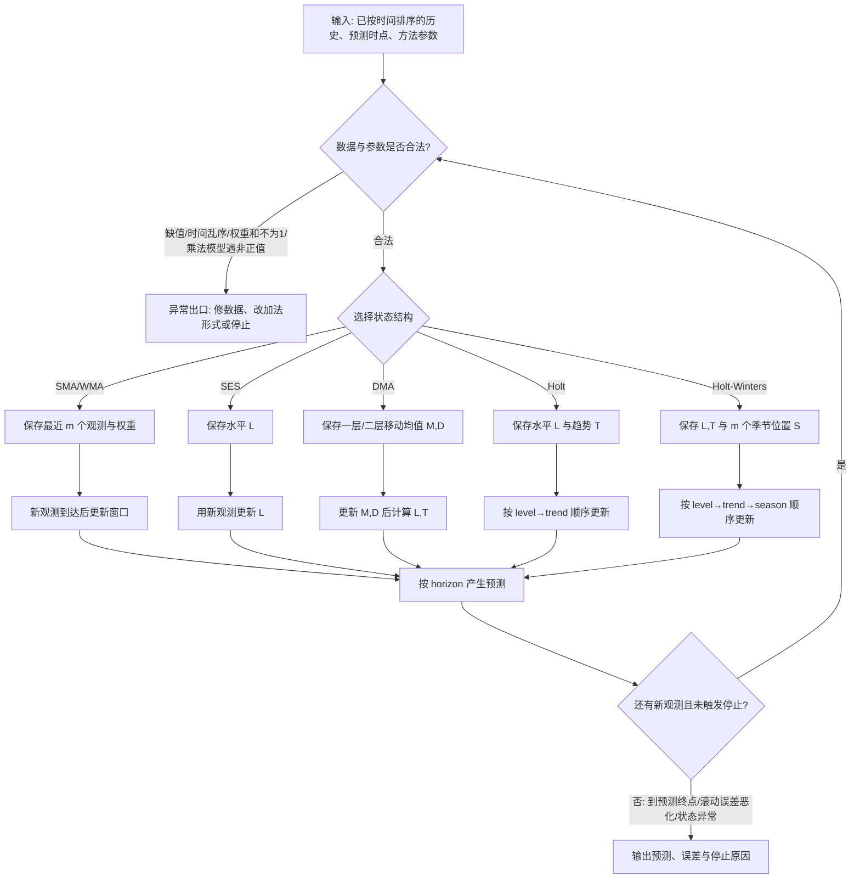
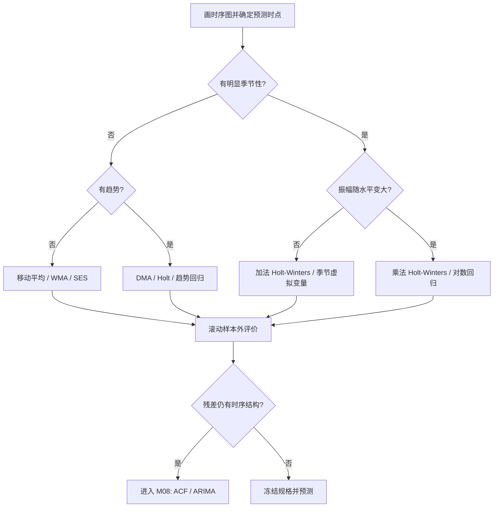

# M07 · 时间序列 I：平滑、趋势与季节性

> **本讲一句话**：先辨认序列里的水平、趋势和季节性，再选择移动平均、指数平滑、Holt／Holt-Winters 或回归，把可预测结构与随机波动分开。
>
> **原始材料**：`IS6400-L8-time series1-new.pdf`，45 个物理页。PDF 页脚仍写 `/39`，本文一律用物理页码。配套工作簿只读核对：`Why Double Moving Average Works.xlsx`、`model lagged term in sklearn.xlsx`。课堂转录尚未到位，因此本文不写“教授明示”或课堂覆盖结论。

---

## 0. 三分钟速览

时间序列（Time Series）与普通回归的最大差别是：每行数据有先后顺序，过去值可能帮助预测未来值。建模不能随机打乱时间，也不能让未来信息进入过去的特征。

本讲有两条路线。平滑路线用最近观测递推更新“当前水平”，再按需要加入趋势和季节性；回归路线把时间、季度和滞后量做成特征。两条路线都要先问：序列里究竟有哪些结构，预测时点能看到哪些信息？

**学完你应该能**

1. 从图形区分水平、趋势、季节性与周期性，并说明加法、乘法组合的差别。
2. 给定短序列，手算简单移动平均、加权移动平均和简单指数平滑的一步预测。
3. 用双重移动平均或 Holt 方法分别更新水平和趋势，并说明停止或换模型的边界。
4. 解释 Holt-Winters 和 ETS 的状态更新，判断应使用加法还是乘法季节项。
5. 构造时间趋势、季节虚拟变量、滞后与滚动特征，并识别时间泄漏。

**如果只记三件事**

- “最近数据更有用”是一项建模假设，不是自然定律；窗口和权重必须用按时间滚动的样本外误差选择。
- 简单指数平滑只更新水平；有趋势用 Holt，有稳定季节循环再考虑 Holt-Winters／季节 ETS。
- 构造 `shift` 和 `rolling` 特征时必须先移位，再滚动；否则当前答案会进入当前输入。

---

## 1. 开始之前 · 知识衔接

### 1.1 你已经学过的

下面一行表示一个先修概念。第二列给出本讲够用的唤醒，第三列指向原笔记。

| 概念 | 一句话唤醒 | 回看 |
|---|---|---|
| 因变量与自变量 | 回归用输入 $X$ 预测响应 $Y$；时间序列把时点 $t$ 和过去信息加入输入 | [[IS6400_Business_Data_Analytics/notes/M02-预测分析-线性回归#2.2 预测建模：管理者为什么需要回归\|M02 §2.2]] |
| 残差 | 残差是观测值减拟合值；仍有规律的残差表示模型漏掉结构 | [[IS6400_Business_Data_Analytics/notes/M02-预测分析-线性回归#2.5.3 曲线拟合：怎么定义"最好的那条线"（讲义 p.19, p.28）\|M02 §2.5.3]] |
| 训练／验证／测试隔离 | 规格和超参数只能在训练与验证历史中选择，测试期只能做最后评价 | [[IS6400_Business_Data_Analytics/notes/M02-预测分析-线性回归#2.9 过拟合与模型评估（讲义 p.39–45）\|M02 §2.9]] |
| 虚拟变量 | $k$ 个类别在含截距回归中通常用 $k-1$ 个指示变量，并留一个基准类别 | [[IS6400_Business_Data_Analytics/notes/M02-预测分析-线性回归#2.7.2 虚拟变量与 n−1 规则（讲义 p.25）⭐⭐ 本讲最可能考的技术点\|M02 §2.7.2]] |

读第一行：普通回归已告诉我们怎样把输入映射到输出；本讲新增的约束是输入只能来自预测时点已经发生的历史。

### 1.2 本讲全新引入的概念

| 概念 | English | 展开位置 |
|---|---|---|
| 时间序列与预测时点 | Time Series / Forecast Origin | §2.2 |
| 水平、趋势、季节性、周期性 | Level / Trend / Seasonality / Cycle | §2.3 |
| 简单／加权移动平均 | Simple / Weighted Moving Average | §2.4 |
| 简单指数平滑 | Simple Exponential Smoothing, SES | §2.4 |
| 双重移动平均 | Double Moving Average, DMA | §2.5 |
| Holt 线性趋势 | Holt's Linear Trend | §2.6 |
| Holt-Winters 与 ETS | Holt-Winters / ETS | §2.6–§2.7 |
| 趋势与季节回归 | Trend / Seasonal Regression | §2.8–§2.9 |
| 滞后、滚动与周期特征 | Lag / Rolling / Cyclical Features | §2.10 |

### 1.3 为什么这一讲放在这里 · 重排说明

M02 假定每行观测可以用同期输入解释，本讲处理“顺序本身就是信息”的数据。它又为 [[IS6400_Business_Data_Analytics/notes/M08-时间序列II-自相关差分与ARIMA|M08]] 铺路：M07 先建模水平、趋势和季节性，M08 再检查残差是否还有自相关，并引入 ARIMA。

讲义按“导论 → 模式 → 平滑 → 回归”展开。本文保留主次序，但把 p.20–21 的分解与 p.14–18 的图形模式合并讲；把 p.22–26 的三种平滑并列比较；把 p.44–45 的 sklearn 特征工程放在最后，形成“识别结构 → 更新状态 → 建回归特征”的学习链。

---

## 2. 正文

### 2.1 从普通回归转到有顺序的数据（讲义物理 p.1–6）

讲义先用六页复习建立桥梁：p.2 是“训练 → 评价 → 分析错误 → 再训练 → 上线”的机器学习闭环；p.3 对齐 independent／predictor／explanatory variable 与 dependent／target／response variable；p.4 用人均 GDP 预测生活满意度展示训练后对新国家实施预测；p.5 回到 $X$、$Y$；p.6 用回归树图提醒模型不必是一条直线。

**是什么**

普通监督学习把每行写成 $(x_i,y_i)$。时间序列则把观测写成 $Y_t$，下标 $t$ 表示时点。若用过去信息预测下一期，就要构造只依赖 $\{Y_t,Y_{t-1},\ldots\}$ 的预测 $\hat Y_{t+1\mid t}$。

**为什么需要它**

如果把序列随机打乱，训练集可能看到“未来”，评价误差会虚低。时点下标因此不是普通 ID，而是决定信息能否使用的边界。

**课件原例**

p.4 的 GDP 回归在实施阶段只把新国家的 GDP 放进已训练模型。p.6 的回归树也遵守相同两阶段：先用训练记录学习分裂，再让新记录沿已保存分支走到叶子。

**🎙️ 课堂补充**

待转录补充。当前只能确认讲义内容，不能判断课堂是否略过复习页。

**💡 换个说法（笔记补充）**

把模型想成考试前已经打印好的规则表。预测 11 月时，可以看 1–10 月；不能偷看 12 月再回头修改 11 月答案。

**⚠️ 常见误解**

- 时间列并非一定要直接进入模型。它也可以只负责排序，再由滞后、趋势或季节特征承载信息。
- 训练表现好不等于能预测未来，因为未来可能发生结构变化。

**与其他概念的关系**

训练／实施的边界沿用 M02；M08 的滚动评价会把这条边界做成多个连续窗口。

**所以呢**

先守住“预测时点能看到什么”，后面每一种平滑和特征工程才有可信评价。

### 2.2 时间序列与预测方法地图（讲义物理 p.7–13）

**是什么**

时间序列（Time Series）是按规则时间间隔排列的一组观测，例如年、月、周、日或每 15 分钟。预测目标是从时点 $t$ 已知的信息产生未来 $t+h$ 的预测。

讲义把方法分成两大类：

| 路线 | 依据 | 适用情形 | 讲义例子 |
|---|---|---|---|
| 定性／判断预测 | 专家经验、访谈或调查 | 历史数据少、环境剧变、预测期很远 | Historical analogy、Delphi、Market research |
| 定量预测 | 历史模式或变量关系 | 有可用数据，并愿意假设部分结构会延续 | Extrapolation、Econometric／causal methods |

一行表示一种路线。依据列说明预测从哪里来；适用情形列说明何时合理；最后一列保留讲义术语。

**为什么需要它**

没有历史数据时，再复杂的时间序列算法也无从估计；制度改变时，旧模式可能失效。方法地图防止把“有算法”误当成“有证据”。

**课件原例**

p.7 用 Facebook 股价和能源生产展示规则间隔观测；p.8 用智能交易和智能工厂强调“next”；p.10–12 展示历史类比与 Delphi 多轮问卷收敛；p.13 强调定量预测是“using past to predict future”，同时明确过去模式未必延续。

**Delphi 最小控制过程（p.10–12）**

1. 组织者把同一预测问题分别发给一组专家；专家匿名作答，避免职位较高者先压住其他意见。
2. 组织者汇总本轮预测、理由和分歧，但不公开个人身份。
3. 专家看到匿名反馈后修订自己的预测；新一轮结果再次汇总。
4. 重复“反馈 → 修订”，直到达到预先设定的轮数，或预测变化／离散程度低于停止阈值。
5. 输出是小组收敛后的判断和仍存在的分歧，不是把专家姓名投票当成客观真值。

若多轮后意见仍分裂，或外部事件已改变问题，流程应以“不收敛／需改题或补证据”退出，不能强算一个平均数冒充共识。把“市场需求会否增长”迁移成别的问题时，仍要先定义时间范围、预测量和停止标准。

**🎙️ 课堂补充**

待转录补充。

**💡 换个说法（笔记补充）**

新产品没有销量历史时，可以问专家；成熟商品有多年周销量时，可以估计季节模式。若突然封城，旧季节模式可能失效，两类证据需要重新组合。

**⚠️ 常见误解**

- 定性预测不等于随意猜测；Delphi 有匿名、多轮反馈与修订程序。
- 定量预测不自动客观；数据窗口、损失函数和结构假设仍由人选择。

**与其他概念的关系**

M07 主要展开定量路线；外生因果变量在 M08 的 ADL 中再出现。

**所以呢**

先判断证据类型，再谈具体模型；没有可延续历史结构时，不能靠调参补出信息。

### 2.3 模式与分解：水平、趋势、季节和周期（讲义物理 p.14–21）

**是什么**

讲义 p.14–18 用五张图依次显示水平、趋势、季节、季节加趋势和周期。p.20 把观测分为趋势 $T_t$、季节 $S_t$、周期 $C_t$ 与不规则项 $I_t$：

$$
Y_t=T_t+S_t+C_t+I_t,
$$

或

$$
Y_t=T_tS_tC_tI_t.
$$

下表每行是一种成分。第二列说明它改变序列的哪一部分，第三列给时间尺度，第四列给图形识别线索。

| 成分 | 它改变什么 | 时间尺度 | 图上怎样认 |
|---|---|---|---|
| 水平（Level） | 中心位置 | 当前局部 | 围绕近似常数上下波动 |
| 趋势（Trend） | 长期平均 | 较长 | 中心持续上升或下降 |
| 季节性（Seasonality） | 固定周期内的位置效应 | 已知周期 | 每年／每季相似位置重复 |
| 周期性（Cycle） | 较长扩张收缩 | 周期可变 | 围绕趋势起伏，但间隔不固定 |
| 不规则项（Irregular） | 剩余不可预测波动 | 短期 | 前述结构取走后的残差 |

一行是一种成分。第二列说它改变哪一部分，第三列给时间尺度，第四列给图读法。

**为什么需要它**

模型对应不同成分：SES 只追踪水平，Holt 加趋势，Holt-Winters 再加季节。若诊断错了，模型会把季节波动误当成趋势或噪声。

**课件原例**

p.14 的汽油销量在一条近似水平线附近波动；p.15 的 iPhone 图呈长期上升；p.16 的食品价格指数有固定年度起伏；p.17 同时有上升趋势和季节波；p.18 的宏观周期长度不恒定。p.21 的两图显示：加法季节振幅近似固定，乘法季节振幅随水平变大。

**🎙️ 课堂补充**

待转录补充。

**💡 换个说法（笔记补充）**

若每年春节都多卖 100 件，适合加法；若每年春节都多卖约 20%，水平越高振幅越大，适合乘法。

**⚠️ 常见误解**

- “平稳”不等于图上完全没有周期。本讲图形模式与 M08 的弱平稳定义不同；平稳过程可以有不随日历时点变化的短程自相关。
- 周期性不等于季节性。季节性有固定日历周期，商业周期长度通常会变化。

**与其他概念的关系**

乘法模型取对数后可转成加法结构；这也解释 p.41 的指数趋势回归。

这里的对数（Logarithm）是把乘法关系改写成加法关系的变换：若 $Y_t=T_tS_t$，则 $\log Y_t=\log T_t+\log S_t$。它要求被取对数的值为正。

**分解数值例（笔记补充；不是讲义数据）**

设某月趋势基线为 200 件，季节效应有两种口径：

1. 加法口径给 $S_t=30$ 件、不规则项 $I_t=-10$ 件，则 $Y_t=200+30-10=220$ 件。季节项表示“这个月固定多 30 件”。
2. 乘法口径给 $S_t=1.20$、$I_t=0.95$，则 $Y_t=200\times1.20\times0.95=228$ 件。季节项表示“这个月通常放大 20%”。
3. 若基线升到 400 件，加法季节项仍贡献 30 件；乘法季节因子仍为 1.20 时会贡献 80 件。这个差异就是判断加法或乘法的关键。

**为什么公式长这样**

加法分解把各成分写成与 $Y$ 相同单位的独立增减量，所以直接相加。乘法分解把趋势或水平当基数，把季节和不规则项写成无单位倍率，所以相乘。若序列含 0 或负值，乘法分解和对数转换不能直接使用；若季节振幅既不近似固定绝对量，也不近似固定比例，应以滚动误差比较更灵活的规格。

**所以呢**

先画图并识别振幅与周期，再决定状态方程是加法还是乘法。

### 2.4 移动平均、加权平均与简单指数平滑（讲义物理 p.22–26）

**是什么**

三种方法都用过去预测下一期，但保留历史的方式不同。简单移动平均（Simple Moving Average, SMA）给窗口内观测相同权重；加权移动平均允许权重不同；简单指数平滑把全部历史压缩到一个递推水平。

$$
\hat Y_{t+1\mid t}=\frac{1}{m}\sum_{j=0}^{m-1}Y_{t-j}
$$

$$
\hat Y_{t+1\mid t}=\sum_{j=0}^{m-1}w_{j+1}Y_{t-j},\qquad \sum_{j=1}^{m}w_j=1
$$

$$
L_t=\alpha Y_t+(1-\alpha)L_{t-1},\qquad \hat Y_{t+1\mid t}=L_t
$$

下表逐一解释三条公式里的符号，并给出 p.26 计算题采用的单位和数值。

| 符号 | 是什么 | 单位 | 已知还是要算 | 本例 |
|---|---|---|---|---|
| $Y_t$ | 时点 $t$ 的观测需求 | 需求单位（原图未说明实物单位） | 已知 | 1–10 日需求 |
| $m$ | 移动窗口长度 | 期 | 先选 | 5 |
| $w_j$ | 第 $j$ 个历史位置权重 | 无 | 先选 | 和为 1 |
| $\alpha$ | SES 对当前观测的权重 | 无 | 先选 | 0.2 |
| $L_t$ | 更新后的水平 | 与需求相同，具体实物单位未说明 | 要算 | $L_2=241.98$ |

**共享递推控制流程：SMA／WMA／SES／DMA／Holt／Holt-Winters**

走图例：SES 选择水平状态 $L$。第 2 日观测到达后走到“更新 $L$”，得到 $L_2=241.98$，再从预测出口产生第 3 日预测。乘法 Holt-Winters 会走 level → trend → season 三个状态；若观测含 0，图在合法性检查处转向异常出口，而不是继续做 $Y_t/S_{t-m}$。

**为什么公式长这样**

移动平均让窗口内每期等权；加权平均允许近期更重要；SES 每次把旧水平保留 $1-\alpha$，再把当前误差的 $\alpha$ 加回。把递推展开后，越久远的权重为 $\alpha(1-\alpha)^j$，会指数衰减。

**为什么需要它**

原始序列常有短期噪声。平滑把多个时点合成一个状态，使短期预测不被单个尖峰完全带走。

**WMA 数字例子与权重方向**

设最近三期观测从旧到新为 100、110、130。若“越新权重越大”，分别给 0.1、0.3、0.6，权重和为 $0.1+0.3+0.6=1$：

$$
\hat Y_{t+1\mid t}=0.1(100)+0.3(110)+0.6(130)=121.
$$

反例：若把同一组权重方向写反，给最新 130 只有 0.1，预测会变成 $0.6(100)+0.3(110)+0.1(130)=106$。它仍满足“权重和为 1”，却与“近期更重要”的建模理由相反。因此必须同时核权重总和与时间方向。

**课件原例与公开 Quiz（p.22–26）**

p.22 的季度销量用 4 期均值；p.23 说明加权和为 1；p.24 把 SES 写成“last prediction + adjustment on error”。p.25 的软饮料例给 $\alpha=0.38286$、RMSE 470.5061、平均误差 154.26，并显示 Q1-10 的预测继承 Q4-09 更新水平 5528.09。蓝线是实际销量，粉线是 SES 预测；预测随水平上升，但追不上稳定季度峰谷。p.26 有两道公开计算题。

> [!question] English original question（讲义 p.26）
> **Q1:** if we use a moving average with a window size of 5, what is the predicted value for the demand on 11/1/2020?
>
> **Q2:** if we use exponential smoothing with alpha=0.2, what is the predicted value for the demand on 3/1/2020?
>
> Data shown in the slide: 1/1 266.0; 2/1 145.9; 3/1 183.1; 4/1 119.3; 5/1 180.3; 6/1 168.5; 7/1 231.8; 8/1 224.5; 9/1 192.8; 10/1 122.9; 11/1 336.5.

**中文题意与限制**

Q1 要在预测 11/1 时只使用前 5 天，即 6/1–10/1；11/1 的 336.5 是事后真实值，不能进入预测。Q2 使用讲义 p.24 明示的初始化 $L_1=Y_1$，先用 2/1 观测更新，所得 $L_2$ 才是 3/1 的预测。原图没有说明需求对应的具体实物单位。

**直接答案与逐步解析**（⚪ 参考作答；笔记复算，非讲义给定答案）

1. Q1：
   $$
   \hat Y_{11\mid 10}=\frac{168.5+231.8+224.5+192.8+122.9}{5}=188.10.
   $$
   这表示在 10/1 观测取得后，对 11/1 需求的预测为 188.10 个需求单位；原图未说明是件、瓶或其他实物单位。
2. Q2：先初始化 $L_1=Y_1=266.0$；再吸收 2/1 的观测：
   $$
   L_2=0.2(145.9)+0.8(266.0)=241.98.
   $$
   因而 $\hat Y_{3\mid 2}=L_2=241.98$ 个需求单位；原图未说明具体实物单位。

**English reference answer（笔记自拟；非官方答案）**

> Q1: The five-day moving-average forecast for 11/1/2020 is **188.10 units**, calculated from the observations on 6/1 through 10/1 only.  
> Q2: With $L_1=Y_1=266.0$ and $\alpha=0.2$, the forecast for 3/1/2020 is $L_2=0.2(145.9)+0.8(266.0)=\mathbf{241.98}$ units.

**🎙️ 课堂补充**

待转录补充；当前没有官方／课堂答案证据。

**💡 换个说法（笔记补充）**

$m=1$ 等于直接把最后一次观测当下一次预测，反应快但噪声大；很大的 $m$ 很平滑，却会慢半拍。$\alpha$ 也控制同一取舍：接近 1 更快，接近 0 更稳。

**⚠️ 常见误解**

- Q1 不能把 11/1 的 336.5 放进均值；那是把答案泄漏给模型。
- SES 的 $\alpha$ 是当前观测权重，不是旧状态权重。
- `MA` 在本讲指移动平均平滑；M08 的 MA(q) 指“过去误差项”，不是同一概念。

**极端／边界情况**

- $m=1$ 时无平滑；$m$ 超过已有历史长度时不能按该定义计算。
- $\alpha=1$ 时 $L_t=Y_t$；$\alpha=0$ 时水平永不更新，通常不作为可学习范围内部值。
- 若存在稳定趋势，三种水平平滑都会系统性滞后，应转到 §2.5–§2.6。

**与其他概念的关系**

三者都是局部水平估计。DMA 和 Holt 在其上增加趋势状态。

**所以呢**

水平平滑适合没有系统趋势和季节性的短期预测；一旦残差呈持续同号，就要加入趋势。

### 2.5 双重移动平均：从两个滞后中心恢复趋势（讲义物理 p.27–31）

**是什么**

双重移动平均（Double Moving Average, DMA）先对原序列做 $n$ 期移动平均 $M_t$，再对 $M_t$ 做同窗口平均 $D_t$。讲义给出：

$$
L_t=2M_t-D_t,\qquad T_t=\frac{2(M_t-D_t)}{n-1},\qquad \hat Y_{t+k\mid t}=L_t+kT_t.
$$

下表每行解释 DMA 的一个状态或索引。单位列用“件／期”区分水平与趋势。

| 符号 | 是什么 | 单位 | 已知还是要算 |
|---|---|---|---|
| $M_t$ | 原销量的第一层 $n$ 期均值 | 件 | 要算 |
| $D_t$ | $M$ 的第二层 $n$ 期均值 | 件 | 要算 |
| $L_t$ | 校正滞后后的当前基线 | 件 | 要算 |
| $T_t$ | 每期趋势增量 | 件／期 | 要算 |
| $k$ | 向前预测多少期 | 期 | 已知 |

**为什么公式长这样**

线性趋势下，第一层均值的时间中心落后当前约 $(n-1)/2$ 期；第二层又多落后同样距离。$M_t-D_t$ 因而近似这半个窗口距离上的增长量。把它除以 $(n-1)/2$ 得每期斜率，即 $2(M_t-D_t)/(n-1)$；把同一增长量加回 $M_t$ 得当前基线 $2M_t-D_t$。

**数字例子（手把手）**

配套 `Why Double Moving Average Works.xlsx` 用 $n=3$，销量为 100、104、112、113、124、125……。在第 5 月：

1. $M_3=(100+104+112)/3=105.333$，$M_4=(104+112+113)/3=109.667$，$M_5=(112+113+124)/3=116.333$。
2. $D_5=(105.333+109.667+116.333)/3=110.444$。
3. $M_5-D_5=5.889$，所以 $L_5=122.222$，$T_5=5.889$ 件／月。
4. 对第 6 月的一步预测为 $122.222+5.889=128.111$，而真实值为 125。

**为什么需要它**

单层移动平均会落后于线性趋势。DMA 用两层均值的落后差估计趋势，再把基线推回当前时点。

**课件原例**

p.28–31 四页逐步显示同一工作簿：原销量线、$M_t$、$D_t$、差值和校正后的 $L_t$。p.31 明确把 $L_t=M_t+(M_t-D_t)$ 标成预测基线。

**🎙️ 课堂补充**

待转录补充。

**💡 换个说法（笔记补充）**

两条平滑线像两个速度不同的跟随者。快线比慢线高多少，告诉我们序列正在多快上升；把这段落后补回来，就得到当前位置。

**⚠️ 常见误解**

- DMA 不是对同一窗口重复算两次同一个数；第二层输入是第一层移动平均。
- 它适合近似线性趋势且无季节性。季节峰谷会污染 $M_t-D_t$。

**停止条件／什么时候别用**

窗口固定后，数据不足产生第一层和第二层均值时不能输出 DMA。若滚动验证显示趋势变化快、季节强或预测期长，改用 Holt、Holt-Winters 或回归。

**与其他概念的关系**

DMA 用固定窗口估计水平和趋势；Holt 用递推权重持续更新同两个状态。

**所以呢**

DMA 解释了“为什么两次平滑能找趋势”；下一节把固定窗口换成更灵活的指数更新。

### 2.6 Holt 与 Holt-Winters：递推保存水平、趋势和季节（讲义物理 p.32–35）

**是什么**

Holt 线性趋势（Holt's Linear Trend）维护水平 $L_t$ 和趋势 $T_t$：

$$
L_t=\alpha Y_t+(1-\alpha)(L_{t-1}+T_{t-1}),
$$

$$
T_t=\beta(L_t-L_{t-1})+(1-\beta)T_{t-1},
$$

$$
\hat Y_{t+k\mid t}=L_t+kT_t.
$$

乘法季节 Holt-Winters 再维护周期长度为 $m$ 的季节因子 $S_t$：

$$
L_t=\alpha\frac{Y_t}{S_{t-m}}+(1-\alpha)(L_{t-1}+T_{t-1}),
$$

$$
T_t=\beta(L_t-L_{t-1})+(1-\beta)T_{t-1},
$$

$$
S_t=\gamma\frac{Y_t}{L_t}+(1-\gamma)S_{t-m},
$$

$$
\hat Y_{t+k\mid t}=(L_t+kT_t)S_{t-m+h_m},
$$

其中 $h_m=((k-1)\bmod m)+1$ 用来找到未来对应季节位置。下表每行是一只状态或更新参数，并说明它在预测中承担的动作。

| 状态／参数 | 含义 | 单位 | 本步作用 |
|---|---|---|---|
| $L_t$ | 去季节后的当前水平 | 与 $Y$ 相同 | 给预测基线 |
| $T_t$ | 每期趋势增量 | $Y$／期 | 把基线向前推 |
| $S_t$ | 乘法季节倍率 | 无 | 放大或缩小对应季节 |
| $\alpha,\beta,\gamma$ | 三个更新速度 | 无 | 在新证据与旧状态之间权衡 |

**为什么公式长这样**

Holt 的水平先比较当前 $Y_t$ 与上一期“水平加趋势”的一步预期；趋势再比较连续水平的变化。Holt-Winters 先用旧季节因子把 $Y_t$ 除回基线，再用新水平估计当期季节倍率。每个状态都只用时点 $t$ 当时可得的信息。

**数字例子（手把手）**

笔记补充一个无季节小例。设 $L_1=100$、$T_1=4$、$Y_2=108$、$\alpha=0.5$、$\beta=0.25$：

1. 旧状态对第 2 期的一步预期是 $100+4=104$。
2. 新水平 $L_2=0.5(108)+0.5(104)=106$。
3. 新趋势 $T_2=0.25(106-100)+0.75(4)=4.5$。
4. 第 3 期预测为 $106+4.5=110.5$。

**乘法 Holt-Winters 完整状态例（笔记补充）**

设季度周期 $m=4$。在第 5 期更新前，已从至少一个完整周期初始化 $L_4=100$、$T_4=4$。第 1 季度旧季节因子为 $S_1=0.8$。

新观测为 $Y_5=96$，并取 $\alpha=0.5$、$\beta=0.25$、$\gamma=0.2$。

1. **Level**：先除去相同季节位置的旧倍率，再与旧的水平加趋势合并：
   $$
   L_5=0.5\left(\frac{96}{0.8}\right)+0.5(100+4)=112.
   $$
2. **Trend**：用新旧水平差更新趋势：
   $$
   T_5=0.25(112-100)+0.75(4)=6.
   $$
3. **Season**：用观测与新水平的比值更新第 1 季度位置：
   $$
   S_5=0.2\left(\frac{96}{112}\right)+0.8(0.8)=0.811429.
   $$
4. **下一次同季节位置**：第 9 期与第 5 期相隔 4 期，使用刚更新的第 1 季度因子：
   $$
   \hat Y_{9\mid5}=(112+4\times6)(0.811429)=110.354.
   $$

初始化必须至少识别一个完整季节循环，实践中通常需要更多周期才能稳定估计。预测别的季度位置时要取对应的 $S_2$、$S_3$ 或 $S_4$，不能总用 $S_5$。若 $Y_t\le0$，乘法比值与对数解释会失效或非常不稳，应改用加法季节形式、经业务允许的变换，或换模型。

**为什么需要它**

Holt 允许趋势逐期改变；Holt-Winters 又允许每个季节位置有自己的倍率。它们比固定窗口更适合在线更新。

**课件原例**

p.32 给 Holt 三条方程；p.33 的软饮料例给 $\alpha=0.193338836$、$\beta=0.195071241$、RMSE 440.1662445。表中 Q1-94 初始化 $L=1807.37,T=0$；到 Q2-94 更新为 $L=1913.31,T=20.66585$，对 Q3-94 的预测为 1933.976。p.34 列出 level、trend、seasonality；p.35 给乘法季节更新式，并标出“除以季节因子估水平、除以水平估季节”。

**🎙️ 课堂补充**

待转录补充。

**💡 换个说法（笔记补充）**

三种状态像三只记忆盒：水平盒记“现在大约多少”，趋势盒记“每期往哪走”，季节盒记“这个月份通常放大多少”。新数据到来时只更新相关盒子。

**⚠️ 常见误解**

- $\alpha$、$\beta$、$\gamma$ 控制不同状态，不能都解释成“当前观测权重”。
- 乘法季节模型要求水平和观测适合做比值；有 0 或负值时需谨慎，常改用加法形式或其他变换。

**极端／边界情况**

趋势持续外推会无限增长；长预测期常用阻尼趋势。季节周期 $m$ 设错时，季节因子会吸收错误频率。没有至少若干完整周期时，季节初始化和验证很不稳定。

**与其他概念的关系**

Holt 是 ETS(A,A,N) 的常见形式；Holt-Winters 对应带季节的 ETS 组合。

**所以呢**

状态更新把历史压缩成少数可解释量；ETS 用统一记号说明误差、趋势和季节各采用哪种形式。

### 2.7 ETS：把误差、趋势、季节写成模型规格（讲义物理 p.36–37）

**是什么**

ETS 代表 Error、Trend、Seasonality。每个位置用 A（additive）、M（multiplicative）、N（none）或带阻尼的 $A_d$ 表示。讲义给出：SES = ETS(A,N,N)，Holt = ETS(A,A,N)，Holt-Winters 加法季节 = ETS(A,A,A)。

第一个字母决定观测怎样偏离一步预测。加法误差写成 $Y_t=\hat Y_{t\mid t-1}+e_t$，所以 $e_t=Y_t-\hat Y_{t\mid t-1}$，误差与 $Y$ 同单位。乘法误差写成 $Y_t=\hat Y_{t\mid t-1}(1+\varepsilon_t)$，所以 $\varepsilon_t=(Y_t-\hat Y_{t\mid t-1})/\hat Y_{t\mid t-1}$，误差是相对比例；当预测接近 0 或数据非正时，这一写法会失效或极不稳定。

**误差如何进入似然（笔记补充）**

似然（Likelihood）是在给定模型参数后，观测到当前整段数据的相对支持度。以加法高斯一步预测误差为例，若给定过去信息后各期误差条件独立，且 $e_t\mid\mathcal F_{t-1}\sim N(0,\sigma^2)$，联合条件密度才能化为各期密度的乘积，其对数为

$$
\ell=-\frac{n}{2}\log(2\pi\sigma^2)-\frac{1}{2\sigma^2}\sum_{t=1}^{n}e_t^2.
$$

这里的 $\mathcal F_{t-1}$ 表示作出本期预测前已经知道的过去信息。$n$ 是可计算一步误差的期数，$\sigma^2$ 是误差方差，$\sum e_t^2$ 是一步误差平方和。固定 $n$ 和 $\sigma^2$ 时，平方和越小，似然越大；实际 ETS 会同时估计状态初值、平滑参数和误差尺度，不能把“训练误差更小”直接等同于样本外预测更好。

这条似然式只演示固定尺度下的加法高斯误差。乘法误差从相对误差变回观测 $Y_t$ 的密度时还会出现预测尺度对应的变量变换项，不能只把相对误差平方和代入上式就称为完整最大似然估计；本文不在缺少课件推导时补造该推导。

这里用 $\ell$ 表示**对数似然（log-likelihood）**，即把原本为正的似然取自然对数。上面的负数是对数后的数值，不是“负的概率”；对数在正数范围内单调递增，所以最大化对数似然与最大化原似然选择相同参数。

用三期给定的一步误差走完训练目标计算（笔记补充）：

1. 误差为 $[2,-1,1]$，平方和为 $2^2+(-1)^2+1^2=6$。
2. 在给定零均值高斯误差的假设下，方差最大似然估计为 $\hat\sigma^2=6/3=2$。
3. 把期数 3、平方和 6、误差方差 2 代入上式，得到对数似然 $\ell\approx-5.297$。

这里用 $n$ 而不是 $n-k$，因为计算的是给定零均值误差下的方差最大似然估计，不是在求无偏回归残差方差。这个数只演示从预测误差到目标函数的链条，不能跨不同数据集直接比较。

**为什么需要它**

“指数平滑”容易只让人想到一条递推公式。ETS 把数据生成的误差结构也写出来，使预测区间和似然估计有明确模型含义。

**课件原例**

p.36 用树形图要求在 trend、seasonality、random 中选择加法或乘法；p.37 给出 ETS 组合表，并列 SES、Holt 和 Holt-Winters 的对应记号。讲义没有给出误差分布、似然公式或参数估计数表；上面的误差—似然链是笔记补充，不冒充课件原例。

**🎙️ 课堂补充**

待转录补充。

**💡 换个说法（笔记补充）**

ETS(A,A,N) 可读成：“预测误差按加法进入，趋势按加法累积，没有季节项。”三个字母不是性能等级，而是三部分的结构选择。

**⚠️ 常见误解**

- ETS 的第一个字母是误差形式，不是水平形式。
- 讲义列出的组合不是说所有数据都能任意使用；乘法形式对非正数据有边界。

**停止条件／失败机制**

参数通常通过最小化一步误差或最大化似然估计。优化失败、状态爆炸、残差仍有结构或滚动误差明显变差时，应检查初始化、周期和模型规格，不以“收敛”代替样本外可用。

**与其他概念的关系**

M08 的 ARIMA 直接建模滞后相关；ETS 直接建模水平、趋势和季节状态。二者可用滚动误差比较。

**所以呢**

ETS 提供统一语言，把“用了哪种平滑”写成可检查的结构规格。

### 2.8 回归趋势：固定金额增长与固定百分比增长（讲义物理 p.38–41）

**是什么**

本节标题沿用讲义式旧措辞。“固定金额增长”在这里泛指响应 $Y$ 每期增加固定绝对数量，不要求 $Y$ 是货币；销量数据的单位应读作“件／期”或来源给定的其他目标单位。

线性趋势回归用

$$
Y_t=a+bt+e_t,
$$

其中 $b$ 是每期固定目标单位变化。指数趋势写成 $Y_t=ce^{bt}u_t$，取对数后估计：

$$
\ln Y_t=a+bt+e_t.
$$

若 $b$ 不大，$100b\%$ 是每期百分比变化的近似；更准确的百分比是 $100(e^b-1)\%$。

| 符号 | 含义 | 单位 | 已知还是要算 |
|---|---|---|---|
| $t$ | 从选定起点起的期数 | 期 | 已知 |
| $a$ | $t=0$ 时的模型基线 | $Y$ 单位 | 要估 |
| $b$ | 线性每期增量或对数增量 | $Y$/期 或 1/期 | 要估 |
| $e_t$ | 回归未解释部分 | 与响应尺度一致 | 要估计其性质 |

**为什么公式长这样**

线性趋势要求每跨一期加同一个 $b$。指数趋势要求每跨一期乘同一个 $e^b$；取对数把乘法变成加法，因此可用线性回归估计。

**数字例子（手把手）**

若 $\ln Y_t=4+0.05t$：

1. 相邻两期比值为 $Y_{t+1}/Y_t=e^{0.05}$。
2. $e^{0.05}\approx1.05127$。
3. 精确增长率为约 5.127%，而“5%”是小 $b$ 近似。

**为什么需要它**

平滑适合逐期更新；回归适合明确解释趋势系数并同时加入季节虚拟变量或外生变量。

**课件原例**

p.39 给线性趋势定义；p.40 的 64 个季度软饮料观测给 $\widehat{Sales}_t=1633.356+65.39902t$，$R^2=0.886054$，回归标准误约 440.1709。这里回归标准误（Regression Standard Error）可读作残差偏离拟合线的典型尺度，单位仍是销量单位。时间系数的 95% 区间约为 $[59.44512,71.35292]$。残差图仍有明显周期波动，提示只放趋势不够。p.41 给指数趋势与取对数做法。

**🎙️ 课堂补充**

待转录补充。

**💡 换个说法（笔记补充）**

每月多卖 100 件是线性增长；每月比上月多 5% 是指数增长。前者绝对增量固定，后者基数越大、增量越大。

**⚠️ 常见误解**

- p.41 把 $b$ 直接写成百分比是近似；较大 $b$ 应用 $e^b-1$。
- 趋势拟合好不表示残差随机。p.40 的周期残差说明仍漏掉季节性。

**极端／边界情况**

指数趋势要求 $Y_t>0$ 才能取普通对数。两种趋势长期外推都可能不现实，必须限制预测期并看业务容量。

**与其他概念的关系**

趋势回归承接 M02；下一节用虚拟变量处理季度季节效应。

**所以呢**

先看增长是“固定量”还是“固定比例”，再决定原尺度或对数尺度建模。

### 2.9 季节回归：虚拟变量与基准季度（讲义物理 p.42–43）

**是什么**

季度数据可建立三个季节虚拟变量，以第 4 季度为基准：

$$
\ln Sales_t=b_0+b_1t+b_2Q1_t+b_3Q2_t+b_4Q3_t+e_t.
$$

**为什么需要它**

仅用趋势会让季节峰谷留在残差。虚拟变量把每个季度相对基准季度的系统差异加入拟合值。

**课件原例**

p.42 说明季度只需三个虚拟变量；p.43 给 `LogSales`、时间 $t$ 和 Q1–Q3 的数据表与回归输出。该模型 $R^2=0.9270$；时间系数为 0.019。以 Q4 为基准，Q1 系数 −0.090，Q2 系数 0.140，Q3 系数 0.091，三者表中 $p$ 值分别为 0.0172、0.0005、0.0177。图中文字明确说该规格同时考虑 trend and seasonal effect。

**数字例子（手把手）**

假设模型为 $\ln Sales_t=7+0.02t+0.10Q1_t-0.05Q2_t+0.03Q3_t$。在同一 $t$ 下，Q1 相对 Q4 的倍率是 $e^{0.10}\approx1.105$，即约高 10.5%；Q2 为 $e^{-0.05}\approx0.951$，即约低 4.9%。

**为什么公式长这样**

含截距时，把 Q4 设为三只虚拟变量都等于 0 的基准，$b_0+b_1t$ 就是该时点 Q4 的对数销量。Q1、Q2、Q3 每次只打开一只开关，对应系数因此表示该季度相对 Q4 的对数差；指数化后才得到原尺度倍率。

**🎙️ 课堂补充**

待转录补充。

**💡 换个说法（笔记补充）**

基准季度像对照组。三个季度系数只回答“比 Q4 高或低多少”，截距与趋势负责共同基线。

**⚠️ 常见误解**

- 含截距时不能同时加入 Q1–Q4 四个完整虚拟变量，否则列完全共线。
- 对数模型的虚拟变量系数不是原尺度固定差额；应转换为倍率或百分比。

**失败机制／迁移题**

若季节振幅随水平变化，对数尺度有助于把乘法季节转成加法。若季度模式随年份改变，可考虑交互项或状态空间季节模型。

**与其他概念的关系**

这一步把 M02 的虚拟变量迁移到时间位置；M08 的 SARIMA 用季节差分和季节滞后描述另一类季节依赖。

**所以呢**

趋势与季节可以在同一回归中共同解释，但仍要检查残差是否留下自相关。

### 2.10 滞后、滚动与日历特征：怎样不偷看未来（讲义物理 p.44–45）

**是什么**

滞后特征（Lag feature）把过去观测变成当前行的输入，例如 $x_t=Y_{t-1}$。滚动特征概括过去窗口，例如过去 3 期均值。日历特征把月份、星期或小时映射为类别或周期坐标。

这张图的每个箭头是一道信息边界。先 `shift` 后 `rolling`，才能保证当前 $Y_t$ 不进入当前特征。

**为什么需要它**

通用监督学习模型不认识“上一期”。把历史压成明确列后，线性回归、树或梯度提升都能使用时间依赖。

**课件原例**

p.44 引用 sklearn 滞后特征示例，并展示 `shift(1)`、24 小时／7 天滚动统计。配套 `model lagged term in sklearn.xlsx` 的第 4 月行：`shift(1)=112`，过去三期均值 $(100+104+112)/3=105.333$，最大值 112，最小值 100。p.45 展示月份／星期／小时的 one-hot 与周期特征工程入口。

**🎙️ 课堂补充**

待转录补充。

**💡 换个说法（笔记补充）**

在第 4 月做预测时，特征表只能总结第 1–3 月。若先把第 1–4 月一起滚动平均，再拿结果预测第 4 月，就是把第 4 月答案掺进题目。

**⚠️ 常见误解**

- 随机 `train_test_split` 会破坏时间方向，不能直接用于未来预测评价。
- 月份 one-hot 认识“1 月”和“12 月”是两类，却不知道它们相邻；正弦／余弦编码可保留环形邻接。
- 滞后越多并非越好；开头损失更多行，特征共线与过拟合也会增加。

**停止条件／迁移题**

以滚动验证误差选择滞后和窗口；若新增滞后不再改善，或数据量不足以支持最大滞后，就停止扩展。下一讲会用 ACF／PACF 为 AR／MA 阶数提供诊断线索。

**与其他概念的关系**

配套代码教程应链接到 Week 8 时间序列 notebook 的公开方法解释；评分作业四题的完整个人答案仍留在私有作业入口，不写入本公开讲义笔记。

**所以呢**

时间特征工程的核心不是“多造列”，而是让每列严格服从预测时点的信息可得性。

---

## 3. 一图看懂

读图时从上到下：先认结构，再选最小够用模型，最后用按时间滚动的误差和残差判断是否需要更复杂模型。

---

## 4. 速查表

| 方法 | 保存的状态 | 能处理的结构 | 关键参数 | 主要失败信号 |
|---|---|---|---|---|
| SMA | 最近 $m$ 个观测 | 水平 | $m$ | 趋势下持续滞后 |
| WMA | 最近 $m$ 个观测与权重 | 水平、近期变化 | $w_j$ | 权重主观、对尖峰敏感 |
| SES | 水平 $L_t$ | 水平 | $\alpha$ | 残差同号连续出现 |
| DMA | 两层移动均值 | 近似线性趋势 | $n$ | 季节性污染趋势 |
| Holt | 水平、趋势 | 可变线性趋势 | $\alpha,\beta$ | 长期无限外推 |
| Holt-Winters | 水平、趋势、季节 | 固定周期季节 | $\alpha,\beta,\gamma,m$ | 周期错、季节变化 |
| 趋势／季节回归 | 回归系数 | 解释性趋势、季节差异 | 特征规格 | 残差自相关 |

一行是一种方法。状态列说模型把历史压成什么；结构列说它能吸收什么；参数列给选择项；失败信号列告诉你何时不能停。

---

## 5. 双语术语卡

| 中文 | English | 考试可用的英文定义 | 首现 |
|---|---|---|---|
| 时间序列 | Time Series | A sequence of observations indexed in time order, usually at regular intervals. | §2.2 |
| 季节性 | Seasonality | A repeating pattern tied to a fixed and known calendar period. | §2.3 |
| 周期性 | Cyclical pattern | A recurrent rise and fall whose duration is not necessarily fixed. | §2.3 |
| 简单移动平均 | Simple Moving Average | A forecast equal to the arithmetic mean of the most recent fixed window of observations. | §2.4 |
| 简单指数平滑 | Simple Exponential Smoothing | A recursive level forecast that gives exponentially decreasing weights to older observations. | §2.4 |
| 双重移动平均 | Double Moving Average | A trend method that smooths a series twice and uses the difference between the two smooths to estimate level and slope. | §2.5 |
| Holt 线性趋势 | Holt's Linear Trend | An exponential-smoothing method that recursively updates both level and trend. | §2.6 |
| Holt-Winters | Holt-Winters Method | An exponential-smoothing method that updates level, trend, and seasonal states. | §2.6 |
| ETS | Error-Trend-Seasonality | A notation that specifies the error, trend, and seasonal forms of an exponential-smoothing model. | §2.7 |
| 滞后特征 | Lag Feature | A predictor formed from a value observed a fixed number of periods before the forecast origin. | §2.10 |

---

## 6. 考点预判与答题框架

### 6.1 可信度分级

本讲无转录，最高只能记为 🟡 ILO／讲义结构反推或 ⚪ 笔记推断，不能写 🔴 教授明示。

### 6.2 考点清单

| 可信度 | 考点 | 依据 | 对应小节 |
|---|---|---|---|
| 🟡 | 手算 SMA 与 SES | 讲义 p.22–26 含公开 Quiz | §2.4 |
| 🟡 | 加法与乘法季节模型 | 讲义 p.20–21、p.34–37 | §2.3、§2.6–2.7 |
| 🟡 | Holt／Holt-Winters 状态含义 | 讲义核心公式页 p.32–35 | §2.6 |
| 🟡 | 线性与指数趋势系数解释 | 讲义 p.39–41 | §2.8 |
| ⚪ | 识别 `shift`／`rolling` 泄漏 | 讲义 p.44–45 与本课工程目标 | §2.10 |

### 6.3 答题框架

计算题按“预测时点 → 可用历史 → 公式与符号 → 逐步代入 → 单位 → 结果解释”写。模型选择题按“图形结构 → 候选模型能吸收的成分 → 参数／周期 → 时间滚动评价 → 残差检查”写。

---

## 7. 自测

**概念题 1**：季度销量的季节波幅大致恒定，应优先考虑加法还是乘法季节项？

答案

优先考虑加法季节项，因为季节影响更像固定数量。仍应通过滚动评价与残差核对，不凭一张图直接定案。

**计算题 2**：$L_{t-1}=80$、$Y_t=100$、$\alpha=0.25$，SES 的下一期预测是多少？

答案

$L_t=0.25(100)+0.75(80)=85$，所以 $\hat Y_{t+1\mid t}=85$。

**迁移题 3**：月销量有上升趋势和稳定 12 月周期，但包含 0。为什么不能直接套乘法 Holt-Winters？

参考思路

乘法状态需要做观测与季节因子的比值，并假定影响按比例放大。0 值使比值与对数方案出现边界。可先考虑加法季节形式，或在业务允许且验证充分时选择合适变换。

**泄漏题 4**：要预测当天销量，先对包含当天的 7 日窗口求均值，再将均值作为当天输入，有什么问题？

答案

当天真实销量进入了当天特征，构成目标泄漏。应先把销量向后移一日，再计算 7 日滚动统计。

---

## 8. 讲义页码映射

| 笔记小节 | 物理页 | 内容 | 课堂覆盖 |
|---|---:|---|---|
| —（封面） | p.1 | Lecture 7 目录封面 | —（无转录） |
| §2.1 | p.2–6 | 机器学习闭环、变量同义词、线性回归与回归树复习 | — |
| §2.2 | p.7–13 | 时间序列定义、定性／定量预测、Delphi | — |
| §2.3 | p.14–18 | 五类时序图形模式 | — |
| —（章节标题页） | p.19 | Quantitative Forecasting 分隔封面 | — |
| §2.3 | p.20–21 | 加法／乘法分解 | — |
| §2.4 | p.22–26 | SMA、WMA、SES、软饮料图与公开 Quiz | — |
| §2.5 | p.27–31 | DMA 公式与工作簿图解 | — |
| §2.6 | p.32–35 | Holt、Holt-Winters 公式与软饮料图 | — |
| §2.7 | p.36–37 | ETS 结构图与组合表 | — |
| —（章节标题页） | p.38 | Regression Analysis 分隔封面 | — |
| §2.8 | p.39–41 | 线性趋势、软饮料残差、指数趋势 | — |
| §2.9 | p.42–43 | 季节虚拟变量与回归表 | — |
| §2.10 | p.44–45 | sklearn 滞后、滚动和时间特征 | — |

---

## 9. 延伸与勘误

### 9.1 课件有但课上略过

本讲无转录，无法判断课堂略过范围。正文仍覆盖全部 45 个物理页。

### 9.2 课上讲了但课件没有

转录待导出，当前无法判断。

### 9.3 课件自身的问题

- PDF 有 45 个物理页，但 p.40–45 的页脚仍写 `/39`。本文不把页脚总数当物理页数。
- p.23 的权重下标排版混用了 $k$ 与 $m$；严谨条件是所用窗口权重之和为 1。
- p.41 把对数趋势系数 $b$ 直接解释为百分比，只在 $b$ 较小时近似成立；精确增长率是 $e^b-1$。
- p.35 的乘法 Holt-Winters 预测下标压缩且较难辨认；本文用周期位置 $h_m$ 重写，含义不改。
- 讲义说 DMA “best” 用于有趋势无季节数据，这是教学建议，不是无条件最优结论；模型仍需按时间滚动评价。

### 9.4 课外补充

- 🔗 [statsmodels ExponentialSmoothing 官方文档](https://www.statsmodels.org/stable/generated/statsmodels.tsa.holtwinters.ExponentialSmoothing.html)（获取日期 2026-10-20）：实现时须核对 `trend`、`seasonal`、`seasonal_periods`、初始化方法与阻尼趋势参数。
- M08 将继续处理自相关、平稳性、差分与 ARIMA；不要把“已去趋势季节”自动等同于“残差为白噪声”。

### 9.5 待核对

- 已用 300 dpi 重看 p.25、p.33、p.40、p.43，并把可辨认的 $\alpha$、$\beta$、RMSE、$R^2$、趋势和季节系数写入对应原例。仍未逐格转录完整 64 期软饮料数据，因为讲义只显示局部行且未提供原始工作簿；未显示的行不猜。
- 课堂日期未知，frontmatter `date` 保持 `null`，不按 Canvas Week 8 或 Lecture 7 猜日期。
- 对应代码解释由 T08 候选承担；Week 8 Notebook 尾部四道评分作业的个人完整答案不进入公开 M07。

