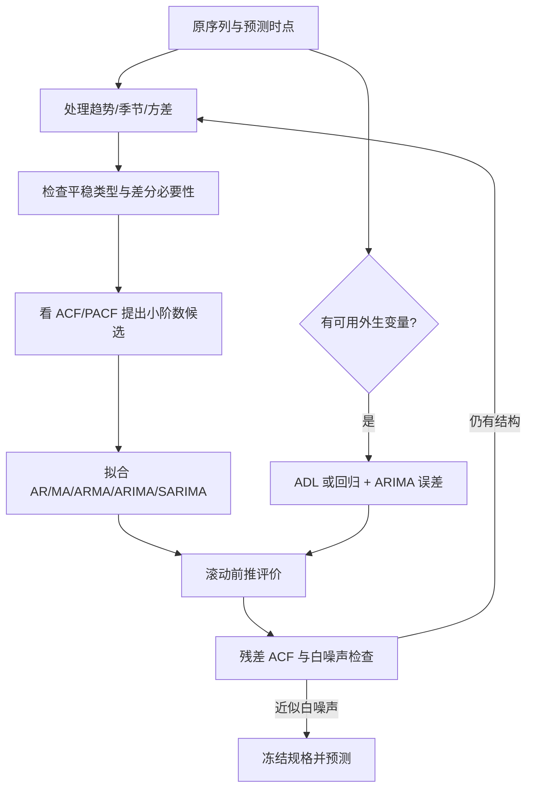

# M08 · 时间序列 II：自相关、差分与 ARIMA

> **本讲一句话**：把 M07 模型留下的残差当成新序列，检查它是否仍可预测，再用 AR、MA、差分和季节结构建立 ARIMA／SARIMA，并用滚动前推评价未来预测。
>
> **原始材料**：`IS6400-L9-time series2.pdf`，46 个物理页。页脚仍沿用 `/44`，p.12 还写 `/39`；本文一律用物理页码。课堂转录尚未到位，不写教授明示考点。

---

## 0. 三分钟速览

预测模型真正完成的标志，不是训练误差够小，而是可预测结构已进入拟合值，剩余残差近似白噪声（White Noise）。自相关函数（ACF）和偏自相关函数（PACF）帮助判断过去值或过去误差仍留下什么结构。

AR 模型用过去的 $y$，MA 模型用过去的冲击误差，ARMA 合并两者。若原序列的均值、方差或季节结构随时间改变，先通过变换与差分得到较稳定的序列，再用 ARIMA／SARIMA 建模。所有模型都要按时间顺序滚动评价，不能随机交叉验证。

**学完你应该能**

1. 手算短序列的滞后相关，并说清 ACF 与 PACF 的“总关联”和“净直接关联”。
2. 从随机游走推到 AR(1)，判断 $\phi=0$、$\phi=1$ 等边界含义。
3. 用给定误差逐期算 MA(1) 的预测与观测，并区分它与 M07 的移动平均平滑。
4. 解释弱平稳、KPSS 原假设、Box-Cox、普通差分与季节差分的作用和风险。
5. 读懂 ARIMA$(p,d,q)$、SARIMA$(p,d,q)(P,D,Q)_m$ 与 ADL，并设计滚动前推评价。

**如果只记三件事**

- ACF／PACF 是诊断线索；有限样本、混合模型和差分都会让“截尾规则”不干净，最终要比较滚动误差并检查残差。
- KPSS 的 $p\ge0.05$ 只表示“未拒绝相应平稳原假设”，不能写成 95% 确认平稳。
- 差分次数不是越多越好。过度差分会放大噪声并制造负相关。

---

## 1. 开始之前 · 知识衔接

### 1.1 你已经学过的

| 概念 | 本讲够用的唤醒 | 回看 |
|---|---|---|
| 水平、趋势、季节 | 水平是局部中心，趋势是长期方向，季节是固定日历周期 | [[IS6400_Business_Data_Analytics/notes/M07-时间序列I-平滑趋势与季节性#2.3 模式与分解：水平、趋势、季节和周期（讲义物理 p.14–21）\|M07 §2.3]] |
| SES／Holt／Holt-Winters | 分别递推更新水平、水平加趋势、水平加趋势加季节 | [[IS6400_Business_Data_Analytics/notes/M07-时间序列I-平滑趋势与季节性#2.6 Holt 与 Holt-Winters：递推保存水平、趋势和季节（讲义物理 p.32–35）\|M07 §2.6]] |
| 趋势与季节回归 | 时间趋势与季度虚拟变量可同时进入回归，但仍需检查残差 | [[IS6400_Business_Data_Analytics/notes/M07-时间序列I-平滑趋势与季节性#2.9 季节回归：虚拟变量与基准季度（讲义物理 p.42–43）\|M07 §2.9]] |
| 残差 | $e_t=Y_t-\hat Y_t$；仍有规律说明模型漏掉可预测结构 | [[IS6400_Business_Data_Analytics/notes/M02-预测分析-线性回归#2.5.3 曲线拟合：怎么定义"最好的那条线"（讲义 p.19, p.28）\|M02 §2.5.3]] |

读最后一行：本讲不是从原序列名字开始堆模型，而是先问已有模型的残差是否还留下可预测关系。

### 1.2 本讲全新引入的概念

| 概念 | English | 展开位置 |
|---|---|---|
| 白噪声与自相关 | White Noise / Autocorrelation | §2.2 |
| ACF 与 PACF | Autocorrelation / Partial Autocorrelation Function | §2.2、§2.5 |
| 随机游走与漂移 | Random Walk / Drift | §2.3 |
| AR 与 MA | Autoregressive / Moving Average Model | §2.4–§2.5 |
| 平稳性与 KPSS | Stationarity / KPSS Test | §2.6 |
| Box-Cox 与差分 | Box-Cox / Differencing | §2.7 |
| ARIMA 与 SARIMA | ARIMA / Seasonal ARIMA | §2.8 |
| 滚动前推验证 | Rolling-origin Evaluation | §2.9 |
| ADL | Autoregressive Distributed Lag | §2.10 |

### 1.3 为什么按这个顺序学 · 重排说明

讲义 p.2–12 先复习 M07，p.13 才切入 autoregression。本文把复习压缩成 §2.1，并在每处回链 M07；正文按“残差目标 → 相关诊断 → AR／MA → 平稳化 → ARIMA → 评价 → 外生变量”组织。

这比直接背 $p,d,q$ 更稳：先知道为什么需要滞后，再知道哪些变换改变了数据，最后才能解释阶数与评价结果。

---

## 2. 正文

### 2.1 M07 方法复习：先吸收趋势季节，再研究剩余依赖（讲义物理 p.1–14）

**是什么**

p.1 是 Lecture 9 封面；p.2–6 复现 SMA、WMA、SES、Holt 和 Holt-Winters；p.7–11 复现线性趋势、软饮料残差、指数趋势和季节虚拟变量；p.12 复现 sklearn 的滞后／滚动特征；p.13 是“Autoregression”分隔封面；p.14 再问“time-indexed independent variable $X_t$ 从哪里来？”答案之一是过去的 $Y$ 与过去残差。

**为什么需要它**

ARIMA 不应替代对趋势和季节的理解。若序列的非平稳结构未处理，长串 ACF 可能只是共同趋势造成，不代表每个滞后都有直接作用。

**课件原例**

p.8 的软饮料线性趋势残差仍呈周期；p.10–11 因此加入季度虚拟变量。p.12 的 `shift(1)` 和滚动统计把过去值显式变成 $X_t$。

**🎙️ 课堂补充**

待转录补充。

**💡 换个说法（笔记补充）**

先把大山坡和四季潮汐移走，再看小波纹是否有顺序。否则大山坡会让相隔很多期的点都显得高度相关。

**⚠️ 常见误解**

- M08 的 MA 是过去误差的模型，不是 M07 的窗口平均。
- 滞后列不是自动合法；仍需保证构造时没有使用当前或未来答案。

**与其他概念的关系**

本节回链 M07 全部复习页；下一节把“残差要随机”写成可检查目标。

**所以呢**

ARIMA 学习从残差诊断开始，而不是从阶数记忆开始。

### 2.2 白噪声、滞后变量与自相关（讲义物理 p.15–17）

**是什么**

预测方程可写成

$$
Y_t=\hat Y_{t\mid t-1}+e_t.
$$

理想残差 $e_t$ 应近似白噪声：均值为 0、方差稳定、不同非零滞后间不相关。对序列 $Y_t$，滞后 $k$ 的样本自相关是

$$
r_k=\frac{\sum_{t=k+1}^{n}(Y_t-\bar Y)(Y_{t-k}-\bar Y)}{\sum_{t=1}^{n}(Y_t-\bar Y)^2}.
$$

下表每行解释自相关公式的一个量。单位列说明哪些量保留原尺度，哪些量已经标准化而无单位。

| 符号 | 是什么 | 单位 | 已知还是要算 |
|---|---|---|---|
| $k$ | 回看多少期 | 期 | 先选 |
| $Y_{t-k}$ | 当前行对应的过去观测 | 与 $Y$ 相同 | 已知 |
| $\bar Y$ | 样本均值 | 与 $Y$ 相同 | 要算 |
| $r_k$ | 滞后 $k$ 的标准化线性关联 | 无 | 要算 |

**为什么公式长这样**

分子把当前偏差与 $k$ 期前偏差相乘：同号贡献正值，异号贡献负值。分母用整体平方偏差缩放，使结果无单位并大致落在 $[-1,1]$。

**数字例子（手把手）**

笔记补充序列 $[1,2,3,4]$，均值 $\bar Y=2.5$。滞后 1 的成对项是 $(2,1),(3,2),(4,3)$：

1. 分子为 $(-0.5)(-1.5)+(0.5)(-0.5)+(1.5)(0.5)=1.25$。
2. 分母为 $(-1.5)^2+(-0.5)^2+(0.5)^2+(1.5)^2=5$。
3. 按上式 $r_1=1.25/5=0.25$。不同软件可能用略不同有限样本分母，但图形解释一致。

**为什么需要它**

若残差在滞后 1 仍显著正相关，看到上一期正误差后，下一期误差仍倾向为正，说明模型还可改进。

**课件原例**

p.15 明确要求 fitted value 包含所有可预测成分；p.16 用银行账户余额说明相邻月份常相关；p.17 用先形成 lagged variables、再算 correlation 的 Excel 表解释操作。

**🎙️ 课堂补充**

待转录补充。

**💡 换个说法（笔记补充）**

把序列复印一份向下错开一行，再把同一行的“现在”和“上一期”配对。自相关就是检查这两列是否一起高、一起低。

**⚠️ 常见误解**

- 不相关不等于独立；白噪声诊断常关注线性相关，但更复杂依赖可能仍存在。
- 单个柱超过界线只是候选证据；检查很多滞后会出现偶然显著，且界线依赖样本假设。

**极端／边界情况**

常数序列的方差为 0，相关无定义。短样本在大滞后只剩很少配对，估计很不稳定。

**与其他概念的关系**

ACF 是 MA 阶数的经典线索，也是残差白噪声检查的一部分；PACF 在 §2.5 去除中间滞后的间接通路。

**所以呢**

自相关把“图上似乎有连续性”变成可计算量，但还不能单独决定模型。

### 2.3 随机游走：水平不平稳，变化可能无规律（讲义物理 p.18–19）

**是什么**

随机游走带漂移写成

$$
Y_t=Y_{t-1}+m+e_t,
$$

其中 $m$ 是平均每期变化，$e_t$ 是当期不可预测冲击。做一阶差分：

$$
\Delta Y_t=Y_t-Y_{t-1}=m+e_t.
$$

这里 $\Delta$ 是一阶差分算子，动作是“当前水平减上一期水平”；$m$ 的单位是“$Y$ 单位／期”；$e_t$ 与 $Y$ 同单位。期望（Expectation）$E[e_t]=0$ 表示在反复出现的同类时点中，冲击的长期平均为 0，不表示每一期冲击都等于 0。

**为什么需要它**

原序列可以表现出长趋势和多阶正自相关，但变化量仍可能近似随机。它解释了“看起来很平滑”不代表价格水平可从趋势可靠外推。

**课件原例**

p.18 的 Google 收盘价水平持续上升，而讲义强调其 differences 可能随机；p.19 给 $Y_t=Y_{t-1}+m+e_t$ 和四个符号定义。

**🎙️ 课堂补充**

待转录补充。

**💡 换个说法（笔记补充）**

今天的位置等于昨天位置加一步随机移动。路径会漂得很远，但每一步本身可能没有可预测方向。

**数字例子（手把手）**

设初始水平为 100，漂移为 2，三期冲击依次为 1、−3、0。

1. 第一期水平是 $100+2+1=103$。
2. 第二期水平是 $103+2-3=102$。
3. 第三期水平是 $102+2+0=104$。
4. 三期差分是 3、−1、2，均值为 1.333；小样本不保证恰等于设定漂移 2。

**⚠️ 常见误解**

- “随机游走”不是说水平图毫无形状；累积冲击常形成看似趋势。
- $m$ 是平均变化而不是误差均值；通常假定 $E[e_t]=0$。

**极端／边界情况**

$m=0$ 是无漂移随机游走。冲击方差随时间累积，因此水平过程方差不恒定，不满足弱平稳。

**与其他概念的关系**

随机游走是 AR(1) 在 $\phi=1,c=0$ 的边界，也是 ARIMA$(0,1,0)$ 的特例。

**所以呢**

若水平不平稳而一阶变化稳定，差分不是数据损坏，而是在改变建模对象。

### 2.4 自回归模型：过去的值怎样进入预测（讲义物理 p.20–24）

**是什么**

AR($p$) 用过去 $p$ 个观测预测当前值：

$$
Y_t=c+\phi_1Y_{t-1}+\cdots+\phi_pY_{t-p}+e_t.
$$

AR(1) 的一步预测是 $\hat Y_{t\mid t-1}=c+\phi Y_{t-1}$。讲义 p.22 给出三种边界：

- 当 $\phi=0$ 时，过去值不起作用，只剩常数加白噪声。
- 当 $\phi=1$ 且 $c=0$ 时，模型是无漂移随机游走。
- 当 $\phi=1$ 且 $c\ne0$ 时，模型是带漂移随机游走。

**为什么公式长这样**

每个 $\phi_j$ 衡量在控制其他列后，$j$ 期前值对当前预测的线性贡献。截距提供长期中心；当 $|\phi|<1$ 时，AR(1) 冲击会按 $\phi^h$ 衰减。

**数字例子（手把手）**

设 $Y_t=10+0.6Y_{t-1}+e_t$，已知 $Y_t=20$：

1. 一步预测 $\hat Y_{t+1}=10+0.6(20)=22$。
2. 两步预测用第一步预测代入：$10+0.6(22)=23.2$。
3. 长期均值为 $10/(1-0.6)=25$，预测逐步向 25 回归。

**为什么需要它**

很多业务量有惯性：余额、需求、温度不会每期完全重置。AR 用少量系数表达这种持续性。

**课件原例**

p.20 从随机游走扩展到 AR(1)、AR(2)、AR($p$)，并说明可用 OLS 估计。p.23 用“先回归掉 $x_1,x_2$，再相关剩余部分”引出 PACF；p.24 用传话图说明中间滞后会传递间接影响。

**🎙️ 课堂补充**

待转录补充。

**💡 换个说法（笔记补充）**

AR(2) 像同时听昨天和前天的意见，但每个系数是在另一个意见已在场时的净贡献。

**⚠️ 常见误解**

- OLS 可估系数不代表普通独立误差回归诊断自动成立；残差仍要查白噪声。
- $|\phi|<1$ 是 AR(1) 平稳的重要边界；$\phi=1$ 不能用同一个长期均值公式。

**停止条件／什么时候别用**

候选 $p$ 可由 PACF、信息准则与滚动误差共同筛选。新增滞后不改善样本外表现、系数不稳定或数据不足时停止加阶。

**与其他概念的关系**

PACF 对纯 AR($p$) 理论上在 $p$ 后截尾；混合 ARMA 中通常不会这么干净。

**所以呢**

AR 把“历史值有惯性”写成模型；下一节加入过去冲击，区分直接与间接相关。

### 2.5 MA、ACF 与 PACF：过去冲击和直接滞后（讲义物理 p.21、p.25–29）

**是什么**

移动平均误差模型（Moving Average Error Model, MA($q$)）用过去 $q$ 个创新冲击。创新（Innovation）是观测到来前不可预测、到来后可由“实际值减一步预测”估计的误差：

$$
Y_t=\mu+\theta_1e_{t-1}+\cdots+\theta_qe_{t-q}+e_t.
$$

下表逐一说明 MA 公式里的量；误差与序列单位相同，系数和阶数没有单位。

| 符号 | 动作 | 单位 |
|---|---|---|
| $\mu$ | 给序列基准均值 | 与 $Y$ 相同 |
| $q$ | 决定纳入多少个过去冲击 | 无 |
| $\theta_j$ | 给第 $j$ 个过去冲击分配权重 | 无 |
| $e_t$ | 记录当期创新 | 与 $Y$ 相同 |

读第一行：若基准均值为 10，那么没有可延续的过去冲击时，一步预测从 10 起步。

偏自相关函数（Partial Autocorrelation Function, PACF）则问：控制中间各阶滞后后，最远那一阶滞后还剩多少直接线性关联。

ACF 衡量 $Y_t$ 与 $Y_{t-k}$ 的总线性关联，包含中间滞后传递的间接作用。PACF 衡量控制 $Y_{t-1},\ldots,Y_{t-k+1}$ 后，$Y_{t-k}$ 与 $Y_t$ 的剩余线性关联。

**PACF(2) 的实际残差化例子（笔记补充）**

取短序列 $[1,2,1,3,2,5]$。对 $t=3,4,5,6$ 排成三列：当前值 $Y_t=[1,3,2,5]$，一阶滞后 $Y_{t-1}=[2,1,3,2]$，二阶滞后 $Y_{t-2}=[1,2,1,3]$。PACF(2) 要控制中间的一阶滞后：

1. 用截距和 $Y_{t-1}$ 回归 $Y_t$，得到拟合式 $\widehat Y_t=3.75-0.5Y_{t-1}$，残差为 $[-1.75,-0.25,-0.25,2.25]$。
2. 用同样的截距和 $Y_{t-1}$ 回归 $Y_{t-2}$，得到 $\widehat Y_{t-2}=2.75-0.5Y_{t-1}$，残差为 $[-0.75,-0.25,-0.25,1.25]$。
3. 两组残差的点积为 4.25，平方和分别为 8.25 与 2.25，因此：
   $$
   \operatorname{PACF}(2)=\frac{4.25}{\sqrt{8.25\times2.25}}=0.98644.
   $$

这个数表示：把 $Y_{t-1}$ 能线性解释的部分从两边都拿走后，$Y_{t-2}$ 与 $Y_t$ 仍有很强的剩余线性关系。小样本只用于展示算法，不作为真实选阶证据。迁移到 PACF($k$) 时，就把中间的 1 到 $k-1$ 阶滞后共同放进两次回归。

**为什么公式长这样**

冲击 $e_{t-1}$ 在上一期发生时不可预知，但到时点 $t$ 已经可以从上一期观测与预测之差估计。MA 模型让冲击影响延续有限期。

**课件原例与完整表格复算（p.25）**

讲义给 $\hat Y_t=10+0.5e_{t-1}$、$Y_t=\hat Y_t+e_t$，并给误差 $e_1=-2,e_2=1,e_3=0,e_4=2,e_5=1$。若初始化 $e_0=0$：

| $t$ | 已知上期误差 | $\hat Y_t$ | 当期误差 $e_t$ | $Y_t$ |
|---:|---:|---:|---:|---:|
| 1 | $e_0=0$ | 10.0 | −2 | 8.0 |
| 2 | −2 | 9.0 | 1 | 10.0 |
| 3 | 1 | 10.5 | 0 | 10.5 |
| 4 | 0 | 10.0 | 2 | 12.0 |
| 5 | 2 | 11.0 | 1 | 12.0 |

一行是一时点。第二列是预测时已知的过去误差，第三列是预测，第四列是新冲击，第五列是观测结果。

p.27 用三个月鲑鱼价格说明 ACF 的两月关联包含“前两月 → 上月 → 本月”的间接通路；PACF 去掉上月后看直接部分。p.28 的 PACF 前两阶显著对应 AR(2) 候选；p.29 的 ACF 前两阶显著对应 MA(2) 候选。

**为什么需要它**

AR 适合状态持续；MA 适合一次冲击影响若干期。ACF／PACF 为候选阶数提供结构线索。

**🎙️ 课堂补充**

待转录补充。

**💡 换个说法（笔记补充）**

ACF 问“两个月前和今天总共多像”；PACF 问“已经知道上个月后，两个月前还额外告诉我多少”。

**⚠️ 常见误解**

- MA($q$) 的“Moving Average”是历史冲击线性组合，不是窗口销量平均。
- 过去误差不是外部直接给定特征；模型估计与预测时要按递推或状态空间方法处理。
- “PACF 截尾选 AR、ACF 截尾选 MA”只对理想纯模型是线索，不是自动判题规则。

**极端／边界情况**

$q=0$ 只剩白噪声加均值。MA 参数还涉及可逆性（Invertibility），用来保证冲击表示唯一且稳定；仅看到收敛不代表可逆条件满足。

**与其他概念的关系**

AR 与 MA 合并成 ARMA；非平稳序列先差分后得到 ARIMA。

**所以呢**

ACF／PACF 帮我们提出候选，但最终规格必须经滚动评价与残差检查。

### 2.6 平稳性与 KPSS：先明确检验的是哪种稳定（讲义物理 p.30–33）

**是什么**

讲义把平稳概括为“无趋势、方差恒定、无季节性”。更严谨地说，本讲通常需要弱平稳（Weak Stationarity）：$E[Y_t]=\mu$ 不随 $t$ 变，$Var(Y_t)=\sigma^2$ 不随 $t$ 变，$Cov(Y_t,Y_{t-k})$ 只依赖滞后 $k$，不依赖具体日历时点。

这一定义允许短程自相关或随机波动形成局部起伏；“平稳”不等于一条平线，也不等于绝对没有任何频率结构。

KPSS（Kwiatkowski–Phillips–Schmidt–Shin）检验的原假设可设为围绕常数平稳（`regression='c'`）或围绕确定性趋势平稳（`regression='ct'`）。

KPSS 先按所选原假设去掉常数或常数加趋势，得到残差 $e_t$。然后累积残差：

$$
S_t=\sum_{i=1}^{t}e_i.
$$

若残差只是围绕固定中心短期摆动，累积和不会长期单向漂走。检验统计量把累积偏离的平方总量与残差的长期方差比较：

$$
\operatorname{KPSS}=\frac{n^{-2}\sum_{t=1}^{n}S_t^2}{\widehat\sigma^2_{LR}}.
$$

$\widehat\sigma^2_{LR}$ 是长期方差（Long-run Variance），会把残差方差和选定滞后内的自协方差一起计入；`nlags` 因此会影响统计量。统计量越大，表示累积偏离相对短期噪声越大，越不利于平稳原假设。

**为什么需要它**

ARMA 的均值、方差与相关结构假设在时间上稳定。对明显非平稳水平直接拟合 ARMA，系数和显著性可能误导。

**课件原例**

p.30 明写 ARMA assumes a stationary time series。p.31 给三条教学判断。p.32 四图 A–D：A 有下行趋势；B 暖／冷季节交替；C 有趋势和季节；D 是股价日变化，均值较稳定但有波动聚集与尖峰，不能只凭视觉宣布全部性质成立。p.33 给 KPSS 原假设与 0.05 判定。

**KPSS 判断步骤**

1. 先决定检验 level-stationary 还是 trend-stationary，选择 `c` 或 `ct`。
2. 计算统计量与 $p$ 值，并记录滞后选择方法。
3. 若 $p<0.05$，在该规格下拒绝平稳原假设。
4. 若 $p\ge0.05$，只能说“未拒绝”，不能说“以 95% 概率确认平稳”。
5. 结合时序图、ACF、另一类单位根检验和残差诊断形成结论。

**KPSS 可复算小例（笔记补充）**

用序列 $[1,2,1,2]$ 演示 `regression='c'` 且 `nlags=0` 的最简计算：

1. 均值为 1.5，去均值残差为 $[-0.5,0.5,-0.5,0.5]$。
2. 累积残差 $S_t$ 为 $[-0.5,0,-0.5,0]$，所以 $\sum S_t^2=0.5$。
3. 分子为 $0.5/4^2=0.03125$。
4. 当 `nlags=0`，长期方差估计退化为残差平方均值：$\widehat\sigma^2_{LR}=1/4=0.25$。
5. KPSS 统计量为 $0.03125/0.25=0.125$。标准 level-stationary 表的 5% 临界值为 0.463，因此这个教学小例不拒绝原假设。

实际样本不能照搬 `nlags=0`。要按预先规则选择滞后，并从软件输出读取对应临界值与表范围；样本过短、结构突变或残差强相关都会让检验不稳定。

**🎙️ 课堂补充**

待转录补充。

**💡 换个说法（笔记补充）**

KPSS 像法庭把“平稳”先放在被告席的无罪推定位置。证据足够强才拒绝；证据不足只是未推翻，并非证明永远平稳。

**⚠️ 常见误解**

- p.33 的 “accept stationary at 95% confidence” 过强。应写 fail to reject the stationarity null at the 5% level。
- “无季节性”是本讲建 ARMA 前的实务口径；弱平稳的核心是均值、方差与协方差结构不依赖绝对时点。
- KPSS 对结构突变、样本长度和滞后选择敏感，不应单独决定差分次数。

**外部核对**

🔗 [statsmodels `kpss` 官方文档](https://www.statsmodels.org/stable/generated/statsmodels.tsa.stattools.kpss.html)（获取日期 2026-10-20）明确：`c` 的原假设是围绕常数平稳，`ct` 是围绕趋势平稳；缺失值不会自动处理，$p$ 值来自临界值表插值。

**与其他概念的关系**

差分用于消除随机趋势或季节单位根；Box-Cox 主要稳定方差，作用不同。

**所以呢**

先说清检验的平稳类型和原假设，再报告“拒绝／未拒绝”；不要把 $p$ 值改写成模型为真的概率。

### 2.7 稳定化：Box-Cox、去季节与差分（讲义物理 p.34–36）

**是什么**

Box-Cox 变换主要处理随水平变化的方差：

$$
g_\lambda(y)=
\begin{cases}
\dfrac{y^\lambda-1}{\lambda}, & \lambda\ne0,\\
\log y, & \lambda=0.
\end{cases}
$$

普通一阶差分去除随机趋势：$\Delta Y_t=Y_t-Y_{t-1}$。周期为 $m$ 的季节差分是 $\Delta_mY_t=Y_t-Y_{t-m}$。二阶差分为

$$
\Delta^2Y_t=Y_t-2Y_{t-1}+Y_{t-2}.
$$

下表每行是一种稳定化操作。第三列记录会失去多少个开头观测，第四列说明预测后还原原尺度时必须保存的信息。

| 操作 | 主要针对 | 损失的开头观测 | 可逆所需信息 |
|---|---|---:|---|
| Box-Cox | 方差随水平变化 | 0 | $\lambda$ 与尺度偏差处理 |
| 一阶差分 | 随机趋势／单位根 | 1 | 最后一个水平 |
| 季节差分 | 固定周期季节依赖 | $m$ | 对应季节上一周期水平 |
| 二阶差分 | 一阶差分仍有随机趋势 | 2 | 两个初始状态 |

一行是一种操作。第三列说训练表最前面会少几行；第四列说把预测还原到原尺度需要保存什么。

**为什么公式长这样**

差分用相邻值相减，任何共同固定水平被消掉；季节差分用同一季节位置相减，稳定季节效应被消掉。Box-Cox 通过幂变换压缩高水平处更大的振幅。

**数字例子（手把手）**

序列 $[10,13,18,25]$：一阶差分为 $[3,5,7]$；二阶差分为 $[2,2]$。原序列每期增量上升 2，二阶差分把这个线性增量趋势变成常数 2。

**为什么需要它**

ARMA 需要较稳定相关结构。稳定化让模型在一个时期学到的关系更可能迁移到后来。

**课件原例与公开 Quiz（p.36）**

> [!question] English original question（讲义 p.36）
> Four panels are shown: **(a) Original data; (b) After Box-Cox Transform; (c) After BC transform and De-seasonality; (d) After BC transform, De-seasonality and De-trend.**
>
> **Question:**  
> 1. what did we do in (b), (c), and (d).  
> 2. Is (a) or (d) stationary? How could you test stationarity?

**原题四图（讲义 p.36 原页渲染）**

![[IS6400_Business_Data_Analytics/notes/figures/time-series/M08-source-p36.png|900]]

图源是 `IS6400-L9-time series2.pdf` 物理 p.36 的 200 dpi 渲染，未改动原图。四幅图横轴都是连续时间位置；(a) 的纵轴是原始 monthly heater demand，(b)–(d) 的纵轴是变换后数值。讲义没有提供原始数列、确切时间标签、Box-Cox $\lambda$、季节估计或趋势估计过程，因此只能判读形状，不能从图片反推原数据或 KPSS 数值。

- (a) 中心与振幅随时间上升，并有重复峰谷。
- (b) Box-Cox 后振幅较接近，但上升趋势和重复峰谷仍在。
- (c) 去季节后重复峰谷明显减弱，上升趋势仍在。
- (d) 再去趋势后围绕 0 波动，视觉上更接近平稳候选；尖峰和局部波动仍要检验。

**💡 四步变换的可复算示意（笔记补充；不是原题数据）**

![[IS6400_Business_Data_Analytics/notes/figures/time-series/M08-simulated-transform-panels.svg|900]]

这张 SVG 使用 24 个确定性模拟正数，不估计原图。所有面板横轴都是时间索引 $t=1,\ldots,24$。四个纵轴依次是模拟原单位、对数单位、去季节后的对数单位、去趋势后的对数残差单位。构造式为：

$$
\log Y_t=(2+0.04t)+s_{position}+0.03\sin(0.9t),
$$

其中四个给定季节位置为 $[0.18,-0.08,0.12,-0.22]$。这里季节项和趋势都是演示时直接给定的真值，不是从数据估计出来的结果。

红点是 $t=5$，它完整走过四幅图：

1. 给定趋势为 $2+0.04(5)=2.2$，季节位置回到第 1 格，因此 $s=0.18$。
2. 给定扰动为 $0.03\sin(4.5)=-0.029326$。
3. 原序列值为 $Y_5=\exp(2.2+0.18-0.029326)=10.492640$ 个模拟单位。
4. Box-Cox 取 $\lambda=0$，即 $\log Y_5=2.350674$。
5. 减去给定季节项后为 $2.350674-0.18=2.170674$。
6. 再减去给定趋势后为 $2.170674-2.2=-0.029326$，正好回到给定扰动。

文字替代：面板 (a) 随时间上升并有四期锯齿；(b) 取对数后仍有趋势和四期波动；(c) 减去给定四位置季节项后只剩平滑上升趋势与小扰动；(d) 再减去给定线性趋势后围绕 0 呈小幅振荡。图源为 `M08-simulated-transform-panels.py`，逐点数据为 `M08-simulated-transform-data.csv`。

**中文题意与图形限制**

四图展示同一序列逐步处理。图只能支持视觉初判，不能从图片读出 KPSS 的数值结果。第 1 问要逐图说新增操作；第 2 问要区分“看起来更接近平稳”与“统计检验未拒绝平稳”。

**直接答案与逐问解析**（⚪ 参考作答；笔记推断，非官方答案）

1. (b) 对原序列做 Box-Cox，压缩高水平处越来越大的季节振幅；(c) 在此基础上去季节，使固定周期峰谷明显减弱，但图上仍有上升趋势；(d) 再去趋势，围绕较稳定中心波动。
2. (a) 有上升趋势、季节性且振幅随水平变化，明显不满足讲义的平稳口径。(d) 视觉上更接近弱平稳，但仅凭图不能确认。应对处理后的有效样本运行 KPSS，说明 `c` 或 `ct`、滞后规则与 $p$ 值；并结合 ACF、均值／方差随时间图和残差白噪声诊断。$p\ge0.05$ 只能说未拒绝原假设。

**English reference answer（笔记自拟；非官方答案）**

> In panel (b), a Box-Cox transformation was applied to stabilize the scale-dependent variance. In panel (c), the seasonal component was removed. In panel (d), the remaining trend was removed as well. Panel (a) is visibly non-stationary because its mean, seasonal pattern, and amplitude change over time. Panel (d) appears closer to weak stationarity, but this should be checked with a stated KPSS specification and residual diagnostics. A KPSS p-value above 0.05 means that the stationarity null is not rejected; it does not prove stationarity with 95% probability.

**🎙️ 课堂补充**

待转录补充；没有课堂确认答案。

**💡 换个说法（笔记补充）**

先把“越卖越多所以波动也越大”的喇叭口压平，再消掉每年重复的波浪，最后移走长期坡度。

**⚠️ 常见误解**

- Box-Cox 不负责自动去趋势或去季节，它主要改变尺度与方差关系。
- 过度差分会把本来稳定的序列变得过于抖动，并常造成强负一阶相关。
- 讲义 p.34 的“subtract monthly average”需要只用训练期估计季节均值；用全数据会泄漏未来。

**停止条件／迁移题**

用最少变换达到稳定和残差可用。每增加一次差分，都要检查滚动误差、ACF 与反变换。若一阶差分已足够，不因公式可写就做二阶差分。

**与其他概念的关系**

ARIMA 的 $d$ 记录普通差分次数；SARIMA 的 $D$ 记录季节差分次数。

**所以呢**

平稳化不是清洗数据，而是把预测问题改写成稳定变化量；所有变换都要保存还原路径。

### 2.8 ARMA、ARIMA 与 SARIMA：把三种结构组合（讲义物理 p.37–42）

**是什么**

ARMA($p,q$) 在平稳序列上组合过去值和过去误差：

$$
Y_t=c+\sum_{i=1}^{p}\phi_iY_{t-i}+\sum_{j=1}^{q}\theta_je_{t-j}+e_t.
$$

ARIMA($p,d,q$) 先对原序列做 $d$ 次普通差分，再对差分序列拟合 ARMA。SARIMA 再加入季节部分：

$$
\text{SARIMA}(p,d,q)(P,D,Q)_m.
$$

下表每行是一组阶数。第三列给提出候选时的诊断线索，第四列列出不能机械采用的判断。

| 参数 | 控制的结构 | 典型诊断线索 | 不能只靠什么决定 |
|---|---|---|---|
| $p$ | 非季节 AR 阶数 | PACF、信息准则 | 柱数机械计数 |
| $d$ | 普通差分次数 | 图、单位根／平稳检验 | 越大越好 |
| $q$ | 非季节 MA 阶数 | ACF、信息准则 | 柱数机械计数 |
| $P,D,Q$ | 季节 AR、差分、MA | 季节滞后 $m,2m$ | 只看月名 |
| $m$ | 每季节循环的观测数 | 业务频率 | “weekly=7”无条件套用 |

一行是一组参数。第三列给候选线索；第四列提醒不能机械决策。

**为什么公式长这样**

差分负责把水平变化转成较稳定序列；AR 描述变化量的持续性；MA 描述冲击的短期延续；季节项在固定间隔 $m$ 重复同样两类依赖。

**数字例子（手把手）**

ARIMA(1,1,1) 对 $Z_t=\Delta Y_t$ 建模：

$$
Z_t=c+\phi Z_{t-1}+\theta e_{t-1}+e_t.
$$

本例的上一期水平为 120，上一期差分为 5，上一期误差为 −2。截距取 1，AR 系数取 0.6，MA 系数取 0.5。

1. 预测变化 $\hat Z_t=1+0.6(5)+0.5(-2)=3$。
2. 还原水平 $\hat Y_t=120+3=123$。
3. 若真实 $Y_t=125$，则新误差为 2，并进入下一期递推。

**SARIMA 季节运算与一步预测例（笔记补充）**

设季度周期 $m=4$，原序列前 8 期为 $[10,12,14,16,11,14,17,20]$。用 SARIMA$(0,0,0)(1,1,0)_4$ 的简化季节结构，先做季节差分 $Z_t=Y_t-Y_{t-4}$，再令 $Z_t=0.5Z_{t-4}+e_t$。

1. 第 5–8 期季节差分分别为 $1,2,3,4$。
2. 预测第 9 期差分时，使用同一季节位置四期前的 $Z_5=1$：$\hat Z_9=0.5(1)=0.5$。
3. 把季节差分还原到原尺度：$\hat Y_9=Y_5+\hat Z_9=11+0.5=11.5$。

这里 $D=1$ 表示做一次周期 4 的季节差分，$P=1$ 表示差分序列使用一个季节 AR 项。

若要预测第 10 期，就改用 $Y_6$ 和 $Z_6$；不能继续使用第 1 季度位置。

若 $m$ 与真实采样频率不一致，整个季节状态会错位。更复杂的 $Q>0$ 还需要相同季节位置的过去误差。

**从候选规格到可用预测的拟合闭环**

1. **输入**：只取当前滚动训练窗，保存原尺度最后水平及季节位置；在训练窗内决定 Box-Cox、$d$、$D$ 与 $m$。
2. **提出候选**：ACF／PACF 只给小范围 $p,q,P,Q$，不能直接宣布最终阶数。
3. **估计**：给定候选后，通过条件平方误差或似然估计 $c,\phi,\theta$ 等参数。MA 部分的创新误差不是原始数据列，要在估计过程中随参数递推。
4. **预测与还原**：先预测差分序列，再按相反顺序加回最后水平与对应季节水平。上面的第 9 期例就是先得 $\hat Z_9=0.5$，再加回 $Y_5=11$ 得 11.5。
5. **诊断与停止**：比较同一滚动切分下的误差和信息准则，检查残差 ACF、参数稳定性、平稳／可逆根及优化状态。继续加阶不改善滚动误差，或出现不收敛、近单位根和残差相关时停止并回到较简单候选。

**为什么需要它**

单一 AR 或 MA 可能不足以描述差分序列；季节数据又会在固定滞后重复。组合模型提供统一框架。

**课件原例**

p.37 给 ARMA($p,q$)；p.38 的 ACF 与 PACF 第一阶候选指向 ARMA(1,1)；p.39 写 ARMA(1,1)。p.40 给一阶与二阶差分；p.41 写 ARIMA(1,1,1) 和特例；p.42 给非季节 $(p,d,q)$ 与季节 $(P,D,Q)_m$。

**🎙️ 课堂补充**

待转录补充。

**💡 换个说法（笔记补充）**

把 ARIMA 看成三道旋钮：先用 $d$ 决定预测“水平还是变化”，再用 $p$ 记过去变化，用 $q$ 记过去惊喜。SARIMA 增加一组按季节周期工作的旋钮。

**⚠️ 常见误解**

- ARIMA 的 $d$ 不是模型复杂度排名，而是数据变换次数。
- 周数据的季节周期不总是 7。每天一条数据的周周期才是 7；每周一条数据的年周期常约 52，仍要按业务日历定义。
- ACF／PACF 图在 ARMA 混合模型中通常都拖尾，不能按纯模型口诀硬选。

**停止条件／失败机制**

从小阶数候选开始，以滚动误差和信息准则筛选，并检查残差 ACF。优化不收敛、根接近单位圆、系数大幅变动、残差仍相关或预测区间失真时不能交付。

**外部核对**

🔗 [statsmodels ARIMA 官方文档](https://www.statsmodels.org/stable/generated/statsmodels.tsa.arima.model.ARIMA.html)（获取日期 2026-10-20）把 AR($p$)、MA($q$)、ARMA、ARIMA、季节模型和带 ARIMA 误差的回归列为同一接口的特例，并分别提供 stationarity／invertibility 约束。

**与其他概念的关系**

ETS 直接维护水平趋势季节状态；ARIMA 直接建模差分与滞后依赖。两者应以同一滚动切分比较。

**所以呢**

规格不是从图上一次拍板，而是“提出候选 → 估计 → 滚动评价 → 残差诊断”的循环。

### 2.9 滚动前推评价：模拟每个真实预测时点（讲义物理 p.43）

**是什么**

滚动前推（Rolling-origin Evaluation）按时间设多个预测起点。每次只用该起点以前的数据训练或更新，再预测后面的固定步长；然后向前移动起点。

**为什么需要它**

随机 K 折让未来行进入训练，破坏部署时的信息顺序。滚动前推直接模拟“当时能看到什么”。

**课件原例**

p.43 的流程图要求：先画序列找结构，必要时 Box-Cox，选择 AR／MA／ARIMA，必要时差分并做 KPSS，用 ACF／PACF 定候选阶数，最后 evaluate；左下角紫色三角格显示训练窗口逐步扩展。

**数字例子（手把手）**

若共有 8 期，用前 4 期起步做一步预测：训练 1–4 预测 5；训练 1–5 预测 6；训练 1–6 预测 7；训练 1–7 预测 8。四个误差一起算 MAE。规格选择结束后，仍需保留一段从未参与选择的最终测试期。

**🎙️ 课堂补充**

待转录补充。

**💡 换个说法（笔记补充）**

每个预测起点都像把时钟拨回当时：未来页面被遮住，只能用左边历史答题。

**⚠️ 常见误解**

- “time series cross-validation” 不意味着时间被随机分折。
- 每个起点重新选 Box-Cox、季节均值或标准化参数时，只能用该训练窗口估计。
- 一步预测最优不保证 12 步预测最优，评价 horizon 必须与业务一致。

**停止条件／迁移题**

候选模型和超参数事先限定；同一切分、同一损失比较。差异小则优先讲义 p.43 的 simpler model 原则。

**与其他概念的关系**

滚动评价把 M02 的训练／验证／测试隔离迁移到有顺序数据，并用于比较 ETS、ARIMA 与 ADL。

**所以呢**

只有按真实时间方向赢得样本外误差，复杂阶数才有业务意义。

### 2.10 外生变量、分布滞后与 ADL（讲义物理 p.44–46）

**是什么**

p.44 的简单时间序列回归用周次和每加仑价格解释销量：

$$
Sales_t=\beta_0+\beta_1Week_t+\beta_2Price_t+u_t.
$$

分布滞后模型（Distributed Lag）让外生变量的过去值进入：

$$
Y_t=\beta_0+\beta_1X_t+\beta_2X_{t-1}+\cdots+u_t.
$$

自回归分布滞后模型（Autoregressive Distributed Lag, ADL）再加入过去的 $Y$：

$$
Y_t=c+\sum_{i=1}^{p}\phi_iY_{t-i}+\sum_{j=0}^{q}\beta_jX_{t-j}+u_t.
$$

下面按角色读三式中的符号。注意记号复用：前两式的 $\beta_0$ 是截距，ADL 求和式的 $\beta_0$ 却是当前 $X_t$ 的系数；不能只看下标就当成同一个量。

| 符号 | 动作 | 单位／范围 |
|---|---|---|
| $Y_t$ | 本期要预测的响应 | 业务响应单位 |
| $X_t$ | 本期真实可得的外生变量 | 由业务变量决定 |
| $c$ | ADL 式的截距；前两个非 ADL 式用 $\beta_0$ 表示截距 | 与响应相同 |
| 非截距 $\beta$ | 给对应输入分配权重；需先看该式的下标约定 | 响应单位／输入单位 |
| $\phi_i$ | 给第 $i$ 阶过去响应分配权重 | 无 |
| ADL 的 $\beta_j$ | 给当前或第 $j$ 阶外生变量分配权重；其中 $\beta_0$ 乘当前 $X_t$，不是截距 | 响应单位／外生变量单位 |
| $u_t$ | 本期尚未解释的扰动 | 与响应相同 |
| $p$ | 决定放入多少阶过去响应 | 非负整数 |
| $q$ | 决定放入多少阶过去外生变量 | 非负整数 |

读第一行：销量模型中的 $Y_t$ 是本期销量，单位可以是件。预测时每个外生变量都必须在对应时点真实可得。

**为什么公式长这样**

销售既可能有自身惯性，也可能受当前和过去价格影响。AR 部分保存响应惯性，distributed lag 部分保存外生冲击的延迟传播。

**为什么需要它**

只用过去销量不能解释促销、价格或天气的已知变化。ADL 把内部动态与外部驱动放在同一预测式中。

**ADL 完整数值例（笔记补充；不是讲义回归结果）**

设 ADL$(1,1)$ 为

$$
Y_t=10+0.5Y_{t-1}+2X_t+1X_{t-1}+u_t.
$$

已知上一期销量 $Y_{t-1}=100$，本期和上期促销强度分别为 $X_t=3$、$X_{t-1}=4$，并假设在这些已知销量与促销信息下，未知扰动的平均值为 0：

1. 自身惯性贡献为 $0.5(100)=50$。
2. 当前促销贡献为 $2(3)=6$，滞后促销贡献为 $1(4)=4$。
3. 一步预测为 $\hat Y_t=10+50+6+4=70$ 件。
4. 若实际销量为 74 件，则新扰动估计为 $u_t=74-70=4$ 件。预测下一期时，响应滞后要使用已观测的 74，而不是继续使用 100。

这个例子只展示符号与信息顺序。系数是笔记给定值，不代表促销的因果效应。若 $X$ 永久增加 1，长期改变为什么是 6 件？在该假设模型动态稳定、其他条件保持相同时，比较调整前后的稳定状态：

1. 用 $\Delta Y$ 表示新旧稳定销量之差。截距 10 在相减时抵消，过去销量差也稳定为同一个 $\Delta Y$。
2. 当前和滞后促销都增加 1，因此 $\Delta Y=0.5\Delta Y+2(1)+1(1)$。
3. 把自身反馈移到左边：$(1-0.5)\Delta Y=3$，所以 $\Delta Y=6$ 件。一次直接影响是 3，自身惯性把后续反馈也累积进去。

这就是本例的长期乘数（long-run multiplier）。只有当 $|0.5|<1$、促销路径明确、并且同一参数关系能继续使用时，稳定状态才有这里的含义；它仍不是已经识别出的促销因果效应。

**课件原例**

p.44 的加油站数据表含 Gallons Sold、Week、Price/Gallon，并给趋势图和回归输出。p.45 区分 autoregressive distributed lag、ADL($p,q$) 与 multiple predictors，并列 OLS 和 Generalized OLS。p.46 总结 stationarity、AR/PACF、MA/ACF、ARMA／ARIMA／SARIMA。

**🎙️ 课堂补充**

待转录补充。

**💡 换个说法（笔记补充）**

今天销量不只受昨天销量影响，也可能受今天降价和上周广告影响。ADL 同时记住“自己过去”和“外部变量过去”。

**⚠️ 常见误解**

- 讲义把外部变量称 causal factors，不代表回归系数自动有因果含义。价格可能由预期需求反向决定，需要额外识别设计。
- 预测未来销量时，未来 $X_t$ 必须已知、可计划或另有预测；不能默认为免费可得。
- 含滞后因变量时，误差相关和动态稳定性仍要检查。

**停止条件／迁移题**

用业务允许的最大滞后设候选，按滚动误差和稳定性缩减。若未来外生变量不可得，需使用情景预测、联合模型或只用可得滞后。

**与其他概念的关系**

ADL 是“回归 + 时间依赖”的桥梁；带 ARIMA 误差的回归是另一种组合方式。

**所以呢**

外生变量能提升解释与预测，但必须同时交代其未来可得性和非因果边界。

---

## 3. 一图看懂

读图时不要跳过回路：残差仍有结构就返回重新处理或改规格；只有样本外表现与残差同时可接受才冻结模型。

---

## 4. 速查表

| 模型／工具 | 输入结构 | 关键参数 | 典型线索 | 主要边界 |
|---|---|---|---|---|
| ACF | 当前与过去值 | lag $k$ | 总关联 | 趋势会制造伪相关 |
| PACF | 控制中间滞后后的关系 | lag $k$ | AR 直接阶数线索 | 有限样本不干净 |
| AR($p$) | 过去 $Y$ | $p$ | PACF 候选截尾 | 需动态稳定 |
| MA($q$) | 过去误差 | $q$ | ACF 候选截尾 | 需可逆性 |
| ARIMA | 差分后的 ARMA | $p,d,q$ | 非季节动态 | 过度差分 |
| SARIMA | 加季节差分／滞后 | $(P,D,Q)_m$ | 固定周期动态 | $m$ 必须按采样频率定义 |
| KPSS | 原或变换序列 | `c`／`ct`、lags | 检查平稳原假设 | 未拒绝不等于证明 |
| ADL | 过去 $Y$ 与当前／过去 $X$ | $p,q$ | 内生惯性＋外部驱动 | 未来 $X$ 可得性、因果边界 |

一行是一种模型或工具。输入列说它看什么；参数列给阶数；线索列给诊断用途；边界列说明常见失效处。

---

## 5. 双语术语卡

| 中文 | English | 考试可用的英文定义 | 首现 |
|---|---|---|---|
| 白噪声 | White Noise | A zero-mean, constant-variance sequence with no serial correlation at non-zero lags. | §2.2 |
| 自相关函数 | Autocorrelation Function | The correlation between a series and its lagged values as a function of lag. | §2.2 |
| 偏自相关函数 | Partial Autocorrelation Function | The correlation at lag $k$ after removing the linear effects of the intermediate lags. | §2.5 |
| 随机游走 | Random Walk | A process whose current value equals the previous value plus an unpredictable innovation, optionally with drift. | §2.3 |
| 自回归模型 | Autoregressive Model | A model that predicts the current value from its own past values. | §2.4 |
| 移动平均误差模型 | Moving Average Model | A model that represents the current value as a linear combination of current and past innovations. | §2.5 |
| 弱平稳 | Weak Stationarity | A process with time-invariant mean and variance and autocovariance depending only on lag. | §2.6 |
| 差分 | Differencing | Subtracting lagged observations to remove stochastic trend or seasonal dependence. | §2.7 |
| ARIMA | Autoregressive Integrated Moving Average | An ARMA model fitted to a differenced series. | §2.8 |
| 滚动前推评价 | Rolling-origin Evaluation | A time-ordered evaluation that repeatedly trains on past data and predicts a later origin. | §2.9 |
| 自回归分布滞后 | Autoregressive Distributed Lag | A regression containing lags of the response and current or lagged explanatory variables. | §2.10 |

---

## 6. 考点预判与答题框架

### 6.1 可信度分级

无转录，不能登记教授明示。下列仅为讲义结构／ILO 反推或笔记推断。

### 6.2 考点清单

| 可信度 | 考点 | 依据 | 对应小节 |
|---|---|---|---|
| 🟡 | 区分 ACF 与 PACF | p.23–29 连续展开并配图 | §2.4–2.5 |
| 🟡 | AR／MA／ARMA／ARIMA 特例 | p.21–30、p.37–42 | §2.4–2.8 |
| 🟡 | p.36 四图处理与平稳性题 | 公开 Quiz | §2.7 |
| 🟡 | KPSS 原假设和判定 | p.33 | §2.6 |
| ⚪ | 滚动前推防泄漏 | p.43 实务流程 | §2.9 |
| ⚪ | ADL 的预测与因果边界 | p.44–45 | §2.10 |

### 6.3 答题框架

模型识别题按“是否平稳 → 是否差分 → ACF/PACF 只提候选 → 估计与约束 → 滚动误差 → 残差白噪声”回答。检验题先写原假设、检验规格与显著性水平，再写拒绝／未拒绝，最后说明统计结论的限制。

---

## 7. 自测

**概念题 1**：为什么趋势序列常在多个滞后都有高 ACF？

答案

不同时间点都共享同一上升趋势，所以较早值与较晚值都一起偏高或偏低。这种关联可能来自共同趋势，并不表示每个滞后都有独立直接作用。

**计算题 2**：AR(1) 为 $Y_t=4+0.5Y_{t-1}+e_t$，$Y_t=10$。一步和两步预测是多少？

答案

一步：$4+0.5(10)=9$。两步：$4+0.5(9)=8.5$。长期均值为 $4/(1-0.5)=8$，预测向 8 回归。

**判断题 3**：KPSS 得 $p=0.12$，能否写“该序列以 88% 概率平稳”？

答案

不能。应写：在给定 `c` 或 `ct` 规格和滞后选择下，于 5% 显著性水平未拒绝平稳原假设。$p$ 值不是原假设为真的概率。

**迁移题 4**：日数据有每周模式。普通一阶差分与季节差分分别去掉什么？

答案

普通一阶差分比较相邻两天，主要处理随机趋势；周期 7 的季节差分比较同一星期位置，主要处理每周重复。是否两者都需要要由图、检验、滚动误差和残差共同决定。

---

## 8. 讲义页码映射

| 笔记小节 | 物理页 | 内容 | 课堂覆盖 |
|---|---:|---|---|
| —（封面） | p.1 | Lecture 9 Review／Autoregression | —（无转录） |
| §2.1 | p.2–12 | M07 平滑、趋势、季节与滞后特征复习 | — |
| —（章节标题页） | p.13 | Autoregression 分隔封面 | — |
| §2.1 | p.14 | 时间序列与 $X_t$ 来源问题 | — |
| §2.2 | p.15–17 | 残差随机性、ACF 与滞后计算 | — |
| §2.3 | p.18–19 | 随机游走与漂移 | — |
| §2.4 | p.20、p.22–24 | AR(1)、AR(2)、AR($p$) 与 PACF | — |
| §2.5 | p.21、p.25–29 | AR／MA 区分、MA 表、ACF／PACF 图 | — |
| §2.6 | p.30–33 | ARMA 平稳前提、四图、KPSS | — |
| §2.7 | p.34–36 | Box-Cox、差分、季节处理与公开 Quiz | — |
| §2.8 | p.37–42 | ARMA、ARIMA、SARIMA | — |
| §2.9 | p.43 | 实务建议与滚动前推 | — |
| §2.10 | p.44–45 | 外生变量回归、Distributed Lag、ADL | — |
| §2.10 | p.46 | 全讲总结 | — |

---

## 9. 延伸与勘误

### 9.1 课件有但课上略过

本讲无转录，无法判断。正文覆盖 46 个物理页。

### 9.2 课上讲了但课件没有

转录待导出，当前无法判断。

### 9.3 课件自身的问题

- PDF 有 46 个物理页，页脚多数写 `/44`，p.12 仍写 `/39`。本文只用物理页码。
- p.17 的 “Lag1 variables: $Y_t=Y_{t-1}$” 容易被读成恒等式。应理解为“构造一列 $X_t=Y_{t-1}$”，不是宣称当前值等于上一期值。
- p.31 的三条是教学判据，不能把平稳定义简化为“绝对无周期”。本文用弱平稳的均值、方差与自协方差口径补严谨边界。
- p.33 的 “accept stationary at 95% confidence” 不严谨。$p\ge0.05$ 只能写“未拒绝 KPSS 平稳原假设”。
- p.35 写“季度数据包含超过 4 个滞后可能部分覆盖年度季节效应”，这是可能性而非保证；季节 AR／差分或显式季节变量通常更可解释。
- p.42 写 “weekly: 7” 只适用于每天一条观测的周周期；若每周一条，7 表示七周而不是一年季节。
- p.44 称 price 为 causal factor 不等于系数自动具备因果解释；可能存在反向因果和遗漏变量。

### 9.4 课外补充

- 🔗 statsmodels `kpss` 官方文档（2026-10-20）：`regression='c'` 检查 level stationarity，`'ct'` 检查 trend stationarity；缺失值不会自动处理。
- 🔗 statsmodels `ARIMA` 官方文档（2026-10-20）：统一接口覆盖 AR、MA、ARMA、ARIMA、季节模型与带 ARIMA 误差回归，并可约束 stationarity 和 invertibility。
- ACF／PACF 选阶之外，应报告预测 horizon、滚动切分、损失函数、残差 ACF 及参数稳定性。

### 9.5 待核对

- p.32 四张外部示意图的原始数据和版权来源未在讲义页给出；本文只按可见形状解释，不声称复算。
- p.36 四图没有给原始数列、Box-Cox 的 $\lambda$、去季节算法或 KPSS 输出，因此参考答案只能描述处理链与测试方法，不能补造统计量或 $p$ 值。
- 课堂日期未知，frontmatter `date` 保持 `null`。
- 代码实现应在配套 T08 中核对 `statsmodels` 版本、初始化、趋势参数、缺失值、预测反变换和滚动切分；本篇只提供精确跨链目标。

