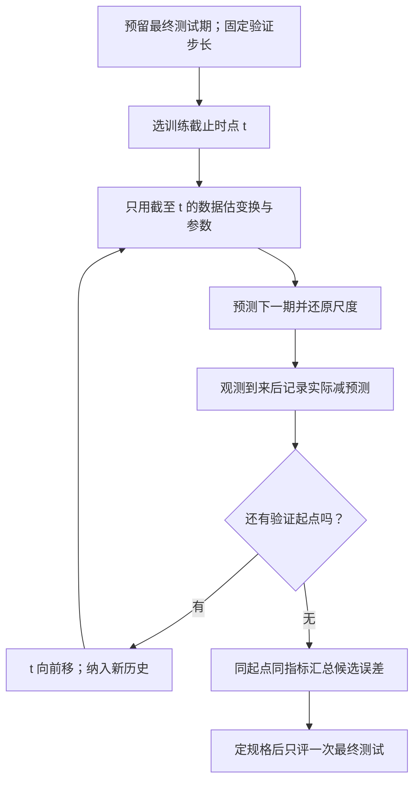
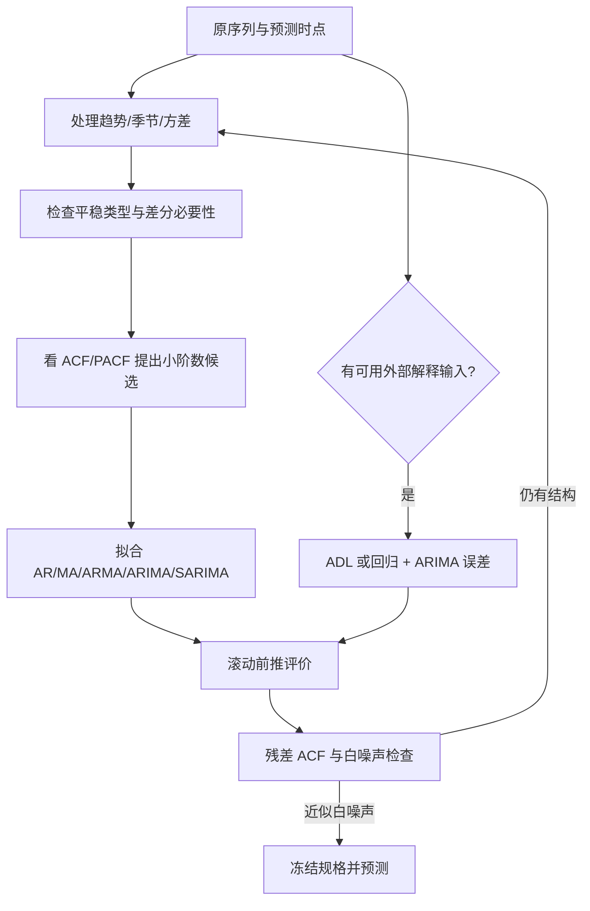

# M08 · 时间序列 II：自相关、差分与 ARIMA

> **本讲一句话**：把 M07 模型留下的残差当成新序列，检查它是否仍可预测，再用 AR、MA、差分和季节结构建立 ARIMA／SARIMA，并用滚动前推评价未来预测。
>
> **原始材料**：`IS6400-L9-time series2.pdf`，46 个物理页。页脚仍沿用 `/44`，p.12 还写 `/39`；本文一律用物理页码。本批纳入 S20 的部分课堂转录；其规范文件为 `M08-T09-transcript-source20-partial.txt`。源时钟同时用于 M08 和 T09，不把两份笔记跨度相加。实际授课日期未核。

---

## 0. 三分钟速览

预测要先确定当时可用的信息，再检查模型是否还漏掉可预测结构。残差是实际值减预测值；理想情况下，它在时间上不再呈现可预测的线性关系。这样的目标称为近似白噪声（White Noise），仍需结合样本外误差判断模型是否可用。自相关函数（ACF）和偏自相关函数（PACF）帮助判断过去值或过去误差仍留下什么结构。

AR 模型用过去的 $y$，MA 模型用过去的冲击误差，ARMA 合并两者。若原序列的均值、方差或季节结构随时间改变，先通过变换与差分得到较稳定的序列，再用 ARIMA／SARIMA 建模。所有模型都要按时间顺序滚动评价，不能随机交叉验证。

**学完你应该能**

1. 用历史窗口、平滑状态与滞后特征构造预测输入，并辨别当前答案泄漏。
2. 手算短序列的滞后相关，并说清 ACF 与 PACF 的“总关联”和“净直接关联”。
3. 从随机游走推到 AR(1)，判断 $\phi=0$、$\phi=1$ 等边界含义。
4. 用给定误差逐期算 MA(1) 的预测与观测，并区分它与 M07 的移动平均平滑。
5. 区分原序列弱平稳与去趋势后平稳，按 KPSS 规格解读结论，并解释变换和差分的作用。
6. 读懂 ARIMA$(p,d,q)$、SARIMA$(p,d,q)(P,D,Q)_m$ 与 ADL，并设计滚动前推评价。

**如果只记三件事**

- ACF／PACF 是诊断线索；有限样本、混合模型和差分都会让“截尾规则”不干净，最终要比较滚动误差并检查残差。
- KPSS 的 $p\ge0.05$ 只表示“未拒绝相应原假设”；`ct` 允许确定性趋势，不能由此认定原水平具有恒定均值。
- 差分次数不是越多越好。过度差分会放大噪声并制造负相关。

> 🎙️ **课堂实况**（实际授课日期未核）：S20从特征解释中段开始，M08讲义在 `01:29:33` 收束；`01:30:17`后转T09。小测与滚动评价有新增证据；缺首尾、识别疑点和原始数据缺口保留。实际授课日期未核。


---

## 1. 开始之前 · 知识衔接

### 1.1 你已经学过的

| 概念 | 本讲够用的唤醒 | 回看 |
|---|---|---|
| 水平、趋势、季节 | 水平是局部中心，趋势是长期方向，季节是固定日历周期 | [[IS6400_Business_Data_Analytics/notes/M07-时间序列I-平滑趋势与季节性#2.3 模式与分解：水平、趋势、季节和周期（讲义物理 p.14–21）\|M07 §2.3]] |
| SES／Holt／Holt-Winters | 分别递推更新水平、水平加趋势、水平加趋势加季节 | [[IS6400_Business_Data_Analytics/notes/M07-时间序列I-平滑趋势与季节性#2.6 Holt 与 Holt-Winters：递推保存水平、趋势和季节（讲义物理 p.32–35）\|M07 §2.6]] |
| 趋势与季节回归 | 时间趋势与季度虚拟变量可同时进入回归，但仍需检查残差 | [[IS6400_Business_Data_Analytics/notes/M07-时间序列I-平滑趋势与季节性#2.9 季节回归：虚拟变量与基准季度（讲义物理 p.42–43）\|M07 §2.9]] |
| 残差 | $e_t=Y_t-\hat Y_t$；仍有规律说明模型漏掉可预测结构 | [[IS6400_Business_Data_Analytics/notes/M02-预测分析-线性回归#2.5.3 曲线拟合：怎么定义"最好的那条线"（讲义 p.19, p.28）\|M02 §2.5.3]] |

读最后一行：本讲不是从原序列名字开始堆模型，而是先问已有模型的残差是否还留下可预测关系。

### 1.2 本讲全新引入的概念

| 概念 | English | 展开位置 |
|---|---|---|
| 白噪声与自相关 | White Noise / Autocorrelation | §2.2 |
| ACF 与 PACF | Autocorrelation / Partial Autocorrelation Function | §2.2、§2.5 |
| 随机游走与漂移 | Random Walk / Drift | §2.3 |
| AR 与 MA | Autoregressive / Moving Average Model | §2.4–§2.5 |
| 平稳性与 KPSS | Stationarity / KPSS Test | §2.6 |
| Box-Cox 与差分 | Box-Cox / Differencing | §2.7 |
| ARIMA 与 SARIMA | ARIMA / Seasonal ARIMA | §2.8 |
| 滚动前推验证 | Rolling-origin Evaluation | §2.9 |
| ADL | Autoregressive Distributed Lag | §2.10 |

### 1.3 为什么按这个顺序学 · 重排说明

讲义 p.2–12 先复习 M07，p.13 才切入 autoregression。本文在 §2.1 逐步恢复复习页的公式、数值表和特征构造，不要求读者先跳出本篇；正文按“残差目标 → 相关诊断 → AR／MA → 平稳化 → ARIMA → 评价 → 外部解释输入”组织。

这比直接背 $p,d,q$ 更稳：先知道为什么需要滞后，再知道哪些变换改变了数据，最后才能解释阶数与评价结果。

---

## 2. 正文

### 2.1 从 M07 接上来：怎样把历史变成预测输入（讲义物理 p.2–14）

假定今天刚得到本期销量，要预测下一期。能用的是已经发生的销量、日期和已知计划；下一期真实销量仍被遮住。预测时点（forecast origin）就是这条信息边界。下面先复习讲义的平滑、趋势与季节，再把它们变成可以交给回归模型的输入。

#### 2.1.1 最近几期该怎样平均（p.2–4）

简单移动平均（Simple Moving Average, SMA）每次取最近 $m$ 个观测的平均。$Y_t$ 是第 $t$ 期的实际值，$F_{t+1}$ 是刚看完第 $t$ 期后对下一期的预测，$m$ 是窗口里的期数：

$$
F_{t+1}=\frac{Y_t+Y_{t-1}+\cdots+Y_{t-m+1}}{m}.
$$

p.2 表中前三个季度销量是 1807.37、2355.32、2591.83。三个数合计 6754.52，除以 3 得 2251.5067，所以对第四季度的三期 SMA 预测为 2251.51。第四季度实际值 2236.39 是事后核对用的答案，不能放进这次平均；预测误差为 $2236.39-2251.51\approx-15.12$ 个销量单位。讲义未给这些销量的具体物理单位，不另猜箱数或金额。

接到第五季度预测时，窗口向右移：丢掉 1807.37，纳入已知的第四季度 2236.39。这说明“移动”改变的是窗口成员，不是把整个序列一次平均到底。

> [!question] English original（p.2）
> So, how do you decide m?  
> What if m=1 or 2?

**中文题意与参考作答**：第一问要求选择回看多少期，第二问要求解释短窗口的后果。没有唯一正确的 $m$：只能在训练期内安排按时间前推的验证，比较若干候选窗口在同一预测步长下的误差。大窗口更平滑，也更容易追不上趋势或突变；小窗口反应快，也更容易把随机波动当变化。

- $m=1$：$F_{t+1}=Y_t$，只复制最后一个观测，是朴素预测（naive forecast）。上期偏高多少，预测就跟着偏高。
- $m=2$：平均最近两期；以上例第三季度预测为 $(1807.37+2355.32)/2=2081.345$。若改为预测第四季度，成员必须改为第二、三季度，得 $(2355.32+2591.83)/2=2473.575$。

**English reference answer（⚪ 笔记自拟，非官方答案）**：Choose the window length by comparing time-ordered validation errors for the intended forecast horizon. A larger window smooths noise but responds more slowly. With m = 1, the forecast equals the most recent observation. With m = 2, it is the average of the two most recent observations available at the forecast origin.

加权移动平均（Weighted Moving Average, WMA，p.3）允许最近值占更大比重。若给最新、次新、再次新的权重分别为 0.5、0.3、0.2，第四季度预测变为：

$$
F_4=0.5(2591.83)+0.3(2355.32)+0.2(1807.37)=2363.985.
$$

权重总和须为 1；常见平滑还要求非负。较大近期权重是“近期更能代表下一期”的建模选择，不是永远有效的事实。讲义 p.3 混写 $k$ 与 $m$，这里统一用 $m$ 表示窗口长度。

简单指数平滑（Simple Exponential Smoothing, SES，p.4）不必保存固定窗口里的所有权重，只保存上一期的水平状态 $L_{t-1}$。状态是模型为下次更新而留下的数字；新观测到来后，用观测纠正旧状态：

$$
L_t=(1-\alpha)L_{t-1}+\alpha Y_t
=L_{t-1}+\alpha(Y_t-L_{t-1}),\qquad F_{t+1}=L_t.
$$

$\alpha$ 是介于 0 和 1 的平滑常数（smoothing constant），无单位。水平、实际值、预测值的单位相同。

笔记补充：旧水平为 100，新销量为 120，取 $\alpha=0.3$。误差为 20，只吸收其中 30%，新水平和下一期预测均为 $100+0.3(20)=106$。

- 若 $\alpha=1$，下一期直接复制新观测 120。
- 若 $\alpha=0$，旧水平 100 完全不更新。

把更新式继续向前代入，最近观测权重为 $\alpha$，前一期为 $\alpha(1-\alpha)$，再前一期为 $\alpha(1-\alpha)^2$。每老一期就再乘小于 1 的 $(1-\alpha)$，因此称“指数衰减”。有限历史还保留初始化状态的权重，不应假装这些有限项已经精确加到 1。SES 只更新水平，不能单靠调大 $\alpha$ 获得独立的趋势或季节状态。

#### 2.1.2 有趋势、季节时，必须多保存什么（p.5–6）

若销量每期都增长，只保存水平会持续落后。Holt 线性趋势（Holt's Linear Trend）增加趋势状态 $T_t$，表示每期增加多少；预测 $h$ 期后就从当前水平再加 $h$ 次趋势。讲义 p.5 的三步必须依次执行，先更新水平，再用新水平更新趋势：

$$
L_t=\alpha Y_t+(1-\alpha)(L_{t-1}+T_{t-1}),
$$
$$
T_t=\beta(L_t-L_{t-1})+(1-\beta)T_{t-1},\qquad
F_{t+h}=L_t+hT_t.
$$

$L_{t-1}+T_{t-1}$ 是上次对本期的预测；$L_t-L_{t-1}$ 是这次更新后所见的水平增量。$\beta$ 控制趋势吸收新增量的速度。$h$ 是向前多少期；$\alpha,\beta$ 无单位。

笔记补充：旧水平 100、旧趋势 5、新观测 112，$\alpha=0.4,\beta=0.2$。旧预测为 105，新水平为 $0.4(112)+0.6(105)=107.8$；新趋势为 $0.2(107.8-100)+0.8(5)=5.56$。下一期预测为 113.36，两期后为 118.92。若在趋势式里还用旧水平替代 $L_t$，就丢掉了这次观测的信息。

Holt-Winters（p.6）还保存每个季节位置的状态 $S$。讲义此页是“加法趋势 × 乘法季节”版本：旺季可表示为正常销量的 1.2 倍，淡季可为 0.8 倍。$m$ 表示一轮季节含几期，$S_{t-m}$ 是上轮同一季节的比例：

$$
L_t=\alpha\frac{Y_t}{S_{t-m}}+(1-\alpha)(L_{t-1}+T_{t-1}),
$$
$$
T_t=\beta(L_t-L_{t-1})+(1-\beta)T_{t-1},
$$
$$
S_t=\gamma\frac{Y_t}{L_t}+(1-\gamma)S_{t-m},\qquad
F_{t+h}=(L_t+hT_t)S_{t+h-m}.
$$

预测式按季节位置取最近已估计的 $S$；上式直写适用于前一轮可覆盖的 $1\le h\le m$，更远时循环使用相同季节位置。$\gamma$ 控制季节状态更新速度；乘法季节的 $S$ 是无单位比例，需为正且不为 0。这里先除去旧季节，再更新基础水平，最后估新的季节比例，不能把销量直接当比例。

笔记补充：已知旧水平 100、趋势 5、上轮同季节比例 1.2，新销量 132，三个平滑常数都取 0.5。去季节销量为 $132/1.2=110$；新水平为 $(110+105)/2=107.5$，新趋势为 $(7.5+5)/2=6.25$，新季节比例为 $(132/107.5+1.2)/2\approx1.21395$。若下一季节已保存比例为 0.9，下一期预测为 $(107.5+6.25)0.9=102.375$。

这些是给定参数和旧状态的手算，不是软件拟合结果。实际模型要从训练期确定初始状态和参数；T08 教程使用的是加法季节版本，不能直接把其 `seasonal='add'` 当成本页乘法式。两种形式的选择取决于季节差额是固定件数还是随水平成比例变化。

#### 2.1.3 时间趋势与季度标签怎样进回归（p.7–11）

线性趋势回归（linear trend regression）把期数 $t$ 当输入。每多一期，预测固定增加 $b$：

$$
Y_t=a+bt+e_t.
$$

$a$ 是时间 0 的截距，$b$ 是每期的平均变化，$e_t$ 是实际值减拟合值。普通最小二乘（Ordinary Least Squares, OLS）选择使残差平方和最小的 $a,b$；平方使正负误差不互相抵消，并更惩罚大误差。

p.8 软饮料销量的 64 个观测得到 $\hat Y_t=1633.356+65.39902t$。例如第 1 期拟合约为 1698.755，第 2 期比它高 65.399。右表 $R^2=0.886054$，表示这条线解释了样本内约 88.61% 的总平方偏差；它不是未来准确率。残差图横轴是期数，纵轴是实际减拟合；反复出现正负峰谷，提醒单一趋势仍漏掉季节结构。表中残差标准差约 440.17 个销量单位，也不能直接当未来多步预测区间。

指数趋势（exponential trend，p.9）针对固定百分比增长。例如 100 每期涨 5%，下一期为 105，再下一期为 110.25，增加量不断变大。讲义用 $Y_t=ce^{bt}u_t$ 表示这一机制；$u_t$ 是乘法扰动。自然对数（natural logarithm, $\ln$）把乘法变为加法，故可写成：

$$
\ln Y_t=a+bt+e_t,\quad a=\ln c,\quad e_t=\ln u_t.
$$

这里 $e^x=\exp(x)$ 是自然对数的反向操作。$b=0.05$ 对应的精确逐期增长率是 $e^{0.05}-1\approx5.127\%$，5% 是小 $b$ 时的近似。取对数要求 $Y_t>0$；对数尺度预测再取指数得到的是原尺度的一种位置预测，若要求原尺度条件均值，还须处理变换带来的偏差，不能忽略误差分布。

季节虚拟变量（seasonal dummy variable，p.10–11）让每季有一个固定差额。以第四季度为基准，第一季度那一列 $Q_1$ 只在第一季度取 1，其余取 0；$Q_2,Q_3$ 同样处理。含截距时四季只放三列：第四季全为 0；若四列都加，四列之和恒为截距列，会重复表达同一信息，无法唯一分开系数。

p.11 的模型同时用期数和季度解释对数销量。下式按原页系数表保留到可读精度，不是重新拟合：

$$
\widehat{\ln Sales_t}=7.510+0.019t-0.090Q_1+0.140Q_2+0.091Q_3.
$$

第一季度的 $-0.090$ 是控制时间后的对数差，对原销量的比例约为 $e^{-0.090}=0.9139$，即比同一时间基准第四季低约 8.61%。不能把它读成低 0.09 件。若第 1 期属第一季，代入得 $7.510+0.019-0.090=7.439$，取指数约 1701.05 个销量单位；由于系数已四舍五入，这只示范代入读法。

p.11 表给 $R^2=0.9270$、调整后 $R^2=0.9218$、残差标准误约 0.102（对数单位），比 p.8 多了季度和对数处理。两页响应尺度及有效样本数不同，不能只比两个 $R^2$ 就判定未来预测更好。季度系数固定，也不代表真实季节永不变化。

#### 2.1.4 滞后与滚动特征：先错开一行，再汇总过去（p.12）

现在换成一个表格模型：一行负责预测一个月份，输入列必须在当月销量揭晓之前就能算出。滞后（lag）就是回看多少期；`shift(1)` 把上一行销量搬到当前行，第一行因没有过去值而空缺。滚动窗口（rolling window）则对最近固定数目的行求均值、最大值或最小值。

讲义 p.12 下方的实际附件是 `model lagged term in sklearn.xlsx`，只有一个工作表，范围 A1:F12；共 11 个连续编号月份。页脚写 `.csv`，库内未发现该同名 CSV，不把它虚构成已读取的数据源。

下表摘录该工作簿；每行是一个月份，当前销量是训练时的答案列，另外四列是当月预测前可用的历史特征。滚动三期汇总只读前三个月，开头不够三期保持空缺。

| month | sales | shift(1) | 过去三期均值 | 过去三期最大 | 过去三期最小 |
|---:|---:|---:|---:|---:|---:|
| 1 | 100 | — | — | — | — |
| 2 | 104 | 100 | — | — | — |
| 3 | 112 | 104 | — | — | — |
| 4 | 113 | 112 | 105.3333 | 112 | 100 |
| 5 | 124 | 113 | 109.6667 | 113 | 104 |

读第 4 行：用 100、104、112 算得均值 $316/3=105.3333$、最大 112、最小 100。此时 113 是要预测的答案，不能进窗口。附件 D5 公式是 `AVERAGE(B2:B4)`，E5/F5 是同一区间的 `MAX`/`MIN`，与该信息边界一致；部分后续单元格保存的是值而非公式，不据此宣称全表会自动重算。

> [!question] English original（p.12）
> How to model this lagged features in sklearn?

**中文题意**：怎样把过去销量整理成机器学习可用的特征，而不是问怎样直接调用一个名为 lag 的 sklearn 模型。截图实际上使用 Polars 的 `pl.col` 表达式建立特征，再供 scikit-learn 的预测器使用。

以下忠实转录截图的特征构造部分。输入 `df` 已按时间升序，一行是一个小时，`count` 为小时计数；原页没有给出本地原始小时数据或 `df` 的导入过程，故本段是源码阅读与手推，未运行。

```python
lagged_df = df.select(
    "count",
    *[pl.col("count").shift(i).alias(f"lagged_count_{i}h")
      for i in [1, 2, 3]],
    lagged_count_1d=pl.col("count").shift(24),
    lagged_count_1d_1h=pl.col("count").shift(24 + 1),
    lagged_count_7d=pl.col("count").shift(7 * 24),
    lagged_count_7d_1h=pl.col("count").shift(7 * 24 + 1),
    lagged_mean_24h=pl.col("count").shift(1).rolling_mean(24),
    lagged_max_24h=pl.col("count").shift(1).rolling_max(24),
    lagged_min_24h=pl.col("count").shift(1).rolling_min(24),
    lagged_mean_7d=pl.col("count").shift(1).rolling_mean(7 * 24),
    lagged_max_7d=pl.col("count").shift(1).rolling_max(7 * 24),
    lagged_min_7d=pl.col("count").shift(1).rolling_min(7 * 24),
)
lagged_df.tail(10)
```

`df.select(...)` 选择原来的目标 `count` 并创建新列。`pl.col("count")` 表示整列；点号连接动作，并不表示小数。`alias` 或等号左侧为新列命名。`for i in [1, 2, 3]` 依次取 1、2、3，各造一个表达式；前面的 `*` 把这三个表达式展开为三个输入，`f"...{i}..."` 将数字写进列名。`tail(10)` 只显示末十行，不负责训练。

关键参数的单位由采样频率决定：`shift(24)` 在小时数据里才是昨天同一小时；`7 * 24` 表示 168 小时。`rolling_mean(24)` 取 24 行平均。先 `shift(1)` 再滚动，使时点 $t$ 的窗口止于 $t-1$；若去掉 `shift(1)`，当前答案会进入当行特征，发生数据泄漏（data leakage）。月份附件的窗口 3 只是另一组教学数字，不能把 24 小时参数原样套进月表。

**直接参考作答**：按时间排序，创建过去 1、2、3 期与业务季节滞后列；以先滞后再滚动的顺序生成历史统计。去掉历史不足的行后，将当前 `count` 作为目标、其余滞后列作为输入，并按时间切分训练和验证。若预测很多步而未来观测尚不可得，要递推用预测值或另设多步模型，不能提前读真实未来值。

**English reference answer（⚪ 笔记自拟）**：Construct lagged and rolling features from observations available before each forecast origin. The slide uses Polars to prepare these columns for a scikit-learn predictor. Shift the series before computing rolling statistics to exclude the current target, remove rows without sufficient history, and evaluate with chronological splits. A multi-step forecast must not use future observed targets as if they were already known.

#### 2.1.5 p.14 与 p.16 的输入问题：过去值能当什么（p.14、p.16、p.21）

时间序列（time series）是一列按固定间隔记录的观测。p.14 的能源产量和 Facebook 股价图中，每个点对应一个时点；图形说明时间顺序可能有信息，不证明它们一定能外推。$Y_t$ 表示本期要预测的值，$X_t$ 表示本期用于预测的输入。

> [!question] English original（p.14、p.16、p.21）
> How to get Xt?（p.14）  
> Possible Xt?（p.16，紧接本月银行余额与上月余额的例子）  
> Xt?（p.21，紧接 AR 与 MA 的介绍）

**中文与参考作答**：这些问句共同问“当前输入从哪里来”。可以像附件那样把过去 $Y$ 搬成 $X_t$，例如 $X_t=Y_{t-1}$；也可以使用日期、过去滚动统计或预测前已知的价格计划。AR 用过去观测，MA 用过去创新误差，后者须由已到来的观测递推估计，不是另有一列随手可得的未来误差。银行余额例中，上月余额是合法候选，本月最终余额仍是待预测目标；相关不保证强预测，更不证明因果。

**English reference answer（⚪ 笔记自拟）**：Possible predictors include lagged values of the response, historical rolling summaries, calendar variables, and external variables known at the forecast origin. For a bank balance, last month's balance is a possible predictor of this month's balance. AR models use previous observations, whereas MA models use previously estimated innovations. Current or future unknown outcomes must not enter the predictor set.

**🎙️ 课堂补充**（S20 `00:02`–`02:36`、`07:34`–`11:29`）

本源开始时已经在解释从历史观测构造输入，随后转入自回归；没有录到 p.2–11 的完整复习，也没有 p.12 Polars 代码逐行演示。S20 `07:43` 明确说：*"We cannot use any future information to construct Xt"*。中文就是：在预测发生时，输入必须已经可得，不能拿未来答案造特征。

银行余额例用本月余额预测下月余额（S20 `08:43`–`11:09`）。课堂把“会变化、有关系、当时可得”作为选特征的直觉；前两项不是预测有用的充分条件，相关也不证明因果。`09:36` 的“余额都为零也相关”不能直接作为数学结论：常量列方差为零，相关系数无定义。这里新增的是课堂选特征思路，不改变正文的预测信息边界。


### 2.2 白噪声、滞后变量与自相关（讲义物理 p.15–17）

假设连续几期模型都低估销量，实际减预测的残差便连续为正。若这种连续性能帮助预测下一期，说明模型仍漏掉信息。p.15 要求把可预测部分放进拟合值，剩余部分才当成无法预先知道的误差。

预测方程可写成

$$
Y_t=\hat Y_{t\mid t-1}+e_t.
$$

$\hat Y_{t\mid t-1}$ 读作“看完第 $t-1$ 期后对第 $t$ 期的预测”，帽子表示估计或预测。理想残差 $e_t$ 应近似白噪声：长期平均为 0、方差稳定、不同非零滞后间不相关。均值是平均值；方差是离均值偏差的平方平均，衡量波动大小。

自相关（autocorrelation）比较同一序列现在和过去是否一起高、一起低；把不同回看期数 $k$ 的相关排起来，就是自相关函数（Autocorrelation Function, ACF）。它衡量线性关联，不等于因果方向。对序列 $Y_t$，常用的样本 ACF 定义为

$$
r_k=\frac{\sum_{t=k+1}^{n}(Y_t-\bar Y)(Y_{t-k}-\bar Y)}{\sum_{t=1}^{n}(Y_t-\bar Y)^2}.
$$

下表每行解释自相关公式的一个量。单位列说明哪些量保留原尺度，哪些量已经标准化而无单位。

| 符号 | 是什么 | 单位 | 已知还是要算 |
|---|---|---|---|
| $k$ | 回看多少期 | 期 | 先选 |
| $Y_{t-k}$ | 当前行对应的过去观测 | 与 $Y$ 相同 | 已知 |
| $\bar Y$ | 样本均值 | 与 $Y$ 相同 | 要算 |
| $r_k$ | 滞后 $k$ 的标准化线性关联 | 无 | 要算 |

分子把当前偏差与 $k$ 期前偏差相乘：同号贡献正值，异号贡献负值。分母用整体平方偏差缩放，使结果无单位且落在 $[-1,1]$。求和符号 $\sum$ 的动作是把指定行依次相加；分子只有能配成对的 $n-k$ 项，分母使用全部 $n$ 行围绕同一均值的平方偏差。

**数字例子（手把手）**

笔记补充序列 $[1,2,3,4]$，均值 $\bar Y=2.5$。滞后 1 的成对项是 $(2,1),(3,2),(4,3)$：

1. 分子为 $(-0.5)(-1.5)+(0.5)(-0.5)+(1.5)(0.5)=1.25$。
2. 分母为 $(-1.5)^2+(-0.5)^2+(0.5)^2+(1.5)^2=5$。
3. 按上式 $r_1=1.25/5=0.25$。这表示此样本、此 ACF 定义下的一阶关联为 0.25，不是“下一期上涨概率为 25%”。

本篇统一使用上式，不能与另取重叠两列、分别去各自均值的 Pearson 相关混算：例如本例重叠两列为 $[2,3,4]$ 与 $[1,2,3]$，后者 Pearson 相关为 1，而上述 ACF 为 0.25。有限短样本里这不是小数舍入差异。报告软件结果须说明估计方式；不能把不同算法的数值当成同一次复算。

若残差在滞后 1 仍显著正相关，看到上一期正误差后，下一期误差仍倾向为正，说明模型还可改进。

p.17 的表从 Jan-95 销量 226、Feb-95 销量 254、Mar-95 销量 204 开始。Feb-95 行的一阶滞后填 226；Mar-95 行填一阶 254、二阶 226。原页写 “Lag1 variables: $Y_t=Y_{t-1}$” 是列构造说明，不是当前值恒等于过去值。

右侧保存的一至六阶相关依次约为 0.3492、0.0772、0.0814、−0.0095、−0.1353、0.0206，标准误列约 0.1443。完整中间月份未显示，也未找到本页完整原表，因此这些只是讲义给定输出，不声称已从全部销量复算。它们表明该例一阶正关联较强，其余所示阶数较小，仍不能自动选定模型。

常见白噪声 ACF 图以 0 为中心画近似 95% 逐阶参考带；在独立同分布且样本较大等条件下，带宽约为 $1.96/\sqrt n$。这里的“显著”是柱超出该近似范围，不是模型正确概率。滞后 0 比较序列与自身，非恒定序列必为 1，不应把这一柱算成模型阶数。

**🎙️ 课堂补充**（S20 `02:57`–`05:50`、`11:32`–`24:57`）

课堂先问模型是否漏掉信息，再逐行把过去观测搬成新列。S20 `13:08`：*"So t equals to 1, so x1 equals to y0, but we do not have y0"*。第一行缺少上一期，因此保持缺失，不能填成已知零。

加入 lag2 时前两行缺失；继续加阶会减少可用训练行（S20 `17:44`–`22:16`）。同时，旧滞后若已被现有列解释，就可能冗余（`23:29`–`24:11`）。这补足了“不是滞后越多越好”的课堂理由。口述 ASR 的首期数值出现 223／266，正文仍按 p.17 书面 226，不把不一致数字当已核课堂数据。

**💡 换个说法（笔记补充）**

把序列复印一份向下错开一行，再把同一行的“现在”和“上一期”配对。自相关就是检查这两列是否一起高、一起低。

**⚠️ 常见误解**

- 不相关不等于独立；白噪声诊断常关注线性相关，但更复杂依赖可能仍存在。
- 单个柱超过界线只是候选证据；检查很多滞后会出现偶然显著，且界线依赖样本假设。

**极端／边界情况**

常数序列的方差为 0，相关无定义。短样本在大滞后只剩很少配对，估计很不稳定。

ACF 是 MA 阶数的经典线索，也是残差白噪声检查的一部分；PACF 在 §2.5 去除中间滞后的间接通路。

自相关把“图上似乎有连续性”变成可计算量，但还不能单独决定模型。

### 2.3 随机游走：水平不平稳，变化可能无规律（讲义物理 p.18–19）

p.18 的 Google 收盘价曲线随时间累积上升，不表示每一天的变化都能预测。若今天价格等于昨天加一个不可预知的冲击，连续冲击会把水平推远，即使每一步本身毫无持续方向。随机游走（random walk）带漂移写成

$$
Y_t=Y_{t-1}+m+e_t,
$$

其中 $m$ 是平均每期变化，$e_t$ 是当期不可预测冲击。做一阶差分：

$$
\Delta Y_t=Y_t-Y_{t-1}=m+e_t.
$$

这里 $\Delta$ 是一阶差分算子，动作是“当前水平减上一期水平”；$m$ 的单位是“$Y$ 单位／期”；$e_t$ 与 $Y$ 同单位。期望（Expectation）$E[e_t]=0$ 表示在反复出现的同类时点中，冲击的长期平均为 0，不表示每一期冲击都等于 0。

原序列可以表现出长趋势和多阶正自相关，但变化量仍可能近似随机。它解释了“看起来很平滑”不代表价格水平可从趋势可靠外推。

p.18 的 Google 收盘价水平持续上升，而讲义强调其 differences 可能随机；p.19 给 $Y_t=Y_{t-1}+m+e_t$ 和四个符号定义。

**🎙️ 课堂补充**（S20 `25:00`–`27:26`）

课堂从一般滞后回归把过去值系数固定成 1，引出随机游走。S20 `25:31`：*"Now the random walk is assumed, so a equals to 1."* 每期平均移动由漂移描述，具体一步还带冲击；不能把平均移动理解为每次恰好走同样距离。此段确认随机游走是特殊模型，没有提供一组可重估参数的真实数据。

**💡 换个说法（笔记补充）**

今天的位置等于昨天位置加一步随机移动。路径会漂得很远，但每一步本身可能没有可预测方向。

**数字例子（手把手）**

设初始水平为 100，漂移为 2，三期冲击依次为 1、−3、0。

1. 第一期水平是 $100+2+1=103$。
2. 第二期水平是 $103+2-3=102$。
3. 第三期水平是 $102+2+0=104$。
4. 三期差分是 3、−1、2，均值为 1.333；小样本不保证恰等于设定漂移 2。

**⚠️ 常见误解**

- “随机游走”不是说水平图毫无形状；累积冲击常形成看似趋势。
- $m$ 是平均变化而不是误差均值；通常假定 $E[e_t]=0$。

**极端／边界情况**

$m=0$ 是无漂移随机游走。若初值固定、各期冲击不相关且每期方差均为 $\sigma^2$，$t$ 期水平已累加 $t$ 个冲击，方差为 $t\sigma^2$。$\sigma^2$ 是单期冲击波动大小；不相关使这些方差可相加。因此水平过程方差不恒定，不满足后文的弱平稳。若冲击相关或方差改变，这个简式也需修改。

随机游走是 AR(1) 在 $\phi=1,c=0$ 的边界，也是 ARIMA$(0,1,0)$ 的特例。

若水平不平稳而一阶变化稳定，差分不是数据损坏，而是在改变建模对象。

### 2.4 自回归模型：过去的值怎样进入预测（讲义物理 p.20–24）

先把当前值放到答案列，再把过去一期、两期等各搬成输入列。自回归（autoregression, AR）就是用自己过去的观测做回归；AR($p$) 的 $p$ 表示最远用到过去第 $p$ 期：

$$
Y_t=c+\phi_1Y_{t-1}+\cdots+\phi_pY_{t-p}+e_t.
$$

AR(1) 的一步预测是 $\hat Y_{t\mid t-1}=c+\phi Y_{t-1}$。讲义 p.22 给出三种边界：

- 当 $\phi=0$ 时，过去值不起作用，只剩常数加白噪声。
- 当 $\phi=1$ 且 $c=0$ 时，模型是无漂移随机游走。
- 当 $\phi=1$ 且 $c\ne0$ 时，模型是带漂移随机游走。

先读各项的角色：

- $c$ 是截距，单位与响应相同。
- $\phi_j$ 是第 $j$ 阶过去值的权重，无单位。
- $e_t$ 是当期不可预知冲击。

讲义写 $e_t\sim N(0,\sigma^2)$，表示额外采用均值 0、方差 $\sigma^2$ 的正态误差假设。它是模型假设，不能从“AR”三个字自动保证。

给定其他滞后输入不变，$Y_{t-j}$ 每增 1，预测改变 $\phi_j$。若 AR(1) 收到一次额外冲击 10、$\phi=0.6$，它在下一期仍带来 6，再下一期为 3.6，之后每期再乘 0.6。

不同系数对应不同状态变化：

- $|\phi|<1$：冲击逐步衰减。
- $\phi=-0.6$：正负交替衰减。
- $\phi=1$：不衰减；绝对值大于 1 则放大。

**数字例子（手把手）**

设 $Y_t=10+0.6Y_{t-1}+e_t$，已知 $Y_t=20$：

1. 一步预测 $\hat Y_{t+1}=10+0.6(20)=22$。
2. 两步预测用第一步预测代入：$10+0.6(22)=23.2$。
3. 若长期均值不变，左右两期均值同为 $\mu$，而冲击均值为 0，所以 $\mu=10+0.6\mu$。移项得到 $\mu=10/(1-0.6)=25$，预测逐步向 25 回归。

**参数怎样从数据来（笔记补充）**：对 AR(1)，每行有过去值 $x$ 和当前值 $y$，OLS 寻找使 $\sum(y-c-\phi x)^2$ 最小的直线。单输入带截距时，可用 $\phi=\sum(x-\bar x)(y-\bar y)/\sum(x-\bar x)^2$，再令 $c=\bar y-\phi\bar x$。分子衡量两列如何共同偏离各自平均，分母把变化按输入波动缩放。

用连续序列 $[1,2,2,4]$ 复做一次（笔记补充）。每行的过去值必须来自紧邻前一期，不能另外拼一列。

下表一行是一次相邻配对；首期 1 没有过去值，所以不生成训练行。

| 当前时点 | 过去值 $x=Y_{t-1}$ | 当前值 $y=Y_t$ |
|---:|---:|---:|
| 2 | 1 | 2 |
| 3 | 2 | 2 |
| 4 | 2 | 4 |

读第 3 时点：上一期是 2，本期也为 2；下一行过去值仍为这次的本期值 2。这正是 `shift(1)` 的连续关系。

1. 两列均值分别为 $\bar x=5/3$、$\bar y=8/3$。
2. 交叉偏差和为 $4/9-2/9+4/9=2/3$，输入平方偏差和为 $4/9+1/9+1/9=2/3$，所以斜率为 1。
3. 截距为 $8/3-1(5/3)=1$。拟合值为 $[2,3,3]$，实际减拟合得到残差 $[0,-1,1]$。

这三个样本只展示估系数的操作；拟合斜率恰为 1，处于前文随机游走边界，不能把本例当成已经通过平稳检查的 AR 模型。

这只用训练表中已经观测到的值估系数。AR($p$) 用多列同时找最小平方和，不能分别做多次单变量拟合后拼系数。

很多业务量有惯性：余额、需求、温度不会每期完全重置。AR 用少量系数表达这种持续性。

p.20 从随机游走扩展到 AR(1)、AR(2)、AR($p$)。p.23 用先从两端去掉相同中间变量再相关残差的方法引出 PACF；p.24 的传话图说明信息可能经中间环节传递。它是依赖链类比，不提供可估计的实际传播系数。

> [!question] English original（p.23、p.24，两页重复同一问）
> How do we determine p?

**中文与直接参考作答**：$p$ 是过去观测放到多远。先在平稳候选序列上看偏自相关函数（Partial Autocorrelation Function, PACF）：理想纯 AR($p$) 的理论 PACF 在 $p$ 后为 0，提供小范围候选；有限样本柱不会整齐归零，仍需按时间验证和查残差。p.28 画前两阶超出带，提示 AR(2) 候选，不能把图当唯一规格证明。

**English reference answer（⚪ 笔记自拟）**：For a stationary pure AR(p) process, the theoretical PACF cuts off after lag p. Use the sample PACF to propose a small set of orders, then compare time-ordered validation performance and residual diagnostics. Sampling variation and mixed ARMA structure prevent a mechanical count of significant bars from uniquely determining p. 此答案分别适用于 p.23 与 p.24 的重复问句。

**🎙️ 课堂补充**（S20 `27:33`–`38:44`）

课堂把 AR(1) 扩展成 AR(2)，再问第三个滞后是否带来新信息。S20 `35:48`：*"So if x1 and x2 are good enough, they can provide as much information as x3 can provide, then we do not need x3."* 中文是：已有两列若已提供第三列能提供的信息，就无需再加第三列；实际选阶仍须验证，不是只凭这句话删变量。

S20 `37:42`–`37:54` 说明本段不进入 PACF 数学细节，教程再看工具。正文保留残差化和完整算例，供自学理解；这不是教授明说这些推导不会考。

**💡 换个说法（笔记补充）**

AR(2) 像同时听昨天和前天的意见，但每个系数是在另一个意见已在场时的净贡献。

**⚠️ 常见误解**

- OLS 可估系数不代表普通独立误差回归诊断自动成立；残差仍要查白噪声。
- $|\phi|<1$ 是 AR(1) 平稳的重要边界；$\phi=1$ 不能用同一个长期均值公式。

**停止条件／什么时候别用**

候选 $p$ 可由 PACF、信息准则与滚动误差共同筛选。信息准则（information criterion）在同一数据和拟合口径下同时比较拟合好坏与参数数量，避免仅因多放系数就被选中；本篇用作筛选线索，不计算其具体数值。新增滞后不改善样本外表现、系数不稳定或数据不足时停止加阶。

PACF 对纯 AR($p$) 理论上在 $p$ 后截尾；混合 ARMA 中通常不会这么干净。

AR 把“历史值有惯性”写成模型；下一节加入过去冲击，区分直接与间接相关。

### 2.5 MA、ACF 与 PACF：过去冲击和直接滞后（讲义物理 p.21、p.25–29）

若一次未预料到的需求冲击不只影响当期，还延续到下一期，就应记录过去冲击，而不只记录过去销量。移动平均误差模型（Moving Average Error Model, MA($q$)）用过去 $q$ 个创新冲击。创新（Innovation）是观测到来前不可预测、到来后可由“实际值减一步预测”估计的误差：

$$
Y_t=\mu+\theta_1e_{t-1}+\cdots+\theta_qe_{t-q}+e_t.
$$

下表逐一说明 MA 公式里的量；误差与序列单位相同，系数和阶数没有单位。

| 符号 | 动作 | 单位 |
|---|---|---|
| $\mu$ | 给序列基准均值 | 与 $Y$ 相同 |
| $q$ | 决定纳入多少个过去冲击 | 无 |
| $\theta_j$ | 给第 $j$ 个过去冲击分配权重 | 无 |
| $e_t$ | 记录当期创新 | 与 $Y$ 相同 |

读第一行：若基准均值为 10，那么没有可延续的过去冲击时，一步预测从 10 起步。

偏自相关函数（Partial Autocorrelation Function, PACF）则问：控制中间各阶滞后后，最远那一阶滞后还剩多少直接线性关联。

ACF 衡量 $Y_t$ 与 $Y_{t-k}$ 的总线性关联，包含中间滞后传递的间接作用。PACF 衡量控制 $Y_{t-1},\ldots,Y_{t-k+1}$ 后，$Y_{t-k}$ 与 $Y_t$ 的剩余线性关联。

下面用“已解释的信息”连起 p.27 的路线。箭头表示预测信息可能经中间值传递，不能单凭相关图认定真实因果。


ACF 看 A 与 C 的全部线性关联；计算 PACF 时，从 A、C 两端都减去可由 B 线性预测的部分，再相关剩余部分。若只从一端扣除，便不是这里介绍的同一残差化操作。

**PACF(2) 的实际残差化例子（笔记补充）**

取短序列 $[1,2,1,3,2,5]$。对 $t=3,4,5,6$ 排成三列：当前值 $Y_t=[1,3,2,5]$，一阶滞后 $Y_{t-1}=[2,1,3,2]$，二阶滞后 $Y_{t-2}=[1,2,1,3]$。PACF(2) 要控制中间的一阶滞后：

1. 用截距和 $Y_{t-1}$ 回归 $Y_t$，得到拟合式 $\widehat Y_t=3.75-0.5Y_{t-1}$，残差为 $[-1.75,-0.25,-0.25,2.25]$。
2. 用同样的截距和 $Y_{t-1}$ 回归 $Y_{t-2}$，得到 $\widehat Y_{t-2}=2.75-0.5Y_{t-1}$，残差为 $[-0.75,-0.25,-0.25,1.25]$。
3. “残差化”就是实际列减去可由中间滞后预测的部分。两组残差均值为 0，逐行相乘再相加得 4.25；各自平方再相加分别为 8.25 与 2.25。用两个波动尺度的几何平均作分母，得到去单位的相关：
   $$
   \operatorname{PACF}(2)=\frac{4.25}{\sqrt{8.25\times2.25}}=0.98644.
   $$

前两次回归也能按 §2.4 的斜率公式复做：中间列均值为 2、平方偏差和为 2，两次交叉偏差和均为 −1，所以两次斜率都是 −0.5；两端均值分别为 2.75 与 1.75，截距便是 3.75 与 2.75。

这个数表示：把 $Y_{t-1}$ 能线性解释的部分从两边都拿走后，$Y_{t-2}$ 与 $Y_t$ 仍有很强的剩余线性关系。小样本只用于展示算法，不作为真实选阶证据。迁移到 PACF($k$) 时，就把中间的 1 到 $k-1$ 阶滞后共同放进两次回归。

冲击 $e_{t-1}$ 在上一期发生时不可预知，但到时点 $t$ 已经可以从上一期观测与预测之差估计。MA 模型让冲击影响延续有限期。

**课件原例与完整表格复算（p.25）**

讲义给 $\hat Y_t=10+0.5e_{t-1}$、$Y_t=\hat Y_t+e_t$，并给误差 $e_1=-2,e_2=1,e_3=0,e_4=2,e_5=1$。若初始化 $e_0=0$：

| $t$ | 已知上期误差 | $\hat Y_t$ | 当期误差 $e_t$ | $Y_t$ |
|---:|---:|---:|---:|---:|
| 1 | $e_0=0$ | 10.0 | −2 | 8.0 |
| 2 | −2 | 9.0 | 1 | 10.0 |
| 3 | 1 | 10.5 | 0 | 10.5 |
| 4 | 0 | 10.0 | 2 | 12.0 |
| 5 | 2 | 11.0 | 1 | 12.0 |

一行是一时点。第二列是预测时已知的过去误差，第三列是预测，第四列是新冲击，第五列是观测结果。

p.27 用鲑鱼平均月价 $P$ 画出“前两月 → 上月 → 本月”的间接路线，以及前两月直接连到本月的路线。ACF 包含两类线性联系；PACF 控制上月信息后看额外关联。原图的“indirect effect + direct effect”是路径示意，不能当作无需模型就成立的数值恒等式。

> [!question] English original（p.26）
> How to determine q?

**中文与直接参考作答**：$q$ 是过去冲击延续几期。理想纯 MA($q$) 超过 $q$ 期后不再共享冲击，因此理论 ACF 为 0；p.29 所示前两阶显著给 MA(2) 候选。实际图要排除必为 1 的 lag 0，再看参考带，并比较样本外误差。p.28 的 PACF 图才对应 AR 候选，不能交换。

**English reference answer（⚪ 笔记自拟）**：For a pure MA(q) process, the theoretical ACF is zero beyond lag q because observations farther apart no longer share innovations. Use the sample ACF, excluding lag zero, to suggest candidate orders and verify them with chronological validation and residual checks. The slide's two significant nonzero lags suggest MA(2), rather than proving it. 篇中没有该例原始数据，不能复造图柱数值。

AR 适合状态持续；MA 适合一次冲击影响若干期。ACF／PACF 为候选阶数提供结构线索。

**🎙️ 课堂补充**（S20 `31:29`–`33:13`、`38:58`–`43:52`）

课堂用“过去误差还包含遗漏信息”解释 MA 的动机，并明确区别于移动平均平滑。S20 `32:39`：*"Now following this idea, we have this moving average. So this is different from the previous learning simple moving average"*。它用的是过去预测创新，不能把未来未知误差当输入；本源未逐行讲完 p.25 的五期数表，数表仍按讲义与手算来源保留。

S20 `40:48`–`43:17` 提醒先查横轴从 0 还是 1 开始，课堂示例取最前面连续越界的两阶。这个简便选法不能推广为“较远显著柱一律无用”：季节结构、混合模型和抽样误差都可能留下后续柱，仍按正文把图用于提出候选，再验证。

**💡 换个说法（笔记补充）**

ACF 问“两个月前和今天总共多像”；PACF 问“已经知道上个月后，两个月前还额外告诉我多少”。

**⚠️ 常见误解**

- MA($q$) 的“Moving Average”是历史冲击线性组合，不是窗口销量平均。
- 过去误差不是外部直接给定特征；模型估计时要随着当前参数重新递推，详见 §2.8 的同一数据比较。
- “PACF 截尾选 AR、ACF 截尾选 MA”只对理想纯模型是线索，不是自动判题规则。

**极端／边界情况**

$q=0$ 只剩白噪声加均值。可逆性（invertibility）问“能否从观测稳定地找回冲击”：对 MA(1)，$e_t=Y_t-\mu-\theta e_{t-1}$，初始误差的影响每期再乘 $-\theta$。当 $|\theta|<1$ 时才逐步衰减，避免久远初始化持续左右当前冲击。它与 AR 的动态稳定检查对象不同；高阶项会共同作用，不能只逐个查系数绝对值。§2.8 的“根与单位圆怎样读”给出诊断桥梁。

AR 与 MA 合并成 ARMA；非平稳序列先差分后得到 ARIMA。

ACF／PACF 帮我们提出候选，但最终规格必须经滚动评价与残差检查。

### 2.6 平稳性与 KPSS：先明确检验的是哪种稳定（讲义物理 p.30–33）

想把早期学到的关系用于后期，需要确认序列的统计性质是否随着日历位置改变。平稳性（stationarity）回答这个问题。讲义把平稳概括为“无趋势、方差恒定、无季节性”。更严谨地说，本讲通常需要弱平稳（Weak Stationarity）：$E[Y_t]=\mu$ 不随 $t$ 变，$Var(Y_t)=\sigma^2$ 不随 $t$ 变，$Cov(Y_t,Y_{t-k})$ 只依赖滞后 $k$，不依赖具体日历时点。

期望 $E[Y_t]$ 是许多可能实现中时点 $t$ 的平均，并非要求每个实际观测都等于 $\mu$；方差衡量围绕这个中心的波动。协方差（covariance）把两个时点的偏差相乘后求平均，衡量它们是否一起高或低。“只依赖滞后”指一月与二月、六月与七月这两种一期间隔关系相同，不由月份位置另定一套规则。

这一定义允许短程自相关或随机波动形成局部起伏；“平稳”不等于一条平线，也不等于绝对没有任何频率结构。

统计检验先指定一个暂时成立的说法，称原假设（null hypothesis）。$p$ 值是在该说法及检验假设成立时，出现至少这样极端统计量的概率；不是数据平稳的概率。KPSS（Kwiatkowski–Phillips–Schmidt–Shin）检验的原假设可设为围绕常数平稳（`regression='c'`）或围绕确定性趋势平稳（`regression='ct'`）。

**趋势平稳检查的对象是什么（笔记补充）**

设 $e_t$ 已是均值为 0 的弱平稳扰动，原序列为：

$$
Y_t=2+0.5t+e_t.
$$

其均值每期增加 0.5，所以原 $Y_t$ 不满足恒定均值的弱平稳。若减去给定趋势 $2+0.5t$，剩下的恰是 $e_t$，才有这里假定的弱平稳性质。这种“围绕确定性趋势波动，去趋势后平稳”叫趋势平稳（trend stationarity）。

`regression='ct'` 的原假设允许上述确定性线性趋势；检验先估计并去掉常数与趋势，再检查剩余部分是否符合平稳原假设。`regression='c'` 只去常数，对应原序列围绕固定中心平稳的假设。两者检查的问题不同，不能看哪个 $p$ 值大就选哪个。

因此，`ct` 未拒绝并不把有趋势的原水平变成恒定均值序列。若采用去趋势建模路线，只用训练期估计趋势，对去趋势后的剩余拟合恒定均值 ARMA，最后把未来时点的趋势加回预测。是否差分则是另一路选择，需结合图、检验和前推误差决定，不能因为存在确定性趋势就机械差分。

KPSS 先按所选原假设去掉常数或常数加趋势，得到残差 $e_t$。然后累积残差：

$$
S_t=\sum_{i=1}^{t}e_i.
$$

若残差只是围绕固定中心短期摆动，累积和不会长期单向漂走。检验统计量把累积偏离的平方总量与残差的长期方差比较：

$$
\operatorname{KPSS}=\frac{n^{-2}\sum_{t=1}^{n}S_t^2}{\widehat\sigma^2_{LR}}.
$$

$\widehat\sigma^2_{LR}$ 是长期方差（Long-run Variance），会把残差方差和选定滞后内的自协方差一起计入；`nlags` 因此会影响统计量。统计量越大，表示累积偏离相对短期噪声越大，越不利于平稳原假设。

ARMA 的均值、方差与相关结构假设在时间上稳定。对明显非平稳水平直接拟合 ARMA，系数和显著性可能误导。

p.30 明写 “ARMA: assumes a stationary time series”。p.32 的四图要分别读：A 是 US treasury bill contracts，横轴 Day、纵轴合约数量，有下行趋势；B 是温度随季节反复升降，固定日历位置的均值不同；C 是澳洲季度发电量，横轴年份、纵轴 billion kWh，趋势上升并带重复季节波动。这三幅均不符合讲义的直接平稳口径。

D 是 Google 收盘价的每日变化，不是价格水平。横轴是交易日序号、纵轴为价格变化，中心看似在 0 附近，但尖峰和高低波动段仍要检查，不能仅凭形状宣称方差恒定。四图无完整原数列，这里是图形判断，不是统计检验输出。

**KPSS 判断步骤**

1. 先按问题选择假设：原水平围绕常数用 `c`；允许确定性线性趋势、检查去趋势剩余用 `ct`，并说明理由。
2. 计算统计量与 $p$ 值，并记录滞后选择方法。
3. 若 $p<0.05$，在该规格下拒绝平稳原假设。
4. 若 $p\ge0.05$，只能说“未拒绝该规格的原假设”。`ct` 未拒绝不代表原水平具有恒定均值，也不能写“以 95% 概率确认平稳”。
5. 结合时序图、ACF、另一类单位根检验和残差诊断形成结论。

**KPSS 可复算小例（笔记补充）**

用序列 $[1,2,1,2]$ 演示 `regression='c'` 且 `nlags=0` 的最简计算：

1. 均值为 1.5，去均值残差为 $[-0.5,0.5,-0.5,0.5]$。
2. 累积残差 $S_t$ 为 $[-0.5,0,-0.5,0]$，所以 $\sum S_t^2=0.5$。
3. 分子为 $0.5/4^2=0.03125$。
4. 当 `nlags=0`，长期方差估计退化为残差平方均值：$\widehat\sigma^2_{LR}=1/4=0.25$。
5. KPSS 统计量为 $0.03125/0.25=0.125$。常用 level-stationary 渐近参考表的 5% 临界值为 0.463；按该表机械比较，0.125 不越界。但只有 4 个观测，不能把大样本参考表当成可信的实际检验结论；这里仅复算统计量。

实际样本不能照搬 `nlags=0`。要按预先规则选择滞后，并从软件输出读取对应临界值与表范围；样本过短、结构突变或残差强相关都会让检验不稳定。

**🎙️ 课堂补充**（S20 `44:06`–`47:43`）

四幅图不只看有没有趋势。课堂对第四图也比较了不同窗口的波动：S20 `45:39`：*"So then the values here is relatively much larger"*；接着指出波动并不稳定（`45:42`–`45:51`）。因此 D 图“像围绕零波动”还不足以确认平稳，和正文的谨慎判断一致。

课堂在 `46:25`–`46:54` 用 KPSS 的平稳原假设讲判断，但“accept ... at 95%”仍是过强简述。正文继续区分 c／ct 与“未拒绝”，不把新转录当作推翻统计边界的依据。

**💡 换个说法（笔记补充）**

KPSS 像法庭把“平稳”先放在被告席的无罪推定位置。证据足够强才拒绝；证据不足只是未推翻，并非证明永远平稳。

**⚠️ 常见误解**

- p.33 的 “accept stationary at 95% confidence” 过强。应写 fail to reject the stationarity null at the 5% level。
- “无季节性”是本讲建 ARMA 前的实务口径；弱平稳的核心是均值、方差与协方差结构不依赖绝对时点。
- `ct` 允许原序列保留确定性趋势；要对恒定均值 ARMA 建模，须先明确处理趋势的路线，不能直接将原水平当作已弱平稳。
- KPSS 对结构突变、样本长度和滞后选择敏感，不应单独决定差分次数。

**外部核对**

🔗 [statsmodels `kpss` 官方文档](https://www.statsmodels.org/stable/generated/statsmodels.tsa.stattools.kpss.html)（原笔记记录获取于 2026-10-20，本轮未重新在线获取）明确：`c` 的原假设是围绕常数平稳，`ct` 是围绕趋势平稳；缺失值不会自动处理，$p$ 值来自临界值表插值。

差分用于消除随机趋势或季节单位根；Box-Cox 主要稳定方差，作用不同。

先说清检验的平稳类型和原假设，再报告“拒绝／未拒绝”；不要把 $p$ 值改写成模型为真的概率。

### 2.7 稳定化：Box-Cox、去季节与差分（讲义物理 p.34–36）

若高销量时期连波动幅度也更大，先改变尺度；若中心随时间变，再处理趋势；若固定季节位置反复偏高，再处理季节。它们不是同一种问题。Box-Cox 变换（Box-Cox transformation）主要处理随水平变化的方差，标准形式要求每个输入 $y>0$：

$$
g_\lambda(y)=
\begin{cases}
\dfrac{y^\lambda-1}{\lambda}, & \lambda\ne0,\\
\log y, & \lambda=0.
\end{cases}
$$

$\lambda$ 是选择的幂变换参数，无单位；$\lambda=0$ 使用自然对数，$\lambda=1$ 得 $y-1$，并不会产生相同程度的压缩。以 $\lambda=0$ 为例，10 与 20 的差原来为 10，变成 $\ln20-\ln10=\ln2\approx0.6931$；100 与 200 原来差 100，取对数后同样差 0.6931，所以“同样翻倍”在新尺度上对应同样间隔。若数据含 0 或负值，不能直接套标准 Box-Cox；另加常数会改变模型，必须说明依据。

普通一阶差分（first differencing）常用于处理随机趋势：$\Delta Y_t=Y_t-Y_{t-1}$。周期为 $m$ 的季节差分是 $\Delta_mY_t=Y_t-Y_{t-m}$。二阶差分为

$$
\Delta^2Y_t=Y_t-2Y_{t-1}+Y_{t-2}.
$$

下表每行是一种稳定化操作。第三列记录会失去多少个开头观测，第四列说明预测后还原原尺度时必须保存的信息。

| 操作 | 主要针对 | 损失的开头观测 | 可逆所需信息 |
|---|---|---:|---|
| Box-Cox | 方差随水平变化 | 0 | $\lambda$、平移量（若有）与偏差处理 |
| 一阶差分 | 随机趋势／单位根 | 1 | 最后一个水平 |
| 季节差分 | 固定周期季节结构／季节单位根 | $m$ | 对应季节上一周期水平 |
| 二阶差分 | 一阶差分仍有随机趋势 | 2 | 两个初始状态 |

一行是一种操作。第三列说训练表最前面会少几行；第四列说把预测还原到原尺度需要保存什么。

差分用相邻值相减，任何共同固定水平被消掉；季节差分用同一季节位置相减，稳定季节效应被消掉。Box-Cox 通过幂变换压缩高水平处更大的振幅。

**数字例子（手把手）**

笔记补充序列 $[10,13,18,25]$：相邻相减，得一阶差分 $[3,5,7]$；再对增量相减，得二阶差分 $[2,2]$。第二次的动作是 $(Y_t-Y_{t-1})-(Y_{t-1}-Y_{t-2})$，合并为 $Y_t-2Y_{t-1}+Y_{t-2}$；中间一期出现两次，所以系数是 −2。这个确定性教学例展示差分运算，不表示每个趋势都需要两次差分。

p.34 的“subtract quarterly / monthly average”是另一路去季节：只在训练期估计同季节平均与总体平均之差，再从该季节观测中减去这个固定差额。笔记补充：若两轮四季数据为 $[10,20,10,20,12,22,12,22]$，四位置平均为 $[11,21,11,21]$，总平均 16，季节差额为 $[-5,5,-5,5]$；逐项减后得到 $[15,15,15,15,17,17,17,17]$。季节峰谷消失，跨年水平增长仍在。预测后要加回对应季节差额。

**与 T09 的直接减月均值怎样衔接（笔记补充）**：本例先把同季节均值减总体均值，得到中心化季节差额；T09 直接减同月均值。以前例第一个值 10 为例，中心化方法得 $10-(-5)=15$，直接减同月均值则得 $10-11=-1$，两者差总体均值 16。

因此两条去季节序列只相差同一个常量。再做相邻差分时，这个常量会相消，差分结果一致；恢复水平时却必须加回各自减去的季节量。T09 保存的是同月 Box-Cox 均值，不能改加本例的中心化差额；计算和恢复始终使用同一尺度。

p.35 的操作是“先去季节，再 AR，最后加回季节”。若去季节后的下一期预测为 18，下一季节差额为 +5，原尺度预测为 23；乘法季节则应乘回比例。多加滞后可能让 AR 部分吸收季节，但不是必然：季度年度周期至少要能访问第 4 阶，仍需检查数据量与残差。

ARMA 需要较稳定相关结构。稳定化让模型在一个时期学到的关系更可能迁移到后来。

**课件原例与公开 Quiz（p.36）**

> [!question] English original question（讲义 p.36）
> 图中原标签（题面组成部分）：**(a) Original data; (b) After Box-Cox Transform; (c) After BC transform and De-seasonality; (d) After BC transform, De-seasonality and De-trend.**
>
> **Question:**  
> 1. what did we do in (b), (c), and (d).  
> 2. Is (a) or (d) stationary? How could you test stationarity?

**原题四图（讲义 p.36 原页渲染）**

![[IS6400_Business_Data_Analytics/notes/figures/time-series/M08-source-p36.png|900]]

图源是 `IS6400-L9-time series2.pdf` 物理 p.36 的 200 dpi 渲染，未改动原图。四幅图横轴都是连续时间位置；(a) 的纵轴是原始 monthly heater demand，(b)–(d) 的纵轴是变换后数值。这张讲义原页本身没有提供原始数列、确切时间标签、Box-Cox $\lambda$ 或估计过程。后文课堂证据可补处理方法，仍不能从图片反推原数据或 KPSS 数值。

- (a) 中心与振幅随时间上升，并有重复峰谷。
- (b) Box-Cox 后振幅较接近，但上升趋势和重复峰谷仍在。
- (c) 去季节后重复峰谷明显减弱，上升趋势仍在。
- (d) 再去趋势后围绕 0 波动，视觉上更接近平稳候选；尖峰和局部波动仍要检验。

**💡 四步变换的可复算示意（笔记补充；不是原题数据）**

![[IS6400_Business_Data_Analytics/notes/figures/time-series/M08-simulated-transform-panels.svg|900]]

这张 SVG 使用 24 个确定性模拟正数，不估计原图。所有面板横轴都是时间索引 $t=1,\ldots,24$。四个纵轴依次是模拟原单位、对数单位、去季节后的对数单位、去趋势后的对数残差单位。构造式为：

$$
\log Y_t=(2+0.04t)+s_{position}+0.03\sin(0.9t),
$$

其中四个给定季节位置为 $[0.18,-0.08,0.12,-0.22]$。这里季节项和趋势都是演示时直接给定的真值，不是从数据估计出来的结果。

红点是 $t=5$，它完整走过四幅图：

1. 给定趋势为 $2+0.04(5)=2.2$，季节位置回到第 1 格，因此 $s=0.18$。
2. 给定扰动为 $0.03\sin(4.5)=-0.029326$。
3. 原序列值为 $Y_5=\exp(2.2+0.18-0.029326)=10.492640$ 个模拟单位。
4. Box-Cox 取 $\lambda=0$，即 $\log Y_5=2.350674$。
5. 减去给定季节项后为 $2.350674-0.18=2.170674$。
6. 再减去给定趋势后为 $2.170674-2.2=-0.029326$，正好回到给定扰动。

文字替代：面板 (a) 随时间上升并有四期锯齿；(b) 取对数后仍有趋势和四期波动；(c) 减去给定四位置季节项后只剩平滑上升趋势与小扰动；(d) 再减去给定线性趋势后围绕 0 呈小幅振荡。图源为 `M08-simulated-transform-panels.py`，逐点数据为 `M08-simulated-transform-data.csv`。

**中文题意与图形限制**

四图展示同一序列逐步处理。图只能支持视觉初判，不能从图片读出 KPSS 的数值结果。第 1 问要逐图说新增操作；第 2 问要区分“看起来更接近平稳”与“统计检验未拒绝平稳”。

**直接答案与逐问解析**（⚪ 参考作答；笔记推断，非官方答案）

1. (b) 对原序列做 Box-Cox，压缩高水平处越来越大的季节振幅；(c) 在此基础上去季节，使固定周期峰谷明显减弱，但图上仍有上升趋势；(d) 再去趋势，围绕较稳定中心波动。
2. (a) 有上升趋势、季节性且振幅随水平变化，明显不满足讲义的平稳口径。(d) 视觉上更接近弱平稳，但仅凭图不能确认。

   检验时，对处理后的有效样本运行 KPSS，说明 `c` 或 `ct`、滞后规则与 $p$ 值；结合 ACF、随时间均值／方差图和残差诊断。$p\ge0.05$ 只能说未拒绝原假设。

   原图本身没有写明算法。新录 S20 的课堂及教程说明本次演示用月份均值去季节，再一阶差分；这项课堂证据见下方补充块。图的原始数列、Box-Cox 参数及 KPSS 输出仍未知，不能反造数值。

**English reference answer（笔记自拟；非官方答案，依原编号）**

> **1.** In panel (b), a Box-Cox transformation was applied to stabilize the scale-dependent variance. In panel (c), the seasonal component was removed. In panel (d), the remaining trend was removed as well.
>
> **2.** Panel (a) is visibly non-stationary because its mean, seasonal pattern, and amplitude change over time. Panel (d) appears closer to weak stationarity, but this should be checked with a stated KPSS specification and residual diagnostics. A KPSS p-value above 0.05 means that the stationarity null is not rejected; it does not prove stationarity with 95% probability.

**🎙️ 课堂补充**（S20 `47:48`–`59:58`；教程复核至 `01:52:28`）

这次录到去季节后再做一阶差分的处理链。讲义图没有写明算法，但课堂 `57:49`–`58:02` 口述相邻相减，教程 `01:52:14` 又明确 first-order differencing；当前 Notebook Cell 29 是 `.diff()`。ASR 在前段把 first 误写为 fourth，不能照此教成四阶差分。

**课堂小测的最终指令**为：*"Okay, so please answer the question how we get from C to D and how we test the stationary test."*（S20 `59:51`）。中文：解释 C→D 的处理，并说明怎样检验处理后序列的平稳性。`59:58` 给 5 分钟并要求交 Canvas；`01:29:47` 再提醒当日 14:00 前提交。实际日期未知，不据此新造带日期的 DDL，也没有本人提交回执。

前几句 ASR 写成 C→B，和末次 C→D 不一致；这里采用最后明确的指令并保留这项识别限制。讲义原题两问仍完整保留，不被口头缩题覆盖。

参考作答（笔记自拟）：把 C 图的去季节序列记为 $u_t$，计算 $v_t=u_t-u_{t-1}$，检查差分后的图与 KPSS。必须声明检验规格；$p\ge0.05$ 只能说未拒绝相应平稳原假设。English reference: Apply first-order differencing to the de-seasonalized series, then inspect and test the transformed series using a stated KPSS specification. Failure to reject is not proof of stationarity.

**💡 换个说法（笔记补充）**

先把“越卖越多所以波动也越大”的喇叭口压平，再消掉每年重复的波浪，最后移走长期坡度。

**⚠️ 常见误解**

- Box-Cox 不负责自动去趋势或去季节，它主要改变尺度与方差关系。
- 过度差分会把本来稳定的序列变得过于抖动，并常造成强负一阶相关。
- 讲义 p.34 的“subtract monthly average”需要只用训练期估计季节均值；用全数据会泄漏未来。

**停止条件／迁移题**

用最少变换达到稳定和残差可用。每增加一次差分，都要检查滚动误差、ACF 与反变换。若一阶差分已足够，不因公式可写就做二阶差分。

ARIMA 的 $d$ 记录普通差分次数；SARIMA 的 $D$ 记录季节差分次数。

平稳化不是清洗数据，而是把预测问题改写成稳定变化量；所有变换都要保存还原路径。

### 2.8 ARMA、ARIMA 与 SARIMA：把三种结构组合（讲义物理 p.37–42）

若过去观测的惯性和过去冲击的延续都存在，就把两类输入放入同一式。自回归移动平均（Autoregressive Moving Average, ARMA）模型 ARMA($p,q$) 在平稳序列上组合过去值和过去误差：

$$
Y_t=c+\sum_{i=1}^{p}\phi_iY_{t-i}+\sum_{j=1}^{q}\theta_je_{t-j}+e_t.
$$

自回归差分移动平均（Autoregressive Integrated Moving Average, ARIMA）先对原序列做 $d$ 次普通差分，再对差分序列拟合 ARMA。季节自回归差分移动平均（Seasonal ARIMA, SARIMA）再加入季节部分：

$$
\text{SARIMA}(p,d,q)(P,D,Q)_m.
$$

下表每行是一组阶数。第三列给提出候选时的诊断线索，第四列列出不能机械采用的判断。

| 参数 | 控制的结构 | 典型诊断线索 | 不能只靠什么决定 |
|---|---|---|---|
| $p$ | 非季节 AR 阶数 | PACF、信息准则 | 柱数机械计数 |
| $d$ | 普通差分次数 | 图、单位根／平稳检验 | 越大越好 |
| $q$ | 非季节 MA 阶数 | ACF、信息准则 | 柱数机械计数 |
| $P,D,Q$ | 季节 AR、差分、MA | 季节滞后 $m,2m$ | 只看月名 |
| $m$ | 每季节循环的观测数 | 业务频率 | “weekly=7”无条件套用 |

一行是一组参数。第三列给候选线索；第四列提醒不能机械决策。

差分负责把水平变化转成较稳定序列；AR 描述变化量的持续性；MA 描述冲击的短期延续；季节项在固定间隔 $m$ 重复同样两类依赖。

**数字例子（手把手）**

ARIMA(1,1,1) 对 $Z_t=\Delta Y_t$ 建模：

$$
Z_t=c+\phi Z_{t-1}+\theta e_{t-1}+e_t.
$$

本例的上一期水平为 120，上一期差分为 5，上一期误差为 −2。截距取 1，AR 系数取 0.6，MA 系数取 0.5。

1. 预测变化 $\hat Z_t=1+0.6(5)+0.5(-2)=3$。
2. 还原水平 $\hat Y_t=120+3=123$。
3. 若真实 $Y_t=125$，则新误差为 2，并进入下一期递推。

**SARIMA 季节运算与一步预测例（笔记补充）**

设季度周期 $m=4$，原序列前 8 期为 $[10,12,14,16,11,14,17,20]$。用 SARIMA$(0,0,0)(1,1,0)_4$ 的简化季节结构，先做季节差分 $Z_t=Y_t-Y_{t-4}$，再令 $Z_t=0.5Z_{t-4}+e_t$。

1. 第 5–8 期季节差分分别为 $1,2,3,4$。
2. 预测第 9 期差分时，使用同一季节位置四期前的 $Z_5=1$：$\hat Z_9=0.5(1)=0.5$。
3. 把季节差分还原到原尺度：$\hat Y_9=Y_5+\hat Z_9=11+0.5=11.5$。

这里 $D=1$ 表示做一次周期 4 的季节差分，$P=1$ 表示差分序列使用一个季节 AR 项。

若要预测第 10 期，就改用 $Y_6$ 和 $Z_6$；不能继续使用第 1 季度位置。

若 $m$ 与真实采样频率不一致，整个季节状态会错位。更复杂的 $Q>0$ 还需要相同季节位置的过去误差。

**误差未知时，系数怎样拟合（笔记补充）**

以 MA(1) 为例，给定 $\mu,\theta$ 和初始 $e_0=0$ 后，按时间递推：先算 $\hat Y_t=\mu+\theta e_{t-1}$，等当前观测进入训练表，再算 $e_t=Y_t-\hat Y_t$。换一组参数时，整串误差都要重算，不能把上一组误差冻结成输入。

对 p.25 完成后的观测 $[8,10,10.5,12,12]$，只比较两组给定参数，均固定 $\mu=10,e_0=0$：

| 候选 $\theta$ | 递推得到的五个误差 | 条件平方误差和 |
|---:|---|---:|
| 0 | −2、0、0.5、2、2 | 12.25 |
| 0.5 | −2、1、0、2、1 | 10.00 |

第二行平方和为 $4+1+0+4+1=10$，比第一行小，只能说明这两个候选中的第二个训练拟合较好。实际优化会比较更多系数、处理初始状态，常用似然（likelihood）衡量该参数使观测序列出现的相对合理程度；不是本篇已跑出的参数。训练平方误差更小不等于未来误差更小，后者还要在时间验证中评估。

**从候选规格到可用预测的拟合闭环**

1. **输入**：只取当前滚动训练窗，保存还原所需状态。在窗内决定变换、差分和季节周期；若走 §2.6 的去确定性趋势路线，建模对象是去趋势剩余，预测后再加回趋势。`ct` 未拒绝不能替代这一步。
2. **提出候选**：ACF／PACF 只给小范围 $p,q,P,Q$，不能直接宣布最终阶数。
3. **估计**：给定候选后，通过条件平方误差或似然估计 $c,\phi,\theta$ 等参数。MA 部分的创新误差不是原始数据列，要在估计过程中随参数递推。
4. **预测与还原**：先预测差分序列，再按相反顺序加回最后水平与对应季节水平。上面的第 9 期例就是先得 $\hat Z_9=0.5$，再加回 $Y_5=11$ 得 11.5。
5. **诊断与停止**：比较同一滚动切分下的误差和信息准则，检查残差 ACF、参数稳定性、下述根的距离及优化状态。加阶不改善前推误差就不继续加；不收敛、根在边界内／边界上或残差仍有结构时，先查问题，不能直接交付。

**根与单位圆怎样读（笔记补充）**

前文 AR(1) 的额外冲击每期乘 $\phi$。把同一衰减条件换成软件常用的写法：令 $z$ 为待求数，解 $1-\phi z=0$。使左边等于 0 的数叫方程的根（root）；当 $\phi\ne0$，根为 $z=1/\phi$。

例如 $\phi=0.6$，根为 $5/3\approx1.6667$。根到 0 的距离大于 1，恰好对应系数绝对值小于 1、冲击逐步衰减。若 $\phi=1$，根为 1，落在边界；若 $\phi=0$，方程只剩 1，不存在这类有限根，模型也不再保留过去冲击。

对本篇正号约定的 MA(1)，相应方程为 $1+\theta z=0$。$\theta=0.5$ 时根为 −2，到 0 的距离为 2；它对应 §2.5 已演示的稳定找回冲击。高阶 AR/MA 会得到多个根，需要一起检查，不是分别检查每个系数。

软件可能把一个根显示成 $a+bj$：这里暂把它读成平面上横坐标 $a$、纵坐标 $b$ 的点，$j$ 是虚数记号且 $j^2=-1$。无需先手算复杂根，当前只读它到 0 的距离（模，modulus）：

$$
|z|=\sqrt{a^2+b^2}.
$$

单位圆（unit circle）就是所有距 0 为 1 的点组成的边界。例如软件若给根 $1.2+0.5j$，其距离为 $\sqrt{1.2^2+0.5^2}=1.3$，在圆外；这是给定输出的读法例，不是本讲拟合结果。

采用标准 ARMA 滞后多项式约定时，AR 多项式的所有根都须在单位圆外，才满足相应稳定／平稳条件；MA 多项式所有根在圆外才满足可逆条件。ARIMA/SARIMA 要查的是完成所选差分后的 AR/MA 部分，不能把人为指定的差分单位根当成剩余 AR 已失稳。

**怎样读软件诊断与边界**

例如 statsmodels 的已拟合结果可提供 `arroots`、`maroots`；先读各根，再比较其模与 1。某部分没有滞后项时，根列表可能为空，该部分没有待检有限根；不可对空列表硬取最小值。本篇不运行拟合，也不要求手解高阶多项式；完整高阶诊断需由实际模型输出支撑。

根距离刚大于 1 虽在允许侧，仍表示衰减可能很慢。例如 AR(1) 的 $\phi=0.99$ 对应距离约 1.0101；不能据此直接判不平稳，也不能忽略估计不确定性。应核数值容差、约束与收敛警告、参数稳定性和前推表现；本篇没有规定一个通用的“接近”阈值。

单一 AR 或 MA 可能不足以描述差分序列；季节数据又会在固定滞后重复。组合模型提供统一框架。

p.37 给组合式；p.38 上图为 ACF、下图为 PACF，横轴都是滞后，纵轴为相关。lag 0 为 1，第一阶较明显；页上标注 $q=1,p=1$，随后 p.39 给 ARMA(1,1)。这是讲义选候选的演示，不是纯 AR/MA 截尾规则对混合模型的证明：ARMA 的两种理论函数通常都拖尾，应把 (1,1) 放进候选并验证。

p.40 给差分，p.41 给特例。读三组常见形式：

- $d=0$ 表示不做普通差分；ARIMA$(p,0,0)$ 是 AR($p$)。
- ARIMA$(0,0,q)$ 是 MA($q$)；ARIMA$(0,0,0)$ 是均值加白噪声。
- $d=1$ 时对象换成变化量；随机游走对应 ARIMA$(0,1,0)$。是否含漂移另看截距／趋势设置，不能只凭三个阶数判断。

p.42 将非季节与季节阶数分组：

- 非季节部分为 $(p,d,q)$，按相邻一期处理。
- 季节部分为 $(P,D,Q)_m$；季节 AR 与 MA 使用间隔 $m$ 的过去值和误差，$D$ 是季节差分次数。
- 季度年度周期取 $m=4$，每月年度周期取 $m=12$。

标准乘法 SARIMA 的两组结构还会相互作用。用 $B$ 表示“向过去移一期”，例如 $BY_t=Y_{t-1}$；$B^m$ 表示向过去移一个季节周期。

若非季节和季节 AR 各有一阶，两个操作依次作用：

$$
(1-\phi B)(1-\Phi B^m)=1-\phi B-\Phi B^m+\phi\Phi B^{m+1}.
$$

最后一项意味着还出现“一个周期加一期”的交叉滞后。它来自两组操作相乘，不能把两组随意相加后就称作标准 SARIMA。此处用于读懂组合，不要求凭这行推断完整模型已拟合。

**🎙️ 课堂补充**（S20 `01:07:03`–`01:22:00`）

课堂把差分解释成“先换预测对象，再加回已知水平”。S20 `01:12:14`：*"And if we can predict yt prime,"*；随后 `01:12:20`–`01:12:23` 说明加上前一期观测还原 $Y_t$。这确认正文的恢复方向；预测第二步时仍只能用已知历史或递推预测，不能偷读未来真实值。

`01:14:33`–`01:15:16` 要求记住 d，并在被问 ARIMA(1,1,1) 时同时写模型和差分定义，见 §6。`01:17:23`–`01:21:24` 用“星期三与前几次星期三”解释季节滞后。口述有 weekly 与 daily 混称，按每天一条才有 m=7；每周一条不能照搬 7。

**💡 换个说法（笔记补充）**

把 ARIMA 看成三道旋钮：先用 $d$ 决定预测“水平还是变化”，再用 $p$ 记过去变化，用 $q$ 记过去惊喜。SARIMA 增加一组按季节周期工作的旋钮。

**⚠️ 常见误解**

- ARIMA 的 $d$ 不是模型复杂度排名，而是数据变换次数。
- 周数据的季节周期不总是 7。每天一条数据的周周期才是 7；每周一条数据的年周期常约 52，仍要按业务日历定义。
- ACF／PACF 图在 ARMA 混合模型中通常都拖尾，不能按纯模型口诀硬选。

**停止条件／失败机制**

从小阶数候选开始，以前推误差和信息准则筛选，并检查残差 ACF。根在单位圆内或圆上、不收敛、系数大幅变动、残差仍相关或预测区间失真时，先处理失败原因。根在圆外但很接近边界时，按上段核诊断与不确定性，不能只凭“接近”二字否决。

**外部核对**

🔗 [statsmodels ARIMA 官方文档](https://www.statsmodels.org/stable/generated/statsmodels.tsa.arima.model.ARIMA.html)（原笔记记录获取于 2026-10-20，本轮未重新在线获取）把 AR($p$)、MA($q$)、ARMA、ARIMA、季节模型和带 ARIMA 误差的回归列为同一接口的特例，并分别提供 stationarity／invertibility 约束。

ETS 直接维护水平趋势季节状态；ARIMA 直接建模差分与滞后依赖。两者应以同一滚动切分比较。

规格不是从图上一次拍板，而是“提出候选 → 估计 → 滚动评价 → 残差诊断”的循环。

### 2.9 滚动前推评价：模拟每个真实预测时点（讲义物理 p.43）

训练时若见过未来，验证就无法模拟真实预测。滚动前推（Rolling-origin Evaluation）按时间设多个预测起点。每次只用该起点以前的数据训练或更新，再预测后面的固定步长；然后向前移动起点。



从上往下读，回箭头表示每个新起点都重新遵守信息边界。扩展窗口纳入全部已知历史；若业务只保留最近固定长度，则移掉最早一行，成为滑动窗口。两者都不能读未来。

随机 K 折让未来行进入训练，破坏部署时的信息顺序。滚动前推直接模拟“当时能看到什么”。

p.43 的流程图要求：先画序列找结构，必要时 Box-Cox，选择 AR／MA／ARIMA，必要时差分并做 KPSS，用 ACF／PACF 定候选阶数，最后 evaluate；左下角紫色三角格显示训练窗口逐步扩展。

**数字例子（手把手）**

若共有 8 期，用前 4 期起步做一步预测：训练 1–4 预测 5；训练 1–5 预测 6；训练 1–6 预测 7；训练 1–7 预测 8。假设四个实际值为 10、12、11、13，四个一步预测为 9、13、10、11，则误差是 1、−1、1、2。平均绝对误差（Mean Absolute Error, MAE）取绝对值再平均：$(1+1+1+2)/4=1.25$，单位与响应相同；均方根误差（Root Mean Squared Error, RMSE）先平方平均再开根，为 $\sqrt{7/4}\approx1.3229$，较重惩罚大误差。这些是笔记给定预测，不是拟合输出。

这 8 期只是验证过程示范，没有额外的最终测试集；真实选模结束后还应另留一段完全未参与选择的最终测试期。若业务要一次预测未来 4 期，每个起点就比较同样的 4 步，不能拿逐期获得新真实值的一步结果冒充一次 4 步结果。

**🎙️ 课堂补充**（S20 `01:22:04`–`01:27:10`）

课堂用咖啡补货说明评价步长必须匹配决策：每天只决定明日备多少杯，就比较一步预测。S20 `01:27:10`：*"We only care about the next-day prediction, okay?"* 在该例中，1 月 1 日训练预测 2 日；看到 2 日实际值后再训练预测 3 日，如此逐日积累误差。

这与今天只训练一次、连续预测未来 12 天不同。若业务本来需要一次作出 12 期计划，就应评价那个多步任务，不能把咖啡例变成所有业务只准一步预测的规定。课堂建议项目中的时间序列方案考虑此协议，未新增强制项目模型要求。

**💡 换个说法（笔记补充）**

每个预测起点都像把时钟拨回当时：未来页面被遮住，只能用左边历史答题。

**⚠️ 常见误解**

- “time series cross-validation” 不意味着时间被随机分折。
- 每个起点重新选 Box-Cox、季节均值，或按均值与波动尺度缩放数值时，只能用该训练窗口估计。
- 一步预测最优不保证 12 步预测最优，评价 horizon 必须与业务一致。

**停止条件／迁移题**

候选模型和训练前配置（超参数，例如各阶数）事先限定；同一切分、同一损失比较。差异小则优先讲义 p.43 的 simpler model 原则。

滚动评价把 M02 的训练／验证／测试隔离迁移到有顺序数据，并用于比较 ETS、ARIMA 与 ADL。

只有按真实时间方向赢得样本外误差，复杂阶数才有业务意义。

### 2.10 把价格、促销等外部输入加进来（讲义物理 p.44–46）

过去销量不一定足以预测下一期。若下周价格已排定，可以把价格作为额外解释变量（explanatory variable）；若天气还未知，就只能用已知天气、天气预测或明确的情景，不能事后偷看真实天气。

这里的外部解释输入（external explanatory input）指在模型中另加的价格、促销等信息来源。它是否在未来可得，是预测时点的信息问题；统计外生性（statistical exogeneity）则问它与模型未解释扰动的关系，二者不能互相保证。

一种当前够用的外生性条件是：给定模型使用的输入信息后，未解释扰动的条件平均为 0，即同类输入情境反复出现时，遗漏影响不会总向同一方向偏。若商家已知某个未进模型的需求冲击并提前涨价，未来价格即使已排定，价格仍可能携带这个遗漏冲击的信息，从而不满足所需条件。

所以，未来已知的价格可以成为预测候选，但不能仅凭已知就把价格系数解释为因果效应。滞后输入也不天然保证统计外生性；仍需结合误差结构、信息来源和模型假设判断。下文“外部输入”只指变量来源，不冒充已验证外生性。

#### 2.10.1 先读 p.44 的加油站示例

p.44 保留的模型原式是 $Sales=\beta_0+\beta_1Week+\beta_2Price/Gallon$。一行代表一周，响应是售出加仑数（Gallons Sold），输入是周序号和每加仑价格。表格只露出第 1–9 周，第 10 周被图表遮挡；回归输出说使用了 10 个观测，不反造被遮住的数据。

本页回归式按可见输出为：

$$
\widehat{Sales_t}=72333.08447+508.6681395\,Week_t-16463.19901\,Price_t.
$$

同一页折线图只用 Week 得到斜率约 812.99、$R^2=0.6845$，是另一个单变量模型；不能把它与下方多变量系数混在一起。下表是多变量结果的阅读入口，第三列说明控制另一个输入后的含义。

| 项目 | 原页数值（约） | 怎样读 |
|---|---:|---|
| Week 系数 | 508.6681 | 价格相同时，每多一周预测增加这么多加仑 |
| Price/Gallon 系数 | −16463.1990 | 周序号相同时，单价增加 1 货币单位对应的销量差 |
| $R^2$ | 0.8659 | 样本内解释的总平方偏差比例 |
| 调整后 $R^2$ | 0.8276 | 对增加输入列作惩罚后的拟合指标 |
| 残差标准误 | 1235.4003 | 按残差自由度 7 估计，单位为加仑 |
| 观测数 | 10 | 不是图上可见的 9 行数 |

读第二行：若价格只涨 0.10，模型对应的预测差为 $-16463.19901(0.10)=-1646.319901$ 加仑，不是少 16463 加仑。p.44 第 1 周给出的价格为 3.95，代入得 $72333.08447+508.6681395-16463.19901(3.95)\approx7812.1165$ 加仑；实际为 7815，残差约为 2.8835 加仑。这是用讲义已估系数代入，未重新训练，也不能据第一行很接近就认定全期预测都好。

原表还给 Week 和 Price 的 $t$ 统计量约为 3.0246、−3.0766，相应 $p$ 值约 0.0193、0.0179。标准误（standard error）衡量系数估计的抽样不确定程度，$t$ 将“估计值离 0 多远”除以它的标准误。在相应模型与误差假设下小 $p$ 值反对系数为 0，不证明价格已经被识别为因果作用。需求预期可能同时影响定价和销量，遗漏变量也可能造成关联。

#### 2.10.2 延迟影响怎样写成 ADL（p.45）

有些外部影响不会当期全部发生：本周广告可能到下周才带来购买。分布滞后（distributed lag）就是把同一输入不同过去时点各放一列，让影响沿时间分开。再加上过去销量，就成为自回归分布滞后（Autoregressive Distributed Lag, ADL）。

原页 ADL$(p,q)$ 使用过去 1 到 $p$ 期的响应、过去 1 到 $q$ 期的解释变量。用正文统一的符号写为：

$$
Y_t=c+\sum_{i=1}^{p}\phi_iY_{t-i}
+\sum_{j=1}^{q}\beta_jX_{t-j}+u_t.
$$

每行对应当前时点；各项角色分别是：

- $c$ 是截距，$u_t$ 是本期未解释的扰动，两者与销量同单位。
- $\phi_i$ 是过去响应的权重，无单位。
- $\beta_j$ 是对应输入滞后的权重，单位为销量单位除以输入单位。
- $p,q$ 是纳入多少期的整数。

p.45 的 Multiple Predictors 再增加另一个变量 $Z$ 的过去 1 到 $r$ 期，形式为多加 $\sum_{\ell=1}^{r}\eta_\ell Z_{t-\ell}$。例如 $X$ 是价格，$Z$ 是广告强度；它们不是把同一列改两个名字。多放滞后会减少可用开头行、增加待估系数，短样本容易过拟合。

有些 ADL 约定还纳入当前已知 $X_t$。以下笔记补充采用该扩展，明确写出两个输入，不将它冒充 p.45 的原式：

$$
Y_t=10+0.5Y_{t-1}+2X_t+1X_{t-1}+u_t.
$$

上一期销量为 100 件，本期和上期可得促销强度分别为 3、4。预测时把未知扰动的条件均值设为 0：

1. 过去销量贡献为 $0.5(100)=50$ 件。
2. 当前促销贡献为 $2(3)=6$ 件，过去促销贡献为 $1(4)=4$ 件。
3. 加上截距 10，预测为 $10+50+6+4=70$ 件。
4. 若实际为 74 件，新残差为 4 件；等它真的观测到后，下期的响应滞后才更新为 74。

若促销永久增加 1，影响不止当期 2 件。笔记补充：第一期仅当前输入改变，增加 2；下一期当前与滞后输入均高 1，且过去销量增加 2，因此增加 $0.5(2)+2+1=4$；再下一期增加 $0.5(4)+3=5$。稳定后新旧销量差满足 $\Delta Y=0.5\Delta Y+3$，所以 $\Delta Y=6$ 件。

这叫长期乘数（long-run multiplier），要求动态稳定、输入永久改变且参数关系保持；临时一次促销不能直接套 6 件。系数是给定演示值，整段没有识别真实促销因果效应。

#### 2.10.3 OLS 与 Generalized OLS 在改什么（p.45）

OLS 选择使所有时点残差平方和最小的系数。它把每个残差按同样尺度比较；若相邻残差强相关，十个相邻观测就不能当成十份完全独立信息来算普通标准误。

广义最小二乘（Generalized Least Squares, GLS，讲义写 Generalized OLS）先按误差的方差和相关结构重新缩放、组合观测，使变换后的误差更接近同尺度且不相关，再做平方误差拟合。它改变的是“怎样衡量残差”，不是另加一个业务变量。

笔记补充一个可追踪特例：若误差满足 $u_t=0.5u_{t-1}+v_t$，$v_t$ 彼此不相关，就把当期方程减去 0.5 倍上期方程。左侧变为 $Y_t-0.5Y_{t-1}$，每个输入也做同样变换，误差变为 $u_t-0.5u_{t-1}=v_t$。例如当期销量 110、上期 100，变换响应为 60；当期价格 4、上期 3.8，变换价格为 2.1；原截距列 1 也变为 0.5，不能只变换销量。

实际误差相关系数通常未知，需估计并处理第一行；本讲未给 GLS 数据或估计细节，因此这里解释用途和一个给定相关结构的变换，不声称完成 GLS 拟合。若滞后响应与扰动相关，或价格携带未入模需求冲击，单靠 GLS 不能自动使输入满足上述条件平均为 0 的要求，也不能自动给出因果解释。

**🎙️ 课堂补充**（S20 `01:27:14`–`01:29:33`）

课堂外部输入例是明日天气预报，而不是事后得知的明日真实天气。S20 `01:28:41`：*"from the weather report. Now I can use the weather conditions as my new streams of features here."* 中文：在预测咖啡需求时，把当时可取得的天气预报和需求滞后一起输入。

这补充了外部信息的取得途径，但没有逐项复算 p.44 的加油站表，也没有完整讲 GLS 估计。未来可得不等于统计外生或因果已识别；原系数和 GLS 小例继续保持讲义输出／笔记补充来源。

#### 2.10.4 回到全讲终点（p.46）

讲义最后把平稳性、AR/PACF、MA/ACF、ARMA/ARIMA/SARIMA 连起来。回答一道模型选择题时，先说明数据与预测时点，检查需要哪种平稳化，再提出少量滞后候选；在相同前推切分比较，并看剩余残差。外部变量只有在未来可得或有明确情景时才能纳入预测。残差近似白噪声也不保证未来业务环境不变，因此最终预测还需报告适用期间和不确定性。


---

## 3. 一图看懂



读图时不要跳过回路：残差仍有结构就返回重新处理或改规格；只有样本外表现与残差同时可接受才冻结模型。右侧分支仅表示有额外可用输入，不表示这些输入已经满足统计外生性。

---

## 4. 速查表

每行是一种工具或模型。先看输入，再看候选线索；最后一列限定什么时候不能直接采用该判断。

| 模型／工具 | 输入结构 | 关键参数 | 典型线索 | 主要边界 |
|---|---|---|---|---|
| ACF | 当前与过去值 | lag $k$ | 总关联 | 趋势会制造伪相关 |
| PACF | 控制中间滞后后的关系 | lag $k$ | AR 直接阶数线索 | 有限样本不干净 |
| AR($p$) | 过去 $Y$ | $p$ | PACF 候选截尾 | 需动态稳定 |
| MA($q$) | 过去误差 | $q$ | ACF 候选截尾 | 需可逆性 |
| ARIMA | 差分后的 ARMA | $p,d,q$ | 非季节动态 | 过度差分 |
| SARIMA | 加季节差分／滞后 | $(P,D,Q)_m$ | 固定周期动态 | $m$ 必须按采样频率定义 |
| KPSS | 原或变换序列 | `c`／`ct`、lags | 固定中心／去趋势剩余 | `ct` 未拒绝不证明原水平弱平稳 |
| ADL | 过去 $Y$ 与当前／过去 $X$ | $p,q$ | 自身惯性＋外部输入 | 未来可得不保证统计外生性 |

一行是一种模型或工具。输入列说它看什么；参数列给阶数；线索列给诊断用途；边界列说明常见失效处。

---

## 5. 双语术语卡

每行把中文、讲义英文与可用于考试的定义配在一起；定义用于检索，计算步骤仍回看对应正文。

| 中文 | English | 考试可用的英文定义 | 首现 |
|---|---|---|---|
| 白噪声 | White Noise | A zero-mean, constant-variance sequence with no serial correlation at non-zero lags. | §2.2 |
| 自相关函数 | Autocorrelation Function | The correlation between a series and its lagged values as a function of lag. | §2.2 |
| 偏自相关函数 | Partial Autocorrelation Function | The correlation at lag $k$ after removing the linear effects of the intermediate lags. | §2.5 |
| 随机游走 | Random Walk | A process whose current value equals the previous value plus an unpredictable innovation, optionally with drift. | §2.3 |
| 自回归模型 | Autoregressive Model | A model that predicts the current value from its own past values. | §2.4 |
| 移动平均误差模型 | Moving Average Model | A model that represents the current value as a linear combination of current and past innovations. | §2.5 |
| 弱平稳 | Weak Stationarity | A process with time-invariant mean and variance and autocovariance depending only on lag. | §2.6 |
| 差分 | Differencing | Subtracting lagged observations to remove stochastic trend or seasonal dependence. | §2.7 |
| ARIMA | Autoregressive Integrated Moving Average | An ARMA model fitted to a differenced series. | §2.8 |
| 滚动前推评价 | Rolling-origin Evaluation | A time-ordered evaluation that repeatedly trains on past data and predicts later observations from successive forecast origins. | §2.9 |
| 自回归分布滞后 | Autoregressive Distributed Lag | A regression containing lags of the response and current or lagged explanatory variables. | §2.10 |
| 漂移 | Drift | The mean change per period in a random walk. | §2.3 |
| 自回归移动平均 | ARMA | A model combining autoregressive terms and moving-average innovations for a stationary series. | §2.8 |
| 季节 ARIMA | Seasonal ARIMA | An ARIMA model with seasonal autoregressive, differencing, and moving-average components at period m. | §2.8 |
| Box-Cox 变换 | Box-Cox Transformation | A power transformation of positive values, with the logarithm as the zero-parameter case. | §2.7 |
| KPSS 检验 | KPSS Test | A test of level stationarity (c) or stationarity around a deterministic linear trend (ct); the latter does not imply a constant-mean original series. | §2.6 |
| 趋势平稳 | Trend Stationarity | Stationarity of the remainder after removing a deterministic trend from a series. | §2.6 |
| 统计外生性 | Statistical Exogeneity | A restriction on the relationship between regressors and unobserved disturbances, such as a zero conditional mean of the disturbance given the included information. | §2.10 |
| 广义最小二乘 | Generalized Least Squares | Least-squares estimation that accounts for the covariance structure of errors through a suitable transformation. | §2.10.3 |
| 平均绝对误差 | Mean Absolute Error | The mean absolute difference between paired actual and predicted values. | §2.9 |
| 均方根误差 | Root Mean Squared Error | The square root of the mean squared difference between paired actual and predicted values. | §2.9 |

---

## 6. 考点预判与答题框架

### 6.1 可信度分级

本批有 1 组明确的记忆／答题要求，另有课堂小测提交指令；没有录到“此原题必进期末”的承诺。下面保留原有 🟡／⚪ 复习项，不因课堂讲过就全部升红。

### 6.2 考点清单

下表是材料支持的复习重点，不是已确认考试题。🟡 表示按讲义结构反推，⚪ 表示笔记推断。

| 可信度 | 考点 | 依据 | 对应小节 |
|---|---|---|---|
| 🔴 答题要求 | 写 ARIMA(1,1,1) 时说明 d 与差分对象 | S20 `01:14:33`：*"So you need to remember what is d."*；`01:14:43`–`01:15:16`要求模型连同差分定义 | §2.8 |
| 🟡 | 区分 ACF 与 PACF | p.23–29 连续展开并配图 | §2.4–2.5 |
| 🟡 | AR／MA／ARMA／ARIMA 特例 | p.21–30、p.37–42 | §2.4–2.8 |
| 🟡 | p.36 四图处理与平稳性题 | 公开 Quiz | §2.7 |
| 🟡 | KPSS 原假设和判定 | p.33 | §2.6 |
| ⚪ | 滚动前推防泄漏 | p.43 实务流程 | §2.9 |
| ⚪ | ADL 的预测与因果边界 | p.44–45 | §2.10 |

### 6.3 答题框架

模型识别题按“是否平稳 → 是否差分 → ACF/PACF 只提候选 → 估计与约束 → 滚动误差 → 残差白噪声”回答。检验题先写原假设、检验规格与显著性水平，再写拒绝／未拒绝。

按课堂答题要求，ARIMA(1,1,1) 可先定义 $Z_t=Y_t-Y_{t-1}$，再写 $Z_t=c+\phi Z_{t-1}+\theta e_{t-1}+e_t$，并说明 $Z_{t-1}=Y_{t-1}-Y_{t-2}$。这是按 p.40–41 组织的参考表达，不把 ASR 破碎公式当逐字原话。

---

## 7. 自测

**概念题 1**：为什么趋势序列常在多个滞后都有高 ACF？

<details><summary>答案</summary>

不同时间点都共享同一上升趋势，所以较早值与较晚值都一起偏高或偏低。这种关联可能来自共同趋势，并不表示每个滞后都有独立直接作用。

</details>

**计算题 2**：AR(1) 为 $Y_t=4+0.5Y_{t-1}+e_t$，$Y_t=10$。一步和两步预测是多少？

<details><summary>答案</summary>

一步：$4+0.5(10)=9$。两步：$4+0.5(9)=8.5$。长期均值为 $4/(1-0.5)=8$，预测向 8 回归。

</details>

**判断题 3**：KPSS 得 $p=0.12$，能否写“该序列以 88% 概率平稳”？

<details><summary>答案</summary>

不能。应写：在给定规格和滞后选择下，于 5% 显著性水平未拒绝该规格的原假设。`c` 检查围绕常数平稳，`ct` 允许确定性线性趋势、检查去趋势剩余。后者未拒绝不表示原水平已具有恒定均值；$p$ 值也不是原假设为真的概率。

</details>

**迁移题 4**：日数据有每周模式。普通一阶差分与季节差分分别去掉什么？

<details><summary>答案</summary>

普通一阶差分比较相邻两天，主要处理随机趋势；周期 7 的季节差分比较同一星期位置，主要处理每周重复。是否两者都需要要由图、检验、滚动误差和残差共同决定。

</details>


**输入追踪题 5**：已知三个月销量为 100、104、112，第四月销量 113 还未揭晓。第四月的三期滚动均值是什么？若代码不先 shift，会错在哪里？

<details><summary>答案</summary>

可用均值为 $(100+104+112)/3=105.3333$。直接对当前列滚动会使用 104、112、113，均值为 109.6667，其中 113 正是未知答案，构成泄漏。若要在第三月末一次预测第四、五月，不能再用第四月真实值构造五月特征，须递推或用专门多步模型。

</details>

**模型追踪题 6**：MA(1) 的均值为 10、系数为 0.5、上期已估误差为 −2。下一期一步预测是多少？若实际值为 10，更新后的误差是什么？

<details><summary>答案</summary>

预测为 $10+0.5(-2)=9$。观测到 10 后才可得本期误差 $10-9=1$；下期预测可使用这个 1。预测时先把本期未知误差设为条件均值 0，而不是假装预先知道误差 1。

</details>

**季节还原题 7**：季度序列做 $Z_t=Y_t-Y_{t-4}$，已知 $Y_5=11,Z_5=1$，季节模型 $Z_t=0.5Z_{t-4}+e_t$。第 9 期水平预测多少？

<details><summary>答案</summary>

第 9 期与第 5 期是同一季节位置。先预测差分为 $0.5(1)=0.5$，再加回第 5 期水平，得 $11+0.5=11.5$。若改为预测第 10 期，应改用第 6 期的水平和差分；不能沿用第 5 期位置。

</details>

---

## 8. 讲义页码映射

以 46 个 PDF 物理页为准。S20 从中段开始；同一源 `01:30:17` 以后属于 T09，不计作 M08 讲义时长。表里的区间是内容定位，未把话题相似当成每页逐字讲解。没有对应来源的细节保持 ❓，不可降权。

| 笔记小节 | 物理页 | 内容 | 课堂覆盖 |
|---|---:|---|---|
| — | p.1 | 封面 | ⚪ 封面 |
| §2.1.1–2.1.3 | p.2–11 | 平滑、趋势与季度回归复习 | ❓ 本源开头已在特征回顾，未录本组逐页讲解；不可降权 |
| §2.1.4 | p.12 | 滞后／滚动与 Polars | S20 `00:02`–`00:23`只回提历史特征；❓ 代码／工作簿逐行未录 |
| — | p.13 | 自回归分区 | ⚪ 分区；S20 `00:23`宣布主题 |
| §2.1.5 | p.14 | 时间序列与输入 | S20 `00:58`–`02:36` |
| §2.2 | p.15–17 | 残差、银行余额、滞后列 | S20 `02:57`–`24:57`；数字不一致见 §2.2 |
| §2.3 | p.18–19 | 随机游走 | S20 `25:00`–`27:26` |
| §2.4 | p.20、p.22–24 | AR 与 PACF | S20 `27:33`–`38:44` |
| §2.5 | p.21、p.25–29 | MA、ACF／PACF图 | S20 `31:29`–`43:52`；❓ p.25五期表未逐行讲完 |
| §2.6 | p.30–33 | 平稳与 KPSS | S20 `43:29`–`47:25`；第四图波动也受质疑 |
| §2.7 | p.34–36 | 变换与四图小测 | S20 `47:33`–`59:58`；原题／口头缩题分别保留 |
| §2.8 | p.37–42 | ARMA／ARIMA／SARIMA | S20 `01:07:03`–`01:22:00` |
| §2.9 | p.43 | 滚动前推 | S20 `01:22:04`–`01:27:10`，咖啡补货例 |
| §2.10 | p.44–45 | 外部输入、ADL／GLS | S20 `01:27:14`–`01:29:33`只展开天气输入；❓加油站数表／GLS细节未录 |
| §2.10.4 | p.46 | 总结 | 主体概念已讲；S20 `01:29:33`收束，未见逐页朗读 |
| T09 | 讲义无对应页 | 教程数据准备与 PACF | S20 `01:30:17`–`01:58:49`，见 T09 §8；不计作本讲讲义覆盖 |

时间定位不代表完整课堂：源媒体 7147.584 秒，1064 个原机器段，段首 `00:02`–`01:58:49`。原音未逐字听校，课间墙钟长度未知。

---


**课堂时间分配**（本源所列窗口的段首跨度，非净授课时长）：

| 内容块 | 时间戳 | 跨度 | 所列跨度占比 |
|---|---|---:|---:|
| 讲义与小测布置 | S20 `00:02`–`01:00:09` | 60.1 min | 50.8% |
| 小测对应的转录空档 | S20 `01:00:09`–`01:07:03` | 6.9 min | 5.8% |
| 后段讲义与收束 | S20 `01:07:03`–`01:29:56` | 22.9 min | 19.3% |
| 同源教程，另归T09 | S20 `01:30:17`–`01:58:49` | 28.5 min | 24.1% |

分母仅为本表各窗口跨度之和；空档是否含未识别语句未逐声核实，不能称课堂净时长。
## 9. 延伸与勘误

### 9.1 课件有但课上略过

没有证据将以下缺少完整课堂证据的内容当作 ⏭️；正文继续自学，不可降权。

| 页码 | 来源缺口 | 处理 |
|---|---|---|
| p.2–11 | 录音首句已在特征回顾中段，缺逐页复习 | ❓ 保留原讲义解释 |
| p.12、p.25 | 未录Polars逐行／五期MA表逐行计算 | ❓ 不把概念提及扩大为完整演示 |
| p.44–45 | 只录天气输入思路，未录加油站数表及GLS细节 | ❓ 保留书面输出与笔记补充来源 |

课堂未展开PACF数学推导是当次讲法，不等于考试豁免。

### 9.2 课上讲了但课件没有

三项增量按用途定位，细节已在对应正文展开。

| 内容 | 来源窗口 | 去向 |
|---|---|---|
| 咖啡补货与一步滚动评价 | S20 `01:22:30`–`01:27:10` | §2.9 |
| 银行余额、滞后样本损失与冗余 | S20 `08:43`–`24:11` | §2.1–§2.4 |
| 小测最终C→D要求 | S20 `59:51` | §2.7；原题与口头指令分开 |


### 9.3 课件自身的问题

- PDF 有 46 个物理页，页脚多数写 `/44`，p.12 仍写 `/39`。本文只用物理页码。
- p.12 标题指 sklearn，实际截图使用 Polars 表达式；页脚 `.csv` 与库内 `.xlsx` 附件不一致，正文分别说明。
- p.17 的 “Lag1 variables: $Y_t=Y_{t-1}$” 容易被读成恒等式。应理解为“构造一列 $X_t=Y_{t-1}$”，不是宣称当前值等于上一期值。
- p.29 与 p.38 的 lag 0 柱为自相关 1，不能算进阶数；p.38 的 $p=1,q=1$ 仅是候选标注。
- p.31 的三条是教学判据，不能把平稳定义简化为“绝对无周期”。本文用弱平稳的均值、方差与自协方差口径补严谨边界。
- p.33 的 “accept stationary at 95% confidence” 不严谨。$p\ge0.05$ 只能写“未拒绝所选 KPSS 原假设”；`ct` 允许原序列带确定性趋势，不等于原水平已弱平稳。
- p.35 写“季度数据包含超过 4 个滞后可能部分覆盖年度季节效应”，这是可能性而非保证；季节 AR／差分或显式季节变量通常更可解释。
- p.42 写 “weekly: 7” 只适用于每天一条观测的周周期；若每周一条，7 表示七周而不是一年季节。
- p.45 ADL 原式只含过去的 $X$，本篇数值例额外含当前可得 $X_t$，已明确是扩展示例；GLS 只是讲义列名，本篇给定相关结构的变换不冒充实际拟合。
- p.44 称 price 为 causal factor 不等于系数自动具备因果解释；可能存在反向因果和遗漏变量。

### 9.4 课外补充

- 🔗 statsmodels `kpss` 官方文档（2026-10-20）：`regression='c'` 检查 level stationarity，`'ct'` 检查 trend stationarity；缺失值不会自动处理。
- 🔗 statsmodels `ARIMA` 官方文档（2026-10-20）：统一接口覆盖 AR、MA、ARMA、ARIMA、季节模型与带 ARIMA 误差回归，并可约束 stationarity 和 invertibility。
- ACF／PACF 选阶之外，应报告预测 horizon、滚动切分、损失函数、残差 ACF 及参数稳定性。

### 9.5 待核对

- p.32 四张外部示意图的原始数据和版权来源未在讲义页给出；本文只按可见形状解释，不声称复算。
- p.36 仍缺原始数列、Box-Cox 的 $\lambda$ 和 KPSS 输出。课堂已支持本次演示采用月份均值去季节／一阶差分，不再把“完全不知道算法”作为当前缺口；仍不能补造统计量或 $p$ 值。
- 课堂日期未知，frontmatter `date` 保持 `null`。
- [[IS6400_Business_Data_Analytics/notes/T08-时间序列实战-销量与季度季节性|T08 时间序列实战]] 配套 notebook 只含移动平均及 ETS 公开教程，没有本讲完整 ARIMA/SARIMA/ADL 实现，不能用它的 30 个历史已运行代码 cells 证明这些模型已运行。本篇 p.12 为截图阅读，MA/ARIMA/ADL 为给定值手推，均未训练；未改 notebook、CSV 与旧运行证据不重跑。
- p.8、p.11、p.17、p.32、p.36、p.38、p.44 缺完整原始数据或变换过程。保存的讲义输出可读、给定系数可代入，未据图片逆造完整数据；p.44 第 10 行被遮挡，不能完整复拟合。
- Notebook 最后两个单元（1-based Cells 50–51）是 Week 8 评分题及提交要求，权威入口为 [[IS6400_Business_Data_Analytics/assignment/graded/A09-week8/notes/任务说明|A09 Week 8 任务说明]]；本篇不改正式作业、评分训练或提交状态。
- 本批融合只认证全部新增与受影响范围，原有教学审查按既有证据承接；独立审查、来源、显示、写回与各端同步由本批回执分别记录，不把材料 v1.0 当作本人已学会。
- S20 发生 1 处段首空档：`01:00:09`–`01:07:03`，间隔 6 分 54 秒。`59:58`已布置5分钟小测，支持练习活动解释；未逐声核听，不保证空档没有漏掉任何内容。
- 首句为特征回顾中段，末尾在 T09 PACF 截止，故规范文件保留 partial。4条自动过滤文本已另存并检查，其中含可能被误判的数学短句；原机器文本未被人工改写。
- ASR 有 residual／PACF／Box-Cox、first／fourth、223／266等误识风险；正文按讲义和Notebook校正，引用保留原词或显式方括号，不冒称逐字听校。

**反方视角**：最弱证据是首段缺录及p.44数表／GLS细节；不能靠此源复算p.36原图的KPSS。一步评价适用于所述每日补货任务，课堂简便选阶也不是普遍定理。遇到原始参数未知时，继续标未知，不将参考答案升级成原话。

### 9.6 变更记录

| 日期 | 变化 |
|---|---|
| 2026-10-31 | 纳入S20转录的M08课堂窗，并将同源教程窗送T09；保留缺首尾、识别与来源限制。实际教学门槛／写回／同步证据分列本批回执。 |

